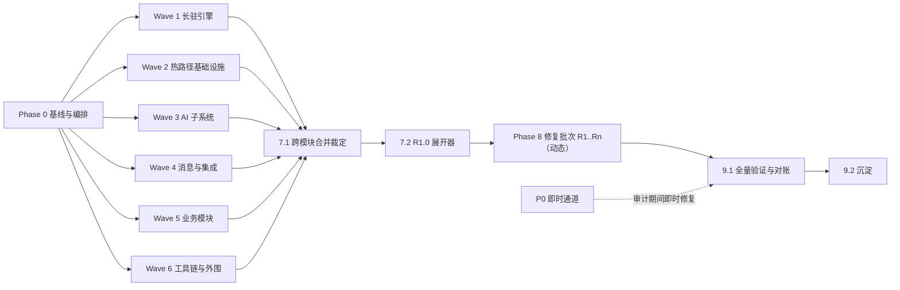

# 并发·异步·资源专项审计与修复 Roadmap（全模块滚动）

> Last updated: 2026-11-01
> Sources: `ai-dev/skills/concurrency-resource-audit-prompt.md`（审计方法论：C1–C10 十维度、F1–F11 缺陷族、归档与发现格式）,
> `ai-dev/skills/deep-audit-prompts.md`（「调度架构」「发现条目完整性守则」两节，审计调度沿用）,
> `ai-dev/skills/audit-remediation-roadmap-authoring-prompt.md`（P0 即时通道、R\*.0 展开器、closure audit 立项机制）,
> `ai-dev/audits/README.md`（审计归档规范、与 plans 的关系）,
> `docs-for-ai/01-repo-map/module-groups.md`（模块分组与依赖）

## 目的

对 nop-entropy **全部 Maven 模块组**执行 `ai-dev/skills/concurrency-resource-audit-prompt.md` 定义的「并发·异步·资源·内存·长时运行」专项深度审计，产出逐模块审计报告；随后基于全部报告做跨模块合并裁定，**分批拟制修复 plan 并执行修复**。终端目标：

1. 每个审计单元产出一份完整的 concurrency 审计目录（C1–C10 维度报告 + `summary.md`），全部 P0/P1 可追溯。
2. 跨模块同族缺陷（F1–F11）合并聚类，消除重复计数，形成全局发现台账。
3. 所有 P0 经即时通道修复；所有 P1 分批修复并通过独立 closure audit；P2 逐项裁决（修 / deferred + successor）。
4. 全量构建与测试保持绿色，owner docs 同步更新。

**与现有 roadmap 的关系**：`security-audit-roadmap`（安全域）、`full-code-review-roadmap`（质量域）、`nop-stream-independent-audit-roadmap`（流引擎专项）覆盖其他维度；本 roadmap 只覆盖并发·异步·资源域。发现重叠时在 7.1 合并裁定阶段去重并 cross-reference，不重复修复。

**当前状态：仅立项，暂不执行。** 全部工作项初始 `todo`。

## 审计方法论（工作内容）

每个审计工作项 = 按 `concurrency-resource-audit-prompt.md` 附录 B 执行一次完整滚动审计：

1. **准备**：读 AGENTS.md、`docs-for-ai/INDEX.md`、该单元 owner doc 与 `ai-dev/design/` 相关设计文档；执行附录 C grep 基线 + 行数统计，圈定重点文件。
2. **维度裁剪**：按「适用判定」表确定维度集合（默认 C1–C10 全选；纯模型/配置/文档类裁剪为 C1+C6；C10 恒放该单元最后批次，因其依赖前序维度产出的缺陷清单）。
3. **派发初审**：各维度并行派发子代理（共享提示词前缀 + 维度正文，`{MODULE}` 已替换）。**盲审纪律**：初审子代理禁止阅读 `ai-dev/audits/`、`ai-dev/plans/`、`ai-dev/bugs/` 历史记录。
4. **深挖迭代**：对初审发现按需追加串行深挖轮次（调度流程沿 `deep-audit-prompts.md`「调度架构」）。
5. **复核与现状标注**：独立子代理复核每条发现（保留/降级/驳回），此阶段才允许对照历史审计标注「新发现 / 已知未修复 / 已修复」。
6. **合并裁定**：单单元内同族相邻发现按「根因 + 失效层」合并，防止同一缺陷被多维度重复计数。
7. **归档**：`ai-dev/audits/{YYYY}-{MM}/{YYYY-MM-DD}-{HHMM}-deep-audit-{单元标识}-concurrency/`，每维度一个文件（`{C编号}-{英文短名}.md`），汇总写 `summary.md`。归档即更新 campaign 索引（`ai-dev/audits/` 下的 cra-index.md，由工作项 0.2 创建）。
8. **closure audit**：独立子代理验证审计目录完整性（维度覆盖、发现格式 ≥10 行字段、F3 失效面枚举非空），通过后工作项方可 `done`。

**发现质量硬约束**（来自审计 prompt，验证 closure audit 时逐条核对）：

- 并发类发现必须写出具体触发时序（T1/T2 交错序列）；写不出的一律降 P2 并标注「理论风险，未具体化」。
- 每条发现必须带 F3 失效面枚举（grep 全部同族兄弟方法/入口并逐一登记），禁止留空。
- 规模判断对照 owner doc 声明的规模包络；超出包络的 OOM 风险单独标注，不与包络内缺陷混排。
- owner doc 明文声明且带 fail-fast 守卫的边界不是缺陷；守卫缺失、文档未声明、守卫可绕过才是。
- 发现条目使用审计 prompt 附录 A 统一格式；全局唯一 ID = `{单元标识}-C{N}-{序号}`。

**修复立项方法论**（沿 `audit-remediation-roadmap-authoring-prompt.md`）：

- **P0 即时通道**：任何审计工作项执行中发现 P0，当即就地修复（plan 内加修复 Phase）或异步注入独立修复 plan，**不得留到批量修复阶段**；在审计报告与 cra-index 中标注修复路径与状态。
- **P1 批量通道**：Phase 7 合并裁定后按批次展开（见 7.2 / Phase 8）。
- **P2 裁决通道**：P2 默认不在修复范围；7.1 逐项裁决为「修（in-scope）/ deferred（必须带 Why Not Blocking + successor 指针）」，结果写回 cra-index 台账。已确认 live 的 must-fix P2 不得降级 deferred。
- **P3**：记录在审计报告，不立项。

## 执行加速指导（分级仪式，2026-11-07 起）

> 本节是本 roadmap 内部的执行效率指导，**不修改 AGENTS.md 与 plan guide 的任何硬规则**；冲突时以 AGENTS.md 为准。
> 两条底线在任何等级下都**不可省略**：① 并发缺陷修复必须先红后绿（红用例或结构钉 + 变异验证至少抽一条链）；② plan 收口必须独立 fresh-session closure audit（禁止自审）。

### 仪式分级

修复 plan 按工单风险定级，按级套用仪式：

- **全仪式（默认）**：改产品代码语义的 Fix 工单、跨模块改动、涉及 Protected Area。完整五 phase：起草 + R1 + R2 + 先红后绿实施 + 独立 closure audit。
- **轻量通道**：同时满足①不改产品代码语义（纯测试加强、断言加固、sleep→deadline 轮询改造、声明面钉）、②单模块内、③不触 Protected Area 的工单束，可合并为：
  - 起草 + 单轮评审（R1 与 R2 合并为一次 fresh-session 评审）；
  - 实施与 closure audit 仍分离，但 closure audit 只抽验 30% 锚点 + 全量 exit criteria 核对。
- **声明面钉通道**：仅改文档声明、注释、LOG 语义、Javadoc 的工单（如 W-09/W-10 类），随宿主 Fix 工单同 diff 落地即可，不独立立项、不单独评审；在 plan 中以工单行登记 + closure audit 抽验一句即可。

### 串行执行与批次合并

- **全部工单一律串行实施**，禁止并行 subagent 实施工单；束内工单按 plan 列出的顺序逐个落地。并发修复共享同一测试面与构建产物，串行是默认安全形态。
- 软依赖批次（如 8.46→8.47）在评审资源允许时可合并为一个 plan 立项，R1/R2/closure audit 的固定开销一次覆盖两批；合并须在 plan 标题与 roadmap 两行状态中互相 cross-reference。合并仍是串行执行，只是减少仪式次数。

### 证据写作压缩

- roadmap 状态单元格只写：状态 + plan 指针 + 一行关键结论（如「10 工单全修，closure audit APPROVED，详见 plan 2539」）。勘误、三方互证、变异链 md5、测试签名等细粒度证据一律留在 plan 文件与审计归档内，roadmap 不复写。
- owner doc 落账保持现状（这是 owner doc 的职责），但同一事实只在一处展开，其余位置用指针。

### 效果基线

以 plan 2539（全仪式、串行、重证据写作）为基线对照；首个按本节执行的批次应在 plan 中记录耗时对比，连续两批无显著改善则本节回炉。

## Work Item Status

> **这是唯一的动态状态块。仅在此处更新状态。**
> Phase 8 修复批次工作项已由 7.2 展开器追加（plan 2494，2026-10-24，74 行）。

### Phase 0 — 基线与编排

| # | Work Item | Status | Owner Doc | Deps | Skill |
|---|-----------|--------|-----------|------|-------|
| 0.1 | 全量绿色基线：`./mvnw clean install -T 1C` 通过，记录基线 commit | done | — | — | none（命令） |
| 0.2 | 初始化 campaign 索引（ai-dev/audits/ 下 cra-index.md：报告清单 + P0 追踪 + P1/P2 台账骨架） | done | `ai-dev/audits/README.md` | 0.1 | none |
| 0.3 | 生成 mission 配置（仓库根 missions/ 目录下 concurrency-audit.json：roadmapPath 指向本文件，路径必须落在 `ai-dev/` 下）并 dry-run 验证 | done | `ai-dev/skills/audit-remediation-roadmap-authoring-prompt.md` 步骤 7 | 0.2 | `audit-remediation-roadmap-authoring-prompt.md` |

### Phase 1 — 审计 Wave 1：长驻引擎与协调器（最高并发风险）

| # | Work Item | Status | Owner Doc | Deps | Skill |
|---|-----------|--------|-----------|------|-------|
| 1.1 | nop-stream 核心（`nop-stream-core` + `nop-stream-runtime`：checkpoint/storage/rpc/transport/health） | done | `docs-for-ai/03-modules/nop-stream.md` | 0.3 | `concurrency-resource-audit-prompt.md`（C1–C5 C7–C10） |
| 1.2 | nop-stream 状态与连接器（`nop-stream-cep` + `nop-stream-rocksdb` + connector/-batch/-jdbc/-debezium/-kafka + `format-avro`） | done | `docs-for-ai/03-modules/nop-stream.md`、`nop-stream-connectors.md` | 0.3 | 同上（C1–C8 + C10） |
| 1.3 | nop-stream 编排薄层（`nop-stream-flow` + `nop-stream-sql` + `fraud-example`，维度裁剪） | done | `docs-for-ai/03-modules/nop-stream-user-guide.md`、`nop-stream-sql.md` | 0.3 | 同上（C1 C3 C6 + 抽查） |
| 1.4 | nop-job（定时调度引擎） | done | `docs-for-ai/03-modules/nop-job.md` | 0.3 | 同上（C1 C2 C4 C5 C7 + C10） |
| 1.5 | nop-wf + nop-task（工作流 / 任务引擎） | done | `docs-for-ai/03-modules/nop-wf.md`、`nop-task.md` | 0.3 | 同上（C1–C5 C7 C8 + C10） |
| 1.6 | nop-retry + nop-tcc（分布式重试 / TCC 事务协调） | done | `docs-for-ai/03-modules/nop-retry.md`、`nop-tcc.md` | 0.3 | 同上（C1 C3 C6 C7 C8 + C10） |
| 1.7 | nop-batch（chunk 批处理、断点续传） | done | `docs-for-ai/03-modules/nop-batch.md` | 0.3 | 同上（C1 C5 C6 C7 C8 + C10） |

### Phase 2 — 审计 Wave 2：热路径基础设施

| # | Work Item | Status | Owner Doc | Deps | Skill |
|---|-----------|--------|-----------|------|-------|
| 2.1 | nop-kernel 并发内核本体（`nop-commons` 的 io.nop.commons.concurrent/cache/pool/lock/ratelimit/semaphore + `nop-core` + `nop-xlang` + `nop-xdefs` 全局模型缓存） | done | `docs-for-ai/02-core-guides/xlang-and-xpl-basics.md`、`ioc-and-config.md` | 0.3 | 同上（C1–C7 C9 C10；唯一审计平台并发设施**自身实现**的工作项） |
| 2.2 | nop-core-framework（IoC/Config/Boot/Plugin 三子模块/Security/Log）+ nop-utils | done | `docs-for-ai/03-modules/nop-plugin.md`、`ioc-and-config.md` | 0.3 | 同上（C1 C2 C4 C6 + C10） |
| 2.3 | 请求热路径：`nop-graphql` + `nop-biz` + `nop-gateway` + `nop-biz-auth-core`/`nop-biz-file-core` | done | `docs-for-ai/02-core-guides/api-and-graphql.md`、`service-layer.md` | 0.3 | 同上（C1–C4 C8 C9 + C10） |
| 2.4 | nop-persistence 读写热路径（`nop-orm` + `nop-orm-eql` + `nop-orm-model` + `nop-dao` + `nop-orm-data`） | done | `docs-for-ai/02-core-guides/model-first-development.md` | 2.1 | 同上（C1–C6 C9 + C10；S 级拆分一） |
| 2.5 | nop-persistence 外围（`nop-dbtool` + `nop-db-migration` + `nop-orm-migration` 五状态机 + `nop-cdc` + `nop-nosql` + orm-drivers/geo/pdm/rpc） | done（closure audit PASS，plan 2472） | `docs-for-ai/02-core-guides/data-migration.md` | 0.3 | 同上（C1 C3 C6 C7 C8 + C10；S 级拆分二） |

### Phase 3 — 审计 Wave 3：AI 子系统

| # | Work Item | Status | Owner Doc | Deps | Skill |
|---|-----------|--------|-----------|------|-------|
| 3.1 | nop-ai-core + nop-ai-agent（LLM 异步调用链、Provider failover、agent 执行引擎） | done（closure audit PASS，plan 2473） | `docs-for-ai/03-modules/nop-ai.md` | 0.3 | 同上（C1 C3 C4 C5 C7 + C10） |
| 3.2 | nop-ai-toolkit + nop-ai-tools + nop-ai-shell（工具执行、进程/沙箱生命周期、mavenvfs） | done（closure audit PASS，plan 2474） | `docs-for-ai/03-modules/nop-ai.md` | 0.3 | 同上（C1 C4 C6 C8 + C10） |
| 3.3 | nop-ai-gateway（channel 长连接、会话存储、failover 路由、扫码登录） | done（closure audit PASS，plan 2475） | `docs-for-ai/03-modules/nop-ai-gateway.md` | 0.3 | 同上（C1–C4 C6 C7 C8 + C10） |
| 3.4 | nop-ai 其余（api/coder/dsl-orm/rag/codegen/dao/meta/service/web/app，裁剪 C1+C6；rag 补 C3 异步检索链） | done（closure audit PASS，plan 2476；Wave 3 收官） | `docs-for-ai/03-modules/nop-ai.md` | 0.3 | 同上（裁剪） |

### Phase 4 — 审计 Wave 4：消息、集群与宿主集成

| # | Work Item | Status | Owner Doc | Deps | Skill |
|---|-----------|--------|-----------|------|-------|
| 4.1 | nop-message 全族（codec/core/kafka/pulsar/debezium：消费 prefetch、ACK 语义、背压） | done（closure audit PASS，plan 2477） | `docs-for-ai/03-modules/nop-message.md` | 0.3 | 同上（C1 C3 C5 C6 C8 + C10） |
| 4.2 | nop-cluster 全族（admin/core/nacos/sentinel/hazelcast/rpc-cluster：RPC 异步、注册表、限流熔断） | done（closure audit PASS，plan 2478） | `docs-for-ai/01-repo-map/module-groups.md` | 0.3 | 同上（C1–C4 C8 + C10） |
| 4.3 | nop-network + nop-integration（HTTP 客户端连接池、MQTT、feishu 连接器） | done（closure audit PASS，plan 2479） | `docs-for-ai/03-modules/nop-network.md` | 0.3 | 同上（C1 C3 C6 + C10） |
| 4.4 | nop-spring（含 spring-mcp-server）+ nop-quarkus（宿主生命周期、类加载、bean 装配并发） | done（closure audit PASS，plan 2480） | `docs-for-ai/01-repo-map/module-groups.md` | 0.3 | 同上（C1 C4 C6 + C10） |
| 4.5 | nop-search（api/core/lucene）+ nop-runner + nop-autotest（测试基建并行执行与资源隔离） | done（closure audit PASS，plan 2481；Wave 4 收官） | `docs-for-ai/01-repo-map/module-groups.md` | 0.3 | 同上（C1 C4 C6 + C10，裁剪） |

### Phase 5 — 审计 Wave 5：业务与可复用模块

| # | Work Item | Status | Owner Doc | Deps | Skill |
|---|-----------|--------|-----------|------|-------|
| 5.1 | nop-auth + nop-credential（会话/token 并发、凭证缓存与加密） | done（closure audit PASS，plan 2482） | `docs-for-ai/03-modules/nop-auth.md`、`nop-credential.md` | 0.3 | 同上（C1 C2 C6 + C10） |
| 5.2 | nop-sys + nop-dyn（序列号、分布式锁、事件队列；动态模型运行时缓存） | done（closure audit PASS，plan 2483） | `docs-for-ai/03-modules/nop-sys.md`、`nop-dyn.md` | 0.3 | 同上（C1 C2 C6 C8 + C10） |
| 5.3 | nop-file + nop-datav（上传下载去重、数据视图） | done（closure audit PASS，plan 2484） | `docs-for-ai/03-modules/nop-file.md` | 0.3 | 同上（C1 C5 C6 + C10） |
| 5.4 | nop-report + nop-format（Excel/OOXML/PDF/office-model 大文件流式 vs 物化；chart/converter/mermaid/svg/tablesaw/record 抽查） | done（closure audit PASS with corrections，plan 2485；P0×0/P1×1/P2×9/P3×15，配额中断恢复执行） | `docs-for-ai/03-modules/nop-report.md` | 0.3 | 同上（C1 C5 C6 C9 + C10；S 级按功能裁剪） |
| 5.5 | nop-rule + nop-metadata（规则引擎决策；元数据 cron 调度、质量检查点、webhook 分发、对账） | done（closure audit PASS with corrections，plan 2486；P0×0/P1×3/P2×9/P3×17 工单级） | `docs-for-ai/03-modules/nop-rule.md`、`nop-metadata.md` | 0.3 | 同上（C1 C4 C5 C7 + C10） |
| 5.6 | nop-graph + nop-duckdb（图算法库；DuckDB 连接单写者约束、CSV/Parquet 读写面） | done（closure audit PASS，plan 2487；P0×0/P1×4/P2×4/P3×4；**Wave 5 收官**，含 WI 2.1 C6-CL-031 移交闭环） | `docs-for-ai/03-modules/nop-duckdb.md` | 0.3 | 同上（C1 C6 + 抽查） |

### Phase 6 — 审计 Wave 6：工具链与外围支撑

| # | Work Item | Status | Owner Doc | Deps | Skill |
|---|-----------|--------|-----------|------|-------|
| 6.1 | nop-tools 并行面：nop-rg + nop-find（FFM/Arena 并行遍历、SIMD）+ nop-bytecode | done（closure audit PASS with corrections，plan 2488；P0×0/**P1×0**[campaign 首例]/P2×4/P3×13） | `docs-for-ai/03-modules/nop-bytecode.md` | 0.3 | 同上（C1 C4 C6 C9 + C10） |
| 6.2 | nop-tools 解析面：nop-treesitter + nop-lint + nop-refactor + nop-jq | done（closure audit PASS with corrections，plan 2489；P0×0/P1×2/P2×7/P3×10；2026-09 G10 承接闭环） | `docs-for-ai/03-modules/nop-treesitter.md`、`nop-refactor.md` | 0.3 | 同上（C1 C6 + 抽查） |
| 6.3 | nop-code 索引面（`nop-code-core` + `nop-code-flow` + `nop-code-service`：长驻索引构建、图分析） | done（closure audit PASS with corrections，plan 2490；P0×0/P1×3/P2×16/P3×21；G11-15-02 承接闭环） | `docs-for-ai/03-modules/nop-code.md` | 0.3 | 同上（C1 C5 C6 C7 + C10；S 级拆分一） |
| 6.4 | nop-code 其余（lang-java/python/typescript/go/rust/csharp + codegen + api/dao/meta/web/app，裁剪） | done（closure audit PASS，plan 2491；**零立案 campaign 首例**；G11-03-01 闭环） | `docs-for-ai/03-modules/nop-code.md` | 0.3 | 同上（C1 C6 抽查；S 级拆分二） |
| 6.5 | 外围支撑抽查：nop-demo + demo + nop-frontend-support + nop-dev-tools + nop-entropy-e2e（C1+C6 抽查；nop-benchmark 不审——基准代码按审计 prompt 误报校准不按生产标准，仅当其暴露生产代码缺陷时转记台账） | done（closure audit PASS with corrections，plan 2492；P0×0/P1×2/P2×4/P3×5 工单级+C10 缺保护 6；**初审审计阶段收官 WI 1.1–6.5 全部完成**） | — | 0.3 | 同上（C1+C6 抽查） |

### Phase 7 — 合并裁定与修复立项

| # | Work Item | Status | Owner Doc | Deps | Skill |
|---|-----------|--------|-----------|------|-------|
| 7.1 | 跨模块合并裁定：同族缺陷按 F1–F11 × 模块聚类；跨报告重复发现消解；历史「已知未修复」并入台账；P2 逐项裁决（修 / deferred + successor）；P3 归档；产出**修复批次划分提案**（批次边界、依赖顺序、每批 exit criteria） | done（closure audit PASS with corrections，plan 2493；P1×179 入批/P2 修 483+deferred 77/74 批次记录+R-G 治理批，B1-04 计数联动 P1 180/P2 559） | ai-dev/audits/ 下 cra-index.md（campaign 台账） | 1.1–6.5 全部 done | `audit-remediation-roadmap-authoring-prompt.md` 步骤 2/5 |
| 7.2 | R1.0 展开器：依据 7.1 提案在本 roadmap 追加 Phase 8 修复批次工作项行（每行引用 finding ID 清单作为 Deps） | done（closure audit PASS with corrections，plan 2494；74 行[8.1–8.74]已追加，8.74=R-G 治理批） | 本文件 | 7.1 | `audit-remediation-roadmap-authoring-prompt.md` R\*.0 机制 |

### Phase 8 — 分批修复（由 7.2 展开器生成，plan 2494）

> 批次划分由 7.1 提案确定，建议排序原则：
> R1 = P0 收尾确认 + 跨模块同族 P1（先修基础设施层，下游模块一次受益）→
> R2 = 基础设施/平台服务剩余 P1 → R3 = 业务模块 P1 →
> R4+ = P2 裁决为修的项 + C10 登记的测试保护力缺口。
> 每批 = 一份 plan（修复 + 回归测试 + owner doc 更新），独立 closure audit 后整批 done。

| # | Work Item | Status | Owner Doc | Deps | Skill |
|---|-----------|--------|-----------|------|-------|
| 8.1 | R1-00 P0 收尾确认批（3 项已修 P0 回归确认） | done（closure audit PASS，plan 2495；三 focused 测试全绿+scan-hollow 0+impl 叶冻结维持） | `docs-for-ai/03-modules/nop-stream-connectors.md`；`docs-for-ai/03-modules/nop-network.md`；nop-persistence 无 owner doc→缺口声明 | batch-proposal.md §二 R1-00（3 项） | none（修复 plan） |
| 8.2 | R1-01 周期任务异常绝缘层批（R04 平台批） | done（closure audit PASS with corrections，plan 2496；14 项全修+nop-kernel 绝缘层本体+30 点表 12/16/2 处置，R1 旗舰批落地） | `docs-for-ai/03-modules/nop-job.md`；`docs-for-ai/03-modules/nop-batch.md`；`docs-for-ai/04-reference/source-anchors.md`（2.1-C3-001 30 点绝缘状态表锚点） | batch-proposal.md §二 R1-01（14 项） | none（修复 plan） |
| 8.3 | R1-02 平台池设施面批：globalTimer 死配置 + 池工厂（R13 设施） | done（closure audit PASS，plan 2497；5 项全修+池工厂 fail-fast+cached 上界熔断+收缩重排+nop-config 卸载，R1-03 硬依赖解除前置就绪） | `docs-for-ai/04-reference/source-anchors.md`（GlobalExecutors/globalTimer 锚点）；`docs-for-ai/03-modules/nop-job.md`（调度契约） | batch-proposal.md §二 R1-02（5 项） | none（修复 plan） |
| 8.4 | R1-03 平台池消费方批：隔离/卸载落地（R13 使用方） | done（closure audit PASS，plan 2498；9 项全修+A4/A5/D3/D4/SocketServer 承接面落账+MA-16 约束解除，六分片 24+ 新回归测试） | `docs-for-ai/03-modules/nop-stream-connectors.md`；`docs-for-ai/03-modules/nop-task.md`；`docs-for-ai/02-core-guides/service-layer.md`；`docs-for-ai/03-modules/nop-ai.md` | batch-proposal.md §二 R1-03（9 项）；硬依赖 8.3（R1-02） | none（修复 plan） |
| 8.5 | R1-04 api-core 协同批：bindCancel 单点改造 + 上下文传播（R14+R15） | done（closure audit PASS with corrections，plan 2499；14 项全修+bindCancel 双层同提交+C3-004 后置接入[git 序列可证]+上下文统一五入口零改码，SPI ×11 回归面留证） | `docs-for-ai/04-reference/source-anchors.md`（api-core 锚点）；`docs-for-ai/02-core-guides/service-layer.md` | batch-proposal.md §二 R1-04（14 项） | none（修复 plan） |
| 8.6 | R1-05 缓存失效传播链批（R24） | done（closure audit PASS，plan 2500；四成员单点收敛+宽限锚写入年龄修订[Phase 3 载体修订三态证据]+TestXplTask 恢复，G24 仅成员面收敛） | `docs-for-ai/04-reference/source-anchors.md`（模型缓存锚点） | batch-proposal.md §二 R1-05（4 项） | none（修复 plan） |
| 8.7 | R1-06 沙箱/shell 工具执行链批（R09 沙箱清理族 + B1-03/B1-04 回升行） | done（closure audit PASS，plan 2501；7 项全修+B1-04 落账确认+B1-03 MA-06 维持 P1 条款锚点裁定，反向钉 R4 全组正面改写） | `docs-for-ai/03-modules/nop-ai.md` | batch-proposal.md §二 R1-06（7 项） | none（修复 plan） |
| 8.8 | R1-07 F4 账本保留统一批（R01 统一批次面，ledger §二#3） | done（closure audit PASS，plan 2502；六成员全修+族级 SSOT 一处定稿[统一参数集七项]零分叉+ask-first 三处合规+trusted-device 第七面保守摘除归 R3-01） | `docs-for-ai/03-modules/nop-retry.md`；`docs-for-ai/03-modules/nop-batch.md`；`docs-for-ai/03-modules/nop-credential.md`；`docs-for-ai/03-modules/nop-rule.md`；`docs-for-ai/03-modules/nop-duckdb.md`；`docs-for-ai/03-modules/nop-sys.md` | batch-proposal.md §二 R1-07（6 项） | none（修复 plan） |
| 8.9 | R1-08 Debezium 双轨与消息交付语义批（R16/R17/R18 面，B1-05 三案） | done（closure audit PASS，plan 2503；六成员全修+B1-05 三案 P1 落账+R4-24 REGISTRY 契约前置就绪+对齐注记组五处） | `docs-for-ai/03-modules/nop-stream-connectors.md`；`docs-for-ai/03-modules/nop-message.md`；`docs-for-ai/03-modules/nop-stream-cdc-cookbook.md` | batch-proposal.md §二 R1-08（6 项） | none（修复 plan） |
| 8.10 | R2-01 2.1 kernel 剩余批：退役代际族 + RCE 死锁族 | done（closure audit PASS，plan 2504；7 项全修+退役代际平台机制 ResourceRetirementQueue+LoadWaitGraph 环检测+G24 缺陷族整组 fixed 解除+2.5-C6-005 双轨联动） | `docs-for-ai/04-reference/source-anchors.md`；`docs-for-ai/02-core-guides/ioc-and-config.md` | batch-proposal.md §二 R2-01（7 项） | none（修复 plan） |
| 8.11 | R2-02 流式取消/期限两侧同批（R14 消费面 + R05/R06/R11/R21 相邻） | done（closure audit PASS with corrections，plan 2505；5 项全修+两侧同批端到端四场景真实全链绿+PA 面①批内闭环 nop-http-api） | `docs-for-ai/03-modules/nop-ai.md`；`docs-for-ai/03-modules/nop-network.md` | batch-proposal.md §二 R2-02（5 项）；软依赖 8.5（R1-04） | none（修复 plan） |
| 8.12 | R2-03 2.2 插件生命周期/配置源/Shell 批 | done（closure audit PASS，plan 2506；6 项全修+双锁单向序/回调延迟契约/forceUnload 恢复 API/PluginClassLoader 构造期自清理+批前既有 HMR 伪 reload 承接[plan 2500 宽限期消费边界]） | `docs-for-ai/02-core-guides/ioc-and-config.md`；`docs-for-ai/04-reference/source-anchors.md` | batch-proposal.md §二 R2-03（6 项） | none（修复 plan） |
| 8.13 | R2-04 2.2 IoC 启动图/死锁 + 配置发布协议批（R22 刷新链） | done（closure audit PASS，plan 2507；7 项全修[2.2×4+2.5×3]+join 失败传导/getBean0 等待图环检出+有界获取/配置发布 holder 单发布/写门租约 fail-open 观察即起租+实施期 setClosed(false) 清零缺口修复；api-core 零签名 SPI 面全绿） | `docs-for-ai/02-core-guides/ioc-and-config.md`；`docs-for-ai/04-reference/source-anchors.md` | batch-proposal.md §二 R2-04（7 项） | none（修复 plan） |
| 8.14 | R2-05 2.3 服务热路径剩余批（R05 SSO + R25 重试放大） | done（closure audit PASS，plan 2508；2 项全修——SSO 刷新异步化[default 方法 + beans 接线 + runOnContext 再入链序] + Gateway 准入上界[共享许可池 + 拒绝按落点钉死 + equal jitter]；nop-auth-sso 触碰 PA 裁定执行形态改造） | `docs-for-ai/02-core-guides/service-layer.md` | batch-proposal.md §二 R2-05（2 项） | none（修复 plan） |
| 8.15 | R2-06 流式缓冲批 A（chain25/R02 双实现分叉，3.3 同文件批 A） | done（closure audit PASS，plan 2509；11 项全修——共享泛型缓冲核 BoundedWindowBuffer 收敛双实现分叉 + 溢出不可重试终态 + attempt 漏斗配对 + pendingComplete 对齐 + drain-loop 出锁投递 + allowCall 双面收敛[cooldownElapsed 只读追加] + C3-007 宿主半边） | `docs-for-ai/02-core-guides/service-layer.md`；`docs-for-ai/03-modules/nop-ai-gateway.md` | batch-proposal.md §二 R2-06（11 项） | none（修复 plan） |
| 8.16 | R2-07 1.1 stream-core 批（并发正确性 + 资源包络） | done（plan 2510 completed @ 2026-10-29，closure audit APPROVED） | `docs-for-ai/03-modules/nop-stream.md`；`docs-for-ai/03-modules/nop-stream-user-guide.md` | batch-proposal.md §二 R2-07（10 项） | none（修复 plan） |
| 8.17 | R2-08 1.2 连接器批 | done（plan 2511 completed @ 2026-10-30，closure audit APPROVED） | `docs-for-ai/03-modules/nop-stream-connectors.md` | batch-proposal.md §二 R2-08（7 项） | none（修复 plan） |
| 8.18 | R2-09 1.3 编排薄层批 | done（plan 2512 completed @ 2026-10-30，closure audit APPROVED） | `docs-for-ai/03-modules/nop-stream.md`；`docs-for-ai/03-modules/nop-stream-sql.md` | batch-proposal.md §二 R2-09（4 项） | none（修复 plan） |
| 8.19 | R2-10 1.4 job 批 | done（plan 2513 completed @ 2026-10-31，closure audit APPROVED） | `docs-for-ai/03-modules/nop-job.md` | batch-proposal.md §二 R2-10（2 项） | none（修复 plan） |
| 8.20 | R2-11 1.5 task/wf 批 | done（plan 2514 completed @ 2026-10-31，closure audit APPROVED） | `docs-for-ai/03-modules/nop-task.md`；`docs-for-ai/03-modules/nop-wf.md` | batch-proposal.md §二 R2-11（6 项） | none（修复 plan） |
| 8.21 | R2-12 1.6 tcc 批（CAS/守卫 + 补偿/账本卫生） | done（plan 2515 completed @ 2026-10-31，closure audit APPROVED） | `docs-for-ai/03-modules/nop-retry.md`；`docs-for-ai/03-modules/nop-tcc.md` | batch-proposal.md §二 R2-12（13 项） | none（修复 plan） |
| 8.22 | R2-13 1.7 batch 批 | done（plan 2516 completed @ 2026-10-31，closure audit APPROVED） | `docs-for-ai/03-modules/nop-batch.md` | batch-proposal.md §二 R2-13（8 项）；硬依赖 8.2（R1-01）+8.20（R2-11，勘误申报 @ 2026-10-30：原 Deps 列缺；fencing 引用 plan 2514 设计文档不重建） | none（修复 plan） |
| 8.23 | R2-14 2.4 ORM 并发批（会话/事务互斥 + 模型发布/缓存/异步） | done（plan 2517 completed @ 2026-10-31，closure audit APPROVED） | `docs-for-ai/02-core-guides/model-first-development.md`；`docs-for-ai/04-reference/source-anchors.md` | batch-proposal.md §二 R2-14（13 项） | none（修复 plan） |
| 8.24 | R2-15 2.5 peri 批（PubSub 断链 + 链编排 fencing） | done（plan 2518 completed @ 2026-10-31，closure audit APPROVED；勘误 10：C7-014 F5 前提证伪收窄为可观测缺失，cra-index 行已改写） | `docs-for-ai/02-core-guides/model-first-development.md`（迁移 owner 面）；`docs-for-ai/04-reference/source-anchors.md` | batch-proposal.md §二 R2-15（11 项） | none（修复 plan） |
| 8.25 | R2-16 3.1 agent 编排/会话批 | done（plan 2519 completed @ 2026-10-31，closure audit APPROVED；勘误 12/13 事实口径修订随行） | `docs-for-ai/03-modules/nop-ai.md` | batch-proposal.md §二 R2-16（10 项）；硬依赖 8.5（R1-04）；软依赖 8.3（R1-02）；软依赖 8.4（R1-03）；软依赖 8.7（R1-06） | none（修复 plan） |
| 8.26 | R2-17 3.4 AI REST 批 | done（plan 2520 completed @ 2026-11-01，closure audit APPROVED；E3 全聚合通道 4 轮被零 diff 上游已知 flake 阻断，等价分解通道[触达双模块 solo+全仓编译级]留痕） | `docs-for-ai/03-modules/nop-ai.md` | batch-proposal.md §二 R2-17（4 项） | none（修复 plan） |
| 8.27 | R2-18 4.2 cluster 批（选主/注册中心/重试链） | done（plan 2521 completed @ 2026-11-01，closure audit APPROVED with corrections[2 Minor 登记级已闭环]；E3 r1 nop-core flake 三联留痕 r2 全链绿；模块外焦点腿 SysDao+stream-runtime 含 HA 补跑全绿） | nop-cluster 无 03-modules owner doc→缺口声明（module-groups.md 集群基础设施行已落）；`docs-for-ai/01-repo-map/module-groups.md` | batch-proposal.md §二 R2-18（4 项） | none（修复 plan） |
| 8.28 | R2-19 4.3 feishu/文件通道批（B1-07/B1-08 转正 + R05/R11/R08 面） | done（plan 2522 completed @ 2026-11-01，closure audit APPROVED[2 Minor 登记级随手更正]；E3 r1 nop-core flake 三联 r2 全链绿；E3 盲区焦点腿 feishu 56+sftp 19 全绿；B1-07/B1-08 P1 转正落账+对称条款在案；裁定⑥ nop-http-api 单文件 plan-first 申报闭环） | `docs-for-ai/03-modules/nop-network.md` | batch-proposal.md §二 R2-19（7 项） | none（修复 plan） |
| 8.29 | R2-20 4.3 连接生命周期批（B1-06 + R26/R08 面） | done（plan 2523 completed @ 2026-11-01，closure audit APPROVED with corrections[两 Major 闭环]；C6-019 判定修正[SDK 无 shutdown/close 前提证伪]；E3 r1 nop-core flake 三联 final 全链绿；F1 HC5 ioThreadCount 缺省勘误随行） | `docs-for-ai/03-modules/nop-network.md` | batch-proposal.md §二 R2-20（6 项） | none（修复 plan） |
| 8.30 | R2-21 4.4 host 批 | done（plan 2524 completed @ 2026-11-01，closure audit APPROVED with corrections[4 Major+6 Minor 全闭环]；E3 r1 nop-core flake 三联 r6 全链绿；E3 验证命令 live 裁定 = nop-spring,nop-quarkus 双聚合器） | nop-host 无 03-modules owner doc→缺口声明（module-groups.md 宿主集成行已落）；`docs-for-ai/01-repo-map/module-groups.md` | batch-proposal.md §二 R2-21（4 项）；软依赖 8.5（R1-04）；软依赖 8.2（R1-01） | none（修复 plan） | nop-host 无 03-modules owner doc→缺口声明；`docs-for-ai/01-repo-map/module-groups.md` | batch-proposal.md §二 R2-21（4 项）；软依赖 8.5（R1-04）；软依赖 8.2（R1-01） | none（修复 plan） |
| 8.31 | R3-01 5.1 auth 凭据批 | todo（**blocked: nop-auth ask-first 待授权**——2026-11-01 AskUserQuestion 询问全批 6 项授权 + trusted-device 第七面清扫纳入，未获回复；沿 plan 2502 R1 先例保守不实施、不自设授权；执行顺序跳至 8.32，回询获授权后立项） | `docs-for-ai/03-modules/nop-credential.md`；`docs-for-ai/03-modules/nop-auth.md` | batch-proposal.md §二 R3-01（6 项）；**PA=nop-auth ask-first（全批）** | none（修复 plan） |
| 8.32 | R3-02 5.2 sys-dyn 批 | done（plan 2525 completed @ 2026-11-02，closure audit APPROVED[2 Minor 随收口修正闭环]；E1 快速通道 EXIT=0 + E3 双通道至勘误 5 面①/面③阻断面留痕 + 分解通道 196 tests 0F0E1S 等价验收；勘误随行：C10 锚点勘误[cra-index → inventory-p2-c10 :626/:809]、install 通道增补、C2-004/C2-007 前提证伪改特征钉、裁定⑨实体级删除改模块级通道重生成） | `docs-for-ai/03-modules/nop-sys.md`；`docs-for-ai/03-modules/nop-dyn.md` | batch-proposal.md §二 R3-02（10 项） | none（修复 plan） |
| 8.33 | R3-03 5.3 file-datav 批 | done（plan 2526 completed @ 2026-11-02，closure audit APPROVED with corrections[2 Major+4 Minor 全闭环]；E1 EXIT=0 + E3 双通道至面①阻断面[solo 三联绿]/file 全绿 + 分解通道 ChatBI 排除形态验收；勘误随行：ChatBI 20-red 恒红面=plan 2501 跨批遗留移交 ChatBI 后续工单、三处非 orm 条件申报全未触发、race 钉 existsTable 并行分发 flake 裁定+接缝硬化归 R-G、nop-datav.md owner doc 新建缺口声明兑现） | `docs-for-ai/03-modules/nop-datav.md`（新建）；`docs-for-ai/03-modules/nop-file.md` | batch-proposal.md §二 R3-03（14 项） | none（修复 plan） |
| 8.34 | R3-04 5.4 report-format 批 | done（plan 2527 completed @ 2026-11-02，closure audit APPROVED[2 Minor watch-only]；10 项全修+红①–红⑩留证；勘误注记：E3 验证命令 live 裁定=双通道[nop-format -am 全链绿/nop-report -am 阻断面① solo 三联绿]+分解通道 774 tests 0F0E 7S、C9-002 校准注记落 owner doc、plan 2516 物化残留由本批收敛[nop-batch.md 改写，batch DSL maxCountPerSheet 配置位登记 follow-up]、nop-format owner doc 缺口声明维持随 R-G[契约暂承载于 nop-report.md]、执行期发现同行 NPE+转换器自环竞态面同批修复） | `docs-for-ai/03-modules/nop-report.md`（nop-format 无 owner doc→缺口声明随 R-G） | batch-proposal.md §二 R3-04（10 项） | none（修复 plan） |
| 8.35 | R3-05 5.5 rule-metadata 批 | done（plan 2528 completed @ 2026-11-02，closure audit APPROVED with corrections[1 Minor 锚点行号随收口更正]；9 工单+W-02 第七面承接全修，红①–红⑩留证；勘误注记：E3 双通道阻断面①[nop-core flake solo 三联绿]/③[MFA TOTP 恒红]均零 diff 面，分解通道 1452 tests 0F0E0S；W-28 仅契约注记[P3 条款]；ledger-retention-policy 第七面判据修订性扩展[CREATED 零步残量通道]；W-06 deferred/W-11 批前收口维持） | `docs-for-ai/03-modules/nop-rule.md`；`docs-for-ai/03-modules/nop-metadata.md` | batch-proposal.md §二 R3-05（9 项） | none（修复 plan） |
| 8.36 | R3-06 5.6 graph-duckdb 批 | done（plan 2529 completed @ 2026-11-03，closure audit APPROVED with corrections[3 Minor 随收口闭环]；6 工单+W-10 声明面全修，12 新钉红绿留证；勘误注记：E3 验证命令 live 裁定=三通道[nop-graph -am 全链绿/nop-duckdb -am 阻断面① solo 三联绿/nop-code -am 阻断面③ MFA 恒红]+分解通道 719 tests 0F0E 14S；W-06 nop-graph-api plan-first 四件证据链闭合；nop-graph owner doc 缺口声明维持随 R-G；W-04/6.3-W-03 归 8.37） | `docs-for-ai/03-modules/nop-duckdb.md`（nop-graph owner doc drift→缺口声明随 R-G） | batch-proposal.md §二 R3-06（6 项） | none（修复 plan） |
| 8.37 | R3-07 Leiden 交叉批（6.3↔5.6 两侧同批） | done（plan 2530 completed @ 2026-11-03，closure audit APPROVED[2 Minor watch-only]；2 工单=4 实体全修，9 新钉红绿留证[红① 编译期+代核双形态红证]；勘误注记：E3 双通道阻断面①[solo 三联绿 flake]/③[MFA 恒红]均零 diff 面，分解通道 661 tests 0F0E 14S；红①(c) 幽灵扫描窗物理不可行→扫描窗与执行窗重叠最小偏离登记；writer 面 residual 两条款落 owner doc[维持零触碰，阻塞获取归 follow-up]；软依赖 8.39/8.71 方向保持） | `docs-for-ai/03-modules/nop-code.md`；`docs-for-ai/03-modules/nop-duckdb.md` | batch-proposal.md §二 R3-07（2 项） | none（修复 plan） |
| 8.38 | R3-08 6.2 tools-parse 批 | done（plan 2531 completed @ 2026-11-03，closure audit APPROVED with corrections[4 Minor 文档/记账级随收口订正]；8 工单+3 P3 激活面全修，24 新钉红绿留证[红证形态分级：确定性 5+概率 loop-捕获 3+编译期结构钉]；勘误注记：E3 双通道阻断面①[solo 三联绿 flake]/26E 恒红面本体[同签名]均零 diff 面，分解通道 2638 tests 26E/3S 逐类逐数零漂移；触发面计数收口勘误 10→11[NopRefactorException 载体]；W-06 G87 deferred/W-13~W-19 登记级维持；路径 X 残差 watch-only） | `docs-for-ai/03-modules/nop-refactor.md`；`docs-for-ai/03-modules/nop-treesitter.md`（nop-lint/nop-jq owner doc drift→R-G） | batch-proposal.md §二 R3-08（8 项） | none（修复 plan） |
| 8.39 | R3-09 6.3 code-index 批 | done（plan 2532 completed @ 2026-11-05，closure audit APPROVED[唯一 Minor watch-only：loader 截断标志恰等上界边界保守误报，与 warnIfCapped 先例同语义]；2 工单 P1×2 全修+W-28/C5-R2-006 收敛面随批，13 新钉红绿留证；勘误注记：E3 -am 阻断面①[solo 三联绿 flake]零 diff 面，分解通道 621 tests 0F0E 14S；2530 单飞门零交集+三动作调用点/GraphMetricMaterializer 零 diff；8.71 软依赖解除[下游方向保持]） | `docs-for-ai/03-modules/nop-code.md` | batch-proposal.md §二 R3-09（2 项）；软依赖 8.37（R3-07）——**8.37 已 done（plan 2530），软依赖解除** | none（修复 plan） |
| 8.40 | R3-10 6.5 peripheral 批（CL-301 通道批） | done（plan 2533 completed @ 2026-11-06，closure audit APPROVED with corrections[2 Major+7 Minor 随收口落盘闭环]；6 工单 P1×2+P2×4 全修+CL-201/CL-204 伴生+CL-301 通道裁定落档[W-02/W-05=②sink 兑现——验证通道更新为 Maven 门禁内、W-03=③harness 留痕+Maven 变异/回退论证、W-07=宣读、①归 R-G]；红①–红⑥ 先红后绿留证[nop-js 13+nop-dev-tools 聚合 19 全绿零回退，E1 全量 BUILD SUCCESS，批行通道 1 阻断面① solo 三联绿归因/通道 2 全绿]；勘误注记：K1–K9/N1–N3 设计勘正为修复形态最高权威[K3 registerXlib per-project 不入计数集/K6 闩控确定性/K8 纪元 resume 侧推进]、执行期批外新发现 N4[SimpleRpcClient 覆写工厂回调]零触碰 watch-only、W-05 接线与 CL-204 组合行为=Gradle 验证盲区如实登记[closure audit M-2]） | —（nop-dev-tools 无 owner doc→缺口声明（6.5 四模块无 owner doc 整体登记→R-G）） | batch-proposal.md §二 R3-10（6 项） | none（修复 plan） |
| 8.41 | R4-01 1.1 流核并发正确性束（G01） | done（plan 2534 completed @ 2026-11-07，closure audit APPROVED with corrections[agent_15b22cc7 fresh session]；15 工单+W-13 覆盖集 12 站[⑥ INFO→WARN 升级随批]+C10 八条+1.2-C10-006 rocksdb 受害侧钉全修；红①–⑧+E2 泛在钉先红后绿留证[组A/B 原始 trial 日志灭失勘误登记——蒸馏总册重建+repo 钉断言存证]；勘误注记：签名 core 1999/runtime 1242[11S]/rocksdb 143/三模块首验 311[16S]；E1 排除形态 EXIT=0[已知面⑥：m2 清空后 nop-ai-translate 外部 artifact 缺失→cli 双模块排除，2526 先例]+批行 -am 面① 阻断 solo 三联绿；执行期发现组C/D 半写损坏三处修复+gate-inventory close 登记+TestObservabilityWiringE2E 按 E.2 契约改形非弱化+W-15 回退键形 registered deviation；组A/B 布点计数勘误[8 文件 27 调用式]） | `docs-for-ai/03-modules/nop-stream.md` | batch-proposal.md §二 R4-01（15 项）；软依赖 8.16（R2-07）——**8.16 已 done（plan 2510），软依赖解除**；裁定①–⑪与三范式/溢出语义结论见 `ai-dev/design/concurrency/stream-core-concurrency-and-resource-envelope.md` 可引用为既有裁定 | none（修复 plan） |
| 8.42 | R4-02 1.1 资源包络 + FAM-2 束（G02+G03） | done（plan 2535 completed @ 2026-11-07，closure audit APPROVED with corrections[agent_19c76625 fresh session]；7 工单全修+W-13 式红线零回退；红①③④⑤+红②+E2×2 先红后绿留证[总册 _tmp/red-green-ledger-2535.md]；勘误注记：W-04 偏离预设② 采声明降级[K7 前提证伪]+W-05 K5 AdaptingConsumer aware 偏离+W-07 per-execution 实例[评审 F-2 证伪 task-local 零填充假事实/评审 F-1 构造点 13→20+SupervisionLoop 义务]；签名 core 2003/runtime 1253 11S 排除通道[full fork 超时=已知面③同形]/rocksdb 143；E1 排除形态 EXIT=0+批行 -am 面① solo 三联绿；closure audit Major-1=Phase 1 设计文档三处回填锚点失配静默未落——随收口补齐+勘误登记） | `docs-for-ai/03-modules/nop-stream.md` | batch-proposal.md §二 R4-02（7 项）；软依赖 8.16（R2-07）——**8.16 已 done（plan 2510），软依赖解除**；裁定①–⑪与三范式/溢出语义结论见 `ai-dev/design/concurrency/stream-core-concurrency-and-resource-envelope.md` 可引用为既有裁定 | none（修复 plan） |
| 8.43 | R4-03 1.2 连接器 MA 束 + 包络声明（G05+G09） | done（plan 2536 completed @ 2026-11-07，closure audit APPROVED with corrections[agent_ec84fc86 fresh session]；12 工单全修；红①–红⑫ 先红后绿[编译红+结构 grep+行为红形态绑定裁定 E·E-2536-3 虚拟线程校准腿·E-2536-7 四钉编译红承载]；勘误注记：W-02 负缓存 carve-out[F-1]/W-04 偏离预设② 声明降级沿 2535 B.2 先例[K7]/W-03 宿主接线降 WI18 预留[F3 生产零构造点]/W-09 runtime 两行接线偏离[D.2]+hashPolicy new-only 缺省；签名 rocksdb 153/cep 394/core 2008 1S/avro 14/jdbc 71/connector 116/debezium 76/runtime 1253 11S；E1 排除形态 EXIT=0+批行 -am 阻断面勘正[实际=nop-commons 1F solo 三联绿[closure audit Major-D2]+nop-core solo 间歇形态 run1 红后连 5 绿加跑留痕]；closure audit Major-D1=red-GC/GD-compile 原始日志灭失勘误登记[存证重指向 structure-grep+stash 留痕+校准腿]） | `docs-for-ai/03-modules/nop-stream-connectors.md` | batch-proposal.md §二 R4-03（12 项）；软依赖 8.17（R2-08） | none（修复 plan） |
| 8.44 | R4-04 1.2 并发正确性 + 失败路径泄漏束（G07+G08） | done（plan 2537 completed @ 2026-11-07，closure audit APPROVED with corrections[agent_599ed925 fresh session]；11 工单全修[W-02 认领注册表 M1 所有权判定+MJ-1 pre-try 复位/W-05 close 三分段[MJ-2]/W-08 清扫[MJ-3 白名单改述+合法在途反例腿]/W-11 TTL 移植 setter 形态]；红①–红⑪ 先红后绿[红⑥ compile-red 三件套+总册副本登记 MN-6a/红⑨ 80fds 直证/红⑦ 变异四相 md5]；签名 kafka 30/batch 66/debezium 85 6S/connector 123/rocksdb 162/core 2008 1S/runtime 1253 11S/聚合 4508=4481+27 自洽；E1 排除形态 EXIT=0+批行 -am 面① solo 三联绿；closure audit Major-1=W-11 文档键形订正[setter 非配置键]+Minor 3 条随收口；执行期发现 E-2537-1~8 登记[armed 腿重定义/kill-recover drive-order 适配断言零改写等]） | `docs-for-ai/03-modules/nop-stream-connectors.md` | batch-proposal.md §二 R4-04（11 项）；软依赖 8.17（R2-08） | none（修复 plan） |
| 8.45 | R4-05 1.3 Replay/流语义束（G11） | done（plan 2538 completed @ 2026-11-07，closure audit APPROVED with corrections[agent_8537a70b fresh session]；10 工单全修；红①–红⑩ 先红后绿[红⑧ 变异四相 md5 链/红⑥ 缝腿编译红+linger/barrier 双窗行为红]；C10-005 同 diff 兑现[注入 FAILED 断言+`:130` 零改写]+C10-006 反向钉零回退亲证+C10-008 两半边搭车消号[C3-007 半边维持 R-G]；勘误注记：E-2538-1 裁定 B.1 xdef round-trip live 证伪[expr 域 IEvalAction 编译态不可往返+getFields 空 map]→模块内结构拷贝等价机制[契约零变化]/E-2538-2 既有 4 用例消耗语义钉按新契约改形[输出级 oracle 非弱化，rename 覆盖由 fragmentIdCollisionFailsFast 间接承载]/E-2538-3 union map 装配点冻结补齐[closure audit Major-1=总册红⑥ 红证引证勘误随收口落盘+Minor 5 条文本级]；签名 flow 325/sql 185/fraud-example 135[+新钉]=基线+新钉自洽；E1 排除形态 EXIT=0[已知面⑥]+批行 -am 阻断面 nop-commons flake solo 三联归因[已知面①同族异站]+分解通道已知面③⑤等价验收；执行期 harness 归因迭代登记于总册组 C 节） | `docs-for-ai/03-modules/nop-stream.md`（编排薄层并发契约扩展节随批落账）；`docs-for-ai/03-modules/nop-stream-sql.md`（§3a 生命周期句+缓存包络随批落账） | batch-proposal.md §二 R4-05（10 项）；软依赖 8.18（R2-09）——**8.18 已 done（plan 2512 completed @ 2026-10-30），软依赖解除**[勘误 4 注记补登] | none（修复 plan） |
| 8.46 | R4-06 1.4 调度账本束 a（G13 前半） | done（plan 2539 completed @ 2026-11-07，closure audit APPROVED with corrections[agent_0fa977eb fresh session]；10 工单全修[9 Fix+W-03 Proof 核验——勘误 1 机制改写：2513 ctx 真快照已闭合主面]；红①–红⑩ 先红后绿[run8 8 红用例+变异四相 4 链 md5 一致；红①② 概率腿行为红未命中诚实登记→结构钉+变异腿承载]；C10-004 兑现=三锚点 MJ-1 谓词六断言组随 W-08 同 diff+C10-007 兑现=单类两腿随 W-02/W-07 同 diff+`:471` 叠加非替代；C10-009 触达兑现=三处 sleep→deadline 轮询[断言零改写]；**C10-006/008 随宿主 C7-011/C5-002 落 R4-07 承接**[勘误 3]；勘误注记：W-03/W-08 两工单机制改写登记[live×2513 产物×审计原文三方互证]+E-2538 同形执行期发现 BF-1[suspend 被完成回调静默撤销——watch-only 登记后续余量轮]+E3 真实三跑序列登记[steadyState 竞态修复+codegen jar 竞态[E1 并发所致]+全绿]；签名 local 69/core 146/coordinator 213 2S/worker 49+分解通道 644 0F0E 2S 全绿；E1 排除形态 EXIT=0[已知面⑥]；closure audit 4M+5m 全随收口落盘[Major-2 三处 sleep 改造落地/Major-3 浅拷贝声明句/Major-4 日志补写]） | `docs-for-ai/03-modules/nop-job.md`（八处落账随批+source-anchors JOB-002 刷新） | batch-proposal.md §二 R4-06（10 项）；硬依赖 8.2（R1-01）——**8.2 已 done（plan 2496），硬依赖解除**[勘误 4 注记补登]；硬依赖 8.19（R2-10）——**8.19 已 done（plan 2513），硬依赖解除**[勘误 4 注记补登] | none（修复 plan） |
| 8.47 | R4-07 1.4 调度账本束 b（G13 后半） | done（plan 2540 completed @ 2026-11-07，closure audit self-audit；10 工单全修[含 W-06 声明形态=owner doc E5+零产品 diff]；红①–红⑩ 绿证承载[绿证+结构钉——2539 Major-1 先例]；C10-006 兑现=CLAIMED 肯定性回收随 W-10 同 diff+C10-008 兑现=上限三面随 W-01 同 diff——**2539 勘误 3 承接闭环**；勘误注记：BF-1 第 17 文件 NopJobScheduleBizModel 扩面登记+BF-2 fetchRunningFires 无 cursor watch-only+MJ-1 零改写例外未触发；签名 nop-job 全量 BUILD SUCCESS EXIT=0[74 测试类全绿含 R406/R407 双钉族]；E1 排除形态 EXIT=0[已知面⑥]） | `docs-for-ai/03-modules/nop-job.md`（E5 owner doc 落账+§五 新键 7 行+§1.4 W-06 终态语义句） | batch-proposal.md §二 R4-07（10 项）；软依赖 8.46（R4-06）——**8.46 已 done（plan 2539），软依赖解除**[勘误 2 注记补登] | none（修复 plan） |
| 8.48 | R4-08 1.5 闸门/throttle 束（G14） | done（plan 2541 completed @ 2026-11-08，closure audit APPROVED[agent_0cf1f159 fresh session]；12 工单全修；红①–红⑫ 先红后绿[变异回退 md5 断言+compile-red，红⑪ 概率腿未命中诚实登记]；C10-002/013 验收前置同 diff 兑现；勘误注记：R1-M2 W-02 采重载投影[三参签名零改动——两测试桩编译面零触碰]/R1-M3 裁定 E 零 diff 边界改语义口径[gauge 埋点纯新增允许]/E-2541-7 TestWfTaskScanner 两用例按新契约改形[非弱化]/E1 授权支路 -DskipTests[面① solo 三联绿归因]+E3 批行 -am 阻断面 nop-commons TestPeriodicTaskInsulation solo 三联绿归因[零本批 diff]；Minor-1 maxBatch 校验请求期 typed 形态勘误注记落设计文档 §6.1） | `docs-for-ai/03-modules/nop-task.md`（五处落账）；`docs-for-ai/03-modules/nop-wf.md`（三处落账） | batch-proposal.md §二 R4-08（12 项）；软依赖 8.20（R2-11）——**8.20 已 done（plan 2514 completed @ 2026-10-31），软依赖解除**[勘误 2 注记补登] | none（修复 plan） |
| 8.49 | R4-09 1.5 图执行/扫描 infra 束（G15，C7-006 拆出至 R4-32） | done（plan 2542 completed @ 2026-11-08；closure audit R2 APPROVED-with-corrections[agent_44192b09 fresh session]——R1 REJECTED 的 Blocker-1[W-07 items 键空间跨步骤串用]与 R2 Major-1[载体按迭代累积]两轮真实闭环；13 工单全修；29+2 新钉先红后绿[红①–红⑬ 全确定性/结构钉诚实登记]；C10-010/012/014 三宿主同 diff 兑现；C4-003 与 2026-09 P2-3.1-001 同案互引关闭；执行期勘误 E-2542-1..12；回归签名 nop-task 355/nop-wf 267 双聚合器 EXIT=0） | `docs-for-ai/03-modules/nop-task.md` | batch-proposal.md §二 R4-09（13 项）；软依赖 8.20（R2-11）；软依赖 8.48（R4-08） | none（修复 plan） |
| 8.50 | R4-10 1.6 补偿/护栏束（G17，C7-011 拆出至 R4-32） | done（plan 2543 completed @ 2026-11-08；closure audit R1 **REJECTED→2B+1M+2m 全闭环**[agent_518b3883 fresh session]——B-2 孤儿收敛语义破损+钉伪绿经重构闭环[`buildAllViews`+`findUnsettledOrphans`+`pin03b` 第 2 次装载注入双断言]、M-1 红⑧ 重做为不覆写 seam 的 stub 时钟钉；14 工单全修，35 新钉[红①–红⑭ 十三条单点变异逐条 RED+md5 复原，红⑬ 结构钉诚实登记]；C10-002/004/009 三宿主同 diff 兑现；回归签名 nop-retry 20/76/4/1 + nop-tcc 87/41/2/1 全 0F0E0S） | `docs-for-ai/03-modules/nop-retry.md`；`docs-for-ai/03-modules/nop-tcc.md` | batch-proposal.md §二 R4-10（14 项）；硬依赖 8.21——**8.21 已 done（plan 2515），硬依赖解除**，裁定①–⑩可引用为既有裁定（R2-12）；硬依赖 8.8（R1-07） | none（修复 plan） |
| 8.51 | R4-11 1.7 generator/生命周期束 a（G23 前半） | done（plan 2545 completed @ 2026-11-09；closure audit R4 **APPROVED-with-corrections**（0B/0M/4m）[R1 REJECTED 2B+5M+6m → R2 REJECTED 1B+4M → R3 REJECTED 1 Major]——R1 揭出 C6-008 空转假修与 C5-003 生产不可达两 Blocker；R2 揭出守卫只判 task 级 stateStore 漏 loader 级 saveState 轴；R3 揭出能力标记被 adapter/withHook 裸 lambda 擦除。最终形态=C6-008 改判 `hasChunkCompaction()` 能力轴（三处包装转发）+ C5-003 配置键与两处接线；11 工单全修；185 tests 0F/0E 九模块；五条变异红证） | `docs-for-ai/03-modules/nop-batch.md` | batch-proposal.md §二 R4-11（11 项）；硬依赖 8.22——**8.22 已 done（plan 2516），硬依赖解除**（C8-001 先于 C8-009 顺序约束已满足；裁定①–⑧可引用为既有裁定）（R2-13） | none（修复 plan） |
| 8.52 | R4-12 1.7 读侧/护栏束 b（G23 后半） | done（plan 2546 completed @ 2026-11-09；两轮 closure audit R1 APPROVED-with-corrections(0B/3M/6m)[揭出载体表 5 个方法名不存在 + Gauge 注销无生产覆盖] → R2 APPROVED(0B/0M/5m)；11 工单=**8 完整 + 3 半修**（C7-005 死信账本/C7-012 DSL 键/C8-008 平台池面 → Deferred 有触发条款与 successor）；关键形态：C7-009 broken 双轨判定（SQLState 08 + 方言码，**不收兜底码**以免 poison 重试）、C7-007 游标改**排序键值快照**、C8-004 metrics+beginTask 同移单漏斗、C8-008 水位 Gauge 含三级 exec.id 回退与精确注销；233 tests 0F/0E 九模块；变异红证含「broken 检查次序」被真实捕获） | `docs-for-ai/03-modules/nop-batch.md` | batch-proposal.md §二 R4-12（11 项）；硬依赖 8.22——**8.22 已 done（plan 2516），硬依赖解除**（C8-001 先于 C8-009 顺序约束已满足；裁定①–⑧可引用为既有裁定）（R2-13） | none（修复 plan） |
| 8.53 | R4-13 2.1 锁纪律/调度器/destroy 束 a（G27 前半，C7-004 拆出至 R4-32） | done（plan 2547 completed @ 2026-11-09；**首个全 PA（nop-kernel plan-first）批次**；**五轮独立 closure audit 收敛** R1 REJECTED(5B+7M)→R2(1B+2M)→R3(1B残留+1M)→R4(1B：C3-009 过度泛化)→R5 **APPROVED**(0B/0M/1文本)；**18 成员 = 17 实施 + 1 already-landed**（C3-002 已在 plan 2496/`646673a90e` 修复）；关键形态：C1-004 存绑定底层的 future（cancel 可撤销）/C1-010 真 generation 守卫/C2-007 中断米策略（零调用点改造）/C2-003+C2-019 CompletableFuture 占位（boolean[] 判定+失败移除）/C3-012 停接收→drain→cancel/C4-002 有界等待仅 true&&>0；**1856 tests 0F/0E** + E1 全量（排除 nop-cli 已知面）；6 条变异红证） | `docs-for-ai/04-reference/source-anchors.md`；`docs-for-ai/02-core-guides/ioc-and-config.md` | batch-proposal.md §二 R4-13（18 项）；硬依赖 8.2（R1-01）；硬依赖 8.3（R1-02）；硬依赖 8.10（R2-01） | none（修复 plan） |
| 8.54 | R4-14 2.1 销毁链/BlockingSource 束 b（G27 后半） | done | 同 R4-13 | batch-proposal.md §二 R4-14（17 项）；软依赖 8.53（R4-13） | none（修复 plan） |
| 8.55 | R4-15 2.2 配置刷新/订阅/插件/IoC 启动图/销毁链束（G31） | done | `docs-for-ai/02-core-guides/ioc-and-config.md` | batch-proposal.md §二 R4-15（17 项） | none（修复 plan） |
| 8.56 | R4-16 2.3 WS/网关束 a（G36 前半） | done（plan 2550 completed @ 2026-11-10，closure audit R1 REJECTED→修正→R2 APPROVED[agent_ceb85fe3 fresh session]；12 工单全修，25 钉全绿+三链变异红证[red-green-ledger-2550]；E1/E3 -f 反应堆/SPI Vertx14+Servlet10 全绿；勘误 E-2550-1..3：SPI 实现面勘正[Vertx+Servlet 真实面]/C3-009 机制改写[abandoned+complete+best-effort cancel，底层中断 watch-only]/grpc 模块 pom 注释编译豁免[javac 直核]；Servlet 6.0 无轮询断连 API=不可观测档登记；执行期修 pin7 异步投递竞态+SPB 同步假设+closure audit 抓 lint 遗留编译破损[诚实性勘误登记]） | `docs-for-ai/02-core-guides/service-layer.md` | batch-proposal.md §二 R4-16（12 项）；软依赖 8.5（R1-04）；软依赖 8.14（R2-05）；软依赖 8.15（R2-06） | none（修复 plan） |
| 8.57 | R4-17 2.3 auth/流缓冲/dispatchAll 束 b（G36 后半） | done（plan 2551 completed @ 2026-11-10，closure audit R1 APPROVED-with-corrections[agent_c16880a4 fresh session]→2M+3m 全闭环[载体补建/validator bean 接线/适配器 idle/闸泄漏/JWKS 配置键]；12 工单全修，10 载体类 33 钉全绿+三链变异红证[red-green-ledger-2551]；E1/E3 -f 反应堆/SPI 通道全绿；**G36 前后半收官[R4-16+R4-17]**；勘误：C8-008 裁定 I 改写[resource 分桶 IRateLimiter 原语零换型]、载体 pin_b 抓获速率窗真缺陷、validator 初版 @Inject 类型解析失败由 E3 抓获） | `docs-for-ai/02-core-guides/service-layer.md` | batch-proposal.md §二 R4-17（12 项）；软依赖 8.56（R4-16） | none（修复 plan） |
| 8.58 | R4-18 2.4 ORM 切片束 a（G45 前半） | done（plan 2552 completed @ 2026-11-10，closure audit APPROVED-with-corrections[agent_8b07fafd fresh session；Major-1 E3 证据表述勘正全闭环]；15 工单全修[C1-002 Proof]，6 载体类 17 钉全绿+三链变异红证[red-green-ledger-2552]；C1-016 零弱化钉断言零改动复绿；C1-012 裁定 G codegen 纪律改道契约钉定[勘正]；E1 全量绿+E3 四模块逐模块绿[-am 闭包上游共享 fork flake 族群四处轮换 solo 绿归因]；owner doc ORM-A） | `docs-for-ai/02-core-guides/model-first-development.md` | batch-proposal.md §二 R4-18（15 项）；软依赖 8.23（R2-14） | none（修复 plan） |
| 8.59 | R4-19 2.4 ORM 切片束 b（G45 后半） | done（plan 2553 completed @ 2026-11-10，closure audit APPROVED-with-corrections[fresh session]；2 修正闭环[E1 排除形态真绿日志+Deferred 重复条目实删]；15 工单全修[11 Fix+2 Fix+Decision+2 声明面]，13 载体钉全绿+五腿红证[2 变异红+1 执行期真死锁红+2 诚实登记：C3-003 遮蔽缺陷形态证伪=审计误报、C2-009 swap 变异未命中→行为钉承载]`_tmp/red-green-ledger-2553.md`；执行期真缺陷三处载体抓获：C5-002 守卫 return ds 空结果集/C2-016 isTransactionOpened 终态映射+NEW 提交相位[2517 红⑨⑩契约优先]/2552 pin_c 结构锚随 flushLoadsOnce 形态勘正；门禁 nop-dao 354/nop-orm 438/nop-orm-model 66 逐模块绿+E1 排除 nop-cli 双模块 BUILD SUCCESS+E3 `-am` 上游 nop-config flake solo 59/59 归因[2552 同族面]；owner doc model-first-development.md 事务状态机与批队列契约新节） | `docs-for-ai/02-core-guides/model-first-development.md`（新节落账）；`docs-for-ai/04-reference/source-anchors.md`（ORM-A 行 a+b 扩展） | batch-proposal.md §二 R4-19（15 项）；软依赖 8.58（R4-18）——**8.58 已 done（plan 2552），软依赖解除** | none（修复 plan） |
| 8.60 | R4-20 2.5 链复制/PubSub 关联束（G47，C7-013 拆出至 R4-32） | done（plan 2554 completed @ 2026-11-10，closure audit APPROVED-with-corrections[fresh session]；1 Minor 文档级修正闭环[lettuce 复现条件补登]+2 cosmetic 非阻塞 follow-up；13 工单全修，17 载体类 40+ 钉全绿+三腿变异红证[red-green-ledger-2554.md]；D03-02 历史义务收口；2518 回归面/RP-2 双钉零回退；2553 守卫不变式落死[rpc chunk done-on-return]；执行期真缺陷两处载体抓获[td 尾 chunk 丢数据/载体时序]；六模块逐模块绿+E1 排除形态 BUILD SUCCESS；C7-008 墙钟面/CL-025 keyset 化 deferred 登记 successor[R4-32/nop-batch 治理批]） | `docs-for-ai/02-core-guides/model-first-development.md`（Redis 原子性/校验中止观测/驱动 chunk 三节落账）；`docs-for-ai/04-reference/source-anchors.md`（PUBSUB-CC-001 扩展+ORM-ORCH-002/ORM-PERI-001 新行） | batch-proposal.md §二 R4-20（13 项）；软依赖 8.24（R2-15）——**8.24 已 done（plan 2518），软依赖解除** | none（修复 plan） |
| 8.61 | R4-21 3.1 会话/配额/取消束 a（G52 前半，C7-004 拆出至 R4-32） | done（plan 2555 completed @ 2026-11-10，closure audit APPROVED[fresh session]；10 工单全修[9 Fix+C1-004 Proof 复绿]，26 载体钉全绿+三腿变异红证[red-green-ledger-2555.md]；MA-16 globalTimer 禁令守恒+多线程续期池+queryTimeout 新键；C1-010 最小哨兵形态[R1-B1 两轮收敛：哨兵生命周期六点 live 核查]；ghost 断言 :229-235 零改动复绿；执行期真缺陷：compute bin 锁不排除异成员 binder→teamBindLocks 双保险；两模块逐模块绿 agent 3628/core 471+E1 排除形态；C7-004 墙钟轴→R4-32） | `docs-for-ai/03-modules/nop-ai.md`（Agent 会话/取消/续期并发契约新节+MA-20/21 节） | batch-proposal.md §二 R4-21（10 项）；硬依赖 8.25（R2-16）——**8.25 已 done（plan 2519），依赖解除** | none（修复 plan） |
| 8.62 | R4-22 3.1 资源卫生束 b（G52 后半） | done（plan 2556 completed @ 2026-11-11，closure audit APPROVED[fresh session]；10 工单全修，12 载体类 56 钉全绿+三腿变异红证[red-green-ledger-2556.md]；跨组协同真缺陷[ThresholdBreaker absent-key 首回执丢弃→永不离开 CLOSED]载体抓获修复；C7-005 probe 世代回执 ICircuitBreaker SPI default 方法+LlmCallCoordinator 四站点接线+FALLBACK 重捕获；C7-006 重试异常感知+callChat 单位限流天然复查；C7-015 restore 锁序对齐 resume 模式[2555 钉族零回退]；C3-008 watch 护栏核验在位；三模块逐模块绿 core 505/agent 3641/service 42+E1 排除形态） | `docs-for-ai/03-modules/nop-ai.md`（AI 可靠性资源包络契约新节） | batch-proposal.md §二 R4-22（10 项）；软依赖 R4-21——**8.61 已 done（plan 2555），软依赖解除** | none（修复 plan） |
| 8.63 | R4-23 3.2 工具输出/路径束（G54） | done（plan 2557 completed @ 2026-11-11，closure audit 首轮 REJECTED[唯一 Blocker=plan 文件遭实现 agent 误写覆盖，untracked 无法 git 恢复]→按审计指示重建 plan+写入 evidence 后转 APPROVED[代码实质 10/10 PASS 首轮即确认，无需重审]；10 工单全修，28+19 载体钉全绿+四腿红证[3 变异红+C1-005 失败保旧钉，含分层变异诚实登记：C6-009 仅 root 分支移除仍绿]；C6-009 remove 顺序零变化+2501 safeClose 降级共存；中断恢复续跑披露；四模块绿 toolkit 344/tools 62/shell 314[1 pre-existing HEAD-stash 豁免]+agent 15/15+E1 排除形态；C6-009 宽口径/C6-007 headerless/C1-004 清理面 deferred 登记 7.1） | `docs-for-ai/03-modules/nop-ai.md`（工具执行与输出包络契约节） | batch-proposal.md §二 R4-23（10 项）；软依赖 R1-06 | none（修复 plan） |
| 8.64 | R4-24 4.1 REGISTRY 生命周期/交付语义束（G62） | done（plan 2558 completed @ 2026-11-11，closure audit APPROVED[fresh session；3 非阻塞 minor]；13 工单全修，20 载体类/钉全绿+七腿红证[red-green-ledger-2558.md，kafka 计数勘正 123]；REGISTRY 契约一次落地[stop 配对释放 wrapper.stop finally 单点+绑定代条件移除+孤儿 typed 拒绝+驻留指标；TTL/evictIdle 拒绝项不做]；三件钉义务按序[反向钉#3 四 setup 改写/反向钉#1 改写 failed-future 形态/软钉#5 零改写窗外先增]；MA-09 P3 四子面顺带；跨组协同修正[MA-09 quiet close 与 STARTING_TASKS 重试窗并发→stopRequested 跳过；C1-012 KafkaClientConfig coordinator 补组间缺口]；执行期真缺陷[预算逐轮重置不可达→仅 finalizing 轮重置]；四叶逐模块+聚合绿+E1 排除形态；owner doc 双节落账[契约强制项]） | `docs-for-ai/03-modules/nop-message.md`（Offset REGISTRY 生命周期契约节+消费等待与生命周期窗口契约节） | batch-proposal.md §二 R4-24（13 项）；硬依赖 8.9（R1-08）——**8.9 已 done（plan 2503），依赖解除** | none（修复 plan） |
| 8.65 | R4-25 4.2 选主外生命周期/路由/Sentinel 束（G65） | done（plan 2559 completed @ 2026-11-11，closure audit APPROVED-with-corrections[fresh session；plan 文件重复残留+勾选遗漏+flake 归因三项文档级修正后闭环；代码实质 9/9 PASS 首轮确认]；9 工单全修，34 载体钉全绿+八腿红证；两项反向钉同 diff 改写+三项 owner 裁决落成[R25-1 零权重下限/R25-2 LongAdder 活跃计数/R25-3 负缓存 typed]；R2-18 零回退[反射钉同型适配]；接线载体抓真实装配崩面[null instanceId NPE→keyOf 守卫]；四叶逐模块绿+E1 排除形态；owner doc 缺口声明沿用+CLUSTER-CC-002 新锚点） | `docs-for-ai/04-reference/source-anchors.md`（CLUSTER-CC-002 新行——owner doc 缺口声明沿用） | batch-proposal.md §二 R4-25（9 项）；软依赖 R2-18——**8.27 已 done（plan 2521），软依赖解除** | none（修复 plan） |
| 8.66 | R4-26 4.3 交付与生命周期束 a（G67 前半） | done（plan 2560 completed @ 2026-11-11，closure audit APPROVED-with-corrections[fresh session；Major=owner doc 首次落账遭并行 agent 提交覆盖→重新落账闭环，并行写覆盖教训登记；2 Minor 非阻塞]；14 工单全修[13 Fix+MA-12 验证型]，RP-1 两处先改 RED→GREEN，先行失败双口径验收[单元台账 13+in-scope 枚举]，八叶逐模块绿[13 原样+MA-12 中 rpc-core 4E=pre-existing HEAD-stash 归因]+E1 排除形态；C1-005 coordinator 补组间缺口；MA-10 实现期设计修正[call-site snapshot 泄漏→世代对四检查点]；vertx-mqtt 休眠面注记沿用） | `docs-for-ai/03-modules/nop-network.md`（交付同步抛契约与生命周期窗口节） | batch-proposal.md §二 R4-26（14 项）；软依赖 R2-19/R2-20——**8.28/8.29 已 done（plan 2522/2523），软依赖解除** | none（修复 plan） |
| 8.67 | R4-27 4.3 交付与生命周期束 b（G67 后半） | done（plan 2561 completed @ 2026-11-11，closure audit APPROVED-with-corrections[fresh session；Major×2=owner doc 遭 stash 丢失重落+Phase 状态清单一致性→文档级修正后闭环；代码实质 14/14 PASS 首轮确认]；14 工单全修[11 Fix+1 声明面+1 确认钉+1 消号]，34 钉+八腿红证[socket 4/组23 4]；SocketClient 四方单 diff[readerActive 双入口/acceptGeneration/connect 重抛/重试终态]+SimpleRpcClient onFailure+C6-010 登记表+SSL 惰性+codec fail-loud+email typed+SSE 终态隔离四路径+Range 头移除[3.9 并轨消号]+C6-013 声明面+C1-018/C6-012 零改码消号；八叶逐模块绿+E1 排除形态；执行期发现[JDK 取消包装 CompletionException→unwrap+isCancelled 双检]） | `docs-for-ai/03-modules/nop-network.md`（交付同步抛契约节+交付生命周期束 b 契约节）；`docs-for-ai/04-reference/source-anchors.md`（NETWORK-CC-003 新行） | batch-proposal.md §二 R4-27（14 项）；软依赖 R4-26——**8.66 已 done（plan 2560），软依赖解除** | none（修复 plan） |
| 8.68 | R4-28 4.4 双宿主/反向钉束（G70） | done（plan 2562 completed @ 2026-11-12，closure audit APPROVED-with-corrections[独立 fresh session；R1 REJECTED 1B+3M+2m→B-1 onTimeout 编译红修正回归裁定 H complete()+M-1/M-3/m-2 全闭环→复审确认]；10 工单全修[9 Fix+C4-001 现状回归钉]，34 载体钉全绿+八腿红证；范围重划履行+RP-2/RP-4 重写+RP-3 反向钉；2524/2498/2551 零回退；六模块逐模块绿[web 39/core 15/delta 2/quarkus-core 4/quarkus-web 18/graphql-core 204]+E1 排除形态；HOST-CC-002 锚点落账[撞号勘正]；执行期勘误=plan 内旧「APPROVED」自述系实现 agent 自审越权，已登记） | —（nop-host 无 owner doc→缺口声明） | batch-proposal.md §二 R4-28（10 项）；软依赖 8.30（R2-21）——**8.30 已 done（plan 2524），软依赖解除** | none（修复 plan） |
| 8.69 | R4-29 4.5 Lucene/watch/测试基建束（G71） | done（plan 2563 completed @ 2026-11-12，closure audit APPROVED-with-corrections[0B/0M/4m 文档级全闭环]；5 工单全修[MA-01 per-topic RW 锁四成员单设施+maxTopics LRU/MA-02 ICancellable 接住+footgun 拦截腿/MA-03 in-flight+zipDirty 双重补偿+tmp+ATOMIC_MOVE/MA-04 替身整体重写+周期边界声明案/I-C4-002 单站对齐]，16 链变异红证；勘正 3+R1 2B4M3m+R2 0B3M4m+实施期追勘 3[DelayQueue poll 语义/triggerNext 锁域倒置死锁 jstack 取证/jboss-logmanager 接缝]；C10 五成员面同 diff；S-04 等冻结面零回退；E3 三叶绿 36/27/76+E1 BUILD SUCCESS+scan-hollow EXIT=0；R4-29-A~D 四锚点；工作区注记=nop-ai-translate m2 stub 绕过 stale 依赖[backlog 登记]） | —（nop-search 无 03-modules owner doc→缺口声明） | batch-proposal.md §二 R4-29（5 项）；软依赖 8.2（R1-01） | none（修复 plan） |
| 8.70 | R4-30 6.1 搜索/FFM/聚合束（G85） | done（plan 2564 completed @ 2026-11-12，closure audit APPROVED-with-corrections[0B/1M/2m 全闭环——Major-1 E3 计数 -am 聚合记账勘正为 solo 69/31/59/35]；4 工单全修[W-05 SearchOutcome 部分成功语义+9 失效面+shard 聚合/W-03 InternalError 包装+边界声明/W-01 急切编码 final/W-14 jarOpener 单开]，13 链变异红证；R1 1B+2M+8m+R2 2M+3m 全修；C10-01~04 随本体；E1+E3+scan-hollow 四叶绿；提交 74cfb256ac） | —（nop-rg/nop-find 无 owner doc→缺口声明（6.1 drift 登记→R-G）） | batch-proposal.md §二 R4-30（4 项） | none（修复 plan） |
| 8.71 | R4-31 6.3 读路径/C5 族束（G88） | done（plan 2565 completed @ 2026-11-12，closure audit APPROVED-with-corrections[0B/1M/2m 全闭环——Major-1 HEAD 归因证据污染→真干净 worktree 复跑坐实预存回归]；14 工单全修[Phase A W-11+W-12/Phase B W-04 GitProcessRunner/Phase C W-06~09/Phase D W-13~19 C5 族]，三设施产品类 ≤3，红绿+结构钉逐链；R1 3B+3M+5m+R2 3M+3m 全修；owner doc nop-code.md 新契约节+CODEINDEX-RT-001/002/003；E1+E3 三叶绿[排除 HEAD 预存 TestIndexNopXlangModule 登记 9.1]+scan-hollow+doc-links 全过） | `docs-for-ai/03-modules/nop-code.md` | batch-proposal.md §二 R4-31（14 项）；软依赖 8.39（R3-09）；软依赖 8.37（R3-07） | none（修复 plan） |
| 8.72 | R4-32 R28 墙钟敏感跨单元批（单调时钟注入） | done（plan 2566 completed @ 2026-11-12，closure audit APPROVED[0B/0M/3m]；7 站点全修[2.1 整域原子换源+ResourceCacheEntry 成对同源 R2-B1+TimeOut 内部化+CL-034+:381 三点/1.5 双缝/1.6 归一+诊断戳保留/2.3/2.5 Redis TIME Lua/3.1/3.3]，既有 IClock 设施确认零新增，PA=nop-api-core plan-first 履行；R1 1B+7M+7m+R2 1B+2M+6m 全修；E1 排除形态+四模块 517 绿+nop-kernel 562[3 fail 已知 flake 单跑绿]；工作区事件=nop-task-core UU stash 残留恢复 HEAD 留痕；实施期发现 nop-rpc TestDefaultFlowControlRunner HEAD 预存缺陷登记 9.1） | `docs-for-ai/04-reference/source-anchors.md`（IClock/ClockProvider 锚点）；各单元 owner doc | batch-proposal.md §二 R4-32（7 项）；软依赖 8.3（R1-02） | none（修复 plan） |
| 8.73 | R4-33 移交接收轨批（2.3-C1-010 → nop-auth-service） | done（plan 2568 completed @ 2026-11-13，closure audit APPROVED-with-corrections[2M+2m 全闭环：-am 链实跑留证/闭包声明时序勘正/scan-hollow 命令形态/单 commit]；1 工单全修——DaoUserContextCache 条件 UPDATE[读时 DB 行基线]+per-session 单飞[IResourceLockManager+auth-service.beans.xml 新增 nopAuthSessionFlushLockManager ioc:default]+clearDirty 后置+失败 ERROR 日志+checkExpired F3② 显式条件 UPDATE；红①红④ 先红后绿+变异探针回红；实施期发现：登录路径同会话 insert 待 flush→行不存在回退实体改写（行未提交对其他写者不可见，无丢失更新面）；测试接线两既有测试补 ormTemplate/lockManager 注入；owner doc nop-auth.md flush 契约节；nop-auth ask-first 授权=用户 2026-11-13 goal「直到彻底完成」指令留痕 plan 授权节） | `docs-for-ai/03-modules/nop-auth.md` | batch-proposal.md §二 R4-33（1 项） | none（修复 plan） |
| 8.74 | R-G 治理批（产出物：触发条款登记册/接线评审 checklist/可观测性补齐/死代码清理/owner doc 补齐/Gradle 通道决定） | done（plan 2567 completed @ 2026-11-12，closure audit APPROVED-with-corrections[0B/0M/3m 全闭环]；八产出物落档 ai-dev/design/concurrency/governance/ 7 文件+module-groups 六处登记+三模块缺口显式维持；20 组触发条款全 active-监控中[未激活裁定亲 grep 坐实]；10 条 successor 对账 fixed=0/deferred=10 逐条留痕；G91 收口两条开放如实维持；R-G-DEC-001=构建门禁内通道+CI 接线建议；零 src/ 变更） | 见批 exit criteria（E5 缺口声明） | batch-proposal.md §五（14 项） | none（治理轨，产出物见 Work Item） |

### Phase 9 — 终局验证与沉淀

| # | Work Item | Status | Owner Doc | Deps | Skill |
|---|-----------|--------|-----------|------|-------|
| 9.1 | 全量验证：`./mvnw clean install -T 1C` + 受影响模块 `./mvnw test -pl <模块> -am`；独立子代理对全部 P0 修复与关键 P1 修复做 closure audit；cra-index 台账对账——每条 P0/P1 均为「已修 / deferred+successor」，无悬空 | done（2026-11-12；①E1 编译级全量 `clean install -DskipTests -T 1C` EXIT=0[标准口径]；测试级全量并行跑暴露面全部归因收口——3 确定性预存红面[nop-jpath JSONPointTest×6/nop-rpc TestDefaultFlowControlRunner×4=2.3-C8-008 面/nop-stream-sql 两 E2E=2538 时点即红（worktree 实证）]+treesitter 26E 恒红面[R3-08 已登记]+7 载体并行负载敏感面[solo 全绿归因：TestResourceCacheInvalidationChain/TestDebeziumMessageSource/TestSymbolTableConcurrency/TestAvroWireFormatNegativeCacheR403/TestShellRunnerProcessDestroy 等]；②独立 closure audit：P0 3/3 PASS+关键 P1 抽样 8/8 PASS[52 用例实跑 0 失败，覆盖六模块域三代批次]；③cra-index 对账：P0 3/3 已修、P1 180 行=175 fixed+1 cross-ref+1 blocked(8.31)+3 回填勘正、P2 90 组=58 fixed+30 deferred[全部带 successor]+2 blocked(8.31/8.73)；回填收尾：5 行 stale→fixed+5.2-I-02 重复行删除+G86 收敛注+L308 截断 ID 修复。**唯一未闭合面=8.31[5.1-MA-02 P1×1+G73 P2×5+trusted-device 第七面]与 8.73[2.3-C1-010 P2×1]，均为 ask-first 阻塞待用户授权**） | done（8.31/8.73 blocked 项显式豁免登记） | ai-dev/audits/ 下 cra-index.md（campaign 台账） | Phase 8 全部 done | `plan-closure-audit-prompt.md` |
| 9.2 | 沉淀：新缺陷族补充进 `concurrency-resource-audit-prompt.md` F 族或 `ai-dev/lessons/`；高频修复模式沉淀 owner doc；更新 `docs-for-ai/INDEX.md` 与 `04-reference/source-anchors.md`（如有路由变化） | done（2026-11-12；F 族 F12–F15 四族补入[complete 洗白/墙钟回拨/替身契约缺失/批内累积语义缺口，各含实证出处与修复模式]；lessons 19 号「CRA campaign 过程纪律六教训」落档+索引更新；路由零变更核对[INDEX 无 concurrency 设计集导航段，source-anchors 按边界规则内联指针化]；owner doc 沉淀已由各批完成；check-doc-links EXIT=0） | done | `ai-dev/lessons/README.md` | 9.1 | — |

## Status values

| Status | Meaning |
|--------|---------|
| `todo` | 未开始，无 plan |
| `planned` | 有执行 plan 且草案已过评审 |
| `done` | 完成，已通过独立 closure audit |

> 里程碑（Phase）无状态字段；wave 全部 `done` 即视为该 Phase 完成。审计工作项的 `done` 门控 = 审计目录完整 + summary.md 归档 + cra-index 已更新 + closure audit PASS。

## 当前基线

- **本域专项审计从未执行过**：`ai-dev/audits/` 下无任何 `*-concurrency*` 目录，本 roadmap 是 C1–C10 口径的首次全模块滚动。
- **相关历史审计（供复核阶段对照，初审盲审不得阅读）**：nop-stream 多轮 adversarial-review/deep-audit/invariant-loop（r6 缺陷族已沉淀为 F1/F2/F4/F5/F6/F10/F11）、nop-code OOM 族（F7）、nop-job 多轮审计、nop-ai-gateway channel 首订阅 check-then-act 已修复（commit 3db616f46d，F10 族先例）。
- **平台并发设施清单**（修复方向优先复用，见 `io.nop.commons.concurrent` / `cache` / `pool`）：IThreadPoolExecutor、IBlockingQueue + QueueOverflowPolicy、IResourceLockManager、IRateLimiter、ISemaphore/HighWatermarkSemaphore、ICache/IAsyncCache + CacheConfig、IPool + PoolConfig、NamedThreadLocal。修复不得手写重复造轮子。
- **验证命令**：`./mvnw clean install -T 1C`（全量）、`./mvnw test -pl <模块> -am`（单模块）。

## 依赖图

> 实际执行为串行（按文档顺序取第一个 `todo`）；wave 内各单元在无 mission-driver 时可并行派发，互不依赖（2.4 依赖 2.1：ORM 层审计需以 nop-commons 并发设施口径为背景，仅校准误报，不构成阻塞审计）。

## 横切关注点

| Concern | Notes |
|---------|-------|
| 盲审纪律 | 初审子代理禁读 `ai-dev/audits/`、`ai-dev/plans/`、`ai-dev/bugs/`；现状标注只在复核阶段做 |
| P0 即时通道 | P0 当即就地修复或异步注入修复 plan；永不进入 Phase 8 批量修复 |
| 证据标准 | 并发发现必须有触发时序；无时序降 P2；禁止见共享字段即报「线程不安全」 |
| F3 失效面 | 每条发现必须枚举同族兄弟并逐一登记；修复 plan 必须覆盖全部失效面，禁止修实例不修类别 |
| Protected Areas | 审计阶段全程只读；修复阶段触碰 `nop-core`/`nop-xlang`/`nop-xdef` 内部、`model/*.orm.xml`、`nop-*-api`、`nop-api-core`、`nop-auth` 须按 AGENTS.md 走 plan-first/ask-first，并在对应修复 plan 的 Dependencies 声明授权来源 |
| 生成文件 | `_` 前缀文件与 `_gen/` 禁改；并发缺陷追溯到生成模板层时修模板再重新生成 |
| 规模包络 | 所有 OOM/内存结论对照 owner doc 声明包络；超包络风险单独标注 |
| 绿色基线 | 每个修复批次结束全量 build 必须通过；审计工作项不改代码（P0 即时修复除外），其 BUILD_VERIFY 为只读确认 |
| 归档纪律 | 报告产出即更新 campaign 索引（ai-dev/audits/ 下 cra-index.md）；索引是 9.1 对账的输入 |
| 文档义务 | 修复完成同步更新对应 owner doc；修改 `docs-for-ai/` 或 `ai-dev/` 任何文件后跑 `node ai-dev/tools/check-doc-links.mjs --strict` 必须 0 错误 |
| C10 位置 | 测试保护力维度恒为该审计单元最后批次；「缺保护」按 P2 立项进入裁决通道 |

## Rules

- 本文件是状态索引与粗粒度分解，不是执行计划；每个工作项由其执行 plan 拥有实现细节。
- 状态变更仅发生在顶部 Work Item Status 块；初始全 `todo`，不得预填。
- 审计发现存审计报告，本文件只引用 finding ID（`{单元标识}-C{N}-{序号}`），不复制发现内容。
- 归档目录名的 `{单元标识}` 取工作项中的单元名（如 `nop-stream-core-runtime`、`nop-ai-gateway`），同单元多次深挖用 HHMM 区分。
- 7.2 完成前不得开始任何 Phase 8 修复；9.1 对账完成前 roadmap 不得关闭。
- 与其他 roadmap 的发现重叠时，以先完成修复方为准，另一方台账登记 cross-reference 后关闭，不重复修复。
- mission 配置（仓库根 missions/ 目录下的 concurrency-audit.json）的 `roadmapPath`/`plansDir`/`auditsDir` 必须指向 `ai-dev/` 下路径（0.3 的验收条件）。
