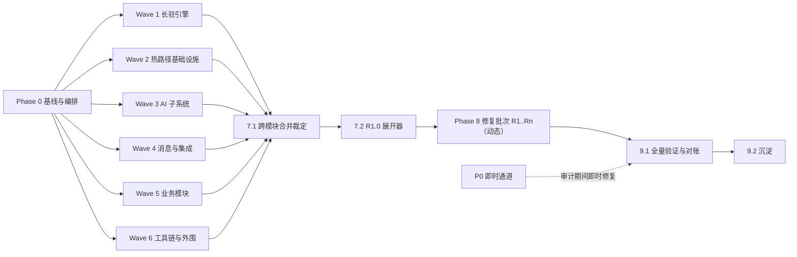

# 并发·异步·资源专项审计与修复 Roadmap（全模块滚动）

> Last updated: 2026-10-13
> Sources: `ai-dev/skills/concurrency-resource-audit-prompt.md`（审计方法论：C1–C10 十维度、F1–F11 缺陷族、归档与发现格式）,
> `ai-dev/skills/deep-audit-prompts.md`（「调度架构」「发现条目完整性守则」两节，审计调度沿用）,
> `ai-dev/skills/audit-remediation-roadmap-authoring-prompt.md`（P0 即时通道、R\*.0 展开器、closure audit 立项机制）,
> `ai-dev/audits/README.md`（审计归档规范、与 plans 的关系）,
> `docs-for-ai/01-repo-map/module-groups.md`（模块分组与依赖）

## 目的

对 nop-entropy **全部 Maven 模块组**执行 `ai-dev/skills/concurrency-resource-audit-prompt.md` 定义的「并发·异步·资源·内存·长时运行」专项深度审计，产出逐模块审计报告；随后基于全部报告做跨模块合并裁定，**分批拟制修复 plan 并执行修复**。终端目标：

1. 每个审计单元产出一份完整的 concurrency 审计目录（C1–C10 维度报告 + `summary.md`），全部 P0/P1 可追溯。
2. 跨模块同族缺陷（F1–F11）合并聚类，消除重复计数，形成全局发现台账。
3. 所有 P0 经即时通道修复；所有 P1 分批修复并通过独立 closure audit；P2 逐项裁决（修 / deferred + successor）。
4. 全量构建与测试保持绿色，owner docs 同步更新。

**与现有 roadmap 的关系**：`security-audit-roadmap`（安全域）、`full-code-review-roadmap`（质量域）、`nop-stream-independent-audit-roadmap`（流引擎专项）覆盖其他维度；本 roadmap 只覆盖并发·异步·资源域。发现重叠时在 7.1 合并裁定阶段去重并 cross-reference，不重复修复。

**当前状态：仅立项，暂不执行。** 全部工作项初始 `todo`。

## 审计方法论（工作内容）

每个审计工作项 = 按 `concurrency-resource-audit-prompt.md` 附录 B 执行一次完整滚动审计：

1. **准备**：读 AGENTS.md、`docs-for-ai/INDEX.md`、该单元 owner doc 与 `ai-dev/design/` 相关设计文档；执行附录 C grep 基线 + 行数统计，圈定重点文件。
2. **维度裁剪**：按「适用判定」表确定维度集合（默认 C1–C10 全选；纯模型/配置/文档类裁剪为 C1+C6；C10 恒放该单元最后批次，因其依赖前序维度产出的缺陷清单）。
3. **派发初审**：各维度并行派发子代理（共享提示词前缀 + 维度正文，`{MODULE}` 已替换）。**盲审纪律**：初审子代理禁止阅读 `ai-dev/audits/`、`ai-dev/plans/`、`ai-dev/bugs/` 历史记录。
4. **深挖迭代**：对初审发现按需追加串行深挖轮次（调度流程沿 `deep-audit-prompts.md`「调度架构」）。
5. **复核与现状标注**：独立子代理复核每条发现（保留/降级/驳回），此阶段才允许对照历史审计标注「新发现 / 已知未修复 / 已修复」。
6. **合并裁定**：单单元内同族相邻发现按「根因 + 失效层」合并，防止同一缺陷被多维度重复计数。
7. **归档**：`ai-dev/audits/{YYYY}-{MM}/{YYYY-MM-DD}-{HHMM}-deep-audit-{单元标识}-concurrency/`，每维度一个文件（`{C编号}-{英文短名}.md`），汇总写 `summary.md`。归档即更新 campaign 索引（`ai-dev/audits/` 下的 cra-index.md，由工作项 0.2 创建）。
8. **closure audit**：独立子代理验证审计目录完整性（维度覆盖、发现格式 ≥10 行字段、F3 失效面枚举非空），通过后工作项方可 `done`。

**发现质量硬约束**（来自审计 prompt，验证 closure audit 时逐条核对）：

- 并发类发现必须写出具体触发时序（T1/T2 交错序列）；写不出的一律降 P2 并标注「理论风险，未具体化」。
- 每条发现必须带 F3 失效面枚举（grep 全部同族兄弟方法/入口并逐一登记），禁止留空。
- 规模判断对照 owner doc 声明的规模包络；超出包络的 OOM 风险单独标注，不与包络内缺陷混排。
- owner doc 明文声明且带 fail-fast 守卫的边界不是缺陷；守卫缺失、文档未声明、守卫可绕过才是。
- 发现条目使用审计 prompt 附录 A 统一格式；全局唯一 ID = `{单元标识}-C{N}-{序号}`。

**修复立项方法论**（沿 `audit-remediation-roadmap-authoring-prompt.md`）：

- **P0 即时通道**：任何审计工作项执行中发现 P0，当即就地修复（plan 内加修复 Phase）或异步注入独立修复 plan，**不得留到批量修复阶段**；在审计报告与 cra-index 中标注修复路径与状态。
- **P1 批量通道**：Phase 7 合并裁定后按批次展开（见 7.2 / Phase 8）。
- **P2 裁决通道**：P2 默认不在修复范围；7.1 逐项裁决为「修（in-scope）/ deferred（必须带 Why Not Blocking + successor 指针）」，结果写回 cra-index 台账。已确认 live 的 must-fix P2 不得降级 deferred。
- **P3**：记录在审计报告，不立项。

## Work Item Status

> **这是唯一的动态状态块。仅在此处更新状态。**
> Phase 8 修复批次工作项由 7.2 展开器动态追加。

### Phase 0 — 基线与编排

| # | Work Item | Status | Owner Doc | Deps | Skill |
|---|-----------|--------|-----------|------|-------|
| 0.1 | 全量绿色基线：`./mvnw clean install -T 1C` 通过，记录基线 commit | done | — | — | none（命令） |
| 0.2 | 初始化 campaign 索引（ai-dev/audits/ 下 cra-index.md：报告清单 + P0 追踪 + P1/P2 台账骨架） | done | `ai-dev/audits/README.md` | 0.1 | none |
| 0.3 | 生成 mission 配置（仓库根 missions/ 目录下 concurrency-audit.json：roadmapPath 指向本文件，路径必须落在 `ai-dev/` 下）并 dry-run 验证 | done | `ai-dev/skills/audit-remediation-roadmap-authoring-prompt.md` 步骤 7 | 0.2 | `audit-remediation-roadmap-authoring-prompt.md` |

### Phase 1 — 审计 Wave 1：长驻引擎与协调器（最高并发风险）

| # | Work Item | Status | Owner Doc | Deps | Skill |
|---|-----------|--------|-----------|------|-------|
| 1.1 | nop-stream 核心（`nop-stream-core` + `nop-stream-runtime`：checkpoint/storage/rpc/transport/health） | done | `docs-for-ai/03-modules/nop-stream.md` | 0.3 | `concurrency-resource-audit-prompt.md`（C1–C5 C7–C10） |
| 1.2 | nop-stream 状态与连接器（`nop-stream-cep` + `nop-stream-rocksdb` + connector/-batch/-jdbc/-debezium/-kafka + `format-avro`） | todo | `docs-for-ai/03-modules/nop-stream.md`、`nop-stream-connectors.md` | 0.3 | 同上（C1–C8 + C10） |
| 1.3 | nop-stream 编排薄层（`nop-stream-flow` + `nop-stream-sql` + `fraud-example`，维度裁剪） | todo | `docs-for-ai/03-modules/nop-stream-user-guide.md`、`nop-stream-sql.md` | 0.3 | 同上（C1 C3 C6 + 抽查） |
| 1.4 | nop-job（定时调度引擎） | todo | `docs-for-ai/03-modules/nop-job.md` | 0.3 | 同上（C1 C2 C4 C5 C7 + C10） |
| 1.5 | nop-wf + nop-task（工作流 / 任务引擎） | todo | `docs-for-ai/03-modules/nop-wf.md`、`nop-task.md` | 0.3 | 同上（C1–C5 C7 C8 + C10） |
| 1.6 | nop-retry + nop-tcc（分布式重试 / TCC 事务协调） | todo | `docs-for-ai/03-modules/nop-retry.md`、`nop-tcc.md` | 0.3 | 同上（C1 C3 C6 C7 C8 + C10） |
| 1.7 | nop-batch（chunk 批处理、断点续传） | todo | `docs-for-ai/03-modules/nop-batch.md` | 0.3 | 同上（C1 C5 C6 C7 C8 + C10） |

### Phase 2 — 审计 Wave 2：热路径基础设施

| # | Work Item | Status | Owner Doc | Deps | Skill |
|---|-----------|--------|-----------|------|-------|
| 2.1 | nop-kernel 并发内核本体（`nop-commons` 的 io.nop.commons.concurrent/cache/pool/lock/ratelimit/semaphore + `nop-core` + `nop-xlang` + `nop-xdefs` 全局模型缓存） | todo | `docs-for-ai/02-core-guides/xlang-and-xpl-basics.md`、`ioc-and-config.md` | 0.3 | 同上（C1–C7 C9 C10；唯一审计平台并发设施**自身实现**的工作项） |
| 2.2 | nop-core-framework（IoC/Config/Boot/Plugin 三子模块/Security/Log）+ nop-utils | todo | `docs-for-ai/03-modules/nop-plugin.md`、`ioc-and-config.md` | 0.3 | 同上（C1 C2 C4 C6 + C10） |
| 2.3 | 请求热路径：`nop-graphql` + `nop-biz` + `nop-gateway` + `nop-biz-auth-core`/`nop-biz-file-core` | todo | `docs-for-ai/02-core-guides/api-and-graphql.md`、`service-layer.md` | 0.3 | 同上（C1–C4 C8 C9 + C10） |
| 2.4 | nop-persistence 读写热路径（`nop-orm` + `nop-orm-eql` + `nop-orm-model` + `nop-dao` + `nop-orm-data`） | todo | `docs-for-ai/02-core-guides/model-first-development.md` | 2.1 | 同上（C1–C6 C9 + C10；S 级拆分一） |
| 2.5 | nop-persistence 外围（`nop-dbtool` + `nop-db-migration` + `nop-orm-migration` 五状态机 + `nop-cdc` + `nop-nosql` + orm-drivers/geo/pdm/rpc） | todo | `docs-for-ai/02-core-guides/data-migration.md` | 0.3 | 同上（C1 C3 C6 C7 C8 + C10；S 级拆分二） |

### Phase 3 — 审计 Wave 3：AI 子系统

| # | Work Item | Status | Owner Doc | Deps | Skill |
|---|-----------|--------|-----------|------|-------|
| 3.1 | nop-ai-core + nop-ai-agent（LLM 异步调用链、Provider failover、agent 执行引擎） | todo | `docs-for-ai/03-modules/nop-ai.md` | 0.3 | 同上（C1 C3 C4 C5 C7 + C10） |
| 3.2 | nop-ai-toolkit + nop-ai-tools + nop-ai-shell（工具执行、进程/沙箱生命周期、mavenvfs） | todo | `docs-for-ai/03-modules/nop-ai.md` | 0.3 | 同上（C1 C4 C6 C8 + C10） |
| 3.3 | nop-ai-gateway（channel 长连接、会话存储、failover 路由、扫码登录） | todo | `docs-for-ai/03-modules/nop-ai-gateway.md` | 0.3 | 同上（C1–C4 C6 C7 C8 + C10） |
| 3.4 | nop-ai 其余（api/coder/dsl-orm/rag/codegen/dao/meta/service/web/app，裁剪 C1+C6；rag 补 C3 异步检索链） | todo | `docs-for-ai/03-modules/nop-ai.md` | 0.3 | 同上（裁剪） |

### Phase 4 — 审计 Wave 4：消息、集群与宿主集成

| # | Work Item | Status | Owner Doc | Deps | Skill |
|---|-----------|--------|-----------|------|-------|
| 4.1 | nop-message 全族（codec/core/kafka/pulsar/debezium：消费 prefetch、ACK 语义、背压） | todo | `docs-for-ai/03-modules/nop-message.md` | 0.3 | 同上（C1 C3 C5 C6 C8 + C10） |
| 4.2 | nop-cluster 全族（admin/core/nacos/sentinel/hazelcast/rpc-cluster：RPC 异步、注册表、限流熔断） | todo | `docs-for-ai/01-repo-map/module-groups.md` | 0.3 | 同上（C1–C4 C8 + C10） |
| 4.3 | nop-network + nop-integration（HTTP 客户端连接池、MQTT、feishu 连接器） | todo | `docs-for-ai/03-modules/nop-network.md` | 0.3 | 同上（C1 C3 C6 + C10） |
| 4.4 | nop-spring（含 spring-mcp-server）+ nop-quarkus（宿主生命周期、类加载、bean 装配并发） | todo | `docs-for-ai/01-repo-map/module-groups.md` | 0.3 | 同上（C1 C4 C6 + C10） |
| 4.5 | nop-search（api/core/lucene）+ nop-runner + nop-autotest（测试基建并行执行与资源隔离） | todo | `docs-for-ai/01-repo-map/module-groups.md` | 0.3 | 同上（C1 C4 C6 + C10，裁剪） |

### Phase 5 — 审计 Wave 5：业务与可复用模块

| # | Work Item | Status | Owner Doc | Deps | Skill |
|---|-----------|--------|-----------|------|-------|
| 5.1 | nop-auth + nop-credential（会话/token 并发、凭证缓存与加密） | todo | `docs-for-ai/03-modules/nop-auth.md`、`nop-credential.md` | 0.3 | 同上（C1 C2 C6 + C10） |
| 5.2 | nop-sys + nop-dyn（序列号、分布式锁、事件队列；动态模型运行时缓存） | todo | `docs-for-ai/03-modules/nop-sys.md`、`nop-dyn.md` | 0.3 | 同上（C1 C2 C6 C8 + C10） |
| 5.3 | nop-file + nop-datav（上传下载去重、数据视图） | todo | `docs-for-ai/03-modules/nop-file.md` | 0.3 | 同上（C1 C5 C6 + C10） |
| 5.4 | nop-report + nop-format（Excel/OOXML/PDF/office-model 大文件流式 vs 物化；chart/converter/mermaid/svg/tablesaw/record 抽查） | todo | `docs-for-ai/03-modules/nop-report.md` | 0.3 | 同上（C1 C5 C6 C9 + C10；S 级按功能裁剪） |
| 5.5 | nop-rule + nop-metadata（规则引擎决策；元数据 cron 调度、质量检查点、webhook 分发、对账） | todo | `docs-for-ai/03-modules/nop-rule.md`、`nop-metadata.md` | 0.3 | 同上（C1 C4 C5 C7 + C10） |
| 5.6 | nop-graph + nop-duckdb（图算法库；DuckDB 连接单写者约束、CSV/Parquet 读写面） | todo | `docs-for-ai/03-modules/nop-duckdb.md` | 0.3 | 同上（C1 C6 + 抽查） |

### Phase 6 — 审计 Wave 6：工具链与外围支撑

| # | Work Item | Status | Owner Doc | Deps | Skill |
|---|-----------|--------|-----------|------|-------|
| 6.1 | nop-tools 并行面：nop-rg + nop-find（FFM/Arena 并行遍历、SIMD）+ nop-bytecode | todo | `docs-for-ai/03-modules/nop-bytecode.md` | 0.3 | 同上（C1 C4 C6 C9 + C10） |
| 6.2 | nop-tools 解析面：nop-treesitter + nop-lint + nop-refactor + nop-jq | todo | `docs-for-ai/03-modules/nop-treesitter.md`、`nop-refactor.md` | 0.3 | 同上（C1 C6 + 抽查） |
| 6.3 | nop-code 索引面（`nop-code-core` + `nop-code-flow` + `nop-code-service`：长驻索引构建、图分析） | todo | `docs-for-ai/03-modules/nop-code.md` | 0.3 | 同上（C1 C5 C6 C7 + C10；S 级拆分一） |
| 6.4 | nop-code 其余（lang-java/python/typescript/go/rust/csharp + codegen + api/dao/meta/web/app，裁剪） | todo | `docs-for-ai/03-modules/nop-code.md` | 0.3 | 同上（C1 C6 抽查；S 级拆分二） |
| 6.5 | 外围支撑抽查：nop-demo + demo + nop-frontend-support + nop-dev-tools + nop-entropy-e2e（C1+C6 抽查；nop-benchmark 不审——基准代码按审计 prompt 误报校准不按生产标准，仅当其暴露生产代码缺陷时转记台账） | todo | — | 0.3 | 同上（C1+C6 抽查） |

### Phase 7 — 合并裁定与修复立项

| # | Work Item | Status | Owner Doc | Deps | Skill |
|---|-----------|--------|-----------|------|-------|
| 7.1 | 跨模块合并裁定：同族缺陷按 F1–F11 × 模块聚类；跨报告重复发现消解；历史「已知未修复」并入台账；P2 逐项裁决（修 / deferred + successor）；P3 归档；产出**修复批次划分提案**（批次边界、依赖顺序、每批 exit criteria） | todo | ai-dev/audits/ 下 cra-index.md（campaign 台账） | 1.1–6.5 全部 done | `audit-remediation-roadmap-authoring-prompt.md` 步骤 2/5 |
| 7.2 | R1.0 展开器：依据 7.1 提案在本 roadmap 追加 Phase 8 修复批次工作项行（每行引用 finding ID 清单作为 Deps） | todo | 本文件 | 7.1 | `audit-remediation-roadmap-authoring-prompt.md` R\*.0 机制 |

### Phase 8 — 分批修复（7.2 后动态生成）

> 批次划分由 7.1 提案确定，建议排序原则：
> R1 = P0 收尾确认 + 跨模块同族 P1（先修基础设施层，下游模块一次受益）→
> R2 = 基础设施/平台服务剩余 P1 → R3 = 业务模块 P1 →
> R4+ = P2 裁决为修的项 + C10 登记的测试保护力缺口。
> 每批 = 一份 plan（修复 + 回归测试 + owner doc 更新），独立 closure audit 后整批 done。

| # | Work Item | Status | Owner Doc | Deps | Skill |
|---|-----------|--------|-----------|------|-------|
| 8.1+ | （动态追加）修复批次 R1、R2、…，每行引用 finding ID 清单 | — | 对应模块 owner doc | 7.2 + 前一批 | none（修复 plan） |

### Phase 9 — 终局验证与沉淀

| # | Work Item | Status | Owner Doc | Deps | Skill |
|---|-----------|--------|-----------|------|-------|
| 9.1 | 全量验证：`./mvnw clean install -T 1C` + 受影响模块 `./mvnw test -pl <模块> -am`；独立子代理对全部 P0 修复与关键 P1 修复做 closure audit；cra-index 台账对账——每条 P0/P1 均为「已修 / deferred+successor」，无悬空 | todo | ai-dev/audits/ 下 cra-index.md（campaign 台账） | Phase 8 全部 done | `plan-closure-audit-prompt.md` |
| 9.2 | 沉淀：新缺陷族补充进 `concurrency-resource-audit-prompt.md` F 族或 `ai-dev/lessons/`；高频修复模式沉淀 owner doc；更新 `docs-for-ai/INDEX.md` 与 `04-reference/source-anchors.md`（如有路由变化） | todo | `ai-dev/lessons/README.md` | 9.1 | — |

## Status values

| Status | Meaning |
|--------|---------|
| `todo` | 未开始，无 plan |
| `planned` | 有执行 plan 且草案已过评审 |
| `done` | 完成，已通过独立 closure audit |

> 里程碑（Phase）无状态字段；wave 全部 `done` 即视为该 Phase 完成。审计工作项的 `done` 门控 = 审计目录完整 + summary.md 归档 + cra-index 已更新 + closure audit PASS。

## 当前基线

- **本域专项审计从未执行过**：`ai-dev/audits/` 下无任何 `*-concurrency*` 目录，本 roadmap 是 C1–C10 口径的首次全模块滚动。
- **相关历史审计（供复核阶段对照，初审盲审不得阅读）**：nop-stream 多轮 adversarial-review/deep-audit/invariant-loop（r6 缺陷族已沉淀为 F1/F2/F4/F5/F6/F10/F11）、nop-code OOM 族（F7）、nop-job 多轮审计、nop-ai-gateway channel 首订阅 check-then-act 已修复（commit 3db616f46d，F10 族先例）。
- **平台并发设施清单**（修复方向优先复用，见 `io.nop.commons.concurrent` / `cache` / `pool`）：IThreadPoolExecutor、IBlockingQueue + QueueOverflowPolicy、IResourceLockManager、IRateLimiter、ISemaphore/HighWatermarkSemaphore、ICache/IAsyncCache + CacheConfig、IPool + PoolConfig、NamedThreadLocal。修复不得手写重复造轮子。
- **验证命令**：`./mvnw clean install -T 1C`（全量）、`./mvnw test -pl <模块> -am`（单模块）。

## 依赖图

> 实际执行为串行（按文档顺序取第一个 `todo`）；wave 内各单元在无 mission-driver 时可并行派发，互不依赖（2.4 依赖 2.1：ORM 层审计需以 nop-commons 并发设施口径为背景，仅校准误报，不构成阻塞审计）。

## 横切关注点

| Concern | Notes |
|---------|-------|
| 盲审纪律 | 初审子代理禁读 `ai-dev/audits/`、`ai-dev/plans/`、`ai-dev/bugs/`；现状标注只在复核阶段做 |
| P0 即时通道 | P0 当即就地修复或异步注入修复 plan；永不进入 Phase 8 批量修复 |
| 证据标准 | 并发发现必须有触发时序；无时序降 P2；禁止见共享字段即报「线程不安全」 |
| F3 失效面 | 每条发现必须枚举同族兄弟并逐一登记；修复 plan 必须覆盖全部失效面，禁止修实例不修类别 |
| Protected Areas | 审计阶段全程只读；修复阶段触碰 `nop-core`/`nop-xlang`/`nop-xdef` 内部、`model/*.orm.xml`、`nop-*-api`、`nop-api-core`、`nop-auth` 须按 AGENTS.md 走 plan-first/ask-first，并在对应修复 plan 的 Dependencies 声明授权来源 |
| 生成文件 | `_` 前缀文件与 `_gen/` 禁改；并发缺陷追溯到生成模板层时修模板再重新生成 |
| 规模包络 | 所有 OOM/内存结论对照 owner doc 声明包络；超包络风险单独标注 |
| 绿色基线 | 每个修复批次结束全量 build 必须通过；审计工作项不改代码（P0 即时修复除外），其 BUILD_VERIFY 为只读确认 |
| 归档纪律 | 报告产出即更新 campaign 索引（ai-dev/audits/ 下 cra-index.md）；索引是 9.1 对账的输入 |
| 文档义务 | 修复完成同步更新对应 owner doc；修改 `docs-for-ai/` 或 `ai-dev/` 任何文件后跑 `node ai-dev/tools/check-doc-links.mjs --strict` 必须 0 错误 |
| C10 位置 | 测试保护力维度恒为该审计单元最后批次；「缺保护」按 P2 立项进入裁决通道 |

## Rules

- 本文件是状态索引与粗粒度分解，不是执行计划；每个工作项由其执行 plan 拥有实现细节。
- 状态变更仅发生在顶部 Work Item Status 块；初始全 `todo`，不得预填。
- 审计发现存审计报告，本文件只引用 finding ID（`{单元标识}-C{N}-{序号}`），不复制发现内容。
- 归档目录名的 `{单元标识}` 取工作项中的单元名（如 `nop-stream-core-runtime`、`nop-ai-gateway`），同单元多次深挖用 HHMM 区分。
- 7.2 完成前不得开始任何 Phase 8 修复；9.1 对账完成前 roadmap 不得关闭。
- 与其他 roadmap 的发现重叠时，以先完成修复方为准，另一方台账登记 cross-reference 后关闭，不重复修复。
- mission 配置（仓库根 missions/ 目录下的 concurrency-audit.json）的 `roadmapPath`/`plansDir`/`auditsDir` 必须指向 `ai-dev/` 下路径（0.3 的验收条件）。
