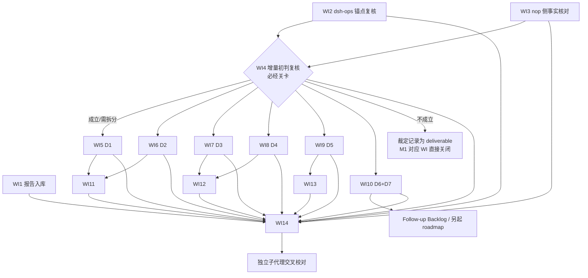

# dsh-ops 插件调研与 nop-ai-agent 增量吸收 Roadmap

> Last updated: 2026-10-16（Round 2 评审修订后）
> Sources: 2026-10-16 dsh-ops（T-Auto/dsh-ops v0.3.0，clone 于 ~/ai/dsh-ops，clone HEAD `6a7a4c7`）实地调研 + 报告 ~/ai/agent-survey/dsh-ops-analysis.md；nop 侧事实基线以 ai-dev/design/nop-ai-agent/ 下权威设计文档核对（nop HEAD `f1b1ab1`／2026-10-14，工作树核对于 2026-10-16）
> 位置：本文件按仓库 roadmap 惯例存放于 ai-dev/backlog/；对比报告（Deliverable）产出至 ai-dev/analysis/agent-survey/（既有外部调研归档目录）。格式对齐既有 nop-ai-agent-design-comparison-roadmap.md（frontmatter + checkbox 通道）。
> 书写约定：Deliverable 是尚未产出的未来报告，其路径一律用普通文本书写、**不加反引号**——check-doc-links 会把仓库内相对路径当必须已存在的链接校验；已存在的 owner / 参考文档路径保持反引号，持续受 checker 保护。仓库外路径（~/ai/...）不加反引号仅为可读性保守，不被 checker 校验。
> 评审记录：Round 1（2026-10-16，3 名独立子 agent 并行：dsh-ops 事实 / nop 基线 / roadmap 规范）发现已全部应用——报告侧修正 26 处（FACT 7 + ANCHOR 9 + OVERCLAIM 5 + 笔误 1 + nop 侧 4，含 AgentLifecyclePoint 12→11、"5 项真增量"→"4+2+1"、D4 既有 deny-list 补记）；roadmap 侧修正 10 处（Non-Goals 阻断项、M3 拆分、Cross-Cutting/Rules/依赖图补齐）。Round 2（2 名并行：修订核验 / 规范一致性）确认报告达"事实可信、可入库"标准（仅剩 4 处轻量问题，已修），roadmap 5 个文本精确性问题（closure 口径、Follow-up 预登记、闸门残留、判据措辞、deps/图）已关闭。Round 3 收口判定：实质面达成共识，2 处"修订引入的不一致"（报告头部审查状态计数 25→26、mermaid 补 WI5–WI10→WI14 六条边使图与 deps 完全对齐）已修复后收口。修订数按发现条目清点（组合计口径）。详见 ai-dev/logs/2026/10-16.md。

## Purpose

编排一项**调研 + 设计固化任务**：以报告 dsh-ops-analysis.md 为基线，先把五项候选增量（D1–D5）与两项小项（D6/D7）的双方事实（dsh-ops 代码锚点 × nop-ai-agent live 实现）核对成可裁定状态，再对通过裁定的增量产出设计固化文档。

**背景动机（本 roadmap 的存在理由）**：该报告初稿 §9 曾把"有界结果引用（spill）""后台任务托管""并发路径串行"误列为 nop 缺失项，经核对三项均已有落地实现（ISpillStore/read-spill、IBackgroundTaskRegistry/runInBackground、concurrency-safe 路径串行）。本 roadmap 的 M0-WI4 把"增量初判复核"固化为必经关卡，防同类误判进入实施。

终态：M0 四项事实基线全部落库（分析产物）；M1 六个专项报告覆盖 D1–D7 七个维度（D6+D7 合并一份）；M2 通过裁定的增量在 ai-dev/design/nop-ai-agent/ 下有设计固化文档（append owner doc 或新文件按 owner doc 规则）；M3 总报告 + 独立子代理交叉校对通过。

## 增量清单（待 M0-WI4 复核的初判）

> 优先级图例：**P1** 安全面（必修级）｜**P2** 设计级（进入 M2 设计固化）｜**P3** 规范/优化级（可留 Follow-up 或另起 roadmap）。D 编号与报告 §10 表行序（1=ladder, 2=权限双检, 3=env, 4=批操作, 5=失败值, 6=schema 投影, 7=测试门禁）的映射由 WI1 在入库报告中登记。

| ID | 机制 | 优先级 | nop 现状锚点 |
|---|---|---|---|
| D1 | prompt-ladder 路由表（按活注册表渲染 Task→Tool 表 + 纠错行为引导进 system prompt） | P2 | `ai-dev/design/nop-ai-agent/02-execution-model.md`（prompt assembly / contribution PROMPT） |
| D2 | 失败值三段语义（status + error.code + effectState none/unknown + nextAction，失败是返回值不是异常） | P2 | `ai-dev/design/nop-ai-agent/04-tool-invocation.md` |
| D3 | spawn 前权限双检 + sandbox 模式变更中止在飞执行 | P2 | `ai-dev/design/nop-ai-agent/nop-ai-agent-security-and-permissions.md` |
| D4 | 子进程环境 allow-list（凭据形态变量一律不继承） | P1 | `ai-dev/design/nop-ai-agent/nop-ai-tool-filesystem-design.md`、`ai-dev/design/nop-ai-agent/nop-ai-shell-design.md` |
| D5 | 批操作 plan→resume 两段式（计划对象化 + 按 id 确认执行） | P2 候选 | `ai-dev/design/nop-ai-agent/04-tool-invocation.md`、`ai-dev/design/nop-ai-agent/nop-ai-tool-file-edit-strategies.md` |
| D6 | 工具 schema build-time 投影（收窄不支持参数；runtime 投影与缓存纪律冲突已预登记） | P3 候选 | `ai-dev/design/nop-ai-agent/04-tool-invocation.md`（其 WI18 缓存裁定） |
| D7 | 测试三态门禁（skip 单列 + REQUIRE 开关转 fail） | P3 | `docs-for-ai/02-core-guides/testing.md` |

**已对齐、不再立项**（防重复劳动）：结果引用（spill/read-spill + 引用式压缩 shortRef/read-ref）、后台任务托管（IBackgroundTaskRegistry + runInBackground + task-output/task-stop）、并发路径串行（concurrency-safe + callTool chokepoint）、输出预算（maxOutputChars）、前缀缓存（head-anchor + 提供商缓存键放置）、权限审批（IApprovalGate + sandboxPolicy）、LLM 提供 env 的 deny-list 与 bash 默认 fail-closed（并入 D4 增量基线）、韧性面等价项（teardown 隔离 ~ Registry/close 回收、reconnect 预算 ~ RecoveryManager 周期扫描——dsh-ops 该组仅模式参考）。

## 范围边界（Non-Goals）

- 不排实施计划：本 roadmap 只到"设计固化 + 裁定"为止，落地实施由 DRAFT 管线另起 plan（对齐 design-comparison roadmap 惯例）。
- 改动范围闸门：不改任何产品代码。许可范围 = 各 WI 登记的 Deliverable 路径 + 本 roadmap 自身的状态维护与 ai-dev/logs/ 日志记录；M0/M1/M3 的新报告统一落 ai-dev/analysis/agent-survey/；M2 仅可向 ai-dev/design/nop-ai-agent/ 与 docs-for-ai/ 下**既有** owner doc 追加小节（新建设计文件先按 Rules#3 提请人工确认）；其余文件一律不动。
- 不覆盖 dsh-ops 的 Windows 专属机制（私有 MSYS + IPC 代理、workspace ACL 准备、二进制 provenance/quarantine）——仅作模式参考登记，不立项。
- 不做 dsh-ops 的自证 benchmark（97%/65% token 减免）复现或采信；报告中该数字一律按作者自证数字标注（README 自述"自用 benchmark"，见 `~/ai/dsh-ops/README.md:20-24`）。
- D6/D7 即便 WI4/WI10 裁定成立，也不进入本 roadmap M2（M2 槽位仅覆盖 D1–D5）：登记 Follow-up Backlog 或另起 roadmap（D7 的 owner doc 在 docs-for-ai/，不在 nop-ai-agent design 目录）。

## Work Item Status

> 唯一动态状态块。勾选 = 独立 closure audit 通过。WI 编号全文件递增；顺序即执行顺序，AI 不重排。

### M0 — 事实基线与增量复核

- [ ] WI1 调研报告入库：把 dsh-ops-analysis.md 适配为仓库分析产物 ai-dev/analysis/agent-survey/2026-10-16-dsh-ops-vs-nop-ai-agent-deep-comparison.md（保留代码锚点、"自证 benchmark 存疑"标注与 §10 修正版对照表；外部报告以 source 行引用，不复制维护双份）（Deliverable: ai-dev/analysis/agent-survey/2026-10-16-dsh-ops-vs-nop-ai-agent-deep-comparison.md; deps: 无; 参考: `ai-dev/analysis/00-analysis-writing-guide.md`、`ai-dev/analysis/agent-survey/2026-08-13-deepseek-harness-analysis.md`）
- [ ] WI2 dsh-ops 机制清单与锚点复核：clone 于 2026-10-16（v0.3.0），逐机制（ladder 渲染、权限五查、bash-ipc、file worker、PTC batch/result、MCP 客户端、provision）记录 HEAD commit + 文件锚点；区分"代码事实"与"注释自述"（Deliverable: ai-dev/analysis/agent-survey/2026-10-16-dsh-ops-mechanism-anchors.md; deps: 无）
- [ ] WI3 nop 侧事实基线核对：报告 §9 每条 nop 事实对照 live 代码/设计文档逐条复核——重点证实/证伪：env scrub 缺失（D4）、spawn 前二次 resolve 缺失（D3）、工具结果 effectState 缺失（D2）、活注册表 prompt 路由缺失（D1）、批操作 plan/confirm 缺失（D5）；已确认存在的（spill/background/path-serial/output-budget）记录锚点防再误判（Deliverable: ai-dev/analysis/agent-survey/2026-10-16-nop-ai-agent-baseline-facts.md; deps: 无; Owner: `ai-dev/design/nop-ai-agent/01-architecture-baseline.md`、`ai-dev/design/nop-ai-agent/04-tool-invocation.md`）
- [ ] WI4 增量初判复核（必经关卡）：D1–D7 逐项裁定"成立 / 不成立 / 需拆分"，不成立项必须给出 live 代码反证；产出进入 M1 的最终清单。变更控制：增量清单按裁定一次性回写，diff 登记于裁定记录；涉及工作项增删/合合须先提请人工确认（Deliverable: 上表修正 + 裁定记录追加至 ai-dev/analysis/agent-survey/2026-10-16-nop-ai-agent-baseline-facts.md; deps: WI2, WI3）

### M1 — 逐维深挖对比

> 执行闸门：各 WI 仅对 WI4 裁定"成立 / 需拆分"的维度执行；不成立项以 WI4 裁定记录为 deliverable，勾选时在 WI 行追加裁定注记。

- [ ] WI5 D1 prompt-ladder 路由表深挖：nop prompt assembly 全路径（AgentPromptAssembly section/order、IContributionRegistry PROMPT priority 注入、tag 可见性 activeTags）× dsh renderToolingPolicy 的"按 agent 活注册表渲染 + 行为纠错引导"；技术落点、与工具定义面前缀缓存稳定性（`04-tool-invocation.md` 的 WI18 纪律）的相互影响、指引文本的模型行为效果证据等级（dsh 侧为自证，须标注）（Deliverable: ai-dev/analysis/agent-survey/2026-10-16-D1-prompt-ladder-routing.md; deps: WI4; Owner: `ai-dev/design/nop-ai-agent/02-execution-model.md`）
- [ ] WI6 D2 失败值语义深挖：nop 工具结果契约现状（error result 形态、ErrorCode 两级策略、checkpoint 侧 effectState 类语义）+ effectState:none/unknown + nextAction 的落点候选（tool.xdef output schema 扩展 vs IToolExecutor 返回值包装 vs dispatcher 统一 wrapper）；与 `docs-for-ai/02-core-guides/error-handling.md` 两档策略的边界划分（Deliverable: ai-dev/analysis/agent-survey/2026-10-16-D2-failure-value-contract.md; deps: WI4; Owner: `ai-dev/design/nop-ai-agent/04-tool-invocation.md`、`docs-for-ai/02-core-guides/error-handling.md`）
- [ ] WI7 D3 权限复查与中止深挖：nop 工具执行链 chokepoint 全清单（ToolManagerImpl.callTool / PRE_TOOL_ATTEMPT 中间件 / IApprovalGate / Bail 态）+ "异步准备→spawn 之间二次 resolve 权威权限"的可行插入点 + sandbox 模式变更时中止在飞调用的传导路径（exec signal / 取消两级语义）（Deliverable: ai-dev/analysis/agent-survey/2026-10-16-D3-permission-recheck-abort.md; deps: WI4; Owner: `ai-dev/design/nop-ai-agent/nop-ai-agent-security-and-permissions.md`）
- [ ] WI8 D4 子进程环境 allow-list 深挖：nop 子进程 env 三路径现状（`BashExecutor` deny-list 只过滤 LLM 键 / `HostBashSandbox` opt-in 经 `ProcessBuilder.environment()` 全量继承宿主 env / `DockerBashSandbox` 只透传 LLM `-e KEY=VALUE`）+ allow-list 落点（executor 层 vs sandbox 层）、与既有 deny-list 的合并策略、shipped 默认 fail-closed 边界（Deliverable: ai-dev/analysis/agent-survey/2026-10-16-D4-child-env-allowlist.md; deps: WI4; Owner: `ai-dev/design/nop-ai-agent/nop-ai-tool-filesystem-design.md`、`ai-dev/design/nop-ai-agent/nop-ai-shell-design.md`）
- [ ] WI9 D5 批操作两段式深挖：nop 文件工具策略族（ApplyDelta/Patch/Replace）+ dry-run 现状核对 + plan/confirm-by-id 契约草案（计划对象不可变、resume 禁改计划、protect 列表、与 checkpoint idempotency key/发散检测的关系）（Deliverable: ai-dev/analysis/agent-survey/2026-10-16-D5-batch-plan-resume.md; deps: WI4; Owner: `ai-dev/design/nop-ai-agent/04-tool-invocation.md`、`ai-dev/design/nop-ai-agent/nop-ai-tool-file-edit-strategies.md`）
- [ ] WI10 D6+D7 合并深挖（两个 P3 项一份报告）：schema build-time 投影（收窄 enum/删不服务参数；runtime 投影与缓存纪律冲突的论证复核）+ 测试三态门禁协议化（skip 退出码单列、REQUIRE 开关；对齐既有 e2e 三形态实践）（Deliverable: ai-dev/analysis/agent-survey/2026-10-16-D6D7-schema-projection-test-gating.md; deps: WI4; Owner: `ai-dev/design/nop-ai-agent/04-tool-invocation.md`、`docs-for-ai/02-core-guides/testing.md`）

### M2 — 增量设计固化（仅 M1 裁定成立且属 D1–D5 者进入）

> D6/D7 的去处见 Non-Goals 末条：不进入本 M，登记 Follow-up Backlog 或另起 roadmap。
> 合并项关闭规则：WI11/WI12 为两项合并，其任一组成维度被 M1 裁定不成立时，合并 WI 仅对成立维度产出设计增量，并在 WI 行追加裁定注记（同 M1 闸门口径）。

- [ ] WI11 D1+D2 合并设计固化：在 `ai-dev/design/nop-ai-agent/02-execution-model.md`（prompt section 类型）与 `ai-dev/design/nop-ai-agent/04-tool-invocation.md`（结果契约）落设计增量小节，含契约、默认值、零回归边界（Deliverable: 两份 owner doc 的设计增量小节; deps: WI5, WI6）
- [ ] WI12 D3+D4 合并设计固化：执行链复查点 + 子进程 env allow-list 设计增量小节（Deliverable: owner doc 设计增量小节; deps: WI7, WI8; Owner: `ai-dev/design/nop-ai-agent/nop-ai-agent-security-and-permissions.md`）
- [ ] WI13 D5 设计固化（若 WI9 裁定成立）：批操作 plan/resume 契约设计增量小节（Deliverable: owner doc 设计增量小节; deps: WI9; Owner: `ai-dev/design/nop-ai-agent/04-tool-invocation.md`）

### M3 — 汇总与收口

- [ ] WI14 总对比报告：汇总 M0 事实基线（WI1–WI4 产物）、M1 专项报告与 M2 设计增量，产出全维度对照总表与去留裁定汇总（Deliverable: ai-dev/analysis/agent-survey/2026-10-16-dsh-ops-increment-summary.md; deps: WI1..WI13 全部）
- [ ] WI15 交叉一致性校对与收口：由独立子代理（不同 task_id）校对全部产物（M0 三份基线 + M1 六份专项 + M2 设计增量 + WI14 总报告）间的结论矛盾、锚点失效与模板缺失，修正后在总报告附录记录校对结论（Deliverable: ai-dev/analysis/agent-survey/2026-10-16-dsh-ops-increment-summary.md 附录; deps: WI14）

## Cross-Cutting

**完成判定（closure gate，逐 WI 适用）**：勾选一个 WI 需同时满足——

1. Deliverable 文件存在且位于本 roadmap 登记路径（M0/M1 报告在 ai-dev/analysis/agent-survey/ 下，M2 为 owner doc 增量小节）；
2. 报告具备 `ai-dev/analysis/00-analysis-writing-guide.md` 要求的基础结构（前置元数据 + Context + Analysis + Conclusion）**并**含四段：结论 / 发现分级 / 证据锚点 / 已核对正确清单；
3. 全部代码锚点可解析（抽样 ≥5 条 file:line 指向所述内容；引用数值有 live 复核命令/日期记录）；
4. `node ai-dev/tools/check-doc-links.mjs --strict` 0 error（analysis mission，warning 单列说明）；
5. 独立 closure audit 通过：**逐 WI** 由不同 task_id 的子代理在勾选前对照 live 代码复核，勾选时在该 WI 行记录 audit 来源（task_id + 日期）。WI15 的统一交叉校对是叠加层，不替代各 WI 各自的 closure 证据；WI15 自身被勾选前同样需一次独立 audit。

**证据纪律**：区分"代码事实"（文件:行级锚点）与"注释/文档自述"（引用处标注来源文件）；dsh-ops 的自证 benchmark 一律标注证据等级；nop 侧结论以 live 代码优先、设计文档次之，两者矛盾时在产物中显式记录矛盾而非择一沉默。

**无自动化机器门禁声明**：本仓库无 roadmap ledger 校验器（`tools/mission-driver/src/roadmap-check.mjs` 不解析本文件 checkbox 格式，AGE 模板 ledger 校验不在本仓库 tools/ 副本）——checkbox 状态以人工/脚本核对 + 上条 check-doc-links 为准，特此登记防误读（沿 design-comparison roadmap P2 收口结论）。

## Rules

1. **单一状态面**：Work Item Status 是唯一动态状态块；Purpose/终态/日志与它不一致时以先修正文本为准。
2. **WI 编号唯一且递增**：不重排、不复用、不跳号；新增工作项追加到对应 M 块尾部并更新总数引用。
3. **调整工作项须人工确认**：涉及 WI 增删/合合、范围变更、Non-Goals 修订，先提请人工确认再改（含 WI4 变更控制触发的范围调整）。
4. **顺序即执行顺序**：AI 不因"看起来更省事"重排 M0→M1→M2→M3。
5. **书写约定延续**：未产出 Deliverable 路径不加反引号；已存在 owner doc 保持反引号受 checker 保护。
6. **不静默降级**：某 WI 无法在当前环境执行（如缺外部二进制）时，显式登记 blocked 原因，不得假勾选。

## Dependency Graph

## Follow-up Backlog

> P3 / 非阻塞项。执行中发现的新增候选追加于此，格式同 M0。

- [ ] [P3] `nop-ai/nop-ai-agent/src/main/java/io/nop/ai/agent/middleware/ExecutionPoint.java:8` javadoc 声称 "the existing **12** session-level points"，与 live `AgentLifecyclePoint` 11 值（`REASONING_CHUNK` 于 2026-09-15 移除）及 6 份设计文档矛盾——javadoc 漂移，修法 = 改注释数字并指向 `AgentLifecyclePoint`；属产品代码变更、超本 roadmap Non-Goals，预登记待后续 plan 收口（source: 报告 Round 1 评审附带发现，2026-10-16）
