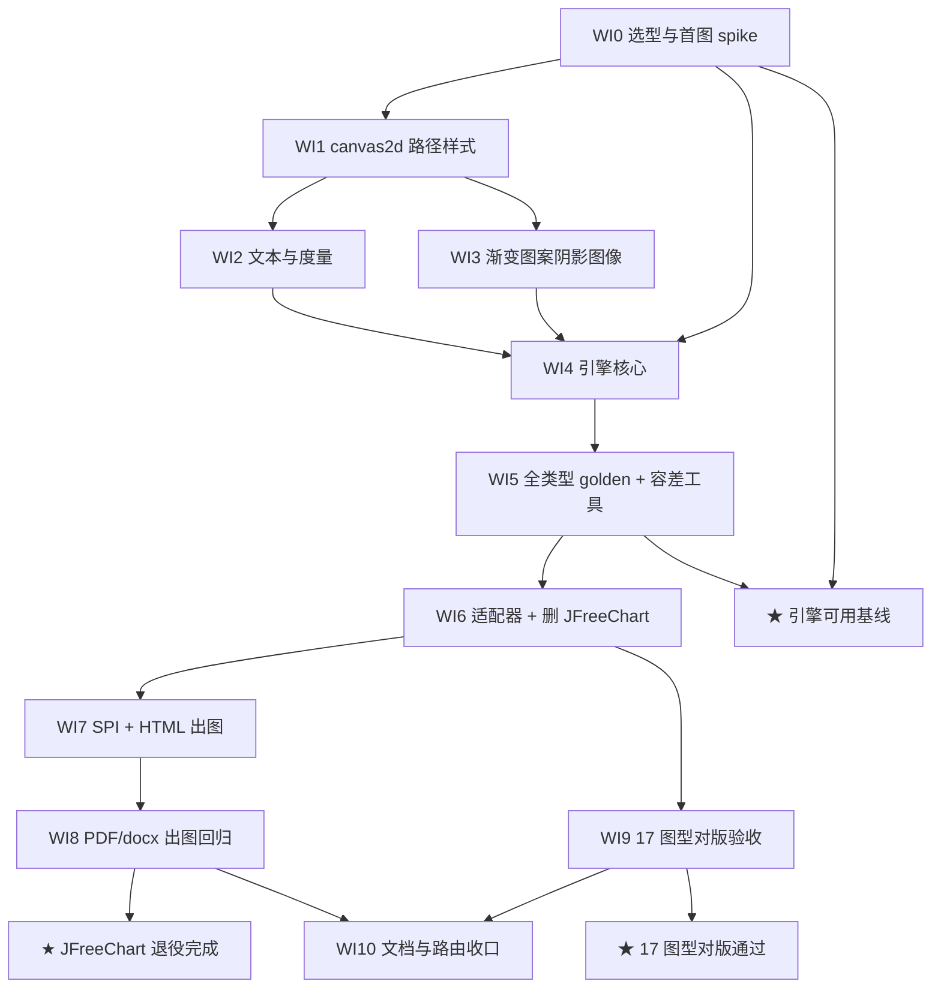

# ECharts 服务端静态渲染与 JFreeChart 退役 Roadmap（nop-chart-echarts）

> Last updated: 2026-10-06（起草，全部 WI 未启动）
> 位置：按仓库 roadmap 惯例存放于 ai-dev/backlog/。书写约定：未来交付物路径用普通文本书写、不加反引号；已存在的文档路径用反引号，持续受 check-doc-links 保护。
> Sources: 2026-10-06 会话裁定（路线 B：JVM 内 GraalJS 执行 dist/echarts.js + Java2D 实现 Canvas2D shim；范围=常见图型全量 + 直接吃 ECharts option JSON；换机制同时接线报表导出；保留 nop-chart-export 壳换内脏；四 jar 拆分且接线 jar 归 nop-report；对版标准=结构语义对版+样式尽量贴近）。对版素材：`docs/dev-guide/report/excel-chart.md`（17 张 Excel 截图）+ `nop-format/nop-chart-export/src/test/resources/xlsx/test-all-charts.xlsx`（17 图型 fixture，2026-10-06 已核对一一对应）。

## Purpose

本 roadmap 编排 Nop 平台以 ECharts 替代 JFreeChart 作为报表图表的**静态**渲染引擎：JVM 内 GraalJS 执行 dist/echarts.js，Java2D 实现 Canvas2D shim，把 ChartModel / ECharts option JSON 渲染为 PNG/SVG（无动画、无交互），接线 Excel/PDF/docx/HTML 报表导出，最终从 nop-dependencies 删除 jfreechart。

**范围硬边界**（改动须先改本节）：

- **不迁移不移植** ECharts/zrender 源码——直接执行官方 dist 文件；不做纯 Java 移植，不做 Node sidecar。
- **xlsx 原生 OOXML 图表路径零改动**（ExpandedSheetChartGenerator → DrawingChartBuilder 照旧），本 roadmap 只替换非 xlsx 输出（HTML/PDF/docx）的图表生成机制。
- **JFreeChart 全量移除**：nop-chart-export 内 24 个 org.jfree 实现文件与 nop-kernel/nop-dependencies/pom.xml 版本项全部删除；契约（IChartExporter/ChartExportOptions/ChartExportErrors/Registry/ChartDataFilter）保留。
- **不做动画/交互/工具箱**：toolbox saveAsImage 等交互件由 OptionNormalizer 剥离。
- 对版验收采用「结构语义对版 + 样式尽量贴近」（图型/系列/数据/标签/图例/轴必须一致；配色等从 ChartModel 携带尽量贴近 Excel，不追求像素等同）。

不含实现细节。每个 WI 由独立执行计划承载（`ai-dev/plans/00-plan-authoring-and-execution-guide.md`）；roadmap 就绪后可经 mission-driver draft 生成 mission config 驱动（当前未立项 mission）。

## Work Item Status

> 唯一动态状态块。勾选 = 独立 closure audit 通过（完成判定见 Cross-Cutting）；未勾选 = `todo`（无计划），起草 plan 并通过 draft review 后标注 `planned`。WI 编号全文件递增不重排；**deps 是唯一并行屏障**。每个 WI 以独立 plan 承载。

### M0 — 可行性与选型裁定

- [ ] WI0 GraalJS 选型与裸环境首图 spike：GraalJS 版本裁定（nop-dependencies 现有 graalvm.version=23.1.2 与 nop-xlang-truffle 钉 truffle 25.2.4 的对齐取舍，CI JDK21 + 本地 JDK26 双验）；echarts 资源获取裁定（Maven Central 的 org.mvnpm:echarts:6.1.0 依赖并排除 tslib/zrender 传递依赖 vs 提交 dist/echarts.js 3.8MB 入库）；最小裸环境（仅 global/console/timer/setPlatformAPI 假 canvas，**不定义** window/document/navigator）加载 dist/echarts.js 渲出第一张含中文 bar PNG；中文字体可得性初验。裁定报告落 ai-dev/analysis/ 当月目录（Deliverable: 裁定报告 + 依赖坐标裁定 + 首图 PoC；deps: 无；Item Type: Decision + Proof）

### M1 — nop-canvas2d（新模块：纯 Java2D Canvas2D，零 Graal/echarts/报表依赖）

- [ ] WI1 路径与样式状态机核心：模块注册（根 pom modules + nop-dependencies BOM 条目）；save/restore/setTransform/translate/scale/rotate 状态机；beginPath/moveTo/lineTo/bezierCurveTo/quadraticCurveTo/arc/arcTo/ellipse/rect 路径；fill（非零缠绕）/stroke、lineWidth/Cap/Join/miterLimit、setLineDash+lineDashOffset、clip、globalAlpha、CSS 颜色解析（rgb/hex/rgba/hsla/命名色）。Java2D 渲染后端 + 单测（Deliverable: 模块 + 测试；deps: WI0；Item Type: Feature）
- [ ] WI2 文本与度量：CSS 字体串解析（style/weight/size/family）、textAlign/textBaseline 语义换算、measureText（含 zrender 的 lineHeight = width('国') 规则与缓存）、fillText/strokeText（strokeFirst 描边）、truncate/ellipsis 截断与富文本分行、FontMapper（sans-serif 等泛族 → 可配置具体字体，中文必须覆盖，缺字体显式报错）。单测（Deliverable: 文本子系统 + 测试；deps: WI1；Item Type: Feature）
- [ ] WI3 渐变/图案/阴影/图像：createLinearGradient/createRadialGradient（用户空间坐标语义）、createPattern + 变换矩阵、shadowBlur/shadowColor/shadowOffsetX/Y 离屏合成、drawImage 三形态、getImageData/putImageData/copyFrom（heatmap 依赖）、createCanvas 离屏。单测（Deliverable: 特效子系统 + 测试；deps: WI1；Item Type: Feature）

### M2 — nop-chart-echarts（引擎：已有空壳 pom）

- [ ] WI4 引擎核心：GraalJS Context 池（每线程复用、echarts.js 只加载一次、超时/异常 → 模块级错误码 English 消息）；polyglut↔canvas2d 桥（假 canvas 根节点、ctx 属性写入、drawImage 吃 fake canvas、getImageData → BufferedImage）；setPlatformAPI 注入（createCanvas 覆盖默认 false、loadImage defer 到 timer、measureText、getTime）；OptionNormalizer（剥离 toolbox 交互件等）；EChartsRenderer.render(optionJson, w, h) → PNG/SVG 统一入口；progressive 16ms timer 泵。单测（Deliverable: 引擎模块 + 测试；deps: WI0、WI2、WI3；Item Type: Feature）
- [ ] WI5 option JSON 全类型出图验证 + 容差对比工具：bar/line/area/pie/doughnut/scatter/radar/heatmap/funnel/gauge/boxplot/graph/sankey/tree/treemap/sunburst/lines/map(GeoJSON)/parallel/calendar/candlestick + legend/axis/visualMap/dataZoom/markLine/markPoint/rich 文本/渐变/decal/image://；heatmap getImageData、aria setAttribute、SVG 地图 DOMParser 裁定（GeoJSON 优先）、progressive 泵复验。新建像素容差 image-diff 测试工具（仓库现无），产出自有基线 golden（Deliverable: 覆盖测试矩阵 + golden 基线 + 容差工具；deps: WI4；Item Type: Proof）

### M3 — nop-chart-export 换内脏（JFreeChart 退役）

- [ ] WI6 ChartModel→option 适配器与 JFreeChart 删除：以 /nop/schema/excel/chart.xdef 为映射规范实现常见 ChartType 适配（系列/样式/渐变/图例/坐标轴/数据标签/trendLine→markLine，series 配色携带以贴近对版）；IChartExporter 等契约与 ChartDataFilter 保留、既有 3 个测试迁移；删除 24 个 org.jfree 文件与 nop-dependencies 中 jfreechart 版本项；确认审计发现的 5 个死配置/趋势线热力图缺陷随之消灭（Deliverable: 适配层 + 依赖删除 + 测试迁移；deps: WI5；Item Type: Feature + Proof）

### M4 — 报表接线（SPI 在 nop-excel，实现在 nop-report/nop-chart-report）

- [ ] WI7 SPI 与 HTML 出图：nop-excel 定义 IChartImageProvider + registry（IReportRendererFactory 旁），HTML 两处 hook（HtmlReportRendererFactory/SimpleHtmlReportRendererFactory，hook ≤30 行，provider 不在 classpath 静默跳过）；新建 nop-report/nop-chart-report 模块（provider 实现 bean、ExpandedSheet/IExcelSheet → 图表模型 resolver、锚点→坐标、demo/app opt-in 拉入，不进 nop-report-core）。HTML 出图测试（Deliverable: SPI + 接线模块 + HTML 测试；deps: WI6；Item Type: Feature）
- [ ] WI8 PDF/docx 出图与三格式回归：nop-report-pdf PdfSheetRenderer 增 renderCharts（镜像 renderImages 路径，PdfImageHelper 增 byte[] 重载，countImageXObjects 断言）；nop-report-docx XptWordTableRenderer 表后插图（pointsToTwips）；test-bar-chart.xpt.xlsx fixture 的 xlsx/html/pdf/docx 四路断言，xlsx 原生路径零改动回归（Deliverable: pdf/docx 出图 + 回归；deps: WI7；Item Type: Feature + Proof）

### M5 — 对版验收与收口

- [ ] WI9 17 图型截图对版验收：test-all-charts.xlsx（17 sheet / 17 图型）全链路解析 → 适配 → 渲染 17 张 PNG，逐张对 `docs/dev-guide/report/excel-chart/` 下 17 张 Excel 截图判定——结构语义（图型/系列数/数据形状/标签/图例/坐标轴）必须一致，样式（配色/图例位置/轴样式）尽量贴近；AI vision 逐图判定 + 人工抽查，验收报告落 ai-dev/analysis/ 当月目录；失败项回灌适配器或 shim（Deliverable: 17 图渲染 + 对版验收报告；deps: WI6；Item Type: Proof）
- [ ] WI10 文档与路由收口：docs-for-ai owner doc（图表静态渲染：模块边界、字体配置、option/ChartModel 双入口、opt-in 接入）+ docs-for-ai/INDEX.md 路由 + 01-repo-map/module-groups.md 登记 nop-canvas2d/nop-chart-echarts/nop-chart-report + 04-reference source-anchors；当日 ai-dev/logs/ 状态一致（Deliverable: 文档 + 路由更新；deps: WI0–WI9 完成或显式裁定；Item Type: Proof）

- ★ **Milestone: ECharts 引擎可用基线**（WI0–WI5 全部完成后勾选）
- ★ **Milestone: JFreeChart 退役完成**（WI6–WI8 全部完成后勾选）
- ★ **Milestone: 17 图型对版通过**（WI9 完成后勾选）

## Current Baseline（2026-10-06 核对）

**已存在：**

- **JFreeChart 足迹**：nop-chart-export 24 个 org.jfree 文件（约 4.9K LOC）**零生产调用方**；版本项在 nop-kernel/nop-dependencies/pom.xml。契约 IChartExporter/ChartExportOptions/ChartExportErrors/Registry/ChartDataFilter 无 org.jfree 耦合，可原样保留。
- **空壳与先例**：nop-format/nop-chart-echarts 空壳 pom 已注册；nop-frontend-support/nop-js 已用 GraalJS 23.1.2 但模块被注释禁用（`nop-frontend-support/pom.xml` 不在 reactor）→ 新模块自包含 Graal 依赖，不依赖 nop-js。
- **ECharts 本体**：~/sources/echarts v6.1.0；dist/echarts.js（3,847,293 B，纯 ES5，0 eval/with/async/import）已在 Node vm + Proxy 假 canvas 实测跑通全部图表类型；仅需 global、timer、console、setPlatformAPI、假 canvas 根。默认 createCanvas 返回 false 需注入；loadImage 需 defer；非 ssr 模式保 env.node → animation:false 且 setOption 末尾自动 flush；ssr:true 反而重开动画不自动 flush（不用）。
- **shim 实测面**：zrender 只用约 30 个 Canvas2D 方法，从不用 ctx.filter/roundRect/evenodd；Java2D 原生覆盖约 70%，需手写 measureText/基线、径向与用户空间渐变、shadow 离屏合成、pattern 矩阵、getImageData/putImageData。
- **对版素材**：test-all-charts.xlsx（17 图型）与 docs/dev-guide/report/excel-chart/ 17 张 Excel 原生渲染截图一一对应（2026-10-06 抽验确认）；同族样本 nop-ooxml-xlsx/samples/original-all-charts 属 xlsx 原生路径（不动）。
- **依赖坐标**：Maven Central 存在 org.mvnpm:echarts:6.1.0（13MB，dist 路径 META-INF/resources/_static/echarts/6.x/dist/echarts.js）；nop-dependencies 有 graalvm.version=23.1.2；nop-xlang-truffle 钉 truffle 25.2.4。
- **接线点已核验**：nop-excel HTML 两处 hook（HtmlReportRendererFactory/SimpleHtmlReportRendererFactory 的 renderSheet）；nop-report-pdf PdfSheetRenderer（renderImages 镜像点 + PdfImageHelper）；nop-report-docx XptWordTableRenderer + pointsToTwips；ExpandedSheet implements IExcelSheet，IExcelSheet.getCharts() 可用；fixture test-bar-chart.xpt.xlsx 在 nop-report-core 测试资源。
- **测试与工具**：nop-autotest 三档基类 + `docs-for-ai/02-core-guides/testing.md`；**仓库无像素 diff 工具**（WI5 新建）。

**主要缺口：**

- 未裁定：GraalJS 版本与 echarts 资源获取方式（WI0）；中文字体确定性。
- 不存在：nop-canvas2d 模块与 Canvas2D shim（WI1–3）；GraalJS 引擎/桥/Normalizer/EChartsRenderer（WI4）；option golden 与容差工具（WI5）。
- 未替换：ChartModel→option 适配器、org.jfree 删除（WI6）；三格式报表出图接线（WI7–8）。
- 未验收：17 图型对版（WI9）；owner doc/模块登记（WI10）。

## Framework / Platform Reuse

| 能力 | 提供方 | 约束 |
| --- | --- | --- |
| 图形渲染引擎 | dist/echarts.js（ECharts 6.1.0，捆绑 zrender） | 直接执行 dist；不移植、不 fork、不加载模块化源码 |
| JS 执行 | org.graalvm.js（版本 WI0 裁定；先例 nop-js 23.1.2） | nop-js 模块被禁用不可依赖；新模块自包含依赖并收敛进 BOM |
| 2D 绘图 | 新模块 nop-canvas2d（Java2D） | 只实现 zrender 实际使用的约 30 个方法，不追完整 W3C 规范 |
| 图表模型与规范 | nop-excel ChartModel/ICellRefResolver + /nop/schema/excel/chart.xdef | 适配以 chart.xdef 为规范；不改 xlsx 原生图表路径 |
| 渲染 SPI | nop-excel IReportRendererFactory + HTML 渲染器 | hook ≤30 行；provider 不在 classpath 静默跳过；GraalJS 不进 nop-report-core |
| xlsx 原生图表 | ExpandedSheetChartGenerator + DrawingChartBuilder | 零改动，回归保护 |
| 依赖管理 | nop-kernel/nop-dependencies BOM | Graal/echarts 坐标收敛进 BOM；jfreechart 版本项最终删除 |
| 测试基座 | nop-autotest + `docs-for-ai/02-core-guides/testing.md` | golden 断业务不变量 + 像素容差，防快照漂移 |
| 对版基准 | `docs/dev-guide/report/excel-chart/` 17 张 + test-all-charts.xlsx | 结构语义必须一致、样式尽量贴近；不作像素等同要求 |

## Dependency Graph

## Cross-Cutting（每个 WI 的完成判定）

1. **验证门**：`./mvnw test -pl <module> -am` 绿（触及多模块跑 `./mvnw clean install -T 1C`）；命令口径以 `docs-for-ai/00-start-here/project-context.md` Verification Commands 为准。
2. **裸环境红线**：引擎内严禁定义 window/document/navigator（保 env.node → 官方强制 animation:false）；不用 ssr:true（重开动画且不自动 flush）；createCanvas/loadImage 必须注入覆盖与 defer。
3. **生成物禁改**：不手编辑 _ 前缀与 _gen 生成物；适配与接线一律改源模型/契约层。
4. **错误处理**：两档惯例（`docs-for-ai/02-core-guides/error-handling.md`）——canvas/引擎/适配模块级异常 + English 消息，不裸 RuntimeException。
5. **字体确定性**：FontMapper 可配置且中文必覆盖；缺字体显式报错而非静默 fallback；golden 与对版依赖字体环境一致。
6. **测试取向**：断言业务语义而非凑数量；既有测试只增不删不削弱；测试暴露的产品缺陷走 `ai-dev/bugs/00-bug-fix-note-writing-guide.md` 独立立项，不在本 roadmap WI 内夹带修复。
7. **接线 opt-in**：nop-report-chart 不进 nop-report-core；接线回归必须同时证明「provider 缺席时静默跳过」与「provider 在位时出图」。
8. **xlsx 路径零改动**：任何 WI 不得触碰 ExpandedSheetChartGenerator → DrawingChartBuilder；xlsx 导出回归必须保持原生 OOXML 图表。
9. **closure 判定**：独立 closure audit（不同 task_id 子代理，不得自审）通过后才勾选 checkbox，并同步承载 plan 状态与当日 ai-dev/logs/。
10. **文档链接**：改动 ai-dev/ 或 docs-for-ai/ 后运行 node ai-dev/tools/check-doc-links.mjs --strict，必须 0 错。
11. **范围回写**：任何「砍图表类型/改对版标准/恢复动画/保留 JFreeChart」的范围变更，先改本文件 Purpose 硬边界再动工。

## Rules

- 状态只在 Work Item Status 的 checkbox 通道维护，不设第二状态面；WI 编号全文件递增不重排。
- deps 是唯一并行屏障：M1 内 WI2/WI3 可并行；WI9 仅依赖 WI6，可与 WI7/WI8 并行；WI10 必须最后。
- 本文件是状态索引与粗粒度分解，不是执行计划：不写实现步骤，deliverable 只述范围。
- 每个 `todo`/`planned` WI 由独立 plan 承载（起草按 `ai-dev/plans/00-plan-authoring-and-execution-guide.md`，plan 编号接 ai-dev/plans/ 现有最大编号顺延）；mission 启动后不得手工改本文件（先停 mission）。
- 里程碑为派生状态：★ 引擎可用基线仅在 WI0–WI5 全部完成后勾选，其余同理。
- 未来交付物路径用普通文本不加反引号；已存在文档路径加反引号受 check-doc-links 保护。
