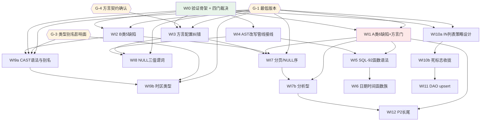

# EQL 跨数据库兼容性治理（EQL Cross-Database Compatibility Hardening）

> **来源调研**：`ai-dev/analysis/2026-10/2026-10-02-eql-cross-database-compatibility-syntax-research.md`（v3，经两轮共 8 个独立子 agent 交叉审查）
> **执行分支**：`feat/eql-cross-db-compat`（worktree `../nop-entropy-eql-cross-db-compat`）
> **本图产出方法**：调研报告 Part 7 的 S-1..S-14 批次 → 本图的 WI0..WI12；经**三轮**独立子 agent 三路审查（代码事实 / 跨库矩阵 / 结构可执行性）修订至 **v7.1**（四轮独立子 agent 审查至 `consensus-reached-with-nits` + 合并后锚点重核验两轮）
> **Last updated**：2026-10-03（v7.2）
> **当前状态**：**draft review 已通过（v7.2）**，执行中 —— WI0 已 `planned`；状态流转见 Work Item Status
> **v2 修订摘要**：修正 `supportReturningForUpdate` 语义误读（v1 据此误判 duckdb/oracle/h2 三处；该标志只门控 `UPDATE … RETURNING`，不是"该库有没有 RETURNING"）；`orm.xml` 计数 78→114；修正"扩展点全部没接线"的过claim；WI9 拆为 WI9a/WI9b；补 6 项此前被遗漏的活缺陷。
> **v3 修订摘要**：更正 H2 的默认 `LIKE` escape 是**反斜杠**而非 NULL（v1/v2 误列入 NULL 组）；更正 H2 `greatest`/`least` 的"忽略 NULL"兼容模式**仅 `LEGACY`/`MS SQL Server`/`PostgreSQL`**；把 `DB2`/`TDengine`/`H2` 的聚合 `FILTER` 移入"未取证"；`INTERSECT`/`EXCEPT` 缺口补上 **MariaDB ≤10.2**；`orm.xml` 属性的 `stdSqlType=` 计数 8307→8332；AST 零生成器消费字段 3→**7**；死标志口径 13→**14** 并给 `supportNullsFirst` 一个真实 owner；全部 `-pl` 命令改为 Maven 可运行的 `:` 前缀形式（v3 前每条验证命令都会报错）。
> **v4 修订摘要**：登记 DM8 默认 escape 为 `unverified`；删除一条**不成立的** `mariadb` 保留字缺陷指控（仓库其实正确）；统一死标志计数（接线 10 / 总计 14）；给 WI9b 补 BC 门禁 + 生成管线 Protected Area + 可编译的 `-pl`；给 `supportNullsFirst` 与 `ORDER BY … COLLATE`、`lastDay(d)` 三条 ledger 项落实真实 owner；消解 G-3↔WI9b 与 WI3 计数口径的残留矛盾；更正 5 处 `nop-persistence/nop-orm-eql/model/antlr/BaseRule.g4` 行号（此前整体偏移 −1）。
> **v5 修订摘要**：把 10 条 per-WI 的既有 EQL 语料 BC 判据从"7 个全测"改为**按各 WI `-pl` 的实际覆盖面**如实陈述（`:nop-orm-demo` 3 份与 `nop-spring-simple-demo` 1 份本就无法由单 WI 命令覆盖，改由 EC 第 8 条 + WI0 静态快照兜底）；新增 **BUG-15**（`SqlTypeExpr.characterSet`/`collate` 的潜在静默丢弃，owner=WI2）并把 WI2 从 4 项扩为 5 项；补齐门控矩阵中 WI2/WI3 的 `G-1` 与 WI9a 的 `WI0`；更正 `nop-persistence/nop-orm-eql/model/antlr/BaseRule.g4` 中 `characterSet_`(`:384`)/`collateClause_`(`:388`) 的行号与"永久不可达"结论。
> **v6 修订摘要**（sign-off 后的收尾）：删除 ledger 中残留的调研报告错误（`Oracle 无 WHEN MATCHED THEN DELETE` → **有**）；把 WI2 的 4→5 缺陷数同步到 mermaid/Current Baseline/EC#2；把 Cross-Cutting 的 `-pl` 强制项收敛到各 WI 真正跑得到的范围（另两个 EQL 消费方只由 EC 第 8 条覆盖）；登记 `nop-stream-runtime` 的 3 项**既有**失败并定义"全绿"口径；为 `stringAgg`/`regexpLike`/`MERGE` 三条 ledger 行补上 EC 级 owner。
> **v7.2 修订摘要**（执行前 draft review 通过轮）：独立子 agent 抽查 12 处必查锚点 + 约 50 处附加锚点**全部命中**，`parseRoadmapMarkdown` 16 工作项全部合法，**无 Blocker**。据此修正 4 处：① EC 第 6 条的 broken-link 基线由陈旧的"7 项"改为与 Current Baseline 一致的 **3 项**（`06-resource-leak-v1.md:54,83,91`），并更正"real exit 1"的过时口径（实测 `--strict` 退出码 0、3 个 warning 计 0 error；门禁口径维持"**新增 broken link = 0** + 不顺手修 3 个无关 pre-existing 文件"）；② 依赖图注记"WI3 的其余 11 项"改为**其余 9 项**（G-1 只阻塞 mariadb `RETURNING` 与 `INTERSECT` 两项，12−1(已完成第 8 项)−2=9 的算术残留）；③ WI0 交付 1 的"从 `DialectManager` 动态取集合"改为**VFS 枚举**（`DialectManager` 无方言枚举 API，正确形态是枚举 `/nop/dao/dialect/*.dialect.xml`（18 个）后逐个 try-load）。
> **v7.1 修订摘要**：v7 的批量修正**首轮不完整** —— 独立复核发现 **9 处锚点漏改**（都是"同一批里兄弟锚点已改、本处未改"的 off-by-one）：`sqlExpr_special` `:248-251`→`:286-289`、`_EqlASTBuildVisitor` `:1296/:1299`→`:1331/:1334`、**手写** `EqlASTBuildVisitor.java:270-272`（v7 误加了 `_` 前缀，而 `_` 前缀的生成物里根本没有 `stdName` 字样）、`escapeSql` `:684`→`:715`、`AstToSqlGenerator` `:388`→`:410`、`IDialect` `:145`→`:151`、`h2` CROSS `:26`→`:29`、`h2` FILTER `:34`→`:37`、`JdbcTwoPhaseCommitSink` `:166`→`:167`；另修正 `ast/` 手写文件计数 **81→80**（`SqlStatementKind.java` 被重复计入）与文档链接基线 **7→3**（合并顺带修好 4 项）。经此两轮，**190 个锚点全部逐个开文件核对完毕**。
> **v7 修订摘要（合并 `add-stream-sql` 后的锚点重核验）**：rebase 到新 master 后重核全部 `file:line` 锚点，**修正 54 处行号**（`EqlParser.java` 9933→**10785**、`ast/_gen/` 72→**77**、`ast/` 手写 75→**80**（v7.1 更正：首轮误算成 81，`SqlStatementKind.java` 被重复计入）、`EqlASTKind.java` 130→**140**、`_EqlASTBuildVisitor.java` 1653→**1804** 且路径本就是 `parse/` 而非 `ast/`、`nop-persistence/nop-orm-eql/model/antlr/BaseRule.g4`/`nop-persistence/nop-orm-eql/model/antlr/DMLStatement.g4` 整体下移 +10、`owner doc` 四处失真 `:91/:94/:96/:97`→`:105/:108/:110/:111`、`dialect.xdef` 六个 literal 行 +1、`h2.dialect.xml` `:26/:34`→`:29/:37`）。**三处实质更正**（不是行号问题）：① **`nop-dao` 没有 codegen 管线**（`pom.xml:119`），方言标志"改 xdef → `_gen` 重生成 = 生成管线 plan-first"的前提**不成立**，本图 7 处成本/门控表述已改；② **WI3 第 8 项已被另一分支顺带修好**（`postgresql:3` 现在 extends `window-expr-support`）⇒ 12 项待结论项减为 **11**；③ **WI12 的"窗口命名 `WINDOW`（需新 AST 节点）"已建成**（新增 `SqlWindowClause`/`SqlWindowDecl`/`SqlWindowFrame`/`SqlWindowFrameBound`/`SqlTumbleTableSource` 五个 AST 节点）。另新增两条登记：`EqlASTKind` **ordinal 已被重编号**（常量 62→67，插入点 30 与 53-56），以及 `STRING` token **可证不可词法化**（`EqlLexer.java:21-81` 与 `EqlParser.java:21-81` 在第 81 行分叉：parser 有 `STRING=358`、lexer 没有）—— 后者是 BUG-15 的直接机器证据。WI5 的前提"`nop-persistence/nop-orm-eql/model/antlr/BaseRule.g4` 那 4 条 SQL-92 规则从未生效过"经字节级 diff **仍然成立**（整块仅位移 +38）。
> **对源调研报告的显式覆盖**（以下 6 处 v4 判定调研报告有误，**不得回引调研报告**）：① `__XGEN_FORCE_OVERRIDE__` 的语义是"每次强制覆盖"而非"不会重生成"；② `nop-persistence/nop-orm-eql/model/antlr/BaseRule.g4` 那 4 条规则从未在本仓库生效过（不存在"曾做过又被回退"）；③ Oracle **有** `WHEN MATCHED THEN DELETE`；④ H2 默认 `LIKE` escape 是反斜杠；⑤ `supportReturningForUpdate` 的真实语义；⑥ `orm.xml`/`stdSqlType=` 计数。调研报告称"7 个方言配置错误"，实际待结论项为 **12**（见 WI3）。

## Status values

合法 token 为 **`todo` / `ready` / `planned` / `done`** 四个（`tools/mission-driver/src/roadmap-check.mjs:14` 的 `VALID_STATUSES`）。本图只用 `todo` / `planned` / `done`，`ready` 保留不用。流转：draft review 通过 → `todo` 改 `planned`；独立 closure audit 通过 → `planned` 改 `done`（**不得提前**）。

## Current Baseline

| 项 | 基线 |
|---|---|
| 已知 A 类静默错误 SQL 缺陷 | **6**（BUG-1/2/3/5/10/14） |
| 已知 B 类缺陷 | **4 个已可复现**（BUG-4/6/7/8）+ **1 个潜在**（BUG-15 `SqlTypeExpr`，尚不可达） |
| 方言相关待结论项 | **11**（WI3：4 项 `supportReturningForUpdate` 值、1 项 `unverified` 只标注、1 项窗口函数 mixin 归属（`mysql5.7` 去除；PG/DuckDB 补齐项**已完成**）、1 项 `ilike` 函数注册、2 项 Java 接线（`defaultNullsFirst` + H2 补配）、**2 项版本门/selector**） |
| 存量死标志 | **14**（WI10b 三档处置：10 接线 / 1 补 accessor+消费者 / 3 软弃用） |
| 零生成器消费的 AST 字段 | **7**（`SqlLikeExpr.escape`、`SqlOrderByItem.collate`、`SqlQuerySelect.nowait`、`SqlCollectionAccessExpr.collFuncName`、`SqlCollectionAccessExpr.collFuncArgs`、`SqlTypeExpr.characterSet`、`SqlTypeExpr.collate`） |
| 零生产消费的 `IDialect` accessor | **9**（另有 5 个标志连 accessor 都没有） |
| 可加载方言 | **14**（18 个 `*.dialect.xml` 中 4 个不可实例化） |
| `*.orm.xml` 文件数 / `stdSqlType=` 属性数 | **114**（含 19 个生成的 `_app.orm.xml`，其余 95）/ **8332** |
| 文档链接 broken link 基线 | **3**（合并后实测：`ai-dev/plans/nop-bytecode/06-resource-leak-v1.md:54,83,91`；原基线 7 项中的另 4 项已被 `add-stream-sql` 顺带修好） |
| 含 `<eql>` 的 `sql-lib.xml` | **7** |

## 目的

EQL（Entity Query Language）是 Nop ORM 面向业务的查询语言，定位是"标准 SQL + 实体属性自动导航"。调研报告在两轮交叉审查后确认了三类问题，本 roadmap 按**危害 × 可验证性**把它们系统性收口：

1. **6 个在执行路径上静默产出错误 SQL 的缺陷（A 类）**。这类缺陷最危险 —— 用户与开发者都收不到任何错误信号，SQL 文本却已改变语义。已实测确认 `cross join` 被静默误解析（`select count(*) from a cross join b` → `from a as cross join b`，而 `natural join` 确实失败）；`LIKE … ESCAPE` 子句被丢弃（**Oracle/DB2 默认 escape 为 NULL（DM8 未取证）**，H2 与 PostgreSQL 默认 escape 为反斜杠 → 返回错误行集）；`LATERAL` 关键字被丢弃（`lateral (sub)` 与 `(sub)` 输出**字节完全相同**，139 字符 → 退化成未关联子查询）；`for update` 硬编码绕过方言锁模板；裸 `INTERVAL` 不经任何方言模板直接输出（PG 上非法）；集合下标访问产出垃圾 AST（`select o.roles[1].x()` → `select o.roles 1 from t`）。
2. **方言相关待纠错项**（活 bug，WI3 的 12 项）。**必须先分清 `supportReturningForUpdate` 的真实语义**：`dialect.xdef:39` 写的是"Update语句增加 returning 子句支持"，`EqlTransformVisitor.java:1561` 只在 `visitSqlUpdate` 上校验它，生成器输出的是 `UPDATE … returning <投影列表>`、**不带 `INTO`**。⇒ 该标志**不是**"该库有没有 RETURNING 子句"。据此：`mysql.dialect.xml:137 = true` 是错的（MySQL 连 `UPDATE` 都没有 returning）；`oracle.dialect.xml:100 = true` 也是错的（Oracle 的 `UPDATE … returning_clause` 只允许 `INTO` 宿主变量形式，投影列表形式非法）；`h2.dialect.xml:18 = true` 也是错的（H2 完全没有 `RETURNING`）；而 `duckdb.dialect.xml:21 = false` **是正确的**（DuckDB 的 `RETURNING` 只在 `INSERT`/`DELETE`/`MERGE` 上，`UPDATE` 文档零出现）；`mariadb` 继承的 `true` 对 MariaDB ≥ 13.0 成立但**无版本门**。另有 `mysql5.7` 继承了它没有的窗口函数 mixin，而 `postgresql`/`duckdb` 都没有该 mixin。
3. **约 14 个"已预留但未接线"的扩展点**。这是本次调研最有价值的发现。⚠️ **必须区分"未接线"与"半接线"**（v1 曾在此过度声称，已修正）：
   - **零生成器消费的 AST 字段有 7 个**：`SqlLikeExpr.escape`（全仓读取方仅 `EqlASTVisitor.java:568` 遍历 + `EqlASTOptimizer.java:1517`，无生成器）、`SqlOrderByItem.collate`、`SqlQuerySelect.nowait`、`SqlCollectionAccessExpr.collFuncName`/`collFuncArgs`（`collFuncArgs` 的读取方是 `EqlASTVisitor.java:660` + `EqlASTOptimizer.java:1937`；⚠️ **`collFuncName` 全仓零读取** —— 连 `EqlASTVisitor`/`EqlASTOptimizer` 都不读它，v6 曾误称二者是它的读取方）、`SqlTypeExpr.characterSet`/`collate`（`_EqlASTBuildVisitor.java:1331/1334` 会**写入**，但 `AstToEqlGenerator.visitSqlTypeExpr:929-943` 只打印 `name`/`precision`/`scale`、`AstToSqlGenerator.visitSqlCastExpr:455-475` 绕过 `SqlTypeExpr` ⇒ **零读取**）。⚠️ `SqlTypeExpr` 这两项今天**尚不可达**（`cast(a as varchar(10) character set utf8)` / `… collate xx` 都解析失败，`characterSet_` 期望 `STRING` = **无任何 lexer 规则的隐式 token**（规则头 `nop-persistence/nop-orm-eql/model/antlr/BaseRule.g4:384`、body `:385`；`STRING` 在整个 antlr 目录只出现在这一处引用）—— 且这是**机器可证**的：`EqlLexer.java:21-81` 与 `EqlParser.java:21-81` 的 token 表在**第 81 行分叉**，parser 侧多出 `STRING=358` 而 lexer 侧没有，即该 token 在整个词法器里根本不存在）⇒ **加引号也匹配不到、永久不可达**；`collateClause_` 期望 `STRING_`（带引号的字面量，规则头 `:388`、body `:389`）而 `utf8`/`xx` 被词法分析为 `IDENTIFIER_`⇒ **加引号也匹配不到、该分支今天永久不可达**，比 v3 的判断更严重），所以还没产生错误 SQL；但**一旦有人修好那条文法就会变成 BUG-1 同型的静默丢弃** ⇒ 已登记为 **BUG-15**，owner = **WI2**（见 WI2 缺陷表最后一行）。
   - **半接线**：`SqlOrderByItem.nullsFirst` 已被 `AstToEqlGenerator.java:589-595` 消费（只差 `AstToSqlGenerator` 侧）；`SqlSubqueryTableSource.lateral` 已被 `EqlTransformVisitor.java:568` 消费（只差打印侧）。
   - **函数模板机制已完整接线**：`DialectImpl.java:133` → `getFunction()`（`:626`）→ `AstToSqlGenerator.java:484`，`oracle.dialect.xml:174` 在用，且有 `nop-dao/TestSQLFunction.java:29` 测试。它的缺口只是 `TemplateSQLFunction` 的 marker 越界校验（WI0 第 2 项），**不是"没接线"**。
   - **方言特性标志**：`defaultNullsFirst` 在 7 个 XML 已配却零 Java 消费方；9 个 `IDialect` accessor（`isSupportSavePoint`/`isSupportTransaction`/`isSupportTruncateTable`/`isSupportUpdateTableAlias`/`isSupportDeleteTableAlias`/`isSupportRowValueConstructor`/`isSupportUpdateFromJoin`/`isSupportSequence`/`isSupportILike`）零生产消费方；另有 5 个标志（`supportFullJoin`/`supportRightJoin`/`supportDeleteFromJoin`/`supportOutputForUpdate`/`supportNullsFirst`）**连 `IDialect` accessor 都没有**，只有 `_DialectFeatures` 的 `Boolean` getter。
   
   接线成本比新增语法低一个数量级 —— 这是本 roadmap 的核心经济性论据。

**明确不做的事**（继承调研报告 Part 5）：不把方言私有语法（`SELECT TOP`、`LIMIT off,lim`、`DISTINCT ON`、`NATURAL JOIN`、`USING`、`OVERLAY`、`JSON_TABLE`、`a || b` 等）收进 EQL；不把 DDL 收回 EQL；不把 UPSERT 做进语法层（改走 DAO 原语）。

## 排序原则

- **P1 静默错误 > 响亮失败**。静默产出错误 SQL 的缺陷排在解析失败之前 —— 后者至少给了用户信号。
- **只打印不设门 = 净回归**。任何"让生成器开始输出某个子句/关键字"的改动，**必须与对应的方言能力门同批次落地**。否则把"静默错误 SQL"换成"硬运行时失败"，用户体感更差且排查更难。
- **可验证性优先**。先建立多方言验证骨架（WI0），否则后续所有函数表/方言改动都只能靠"看起来对"来判断 —— 这是调研报告 Part 7 把 S-1 排到最前的核心理由。

## 前置决策门（Gate）

以下问题**不解决就会阻塞对应 WI**，必须在开工前由人裁决，AI 不得自行假设（AGENTS.md「AI Must Ask Before」第 1 条）：

| Gate | 问题 | 阻塞 | 为什么阻塞 | 裁决人 |
|------|------|------|-----------|--------|
| **G-1 最低支持版本** | 项目承诺支持的最低数据库版本？已确认的门：`Oracle 23ai`（`BOOLEAN`，21c 文档无 `252 BOOLEAN`）、`MySQL 8.0.31`（`INTERSECT`/`EXCEPT`）、`MariaDB 10.2`（窗口函数）、`MariaDB 13.0`（`UPDATE … RETURNING`）、`PG 15`（`MERGE`；且 15 的 `MERGE` 无 `BY SOURCE`）、`MSSQL 2022`（`GREATEST`/`IS DISTINCT FROM`）、`SQLite 3.39`（`RIGHT/FULL JOIN`、`IS DISTINCT FROM`）。⚠️ **未取得一手引证的边界**（按与 DB2 9.7 相同的纪律处理）：`Oracle 12.1`（`LATERAL`/`OFFSET..FETCH` 只在 21c 文档确认，11g/12.1 的 Oracle `sqlrf` 的 SELECT 页 返回 404）、`DB2 9.7`（DB2 **i 7.5.0** 文档亦含 `LATERAL`，削弱 9.7 假设）、`DuckDB 1.4`（`MERGE` 引入版本）、`MariaDB` `INSERT…RETURNING` 引入版本 | WI1、**WI2（仅 BUG-8）**、**WI3（仅 `INTERSECT`/`EXCEPT` 版本门与 mariadb RETURNING 版本门）**、WI7、WI8、WI9a/WI9b、WI10a（✅ 已裁决 2026-10-03，见 `ai-dev/design/eql-cross-db-compat/2026-10-03-wi0-gate-adjudications.md`，结论=采纳已确认门为承诺基线，全部 unverified 边界维持 unverified 纪律不计入覆盖率） | 低于这些门需评估"双档方言"还是"编译期报错"，直接决定实现形态与工作量 | 平台负责人 |
| **G-2 `GREATEST`/`LEAST` 的 NULL 策略** | EQL 采纳"任一 NULL 即 NULL"还是"忽略 NULL"？ | 不阻塞任何 WI（仅「明确延后项」ledger 项 `greatest`/`least`，维持 open；successor=G-2 裁决后进 WI6 同批） | 调研实测出 3 类 NULL 语义，且 SQLite **永无**该函数。不决策就无法归一 | 产品负责人 |
| **G-3 类型别名的影响面** | 是否接受给 `StdSqlType.fromStdName` 的 `stdNameMap` 加 `TEXT→CLOB`/`NUMBER→NUMERIC`/`BOOL→BOOLEAN` 别名？ | WI9a、WI9b（✅ 已裁决 2026-10-03，见 `ai-dev/design/eql-cross-db-compat/2026-10-03-wi0-gate-adjudications.md`，结论=接受 `TEXT→CLOB`/`NUMBER→NUMERIC`/`BOOL→BOOLEAN` 别名进 WI9a；实测全仓 114 个 orm.xml 的 `stdSqlType="TEXT"/"NUMBER"/"BOOL"` 均为 0 次，纯增量、零既有模型受影响；落地门=114 个 orm.xml 全量回归） | `stdNameMap` **同时被 DDL 类型映射使用**，而且它还是**合法 `stdSqlType=` 取值集合的闸门** —— `SimpleStdDomainHandlers.java:1630/1667` 与 `EqlASTBuildVisitor.java:270-272`（**手写**类，非 `_` 前缀的生成物） 会**拒绝未登记的 stdName**。⚠️ 这意味着加别名改变的不只是 DDL 渲染，而是**既有 orm.xml 的解析接受度**（影响面比本行原先描述的更大）；仓库现有 **114 个 `*.orm.xml`（含 19 个生成的 `_app.orm.xml`，其余 95 个）、8332 个 `stdSqlType=` 属性**，加别名会改变所有现有与未来 ORM 模型的解析结果 | 平台负责人 |
| **G-4 方言契约变更确认** | 方言 XML 是平台对外声明的能力。WI3 要改 7 个 XML、并可能新增一个方言（`INTERSECT/EXCEPT` 版本门）。谁批准？在批准前 WI3 的哪些子项不得落地？ | WI3（✅ 已裁决 2026-10-03，见 `ai-dev/design/eql-cross-db-compat/2026-10-03-wi0-gate-adjudications.md`，结论=批准 WI3 按下表逐项纠错（11 项，含 7 项改值），版本门形态与 G-1 一致，逐项独立提交可 git 回滚） | 这**不是** AGENTS.md 定义的 Protected Area，而是「AI Must Ask Before」第 1 条（产品范围变更且 owner doc 有歧义） | 平台负责人 |

**WI0 必须先产出的一个技术结论**（不阻塞，但决定 WI5 可行性）：

调研报告曾称 `BaseRule.g4:284-314` 的 4 条 SQL-92 标准函数规则是"曾做过又被回退"。**这个叙事已被 git 历史证伪**：`git log -S "positionFunction" --all -- '*BaseRule.g4'` 只命中 **1 个 commit**（`aa1b310122`，2022-06-27，"增加antlr解析配置示例"），且该 commit **首次新增 `nop-persistence/nop-orm-eql/model/antlr/BaseRule.g4` 时这 4 条规则就已是注释状态** —— 没有回退事件，它们在本仓库从未生效过。WI0 只需确认其上游来源（是否来自 `xsql`/SQL 模板移植）。**不得把它们当作"EQL 曾正确实现过"的先例**；WI5 复活这些规则应按新语法设计，不需要"避免重蹈覆辙"的额外论证。（另注：`git log -G "positionFunction|trimFunction|extractFunction|convertFunction" --all` 同样只命中 `aa1b310122`，可排除"曾取消注释后又注释"的变体。）

## Work Item Status

> **全文件唯一的动态状态区。更新状态只改这里。**
> 状态流转：draft review 通过 → `todo` 改 `planned`；closure audit 通过 → `planned` 改 `done`（不得提前）。
>
> **格式约束**：header 必须是 `## Work Item Status`，且状态值必须是本行**最后一个反引号 token**（mission-driver 的 `roadmap-check.mjs` 用 `tryParseTableRow`（状态须在第 2 列）或 `BULLET_RE` 解析；markdown 表格若把"交付范围"放在状态之前会解析出 **0 个工作项**）。已用 `parseRoadmapMarkdown` 实测通过。

- **WI0** 多方言验证骨架（方言能力矩阵棘轮测试）+ `TemplateSQLFunction` marker 加载期校验 + G-1..G-4 四门裁决 + `nop-persistence/nop-orm-eql/model/antlr/BaseRule.g4` 上游溯源: `done`
- **WI1** A 类 6 项执行路径缺陷 BUG-1/2/3/5/10/14（同批次接线 `supportLateral` / `sqlIntervalLiteral` **骨架** / `getForUpdateSql` 空值编译期报错等方言门）: `planned`
- **WI2** B 类 5 项缺陷 BUG-4 回显（`selectAll`+`LIMIT`）/ BUG-6 `full outer join`+`supportFullJoin` 门 / BUG-7 小写 `date '…'` CCE / BUG-8 `cast(x as boolean)` / BUG-15 `SqlTypeExpr` 潜在静默丢弃: `todo`
- **WI3** 11 项方言相关纠错（4 项 `supportReturningForUpdate` 值 / 1 项 `unverified` 保留 / 1 项窗口函数 mixin 归属（`mysql5.7` 去除，PG/DuckDB 已由合并完成）/ 1 项 `ilike` 函数注册 / 2 项 `defaultNullsFirst` 接线 + H2 补配 / `INTERSECT`+mariadb `RETURNING` 版本门 / `db2` selector 断链）+ owner doc 四处失真: `todo`
- **WI4** AST 改写管线接线：把 `IEqlAstTransformer` 提升为 `EqlCompiler` 内部固定环节 + 缓存键（WI8 硬前置）: `planned`
- **WI5** SQL-92 标准函数语法（`POSITION`/`SUBSTRING`/`EXTRACT`/`TRIM`）+ 放开 `day`/`hour`/`minute`/`second`/`quarter` 关键字遮蔽（须含真库执行证据）: `todo`
- **WI6** 归一化日期时间函数族（`dayofweek`/`weekofyear`/`dateAdd`/`dateDiff`/`dateTrunc` 等，须含真库执行证据）: `todo`
- **WI7** 分页（`FETCH FIRST` / `OFFSET..FETCH NEXT`）+ `NULLS FIRST/LAST`（接线 `nullsFirst` + `defaultNullsFirst`）: `todo`
- **WI7b** 分析型：`sqlIntervalLiteral` 模板落地 + `rollup`/`cube`/`grouping` 注册 + 窗口 `OVER` 放宽与 frame + `count(*) FILTER` 文档引导: `todo`
- **WI8** NULL 三值语义谓词 `IS [NOT] DISTINCT FROM` / `IS [NOT] TRUE/FALSE/UNKNOWN`: `todo`
- **WI9a** CAST 类型系统·语法与别名（复用 WI2 已落地的 `BOOLEAN`；新增 `NUMBER`/`TEXT`/`BOOL` 别名 / `UUID` / 收窄 `dataTypeName_` 必拒项）: `todo`
- **WI9b** CAST 类型系统·时区类型（取消 `StdSqlType` 时区类型注释 + 同步语法拼写 + 迁移说明）: `todo`
- **WI10a** `IN` 列表长度上限策略设计（阈值来源 + 改写形态 + 事务语义，产出物落 `ai-dev/design/`）: `todo`
- **WI10b** 按策略实现 + BUG-13 死标志三档处置（接线 10 / 补消费者 1 / 标 deprecated 3）: `todo`
- **WI11** DAO 层批量 upsert 原语（复用已归一化的 `ERR_SQL_DUPLICATE_KEY`，迁移 nop-stream 两个私有枚举）: `todo`
- **WI12** P2 长尾（S-11）：`SAVEPOINT`/`ROLLBACK TO`、窗口命名 `WINDOW`、`FOR UPDATE NOWAIT`/`SKIP LOCKED`、`FROM (VALUES …)`、`AT TIME ZONE`: `todo`

## 依赖与门控矩阵（静态，不含状态）

> 状态不在此重复（见上方 Work Item Status）。本表是执行时查 Protected Area 与硬前置的索引。

| Work Item | 硬前置 | 对应调研批次 | Protected Area |
| --- | --- | --- | --- |
| WI0 | — | S-1 | —（新增测试 + `TemplateSQLFunction` 手写校验 + 一份门禁脚本/工作流，不改生成管线） |
| WI1 | WI0、**G-1** | S-2、S-3（`ESCAPE`/`LATERAL`/`for update`/`INTERVAL`/`cross join`/集合下标） | ⚠️ **不再是生成管线**：方言标志侧见「Cross-Cutting」的「`nop-dao` 无 codegen 管线」条（改 `dialect.xdef` + 手改 `nop-persistence/nop-dao/src/main/java/io/nop/dao/dialect/model/DialectFeatures.java` retention 类 + `IDialect`/`DialectImpl`，**零生成**）；**plan-first 只来自 `.g4` 侧**（`crossJoin_` 新增 → `EqlParser.java` 10785 行重生成） |
| WI2 | WI0、**G-1**（仅 BUG-8） | S-2 部分（`selectAll`+`LIMIT` 回显）+ S-3（`full outer join`、`date '…'`、`cast boolean`、`SqlTypeExpr` 静默丢弃） | **plan-first**（仅 `.g4` 侧：`.g4` 给 `fullJoin_` 加 `OUTER?` → `EqlParser.java` 重生成）。⚠️ `supportFullJoin` 的 accessor 侧**零生成**，见「Cross-Cuting」 |
| WI3 | WI0、**G-1**（仅 `INTERSECT` 版本门与 mariadb `RETURNING` 版本门）、**G-4** | S-4 | 平台对外契约（ask-first，非 AGENTS.md 字面 Protected Area） |
| WI4 | WI0 | S-3.5 | **plan-first**：`IOrmSessionFactory`/`ISqlCompileTool`/`SessionFactoryConfig`/`IPersistEnv`/`LoadedOrmModel`/`EqlCompileContext` 签名透传 |
| WI5 | WI1、WI4 | S-5 | 生成管线（`.g4` → `EqlParser.java` 10785 行重生成） |
| WI6 | WI5 | S-6 | — |
| WI7 | WI1、WI2、WI3、**G-1** | S-7 | 生成管线（`SqlLimit` 增"语法形态"字段 → 77 文件 `_gen` 重写） |
| WI7b | WI1、WI7 | S-8 | 生成管线（`SqlWindowExpr` 增字段） |
| WI8 | WI3、**WI4**、**G-1** | S-9 | — |
| WI9a | WI0、**G-3**、WI2、G-1 | S-10 | **plan-first**：`.g4` 的 `dataTypeName_` → 生成管线（`EqlParser.java` 10785 行重生成）+ `stdNameMap` 别名 = 模型层行为变更 |
| WI9b | **G-1**、**G-3**、WI9a | S-10 | **ask-first**（`StdSqlType` 在 `nop-kernel/nop-commons`，**不是** `nop-*-api`，不属 AGENTS.md 字面 Protected Area）+ **生成管线 plan-first**（`.g4` 的 `dataTypeName_` → `EqlParser` 重生成，**这条是真的**：`.g4` 的生成管线在 `nop-orm-eql` 侧是活的）+ DDL 类型映射行为变更 |
| WI10a | WI0、**G-1** | S-14 前半 | — |
| WI10b | WI10a | S-14 后半 | **plan-first**（xdef 硬删属性会破坏现有 XML 校验） |
| WI11 | WI10b | S-12 | **ask-first**：新增 `nop-dao` public 接口（`IUpsertHandler` 2026-08-22 删除先例） |
| WI12 | WI1、WI7b | S-11 | 生成管线（含 2 个新 AST 节点） |

## 明确延后项（ledger）

调研报告 Part 11 已论证的项，此处做**可审计登记**（理由 / 重新评估触发条件 / successor 路径），避免"看起来被处理了实则被遗忘"：

| 项 | 理由 | 重新评估触发条件 | Successor |
|---|---|---|---|
| `greatest`/`least` | 3 类 NULL 语义（Oracle/MySQL/DB2 = 任一 NULL 即 NULL；PG/MSSQL2022+/PG 兼容模式 = 忽略 NULL；H2 **原生（`REGULAR`/`STRICT`）= 任一 NULL 即 NULL**（原生签名带 `RESPECT NULLS` / `IGNORE NULLS` 变体，默认 `RESPECT`）；忽略 NULL 的兼容模式**仅 `LEGACY` / `MS SQL Server` / `PostgreSQL` 三种**（MySQL / MariaDB / Oracle / DB2 / Derby / HSQLDB 模式**均未文档化**，不是「忽略 NULL」）；DuckDB/MariaDB/DM8 未文档化、DB2 无一手引证）；SQLite **永无**该函数 | **G-2 裁决后** | 若采纳"忽略 NULL"，进 WI6 同批 |
| `stringAgg` | 各库排序语义、`WITHIN GROUP`、分隔符三处分叉，无法无损归一 | 需要一个"排序不敏感"的产品需求 | **文档归 WI3**（owner doc 对账时写明各库差异） |
| `regexpLike` | 已确认有正则函数：PG / MariaDB / H2；已确认无：MSSQL / TDengine；⚠️ 其余（Oracle / DuckDB / DB2 / DM8 / MySQL 的 operator 页 / `default` / `es`）**未逐个取证** ⇒ 不可用比例表述 | 逐个取证后复议 | **文档归 WI3**（owner doc 对账时标注已确认/未取证两栏） |
| `ORDER BY … COLLATE` | MySQL 子句位置不同 + MSSQL collation 是库级作用域而非表达式属性 | **G-1 裁决后** | 进 WI7 同批（WI7 已要改 `SqlOrderByItem`） |
| `count(*) FILTER` | 无法跨多数方言无损 lowering。已确认**有**：PG / DuckDB / SQLite；已确认**无**：MySQL / MariaDB / MSSQL / Oracle（其 3 处 `FILTER` 均为 analytic view 的 `FILTER FACT`）；⚠️ **未取证（不得计入「已确认」）**：DB2（IBM 文档 403/JS 门禁）、TDengine（按红线本就无一手文档）、H2（h2database.com 五页零 `FILTER`，仅 `h2.dialect.xml:37` 保留了该关键字） | — | **WI7b 只做文档引导**：`sum(case when p then 1 else 0 end)`，并说明空分组下 `sum` 返回 NULL 而 `count` 返回 0 |
| `lastDay(d)` | 各库差异可用 `date_trunc` 近似但不等价 | 与 WI6 同批时重新评估 | 进 WI6 |
| keyset 分页 / 命名参数 | 属 ORM API 设计问题，不是语法问题 | — | 单独 roadmap（触发：分页 API 重构立项时） |
| 批量 DML 抽象 / ID 生成策略 | 属 DAO 层设计 | — | 单独 roadmap |
| BUG-9 `ORDER BY <序号>` 收紧 | 属产品语义决策（是否允许按位置排序） | 产品决策 | 收紧 `sqlOrderByItem`（`nop-persistence/nop-orm-eql/model/antlr/DMLStatement.g4`）后重开 |
| 调研报告 Part 9 的 17 条语义陷阱 | **大多无法靠补语法解决** | — | 转为 `eql-and-database-compatibility.md` 的文档 + 配置建议 |
| `TRUNCATE` 进 EQL | **永久否决** | 无 | 无 |
| `GROUPING SETS` | **MySQL/MariaDB 全版本均无** —— MySQL 8.4.3 只加了函数式 `GROUP BY ROLLUP(...)`，8.4 `SELECT` 文法无 `CUBE(...)`、无 `GROUPING SETS (...)` | 无 | **永久否决**（不注册） |
| `CUBE`/`ROLLUP(...)`/`GROUPING()` | MySQL/MariaDB 无 `CUBE`（8.4.3 只加了函数式 `ROLLUP`）；但 Oracle 23ai / PG 15 / DuckDB 均确认支持 | 无 | **WI7b 注册**，显式排除 MySQL/MariaDB |
| G9 JSON 标量函数（`json_extract`/`json_value`/`json_unquote`） | 函数名与路径语法（`->`/`->>` vs `$.a` vs `json_query`）三方分叉，无法无损归一；需先单独调研 | 与 `JSON_TABLE` 否决一并复议 | 单独调研后再立项 |
| `MERGE`/`UPDATE..FROM` | Oracle **有** `WHEN MATCHED THEN DELETE`（`merge_update_clause` 的 `DELETE where_clause`，19/21/23 三版文档确认；⚠️ 调研报告说"无"是错的，见覆盖 ③）；真正的分歧只有 PG 15 的 `MERGE` 无 `BY SOURCE`（需 17）与 MSSQL 需终止 `;`；`postgresql.dialect.xml` 无版本门 | G-1 裁决后 | 进 DAO 层（WI11 已在 prose 中评估，EC 见 WI11 ⑤b） |

## Phase Details

### WI0 — 多方言验证骨架与前置决策（无前置，必须最先做）

调研报告 Part 7 把 S-1 排到最前的理由：**当前不存在 v1 推荐的多方言验证范式**。`TestEqlTranslationSemantics.java` 用的是手工构造的最小 DialectModel（`buildDialect()` 实际在 `:83-96`，只注册 5 个函数）；而 `nop-dao/TestDialect.java:189 testFunctions` 会**对每个注册函数做真实数据库执行** —— 函数表改动自带跨模块回归面，但没有骨架就无法定位是哪个方言、哪个函数出了问题。
> ⚠️ **`TestEqlTranslationSemantics.java` 的 javadoc `:49` 给出的理由是错的，勿继承**：它写"模块测试环境没有 dialect.xml 组件加载器"，但已实测在 `nop-orm-eql` 自己的测试环境里 `CoreInitialization.initialize()` 之后 `DialectManager.getDialect("h2")` **正常返回 `DialectImpl`**（该模块 `pom.xml:31` 直接依赖 `nop-dao`，`dialect.xdef` 由 `nop-kernel/nop-xdefs` 提供）。所以"缺少多方言验证范式"成立，"环境不具备加载能力"**不成立** —— 真正原因只是没人调。

**交付**

1. **方言能力矩阵测试**（`nop-dao`，无需真实 DB）：用 `DialectManager` 遍历**当前可实例化的全部方言模型**（基线 **14** 个，见下方"可加载性实测"），断言 `dialectModel.getFunctions().size() == count(getFunction(name) != null)`，并输出"已注册 / 未注册"清单作为棘轮快照。⚠️ **不要把"14"写死进测试** —— WI3 可能新增方言；`DialectManager` 无方言枚举 API，应枚举 VFS 路径 `/nop/dao/dialect/*.dialect.xml`（当前 18 个）后逐个 try-load 动态取集合。
   > **可加载性实测**：18 个 `*.dialect.xml` 中 **4 个无法实例化** —— `default`（继承根，缺 `dialect.xdef:19/20/21` 标 `mandatory="true"` 的 `driverClassName`/`dbProductNames`/`jdbcUrlPattern` 三个 mandatory 子节点）、`db2`（父级是 `default.dialect.xml` + `window-expr-support.dialect.xml` mixin —— **mixin 不是方言、不带 mandatory 子节点**，补不上；`db2.dialect.xml:5` 自带 `dbProductNames` 但缺 `driverClassName` 与 `jdbcUrlPattern`）、以及 2 个 mixin `geo-support`/`window-expr-support`（本就不作为独立方言加载）。⇒ 实际可加载 **14 个**。⚠️ 注意 `x:extends` 对继承**是有效的**（`h2gis`/`mysql5.7`/`oracle-reverse`/`postgis` 本地无 `driverClassName` 但加载正常）。⚠️ 更严重的是 `db2.selector.yaml`（路径 `nop-persistence/nop-dao/src/main/resources/_vfs/nop/dao/dialect/selector/`，不是 `dao/selector/`）（`productName: DB2 → dialectName: db2`）已注册，意味着 **DB2 自动选择当前就是坏的** —— 这是本 roadmap 新发现的缺陷，登记进 WI3（并在 WI3 里作为**可复现步骤**验证，不只是断言）。
2. **`TemplateSQLFunction` marker 校验**：`TemplateSQLFunction.java:119-121` 目前对越界 `{n}` 静默产出 `" null "`（`:52-54` 只替换全数字 marker 名）。改为**方言加载期抛错**，并补覆盖全部方言的参数化单测。理由：WI5/WI6 计划新增约 100 行手写模板字符串，没有这道闸就是在往 SQL 里注入静默 `null`。
3. **G-1..G-4 四道门裁决** + 结论回写本 roadmap（含删除/改写对应 Gate 行的"阻塞"列）。
4. **`nop-persistence/nop-orm-eql/model/antlr/BaseRule.g4` 上游溯源**：确认 `aa1b310122` 那次语法移植的上游来源，记录"被注释规则自首次提交起即为注释态"这一事实进 owner doc，避免后人重复调查。
5. **既有 EQL 语料基线快照**：把 7 个含 `<eql>` 的 `sql-lib.xml`（清单见 Cross-Cutting）当前的 `toSqlString()` 回显文本落成基线快照存 `ai-dev/audits/`，作为后续每个文法 WI 的 BC 比对基准。

**Exit Criteria**

- 方言能力矩阵测试落地且进 CI；输出一份覆盖快照存入 `ai-dev/audits/`，**棘轮规则**：新增方言或函数必须同步更新快照，否则门禁转红（carrier 建议 `ai-dev/tools/` 下一个 mjs 门禁脚本（文件名待定）+ 一个 workflow job）。
- 故意写一个越界 marker 的模板，断言在**方言加载期**抛错（而非查询期静默产出 `null`）。
- 四道门有书面结论；`nop-persistence/nop-orm-eql/model/antlr/BaseRule.g4` 上游来源有 git 证据。
- `./mvnw test -pl :nop-dao,:nop-orm-eql -am -T 1C` 全绿。

### WI1 — A 类执行路径缺陷（6 项）

本 WI 是整个 roadmap 的**最高优先级**：6 个 A 类缺陷都在执行路径上静默产出错误 SQL，用户与开发者零信号。（BUG-4 属 B 类回显缺陷、BUG-6/7/8 属 B 类解析缺陷，均在 WI2。）

| 缺陷 | 现象（已实测复现） | 门控要求 |
|------|-------------------|---------|
| BUG-1 `ESCAPE` | `like 'a!%%' escape '!'` → escape 子句消失（`getEscape()` 的读取方全仓只有 `EqlASTVisitor.java:568` + `EqlASTOptimizer.java:1517`，**没有任何生成器**）。**Oracle**/DB2 默认 escape 为 NULL（DM8 ⚠️ 未取证）；**H2 与 PostgreSQL 默认 escape 是反斜杠**（H2 grammar 明文 "The default escape character is a backslash"）→ 静默返回错误行集 | 各方言 `ESCAPE` 支持矩阵结论落档 owner doc，逐行标 `[实测]`/`[文档]`；不支持者改写为函数调用 |
| BUG-2 `LATERAL` | `AstToEqlGenerator.java:665-673` 从不读 `getLateral()`，`AstToSqlGenerator` 也无 override。`lateral (sub)` 与 `(sub)` 输出字节相同 → 退化成未关联子查询 | **必须新增 `supportLateral`**（MariaDB 无 / DB2 11.5 有但 9.7 边界未获一手确认 / TDengine ⚠️ unverified / Oracle 需 12.1+）。⚠️ 这是"准入例外"：覆写点数 <5（Part 3 筛选标准 1），**理由必须记录在 WI1 的 plan 里** —— 因为不做门就是静默错误 SQL，做门会误伤 `default`。`es` 是伪方言，不参与能力矩阵 |
| BUG-3 `for update` | `AstToEqlGenerator.java:468-471` 硬编码 `print("for update")`；`IDialect.getForUpdateSql`（`:182`）全仓唯一消费方是 `GenSqlHelper.java:202`（同文件 `:196` 是 `getLockHintSql`），EQL 路径完全绕过 | 空模板时**编译期报错**，遵循 `AstToSqlGenerator.java:495`（`ERR_EQL_NOT_SUPPORT_ILIKE`，注释 `:495` 写明"静默降级为大小写敏感的 LIKE 会改变查询语义，必须显式报错"）已确立的原则 |
| BUG-5 `INTERVAL` | `o.createTime + interval 1 day` 解析 OK，但不经任何方言模板直接输出（单位被规范为 token 文本 `DAY`）→ PostgreSQL 上非法。`interval '1 day'`（PG 形态）今天**根本不解析** | **WI1 只做骨架**：`dialect.xdef` 新增 `sqlIntervalLiteral` 元素（⚠️ 该元素**不存在于** `dialect.xdef`，需新增；**但 `nop-dao` 侧不会重生成 `_gen`，见「Cross-Cutting」**）+ `IDialect` accessor + 语法侧接受两种形态；**逐方言模板内容由 WI7b 收口**（唯一 owner）。**不禁止现有语法**（属破坏性变更），只标 deprecated |
| BUG-10 `cross join` | `select count(*) from a cross join b` → `from a as cross join b`（`joinType_` 在 `DMLStatement.g4:172-173` 只含 inner/left/right/full）。`natural join` 确实失败（`nop.err.antlr.not-end-properly`） | **必须同时加 `crossJoin_: CROSS JOIN`**。⚠️ `CROSS` 已在 `unreservedWord_`（`BaseRule.g4:93`）—— **不要**按调研报告 v1 的旧建议把它移出（`CROSS` 在 **7** 个方言的 `<reservedKeywords>` 里：`postgresql:23`/`duckdb:157`/`h2:29`/`mysql:28`/`mssql:23`/`mariadb:19`/`tdengine:23`，移出即回归） |
| BUG-14 集合下标 | `select o.roles[1].x()` → `select o.roles 1 from t as o`（静默损坏）。`o.roles[]`、`o.roles[order by a].x()` 今天失败 | 修法在 WI1 的 plan 内裁定并记录：或补齐打印（`.` + `collFuncName(args)`），或对非集合实体属性显式报错（遵循 `nop-metadata-service/SqlSelectFieldExtractor.java:121-127` 已确立的"显式失败、不静默跳过"裁决）。集合操作符 `_some`/`_all` 不受影响 |

**Exit Criteria**

- 6 个缺陷各有一个**修复前红、修复后绿**的回归测试，断言的是**正确结果**（具体 SQL 文本），不是"没抛异常"（AGENTS.md「Bug Fix Test Coverage Rule」）。
- 每个门控都有"该方言不支持时编译期报错"的负向用例；BUG-2 的"覆写点数 <5 准入例外"理由已写入 plan。
- **既有 EQL 语料 BC（按本 WI `-pl` 的实际覆盖面，不夸大）**：本 WI `-pl` 覆盖到的 `sql-lib.xml` 与 WI0 基线快照逐字一致 —— `:nop-job-dao`(NopJobTask)、`:nop-auth-service`(test)、`:nop-orm`(test) 三份**必测**；`:nop-orm-demo` 的 chapter 3/4/5 与 `nop-spring-simple-demo` 的 demo.sql-lib.xml **本 WI 不在 `-pl` 内**（后者**根本没有 `src/test` 源码**，任何 `-pl` 命令都跑不到），由 roadmap 级 EC 第 8 条的 `clean install` + WI0 的静态快照覆盖。⚠️ **禁止**在只覆盖部分文件时声称"7 个全测"。本 WI 改 `nop-persistence/nop-orm-eql/model/antlr/DMLStatement.g4` 的 `joinType_`，属文法变更。
- 连带修正断言：`nop-duckdb/TestDuckDbDialect.java:286-287` 读的是 XML `<sqls>` 直读、绕过 EQL 路径，BUG-3 修复后**该断言仍会通过但证明力失效** → 需更新其注释（今天它给出"EQL 路径安全"的假信心），并补一条 EQL 路径在 `forUpdate` 为空时编译期报错的负向用例。
- `./mvnw test -pl :nop-orm-eql,:nop-orm,:nop-dao,:nop-metadata-service,:nop-duckdb,:nop-job-dao,:nop-auth-service -am -T 1C` 全绿。

### WI2 — B 类缺陷（5 项：1 回显 + 3 解析 + 1 潜在静默丢弃）

| 缺陷 | 现象 | 修法 |
|------|------|------|
| BUG-4 回显 | `select * from t` → `select from t`；`select distinct * from t` → `select distinct from t`；`limit 10 offset 5` 全丢。**执行路径正常**（`EqlTransformVisitor.java:301-307` 展开 `selectAll` + `AstToSqlGenerator.java:91-95` 走 `dialect.getPaginationHandler()` 兜住），仅 `toSqlString()`/`@dump` 受影响。`AstToEqlGenerator.visitSqlLimit`（`:598-608`）**在类内无直接调用方，但并非死代码** —— `_SqlQuerySelect.java:311` 已把 `limit` 注册为可遍历 child（可经 `EqlASTVisitor.java:114` 分派到达）。LIMIT 回显丢失的真因是 `printSelect`（`:437-472`）**手写遍历、刻意不 visit limit**，⚠️ **勿删 `visitSqlLimit`** | 修生成器；同时把字符串转义（`:715 escapeSql(value,false)` vs `AstToSqlGenerator.java:410 dialect.getStringLiteral(...)`）与布尔字面量（`:750-752` 硬编码 `" 1 "`/`" 0 "` vs `AstToSqlGenerator.java:416`）也走 dialect，使回显路径与执行路径一致。**无需方言门** |
| BUG-6 `full outer join` | `full join` OK，`full outer join` 失败 —— `DMLStatement.g4:181-182` 的 `fullJoin_: FULL JOIN` 不带 `OUTER?`，而同文件 `:184-188` 的 left/right 都带 | 加 `OUTER?`；**必须同时接线 `supportFullJoin`**（⚠️ 该标志**连 `IDialect` accessor 都没有**，只有 `_DialectFeatures` 的 `Boolean` getter ⇒ 需先补 accessor（**手改 retention 类，零生成，见「Cross-Cutting」**））。已确认无 `FULL JOIN` 的只有 **MySQL/MariaDB**；TDengine 自 3.3.0.0 起支持、MSSQL 支持 `FULL OUTER JOIN`，故 `default.dialect.xml` 的 `supportFullJoin="true"` 对 TDengine 无需改 |
| BUG-7 `date '…'` | 小写 `date '…'` → `ClassCastException` | `toUpperCase(Locale.ROOT)` + 去掉 `(ParserRuleContext)` 强转 |
| BUG-8 `cast(x as boolean)` | `boolean` / `BOOLEAN` 均解析失败 | `dataTypeName_`（`BaseRule.g4:377-382`）加 `BOOLEAN`。⚠️ Oracle 需 23ai 才原生支持 BOOLEAN（Oracle 23ai 教程已列），**受 G-1 阻塞** |
| BUG-15 `SqlTypeExpr` 潜在静默丢弃 | `_EqlASTBuildVisitor.java:1331/1334` 会写入 `characterSet`/`collate`，但 `AstToEqlGenerator.visitSqlTypeExpr:929-943` 只打印 `name`/`precision`/`scale`、`AstToSqlGenerator.visitSqlCastExpr:455-475` 绕过 `SqlTypeExpr` ⇒ **零读取**。今天**尚不可达**（`characterSet_` 期望的 `STRING` 是**无 lexer 规则的隐式 token**，永久不可匹配；`collateClause_` 期望 `STRING_` 但 `utf8`/`xx` 词法为 `IDENTIFIER_`）⇒ 还没产生错误 SQL | **防患**：给这两个字段加**显式拒绝**（解析期报错或编译期报错），使"将来有人修好那条文法"时不会退化成 BUG-1 同型的静默丢弃。与 BUG-1 的 escape 矩阵一并落 owner doc |

**Exit Criteria**

- 5 个缺陷各有修复前红/修复后绿回归测试，断言正确 SQL 文本（BUG-15 是"未来文法修好后不得静默丢弃"的守护测试）。
- `full outer join` 在 MySQL/MariaDB 上有编译期报错负向用例。
- **既有 EQL 语料 BC（按本 WI `-pl` 的实际覆盖面，不夸大）**：本 WI `-pl` 覆盖到的 `sql-lib.xml` 与 WI0 基线快照逐字一致 —— `:nop-job-dao`(NopJobTask)、`:nop-auth-service`(test)、`:nop-orm`(test) 三份**必测**；`:nop-orm-demo` 的 chapter 3/4/5 与 `nop-spring-simple-demo` 的 demo.sql-lib.xml **本 WI 不在 `-pl` 内**（后者**根本没有 `src/test` 源码**，任何 `-pl` 命令都跑不到），由 roadmap 级 EC 第 8 条的 `clean install` + WI0 的静态快照覆盖。⚠️ **禁止**在只覆盖部分文件时声称"7 个全测"。本 WI 改 `nop-persistence/nop-orm-eql/model/antlr/DMLStatement.g4` 的 `fullJoin_` 与 `nop-persistence/nop-orm-eql/model/antlr/BaseRule.g4` 的 `dataTypeName_`，属文法变更。
- `./mvnw test -pl :nop-orm-eql,:nop-orm,:nop-metadata-service,:nop-job-dao,:nop-auth-service -am -T 1C` 全绿。

### WI3 — 方言配置纠错与文档对齐（受 G-4 阻塞）

> ⚠️ **动手前必须先分清 `supportReturningForUpdate` 的真实语义**，否则会像 v1 那样把 3 个方言改错。`dialect.xdef:39` = "Update语句增加 returning 子句支持"；`EqlTransformVisitor.java:1561` **只在 `visitSqlUpdate` 上校验**它；输出形式是 `UPDATE … returning <投影列表>`、**不带 `INTO`**（由 `AstToEqlGenerator.java:347-352` 产出，`AstToSqlGenerator.java:67` 继承之；`EqlTransformVisitor.java:1559-1574` 只做校验与 `select *` 展开）。⇒ 它问的是"该库能否在 UPDATE 上返回投影列表"，**不是**"该库有没有 `RETURNING` 子句"。若将来要门控 `INSERT`/`DELETE` 的 returning，需要**新**标志（`supportReturningForInsert`/`supportReturningForDelete`），不能复用它。

**11 项方言相关待结论项（7 项需改值 + 1 项只标注不改值 + 1 项确认无需改动 + 2 项版本门/selector）** —— 原 12 项中的第 8 项（PG/DuckDB 窗口函数 mixin）已被 `add-stream-sql` 分支顺带修好，见下表第 8 行**

| # | 位置 | 修正 | 依据 |
|---|------|------|------|
| 1 | `mysql.dialect.xml:137` | `supportReturningForUpdate` → `false` | MySQL 8.4 的 `SELECT`/`INSERT`/`UPDATE` 文法**均无** `RETURNING`。`mysql5.7.dialect.xml:5` 已写 `false`，说明本意就是 false、`:137` 是遗漏 |
| 2 | `oracle.dialect.xml:100` | `supportReturningForUpdate` → `false` | Oracle 的 `UPDATE … returning_clause` **只允许 `INTO` 宿主变量形式**（"The `INTO` clause indicates that the values of the changed rows are to be stored in the variable(s) specified in `data_item` list"；`data_item` 是宿主/PL-SQL 变量）。生成器的投影列表形式在 Oracle 上非法 ⇒ 当前 `true` 会生成非法 SQL |
| 3 | `h2.dialect.xml:18` | `supportReturningForUpdate` → `false` | H2 完全没有 `RETURNING` 子句：`grammar.html`/`functions.html`/`features.html`/`commands.html`/`changelog.html` 五页均**零** `RETURNING`（该文件只在 `:37` 保留了 `FILTER` 关键字，并无 `RETURNING` 关键字） |
| 4 | `duckdb.dialect.xml:21` | **保持 `false` 不动**（v1 曾误判为 `true`） | DuckDB 的 `RETURNING` 只在 `INSERT`/`DELETE`/`MERGE` 上；DuckDB `UPDATE` 语句文档**零** `RETURNING`。⇒ `false` 当前正确 |
| 5 | `dm.dialect.xml:67` | **保持并显式标注 `unverified`** | DM8 的 `RETURNING` **疑为** `INTO` 宿主变量风格（同 Oracle）。⚠️ **DM8 无公开一手文档，按红线不得计入覆盖率**。落地前须实测或取得厂商文档；本 WI 的交付是"给出结论或显式保留 `unverified` + 登记 Non-Blocking Follow-up + successor 路径"，**不是**伪造一个"已修正" |
| 6 | `mariadb`（继承 `mysql` 的 `true`） | 由第 1 项连带变为 `false`，**但需版本门裁决** | MariaDB 有 `INSERT…RETURNING`/`REPLACE…RETURNING`/`DELETE…RETURNING`，且 **`UPDATE … RETURNING` 自 MariaDB 13.0 起可用**（且"only for single tables"）。⇒ 改为 `false` 对 ≥13.0 是错的、不改对 10.x–12.x 是错的，而 `mariadb.dialect.xml` 无版本门。**落地形态必须与 `INTERSECT` 版本门一并裁决**（受 G-1 阻塞） |
| 7 | `mysql5.7` | 移除继承的 `window-expr-support` | `mysql.dialect.xml:3` extends `default,geo-support,window-expr-support`，`mysql5.7.dialect.xml:3` → `mysql`，故继承了一个 5.7 没有的能力。（`mariadb` 也继承它，但 MariaDB **10.2.0** 起确有窗口函数 —— **不要顺手改 mariadb**，此条须在 plan 里写明以免被误"修正"） |
| 8 | `postgresql` / `duckdb` | ✅ **已完成（被 `add-stream-sql` 分支顺带修好）** —— 本项从待办中**移除** | 合并后 `postgresql.dialect.xml:3` 已 extends `default,geo-support,window-expr-support`，`duckdb:8` extends `postgresql` ⇒ 传递继承。已用 `DialectManager` 逐方言实测：`postgresql`/`duckdb`/`postgis` 的窗口函数已注册。⇒ **WI3 的 12 项待结论项减为 11 项**（详见下方"Exit Criteria"的分桶算术） |
| 9 | h2 / postgresql / duckdb | **注册 `ilike` 函数**（照 `oracle.dialect.xml:174` 的 `<template name="ilike"><source>regexp_like({0},{1},'i')</source></template>`） | **不是标志错，是缺函数注册**：`h2.dialect.xml:18 supportILike="true"` **正确**（H2 文法 `[NOT] (LIKE 或 ILIKE) operand [ ESCAPE string ]`，且明文 "ILIKE does a case-insensitive compare"）；PG **原生支持 ILIKE**（PG 15 的 `functions-matching` 文档："The key word ILIKE can be used instead of LIKE to make the match case-insensitive"）却继承 `default.dialect.xml:22 supportILike="false"`。⚠️ **不要把标志翻成 `false`**（会引入假阴性） |
| 10 | `defaultNullsFirst` | **接线**（7 个 XML 已配、零 Java 消费方：`mysql:7`/`mssql:5`/`dm:8`/`tdengine:5`/`duckdb:9`/`postgresql:5`/`oracle:5`） | ⚠️ **`defaultNullsFirst`（默认 NULL 序）与 `supportNullsFirst`（是否原生支持 `NULLS FIRST/LAST` 子句）是两个正交事实，不是重复标志。** `duckdb:9 =false`（其 `default_null_order` 默认 `NULLS_LAST`）与 `duckdb:21 =true`（原生接受 `NULLS FIRST/LAST`）**都正确**（依据 `duckdb.dialect.xml:18` 已引的 orderby 文档）。接线时**保留 `supportNullsFirst`**，二者各司其职 |
| 11 | `h2.dialect.xml` | **补 `defaultNullsFirst="true"`** | H2 原生 `SET DEFAULT_NULL_ORDERING` 的默认是 `LOW`（"LOW is the default one, NULL values are considered as smaller than other values during sorting"）⇒ ASC 时 NULL 在前。`supportNullsFirst="true"` 已核实正确，保留不动。⚠️ **H2 还提供方向无关的 `FIRST`/`LAST`**（"sorted before other values, no matter if ascending or descending order is used"），而 `LOW`/`HIGH` 是方向相对的 ⇒ 这是「单个 `defaultNullsFirst` 布尔不足以表达真实行为」的**最强**证据（比 DuckDB-vs-PG 更直接），WI7 ⑤ 引用 |
| 12 | `db2.selector.yaml`（路径 `nop-persistence/nop-dao/src/main/resources/_vfs/nop/dao/dialect/selector/`，不是 `dao/selector/`） / `db2.dialect.xml` | 补 mandatory 子节点**或**下掉该 selector | `db2.dialect.xml` 缺 `<driverClassName>` 无法实例化，而 selector 已注册 ⇒ DB2 自动选择当前就是坏的。**必须先在 WI3 里按 WI0 的复现步骤确认，再修** |

**`INTERSECT`/`EXCEPT` 版本门 —— 缺口有两处，不是只有一处**：
- **MySQL ≤8.0.30**（8.0.31 release notes 原文："In this release MySQL adds support for the SQL standard INTERSECT and EXCEPT table operators."；canonical URL 位于 `dev.mysql.com/doc/relnotes/mysql/8.0/` 下的 8.0.31 release notes（`rel-8.0/` 路径 404））。
- ⚠️ **MariaDB ≤10.2**（"MariaDB has supported INTERSECT (as well as EXCEPT) in addition to UNION since MariaDB **10.3**"；10.3.0 起 `INTERSECT`/`EXCEPT` 成为保留字，MDEV-10141；`INTERSECT ALL`/`DISTINCT` 自 **10.5.0**）。**本 roadmap 自己在 G-1 里把 MariaDB 窗口函数的下限定在 10.2 —— 于是按 G-1 承诺的基线，MariaDB 同样缺 `INTERSECT`/`EXCEPT`**，不能只当 MySQL 问题。（✅ 已核对：`mariadb.dialect.xml` 的 `<reservedKeywords>` **确实**同时保留了 `EXCEPT`(`:30`) 与 `INTERSECT`(`:43`)，仓库正确、无需改动 —— v3 曾误判此处有缺陷，v4 删除该指控。）
- SQLite **自 2000-06-06 起就有**（SQLite `changes.html` 2000-06-06 条目："Added compound select operators: UNION, UNION ALL, INTERSECT, and EXCEPT"），3.39.0 只加了 RIGHT/FULL OUTER JOIN 与 `IS [NOT] DISTINCT FROM`。但 `mysql5.7.dialect.xml` 继承自 `mysql.dialect.xml`，**一个布尔标志无法区分二者** → 按仓库既有的 `mysql`/`mysql5.7` 拆分先例再拆一个方言，或改为运行时版本检查（**受 G-1 阻塞**）。
> ⚠️ **不要把 `getIntersectKeyword()` 当成现成挂载点**：`dialect.xdef:74` 只声明了 `exceptKeyword`，**没有** `intersectKeyword` 属性；`DialectImpl` 也**只**覆写了 `getExceptKeyword()`（`:356-359`）。`IDialect.java:151` 的 `getIntersectKeyword()` 对所有方言恒返回默认 `"intersect"`，**零配置通路**。真正可复用的只有 `exceptKeyword`（`oracle.dialect.xml:105 exceptKeyword="minus"` 已在用）；`INTERSECT` 要做版本门必须先补 xdef 属性 + `_gen` 重生成（生成管线 plan-first）。

**owner doc 修正**（`docs-for-ai/02-core-guides/eql-and-database-compatibility.md`，BUG-12）：四处失真 —— `:105` `supportNullsFirst` 声称有 `IF(ISNULL(f),0,1)` 模拟实现（全仓 `rg -i "isnull\s*\("` 只命中 xdef javadoc，无任何实现）；`:108` `supportILike` 称 PG 支持（PG 继承的是 `false`）；`:111` `supportFullJoin`/`supportRightJoin` 称"部分数据库不支持"（两个标志**无 accessor、零消费**）；`:110` `supportReturningForUpdate` 需补上"仅指 `UPDATE`，且要求投影列表形式（无 `INTO`）"这一关键限定。同时把「明确延后项」中归本 WI 的文档项（`stringAgg` 各库差异、`regexpLike` 已确认/未取证两栏）一并写清。

**Exit Criteria**

- 11 项**逐项给出结论**：**7 项改值落地**（第 1/2/3/7/9/10/11 项）+ 第 4 项（`duckdb`）**确认无需改动** + 第 5 项（`dm`）**只标注 `unverified`、不改值**，产出实测结论**或**登记 Non-Blocking Follow-up + successor 路径 + 第 6 项（`mariadb`）与第 12 项（`db2`）按版本门/修复形态落地。**7+1+1+2 = 11，每行恰好落在一个桶里**（第 8 行是"已完成"记录，不占桶）。 每项一个方言配置断言测试。
- `db2` selector 断链**已按 WI0 的复现步骤确认**并修复（不是仅断言）。
- `INTERSECT` 版本门有明确形态（拆分方言 / 运行时检查 / 补 `intersectKeyword` xdef 属性）并落地；第 6 项 mariadb `RETURNING` 版本门的形态与之一致。
- `eql-and-database-compatibility.md` 四处失真已改，且全文与实际 dialect XML **逐项对账无差异**；「明确延后项」中 **`stringAgg`（各库排序/`WITHIN GROUP`/分隔符差异）与 `regexpLike`（已确认有：PG/MariaDB/H2；已确认无：MSSQL/TDengine；未取证：Oracle/DuckDB/DB2/DM8/MySQL operator 页）两行已在本 WI 落档**（owner doc 内独立小节）；「调研报告 Part 9 的 17 条语义陷阱」亦已转为 owner doc 的"陷阱 + 配置建议"小节。
- `node ai-dev/tools/check-doc-links.mjs --strict`：**本次改动新增 broken link = 0**（当前基线 3 项 warning、0 error、退出码 0，见总则第 6 条；⚠️ **不得**顺手去修那 3 个无关 pre-existing 文件，只比对新增量）。
- `./mvnw test -pl :nop-dao,:nop-orm-eql -am -T 1C` 全绿。

### WI4 — AST 改写管线接线（WI8 的硬前置）

调研报告最重要的单条发现：**路径 ⓓ（AST 树改写）当前没有生产先例**。`CollectionOperatorTransformer.java:57` 是 `public class`，**并不实现** `IEqlAstTransformer`；该接口**零生产实现者**（唯一实现是 `nop-orm/src/test/java/io/nop/orm/eql/TestEqlCompiler.java:76` 的测试桩），且是**按调用点 opt-in** 传入（`EqlCompiler.java:56` 传入、`:58`/`:65` null 保护）。

**后果**：若直接实现 `IS DISTINCT FROM` 的 AST 改写，对所有未显式传 transformer 的既有调用方**不产生 lowering**；且 `ILoadedOrmModel.java:69` 明确警告「astTransformer 不参与缓存键」（`LoadedOrmModel.java:96-97` 的 `QueryPlanCacheKey(name, sqlText, disableLogicalDelete, allowUnderscoreName, enableFilter)` 确实不含 transformer）—— 语义改写放进 transformer 会让编译缓存在不同 transformer 下返回不同结果而缓存键不变。

> ✅ **好消息：已有 env 级默认钩子，WI4 范围比 v1 所述小。** `LoadedOrmModel.java:92-93` 在 `astTransformer == null` 时**回落 `env.getDefaultAstTransformer()`**（`IPersistEnv.java:48`），而它由 `OrmSessionFactoryBean.java:88` ← `SessionFactoryConfig.java:81` 的 `eqlAstTransformer` 配置注入（另见 `SessionFactoryImpl.java:100/127/131`、`SessionFactoryConfig.java:95,99`）。⇒ "按调用点 opt-in" 只对**显式传非 null 以外**的路径成立；实现 `IEqlAstTransformer` + 配 `SessionFactoryConfig.eqlAstTransformer` 就能覆盖默认路径，**不需要**把签名铺到 `IOrmSessionFactory`/`ISqlCompileTool`。WI4 的真正工作因此收窄为：① 把"可选"变成"固定环节"；② **缓存键**问题（这条仍然必须解决）。

**交付**：把 `IEqlAstTransformer` 提升为 `EqlCompiler` 内部固定环节（消除"调用方可选"这个变量）；决定用 `transformBeforeAnalyze`（`:59`，实体未解析）还是 `transformAfterAnalyze`（`:66`，已解析）；处理缓存键。
⚠️ 若确实需要改动 `IOrmSessionFactory.java:69`/`ISqlCompileTool.java:17`/`SessionFactoryConfig.java:81,95,99`/`IPersistEnv.java:48`/`LoadedOrmModel.java:90`/`EqlCompileContext.java:24,31` 的签名，则属**跨模块公共 API，plan-first**；若按上文只动缓存键与 `EqlCompiler` 内部接线，则不触发该门（**由 WI4 的 plan 在 Phase 0 裁定并记录**）。

**Exit Criteria**

- 不传 transformer 的调用方也能拿到 lowering（一个测试证明）。
- 同一 querySpace 下 transformer 语义不一致时不会返回过期 SQL（一个测试证明）。
- 旧参数（`保留` vs `弃用`）有明确结论，且**迁移说明**已写进 owner doc。
- `./mvnw test -pl :nop-orm-eql,:nop-orm,:nop-metadata-service,:nop-job-dao,:nop-auth-service -am -T 1C` 全绿。

### WI5 / WI6 / WI7 / WI7b / WI8 / WI9a / WI9b / WI10a / WI10b / WI11 / WI12 — 功能与收口批次

十一个批次共享四条共同约束：

**约束 1 — 路径定价按调研报告 Part 6 的四路机制表**

| 路径 | 机制 | 成本 |
|------|------|------|
| ⓪ | 复用已有 AST 节点 + `<native>` | 最便宜 |
| ⓑ | 复用已有 `<template>` | 可换序、固定元数 |
| ⓒ | **新增 AST 节点** | 高：重生成 `EqlParser.java`（10785 行）+ `_EqlASTBuildVisitor.java`（1804 行）+ `ast/_gen/` 下 **77 个** `_SqlXxx.java`，外加 `EqlLexer*`/`Eql.interp`/`*.tokens` |
| ⓓ | AST 树改写 | 最高，且**当前无生产先例**（WI4 的存在理由） |

⚠️ `EqlASTKind.java` / `EqlASTVisitor` / `EqlASTProcessor` / `EqlASTOptimizer` 这 4 个文件**也在生成链上**，由 `nop-codegen` 的 `/nop/templates/ast/{ast.name}{Kind,Visitor,Processor,Optimizer}.java.xgen` 从 `EqlAST.xjava` 全量生成（driver：`nop-persistence/nop-orm-eql/precompile/gen-eql-ast.xgen`）。模板头部写死 `//__XGEN_FORCE_OVERRIDE__`，其语义是「**每次都被强制覆盖**」（`CoreConstants.java:154` → `TemplateFileGenerator.java:499-505` 的 `isAllowWrite` → `XCodeGenerator.java:46` "在文件头中标记了 XGEN_MARK_FORCE_OVERRIDE 的总是被覆盖"；已实测：手工加的行会被 `generate-sources` 抹掉）。⇒ **不得手改这 4 个文件**；在 `EqlAST.xjava` 增加 `class` 即自动追加枚举常量 / `switch` 分支 / `visitXxx`。只有当生成模板本身需要改时才动 `nop-kernel/nop-codegen`，那属跨模块变更（plan-first）。

**约束 2 — 聚合函数绕过 `<functions>` 表**：`sqlIdentifier_agg_`（`BaseRule.g4:273-275`）把聚合名硬编码为 `MAX|MIN/SUM/COUNT/AVG`，且 `EqlTransformVisitor` **没有** `visitSqlAggregateFunction` override（只覆写了 `:1454` 的 `visitSqlRegularFunction`）。任何聚合函数归一化都必须走路径 ⓒ 或 ⓓ，**不能靠加 XML**。

**约束 3 — 不满足"能无损 lowering"的项一律不做**（调研报告 Part 3 的筛选标准 1-4）：已做的移出见「明确延后项」ledger。

**约束 4 — 每组 lowering 都要有"一致性"与"不等价"两类用例**。例如 `IS DISTINCT FROM` 的三节点展开在 MySQL 三值逻辑下可能与 `<=>` 不同。

#### WI5 — SQL-92 标准函数语法

`POSITION(x IN y)` → `instr(y,x)`（**调用点换序**）；`SUBSTRING(x FROM a [FOR b])` → `substr(x,a[,b])`（走 `<native>` 的 2/3 元多态）；`EXTRACT(f FROM d)` → `year()`/`month()`；`TRIM` 标准三段式；同步放开 `day`/`hour`/`minute`/`second`/`quarter` 的关键字遮蔽（今天 `day()`/`hour()` 失败而 `month()` 能解析，纯属遮蔽不一致）。
⚠️ **先读「前置决策门」末段**：`BaseRule.g4:284-314` 内共 **5 个被注释的规则块** —— `:295-297 convertFunction`、`:299-301 positionFunction`、`:303-305 substringFunction`、`:307-310 extractFunction`、`:312-314 trimFunction`（其中 4 条属 SQL-92 标准函数）—— **从未在本仓库生效过**，不得当作"曾正确实现"的先例。⚠️ 但 `:286-289 sqlExpr_special` **是活的**（只是其 `//| extractFunction` 备选被注释），不要把整段 `:284-314` 当死代码。

**Exit Criteria** —— 每个新函数：① 一条断言**正确方言 SQL 文本**的正向用例；② 一条"该方言未注册此函数时编译期报错"的负向用例；③ 方言能力矩阵快照的覆盖增量已更新；④ `eql-and-database-compatibility.md` 已同步（含"各库覆盖情况"表）；⑤ `./mvnw test -pl :nop-orm-eql,:nop-dao,:nop-metadata-service,:nop-job-dao,:nop-auth-service -am -T 1C` 全绿，且 `check-plan-checklist.mjs <plan> --strict` 退出 0、`scan-hollow-implementations.mjs --module nop-orm-eql --severity high` 零命中；⑥ **每个新注册函数在 `nop-dao/TestDialect.testFunctions` 真库执行路径下全绿** —— 本 WI 计划新增约 100 行手写模板字符串，只做文本断言等于把 roadmap 自认的最高风险区（静默 `null`）留在无执行证据的状态；确实无法真库验证的方言**逐个列出**并给出替代证据（标注 `[未取证]`）；⑦ **既有 EQL 语料 BC（按本 WI `-pl` 的实际覆盖面，不夸大）**：本 WI `-pl` 覆盖到的 `sql-lib.xml` 与 WI0 基线快照逐字一致 —— `:nop-job-dao`(NopJobTask)、`:nop-auth-service`(test)、`:nop-orm`(test) 三份**必测**；`:nop-orm-demo` 的 chapter 3/4/5 与 `nop-spring-simple-demo` 的 demo.sql-lib.xml **本 WI 不在 `-pl` 内**（后者**根本没有 `src/test` 源码**，任何 `-pl` 命令都跑不到），由 roadmap 级 EC 第 8 条的 `clean install` + WI0 的静态快照覆盖。⚠️ **禁止**在只覆盖部分文件时声称"7 个全测"；⑧ 独立 closure audit 由**不同 `task_id`** 的子 agent 执行，evidence 写入 plan 的 `Closure` 段（`00-plan-authoring-and-execution-guide.md` #26/#27）。

#### WI6 — 归一化日期时间函数族

`month`/`day`/`hour`/`minute`/`second`/`quarter`/`dayofweek`/`weekofyear` + `dateAdd`/`dateDiff`/`dateTrunc`。⚠️ **依赖 WI5 的遮蔽放开**，否则 `day()`/`hour()` 根本解析不了。

**Exit Criteria** —— 同 WI5 八项；另加：`day()`/`hour()` 等此前被遮蔽的函数各有一个"遮蔽放开后可解析"的回归测试，且与 WI0 的既有 EQL 语料基线快照逐字比对无差异；**「明确延后项」中 `lastDay(d)` 一行已在本 WI 裁定**（落地或显式移出并写 successor），不允许名义 owner。

#### WI7 — 分页与 NULL 序

`FETCH FIRST n ROWS ONLY` / `OFFSET n ROWS FETCH NEXT m ROWS ONLY`（今天两者都解析失败）→ 需给 `SqlLimit` 加"语法形态"字段（路径 ⓒ，77 文件 `_gen` 重写）。`NULLS FIRST/LAST`：复用已预留的 `SqlOrderByItem.nullsFirst` + **接线 `defaultNullsFirst`**（WI3 表第 10 项）。`AstToEqlGenerator.java:589-595` 已经会打印 `nulls first`/`nulls last`，只需让 `AstToSqlGenerator` 侧也产出。
⚠️ **本 WI 同时负责消费 `supportNullsFirst`**（该标志在 4 个 XML 已配但**连 `IDialect` accessor 都没有**、只有 `_DialectFeatures.getSupportNullsFirst` 的 `Boolean` getter）：补 `IDialect` accessor（**零生成**，见「Cross-Cuting」）+ 让 `AstToSqlGenerator` 按它决定是否输出 `NULLS FIRST/LAST` 子句。**不得只依赖 `defaultNullsFirst` 推导** —— 两者是正交事实（前者=原生是否接受该子句，后者=默认 NULL 序）。

**Exit Criteria** —— ① 分页两种形态各有正确 SQL 文本用例；② `NULLS FIRST/LAST` 在 `defaultNullsFirst` 为 true/false 两类方言上各有用例；③ **`defaultNullsFirst` 的 7 个 XML 全部有消费路径断言**；③b **`supportNullsFirst` 已有 `IDialect` accessor + `AstToSqlGenerator` 消费点 + 4 个 XML（`duckdb:21`/`h2:17`/`oracle:99`/`postgresql:94`）的行为断言**；④ oracle（默认 NULLS LAST，`oracle:5 defaultNullsFirst="false"`）与 mysql/mssql/dm（默认 NULLS FIRST）两类默认值各有对应用例；⑤ ⚠️ **单个 `defaultNullsFirst` 布尔无法表达方向相关的 NULL 序**，这是本 WI 的已知能力上限：DuckDB 文档明写"DuckDB keeps `NULLS LAST` even for `DESC` ordering, whereas PostgreSQL places `NULL`s first on `DESC`"；H2 的 `LOW`/`HIGH` 是方向相对的（"NULL values are considered as smaller/larger than other values **during sorting**"）。⇒ 至少要有 **DuckDB-vs-PG 在 `DESC` 下的差异用例**，并把该限制作为文档项写进 owner doc（不要求本 WI 解决）；⑥ `./mvnw test -pl :nop-orm-eql,:nop-dao,:nop-metadata-service,:nop-job-dao,:nop-auth-service -am -T 1C` 全绿（WI7 要重生成 77 个 `_gen` 文件，`clean install` 必须过）；⑦ **「明确延后项」中 `ORDER BY … COLLATE` 一行已在本 WI 裁定**：要么落地（语法 + `SqlOrderByItem.collate` 接线 + 各库 collation 作用域文档），要么显式移出并写明 successor 与触发条件 —— 不允许既挂在 ledger 上又无人提及；⑧ **既有 EQL 语料 BC（按本 WI `-pl` 的实际覆盖面，不夸大）**：本 WI `-pl` 覆盖到的 `sql-lib.xml` 与 WI0 基线快照逐字一致 —— `:nop-job-dao`(NopJobTask)、`:nop-auth-service`(test)、`:nop-orm`(test) 三份**必测**；`:nop-orm-demo` 的 chapter 3/4/5 与 `nop-spring-simple-demo` 的 demo.sql-lib.xml **本 WI 不在 `-pl` 内**（后者**根本没有 `src/test` 源码**，任何 `-pl` 命令都跑不到），由 roadmap 级 EC 第 8 条的 `clean install` + WI0 的静态快照覆盖。⚠️ **禁止**在只覆盖部分文件时声称"7 个全测"；⑨ 独立 closure audit（不同 `task_id`，evidence 写入 plan 的 `Closure` 段）。

#### WI7b — 分析型

`sqlIntervalLiteral` 模板落地（BUG-5 的另一半，形态定义在此收口）；`rollup`/`cube`/`grouping` 注册；窗口 `OVER` 放宽（今天 `over(order by …)` 不带 partition 就失败）+ frame（需 `SqlWindowExpr` 增字段）。
⚠️ **注册范围**（按「明确延后项」ledger 的拆分）：`ROLLUP`/`GROUPING()` 覆盖多数方言；`CUBE` 在 **MySQL/MariaDB 全版本均无**（8.4.3 只加了函数式 `GROUP BY ROLLUP(...)`；MySQL 8.4 `SELECT` 文法无 `CUBE(...)`；`GROUPING()` 自 8.0 起有），但 Oracle 23ai（`CUBE` ×14、`GROUPING SETS` ×10）/ PG 15 / DuckDB 均确认支持 ⇒ `CUBE` 注册时显式排除 MySQL/MariaDB，或在这些方言上显式报错。`GROUPING SETS` 属**永久否决**项，不注册。
✅ 已确认 `FULL JOIN` 支持面（供 WI2 的 `supportFullJoin` 门用）：TDengine 自 3.3.0.0 起支持 `FULL JOIN`；MSSQL 支持 `FULL OUTER JOIN` 与 `CROSS JOIN`、无 `LATERAL`；**仅 MySQL/MariaDB 无 FULL JOIN**。

**Exit Criteria** —— ① `rollup`/`cube`/`grouping` 的覆盖矩阵**按方言名列全**（不用比例表述），且 `cube` 在 MySQL/MariaDB 上有显式报错用例；② 窗口 `OVER` 两种形态（带/不带 partition）+ frame 各有正确 SQL 文本用例；③ `sqlIntervalLiteral` 在 PG/Oracle/MySQL 形态下各有正确输出用例（**WI1 建骨架、本 WI 填内容，唯一 owner 是本 WI**）；④ **`count(*) FILTER` 的文档引导小节已写入 `eql-and-database-compatibility.md`**，含"空分组下 `sum` 返回 NULL 而 `count` 返回 0"的提醒；⑤ `./mvnw test -pl :nop-orm-eql,:nop-dao,:nop-metadata-service,:nop-job-dao,:nop-auth-service -am -T 1C` 全绿且 `scan-hollow-implementations.mjs --module nop-orm-eql --severity high` 零命中；⑥ **既有 EQL 语料 BC（按本 WI `-pl` 的实际覆盖面，不夸大）**：本 WI `-pl` 覆盖到的 `sql-lib.xml` 与 WI0 基线快照逐字一致 —— `:nop-job-dao`(NopJobTask)、`:nop-auth-service`(test)、`:nop-orm`(test) 三份**必测**；`:nop-orm-demo` 的 chapter 3/4/5 与 `nop-spring-simple-demo` 的 demo.sql-lib.xml **本 WI 不在 `-pl` 内**（后者**根本没有 `src/test` 源码**，任何 `-pl` 命令都跑不到），由 roadmap 级 EC 第 8 条的 `clean install` + WI0 的静态快照覆盖。⚠️ **禁止**在只覆盖部分文件时声称"7 个全测"；⑦ 三个新函数在 `nop-dao/TestDialect.testFunctions` 真库执行路径全绿（不可真库验证的方言逐个列出并标 `[未取证]`）；⑧ 独立 closure audit（不同 `task_id`，evidence 写入 plan 的 `Closure` 段）。

#### WI8 — NULL 三值语义谓词

`IS [NOT] DISTINCT FROM`、`IS [NOT] TRUE/FALSE/UNKNOWN`。⚠️ **硬前置 = WI3（方言侧 `supportLateral` 之外的 `IS DISTINCT FROM` 能力判定）与 WI4**（AST 改写管线未接线前，本 WI 对未传 transformer 的调用方不产生 lowering），另受 G-1 约束。
⚠️ **`IS NOT TRUE` / `IS NOT FALSE` 无法降到二元比较**：`a IS NOT TRUE` 在 `a IS NULL` 时为 TRUE，而 `a <> 0` 为 NULL —— 需单独设计（不能套用标准的三节点展开模板）。
方言矩阵：`<=>` 只存在于 MySQL/MariaDB；PG/H2/DB2/DuckDB/MSSQL-2022/SQLite-3.39 **原生支持** `IS [NOT] DISTINCT FROM` 可直接输出（H2 文法 `Distinct Predicate`："null-safe, meaning NULL is considered the same as NULL, and the condition never evaluates to UNKNOWN"）；只有 Oracle 需三节点展开。⚠️ **Oracle 23ai 的 `IS TRUE`/`IS FALSE` 简写与其 12.1 边界均未取得一手引证**（23ai `SELECT` 页零 `IS TRUE`；11g/12.1 文档 404）⇒ 按 G-1 的同一纪律标 `unverified`，落地前须实测。⚠️ **DB2 的证据强度弱**：仅能经检索片段确认 `DISTINCT-predicate` 页面存在，IBM 文档直连 403 —— 若 G-1 把 DB2 纳入承诺范围，此格须在 WI8 内补一手取证。
⚠️ **PG 与 H2 的隐式 escape 都与标准不同（两者都是 backslash，同一组）**（PG 15 的 `functions-matching` 文档："According to the SQL standard, omitting `ESCAPE` means there is no escape character (rather than defaulting to a backslash) … PostgreSQL's behavior in this regard is therefore slightly nonstandard"）—— H2 grammar 亦明文 escape 默认是反斜杠（"The default escape character is a backslash. To select no escape character, use `ESCAPE ''`"）⇒ **H2 与 PG 同属"隐式 backslash"组，都必须排除在"默认 escape 为 NULL"名单之外**（v1/v2 曾把 H2 误列入，是 v3 更正）。WI1 的 escape 支持矩阵必须保留这个三分类：{Oracle, DB2} = NULL / {H2, PG} = backslash / {DM8} = 未取证。

**Exit Criteria** —— ① 三节点展开在 MySQL 三值逻辑下与 `<=>` 的**差异**有用例（"不等价"类）；② Oracle 展开路径有正确 SQL 文本用例；③ `IS NOT TRUE`/`IS NOT FALSE` 的 NULL 语义**逐案**有用例（不得复用展开模板）；④ SQLite 3.39 以下方言的编译期报错负向用例（受 G-1）；⑤ `./mvnw test -pl :nop-orm-eql,:nop-orm,:nop-metadata-service,:nop-job-dao,:nop-auth-service -am -T 1C` 全绿；⑥ **既有 EQL 语料 BC（按本 WI `-pl` 的实际覆盖面，不夸大）**：本 WI `-pl` 覆盖到的 `sql-lib.xml` 与 WI0 基线快照逐字一致 —— `:nop-job-dao`(NopJobTask)、`:nop-auth-service`(test)、`:nop-orm`(test) 三份**必测**；`:nop-orm-demo` 的 chapter 3/4/5 与 `nop-spring-simple-demo` 的 demo.sql-lib.xml **本 WI 不在 `-pl` 内**（后者**根本没有 `src/test` 源码**，任何 `-pl` 命令都跑不到），由 roadmap 级 EC 第 8 条的 `clean install` + WI0 的静态快照覆盖。⚠️ **禁止**在只覆盖部分文件时声称"7 个全测"；⑦ 独立 closure audit（不同 `task_id`，evidence 写入 plan 的 `Closure` 段）。

#### WI9a — CAST 类型系统·语法与别名

**复用 WI2/BUG-8 已落地的 `BOOLEAN`**，本 WI 只做：`NUMBER`/`TEXT`/`BOOL` 别名（进 `StdSqlType.fromStdName` 的 `stdNameMap`）；`UUID`；收窄 `dataTypeName_` 的必拒校验项（BUG-11）。
⚠️ **受 G-3 阻塞**：`stdNameMap` **同时驱动 DDL 类型映射**，而仓库有 **114 个 `*.orm.xml`（含 19 个生成的 `_app.orm.xml`，其余 95 个）、8332 个 `stdSqlType=` 属性** —— 加别名会改变所有现有与未来 ORM 模型的解析结果，属模型层行为变更。
⚠️ **Protected Area 有两处**（v1 只披露了一处）：① `.g4` 的 `dataTypeName_` → **生成管线 plan-first**（`EqlParser.java` 10785 行重生成）；② `stdNameMap` 别名 → **模型层行为变更**。本 WI 因此是**一个 WI 两个 Protected Area**，但两者同属"类型名解析"这一个结果面，可容于一个 plan（`WI9b` 才是必须拆开的那半，见下）。

**Exit Criteria** —— ① 每个新增/别名类型在"支持"与"不支持"两类方言上各有正确 SQL 文本 / 编译期报错用例；② `stdNameMap` 别名若落地，**114 个 orm.xml 全量回归通过**（`./mvnw clean install -T 1C`）且"加别名会改变哪些既有模型解析结果"的影响清单已列；③ `dataTypeName_` 必拒项收窄后有一份"被移除的拒绝项 → 现在接受 → 生成什么 SQL"的对照表；④ `orm-model-design.md` 已同步别名表；⑤ `./mvnw test -pl :nop-orm-eql,:nop-orm,:nop-metadata-service,:nop-job-dao,:nop-auth-service -am -T 1C` 全绿；⑥ **既有 EQL 语料 BC（按本 WI `-pl` 的实际覆盖面，不夸大）**：本 WI `-pl` 覆盖到的 `sql-lib.xml` 与 WI0 基线快照逐字一致 —— `:nop-job-dao`(NopJobTask)、`:nop-auth-service`(test)、`:nop-orm`(test) 三份**必测**；`:nop-orm-demo` 的 chapter 3/4/5 与 `nop-spring-simple-demo` 的 demo.sql-lib.xml **本 WI 不在 `-pl` 内**（后者**根本没有 `src/test` 源码**，任何 `-pl` 命令都跑不到），由 roadmap 级 EC 第 8 条的 `clean install` + WI0 的静态快照覆盖。⚠️ **禁止**在只覆盖部分文件时声称"7 个全测"；⑦ 独立 closure audit（不同 `task_id`，evidence 写入 plan 的 `Closure` 段）。

#### WI9b — CAST 类型系统·时区类型（必须独立成 plan）

取消 `StdSqlType.java:38,42` 的 `TIME_WITH_LOCAL_TIME_ZONE` / `TIMESTAMP_WITH_LOCAL_TIME_ZONE` 注释 + 同步 `dataTypeName_` 拼写。⚠️ **必须独立于 WI9a**：这是**取消注释**而非新增，会改变既有部署的 DDL 类型映射，需要独立的迁移评估与独立的 plan（一个 plan 只负责一个明确结果面）。
⚠️ **门禁**：`StdSqlType` 在 `nop-kernel/nop-commons` —— ⚠️ 该模块**不是** `nop-*-api`，不属 AGENTS.md 字面命中的 Protected Area（见「Cross-Cutting」），因此走**「AI Must Ask Before」第 1 条**（ask-first，需书面裁决）+ DDL 类型映射行为变更；本 WI 额外自加 **plan-first** 作为更严的自定门禁，不得反向用"plan-first"替代询问。

**Exit Criteria** —— ① 时区类型的 DDL 生成真库往返测试通过；② 显式给出"升级 SQL / 迁移说明"，**或**显式裁定 `No migration required` 并写明理由（不接受留空）；③ 114 个 orm.xml 全量回归通过；④ owner doc 已同步；⑤ `./mvnw test -pl :nop-orm-eql,:nop-orm,:nop-dao,:nop-db-migration,:nop-job-dao,:nop-auth-service -am -T 1C` 全绿（⚠️ 必须含 `:nop-orm-eql` —— 本 WI 改的是 `.g4`，不带它连编译都做不到）；⑥ **既有 EQL 语料 BC（按本 WI `-pl` 的实际覆盖面，不夸大）**：本 WI `-pl` 覆盖到的 `sql-lib.xml` 与 WI0 基线快照逐字一致 —— `:nop-job-dao`(NopJobTask)、`:nop-auth-service`(test)、`:nop-orm`(test) 三份**必测**；`:nop-orm-demo` 的 chapter 3/4/5 与 `nop-spring-simple-demo` 的 demo.sql-lib.xml **本 WI 不在 `-pl` 内**（后者**根本没有 `src/test` 源码**，任何 `-pl` 命令都跑不到），由 roadmap 级 EC 第 8 条的 `clean install` + WI0 的静态快照覆盖。⚠️ **禁止**在只覆盖部分文件时声称"7 个全测"；⑦ 独立 closure audit（不同 `task_id`，evidence 写入 plan 的 `Closure` 段）。

#### WI10a / WI10b — `IN` 列表长度上限策略 + 死标志收拢

**`IN` 列表长度上限是整个 roadmap 唯一的"日常 ORM 查询就会踩到"的硬失败类别。** 实测 `SqlInValuesExpr`（`AstToEqlGenerator.java:802-819` 的 `printList(values, ",")`，实为 `:212-223` 的裸 for 循环）**零截断**：10000 个字面量全部吐出（5 位数字面量：`toSqlString()` ≈ **13.0 万字符**；⚠️ 该路径硬编码 `new AstToEqlGenerator(sb)`、**没有 pretty 开关**（硬编码在 `EqlASTNode.java:26-29`；`toSqlString()` 在 `:31-35` 只是委托），8.0 万字符那次需手工构造 generator + `setPretty(false)` 才得到）。
⚠️ **阈值依据只有一条是硬的**：Oracle `IN` 上限 1000（`ORA-01795`，"maximum number of expressions in a list is [exceeded]"）。**MSSQL 的 2100 不适用** —— Microsoft 的 Maximum Capacity Specifications 里 2100 是 "Parameters per stored procedure / user-defined function"，即**声明参数**上限，而 EQL 走的是**字面量内联**（不发送 marker）⇒ 2100 对本路径不构成约束。**策略设计必须先回答"EQL 是否/何时会发参数化 `IN` 列表"**，若是，MSSQL 案例才回来。
⚠️ **策略设计必须先落地**，否则本 WI 无法开工 —— 因此拆两步：
- **WI10a（先做，gate）**：产出策略设计文档（阈值来源引用 + 字面量 vs 参数化的取舍 + 改写形态 + 与 `IPaginationHandler` 同类扩展点的关系 + 临时表生命周期与事务语义），存入 `ai-dev/design/`，由独立子 agent 审查。
- **WI10b（后做）**：按策略实现 + 死标志三档处置。

**BUG-13 死标志三档处置（14 个）**

> 口径澄清（v1/v2 在此处反复自相矛盾）：**9** = "有 `IDialect` accessor 且零生产消费方"的集合（`isSupportSavePoint`/`isSupportTransaction`/`isSupportTruncateTable`/`isSupportUpdateTableAlias`/`isSupportDeleteTableAlias`/`isSupportRowValueConstructor`/`isSupportUpdateFromJoin`/`isSupportSequence`/`isSupportILike`）；**14** = 死标志总数 = 本表的 10 + 1 + 3。**9 ⊂ 14**（交集 9，不是 6 —— v2 比较的是"9 集合 ∩ 接线档"两个不同集合）。**5 个标志连 accessor 都没有**，只能从 `_DialectFeatures` 的 `Boolean` getter 读到：见本节表格的「接线（10）」与「补 accessor + 消费者（1）」两档。
> ⚠️ 其中 `supportFullJoin` / `supportRightJoin` / `supportDeleteFromJoin` / `supportOutputForUpdate` / `supportNullsFirst` **连 `IDialect` accessor 都没有**，只有 `_DialectFeatures` 的 `Boolean` getter（`getSupportFullJoin` `:290` / `getSupportRightJoin` `:424` / `getSupportDeleteFromJoin` `:233` / `getSupportOutputForUpdate` `:367` / `getSupportNullsFirst` `:348`）⇒ 对它们"补消费者"只需**先补 accessor**（`nop-persistence/nop-dao/.../IDialect.java` + `DialectImpl.java` 手写，读取 `dialectModel.getFeatures().getXxx()`；**零生成、零 codegen**，见「Cross-Cutting」）。

| 档 | 标志 | 目标 |
|---|------|------|
| 接线（10） | `supportFullJoin`（WI2 已接线）/ `supportUpdateFromJoin` / `supportTruncateTable` / `supportDeleteFromJoin` / `supportRightJoin` / `supportUpdateTableAlias` / `supportDeleteTableAlias` / `supportRowValueConstructor` / `supportILike`（消费者 `AstToSqlGenerator.java:484-497` 的 `visitSqlLikeExpr`，**WI3 将接线**）/ `supportNullsFirst`（消费者：`AstToSqlGenerator` 按它决定是否输出 `NULLS FIRST/LAST` 子句；**WI7 负责补 accessor + 接线 + 断言**，见 WI7 Exit Criteria ③b） | **每个标志必须在 plan 里点名它的目标 `visitXxx` 方法** |
| 补 accessor + 消费者（1） | `supportOutputForUpdate` | 补一个真实消费点或补测试证明（需先补 `IDialect` accessor） |
| 软弃用（3） | `supportSavePoint` / `supportTransaction` / `supportSequence`（`isSupportSequence` 唯一调用方是测试 `TestDialect.java:148`） | ⚠️ 删 `dialect.xdef` 属性**会破坏现有 XML 校验**（`default.dialect.xml:17` 就配了 `supportTransaction="true" supportSavePoint="true"`）⇒ 走「标 deprecated + 保留 + 加 xdef 注释」的软路径；硬删除需先全仓清理引用 |

**Exit Criteria** —— ① 策略设计文档已产出并被独立 audit；② 按策略实现的阈值行为有用例（阈值内正常 / 超阈值改写 / 超阈值且方言不支持时报错），且策略文档已回答"字面量 vs 参数化"这一前提；③ 10 个"接线"标志**逐个**有"消费者方法 + 负向用例"；④ 3 个"软弃用"标志已标 deprecated 且 xdef javadoc 更新；⑤ `./mvnw test -pl :nop-orm-eql,:nop-dao,:nop-metadata-service,:nop-job-dao,:nop-auth-service -am -T 1C` 全绿；⑥ 独立 closure audit（不同 `task_id`，evidence 写入 plan 的 `Closure` 段）。

#### WI11 — DAO 层批量 upsert 原语

调研报告已论证 UPSERT 不该做进语法层。⚠️ **调研报告与 v1 关于 Oracle 的说法是错的，v2 已更正**：Oracle **有** `WHEN MATCHED THEN DELETE` —— `merge_update_clause` 的 `DELETE where_clause`（"Specify the `DELETE` where_clause to clean up data in a table while populating or updating it … You can specify this clause by itself or with the `merge_insert_clause`"），且 19/21/23 **三版**文档均如此（12.2 的 Oracle 页返回 *Page not found*、无法取证 —— 与 11g/12.1 同纪律），因此它**不是** 23ai 特性。真正成立的 `MERGE` 语义分歧只有两条：① **PG 15 的 `MERGE` 文法无 `BY SOURCE`**（PG 15 的 `sql-merge` 文档 零出现，需 17）；② **MSSQL `MERGE` 是唯一强制要求终止 `;` 的 T-SQL 语句**（"The MERGE statement requires a semicolon (`;`) as a statement terminator. Error 10713 is raised when a MERGE statement is run without the terminator."）。另 `postgresql.dialect.xml` 无版本门。正确做法是复用**已归一化**的 `ERR_SQL_DUPLICATE_KEY`（PG `23505`/`postgresql:76`、DB2 `-803`/`db2:13`、DM `-6013,-6015`/`dm:51`、TDengine `1062`/`tdengine:154`，由 `DialectSQLExceptionTranslator.java:70` 注册翻译），以 `JdbcCheckpointStorage` 为参考实现，并把 `nop-stream` 的两个私有 `UpsertDialect` 枚举（`nop-stream-runtime/.../JdbcCheckpointStorage.java:800` 与 `nop-stream-connector-jdbc/.../JdbcTwoPhaseCommitSink.java:167`）迁过去。
⚠️ 新增 `nop-dao` public 接口属**「AI Must Ask Before」第 1 条**（不是 AGENTS.md 字面命中的 Protected Area —— `nop-dao`/`nop-orm`/`nop-commons` 都不是 `nop-*-api` 模块）。**先例**：`IUpsertHandler`/`MysqlUpsertHandler` 于 2026-08-22 被删除（`ai-dev/audits/check/nop-dao.md:415`，注记"未来实现 MySQL upsert 时应连同集成测试重新引入"）—— 本 WI 必须**连同集成测试一起**重新引入。

**Exit Criteria** —— ① `ERR_SQL_DUPLICATE_KEY` 的 8 文件 / 11 处生产调用点回归不受影响；② 两个 nop-stream 私有枚举已下线（无重复实现）；③ 新原语有"插入 / 更新 / 冲突"三类真库集成测试；④ 集成测试覆盖 DB2 的 `-803`（`TestDialect` 的真库执行路径）；⑤ `./mvnw test -pl :nop-dao,:nop-orm,:nop-orm-eql -am -T 1C` 全绿；⑥ 新原语的 owner doc 已补，含 `IUpsertHandler` 删除（2026-08-22）→ 重引入的迁移说明；⑤b 「明确延后项」中 **`MERGE`/`UPDATE..FROM` 一行已在本 WI 裁定**（落地 / 显式移出并写 successor 与触发条件），不允许名义 owner；⑦ 独立 closure audit 由**不同 `task_id`** 的子 agent 执行，evidence 写入 plan 的 `Closure` 段。

#### WI12 — P2 长尾（S-11）

**交付**

1. **接线 `SqlQuerySelect.nowait` → `AstToSqlGenerator`**（该 AST 字段目前只有生成的 `equals` 读它；本 WI 自带此项，不再依赖其他 WI）。
2. `FOR UPDATE NOWAIT` / `SKIP LOCKED` 语法。
3. `SAVEPOINT` / `ROLLBACK TO`。
4. ~~窗口命名 `WINDOW`（需新 AST 节点）~~ —— ✅ **已由 `add-stream-sql` 建成**（`SqlWindowClause`/`SqlWindowDecl` 两个新 AST 节点 + `AstToEqlGenerator.java:460-462` 的 `printSelect` WINDOW 输出 + `EqlTransformVisitor` 的窗口遍历与三道能力门 `:357/:363/:369`）⇒ **本项从 WI12 移除**，改为回归验证；WI12 只保留下列 5 项。
5. `FROM (VALUES …)`。
6. `AT TIME ZONE`。

⚠️ **前置 = WI1 的 BUG-3 已改走 `dialect.getForUpdateSql()`** —— 否则新增语法只会让硬编码路径更长。
⚠️ 原估"含 2 个新 AST 节点 → 触发 77 文件 `_gen` 重写"**已不成立**（那 2 个节点由合并带入）。若 WI12 实施中确实需要新增 AST 节点，则该成本估算才重新适用 —— 以实施时实测为准。

**Exit Criteria** —— ① 每个语法有正确 SQL 文本用例；② `NOWAIT`/`SKIP LOCKED` 在不支持的方言上有编译期报错负向用例，且 `nowait` 的接线有独立的正向用例（证明交付 1 真的落地，而非只有语法）；③ 两个新 AST 节点的生成物已重生成且 `./mvnw clean install -T 1C` 通过；④ `eql-and-database-compatibility.md` 已同步；⑤ `./mvnw test -pl :nop-orm-eql,:nop-orm,:nop-metadata-service,:nop-job-dao,:nop-auth-service -am -T 1C` 全绿（⚠️ ⑥ 要比对 7 个 `sql-lib.xml`，其中 2 个在 `nop-job-dao` / `nop-auth-service`，不带这两个模块就证明不了）；⑥ **既有 EQL 语料 BC（按本 WI `-pl` 的实际覆盖面，不夸大）**：本 WI `-pl` 覆盖到的 `sql-lib.xml` 与 WI0 基线快照逐字一致 —— `:nop-job-dao`(NopJobTask)、`:nop-auth-service`(test)、`:nop-orm`(test) 三份**必测**；`:nop-orm-demo` 的 chapter 3/4/5 与 `nop-spring-simple-demo` 的 demo.sql-lib.xml **本 WI 不在 `-pl` 内**（后者**根本没有 `src/test` 源码**，任何 `-pl` 命令都跑不到），由 roadmap 级 EC 第 8 条的 `clean install` + WI0 的静态快照覆盖。⚠️ **禁止**在只覆盖部分文件时声称"7 个全测"；⑦ 独立 closure audit（不同 `task_id`，evidence 写入 plan 的 `Closure` 段）。

## Cross-Cutting（每个 WI 的完成判定）

| 项 | 要求 |
|---|---|
| ⚠️ **`nop-dao` 没有 codegen 管线（v7 更正，推翻本图前几版的核心成本假设）** | `nop-persistence/nop-dao/pom.xml:119` 明写 `<!-- No exec plugin - let's skip precompile -->`，`precompile/gen-dao-xdsl.xgen` 存在但**从未接线** ⇒ `nop-persistence/nop-dao/src/main/java/io/nop/dao/dialect/model/_gen/_DialectFeatures.java` 与 `_DialectModel.java` 是**冻结**的。**实测证据**：合并后的 `dialect.xdef:58` 新增了 `supportWindowFrameRows/Range/Groups` 三个属性，而 `_DialectFeatures.java` 里 `WindowFrame` 出现 **0** 次；实际做法是**手改非下划线 retention 类** `nop-persistence/nop-dao/src/main/java/io/nop/dao/dialect/model/DialectFeatures.java`（`WindowFrame` 在其中出现 15 次），xdef 绑定按属性名反射 setter，所以 XML 值照常生效。`IDialect` 的 `isSupportWindowFrameRows/Range/Groups` 也是**手写**的（`IDialect.java:89/91/93` + `DialectImpl.java:287/292/297`）。 ⇒ **对 `nop-dao` 的方言标志，"改 `dialect.xdef` → `_gen` 重生成 = 生成管线 plan-first" 是错的**：不触发生成管线，也不构成 AGENTS.md 的 Protected Area。正确形态 = `dialect.xdef`（声明）+ `nop-persistence/nop-dao/src/main/java/io/nop/dao/dialect/model/DialectFeatures.java`（手写 retention）+ `IDialect` + `DialectImpl`，**零生成**。 ⇒ **但 `nop-orm-eql` 侧的生成管线是活的**：`.g4` / `EqlAST.xjava` 改动**确实**原地重写 `EqlParser.java`(10785) / `_EqlASTBuildVisitor.java`(1804) / `ast/_gen/`(77) —— 涉及 `.g4` 的 WI（WI1/2/5/7/7b/9a/9b/12）**仍需 plan-first**，理由是生成管线而非方言标志。 ⇒ 上游 plan `ai-dev/plans/nop-stream-sql/07-wi2-window-codegen-dialect-flags.md:18` 已记录同一发现并刻意采用 retention-wrapper 手法以避免扩大 Protected Area；`nop-persistence/nop-dao/src/main/java/io/nop/dao/dialect/model/DialectFeatures.java:20-25` 的 javadoc 也明写"nop-dao 的 precompile 生成管线未接线"。 |
| **Protected Area 标注** | 每个 WI 在自己的 plan 里必须列出触及的 AGENTS.md Protected Area：`dialect.xdef` / `_gen` / codegen 模板 → **生成管线，plan-first**；`nop-*-api` 公共接口 → **跨模块公共 API，plan-first**；`model/*.orm.xml` → **plan-first**；`nop-auth` → **ask-first**。⚠️ `nop-commons`/`nop-dao`/`nop-orm` **不是** `nop-*-api` 模块，不属于字面命中的 Protected Area；这类变更按「AI Must Ask Before」第 1/3 条处理（**比 plan-first 更严的自定门禁**），不得假借 plan-first 之名绕过询问 |
| **Required Evidence** | plan-first 项：owner doc + （跨模块 API 的）migration plan + 回归测试；ask-first 项：书面裁决记录 |
| **必跑命令** | `./mvnw test -pl :<受影响artifactId 逐个加 `:` 前缀> -am -T 1C`；⚠️ **`-am` 闭包含 `nop-stream-runtime` 的既有失败**（WI0 于 2026-10-03 实测：前版记载的"3 项失败"已过时 —— `TestE2EJdbcTwoPhaseCommitSink` 4/4 与 `TestCheckpointInheritedTwoPhaseCommitRestore` 1/1 现已通过，**仅剩 `TestStreamConnectorRegistryDiscovery.testCapabilityMatrixAlignedWithDesignAdjudication` 1 项失败**（debezium-cdc capability 期望 SINGLE_INSTANCE 实为 PARALLEL），与本 roadmap 零代码关联；实测记录见 `ai-dev/audits/eql-wi0/eql-corpus-baseline.md` 文档头；该模块只在含 `:nop-auth-service` 的命令里进入闭包）。⇒ **"全绿"口径 = 本 WI 相关模块全绿 + 该既有失败与基线一致**，不得据此判本 WI 失败（与文档门禁的基线豁免同一模式）。收口前 `node ai-dev/tools/check-plan-checklist.mjs <plan> --strict` 与 `node ai-dev/tools/scan-hollow-implementations.mjs --module nop-orm-eql --severity high`（**anti-hollow 对本 roadmap 尤其关键 —— "只打印不设门"正是它要抓的半实现形态**） |
| **既有 EQL 语料 BC** | 仓库有 **7 个含 `<eql>` 标签的 `sql-lib.xml`**，其中含 main 资源：`nop-job/nop-job-dao/src/main/resources/_vfs/nop/job/sql/NopJobTask.sql-lib.xml`、`nop-demo/nop-spring-simple-demo/.../demo.sql-lib.xml`、`nop-orm-demo` 的 chapter 3/4/5、`nop-auth/nop-auth-service` 测试、`nop-persistence/nop-orm/src/test/resources/_vfs/nop/test/sql/test.sql-lib.xml`（含 `testComplexParams`/`findBySqlFilter`/`demo_dict` 三处）。⚠️ 调研报告的缓解措施只验证了"无 `.eql` 文件、`<sql>` 不走 EQL"，**从未检查 `<eql>` 正文**。⇒ **每个触及文法的 WI 必须把 `:nop-job-dao` / `:nop-auth-service` 加入 `-pl`**，与 WI0 落下的基线快照逐字比对这两份（`:nop-orm` 在 `nop-job-dao` 的依赖闭包里，已被 `-am` 覆盖，但显式列出更好）；另两个 EQL 消费方 `:nop-orm-tdengine` / `:nop-db-migration` 只在 **roadmap 级 EC 第 8 条** 覆盖（把它们塞进每条 per-WI 命令会拖入整个 stream/migration 依赖树，代价与收益不成比例）。证明要求：在非目标语义上解析结果与回显文本不变。⚠️ **两份永远无法由单 WI 的 `-pl` 覆盖**：`nop-orm-demo` 的 chapter 3/4/5（可加进 `-pl`，但会让每条命令都拖入整个 demo 模块）与 `nop-spring-simple-demo` 的 `demo.sql-lib.xml`（**该模块根本没有 `src/test` 源码**，任何 `-pl` 都跑不到）⇒ 这两份由 roadmap 级 EC 第 8 条的 `clean install` 与 WI0 的静态快照覆盖。⚠️ **禁止**在只覆盖部分文件时声称"7 个全测" |
| **其他 EQL 消费方** | 调研报告 Part 10 列出的消费方必须一并进 `-pl`：`nop-metadata/nop-metadata-service`（`EqlASTParser` + `SELECT *` 显式失败裁决）、`nop-orm-drivers/nop-orm-tdengine`（`TdSqlHelper` → `EqlHelper.appendCol`）、`nop-db-migration` |
| **生成物变更纪律** | 每组 `.g4`/`EqlAST.xjava` 改动**单独提交**，CI 加 `git diff --stat` 阈值告警（**carrier 待定，登记为 WI0 的 Non-Blocking Follow-up + successor 路径**）。**删除 lexer token 会重编号全部 token 类型**（`EqlParser.java:21+`/`EqlLexer.java:21+` 内是字面量连续 token 号），必须独立提交 + 完整重建验证 |

## Dependency Graph

> G-2（`GREATEST` NULL 策略）**不指向任何 WI** —— `greatest`/`least` 已在「明确延后项」中，不属本 roadmap 范围。
> ⚠️ `G1 --> WI2` 只针对 BUG-8（`cast(x as boolean)` 受 Oracle 23ai 约束）；`G1 --> WI3` 只针对 `INTERSECT` 版本门与 mariadb `RETURNING` 版本门。WI2 的其余 4 项、WI3 的其余 9 项**不被 G-1 阻塞**。

## Exit Criteria（整个 roadmap 收口）

每个 WI 独立收口（独立子 agent closure audit，非自审）。整个 roadmap 收口需同时满足：

1. **A 类缺陷零残留**：BUG-1/2/3/5/10/14 全部修复，各有"修复前红、修复后绿"回归测试，无"静默产出错误 SQL"的已知路径。
2. **B 类缺陷零残留**：BUG-4/6/7/8/15 全部修复。
3. **方言相关项零遗留**：WI3 的 11 项**逐项有结论**（7 项改值 + `dm RETURNING` 显式保留 `unverified` 并登记 successor + `duckdb` 确认无需改动 + 2 项版本门/selector 落地）。⚠️ **不得要求 `dm` 被"修正"** —— 它无一手文档，按红线不得计入覆盖率，closure audit 也不得据此判失败。逐项核对：`mysql`/`oracle`/`h2` 的 `supportReturningForUpdate` → `false`；`duckdb` 保持 `false`；`mariadb` 的版本门形态；窗口函数 mixin 的 `mysql5.7` 去除（`PG`/`DuckDB` 补齐项已由合并完成，只需回归验证）；`ilike` 函数注册；`defaultNullsFirst` 7 个 XML 全部有消费路径 + H2 补配；`db2` selector 断链已复现并修复；`INTERSECT` 版本门落地。
4. **能力门闭环且可核对**：本 roadmap **新增/修改**的每一个方言敏感输出点，在 `eql-and-database-compatibility.md` 中成表登记（列：generator 方法 + 触发的能力标志 + 不支持时的错误码），且**表中每行都有一个对应的"该方言编译期报错"负向测试**。⚠️ 准入门槛（"覆写点数 ≥5"，Part 3 筛选标准 1）与收口判据是**两件事** —— 已知 <5 的例外（`supportLateral`）已在 WI1 的 plan 里记录理由，不因本条而失效。
5. **无新增死标志**：本 roadmap 引入的每个方言特性标志都同时满足「有 `IDialect` accessor」+「至少一个生成器消费点」+「一个负向测试」；WI10b 的 14 个存量死标志完成三档处置。
6. **文档一致**：`eql-and-database-compatibility.md` 与实际 dialect XML **逐项对账无差异**；`docs-for-ai/INDEX.md` 与 `04-reference/source-anchors.md` 已更新；新增 `nop-dao` public API 的 owner doc 已补。**门禁口径**：`node ai-dev/tools/check-doc-links.mjs --strict` 退出 0；或（若 3 项登记为既有债）**本次改动新增 broken link = 0**，且基线已在 daily log 记为 pre-existing。⚠️ 当前实测基线是 **3 项既有 broken link**（`ai-dev/plans/nop-bytecode/06-resource-leak-v1.md:54,83,91`，实测 `--strict` 退出码 0、计 0 error；v7.1 前的 7 项中另 4 项已被合并顺带修好），门禁只比对新增量，不要求顺手修这 3 个无关文件。
7. **既有 EQL 语料 BC**：**7 个**含 `<eql>` 的 `sql-lib.xml`（清单见 Cross-Cutting）在非目标语义上与 WI0 的基线快照**逐字一致**。
8. **跨模块验证**：`./mvnw test -pl :nop-orm-eql,:nop-orm,:nop-dao,:nop-metadata-service,:nop-duckdb,:nop-job-dao,:nop-auth-service,:nop-orm-tdengine,:nop-db-migration,:nop-orm-demo -am -T 1C` 全绿；`./mvnw clean install -T 1C` 通过（含 codegen 重生成链路与 **114 个 orm.xml** 回归）。
9. **独立 closure audit**：由不同于执行者的子 agent 对上述 8 条逐条核验，0 Blocker / 0 Major；`scan-hollow-implementations.mjs --severity high` 零命中。

## 关键约束与红线

- ⚠️ **`EqlASTKind` 的 ordinal 不是稳定标识**（v7 新增）：合并新增 5 个 AST 类时，`EqlASTKind` 常量从 **62 个增至 67 个**，插入点 `SqlTumbleTableSource`(ordinal 30) 与 4 个窗口类(53-56) **把其后所有 ordinal 整体推移**（`SqlNotExpr` 30→31 … `SqlMultiValueExpr` 52→57）。⇒ **禁止**把 `EqlASTKind.ordinal()` 持久化或跨版本比较；WI0 的基线快照须记录这一点。
- **不得手改生成物**：`.g4` / `EqlAST.xjava` 改动会原地重写 `EqlParser.java`（10785 行）、`_EqlASTBuildVisitor.java`（1804 行）、`ast/_gen/`（77 个 `_Sql*.java`）、`EqlLexer*`/`Eql.interp`/`*.tokens`。**`EqlASTKind/Visitor/Processor/Optimizer` 也在生成链上**（模板头部 `//__XGEN_FORCE_OVERRIDE__` = 每次强制覆盖），**不得手改** —— 见「约束 1」。
- **但 `ast/` 下另有 80 个手写文件才是扩展点**（`ast/` 顶层 84 个 `.java` − 4 个生成链文件）：**77** 个 `Sql*.java`（`extends _gen/_SqlXxx`，加方法/实现接口，**手写、无 marker**）+ `SqlStatementKind.java`（手写但**无** `_gen` 对应）+ `EqlASTNode.java` + `IWithDecorators.java`。⚠️ 计数口径：**77 + 3 = 80**，`SqlStatementKind.java` 只算一次（它本身就在 `Sql*.java` 的 78 个里，v7 曾把它重复计入成 81）。⚠️ 同目录的 `{ast.name}Node.java.xgen` 模板**同样带 `//__XGEN_FORCE_OVERRIDE__`**，其 body 与现网的 `EqlASTNode.java`（带 `implements ISqlExpr`）**不一致**，说明它当前未被渲染 —— **改生成模板选择前必须先确认该模板未生效**，否则会静默覆盖 `EqlASTNode.java` 并丢掉 `ISqlExpr`。
- **删除 lexer token 的高风险**：会重编号全部 token 类型（`EqlLexer.java:21+` / `EqlParser.java:21+` 内是字面量连续 token 号，`EqlLexer` 与 `EqlParser:26-34` 字节相同）。`DEQ_`(`==`) 与 `CONCAT_`(`||`) 是否可删需重新评估（token 编号已变过多次）。**`SAFE_EQ_`(`<=>`, `Symbol.g4:38`) 必须保留** —— 它是 WI8 的 MySQL lowering 目标，需要可词法化。
- **覆盖数按覆写点计，不按方言名计**：`db2` 无 `<functions>`、`<reservedKeywords>` 也为空（27 行 stub）；`mariadb`/`mysql5.7`/`postgis`/`h2gis`/`oracle-reverse` 都是继承别名（⚠️ 但 `mariadb.dialect.xml:10-105` **另有自己的** `<reservedKeywords>`，函数表视角才是别名）；`es` 是伪方言（`driverClassName="xx"`、`dbProductNames="xx"`、`<features/>`），**不应出现在任何能力矩阵里**。
- **证据等级纪律**：**DM8 与 TDengine 无可引用一手文档，其矩阵格一律标 `unverified`，不得计入覆盖率。** 本 roadmap 已登记的 unverified 边界：TDengine 的 `LATERAL`（文档零提及，join 仅支持表间/子查询）；DB2 `LATERAL` 的 9.7 边界（11.5 已确认，但 **DB2 i 7.5.0 文档亦含 `LATERAL`**，削弱该假设）；Oracle `LATERAL`/`OFFSET..FETCH` 的 12.1 边界（仅 21c 文档确认，11g/12.1 的 Oracle `sqlrf` 的 SELECT 页 返回 404）；DuckDB `MERGE` 的 1.4 引入版本；MariaDB `INSERT…RETURNING`/`REPLACE…RETURNING`/`DELETE…RETURNING` 的引入版本（只有 `UPDATE…RETURNING` 有明确的 13.0 门）；Oracle `UPDATE..FROM` 与 `IS TRUE`/`IS FALSE` 简写的引入版本（23ai 文档未见）；Oracle 的 without-`FROM` `SELECT`；DB2 `greatest`/`least` 的 NULL 语义与聚合 `FILTER`；H2 的聚合 `FILTER`（实践中支持但 h2database.com 五页零 `FILTER`）；Oracle `GREATEST` 的 NULL 语义（行为真实但**未被该函数页明文**）；MySQL 8.4 的正则 operator 页；**DM8 的默认 `LIKE` escape 字符**。
  ⇒ **结论只能按已登记的证据等级书写，禁止用"未取证"支撑覆盖率或"已修正"结论。**
- **idempotent 与可回滚**：每个 WI 单独成 plan、单独提交；`INTERSECT/EXCEPT` 若需拆方言，"拆方言"与"接线"是两个提交（提交规范见 `nop-git-master` skill）。
- **临时文件**：一律用 `_tmp/`（已被 gitignore），**禁止**系统级 `/tmp/`。
