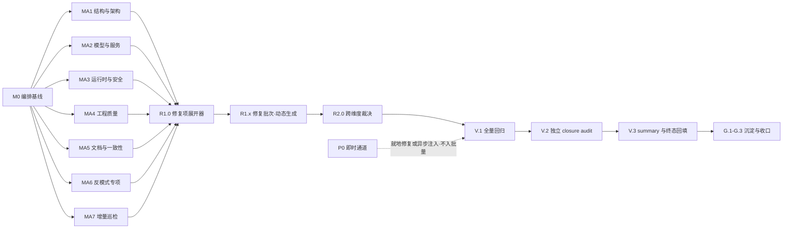

# 全仓代码审查路线图（full-code-review）

> 最后更新：2026-10-09（v7 — R1.0 展开器产物：42+2=44 行 R1.x 增补；v6 — 基线刷新增补：新增 0.5 基线刷新 + 1.9/1.10/2.8/4.6 四个 Wave 1 工作项，覆盖 2026-09-22 基线后新增的模块组与子模块；修订 1.5/6.1 的 jq 空壳前提、7.1 增量窗口、7.2/7.4 增量注记；审核工作项 50→54。v5 = 第四轮收敛审查共识达成；v4 = 第三轮 F1–F7；v3 = 第二轮 N1–N9；v2 = 第一轮 F1–F7）
> 来源：`ai-dev/skills/audit-remediation-roadmap-authoring-prompt.md`
> 关联轮次目录：`ai-dev/audits/2026-09/2026-09-22-2020-code-review-full/`
> Mission 配置：`missions/full-code-review.json`
> 目标范围：nop-entropy 全部顶层模块组（45 组 = 2026-09-22 基线 41 组 + v6 增补时已入库的 nop-refactor/nop-jq/nop-bytecode/nop-duckdb；子模块精确总数以 0.5 刷新后的矩阵为准）
> 总体复杂度：**S 级**（多组同时满足 Java ≥ 200 与子模块 ≥ 5）

## 目的

对全仓库实施「审查 → 修正 → 整体审核」闭环，分三个 Wave 推进：

1. **Wave 0（编制期已完成）**：全仓调研基线、审计维度矩阵、未闭包发现汇聚。
2. **Wave 1（审核）**：按层 × 按模块细粒度审计现有代码，所有报告逐项保留在轮次子目录。
3. **Wave 2（修正）**：R1.0 展开器根据 Wave 1 审计结果把 P0/P1 发现转为修正工作项（增补本 roadmap），逐项修复并验证。
4. **Wave 3（整体审核）**：全量回归 + 独立 closure audit + 轮次汇总与知识沉淀。

本 roadmap 只处理 **P0 与 P1**；P2 走显式裁决通道，P3 记录为 watch-only。

## Work Item Status

> 唯一动态状态块。Status 取值 `todo | in progress | done | blocked | cancelled`。M0 的 0.1–0.4 为编制期已完成，0.5 为 v6 增补的基线刷新项，其余初始全 `todo`。

### M0 — 审计编排基线（Wave 0）

| # | Work Item | Status | Owner Doc | Deps | Skill |
|---|-----------|--------|-----------|------|-------|
| 0.1 | 全仓模块调研与复杂度评级（9 组只读调研） | done | `docs-for-ai/01-repo-map/module-groups.md` | — | `audit-remediation-roadmap-authoring-prompt.md` |
| 0.2 | 建立轮次子目录与报告索引骨架 | done | 轮次子目录 `index.md` | 0.1 | 同上 |
| 0.3 | 绿色构建基线验证 | done | — | 0.1 | none（`./mvnw clean install -DskipTests -T 1C`，2026-09-22T19:56:36+08:00 BUILD SUCCESS） |
| 0.4 | 未闭包发现汇聚清单 | done | 矩阵 `00-scope-and-dimension-matrix.md` §4 | 0.1 | `audit-remediation-verification-prompt.md`（登记口径） |
| 0.5 | 基线刷新（v6 增补），交付物四组：① 矩阵 §1/§2 纳入编制基线当日或之后入库且未入 v5 覆盖的新组/新子模块（nop-refactor、nop-jq、nop-bytecode、nop-duckdb；nop-stream-sql、nop-code-lang-go/rust/csharp、nop-lint-maven-plugin/-graphql、nop-benchmark-stream，nop-lint-js 与基线同日入库同样未覆盖），刷新 ❓ 计数，并对齐 §1 与 live 顶层组（补缺的 nop-core-framework 行、勘正幻影顶层组 nop-record——实位于 nop-format/nop-record、nop-format/nop-record-netty 与 nop-kernel/nop-record-mapping、修 nop-kernel 行「jq 空壳」过时注记）；② 矩阵 §6 增注「新组无 check 系列发现、不参与 P1 抽样分批」并同步 §6 头部「四批并集 = §2 全部 18 行」措辞；③ 同步 roadmap 侧交叉引用（「审计维度矩阵」节的 18 行/55 格计数、6.5–6.8 Details 的批次并集措辞）；④ 同步 `docs-for-ai/01-repo-map/module-groups.md`（补 nop-bytecode 行、勘正 nop-code/nop-lint 行子模块清单） | done（2026-10-03，plan 2307，独立 closure audit PASS——见 plan Closure 段与轮次 index） | 矩阵 `00-scope-and-dimension-matrix.md` | 0.1 | `audit-remediation-roadmap-authoring-prompt.md` |

### MA1 — 结构与架构层审计（Wave 1）

| # | Work Item | Status | Owner Doc | Deps | Skill |
|---|-----------|--------|-----------|------|-------|
| 1.1 | 全仓依赖图与模块边界审计（跨组依赖、循环依赖、api 模块纯净性） | done（2026-10-03，plan 2308，closure audit 三修四轮 PASS——P0=0/P1=0/P2=2/P3=3，裁决通过） | `docs-for-ai/01-repo-map/module-groups.md` | 0.3, 0.4 | `cross-module-dependency-audit-prompt.md` |
| 1.2 | nop-xlang 结构/边界/生成管线审计（解析、编译、执行链；XLangASTOptimizer 3028 行无直接测试、JsPromise:117 吞 Throwable 复核） | done（2026-10-03，plan 2309，closure audit 一次 PASS——P0=0/P1=1/P2=10/P3=18；JsPromise already-fixed；Optimizer 实为生成物） | `docs-for-ai/02-core-guides/xlang-and-xpl-basics.md` | 0.3, 0.4 | `deep-audit-prompts.md`（维度 01/02/05） |
| 1.3 | nop-core 结构审计（VFS/反射 ClassModel/XNode 2829 行/类型体系/CoreInitialization 启动链） | done（2026-10-03，plan 2310，closure audit 一次 PASS——P0=0/P1=0/P2=3/P3=29+watch×5；XNode 裁定保留+monitor） | `docs-for-ai/02-core-guides/xlang-and-xpl-basics.md` | 0.3, 0.4 | `deep-audit-prompts.md`（维度 01/02/15） |
| 1.4 | nop-commons + nop-api-core + nop-codegen + nop-xdefs 审计（工具巨类、162 模板文件链、114 xdef schema 一致性） | done（2026-10-03，plan 2311，closure audit 一次 PASS——P0=0/P1=0/P2=6/P3=34+watch×3；模板链 16/16 抽样、xdef 114/114 闭合正结论；驳回 1） | `docs-for-ai/02-core-guides/xdef-and-xdsl.md` | 0.3, 0.4 | `deep-audit-prompts.md`（维度 02/05/17） |
| 1.5 | xlang 执行后端审计（nop-xlang-java/truffle/e2e/javac/antlr4 + dataset/markdown/record-mapping/kernel-cli；jq 引擎已于 2026-09-28 拆出为顶层组 nop-jq，引擎审计面归 1.9；nop-jpath 的 jq 子集桥接面仍属 kernel 组既有审计项（1.1/1.3/6.x）） | done（2026-10-03，plan 2312，closure audit 一次 PASS——P0=0/P1=0/P2=5/P3=6；ExecToJavaTranslator 保留+monitor、truffle 差集 0 缺口、e2e 位置合理三项正结论；P2×5 测试缺口带修复精算进 R1.0；驳回 1；过程安全事件 1 起已登记；本行状态为 2026-10-04 回填勘误——v6 改写时丢失回填，closure 证据见 plan 2312 Closure 段） | `ai-dev/design/xlang-java/` | 0.3, 0.4 | `deep-audit-prompts.md`（维度 02/16） |
| 1.6 | nop-core-framework 六模块结构边界审计（boot/config/ioc/log/plugin/security；CORE-02 defer 现状复核） | done（2026-10-03，plan 2313，closure audit 一次 PASS——P0=0/P1=0/P2=3/P3=9；CORE-02 still-deferred、弱加密 WARN 现状、CORE-01 docs 闭环三项标定） | `docs-for-ai/03-modules/nop-plugin.md` | 0.3, 0.4 | `deep-audit-prompts.md`（维度 01/02） |
| 1.7 | nop-persistence + nop-service-framework 分层与边界合规审计 | done（2026-10-03，plan 2314，closure audit 一次 PASS——P0=0/P1=0/P2=13/P3=18；分层零违规正结论；AST 模板包死代码 3494 行 P2 队首；初审 P1×2 复核降 P2） | `docs-for-ai/02-core-guides/service-layer.md` | 0.3, 0.4 | `deep-audit-prompts.md`（维度 01/06） |
| 1.8 | 集成与外围结构审计（spring/quarkus/network/integration/runner/autotest/demo + 漏网模块归属裁定） | done（2026-10-03，plan 2315，closure audit 一次 PASS——P0=0/P1=1/P2=6/P3=20；file/credential-app 半拆 P1 进 R1.0；红旗法 0 反向边；归属裁定 3 条） | `docs-for-ai/01-repo-map/module-groups.md` | 0.3, 0.4 | `deep-audit-prompts.md`（维度 01/02） |
| 1.9 | 新增模块组首审 a（v6）：nop-jq（引擎求值语义与官方 1.7.1 套件基线一致性、错误路径）+ nop-refactor（operation 四段契约、Refactor__ GraphQL 契约面 gates 与 EditPlanApplier 信任边界） | done（2026-10-04，plan 2316，closure audit 两轮 PASS——P0=0/P1=1/P2=9/P3=21；jq 工具接缝资源耗尽 P1 进 R1.0；430/430 基线与 refactor 四段全通正结论） | `docs-for-ai/01-repo-map/module-groups.md` + `docs-for-ai/03-modules/nop-refactor.md` | 0.3, 0.4, 0.5 | `deep-audit-prompts.md`（维度 01/05/13） |
| 1.10 | 新增模块组首审 b（v6）：nop-bytecode（class 采集层、字节码分析通道架构、ASM 依赖面与 class file 版本支持门槛）+ nop-duckdb（engine 三配置键与单写者约束、文件读写面、native 包装） | done（2026-10-04，plan 2317，closure audit 两轮 FAIL→PASS——P0=0/P1=2/P2=5/P3=26；bytecode exit 1 契约缺口+ObligationToken 死循环 P1×2 进 R1.0；duckdb 契约与 doc 一致正结论） | `docs-for-ai/03-modules/nop-bytecode.md` + `docs-for-ai/03-modules/nop-duckdb.md` | 0.3, 0.4, 0.5 | `deep-audit-prompts.md`（维度 01/02/09） |

### MA2 — 模型与服务层审计（Wave 1）

| # | Work Item | Status | Owner Doc | Deps | Skill |
|---|-----------|--------|-----------|------|-------|
| 2.1 | nop-orm + nop-orm-model 深审（会话状态机/持久化上下文；check2 P1 复核） | done（2026-10-04，plan 2318，closure audit 一次 PASS——P0=0/P1=2/P2=15/P3=41；detach 一缓契约混杂+DELETING 装配重置 P1×2 进 R1.0；check2 三 P1 全部 already-fixed；降级 1——useRevision 探针实证后 P1→P2） | `docs-for-ai/02-core-guides/model-first-development.md` | 0.3, 0.4 | `deep-audit-prompts.md`（维度 04/10/14/15） |
| 2.2 | nop-orm-eql 深审（EQL 编译器；集合操作符 join 放大 P0 复核） | done（2026-10-04，plan 2319，closure audit 一次 PASS——**不通过附 P0×3**：否定编码根因簇触发即时通道→plan 2320 异步注入；P1×11/P2×17/P3×29；check2 P0 join 放大 already-fixed 但 1:1 掩盖缺口坐实；60 条唯一发现全探针实证） | — | 0.3, 0.4 | `deep-audit-prompts.md`（维度 10/15/16） |
| 2.3 | nop-dao + nop-db-migration + nop-dbtool 深审（migration 9/17 change CCE P0 复核） | done（2026-10-04，plan 2321，closure audit 一次 PASS——通过无 P0 附 P1×1（callFunc 绑定偏移进 R1.0）；**check2 点名 4 条全部 already-fixed**（migration 两 P0 双探针实测+JdbcBatcher 实跑）；P2×19 方言缺口族/事务簿记/recordMigration 翻倍；降级 5、驳回立案 1 dup≡P3-2.1-024；dim14-02 vs 2.1-028 移交 R2.0 对账） | `docs-for-ai/02-core-guides/model-first-development.md` | 0.3, 0.4 | `deep-audit-prompts.md`（维度 04/09/14） |
| 2.4 | nop-nosql + nop-cdc 深审（RESP3 RateLimiter P0、PubSub 串投、codec 不对称复核） | done（2026-10-05，plan 2322，closure audit 一次 PASS——通过无 P0 附 P1×1（rate_limit.lua 集群 CROSSSLOT 进 R1.0）；**check2 P0 复裁定 false-positive（三重独立复现）**、P1-2 already-fixed、**P1-3 still-live（MFA codec 类型不对称）进 R1.0 输入**；RESP3 逐原语矩阵 10 通道全兼容；P2×12/P3×25；降级 3、升级 1、跨维度去重 3） | `ai-dev/design/nop-nosql/` | 0.3, 0.4 | `deep-audit-prompts.md`（维度 09/14/15） |
| 2.5 | 全仓 `model/*.orm.xml` 模型合规扫描（机械维度：业务 13 模块 + ai + code + stream 实体模型） | done（2026-10-05，plan 2323，closure audit 一次 PASS——通过无 P0 附 P1×5（UK/唯一索引零物化族×4+字段长度覆盖族×1 进 R1.0）；**平台级发现：DDL 生成器不物化 `<index>`**（平台工单入 R1.0）；维度 8 独立复算 67/51/16 逐文件证实；21+5 文件覆盖，stream 零模型登记；demo 3 条单列；改判 2 降 1 驳 0） | `docs-for-ai/02-core-guides/orm-model-design.md` | 0.3, 0.4 | `orm-model-audit-prompt.md` |
| 2.6 | nop-biz + nop-graphql 深审（CrudBizModel 上帝类、权限 fail-open 三处、GraphQL 引擎） | done（2026-10-05，plan 2324，closure audit 一次 PASS——不通过附 P1×7 三族（GraphQL fragment 校验族×2+DataLoader 挂死/权限公开面族×3/后台直调零事务）进 R1.0；**check2 九条点名全部 already-fixed**；CrudBizModel 拆分评估交付（宽职责单管线/700 行可下沉/禁机械拆类）；fail-open 三处裁定+双配置键方案；安全类判级总裁据确立；33 条全保留改判 2 驳 0） | `docs-for-ai/02-core-guides/service-layer.md` | 0.3, 0.4 | `deep-audit-prompts.md`（维度 03/07/12/13） |
| 2.7 | 业务模块 BizModel/IoC 配置合规整域扫描（beans.xml、@BizModel 规范、xmeta 对齐） | done（2026-10-05，plan 2325，closure audit FAIL→修复→满足收口条件——通过无 P0/P1 附 P2×4（孤儿注册族×2、_module 缺失×5 JAR、RetryScanner 同型先例未同步）；**NopIoC 硬规则全仓 211 @Inject 文件零违规**（独立复算）；372↔442 双向对账闭合；驳回 1 假阳性反向发现 i18n 缺失族群 447/3987；candidate 池计数串写经 auditor 处方修正） | `docs-for-ai/02-core-guides/ioc-and-config.md` | 0.3, 0.4 | `configuration-audit-prompt.md` + `deep-audit-prompts.md`（维度 08/11） |
| 2.8 | nop-stream-sql 首审（v6；对齐 2.2 的 DSL 编译器先例）：StreamSqlCompiler 与 TUMBLE grammar、分析窗口 keyed state 清理、双流 join 语义（算子实现面在 nop-stream-core/runtime，验证按受影响模块扩展） | done（2026-10-05，plan 2326，closure audit FAIL→处方修正后收口——不通过附 P0×1（SumAgg 混型累加静默错值，探针实测）触发即时通道→**plan 2327 已修复（三通道精确累加器，closure audit Can Close）**；P1×3（null 键误配/putAll seq 丢失/completeUnmatched 双发）；**prior art 零推翻**（WI12/WI13/WI17 live 复核成立）、2.2 不波及；30 条全保留、降 1 驳 1；定向测试排除 2 个预存失败后三模块全绿） | `ai-dev/backlog/nop-stream-sql-roadmap.md` | 0.3, 0.4, 0.5 | `deep-audit-prompts.md`（维度 05/10/14/15） |

### MA3 — 运行时与安全层审计（Wave 1）

| # | Work Item | Status | Owner Doc | Deps | Skill |
|---|-----------|--------|-----------|------|-------|
| 3.1 | nop-wf 深审（WorkflowEngineImpl 1941 行、WF-01..03 MEDIUM 现状、审批状态机） | done（2026-10-05，plan 2328，closure audit 一次 PASS——通过无 P0 附 P1×2（approval-support 绕引擎双事实源与 P1-2.6-005 分立互补同批互引+超时 dueAction 通道被 allowCallByUser 阻断与 job bean 失配叠加同批）；**check2 12 条点名零虚假申报**（P1×4 零推翻+P2×8 六修二 live）；WF-01/02/03 六条全标定（F-WF-02-1 回灌 3.2、F-WF-01-3 建议 ledger 补记）；维度 22 引擎侧适配交付；撞车教训入档 G.1；23 条唯一发现降 0 驳 0） | `docs-for-ai/02-core-guides/workflow-configuration.md` | 0.3, 0.4 | `state-machine-business-review-prompt.md` + `deep-audit-prompts.md`（维度 13/14） |
| 3.2 | nop-task 深审（DaoTaskStateStore、continuation-skip P0 复核、可靠性装饰器） | done（2026-10-05，plan 2329，closure audit FAIL→B1 补录 2 条 P2→聚焦复审满足收口条件——通过无 P0/P1 附 P2×10：恢复完整性族×5（persist 死契约〔P1 降级高位〕/taskInputs 死代码/ACTIVE resume/迭代边界顶替/outputs 重放洞）+装配契约族×2+错误列残留+**F-WF-02-1 深审维持 still-live 修复裁定交付**；continuation-skip P0 复核 already-fixed 与 6.4 一致维持；check 系列 14 条盘点零遗漏；DaoTaskStateStore 实测 902 行） | `docs-for-ai/03-modules/nop-task.md` | 0.3, 0.4 | `state-machine-business-review-prompt.md` |
| 3.3 | nop-batch 深审 a（S 级零专项审计首审）：DSL 任务模型→执行链、集群分区一致性 | done（2026-10-05，plan 2330，closure audit FAIL→B1 补录 P3 2 条 DSL 标题→聚焦复审 SATISFIED——不通过附 P1×3：orm-reader `<eql>` 解析未接线静默全表加载/processor order 声明失效/allOf 掩蔽 fail-fast 根因终态误持久化 KILLED 不可重启〔TestBatchTaskCheckpoint flaky 收编升级为真产品缺陷，探针 5/5〕进 R1.0；**check2 五条 P1 标定全部 already-fixed**；28 条全保留降 0 驳 0；子模块清单对齐 roadmap〔service 收编/api 归 3.4〕） | `docs-for-ai/03-modules/nop-batch.md` | 0.3, 0.4 | `deep-audit-prompts.md`（维度 04/07/14） |
| 3.4 | nop-batch 深审 b（首审续）：JDBC 读写事务、导入导出路径、批任务记录 | done（2026-10-05，plan 2331，closure audit FAIL→P3 编号处方修正后收口——通过无 P0/P1 附 P1×2（snapshotBuilder restore 空列表静默丢弃 chunk/historyStore mandatory 三列 dead-on-arrival）进 R1.0；**check2 七条 3.4 域条目标定全覆盖**（:101 深审维持已修复/:125 修复不可落地由 P1-3.4-002 承载/:153/:180/:205/:231/:249 已修验证）；27 条全保留降 0 驳 0；nop-batch-orm 7 类对抗审查收编） | `docs-for-ai/03-modules/nop-batch.md` | 0.3, 0.4 | `deep-audit-prompts.md`（维度 12/14/16） |
| 3.5 | nop-sys 深审（锁过期判断反向 P0 复核、Maker-Checker、事件广播可靠性） | done（2026-10-05，plan 2332，closure audit FAIL→机械处方修正后收口——通过附 P1×1（owner doc ILockService 幻影〔文档→API→装配三层断裂〕与死装配族同批修复互引）进 R1.0；**check2 13 条标定全部落定**（9 already-fixed/:261 still-live 维持〔DSL 调用点实证〕/:285 partially fixed/:217 false-positive）+ check 锁 P0 already-fixed 与 6.4 一致（附测试证据收窄注记）；编译断裂归因钉死 plan 2306 bc9c444cf3；25 条全保留降 0 驳 0；维度 08 增量注记：2.7 已整域覆盖） | `docs-for-ai/03-modules/nop-sys.md` | 0.3, 0.4 | `deep-audit-prompts.md`（维度 08/13/14） |
| 3.6 | nop-report 深审（XPT 展开、ExpandedCell、公式函数注入面、pdf/docx 导出） | done（2026-10-05，plan 2333，closure audit FAIL→单处方补 log 后收口——通过附 P1×2（removeCell 展开区域起点减号〔check:103 从未处置仍 live〕+权限表全仓零消费引擎取数无角色校验〔nop-datav 下游双轨已成现实〕）进 R1.0；P2×5 含两条挂死独立复现实证置队首；**check2 26 条标定零虚假申报**（:19 COUNTIF/SUMIF P0 已修复〔复核 8/8 测试〕、14+ already-fixed、:298 暂缓承接转 R1.0、:508 删除核实）；撞车合并 12-05≡13-02；净 19 条降 0 驳 0；A/B 面各 3 轮） | `docs-for-ai/03-modules/nop-report.md` | 0.3, 0.4 | `deep-audit-prompts.md`（维度 12/13/15） |
| 3.7 | nop-rule + nop-dyn 深审（规则引擎、DynCodeGen 动态建模信任边界、DYN-01 复核） | done（2026-10-05，plan 2334，closure audit FAIL→机械处方修正后收口——通过附 P1×1（动态模块 moduleName 遮蔽静态模块〔口令哈希直读 published="false" 静默击穿〕主 agent 终裁）进 R1.0；P2×10 含 multiMatch 双存储分叉/缓存失效双缺口/@DataBean 缺失/IEvalScope 锁外写；**check2 31 条零升级**（28 already-fixed + :168 FP + :204 平台暂缓 + :310 转 R1.0 backlog）；**DYN-01 三处维持 JUSTIFIED**；13-01 降 P3、10-08 duplicated 并入 P1-2.5-005；净 22 条降 1 升 1 驳 0；A/B 面各 4 轮） | `docs-for-ai/03-modules/nop-rule.md` | 0.3, 0.4 | `deep-audit-prompts.md`（维度 10/13） |
| 3.8 | nop-tcc + nop-retry + nop-file 深审（CANCEL_SUCCESS 误标 P0、恢复路径、上传下载越权） | done（2026-10-06，plan 2335，closure audit 一次 PASS——通过附 P1×5 三族（文件权限面族×2 + 引擎执行表零 auth〔:290 升级，P1-2.6-006 延伸终裁〕+ 状态机恢复族×2〔CANCELLING 崩溃恢复死锁/TccContext 静默 fork〕）进 R1.0；**check 18 条标定全覆盖**（10 AF + 2 partially〔处置记录过期〕+ 5 still-live + :290 升级）；**:27 P0 already-fixed 双确认**〔TestTccRunner 10/10〕+**:61 交叉 plan 2282 通过**；B 面 1 驳回；净 24 条降 0 升 1 驳 1；A 面 3 轮/B 面 2 轮） | `docs-for-ai/03-modules/nop-tcc.md` | 0.3, 0.4 | `state-machine-business-review-prompt.md` + `deep-audit-prompts.md`（维度 13） |
| 3.9 | nop-gateway + nop-network 深审（AI 鉴权拦截器语义、HTTP 客户端错误路径、解压/MQTT P0 复核） | done（2026-10-06，plan 2336，closure audit 一次 PASS——通过无 P0/P1 新发现附 P2×9 进 R1.0 输入池 + P3×20 watch-only；**AiAuth 鉴权失败语义终裁 fail-closed**〔warn 脱敏后 throw 401〕；**86 条标定全覆盖零虚假申报**〔50 AF + 9 PF + 1 adjudicated + 26 still-live〕；**五条 P0 全部 already-fixed 实测**〔check2 :19/:43 + check :23 + NET 族 :21/:45/:70〕；check :49/:86 两条 P1 确认维持进 R1.0〔P1-check-gw-49/86〕；A 面 1 降级；净 29 条新发现；A/B 面各 3 轮） | `docs-for-ai/03-modules/nop-network.md` | 0.3, 0.4 | `deep-audit-prompts.md`（维度 12/13/14） |
| 3.10 | nop-auth + nop-credential 增量安全审计（security AUTH/CRED 族之后的增量面） | done（2026-10-06，plan 2337，closure audit 一次通过九项全 PASS——通过附 P1×2 进 R1.0：①P1-3.10-001 CRED-01 no-finding 台账虚假保证〔复核升格〕②P1-check-mcc-172 passphrase 泄漏标定维持〔与 P1-check2-nosql-67 同批〕；**29 条 auth 标定全覆盖零冲突**：check2 9 AF+6 deferred/check 13 AF+1 partially——:44/:19 两 P1 already-fixed 零漂移 + check :23 P0 already-fixed 双确认〔P0 不变量在拆分 diff 逐字保持〕；MFA codec 消费点侧取证闭环〔Redis 后端功能性失效 fail-closed〕；diff 四 commit 全部通过；CRED ledger 一致态零漂移；净 6 条新发现（A 驳 1/B 升 1）；A 面 2 轮/B 面轻量 2 轮） | `docs-for-ai/03-modules/nop-auth.md` | 0.3, 0.4 | `deep-audit-prompts.md`（维度 13） |
| 3.11 | 全仓安全横切复核（security-audit item 14 的 MEDIUM×14 逐项现状标定 + 新增敏感面扫描） | done（2026-10-06，plan 2338，closure audit 一次 PASS 八项全过——通过无 P0/P1 新发现附 P2×1/P3×1；**item 14 全 14 条标定完成 0 已修/12 仍 live/2 缓解生效**（复核 14/14 亲读确认零改判）；F-F2-1 升 P1 合并 3.8 P1-3.8-001/002 族 + F-WF-02-1 带修复裁定直入 R1.0；**P2 裁决例外 12 条转 R1.0**（index「P2 裁决台账」首次启用）；grep 复扫三模式 123 处全量核实、口径重放全一致；新发现 P2-3.11-001 JWT 主密钥族 22 文件（含 nop-batch-app 键漂移死配置）+ P3-3.11-001 SSO client-secret 第 4 实例；**owner-doc 同步完成**（security-audit-roadmap item 14 回填 + consolidation ledger F-WF-01-3 缓解补记）；A/B 面各 2 轮） | `ai-dev/backlog/security-audit-roadmap.md` | 0.3, 0.4 | `audit-remediation-verification-prompt.md` |

### MA4 — 工程质量层审计（Wave 1）

| # | Work Item | Status | Owner Doc | Deps | Skill |
|---|-----------|--------|-----------|------|-------|
| 4.1 | 错误处理与错误码一致性审计（全仓 ErrorCode/NopException 两层策略落地） | done（2026-10-06，plan 2339，closure audit 一次 PASS——通过无 P0/P1 附 P2×3 进 R1.0 输入池（错误码字符串伪装系统族 65 处/40 文件/14 模块组 + RangeSplitUtils 中文消息 + ToolSchemaConverter 吞异常降级无参工具〔复核加重：null 系全部真实工具常态路径〕）；**bare RT 全仓仅 5 处仅 1 违规 P3**、BizModel 面 ErrorCode 为主合规率 84.3%（复核修正后）+ .param() 91.3%、api 面校准后零违规、3348 catch 合规 64.0% 正结论；复核修正透明记载（合规率口径/09-04 处数/09-20 加重）；P3×3 watch；零驳回；6.2 移交 3348 行 catches.tsv；A/B 面各 2 轮） | `docs-for-ai/02-core-guides/error-handling.md` | 0.3, 0.4 | `deep-audit-prompts.md`（维度 09）+ `nop-platform-conformance-audit-prompt.md` |
| 4.2 | 测试有效性审计（zero-test 模块清单、@Disabled 清单、反模式抽查） | done（2026-10-06，plan 2340，closure audit 一次 PASS 七项全过——通过附 P1×6/P2×9 进 R1.0（两大 HTTP 适配层零测试〔spring 形态无 e2e〕/batch-orm upsert/sentinel 限流/fsm 状态机/TestStringHelper 5 不触 SUT+1 零断言 + reconciler 被禁 8 周/TestXplTask 裸禁 9 月/TestExcelTemplate 零断言/isWhitespace 双语义零锚定）；**zero-test 120 模块（32%）口径重放 SET-MATCH-EXACT**：93 合理/25 缺口/2 移交；@Disabled 57→真禁用 53+升格 2+误报 2；反模式抽检 28 行仅 2 命中、变异推演 14 个发现侧全「改错仍绿」；**biz-auth-api 2 test 有效约束移出点名清单**；零驳回；A/B 面各 2 轮 + 复核） | `docs-for-ai/02-core-guides/testing.md` | 0.3, 0.4 | `unit-test-antipatterns.md` |
| 4.3 | 巨型手写文件与复杂度热点审计（>1500 行全仓盘点 + 拆分/保留裁定清单） | done（2026-10-06，plan 2341，closure audit 八项核验全过一次通过——通过附 P2×4 拆分建议走 P2 裁决台账转 R1.0（CodeIndexService 六域/JobCoordinator 七域两簇〔禁动锁结构+测试前置〕/ReActAgentExecutor 心跳块/**GraphModelCheckpointExecutor 恢复族队首静态无互锁**）；**基线重放三重独立确认零漂移**（33=9 生成物+11 已裁定+13 待新裁定）；保留 6/monitor 3 台账（触发条件量化）；撞车 11/11 无漂移；1.3 转交 3 项闭环；零附带行为发现；单盘点 agent 分批 3 批 + 复核） | — | 0.3, 0.4 | `deep-audit-prompts.md`（维度 02/15） |
| 4.4 | nop-format + nop-search + nop-message（非 pulsar）+ nop-cluster 深审 | done（2026-10-06，plan 2342，closure audit 八项核验全过一次 PASS——通过无 P0/P1 新发现附 P2×7 进 R1.0 输入池（09-20 partial-dup 与 P2-4.1-001 同批）+ P3×11 watch；**标定 50 条全落定**：format 16〔12 AF+2 partially+1 wontfix+1 still-live：条目 5 生成器-文法对齐探针 0/13 往返实证〕/ search 19〔1 驳回 P0 已修 3 测试复跑绿 + 18 保留 P1×5 live〕/ msg-cluster 15 全成立〔P1×4 全确认〕；mermaid 三 P1 plan 2306 修复验证通过；LuceneSearchEngine 有条件拆分裁定〔6 簇拆 2 保 4 先修 5 P1〕；TODO 35 处三类评定；kafka 生命周期 5 点裁决移交 7.7；6.8 preempt 声明；三面各 1-2 轮 + 三独立复核，零驳回） | — | 0.3, 0.4 | `deep-audit-prompts.md`（维度 09/14/16） |
| 4.5 | nop-frontend-support + nop-dev-tools + nop-migration + nop-runner + nop-utils 深审（CLI 双入口、工具链质量） | done（2026-10-06，plan 2343，closure audit 八项核验全过一次 PASS——通过无 P0/P1 附 P2×1 进 R1.0 输入池（TestXdslResourceTransformer 零断言——processXDef 不可达加强）+ P3×7 watch；**标定台账 88 条零翻案**：dev-tools 25〔17 闭环+6 成立+2 补位〕/ nop-utils 23/23 已修〔P0×2〕/ runner-cli 17/17 未修 / frontend-benchmark 19/19 未修 / migration 4/4 未修移交 demo-migration；**CLI 双入口三模块两真入口一死占位裁定**（EmptyMain 死占位/NopCliApplication 真 main/jdk11 漂移 3 项）；依赖卫生十模块 1 项 P3 违规（nop-java-parser 三跳传递）+ utils 重复度仅 2 同名+1 组跨模块复制；debugger 并发族 6 处修复全部到位；6.8 preempt 声明；两面各 1 轮 + 双独立复核，零驳回） | — | 0.3, 0.4 | `deep-audit-prompts.md`（维度 02/16/17） |
| 4.6 | nop-lint 增量首审（v6）：nop-lint-js/-maven-plugin/-graphql 三个新子模块 + tool-replacement roadmap 收口后的残留面与规则白名单 fail-closed 语义 | done（2026-10-06，plan 2344，closure audit 七项核验全过一次 PASS——通过无 P0/P1 附 P2×4 进 R1.0 输入池（09-01 checkFile 表外扩展名 NPE 击穿错误面〔JDK 26 独立复现〕/09-02 tsc 桥重启不重绑 project/02-01 Mojo threadSafe 并行竞态〔对采用者触发〕/16-01 白名单 silent-empty〔升级触发=GraphQL 主通道〕）+ P3×7 watch；**maven-plugin 零新管线语义成立**；**fail-closed 10 项语义点全部成立**（namespace 既住裁定复核准确）；三层账本对账残余项一致 + 3 项纪律漂移交 tool-replacement 维护；js 适配面合格；单 agent + 复核，零驳回） | `ai-dev/design/nop-lint/` | 0.3, 0.4, 0.5 | `deep-audit-prompts.md`（维度 02/09/16） |

### MA5 — 文档与一致性层审计（Wave 1）

| # | Work Item | Status | Owner Doc | Deps | Skill |
|---|-----------|--------|-----------|------|-------|
| 5.1 | docs-for-ai 与 live 代码一致性审计（02-core-guides + 03-modules 抽样） | done（2026-10-06，plan 2345，closure audit 实质全过（处方 R1 index P1 行/R2 行号勘正已落实）——通过附 P1×3 进 R1.0（①事务默认表述族〔18-01+18-20 分立立案互引 P1-2.6-001：service-layer/api-and-graphql/INDEX 默认规则/runbook/nop-task×3/TXN-001 共 6+ 文件，统一入口双矩阵〕②@IocBean 幻影教程〔nop-job.md，与 P1-3.5-001 同批互引〕③P1-3.5-001 ILockService 标定维持；P2×5 进 R1.0 输入池 + P3×7 watch；**136 条核对声明一致率 ≈89%**；复核 15/15 全保留零驳回；撞车 7/7 未修复维持；12 篇抽样 + INDEX 路由 + source-anchors 全覆盖） | `docs-for-ai/INDEX.md` | 0.3, 0.4 | `documentation-routing-audit-prompt.md` |
| 5.2 | ai-dev/design 各子系统设计文档 drift 审计（对照 live 代码） | done（2026-10-06，plan 2346，closure audit 实质全过（处方 R1 index 台账两行已落实）——通过附 P1×1 进 R1.0（maker-checker/03 现在时描述完全未实现的待审锁/guard/TTL 机制〔orm 表 23 列无锁列、错误码零命中〕）+ P2×3 进 R1.0 输入池 + P3×3 watch；**草稿态违规 39 处/29 篇整体立案 P2-5.2-001 走 P2 裁决台账**（P1×30+P2×9；口径重放三重确认 5/5 精确；②类 1 处改判透明记载——xdef-declarative-validation 执行器实存）；7/12 篇零 drift 正结论；双面 + 双独立复核，零驳回） | `ai-dev/design/README.md` | 0.3, 0.4 | `design-doc-audit-prompt.md` |
| 5.3 | 跨模块公共 API（nop-*-api）契约一致性与版本健康审计 | done（2026-10-07，plan 2347，closure audit FAIL→处方 R1-R3 落实后轻量复核 PASS——见 plan Closure 段——通过无 P0/P1 附 P2×4 进 R1.0 输入池（bom 5 活跃幻影+tests 死依赖/nop-code 版本漂移零留痕/ChatMessage role→type 存量会话不可读〔升 P1 触发条件登记〕/propId=6 重复固化三层）+ P3×11 + 线索×8；机械 10/10 组口径重放吻合、22 条原始条目零整条驳回、7 组撞车终裁、复核补扫新增 P3-5.3-014〔closure audit E7 勘误：TestApiTypes 模块自有测试引用漏计，结论存活〕；api.xml/xdef 资源面零漂移、26 pom 零 impl 反向依赖、唯一真幻影 IRpcStatusReporter 三正结论） | `docs-for-ai/01-repo-map/module-groups.md` | 0.3, 0.4 | `cross-module-dependency-audit-prompt.md` + `deep-audit-prompts.md`（维度 20） |

### MA6 — 代码审计专项：反模式（Wave 1）

| # | Work Item | Status | Owner Doc | Deps | Skill |
|---|-----------|--------|-----------|------|-------|
| 6.1 | 空壳实现全仓扫描（scan-hollow-implementations.mjs + 人工抽样确认） | done（2026-10-07，plan 2348，closure audit FAIL→处方 R1-R3 落实后轻量复核 PASS——见 plan Closure 段——通过附 P2×1 进 R1.0（Pulsar seekToPosition 空实现配置静默失效，挂接 7.7 对账与 4.4 M-03 同批）+ P3×4 + 线索×4；**373 裁定样本扫描行违规仅 4 条**、69 个在建空壳模块全数合法定位零意外、抽样 SHA-256 重放一致；scanner 口径校准三条 watch；**平台空壳卫生度高正结论**） | — | 0.3, 0.4 | `deep-audit-prompts.md` + `ai-dev/tools/scan-hollow-implementations.mjs` |
| 6.2 | 静默跳过/吞异常全仓扫描（空 catch、catch-ignore、no-op 返回值） | done（2026-10-07，plan 2349，closure audit 一次 PASS 六项全过——见 plan Closure 段——通过无 P0/P1 附 P2×4 案 6 位点 + P3×25 案 28 位点全部移交 R1.0（ArgumentCleanupStage 同源对/JqBuiltins recurse 吞输出上限守卫/AiFileTool 安全码误归因/FileHelper 双丢 cause 等）；**宇宙 1111 行全量裁定零遗漏**（B2B 734 行仅 1 违规验证边界转换预判）；U 承接终裁修复 3/维持 2/升级 1；U-6 升级 P3-6.2-025；复核 QA 锚 41 处零漏检；no-op 返回值域由 6.1 承接） | — | 0.3, 0.4 | `deep-audit-prompts.md`（维度 09） |
| 6.3 | 接线完整性抽样审计（入口→出口：codegen 全链、db-migration 执行链、IoC 启动链、GraphQL 请求链） | done（2026-10-07，plan 2350，closure audit FAIL→处方 R1-R2 落实后轻量复核 PASS——见 plan Closure 段——**四链主链全连通零 P0/P1/P2**（「验证无断链」达成：42 机制边全量台账+复核 8/8 边独立追踪+每链 ≥1 条 E3、E1 兜底零依赖）；通过附 P3×3 进 R1.0（nop-dao exec 绑定护栏缺失/exec-maven-plugin 死属性/db-migration beans 双注册表）；dup×3 归并 P2-1.2-008/P3-2.3-034/P3-2.6-008；IoC 重心链资源发现双主分支机理 + P2-2.7-002 复现 live 2/5 消解；教训入档：撞车检索面=相邻工作项发现清单全量 grep） | — | 0.3, 0.4 | `deep-audit-prompts.md`（接线/端到端路径方法——实为 plan guide Rule #22/#23，roadmap 虚锚 V.3 回修） |
| 6.4 | check 系列 P0×36 逐项复核与状态标定（still-live / already-fixed / false-positive / duplicated），仍 live 的转入 R1.0 输入 | done（2026-10-07，plan 2351，closure audit FAIL→处方 R1-R3 纯文本级落实后轻量复核 PASS——见 plan Closure 段——**无 P0 级仍 live**：fix-ai-check 四批次修复全部 master 实证（already-fixed 35 单元，实跑覆盖 36/36 闭环 95 tests 全绿）；still-live 1 单元 P2-6.4-001（#3 ai-rest residual P0→P2 降档，残余复核收窄，入 P2 裁决台账 F7 首用）；#6a FP-as-P0 勘误拆目（缺陷本体 P1 live 纯引用 4.4 S-06）；#6b SUMMARY 遗漏真 P0 补录 already-fixed） | `ai-dev/audits/check/SUMMARY.md` | 0.3, 0.4 | `audit-remediation-verification-prompt.md` |
| 6.5 | check 系列 P1 抽样标定 a（≥50%）：成员 = 矩阵 §6 批次 a（kernel/core-framework/persistence） | done（2026-10-07，plan 2352，closure audit FAIL→处方 R1 纯文本落实后轻量复核 PASS——见 plan Closure 段——批次 a 48 条 P1 对账闭合 + 冻结抽样 44/48=91.7% 标定：**AF 43 / still-live 1 / dup 0 / FP 0**；P2-6.5-001 nosql-cdc ZERO 半分支 GETEX PX 0 配置陷阱〔P1→P2 终裁〕入 P2 裁决台账；db-migration#P1-6 判 AF〔check2 fb3f860729 闭环〕；撞车零 dup 符号级全量 grep；复核 120 tests 全绿零翻案） | `ai-dev/audits/check/SUMMARY.md` | 0.3, 0.4 | `audit-remediation-verification-prompt.md` |
| 6.6 | check 系列 P1 抽样标定 b（≥50%）：成员 = 矩阵 §6 批次 b（service-framework/业务样板/可复用业务·除 metadata） | done（2026-10-08，plan 2353，closure audit FAIL→处方 R1/R2 纯文本落实后轻量复核 PASS——见 plan Closure 段——批次 b 46 条 P1 对账闭合（13/13 diff+统计核对+三向账平）+ 冻结抽样 29/46=63.0% 标定零翻案：**AF 16 / dup 11（9 归并 AF 目标+2 归并轮内 still-live 承载 P1-3.1-002/P1-3.6-001）/ still-live 2 / FP 0**；承接 11 条轮内终判锚点全实测成立；P2-6.6-001 graphql 订阅推送桥未接线 + P2-6.6-002 batch 续写语义缺失〔均复核终裁 P2〕入 P2 裁决台账；closure audit 勘正两处：§二 表格 canonical 收敛 + P2-6.6-001 缺陷主体改回 GraphQLSubscriptionManager） | `ai-dev/audits/check/SUMMARY.md` | 0.3, 0.4 | `audit-remediation-verification-prompt.md` |
| 6.7 | check 系列 P1 抽样标定 c（≥50%）：成员 = 矩阵 §6 批次 c（ai/stream/code/graph/credential/datav/metadata） | done（2026-10-08，plan 2354，closure audit 一次 PASS 四项全过——见 plan Closure 段——批次 c 46 条 P1 对账闭合（枚举 diff 一致+统计核对 12/12+三向账平）+ 冻结抽样 33/46=71.7% 标定零翻案：**AF 13 / dup 1（归并 6.4 #5 修复目标）/ still-live 19 / FP 0**，复核终裁 **P1×11 进 R1.0（P1-6.7-001..011：方言 role/消息伪影/工具 DSL/agent 循环×2/stream 定时器与 restore 位点/CodeIndexService×3）+ P2×8 进 P2 裁决台账（P2-6.7-001..008）**；承接 1 条 P1-check-mcc-172 维持；16 修复提交 master 全可达+33 锚撞车全量 grep 零新增同根；本批 fix-ai-check 零处置标注——AF 锚全部来自外部 mission 修复波） | `ai-dev/audits/check/SUMMARY.md` | 0.3, 0.4 | `audit-remediation-verification-prompt.md` |
| 6.8 | check 系列 P1 抽样标定 d（≥50%）：成员 = 矩阵 §6 批次 d（集成运行时/runner·autotest·demo/e2e/rg/lint+treesitter/其他） | done（2026-10-08，plan 2355，closure audit FAIL→处方 R1 纯文本落实后轻量复核 PASS——见 plan Closure 段——批次 d 69 条 P1 对账闭合（枚举 diff 一致+统计核对 17/17+SUMMARY 分相账平）+ **承接实测 C=43**（4.4/4.5/3.9 行级锚回读零错配：AF 22+partially 2+adj-deferred 1+still-live 18）+ 冻结抽样 22 条标定零翻案：**AF 14 / dup 0 / still-live 8 / FP 0**，终裁 **P1×6 进 R1.0（P1-6.8-001..006）+ P2×2 进 P2 台账（P2-6.8-001/002）**；双轨抽样 84.6% 净池+65≥35 严格两 MET；**承接 still-live 18 条沿在先行标识补登记 index P1 汇总**（含勿双立注记；closure audit 顺带修 :118 遗留合并行拆分）；SftpClient residual=AF 附 adjudicated-deferred〔plan 2283 承载〕） | `ai-dev/audits/check/SUMMARY.md` | 0.3, 0.4 | `audit-remediation-verification-prompt.md` |
| 6.9 | check 系列 P2/P3 批量状态标定（watch-only 归档，不进修复范围；异常项上报 R1.0 裁决） | done（2026-10-08，plan 2356，closure audit 一次 PASS 六项全过——见 plan Closure 段——694 条 P2/P3〔P2 359+P3 335×54 单元〕三分类账平闭合：**①轮内已标定 148+②处置块已标 315+③watch-only 231**；抽验真实率 94.3%+三分类边界抽验 33/33=100%+承接锚回读零虚假承接；升级候选定稿冻结 **130 行=维持 109+降级留痕 17+新增 4**〔含 nop-core-framework#P2-L108 修复被 plan-2309 重构静默回退发现〕上报 R1.0 裁决通道；**check 系列四层〔P0/P1/P2/P3〕全部收口——939 条发现处置闭合**；流程缺陷 F1–F4 勘正表登记） | `ai-dev/audits/check/SUMMARY.md` | 0.3, 0.4 | `audit-remediation-verification-prompt.md` |

### MA7 — 已审模块增量巡检（Wave 1）

| # | Work Item | Status | Owner Doc | Deps | Skill |
|---|-----------|--------|-----------|------|-------|
| 7.1 | nop-ai 增量审计（2026-08-01 后全部非安全维度增量：原 89 提交 + 2026-09-25 起 nop-ai-agent 重构 25 WI、nop-ai-core WI20–22、nop-ai-toolkit WI17 + 3 个回涨千行文件巡检） | done（2026-10-08，plan 2357，closure audit 一次 PASS 五项全过——见 plan Closure 段——148 提交〔确定性超集，147 系时区口径〕三维审计全覆盖：分配表零遗漏零重复+域外 86 提交登记移交+MCP 无基线面全量；发现 **10 条零翻案：P0=0/P1×2〔WI25 懒重投递状态机破坏/PgVectorStore search 列缺失〕进 R1.0+P2×6 进 P2 台账+P3×2 watch-only**；撞车移交 19 笔抽验 12/12+安全面 H-A3-SEC-01 移交 security 族；维度 12 零独立发现；千行回涨 git 实测=4〔roadmap「3」口径勘误〕；重构波 WI20–22 三维判据全过） | `ai-dev/backlog/audit-remediation-roadmap.md` | 0.3, 0.4 | `audit-remediation-verification-prompt.md` | `ai-dev/backlog/audit-remediation-roadmap.md` | 0.3, 0.4 | `audit-remediation-verification-prompt.md` |
| 7.2 | nop-stream 增量巡检（含 2026-09-22 后 CDC WI1–WI8/Debezium 2.4→3.7 换代与 jdbc-2pc dmlMode 面）+ invariant-loop backlog P2×~15 标定 | done（2026-10-08，plan 2358，closure audit 一次 PASS 六项全过——见 plan Closure 段——覆盖账 **62=在审 35+已审域 27** 账平+四套 WI 映射+域外 20/62 登记+backlog **98 行批量标定 35/35/28** 深抽零翻案；发现 **P1-7.2-001 在窗回归〔WI4 工厂 PARALLEL vs 测试断言失配，实跑复现〕进 R1.0**+P2-7.2-001 keyTuple 静默折叠〔P3 升档〕；**AR-06 升级撤销改 P2 残余收敛**〔plan 368 已闭生产链路〕升级上报定稿 0 条 P1 级；R1.0 存量 P1-6.7-007/008 零触碰维持；零 P0；roadmap「P2×~15」系 6 倍低报——口径缺陷已记） | `ai-dev/backlog/nop-stream-invariant-loop-roadmap.md` | 0.3, 0.4 | `audit-remediation-verification-prompt.md` | `ai-dev/backlog/nop-stream-invariant-loop-roadmap.md` | 0.3, 0.4 | `audit-remediation-verification-prompt.md` |
| 7.3 | nop-metadata P1×1 live 复核 + P2 open/watch 台账巡检 | done（2026-10-08，plan 2359，closure audit FAIL→处方 R1 落实后轻量复检 PASS——见 plan Closure 段——**重定基**：台账「P1×1 live」实为 MR2 已修复（7478eeffe0，2026-08-05）——fixed 终验 **PASS 四锚一致**+**台账↔arm-index 状态分叉缺陷登记**（规则 #2 不回写）；P2×16 三分类 **fixed 8/still-open 5/watch 3**〔16/16 行全量独立核验零翻案；行 4 七位点 7/7 fixed 含 MetaTableProfiler 整类消亡勘正〕；落账缺口登记〔维度16-01〕；still-open 5 归 P2 台账通道；零 P0） | `ai-dev/audits/arm-unclosed-findings-nop-metadata.md` | 0.3, 0.4 | `audit-remediation-verification-prompt.md` | `ai-dev/audits/arm-unclosed-findings-nop-metadata.md` | 0.3, 0.4 | `audit-remediation-verification-prompt.md` |
| 7.4 | nop-code gated 项（Phase 9 @Auth）复核 + 增量巡检（含 nop-code-lang-go/rust/csharp 三个 2026-09-29 新语言扩展） | done（2026-10-08，plan 2360，closure audit 一次 PASS 四项全过——见 plan Closure 段——gated 三点核对登记完备〔张力注记：CRUD 面已由 auto-derive 覆盖但非 CRUD 面+AR-155/170 待确认，roadmap 未更新归 invariant-loop 维护〕+Phase 4 cascadeDelete successor 验证 PASS+6 提交巡检+三新扩展 hollow 全 EXIT=0 零缺陷；发现 **6 条零翻案：P0=0/P1×3 进 R1.0〔LlmSemanticEdgeExtractor 生产不可达 roadmap done 误导面/评测自证空转 MRR=1.0/证据链断裂〕+P2×3 进 P2 台账〔含 roadmap-done+plan-draft 系统性脱钩流程缺陷族〕**；Phase 9 @Auth 实施仍归 successor plan〔人工确认后——Protected Area ask-first 合规〕） | `ai-dev/backlog/nop-code-invariant-loop-roadmap.md` | 0.3, 0.4 | `audit-remediation-verification-prompt.md` | `ai-dev/backlog/nop-code-invariant-loop-roadmap.md` | 0.3, 0.4 | `audit-remediation-verification-prompt.md` |
| 7.5 | nop-job R10 发现（5 P1/8 P2）修复状态标定 + 增量巡检 | done（2026-10-08，plan 2361，closure audit 一次 PASS 四项全过——见 plan Closure 段——**重定基：R10 实为 17 条**〔AR-83~99 含 P3×4；roadmap「5 P1/8 P2」低报口径缺陷已记〕——标定 **already-fixed 17/17 零翻案**〔承接对账 plan 267/268/269 全 completed+保持性四连；抽验 11/17=65% 含 P1×5 全覆盖+独立实跑 51 tests 全绿〕+**增量巡检零编号发现**〔50 提交零偏差+域外 20 登记+样本 5 深检全净〕+Watch 注记 3 条低于门槛；零 P0；6.6 零同缺陷+ID 空间防撞登记） | — | 0.3, 0.4 | `audit-remediation-verification-prompt.md` | — | 0.3, 0.4 | `audit-remediation-verification-prompt.md` |
| 7.6 | nop-datav followups P2×~55 抽样巡检 | done（2026-10-08，plan 2362，closure audit 一次 PASS 五项全过——见 plan Closure 段——**重定基：open 实为 P2×52+裁定项×1**〔#28/#31 已✅消化；roadmap「~55」高估口径缺陷已记〕——抽样 **25 条=48.1%≥45%** 三分类 **fixed 2/watch 2/still-open 21** 零翻案〔复核抽验 10/25=40% 全维持〕+45 提交增量巡检 **P2-7.6-001 残留裸 ISE 双重遗漏链**〔复核新证 W3 时点 ISE=0〕进 P2 台账+still-open 21 归 R1.0 批量裁决；#72 评估〔中低紧急宜随 R1.0 ACL 收口〕；零 P0） | `ai-dev/backlog/nop-datav-audit-followups.md` | 0.3, 0.4 | `audit-remediation-verification-prompt.md` | `ai-dev/backlog/nop-datav-audit-followups.md` | 0.3, 0.4 | `audit-remediation-verification-prompt.md` |
| 7.7 | nop-message-pulsar + nop-record 单轮审计残留复核 | done（2026-10-09，plan 2363，closure audit FAIL→处方落实〔P1-7.7-001 行错插 P2 台账归位+同类错位行 P2-7.3 勘正+勾选/日期口径〕后轻量复检 PASS——见 plan Closure 段——**40 条全量现状复核零翻案**：pulsar 17〔AF 14/still-live 3 全 P3 watch-only：F14 收窄/F16 在案行为/F17 丢 MessageId〕+plan-203 审查 23〔R1 fixed 15/still-live 1→**派生 P1-7.7-001 readCollection fixed 分支 subStart 错序双重跳过**〔零启用场景 P1 附 R1.0 升级依据〕/R2 closed 5+late 1〔R2-6 窗内被修复正向发现〕+partial 1〕+**kafka 5 点移交整理**〔M-01/M-03 维持 open+INIT/ALWAYS 区分裁决建议+非 ApiMessage 统一 JSON 方案+P3-4.4-008 低成本收口〕+seek 三处同点位整理=**P2-6.1-001 唯一承载勿双立**；冻结双 SHA 重放 MATCH；零 P0） | `ai-dev/audits/2026-05-20-adversarial-review-nop-message-pulsar/` | 0.3, 0.4 | `audit-remediation-verification-prompt.md` | `ai-dev/audits/2026-05-20-adversarial-review-nop-message-pulsar/` | 0.3, 0.4 | `audit-remediation-verification-prompt.md` |

### MR — 修正波次（Wave 2，动态展开）

| # | Work Item | Status | Owner Doc | Deps | Skill |
|---|-----------|--------|-----------|------|-------|
| R1.0 | 修复工作项展开器：汇聚 MA1–MA7 全部 P0/P1（含 6.4–6.6/3.11 标定结果）→ 向本 roadmap 增补 R1.x 修正工作项行（按模块组分批、粒度对齐审核项） | done（2026-10-09，汇聚 109 open P1 → **44 行 R1.1–R1.42+R1.6a/b/c**；交叉核对零漏单；对抗审查 FAIL→3 Major+8 Minor 全部修复〔R1.6 拆三/R1.1 PA 注记/时序调和/index 同步等〕；草案 `_tmp/fcr-r10-aggregation.md`+`_tmp/fcr-r10-rows.md`） | 本文件 | MA1–MA7 全部 done | `plan-reviewer-prompt.md` + `ai-dev/plans/00-plan-authoring-and-execution-guide.md` |
| R1.x | 修正工作项（由 R1.0 动态增补，每项引用 finding ID，含测试 + doc-sync） | —（已展开为 R1.1–R1.42+R1.6a/b/c） | 逐项指定 | R1.0 + 对应 finding | 逐项指定 |
| R1.1 | nop-xlang 包级 SCC 三档治理（**⚠️ Protected Area：nop-xlang 内部 plan-first**——须设计文档+回归测试证据）（P1-1.2-001：expr→compile 单边割离优先；环成员冻结+方向边零增红线） | done（2026-10-09，plan 2364：expr 包零 compile 引用——`IExecutableExprCompiler` 接缝 + compile 侧 `DefaultExecutableExprCompiler` + META-INF/services + fail-loud 错误码，公开契约与调用方零改动；SCC 21→20 compile 出环实测；三档治理成文设计文档 + owner doc；红线上报验证脚本版本化 `ai-dev/tools/xlang-package-scc-check.py`；nop-xlang 859 tests 全绿 + 接缝回归 4 用例） | `docs-for-ai/02-core-guides/xlang-and-xpl-basics.md` | R1.0 | `deep-audit-prompts.md`（维度 01） |
| R1.2 | nop-file-app/nop-credential-app 半拆命运裁决（P1-1.8-001：恢复 start()+补 web-orm-starter，或正式休眠+文档声明+降 P2；含坏模板 C093 传播面清理） | done（2026-10-09，plan 2365：**裁决=正式休眠**〔审计预授权路径〕——两主类裸注释→裁决注记含复活三步〔import+start()+web-orm-starter〕、两 pom「独立服务包」+web-orm-starter 块勘注；owner doc 三处声明：module-groups §2.5 nop-file 行勘注+nop-credential 新增行、nop-credential.md standalone 段勘注、nop-file.md 无同类表述记录；行为零差异编译通过） | `docs-for-ai/01-repo-map/module-groups.md` | R1.0 | — |
| R1.3 | nop-jq 工具接缝资源耗尽修复（P1-1.9-001：4 叶节点预算+cancelToken 接线+env-supplier，精算在案） | done（2026-10-09，plan 2366：4 叶节点 checkOutputLimit 落地〔combinations/constructObjects/interpParts/repeatString 迭代粒度〕；checkOutputLimit 升级取消检查点网络——isInterrupted 非清除检查+deadline，抛 JqCancellationException 不可捕〔JqHaltException 先例〕，fork() 传播保用户函数体内生效；JqToolExecutor 接 cancelToken→cancel(true) 与 expireAt〔入口 fail-fast+求值内检查〕+getEnvs 注入〔P2-1.9-003 env 直通同批收口〕；IJsonQuery 新增 apply(root,envVars,deadlineAt) 重载，CLI 默认路径不变；官方 430/430 保持，nop-jq 569 + toolkit 266 tests 全绿） | `docs-for-ai/01-repo-map/module-groups.md` | R1.0 | — |
| R1.4 | nop-bytecode 双缺陷修复（P1-1.10-001 分析层异常收口+CLI 兜底 ~17 行；P1-1.10-002 ObligationToken equals/hashCode ~10 行+虚假 javadoc 修正+CLI 防线） | done（2026-10-09，plan 2367：两分析器 analyze(byte[]) 收口〔NopBytecodeException 重抛卫兵+catch(Exception) 包装〕+CLI 顺序 catch(RuntimeException) 兜底→exit 2；ObligationToken equals/hashCode+真实终止契约 javadoc；死循环回归=资源开在循环前/体内引用回边 shape 实证〔复审 live-code 勘误 if/else 菱形不会死循环〕assertTimeout 终止；防线=solve 循环内 deadline 检查〔复审勘误：逐 class 前置检查防不住单方法 in-flight 挂死〕+--max-runtime-seconds 选项〔默认 600，0=确定性钩子〕；owner doc 退出码/时限登记；34/34 tests 绿〔28 基线+6 新〕） | `docs-for-ai/03-modules/nop-bytecode.md` | R1.0 | — |
| R1.5 | nop-orm 会话状态机修复（P1-2.1-001 detach 对齐 evict 语义或文档契约+checkValid；P1-2.1-002 装配路径非 MANAGED 响亮失败；补 delete→select→flush 回归） | done（2026-10-09，plan 2368：detach=checkContext+checkValid+cache.remove〔对齐 evict〕+级联先行重排〔预存 enhancer 先清 NPE 面一并消除〕+IOrmSession javadoc 契约化；internalAssemble head DELETING/DELETED 守卫〔裁定=跳过装配，同事务先删后查合法模式保留〕；**判别证据=stash 修复跑测试 3/3 全 FAIL〔DELETING→MANAGED 重置/contains 命中/closed 不抛〕**，修复后 3/3 绿；回归测试含判别布景〔第二实体保持 dirty〕；owner doc detach/evict 契约表；nop-orm 216+orm-model 34 全绿） | `docs-for-ai/02-core-guides/model-first-development.md` | R1.0 | `deep-audit-prompts.md`（维度 04） |
| R1.6a | nop-orm-eql DML prop-join 渲染修复批（P1-2.2-001/002/004/005/008/010 共 6 条簇 D+P1-2.2-003 回归确认+状态核销〔已由 plan 2320 连带消除〕） | done（2026-10-09，plan 2369：三层守卫按审计簇 D 处方落地——①操作符位置矩阵守卫〔resolvePropPath keyProp 分支 fromText 判定，:821 重赋值前〕②DML 多段路径守卫〔dmlTargetSource 字段+join.getLeft()== 引用相等，where/相关子查询/SET 目标/RETURNING 四入口〕③渲染兜底〔AstToEqlGenerator 判空断言，判别 propJoins 懒初始化 null〕；两个新错误码；合法面零破坏回归〔单段 owner/子查询自身路径/select 通道〕；P1-2.2-003 NOT(_all) 端到端核销 exists+EQ→NE 语义钉住；新增测试 15 用例，模块 191 全绿） | `docs-for-ai/02-core-guides/model-first-development.md` + `docs-for-ai/02-core-guides/eql-and-database-compatibility.md` | R1.0 | `deep-audit-prompts.md`（维度 10） |
| R1.6b | nop-orm-eql 别名查重+合并提升修复（P1-2.2-006 簇 B 别名查重+P1-2.2-007 簇 C 合并提升分支下沉+删 :154 无条件覆盖〔plan 2370 审查勘正：该行对平铺/ALL 形态为承载性提升点，不可简单删除〕） | done（2026-10-09，plan 2370：makeAlias 查重+回登记+makeTableAlias 回登记〔闭合残余碰撞面〕；提升下沉 canMergeSomeScopes 路径1/canMergeAllScopes 分支+删 ：154；**判别证据=stash 全三文件跑新测试 3 判别用例 FAIL 且失败输出与审计探针逐字吻合**〔unknown-alias[t1]/t1.SID=t1.USER_ID 自比/SILENT1 悬空引用〕；既有 32 transformer 测试全绿证实平铺行为保持；新增 6 用例；模块 197 全绿） | 同上 | R1.0 | 同上 |
| R1.6c | nop-orm-eql 实体级缺省过滤器+eval 转换器（P1-2.2-009 实体级缺省过滤器机制〔租户安全面〕+P1-2.2-011 eval 转换器异文件） | done（2026-10-09，plan 2371：visitSqlUpdate/visitSqlDelete 内联 makeWhere+collectDefaultEntityFilter 注入〔逻辑删除+租户+实体 filter 三类，disableLogicalDelete 开关保持〕；eval 双转换器 not like/not in 否定补全〔含空值早退分支包裹〕；sql_lib 盘查=现存资源库无手写 EQL DML；enableFilter DML 边界+恢复类语句边界 owner doc 声明；**判别证据=stash 6/8 FAIL**〔DML 无租户条件/not like→肯定 like/not in→肯定 in〕；新增 8 用例） | 同上 | R1.0 | 同上 |
| R1.7 | nop-dao callFunc 修复（P1-2.3-001：绑定偏移+OUT 类型硬编码合并修，补带参回归；响亮失败零调用方） | done（2026-10-09，plan 2372：setParameters 增 SQL+startIndex 重载（3 参版委托单源化）+prepareCallableStatement 以偏移 1 绑定；OUT VARCHAR 契约 javadoc 化；**判别证据=stash 后 H2 `Parameter "#2"/"#3" is not set` 与审计探针逐字吻合**；带参/双参回归 2 用例+既有零参保持；nop-dao 168 全绿） | `docs-for-ai/02-core-guides/model-first-development.md` | R1.0 | — |
| R1.8 | 密钥与 codec 安全面修复批（P1-2.4-001 rate_limit.lua 双 key 加 hash tag+集群用例；P1-check2-nosql-67 PrefixTextCodec 类型不对称修复方向 a；P1-check-mcc-172 keyId-only param 改造〔Default+Vault 7 泄漏点〕；P1-3.10-001 CRED-01 勘误注+ledger 补 :172） | done（2026-10-09，plan 2373：①hash tag 两构造点〔写+读侧，审查 B1 勘正〕+集群 rateLimiter 用例 **docker 实测：修复前 CROSSSLOT 逐字复现/修复后 8/8 绿**；②peek 数值解析+真实 PrefixEncodeHelper 往返回归〔**判别=stash FAIL verifiedAt null**；putIfAbsentExAsync 覆盖勘误〕；③7 参数点 keyId-only/非材料定位符化+reason 区分+泄漏回归锁定；④CRED-01 勘误〔声明收窄〕+ledger 补 F-MCC-1 行；**附带发现 R1.6c 下游回归**：nop-orm TestOrmTemplate 4 用例期望更新为 DML 租户注入对齐后契约；auth 462/credential 216/orm Template 13 全绿） | `ai-dev/design/nop-nosql/` + `docs-for-ai/03-modules/nop-credential.md` | R1.0 | `deep-audit-prompts.md`（维度 13） |
| R1.9 | ORM 模型合规+DDL 物化批（平台工单-2.5 DDL 生成器物化 `<index>` 含 unique=true 为先导；P1-2.5-001 nop-metadata precision；P1-2.5-002 nop-job UK；P1-2.5-003 nop-batch UK+upgrade 脚本；P1-2.5-004 nop-retry unique-key；P1-2.5-005 nop-rule outputs precision——先修生成器再重生成；**⚠️ Protected Area：model/*.orm.xml 变更 plan-first**） | done（2026-10-09，plan 2374：平台工单=ddl.xlib CreateTables 逐表物化 index（复用 AddIndex）+DataBaseSchemaInitializer 自动建表后 executeUpdate addIndex 两路径；job 3 UK/batch 1 UK constraint 化；retry 2 unique index 经生成器物化（未改模型）；metadata 6 列 precision=20/rule outputs=4000；**DDL git-diff 断言全过**（job 3 constraint/batch 1 constraint/retry 2 unique index/metadata VARCHAR(20)/rule VARCHAR(4000)）；batch upgrade 三方言幂等脚本+metadata 三方言迁移脚本；**判别=stash ddl.xlib index DDL 缺失 FAIL**；**附带修正 nop-orm 下游**：TestOrmTemplate 4 期望对齐 DML 租户注入契约（R1.6c 回归）+TestJobStoreImpl scheduledFireTime 错开（UK 生效后同毫秒碰撞违规）；owner doc 物化规则三条；orm-eql 205/orm 217/job-dao 87/batch-dao 10/metadata-service 1340/rule 全绿） | `docs-for-ai/02-core-guides/orm-model-design.md` | R1.0 | `orm-model-audit-prompt.md`（验收口径） |
| R1.10 | nop-biz 事务+调度修复（P1-2.6-001 action 级事务装饰器死配置——后台直调写动作零事务；P1-2.6-004 DataLoader 调度点后移+终局兜底 dispatch+幂等+异步 op 回归） | done（2026-10-09，plan 2375——**P1-2.6-001 交付**：mutation 默认事务装饰器+collector bean 注册〔biz-defaults on-bean=nopTransactionTemplate 守卫，审查 B1 勘正 collector 零注册运行时 no-op〕；直测回归 4 用例+stash 判别 mutation 默认项 FAIL；**P1-2.6-004 拆出至 successor plan 2376**〔初版锚点实测挂死，需独立调度生命周期重设计，跟踪至 2376 关闭〕；owner doc 三处事务表述修正；nop-biz 115 全绿） | `docs-for-ai/02-core-guides/service-layer.md` | R1.0 | `deep-audit-prompts.md`（维度 12/13） |
| R1.11 | nop-graphql fragment 校验修复族 A（P1-2.6-002 body 变量误拒 GraphQLSelectionResolver 三位点一次闭合；P1-2.6-003 spread 指令变量误拒/@Exclude 死胎；三回归用例） | done（2026-10-09，plan 2377：三位点一次闭合——`collectDocVars` 文档级并集〔null 安全，getVariableDefinitions 构建〕传入 fragment 预解析+`resolveFragmentSelection` 增 vars 参数；位点 3 随传播闭合零独立改动；并集宽松度裁定〔执行契约未提供变量取 null，无静默错值通道〕登记 owner doc；**判别=stash 后 4 正向用例 FAIL 错误码逐字 `nop.err.graphql.unknown-var`** 与审计探针同款；TestGraphQLFragmentVariables 7 用例+fixture graphql+loader 构造变体；graphql-core 141 全绿〔134 基线+7 新增〕；owner doc 能力边界小节〔P3-2.6-007 伴随〕；plan 审查 agent_da52f942 两轮 FAIL→Ready，closure audit agent_de643721） | `docs-for-ai/02-core-guides/api-and-graphql.md` | R1.0 | — |
| R1.12 | 权限公开面修复族 C（P1-2.6-005 approval-support 五 mutation 补 auth；P1-2.6-006 纯 xbiz 静默公开 16 项清单收口；P1-2.6-007 @BizLoader 死注解 setAuth+xdef 补 auth；配套 require-auth-checker/strict-action-auth 双配置键） | done（2026-10-09，plan 2378：7 个 xbiz 文件 16 项 auth 声明+合并终值断言（TestUseApprovalE2E 扩展/metadata/auth/dyn/rule 五侧 merged-model 断言，含 NopAuthUser_tenant 继承）；loader 两路径装配贯通——buildFetcherField 消费 @Auth+xbiz.xdef BizLoaderModel 增 auth（走 xdefs install→nop-biz 原位再生成，diff 仅 _BizLoaderModel 五生成段）+toBuilder 装配；无注解 loader 群体裁定登记 owner doc strict 前置清单；双配置键（ApiConfigs 定义，默认 false 零兼容影响）收敛 fail-open 三处+ObjMetaBasedValidator 同族点，新错误码 ERR_GRAPHQL_NO_ACTION_AUTH_CHECKER，checkAuth 空安全化；全链 enforcement 测试（enable-action-auth=true+checker+非 admin→ERR_AUTH_NO_PERMISSION）2/2；**附带**：nop-sys-dao TestOrmEntityChangeLogInterceptorNullMarker.java:6 import 一行修正（R1.17 附带工单提前消化，向 R1.17 报备）+metadata 四快照重录（nop-auth-service test 依赖传递引入 nop-graphql-orm 的 OrmBizInitializer prepend id 字段，graphql-orm 部署形态平台预期行为，沿 datav 先例处置）；两轮 plan 审查（agent_3c3a2335 FAIL→Ready）；6 模块 Phase 1 回归 2028 tests 绿+api-core/graphql-core/biz/metadata 全绿；closure audit 见 plan 2378 Closure 段） | `docs-for-ai/02-core-guides/service-layer.md` + `docs-for-ai/02-core-guides/auth-and-permissions.md` | R1.0；与 R1.13/R1.20 同批互引（P1-3.1-001、P1-3.8-003） | `deep-audit-prompts.md`（维度 13） |
| R1.13 | nop-wf 双修复（P1-3.1-001 approval-support 绕引擎双事实源——wf 活跃时拒绝直改+受派人校验；P1-3.1-002 超时 dueAction allowCallByUser 阻断——系统身份旁路或契约修订，与 P2-3.1 bean 失配/remind 链同批〔advisory——P2 属台账行非本行交付物〕） | done（2026-10-09，plan 2379：①dueAction 系统触发——ATTR_WF_SYSTEM_ACTION_TRIGGER 服务端标记（内层 IContext，RPC 不可伪造）+allowCallByUser 入口放行，scanner context 携带断言+ghost-actor 步骤带标记放行/无标记仍拒双锚；②审批双事实源——ERR_WF_APPROVAL_FLOW_ACTIVE_LOCK 注册+ApprovalFlowHelper.checkApprovalFlowLocked gate（绑定 flowId→isEnded 活跃判定；approve/reject 标记放行、withdraw/reverse 无条件、submit 重提交守卫）+metadata 两本地覆盖同步 gate+3 处 listener 内联 try/finally 标记窗口（**审查两轮**：agent_678a12e1 两轮——B1 notifyResult 死标签/真实回调为 3 处内联 listener+metadata 覆盖盲区、B2 helper 形态 wf-core 不可见 IBizObject；**执行中裁定**：XScript 闭包字面量不过 xpl 解析→withEngineCallback 形态改 listener 内联 try/finally，机制等价）；E2E 8/8（含新锁定用例+WORKFLOW 全链+DIRECT 窗口）+wf 三模块 195+metadata 1345 全绿；owner doc 两小节；closure audit 见 plan 2379 Closure 段） | `docs-for-ai/02-core-guides/workflow-configuration.md` | R1.0；与 R1.12 同批互引（P1-2.6-005） | `state-machine-business-review-prompt.md` |
| R1.14 | nop-task DaoTaskStateStore 明文序列化收敛（F-WF-02-1 ≡ P2-3.2-005，**P2 带修复裁定 R1.0 直入通道，非 P1 汇总行**：脱敏契约〔secret 标记排除序列化〕为主+residual-risk 文档扩至全部持久化列+加密仅补充，不翻 persist 缺省） | done（2026-10-09，plan 2380：task.xdef input/output 增 secret 属性（nop-task-core 生成类原位再生成）+DaoTaskStateStore.collectSecretProps（ResourceComponentManager 直取模型，规避 bean 环，运行时零改动）+filterSecretProps 五锚点过滤（解析→递归删键→重序列化，空集字节级短路，异常路径 fail-open）+TestDaoTaskStateStoreSecretFilter 6/6 判别（xdef→isSecret→收集集+递归删键+零变化+resume 可解析）+nop-task-core 163/dao 6/service 1 全绿+owner doc residual-risk 全列清单与契约说明；一轮审查 Ready（agent_e6327312，5 advisory 全吸收）；closure audit 见 plan 2380 Closure 段） | `docs-for-ai/03-modules/nop-task.md` | R1.0 | `deep-audit-prompts.md`（维度 13） |
| R1.15 | nop-batch 执行链修复批 a（P1-3.3-001 orm-reader `<eql>` 接线或移除+Guard 覆盖 new 直构；P1-3.3-002 processor order 排序接线+batch-dsl.md 勘正；P1-3.3-003 allOf AtomicReference CAS 首个非取消异常——终态误分类 KILLED） | done（2026-10-09，plan 2381：①`<eql>` 全链移除（EQL 文本→QueryBean 无转换器实证→裁定移除；xdef+生成类+OrmBatchSupport 注释行；newLoaderState null queryBuilder WARN 可观测——全表合法用途实证 batch-demo）；②processor 拷贝后排序接线（B1：共享缓存模型禁原地排序）+TestBatchProcessorOrderAndEqlRemoval 行为判别 1/1；③primaryError CAS（package-private AtomicReference+executeAsync 重置+优先级内嵌 onTaskComplete——执行裁定上移覆盖直调路径）+TestBatchPrimaryError 机制直测 2/2（判别形式裁定：竞态依赖时序非单测确定性，机制直测替代）；dsl 21/core 61 全绿；一轮审查 agent_7e2f3079 Not Ready 2B（B1 排序插入点原地歧义/B2 04-reference 副本漏出）+8A 全修；owner doc 三处+参考副本同步；closure audit 见 plan 2381 Closure 段） | `docs-for-ai/03-modules/nop-batch.md` | R1.0 | `deep-audit-prompts.md`（维度 04/07） |
| R1.16 | nop-batch 记录面修复批 b（P1-3.4-001 OrmBatchRecordSnapshotBuilder.restore 补 ret.add+魔法值文档；P1-3.4-002 historyStore mandatory 三列补默认值+测试升级真 IEntityDao flush 校验；可并 P1-4.2-003 upsert 测试（**主归属 R1.41，勿双立**）） | done（2026-10-09，plan 2382：restore 补 ret.add（retry 集替换语义——AbstractRetryBatchConsumer/RetryConsumeHelper 消费点锚定）+TestOrmBatchRecordSnapshotRestore Proxy 判别 1/1；saveProcessed 三列显式赋值（retryCount=0 沿 orm.xml 注释/batchSize=filtered.size() 显式约定/handleStatus=0 援引 resultStatus 语义）+既有 Proxy 测试扩展三列断言+TestDaoBatchRecordHistoryStoreRealFlush 真 flush 钉定升级（Proxy 盲区封堵）；orm 1/dao 11 全绿+双模块 hollow 扫 0；一轮审查 agent_385b9873 Not Ready 2B（orm 测试基建缺失/P2-3.4-005→007 编号勘误——审计移交注记滑号已在报告勘误）+6A 全修；owner doc 两处；closure audit 见 plan 2382 Closure 段） | `docs-for-ai/03-modules/nop-batch.md` | R1.0 | — |
| R1.17 | nop-sys 修复批（P1-3.5-001 owner doc ILockService 幻影改 IResourceLockManager 真实契约，与 P2-3.5-008/009 死装配族同批〔advisory〕；**附带工单：TestOrmEntityChangeLogInterceptorNullMarker.java:6 import 包名一行修正〔plan 2306 bc9c444cf3 引入的编译断裂〕+复跑 `./mvnw test -pl nop-sys -am` 收口验证债**） | done（2026-10-09，plan 2383：①nop-sys.md 三处改写（能力入口表/分布式锁节重写——IResourceLockManager 真实 API 双形态示例+勘误记录；grep 零 ILockService 残留）；②附带工单**实测未完全闭口**——R1.12 的 import 修正仅达「编译通过」，测试单独运行仍缺 datasource+orm 建表配置；本 plan 补 application.yaml（h2+init-database-schema）后 TestOrmEntityChangeLogInterceptorNullMarker 真正可运行 1/1；nop-sys-dao 66/service 14 全绿；doc-links 0/checklist 0；纯文档轻量 plan 以工具门禁+三方核对替代独立 closure audit（plan Closure 段记录）；closure audit 见 plan 2383 Closure 段） | `docs-for-ai/03-modules/nop-sys.md` | R1.0；与 R1.42 互引（P1-5.1-003） | — |
| R1.18 | nop-report 双修复（P1-3.6-001 removeCell 展开区域起点减号 offset≠0 删错行列+补回归〔P2-3.6-004 测试缺口同批〔advisory〕〕；P1-3.6-002 权限表零消费——引擎取数接入角色校验或显式休眠+文档勘正，nop-datav 双轨对账） | todo | `docs-for-ai/03-modules/nop-report.md` | R1.0 | `deep-audit-prompts.md`（维度 12/13） |
| R1.19 | nop-rule/nop-dyn 动态模块遮蔽防线（P1-3.7-001 moduleName 保留名检查——stdDomain 排除静态模块名或发布前冲突检测+遮蔽告警；与 P2-3.7-010 路径逃逸同批〔advisory〕） | todo | `docs-for-ai/03-modules/nop-rule.md` | R1.0 | — |
| R1.20 | nop-file/tcc/retry auth 权限面族（P1-3.8-001 读侧 NopFileRecord 零 auth+filePath/isPublic 可改+`..` 防御〔F-F2-1 合并入本条〕；P1-3.8-002 毁侧 attachFile/detachFile 归属校验+flush 钩子收敛；P1-3.8-003 TCC/Retry 引擎执行表零 auth 收口） | todo | `docs-for-ai/03-modules/nop-tcc.md` + `docs-for-ai/03-modules/nop-file.md` | R1.0；与 R1.12 同批互引（P1-2.6-006 延伸） | `deep-audit-prompts.md`（维度 13） |
| R1.21 | nop-tcc/retry 状态机恢复族（P1-3.8-004 CANCELLING 崩溃恢复死锁——endAsync cancel 半区对称路由+遗弃防线；P1-3.8-005 参与方 inbound TccContext 桥接——TccContextInvoker 接线或显式单跳约束声明） | todo | `docs-for-ai/03-modules/nop-tcc.md` + `docs-for-ai/03-modules/nop-retry.md` | R1.0 | `state-machine-business-review-prompt.md` |
| R1.22 | nop-stream-sql 三修复（P1-2.8-001 EquiJoinOperator null 等值键误配含 OUTER matched 语义；P1-2.8-002 PerKeyOrderedBuffer.putAll 搬 insertionSeq；P1-2.8-003 completeUnmatched 水位前缘过滤；判别回归已验证可行） | todo | `ai-dev/backlog/nop-stream-sql-roadmap.md` | R1.0 | `deep-audit-prompts.md`（维度 05/10） |
| R1.23 | nop-stream-core/runtime 修复批（P1-6.7-007 TimerServiceManager 不吞定时器异常+改固化缺陷契约的测试；P1-6.7-008 SourceReaderOperator restore-先于-open 暂存+回归；P1-7.2-001 TestStreamConnectorRegistryDiscovery 断言同步 WI4 PARALLEL 工厂语义——模块测试门禁恢复绿） | todo | `docs-for-ai/03-modules/nop-stream.md` | R1.0 | `deep-audit-prompts.md`（维度 14） |
| R1.24 | nop-gateway 双修复（P1-check-gw-49 路由匹配前全量严格 JSON 解析后置/按路由分流；P1-check-gw-86 OAuth code+redirect 分支下发 auth cookie+初始化用户上下文——SSO 回调登录循环） | todo | `docs-for-ai/01-repo-map/module-groups.md`（gateway 面参照 `ai-dev/design/nop-gateway/`） | R1.0；gw-86 与 auth-core 登录链同批互引 | `deep-audit-prompts.md`（维度 13） |
| R1.25 | HTTP 错误路径修复批（P1-6.8-001 nop-spring-web-starter ServletHttpServerContext.removeCookie null 守卫对齐 getCookie 形态；P1-check-netrpc-24 nop-http-client-jdk JdkHttpClient :320-323 沿 3.9 §2.5#1 修复方向） | todo | `docs-for-ai/01-repo-map/module-groups.md` | R1.0 | — |
| R1.26 | nop-integration 消息通道修复批（P1-6.8-002 YunpianSmsSender null areaCode 守卫+两腿 parity 回归〔6.4 #8 同根残腿〕；P1-6.8-004 FeishuClient DATA 帧按协议回 ACK+headers 透传+wire 契约测试） | todo | `docs-for-ai/01-repo-map/module-groups.md` | R1.0 | — |
| R1.27 | nop-autotest 数据面修复批（P1-6.8-003 TestCaseJsonDataSplitter 输出路径对齐+splitter→loader 往返测试；P1-6.8-005 variant 双约定统一+录制→校验往返测试；P1-6.8-006 removeInputTable isDefaultVariant 守卫对齐 saveInputTable 对称性） | todo | `docs-for-ai/02-core-guides/testing.md` | R1.0 | `unit-test-antipatterns.md` |
| R1.28 | nop-search 先修批次（P1-4.4-S-02 空 query 空 BooleanQuery；P1-4.4-S-03 visitNot 纯 MUST_NOT 空集；P1-4.4-S-04 rollback 缓存残留；P1-4.4-S-05 getDoc 跨 topic 串读——**⚠️ 触 nop-search-api 签名 plan-first**；P1-4.4-S-06 indexDir 任意路径+checkAllowAccess 空实现〔安全面，6.4 #6a 纯引用勿双立〕；**先修 5 条 P1 再动 LuceneSearchEngine 拆分**） | todo | `docs-for-ai/01-repo-map/module-groups.md` | R1.0 | `deep-audit-prompts.md`（维度 09） |
| R1.29 | nop-cluster 修复批（P1-4.4-C1 选主注解 @cfg; 笔误+装配冒烟；P1-4.4-C2 LeastActive 取模+TestLoadBalance 用例；P1-4.4-C3 SentinelFlowControl runAsync finally exit〔与 P1-4.2-004 同批〕；P1-4.4-C4 NacosNamingService @@ pos 守卫） | todo | `docs-for-ai/01-repo-map/module-groups.md` | R1.0；P1-4.4-C3 与 R1.41 同批互引（P1-4.2-004） | — |
| R1.30 | nop-message kafka 消费生命周期修复批（P1-4.4-M01 suspend/resume 迁移 pause 语义+rebalance listener；P1-4.4-M02 cancel close/await 顺序重排；P1-4.4-M03 seekToPosition 迁移 ConsumerRebalanceListener+区分 ALWAYS/INIT+重写掩盖测试 TestKafkaConsumeTask；**P2-6.1-001 为同点位唯一承载勿双立——R1.0 裁决：6.1「P2×1 进 R1.0」由本行吸收，已登记**） | todo | `docs-for-ai/01-repo-map/module-groups.md` | R1.0 | — |
| R1.31 | nop-record readCollection 修复（P1-7.7-001 fixed 分支 subStart 捕获点前移+补「急切+非流式+fixed 集合」回归；R1.0 可从严升 P0 依据已附——展开时终裁判级） | todo | `docs-for-ai/02-core-guides/record-mapping.md` | R1.0 | — |
| R1.32 | nop-ai 增量修复批（P1-7.1-001 WI25 DefaultBackgroundTaskRegistry 懒重投递状态机——重投区分源状态+补 FAILED/TIMEOUT 源用例；P1-7.1-002 PgVectorStore.search 回读 content/metadata+pgvector 内容断言测试） | todo | `docs-for-ai/03-modules/nop-ai.md` | R1.0 | `audit-remediation-verification-prompt.md`（验收口径） |
| R1.33 | nop-ai 方言与工具面修复批（P1-6.7-001 AnthropicDialect getRole→"model"+TestAnthropicDialect :394 同步+CL-1 残余；P1-6.7-002 OpenAi/Gemini/Ollama 工具轮 JSON 污染+reasoning 双发〔ResponsesDialect 为范本〕；P1-6.7-003 readLines totalLines；P1-6.7-004 grep 文件路径假阴性） | todo | `docs-for-ai/03-modules/nop-ai.md` | R1.0 | — |
| R1.34 | nop-ai agent 循环修复批（P1-6.7-005 ReActAgentExecutor BAIL 前移除已持久化 assistant/tool_call 或补 error response；P1-6.7-006 AgentCompactionCoordinator 独立 maxContextTokens 配置+改写钉死断言） | todo | `docs-for-ai/03-modules/nop-ai.md` | R1.0 | — |
| R1.35 | nop-code 增量索引修复批（P1-6.7-009 analyzeChanges `file:` rootPath 规范化+异常不折叠 truncated=true；P1-6.7-010 triggerIncrementalIndex 先删后不补——失败文件不纳入指纹；P1-6.7-011 deleteFileRecords 补 indexId scoping+同类 helper 核对；P1-7.4-001 LlmSemanticEdgeExtractor 补接线或双向状态勘正〔与 009 同文件 CodeIndexService，条件判读已登记〕） | todo | `docs-for-ai/03-modules/nop-code.md` | R1.0 | — |
| R1.36 | nop-code 评测与证据链修复批（P1-7.4-002 SearchQualityEvalTest 接真实链路或显式标注 smoke；P1-7.4-003 plan 31 状态勘正+indexDirectory 验证补做或条目移除） | todo | `ai-dev/backlog/nop-code-invariant-loop-roadmap.md` | R1.0 | `audit-remediation-verification-prompt.md`（验收口径） |
| R1.37 | nop-runner/cli 修复批（P1-4.5-R1 CliDiffCommand resolveRelativePathResource(modelPath)+-O/-N required+资源存在校验；P1-4.5-R2 CDI factory 引导修复〔同 R1 共享批次〕；P1-4.5-D1 demo-migration addCatalog off-by-one+**同步删 runner 死副本 GenOrmHelper**） | todo | `docs-for-ai/01-repo-map/module-groups.md` | R1.0 | — |
| R1.38 | nop-frontend-support/nop-web 修复（P1-4.5-B1 PageProvider transformPermissions copy-on-write 或防御性拷贝+竞态回归） | todo | `docs-for-ai/01-repo-map/module-groups.md` | R1.0 | — |
| R1.39 | nop-format 生成器-文法对齐（P1-4.4-A5 条目5 探针 0/13 往返实证修复；**修复立项与 P2-4.4-001/002 合并通道**——P1 登记位单点保留） | todo | `docs-for-ai/01-repo-map/module-groups.md` | R1.0；立项合并关系登记（P2-4.4-001/002 为 4.4 报告级 P2 非 index 台账行——R1.0 裁决时补登记） | — |
| R1.40 | HTTP 适配层测试补齐批（P1-4.2-001 nop-quarkus-web vertx 上下文适配层测试；P1-4.2-002 nop-spring-web-starter servlet 适配层测试——无 e2e 缓解最强项；与 R1.25 同模块面，宜后于 R1.25 执行） | todo | `docs-for-ai/02-core-guides/testing.md` | R1.0 | `unit-test-antipatterns.md` |
| R1.41 | 测试有效性补齐批（P1-4.2-003 nop-batch-orm upsert 语义〔可并入 R1.16〕；P1-4.2-004 nop-cluster-sentinel entry/exit 配对+降级映射〔与 P1-4.4-C3 同批〕；P1-4.2-005 nop-fsm 转移语义直接测试；P1-4.2-006 TestStringHelper 重写+isWhitespace pinning〔与 P2-4.2-009 合并执行〔advisory〕〕） | todo | `docs-for-ai/02-core-guides/testing.md` | R1.0；004 与 R1.29 同批互引 | `unit-test-antipatterns.md` |
| R1.42 | docs 一致性修复批（P1-5.1-001 事务默认表述族① service-layer/api-and-graphql 双矩阵；P1-5.1-002 族② INDEX/transaction-boundaries/nop-task×3/TXN-001；P1-5.1-003 nop-job.md @IocBean 幻影改 beans.xml 教程；P1-5.2-001 maker-checker/03 草稿态标注——**文档修复不受代码修复阻塞**；完成后跑 `node ai-dev/tools/check-doc-links.mjs --strict`） | todo | `docs-for-ai/INDEX.md` + `ai-dev/design/README.md` | R1.0；与 R1.10/R1.17 互引（表述须一致，不互相阻塞） | `documentation-routing-audit-prompt.md`（验收口径） |
| R2.0 | 跨维度裁决：处理跨工作项重复发现与修复冲突；无冲突时直接 done 并注明 | todo | 本文件 | R1.x 全部 done | `closure-audit-prompt.md` |

### MV/MG — 整体审核与沉淀（Wave 3）

| # | Work Item | Status | Owner Doc | Deps | Skill |
|---|-----------|--------|-----------|------|-------|
| V.1 | 全量回归：`./mvnw test -T 1C`（与规则 #10/mission commands 同口径；如需验证安装链另跑 `clean install -DskipTests`）——先记录预存失败清单，再以「修复后无新增失败」为通过标准；报告落 V.1-full-regression.md（执行时创建于轮次子目录，命名遵循规则 #2），路径登记 index | todo | 轮次子目录 | R2.0 | none |
| V.2 | 修复项独立 closure audit（全部 P0 + 关键 P1 抽样回归） | todo | 轮次子目录 | V.1 | `plan-closure-audit-prompt.md` |
| V.3 | 轮次 `summary.md` 汇总 + 矩阵终态回填 + 本 roadmap 状态收口 | todo | 矩阵文件 | V.2 | `closure-audit-prompt.md` |
| G.1 | 新失败模式沉淀 `ai-dev/lessons/` | todo | `ai-dev/lessons/README.md` | V.3 | — |
| G.2 | owner docs（docs-for-ai/）与 skills 同步 | todo | `docs-for-ai/INDEX.md` | V.3 | — |
| G.3 | 本 roadmap 终态收口（文本一致性核对 + 日志收口） | todo | 本文件 | V.3, G.1, G.2 | — |

## 框架/平台复用

- 审计 prompt 库：`ai-dev/skills/deep-audit-prompts.md`（22 维度）、`open-ended-adversarial-review-prompt.md`、`orm-model-audit-prompt.md`、`state-machine-business-review-prompt.md`、`unit-test-antipatterns.md`、`configuration-audit-prompt.md`、`cross-module-dependency-audit-prompt.md`、`documentation-routing-audit-prompt.md`、`design-doc-audit-prompt.md`、`nop-platform-conformance-audit-prompt.md`、`audit-remediation-verification-prompt.md`
- 流程 prompt：`plan-reviewer-prompt.md`（plan 实施前审查）、`plan-closure-audit-prompt.md`（plan 结项）、`closure-audit-prompt.md`（工作项收口）
- 工具：`ai-dev/tools/scan-hollow-implementations.mjs`、`ai-dev/tools/check-plan-checklist.mjs`、`ai-dev/tools/check-doc-links.mjs --strict`
- 历史审计资产：`ai-dev/audits/check/`（41 模块组单轮基线）、`ai-dev/audits/check2/`（持久化深扫）、`ai-dev/audits/security-audit/`（8 族安全）、各模块 arm/invariant 台账

## 当前基线

- **构建**：`./mvnw clean install -DskipTests -T 1C` BUILD SUCCESS（2026-09-22T19:56:36+08:00，exit 0）。全仓 test 尚未建立基线（V.1 首跑时记录预存失败清单）。
- **已闭包审计区**（不重复全维度审计，只做增量/标定）：nop-ai（arm v16 全 done）、nop-metadata（arm + invariant 稳态）、nop-stream（40+ 轮）、nop-datav（P0/P1 闭包）、nop-code（invariant Cycle 1）、nop-auth/nop-credential（deep-audit + security 族）、nop-job（多轮）、xlang 执行后端（设计 review r5 PASS）。
- **未闭包敞口**（Wave 1 必须收口）：check 系列 930 发现无修复跟踪（36 P0）；security item 14 MEDIUM×14 deferred；check2 持久化 4 个 P0 未修；nop-batch/nop-report/nop-sys/nop-rule S/A 级零专项审计；nop-kernel 从未整体审计。详见矩阵 §4。
- **v6 基线刷新敞口**：编制基线（2026-09-22）当日或之后入库、且未入 v5 任何工作项覆盖的新顶层组（nop-refactor/nop-jq/nop-bytecode/nop-duckdb）与新子模块（nop-stream-sql、nop-code-lang-go/rust/csharp、nop-lint-js/-maven-plugin/-graphql、nop-benchmark-stream）不在任何 v5 工作项覆盖内——由 0.5（基线刷新）+ 1.9/1.10/2.8/4.6（首审）收口；nop-ai/nop-stream 组内的大幅重建（ai-agent 重构 25 WI、CDC WI1–WI8）并入 7.1/7.2 增量面。
- **执行注意**：工作树中可能存在与本 roadmap 无关的在途变更；每个工作项动手前先确认基线（`git status` + 必要时构建），不得把他人在途工作误判为审计发现。

## 审计维度矩阵

见 `ai-dev/audits/2026-09/2026-09-22-2020-code-review-full/00-scope-and-dimension-matrix.md`：模块组清单与 S/A/B/C 评级、8 维度 × 22 模块组覆盖矩阵（❓ 未审计格 79 格 = 基线 55 + v6 新组 24 → MA1–MA6 工作项来源；v6 新增子模块另见矩阵 §2 登记表）、未闭包发现清单、check 系列 P1 抽样分批权威归属（§6）、风险热点 Top 10。

## Milestones 概览

| 里程碑 | Wave | 范围 | 交付物 | 依赖 |
|---|---|---|---|---|
| M0 | 0 | 调研基线 + 矩阵 + 未闭包汇聚 + 基线刷新 | 矩阵文件、index、绿色构建 | —（0.1–0.4 编制期已完成；0.5 为 v6 增补，todo） |
| MA1 | 1 | 结构与架构层（10 项） | 审计报告 ×10 | M0 |
| MA2 | 1 | 模型与服务层（8 项） | 审计报告 ×8 | M0 |
| MA3 | 1 | 运行时与安全层（11 项） | 审计报告 ×11 | M0 |
| MA4 | 1 | 工程质量层（6 项） | 审计报告 ×6 | M0 |
| MA5 | 1 | 文档与一致性层（3 项） | 审计报告 ×3 | M0 |
| MA6 | 1 | 反模式专项（9 项） | 审计报告 ×9 | M0 |
| MA7 | 1 | 已审模块增量巡检（7 项） | 审计报告 ×7 | M0 |
| MR | 2 | 修正（R1.0 展开器 + R1.x 动态批次 + R2.0 裁决） | 修复代码 + 测试 + doc-sync | MA1–MA7 |
| MV/MG | 3 | 整体审核与沉淀 | 全量回归、closure audit、summary、lessons/docs | MR |

## Work Item Details

> 通用约定（适用于全部 Wave 1 审计工作项，不再逐项重复）：每项产物为轮次子目录下一份报告（命名 `<工作项号>-<slug>.md`，含摘要段 + P0/P1/P2/P3 发现列表，发现必须附 file:line 证据与修复方向；**severity 判级统一以 `deep-audit-prompts.md` 共享前缀中的 P0–P3 定义为准**，即使本项 Skill 链不含 deep-audit）+ index.md 回填 + **独立子 agent closure audit**（验证：证据完整性、严重性标定、引用路径真实性、**index 登记的 P0/P1 计数与报告发现清单一一对应**）通过后方可置 `done`。审计工作项不改产品代码（P0 即时通道除外）；结束前跑受影响模块 `./mvnw test -pl <模块> -am` 或引用当前绿色基线。

- **1.1**：root pom modules 与 module-groups.md 对齐；跨组依赖违规、循环依赖、`nop-*-api` 模块被实现依赖污染、`_vfs` beans 装配越界。
- **1.2**：xlang 解析/编译/执行链结构；XLangASTOptimizer（3028 行无直接测试）、BuildExecutableProcessor、JsPromise:117 吞 Throwable 复核。
- **1.3**：nop-core 资源/VFS 组件模型、运行时反射元模型、XNode 巨类、类型转换体系、CoreInitialization 启动顺序。
- **1.4**：commons/api-core/codegen 工具巨类（StringHelper 4932、ConvertHelper 1531）；codegen 模板链（162 模板文件）与 xdef schema（114 个）一致性。
- **1.5**：执行后端（已 review 范围之外的部分）：ExecToJavaTranslator 2656 行、truffle 节点族（jq 引擎已随 2026-09-28 拆出顶层组 nop-jq，引擎审计面归 1.9；nop-kernel/nop-jpath 下的 jq 子集桥接面——JqJPathInitializer 等——仍属 kernel 组既有审计项（1.1/1.3/6.x））。
- **1.6**：六模块职责纯度；CORE-02（插件哈希绕过 defer）现状复核；nop-config 弱加密默认路径 fail-closed 评估。
- **1.7**：两层模块组分层合规（api/impl 边界、spi 泄漏、test scope 依赖泄漏）。
- **1.8**：集成层模块归属与依赖方向；EmptyMain 双入口；demo/autotest 基建定位；`nop-entropy-e2e/`（Playwright 测试资产）与根 `scripts/` 的审计归属裁定。
- **1.9**：nop-jq（2026-09-28 自 nop-kernel 迁出的独立组，71 main Java）：求值语义对官方 jq 1.7.1 套件基线的覆盖一致性、错误路径与部分求值行为；nop-refactor（core/java/graphql 三子模块）：check/plan/apply/verify 四段契约连通性、Refactor__ GraphQL 面的 RefactorRuleGates 单一实现与 cap 两键前置门、EditPlanApplier 写面信任边界。
- **1.10**：nop-bytecode（字节码分析通道，roadmap 11 项已收口）：class 采集层架构、发现流 CLI 退出码语义、ASM 依赖面与 class file 版本（major）支持门槛；nop-duckdb（单模块，6 main Java）：engine 三配置键一致性、单写者与配置指纹约束、CSV/Parquet 文件读写面与禁用 `.duckdb` 归档契约。
- **2.8**：nop-stream-sql（2026-10-02 入库，14 main Java 但行为密度高）：StreamSqlCompiler 编译正确性、TUMBLE grammar 与 `<sql>` xdef/SPI 面、分析窗口 keyed MapState 持久化与跨 key 清理、双流等值 join 语义；该面仅有自身 roadmap 31 WI 的逐项 closure audit，缺独立深审。注意：OverWindowOperator 位于 nop-stream-runtime、EquiJoinOperator/PerKeyOrderedBuffer 位于 nop-stream-core，审计范围与验证命令按受影响模块扩展，不限于 `-pl nop-stream-sql`。
- **2.1**：OrmSessionImpl 状态机、级联 flush、脏检查；check2 已报 P1（复合主键非法 SQL、游标分页丢行）复核。
- **2.2**：EqlTransformVisitor/EqlCompiler；集合属性 `_some`/`_all` join 放大 P0 复核与回归测试缺口评估。
- **2.3**：migration 17 种 change executor 逐个验证（9 种 CCE P0 复核）；JdbcBatcher 负计数问题修复确认。
- **2.4**：Lettuce RESP3 兼容矩阵逐原语验证；PubSub 过滤；PrefixTextCodec 对称性（MFA 票据 P1 复核）。
- **2.5**：全仓 orm.xml 源模型机械扫描（实体命名/主键/索引/列类型/delta 合规），不改模型，产出发现清单。
- **2.6**：CrudBizModel 2272 行拆分评估与全局查询变压器单点依赖；GraphQLActionAuthChecker 等 fail-open 三处 fail-fast 方案评估。
- **2.7**：beans.xml 全域扫描：私有字段注入、缺失 bean 定义、@InjectValue 误用、xmeta 与 BizModel 字段对齐。
- **3.1**：WorkflowEngineImpl 审批/委托/子流程状态机；WF-01（check-start-auth 未调用）、WF-02（状态明文）、WF-03 现状标定。
- **3.2**：DaoTaskStateStore 850 行；continuation-skip P0 复核；可靠性装饰器语义。
- **3.3**：nop-batch 首审 a（子模块：dsl/core/exp/gen/biz/service + app/meta/web 装配）——DSL→执行链、集群分区一致性。
- **3.4**：nop-batch 首审 b（子模块：jdbc/dao/orm/sys + api/codegen 契约）——JDBC 读写事务、导入导出路径、批任务记录。
- **3.5**：分布式锁过期判断反向 P0 复核；Maker-Checker 审批语义；事件队列可靠性（plans 288–290 后续）。
- **3.6**：ExpandedCell/XPT 展开正确性；ReportFunctions 公式注入面；pdf 导出样式过滤。
- **3.7**：规则引擎执行语义与 Excel 规则表解析；DynCodeGen 动态模型→ORM 信任边界（生成代码注入风险评估）。
- **3.8**：TccEngine 状态机（CANCEL_SUCCESS 误标 P0 复核、恢复路径）；RetryEngineImpl 死信语义；DaoResourceFileStore 上传限制。
- **3.9**：AiAuthGatewayInterceptor 鉴权失败语义确认（warn 后是否拒绝）；Apache/Jdk HTTP 客户端错误路径；NET 族 P0（解压、MQTT）复核。
- **3.10**：两次 security 审计之间 nop-auth/nop-credential 的 diff 面（含新增 NopAuthLoginAttempt/RateLimitCounter API）；限流存储一致性。
- **3.11**：security-audit consolidation-summary 中 item 14 的 MEDIUM×14 逐项现状（已修/仍 live/缓解生效）+ 全仓新增敏感面（密钥/日志/路径拼接）grep 复扫。
- **4.1**：全仓 `NopException`/ErrorCode 使用一致性、bare RuntimeException、错误消息英文约束。
- **4.2**：zero-test 清单核定（nop-code-api/dao、nop-spring、nop-autotest、nop-benchmark、nop-biz-auth-api 等）；@Disabled 全清单及理由标定；测试反模式抽查。
- **4.3**：>1500 行手写文件全仓盘点（区分生成物），逐个给出拆分/保留/monitor 裁定建议（供 R1.0 参考，不强制拆分）。
- **4.4**：format 族（TODO=27 全仓最多）债务性质；LuceneSearchEngine 1130 行单类；PulsarConsumeTask seek TODO 与 kafka 不对称。
- **4.5**：CLI 双入口腐化风险；dev-tools/idea-plugin 质量；utils 依赖卫生。
- **4.6**：nop-lint 三个新子模块（js 2026-09-22 / maven-plugin 2026-09-24 / graphql 2026-09-25 入库）：语言适配表与 CLI 扩展、maven 插件 check goal 零新管线语义、路径三分法与规则白名单 fail-closed 语义；tool-replacement roadmap 收口（2026-10-03 账本对账）后的残留裁定面复核。
- **5.1**：docs-for-ai 抽样与 live 代码对照（路由表、命令、默认规则是否与实现一致）。
- **5.2**：design/ 各子系统文档是否残留 "Proposed vs Current" 草稿态、与 live 基线 drift。
- **5.3**：nop-*-api 模块表面（api/xmeta/api.xml）与实现一致性、破坏性变更记录、版本健康。
- **6.1**：全仓空壳扫描 + 抽样确认（区分在建模块的合法空壳如 nop-lint-nop 与违规空壳；nop-jq 已于 2026-09-28 建成并独立成组，不再是空壳例证）。
- **6.2**：空 catch/吞异常/no-op 全仓清单，逐个裁定「合法忽略（带注释）」或「静默跳过违规」。
- **6.3**：四条关键链路入口→出口追踪（codegen、db-migration 执行、IoC 启动、GraphQL 请求），验证无断链。
- **6.4**：check 系列 36 个 P0 逐项标定：`still-live / already-fixed / false-positive / duplicated`；check/SUMMARY 记录部分 P0 曾在 `fix-ai-check` 分支处置——标定时以该处置记录为输入、**以 master 当前代码为准**复核 live-ness；仍 live 的全部进入 R1.0 输入。
- **6.5–6.8**：check 系列 209 个 P1 按矩阵 §6 的批次成员表分四批抽样标定（每批 ≥50%，优先安全与数据正确性类；仍 live 的进入 R1.0 输入；check 报告按模块名映射到批次成员，四批并集 = 矩阵 §2 全部 18 个基线行——v6 新增行无 check 发现、不参与，见矩阵 §6 注记——metadata 唯一归属批次 c、search 唯一归属批次 d）。
- **6.9**：check 系列 P2/P3 批量归类为 watch-only 档案；若发现应升级的异常项，逐条上报 R1.0 裁决通道。
- **7.1**：nop-ai 2026-08 后全部增量（非安全维度：契约/错误处理/测试质量；含 nop-ai-agent 重构、nop-ai-core 缓存键/Retry-After 面）+ 3 个千行回涨文件复杂度巡检。
- **7.2–7.7**：各自台账逐项标定（fixed/still-open/watch-only），仍 live 的 P0/P1 进入 R1.0 输入。
- **R1.0**：读全部 Wave 1 报告与 index，按模块组把未修复 P0/P1 聚合为 R1.x 工作项行（每项引用 finding ID、Owner Doc、Skill、可单会话完成的粒度），增补进本文件 MR 表并同步 index；增补内容须经独立子 agent 对抗审查（见规则 #5）。**汇聚对账**：以 Wave 1 报告全集为准（不以上表为唯一来源）；发现 index 登记 vs 报告内容不一致时，先调和并把差异记为流程缺陷，再展开——防止漏单。
- **R1.x**：按 plan guide 拟制 plan（`NN-<描述>.md`，标题注明 finding ID）→ 独立子 agent plan review → 执行修复 + 回归测试 + owner doc 同步 → 独立 closure audit → done。
- **R2.0**：跨维度重复发现合并裁决、修复冲突处理；无冲突则直接 done。
- **V.1–V.3 / G.1–G.3**：全量回归（含测试，先建立预存失败清单作对照）；独立子 agent 对全部 P0 修复与关键 P1 修复做 closure audit（Anti-Hollow：调用链连通 + 无静默跳过）；summary.md 收口；lessons/docs 沉淀；roadmap 文本一致性终检。

## 依赖图

> 0.5（M0 内的 v6 增补项）是 1.9/1.10/2.8/4.6 四个新增 Wave 1 工作项的额外前置（依赖列已注明）；串行执行模式下它是文档顺序第一个 `todo`，天然先于全部 Wave 1 项执行，故依赖图不另画条目级节点。

## 横切关注点

- **执行模式（串行）**：按文档顺序取第一个 `todo` 工作项，人工 + 子 agent 半自动执行为主。**本 roadmap 的六列工作项表（`# | Work Item | Status | …`）与五态词表同 `tools/mission-driver/` 解析器（要求 `| Work Item | Status |` 两列布局 + `todo/ready/planned/done` 词表，见 `roadmap-check.mjs`）不兼容**——若要改由 driver 驱动，须先做表格式转换（机械转换不属内容变更，不触发规则 #5 审查）；未转换前 `mission` 配置仅作元数据与校验用途。mission 的 `commands` 是全局门禁（build/全量 test 仅在 M0/V.1 使用）；工作项级验证一律按规则 #10 的模块级命令。
- **细粒度纪律**：一个工作项 = 单次 AI 会话可完成；禁止在一个工作项内处理整个模块组的多个层面（S 级模块已按行为/机械维度拆分）。
- **P0 即时通道**：审计中发现 P0 必须当即处理——就地修复（该工作项已按 plan guide 拟有 plan 时，在 plan 内追加修复 phase）或异步注入修复 plan（`ai-dev/plans/NN-<描述>.md`，标题注明 finding ID）；审核工作项默认未拟 plan，故就地修复路径通常不可用，**一律走异步注入**；P0 不得留到 R1.x 批量修复，直接进入 V.1 回归范围。
- **报告归档纪律**：全部报告入轮次子目录；产出即更新 `index.md`（P0/P1 计数与状态、P2 裁决台账）；`summary.md` 由 V.3 收口。
- **审计不改代码**：Wave 1 工作项是只读审计（P0 即时通道例外）；Wave 2 修复项才允许代码变更，且必须带测试与 doc-sync 裁定。
- **绿色基线保持**：每个 MA 里程碑结束时受影响模块测试必须保持绿色；R1.x 每项修复后跑受影响模块测试。
- **独立审查强制**：roadmap 增补、plan 拟制、工作项 closure 均须独立子 agent（fresh session）执行，self-audit 不算数。

## 规则

1. **状态机**：工作项 `todo → in progress → done`；blocked/cancelled 必须写原因。本文件 Work Item Status 是唯一动态状态块，里程碑无状态。
2. **报告归档**：报告一律落在 `ai-dev/audits/2026-09/2026-09-22-2020-code-review-full/`，命名 `<工作项号>-<slug>.md`；发现编号 `P<级别>-<工作项号>-<序号>`（如 `P1-3.5-002`）。既有非本目录审计文件一律不动。
3. **范围**：只处理 P0/P1。P2 仅在审计报告显式开辟裁决例外时由 R1.0 逐项裁决（修 / deferred 且带 Why Not Blocking Closure + Successor），裁决台账记入 index.md；P3 记为 watch-only，不进 roadmap。
4. **P0 即时通道**：见横切关注点；每个 P0 在 index.md「P0 发现追踪」表登记修复路径与状态。
5. **roadmap 增补审查（硬性）**：除 Status 回填与 index 引用更新外，任何对本文件工作项表的增补/修改（R1.0 展开产物、范围调整）必须先由独立子 agent 按 `ai-dev/plans/00-plan-authoring-and-execution-guide.md` 的对抗性审查流程（含想象性分析：新工作项引用的路径/发现 ID 是否真实存在、粒度是否单会话可完成、依赖是否成立）通过后才能合入；审查结论在 daily log 记录。
6. **修正 plan 拟制（硬性）**：每个 R1.x 执行前必须按 plan guide 拟制 plan 并经独立子 agent `plan-reviewer-prompt.md` 审查通过（无 Blocker）；plan 编号遵守 `NN-<描述>.md` 规则。
7. **closure audit（硬性）**：审计工作项由独立子 agent 验证报告完整性后才能 `done`；修复工作项按 `plan-closure-audit-prompt.md` 收口，evidence 写入 plan 的 Closure 段；全部收口证据在 index.md 留痕。
8. **边界**：功能开发类 todo（nop-lint W4–6、nop-jq、credential-mfa 二期、ai-agent 自治改进等）由各自 roadmap 负责，不入本 roadmap；本 roadmap 只收口缺陷修复与质量收敛。
9. **文本一致性**：任何工作项状态变更须同步 index.md（Wave 1 行在「报告清单」，MR/MV/MG 行在「MR/MV/MG 状态与收口证据」节）；每项 closure audit 必须核对 index 登记与报告发现清单一一对应；R1.0 汇聚以报告全集为准并与 index 对账（见 R1.0 Details）；V.3 收口前逐项核对本文件、index.md、矩阵文件与 daily log 彼此一致。
10. **验证命令**：构建 `./mvnw clean install -DskipTests -T 1C`；模块测试 `./mvnw test -pl <模块> -am`；全量测试 `./mvnw test -T 1C`（仅 V.1 使用，先建立预存失败清单）；文档 `node ai-dev/tools/check-doc-links.mjs --strict`。

## 增补审查记录

> 规则 #5 要求的 roadmap 增补审查证据在此登记（时间、审查子 agent、结论、涉及工作项）。

- 2026-09-22 v1 初版：独立子 agent（agent_cfa1bcb7）对抗审查，结论「3 项必须先修（F1 拆分 6.4、F2 拆分 1.2/3.3、F5 审查证据落日志）+ 4 项建议（F3 依赖图 P0 箭头、F4 index P2 台账、F6 状态词表、F7 全量 test 口径）」；引用真实性验证零缺陷。
- 2026-09-22 v2：按上述结论修复全部 7 项（MA1 7→8 项、MA3 10→11 项、MA6 4→6 项，共 47 个审核工作项；P0 通道箭头改指 V.1；index 增设 P2 裁决台账；V.1 增加预存失败清单机制；审查结论写入 `ai-dev/logs/2026/09-22.md`）。
- 2026-09-22 v3：第二轮独立审查（agent_92a2b9a9）确认 v1→v2 修复全部落实、无编号错位，新发现 N1–N4（Major）+ N5–N9（Minor），本轮全部修复：N1 横切明确 driver 六列表/词表双重不兼容与 mission commands 口径关系；N2 R1.0 增加报告全集对账规则 + closure audit 清单增计数一致性检查；N3 MA6 的 P1 抽样再拆为 6.5–6.8 四批（模块组分批），P2/P3 归档为 6.9（MA6 6→9 项，共 50 个审核工作项）；N4 矩阵补 nop-entropy-e2e 行、1.8 点名 e2e 与根 scripts/ 归属裁定；N5 6.3 删除错误的「维度 21」引用；N6 通用约定锚定 severity 判级标准；N7 index 增设 MR/MV/MG 状态与收口证据节；N8 P0 通道明确未拟 plan 时一律异步注入；N9 3.3/3.4 补子模块清单。
- 2026-09-22 v4：第三轮收敛审查（agent_b37dec33）确认 N1–N9 全部落实，新发现 F1（Major）+ F2–F7（Minor），本轮全部修复：F1 新增矩阵 §6「check 系列 P1 抽样分批权威归属」（metadata 唯一归批次 c、search 唯一归批次 d，四批并集 = §2 全部 18 行），6.5–6.8 行与 Details 改引 §6；F2 ❓ 计数勘正为 55；F3 模块组行数勘正为 18；F4 §1 评级规则加「人工调整」注记；F5 V.1 命令统一为 `./mvnw test -T 1C`（与规则 #10/mission 同口径）；F6 deep-audit 维度数勘正为 22；F7 V.1 预存失败清单落点定为 V.1-full-regression.md 报告并登记 index。
- 2026-09-22 v5（共识达成）：第四轮收敛审查（agent_628f43aa）实测验证 F1–F7 全部落实（❓=55 复数一致、18 行复数一致、命令三处同口径、22 维度属实、批次并集覆盖验证通过），全局数量链 50 四方自洽，无 Blocker/Major——**判定「共识达成（可直接进入执行）」**。随判定的 2 处 Minor 备忘已就地收尾：utils 显式补入矩阵 §6 批次 d 与 §2 其他行；check P0 在 `fix-ai-check` 分支处置的背景注入 6.4 Details（以 master 代码为准复核 live-ness）。
- 2026-10-09 v7（R1.0 展开器增补）：42+2=44 行 R1.x 增补。独立子 agent（agent_fa83272c）对抗审查 FAIL→3 Major（M1 规则 #5 时序倒置+index 未同步/M2 R1.6 十一条四设计域一行违反单会话粒度/M3 R1.1 PA 注记缺失）+8 Minor，全部修复（R1.6 拆 R1.6a/b/c/R1.1 PA 注记/时序调和/index 同步/8 Minor 全修）——本节即 v7 审查记录。
- 2026-10-03 v6（基线刷新增补）：为覆盖编制基线（2026-09-22）当日或之后入库、未入 v5 覆盖的新顶层组（nop-refactor/nop-jq/nop-bytecode/nop-duckdb）与新子模块（nop-stream-sql、nop-code-lang-go/rust/csharp、nop-lint-js/-maven-plugin/-graphql、nop-benchmark-stream），新增 0.5 基线刷新 + 1.9/1.10/2.8/4.6 四个 Wave 1 工作项（审核工作项 50→54，M0 增 0.5 行），修订 1.5/6.1 的 jq 空壳前提（引擎面归 1.9、nop-jpath 桥接面留 kernel 审计域）、7.1 增量窗口（并入 ai-agent 重构 25 WI 等）、7.2 CDC 注记、7.4 语言扩展、头部计数与 mission description。独立子 agent（agent_55100760）两轮审查：第一轮全量对抗审查（含想象性分析与 pom 级新增模块交叉验证——与草案清单一致、无遗漏）无 Blocker，2 Major（F1 plan 2306 批量修复误归 7.1——实为全仓 44 项缺陷嫌疑修复、零 nop-ai 内容；F2 nop-bytecode 无 FFM 面——实为 ASM）+ F3–F7 Minor，全部修复（含 F8/F9 nit 顺带）；第二轮按改动行快速复核 **PASS（可合入）**，2 处措辞 nit 其一（1.5 jpath 桥接面归属表述）按复核建议改为「kernel 组既有审计项（1.1/1.3/6.x）」，另一处（头部摘要行简写）按复核意见不改。
