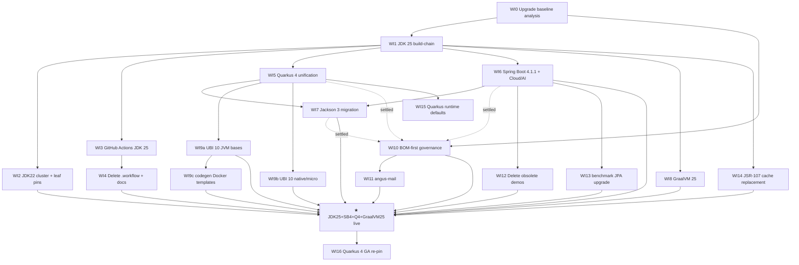

# JDK 25 / Spring Boot 4 / Quarkus 4 Platform Upgrade Roadmap

> Last updated: 2026-10-11
> Sources:
> - `ai-dev/analysis/2026-10/2026-10-09-quarkus4-vs-springboot4-dependency-alignment.md` (primary,三方库依赖对齐度)
> - Quarkus `Migration Guide 4.0` (github.com/quarkusio/quarkus/wiki/Migration-Guide-4.0) + `quarkus-bom 4.0.0.Beta1`
> - Spring Boot `4.0 Migration Guide` / `spring-boot-dependencies 4.1.1` / `system-requirements`
> - 本仓现状扫描（root/nop-dependencies/CI/Dockerfile/pin 点；计数均排除 `target/` 与 `_tmp/`）

## Purpose

This roadmap tracks the platform upgrade of nop-entropy onto **JDK 25** (LTS),
**Spring Boot 4.1.1**, **Quarkus 4.0.0.Beta1** (GA ~Nov 2026), and **GraalVM 25**,
together with the governance change that all third-party versions follow the two base
framework BOMs wherever those BOMs manage the artifact, plus removal of everything the
upgrade makes obsolete. Terminal goal: the whole reactor builds/tests/CI green on a single
JDK 25 toolchain; `nop-dependencies` pins only what no base BOM manages; dead content
(stale JDK8/11 pipelines, JDK17 demo, Spring Boot 3.2 demo, javax-namespaced mail impl,
dead JSR-107 cache, Hibernate 5.4 benchmark stack) is removed or migrated, not carried.

Does not contain implementation details. Each `planned` stage is owned by its execution
plan. A mission config (name `jdk25-sb4-q4`) and its plans dir are created separately
before launch; they do not exist yet, which is expected.

## Decisions already taken

Human-owned choices; execution plans must not re-litigate them:
- **Quarkus 4 = adopt now** at `4.0.0.Beta1` (only 4.x available; GA ~Nov 2026), then a
  final re-pin to GA once it ships (WI17).
- **Spring Boot 4 = `4.1.1`** (current stable). Spring Cloud `2025.1.x` (Oakwood, SB4
  compatibility starts at 2025.1.2); Spring AI `2.0.x`.
- **JDK 25 everywhere** (compile `release=25`, build & CI on 25). This subsumes the
  existing JDK 22 cluster (`nop-cli`/`nop-cli-core`, `nop-find` core/cli, `nop-rg`
  core/vector/cli/benchmark) — of these only the three `nop-rg` modules are FFM-based
  (`java.lang.foreign`), and FFM is final in 22+, so they keep working at 25.
- **BOM-first version policy** — drop `nop-dependencies` pins for anything the
  quarkus-bom / spring-boot-dependencies BOMs manage *and agree on*; keep pins for
  unmanaged libs (each with a "why not BOM-managed" note). See WI10 for the divergence rule.
- **Jackson**: both SB4 and Q4 are Jackson-3-first but still ship Jackson 2 for
  migration. Adopt Jackson 3 as the default on both paths; keep annotations on the
  Jackson-2 line (they are not renamed).
- **OTel**: adopt the Q4 `http/protobuf` / port 4318 default and the 10% sampling default
  (no pin-back).
- **`.workflow/{master,pr,branch}-pipeline.yml`: delete all three** (JDK 11/8/8, Maven
  3.6.3/3.3.9, superseded by `.github/workflows/`; CI entry point consolidated).
- **`nop-demo/nop-spring-demo2`: delete** (SB 3.2.0 sample superseded by nop-spring-demo /
  nop-spring-simple-demo).
- **`nop-benchmark-orm` JPA comparison: upgrade** (keep the comparison surface, do not
  drop it) onto the versions the new BOMs actually provide.
- **JDK-standard `javax.*` (`javax.sql`/`tools`/`crypto`/`swing`/`net.ssl`) must NOT be
  touched** — only Jakarta-EE `javax.*` (mail/cache/persistence) migrate.
- **JCache replacement = Ehcache 3 with the `jakarta` classifier** (no `jakarta.cache`
  release exists, so JSR-107 `javax.cache:cache-api` is replaced outright rather than
  renamed). Nop keeps its own `ICache` abstraction as the public surface.
- **Quarkus 4.0 GA re-pin (WI16) is parked**: never draft it until `quarkus-bom` 4.0.0
  GA is published. It is kept in this roadmap (rather than a successor backlog) so the
  dependency stays visible, but the mission loop must skip it until GA ships.

## Work Item Status

> **This is the only dynamic state block. Update status only here.**
> Humans set items and their order; AI takes the first `todo` item, drafts/executes plans
> (humans don't review individual plans), and writes the item back to `done` when the
> closure audit passes. Order below IS execution order; each item is sized for ONE
> execution plan.
> **WI16 is parked** (see Decisions) — never draft it until Quarkus 4.0 GA ships.

### A — Baseline & JDK 25 foundation

- WI0 Upgrade baseline analysis (migration facts + dependency matrix + pin inventory): `done`
- WI1 JDK 25 build-chain pins (root/kernel/deps + nop-quarkus + nop-cli + nop-ai): `done`
- WI2 JDK 25 JDK22 FFM cluster + leaf pins (nop-find/nop-rg + 9 `java.version=11` + quickstart template): `done`

### B — CI to JDK 25

- WI3 GitHub Actions → JDK 25 + unblock nop-cli lint gate: `done`
- WI4 Delete legacy `.workflow/*` pipelines + fix docs JDK references: `done`

### C — Quarkus 4 adoption

- WI5 Quarkus 4.0.0.Beta1 version unification (all pins incl. divergent 3.29.2/3.21.4): `done`

### D — Spring Boot 4 adoption

- WI6 Spring Boot 4.1.1 + Cloud 2025.1.x + AI 2.0.x BOM bump + sub-pom realign: `done`
- WI7 Jackson 3 migration (8 real databind sites + SB4/Q4 config/annotation surface): `done`

### E — GraalVM, containers & dependency governance

- WI8 GraalVM 25 sync (version bump, js-community pin, polyglot/truffle pins, native config): `done`
- WI9a Container bases → UBI 10 / JDK 25 (JVM Dockerfiles): `todo`
- WI9b Container bases → UBI 10 (native + micro-image Dockerfiles): `todo`
- WI9c Codegen Docker templates → UBI 10 (4 `.xgen`, nop-codegen is plan-first): `todo`
- WI10 BOM-first version governance (drop BOM-managed pins; codify divergence policy): `todo`
- WI11 angus-mail migration (drop `com.sun.mail`, switch `javax.mail`→`jakarta.mail`): `todo`

### F — Deprecation, benchmark & cache

- WI12 Delete obsolete demos (`nop-jdk17-demo`, `nop-spring-demo2`): `todo`
- WI13 benchmark JPA stack upgrade (incl. `javax.persistence`→`jakarta`): `todo`
- WI14 JSR-107 cache replacement → Ehcache jakarta (nop-commons `JavaxCache` + hazelcast): `todo`
- ★ **Milestone: JDK25 + SB4 + Q4 + GraalVM25 baseline live on master** (WI1-14 done): `todo`
- WI15 Quarkus runtime default alignment (OTel/Micrometer): `todo`
- WI16 Quarkus 4.0 GA re-pin + full regression (post-GA; PARKED until GA): `todo`

## Status values

| Status | Meaning |
| --- | --- |
| `todo` | Not started, no plan |
| `planned` | Has execution plan, passed draft review |
| `done` | Complete, passed closure audit |

> Milestone status is derived: the AI sets the milestone to `done` only after WI1-14 are
> all `done`. Never mark it early. WI0 is a hard dep of WI1, so it gates the milestone
> transitively even though it is not one of WI1-14.

## Framework / platform reuse

| Capability | Provider | Notes |
| --- | --- | --- |
| Version management | `quarkus-bom`, `spring-boot-dependencies`, `spring-cloud-dependencies`, `spring-ai-bom` (imported in `nop-dependencies`) | Source of truth for managed versions; new pins must justify why a BOM can't supply the version |
| Mail impl | `org.eclipse.angus:angus-mail` 2.0.5 (managed by **both** BOMs) | Replaces the frozen `com.sun.mail:jakarta.mail` (managed by neither); don't hand-roll or pin |
| Cache | Nop `ICache` + Ehcache 3 (`jakarta` classifier) + Hazelcast client | There is **no** `jakarta.cache` release; JSR-107 `javax.cache:cache-api` is unmaintained and is replaced outright. Nop's `ICache` stays the public surface |
| Jackson 3 | `tools.jackson:jackson-bom` 3.1.5 (SB4) / 3.1.4 (Q4) | **Both** SB4 and Q4 are Jackson-3-first. `com.fasterxml.jackson.core`/`databind` → `tools.jackson.*`; annotations stay `com.fasterxml.jackson.annotation` |
| Jackson 2 (transitional) | `com.fasterxml.jackson:jackson-bom` still managed (Q4 2.22.2 / SB4 2.21.5) | Both BOMs keep Jackson 2 during transition; Boot adds a `spring-boot-jackson2` stop-gap; annotations resolve on the Jackson-2 line |
| GraalVM | `org.graalvm.sdk:graal-sdk`/`nativeimage` **and** `org.graalvm.polyglot:js-community` (all Q4-managed @25.0.4.1); `org.graalvm.polyglot:polyglot` / `org.graalvm.truffle:*` NOT managed by either BOM → pin | Neither BOM manages `org.graalvm.js:js` (legacy, dead coordinate) |
| JDK 25 base images | `registry.access.redhat.com/ubi10/openjdk-25` | UBI 10 is the Quarkus 4 default; replaces ubi8/openjdk-17 |
| Hibernate (benchmark only) | SB4-managed `7.4.5.Final` (Q4 has `8.0.0.Beta3`) | No Hibernate 8 GA in either BOM; platform itself does not depend on JPA |
| nop-orm / own SQL layer | Nop's own ORM/EQL, not JPA/Hibernate | The only JPA consumer is the benchmark comparison surface (WI13) |

## Current baseline

**Already shipped:**
- Reactor `2.0.0-SNAPSHOT`; 44 `<module>` lines in the root pom (42 active + 2 commented) / ~470 poms; builds green on JDK 21 (CI) / `release=17` (root pom).

**Main gaps (blocking the upgrade):**
- Split JDK baseline: root `release=17`; `nop-quarkus/pom.xml` `java.version=17`; a **JDK 22 cluster** (FFM-based `nop-find` core/cli, `nop-rg` core/vector/cli/benchmark); `nop-ai-rag`/`nop-ai-skills` `=21`; **9** `java.version=11` leaf modules (nop-file-api, nop-dyn-api, nop-auth-api, nop-oauth-api, nop-ai-api, nop-task-api, nop-biz-auth-api, nop-credential-api, demo-ddd-api). Known defect: `nop-cli --release 22` cannot build under CI's JDK 21 (`docs-for-ai/03-runbooks/nop-cli-and-lint-gate.md`).
- Split framework baseline: `spring-boot.version=3.5.14`; `quarkus.platform.version=3.35.1` with **divergent** pins — `nop-kernel/pom.xml` `3.29.2`, `nop-spring/nop-all-for-spring` `3.21.4` (`nop-report-for-spring` carries a commented-out `3.21.4`); `nop-demo/nop-spring-demo2` hard-pins `spring-boot 3.2.0`.
- Spring ecosystem trails SB4: `spring-cloud=2025.0.x` (3.5 line), `spring-ai=1.1.5`; SB4.1 needs Cloud `2025.1.2+` / AI `2.0.x`.
- Stale GraalVM: `graalvm.version=23.1.2`; `org.graalvm.js:js` is only a commented-out block (dead) while the active JS dep `org.graalvm.polyglot:js-community` is pinned to 23.1.2.
- Redundant/harmful pins in `nop-dependencies`: `jakarta.mail.version=1.6.8` (a javax-namespaced artifact), plus BOM-managed artifacts pinned locally (`commons-lang3`, `kafka-clients`, `avro`, `antlr4*`, `geolatte-geom`, `javaparser-core`, `json-smart`, `json-path`, `logback`, `slf4j-api`, Spring-side `pulsar-*`, `janino`). Also a **comment to re-verify** at `nop-dependencies/pom.xml:292-296` (WI33 ruling: quarkus-bom manages the pulsar stack to 4.0.9 — true for Q3, but Q4 moves quarkus-managed `pulsar-client-original`/`-messagecrypto-bc` to 4.2.1, which can recreate a mixed-stack `NoSuchMethodError`).
- Mail mismatch: `nop-integration-email-java` declares `com.sun.mail:jakarta.mail` (javax-namespaced) and therefore compiles against `javax.mail.*`; `nop-quarkus/nop-quarkus-file` excludes `angus-mail` and declares `com.sun.mail`.
- Cache dead-end: `nop-commons` + `nop-hazelcast-cache` depend on JSR-107 `javax.cache:cache-api` (unmaintained); `JavaxCache`/`HazelcastCache` on javax.cache. No Jakarta Cache release exists.
- Jackson 3 surface is small: `jackson-databind`/`ObjectMapper` used in only **8 files** (4 in `nop-benchmark-json`/eishay, 3 in `nop-ai-api` tests, 1 in `nop-api-core` test) — **zero** in `nop-spring`/`nop-quarkus`. No `jackson-databind` in any nop-spring/nop-quarkus pom.
- CI on JDK 21 everywhere; legacy `.workflow/*` pipelines on JDK 11 (master) / 8 (pr, branch).
- Dead container bases (87 tracked Dockerfiles): `ubi8/openjdk-17` ×41, `ubi8/ubi-minimal:8.8` ×21, `quarkus-micro-image:2.0` ×21, `ubi8/openjdk-21:1.21` ×2, `ubi8/ubi-minimal:8.5` ×1, `quarkus-micro-image:1.0` ×1. 4 of the 87 are **codegen templates** (`nop-codegen/.../*.xgen`, a Protected Area).
- Obsolete modules: `nop-demo/nop-jdk17-demo`; `nop-demo/nop-spring-demo2` (SB 3.2.0); benchmark JPA surface on Hibernate 5.4.20 / spring-data-jpa 2.3.3 (`javax.persistence`) — incompatible with the new stack.

## Stages

| # | Stage | Owner plan | Deps (hard / soft) | Critical path | Reuse |
| --- | --- | --- | --- | --- | --- |
| WI0 | Upgrade baseline analysis | — (not yet drafted) | — | No (research) | upstream guides |
| WI1 | JDK 25 build-chain pins | — | WI0 | **Yes** | — |
| WI2 | JDK 25 JDK22 cluster + leaf pins | — | WI1 | **Yes** | — |
| WI3 | GitHub Actions → JDK 25 | — | WI1 | **Yes** | — |
| WI4 | Delete `.workflow/*` + docs JDK refs | — | WI3 | No | — |
| WI5 | Quarkus 4.0.0.Beta1 unification | — | WI1 | **Yes** | quarkus-bom 4.0.0.Beta1 |
| WI6 | Spring Boot 4.1.1 + Cloud/AI BOM bump | — | WI1 | **Yes** | spring-cloud 2025.1.x, spring-ai 2.0.x |
| WI7 | Jackson 3 migration | — | WI5, WI6 | **Yes** | tools.jackson |
| WI8 | GraalVM 25 sync | — | WI1 | No | Q4 graal-sdk |
| WI9a | Container bases → UBI 10 (JVM) | — | WI5 | No | ubi10/openjdk-25 |
| WI9b | Container bases → UBI 10 (native + micro) | — | WI5 | No | ubi10/openjdk-25 |
| WI9c | Codegen Docker templates → UBI 10 | — | WI9a | No | ubi10/openjdk-25 |
| WI10 | BOM-first governance + divergence policy | — | WI0 (hard); WI5, WI6, WI7 (soft) | **Yes** | quarkus-bom / spring-boot-dependencies |
| WI11 | angus-mail migration | — | WI10 | No | org.eclipse.angus:angus-mail |
| WI12 | Delete obsolete demos | — | WI6 | No | — |
| WI13 | benchmark JPA stack upgrade | — | WI6 | No | — |
| WI14 | JSR-107 cache replacement | — | WI1 | No | Nop ICache |
| ★ | JDK25+SB4+Q4+GraalVM25 baseline live | — | WI1-14 done | — | — |
| WI15 | Quarkus runtime default alignment | — | WI5 | No | — |
| WI16 | Quarkus 4.0 GA re-pin + regression (parked) | — | ★ + GA release | **Yes** | — |

> Hard deps = `-->`, soft = `-.->` (feeding WI10 with settled resolved versions). Running
> WI10 before the framework items would re-pin twice, but its hard dep is only WI0.
> WI15 is listed after the milestone because it is optional polish; WI16 is parked until
> Quarkus 4.0 GA publishes.

## Stage details

### WI0. Upgrade baseline analysis

> Status: see Work Item Status above

**Goal:** Freeze upstream facts + a per-coordinate dependency decision matrix + the
in-repo pin inventory into a repo-local analysis doc.

**Deliverables:**
- Analysis doc under `ai-dev/analysis/2026-10/`: Java baselines (Q4 min 21 / SB4 min 17 / JDK25 target), UBI 10 default, Hibernate DB-version floor (Db2 12.1 / MariaDB 11.4 / MSSQL 16 / MySQL 8.4 / Oracle 23 / PG 16), Jackson 3 rename + CDI `JsonMapper` for both frameworks, SB4 modular starters + `@MockitoBean`/`RestTestClient`, OTel `http/protobuf:4318` + 10% sampling, Micrometer Prometheus v1, GraalVM 25, the per-coordinate matrix (managed-by-Q4 / by-SB4 / keep-pin / migrate), the two-BOM divergence list (~31 coords), and the "no Jakarta Cache exists" finding.
- Current-state pin inventory (every `release`/`java.version`/framework-version pin + CI JDK + full Dockerfile base distribution) as the before-picture.

**Out of scope:** any code/pom change.

**Module / area:** `ai-dev/analysis/2026-10/`.

### WI1. JDK 25 build-chain pins

> Status: see Work Item Status above

**Goal:** The build-chain JDK properties read 25.

**Deliverables:**
- Set `java.version` / `maven.compiler.source|target|release` to 25 in root `pom.xml`, `nop-kernel/pom.xml`, `nop-kernel/nop-dependencies/pom.xml`, `nop-quarkus/pom.xml`, `nop-demo/pom.xml`.
- Move `nop-cli`/`nop-cli-core` 22→25 and `nop-ai-rag`/`nop-ai-skills` 21→25.
- Remove the now-redundant module-level JDK pins these inherit.

**Out of scope:** JDK22 FFM cluster + leaf 11s (WI2); CI (WI3); framework bumps.

**Module / area:** root + build-chain poms + nop-runner/nop-cli* + nop-ai/* + nop-quarkus.

### WI2. JDK 25 JDK22 cluster + leaf pins

> Status: see Work Item Status above

**Goal:** No module compiles below 25 — covers the FFM cluster and the 11-baseline leaves.

**Deliverables:**
- Move the JDK 22 cluster to inherit 25 (`nop-find` core/cli; `nop-rg` core/vector/cli/benchmark) — only the three `nop-rg` modules are FFM-based, and FFM is final in 22+, so they keep working at 25.
- Move the 9 `java.version=11` leaf modules to inherit the JDK25 baseline (or delete the pins so the root value governs), plus `nop-utils/nop-commons-java21` (`release=21`) and any straggler JDK pin.
- Bring `nop-stream/quickstart/template/pom.xml` to 25.

**Out of scope:** build-chain (WI1); CI.

**Module / area:** the FFM modules, leaf api/demo/quickstart poms.

### WI3. GitHub Actions → JDK 25

> Status: see Work Item Status above

**Goal:** GitHub CI builds on JDK 25.

**Deliverables:**
- `.github/workflows/maven.yml`: every `actions/setup-java` `java-version` 21→25 (build, invariant-gate, e2e).
- `.github/workflows/compliance.yml`: its 3 `actions/setup-java` `java-version` 21→25. (`sync-docs-to-community.yml` has no Java setup.)
- Re-enable the `nop-cli` lint gate in CI (was blocked by the 21/22 mismatch, now unblocked by JDK25).

**Out of scope:** legacy `.workflow/*` (WI4).

**Module / area:** `.github/workflows/`.

### WI4. Delete legacy `.workflow/*` + docs JDK references

> Status: see Work Item Status above

**Goal:** CI entry point consolidated to GitHub Actions; no JDK 8/11 pipeline remains.

**Deliverables:**
- Delete `.workflow/master-pipeline.yml` (JDK 11 / Maven 3.6.3), `pr-pipeline.yml` (JDK 8 / 3.3.9), `branch-pipeline.yml` (JDK 8 / 3.3.9) — superseded by `.github/workflows/`.
- Update JDK references in `docs-for-ai/00-start-here/project-context.md` (still "JDK 17+ / release=17") and `AGENTS.md` (still says "Java 21" in the Tech Stack line and "Install JDK 21 first" in the Windows setup) to the JDK25 baseline.

**Out of scope:** GitHub workflow edits (WI3).

**Module / area:** `.workflow/`, `docs-for-ai/00-start-here/`, `AGENTS.md`.

### WI5. Quarkus 4.0.0.Beta1 version unification

> Status: see Work Item Status above

**Goal:** One Quarkus version — 4.0.0.Beta1 — across every pin.

**Deliverables:**
- Unify `quarkus.platform.version` to 4.0.0.Beta1 across all pin sites, including the divergent `nop-kernel/pom.xml` (3.29.2) and `nop-spring/nop-all-for-spring` (3.21.4), and every app module.
- Re-verify the WI33 pulsar ruling (`nop-dependencies/pom.xml:292-296`) against Q4's BOM: quarkus-bom manages `pulsar-client-original`/`-messagecrypto-bc` @4.2.1, so the locally pinned 4.0.14 can recreate a mixed-stack `NoSuchMethodError`. Update or keep the comment based on that check.
- Resolve the resulting compilation/runtime breakages that are version-only (no feature code).

**Out of scope:** Jackson 3 (WI7); container bases (WI9a/WI9b/WI9c); runtime defaults (WI15).

**Module / area:** `nop-quarkus/*`, all `*-app` Quarkus modules, `nop-kernel/pom.xml`, `nop-spring/nop-all-for-spring` + `nop-report-for-spring`, `nop-demo/nop-quarkus-demo`.

### WI6. Spring Boot 4.1.1 + Cloud/AI BOM bump

> Status: see Work Item Status above

**Goal:** nop-spring and Spring-facing modules resolve SB 4.1.1 with a compatible train.

**Deliverables:**
- `spring-boot.version` 3.5.14→4.1.1; `spring-cloud.version`→2025.1.x (≥2025.1.2); `spring-ai.version` 1.1.5→2.0.x.
- Realign Spring sub-poms onto the single BOM (stop local SB/Cloud overrides).
- Adapt the SB4 modular-starter split where nop-spring uses the combined starters (`-webmvc`/`-restclient`/`-webservices`/`-security-oauth2-*`, `*-test`).

**Out of scope:** Jackson 3 (WI7); deleting demo2 (WI12); benchmark (WI13).

**Module / area:** `nop-spring/*`, `nop-ai/nop-spring-mcp-server`, `nop-demo/nop-spring-*`.

### WI7. Jackson 3 migration

> Status: see Work Item Status above

**Goal:** The real Jackson databind surface and the SB4/Q4 Jackson config/annotation
surface run on Jackson 3.

**Deliverables:**
- Migrate the 8 real `jackson-databind`/`ObjectMapper` sites to `tools.jackson.*` (annotations stay `com.fasterxml.jackson.annotation`): 4 in `nop-benchmark-json`/eishay, 3 in `nop-ai-api` tests, 1 in `nop-api-core` test.
- Adopt SB4's all-classpath Jackson-module auto-detection, and set `spring.jackson.use-jackson2-defaults=false` so Nop runs Jackson-3 defaults end to end. (`Jackson2ObjectMapperBuilderCustomizer`, `@JacksonComponent`, `@JacksonMixin`, and `spring.jackson.parser.*` do not occur in the repo today — record that finding rather than inventing migrations for them.)

**Out of scope:** framework BOM bumps (WI5/WI6 supply them).

**Module / area:** `nop-benchmark/nop-benchmark-json`, `nop-ai/nop-ai-api` tests, `nop-kernel/nop-api-core` test, Spring/Quarkus serialization config.

### WI8. GraalVM 25 sync

> Status: see Work Item Status above

**Goal:** GraalVM artifacts on the JDK 25 line, following BOMs where possible.

**Deliverables:**
- Bump `graalvm.version` 23.1.2→25.x (Q4 BOM floor 25.0.4.1; latest ~25.4.x).
- Drop the hardcoded 23.1.2 on `org.graalvm.polyglot:js-community` in `nop-frontend-support/nop-js/pom.xml` so it inherits Q4's managed 25.0.4.1. Pin only the unmanaged ones on the same line — `org.graalvm.polyglot:polyglot` and `org.graalvm.truffle:*` (neither BOM manages them; `nop-kernel/nop-xlang-truffle` is already at 25.2.4 and must stay consistent). Drop `graalvm.version` itself once no in-repo property still references it. Delete the dead commented `org.graalvm.js:js` block.
- Refresh buildtools plugin usage + native-image configs for the new line.

**Out of scope:** Spring/Quarkus framework bumps.

**Module / area:** `nop-kernel/nop-dependencies`, `nop-frontend-support/nop-js`, `nop-kernel/nop-xlang-truffle`, `nop-kernel/nop-javac`, native-image configs.

### WI9a. Container bases → UBI 10 (JVM)

> Status: see Work Item Status above

**Goal:** JVM container images use JDK 25 / UBI 10 bases.

**Deliverables:**
- Move the 41 non-codegen JVM Dockerfiles from `ubi8/openjdk-17` (×39: 38×`:1.16` + 1×`:1.11`) and `ubi8/openjdk-21` (×2) to `ubi10/openjdk-25`. (The 2 codegen JVM templates are WI9c's, not counted here.)

**Out of scope:** native/micro images (WI9b); codegen templates (WI9c).

**Module / area:** `Dockerfile.jvm` / `Dockerfile.legacy-jar` in the app modules.

### WI9b. Container bases → UBI 10 (native + micro)

> Status: see Work Item Status above

**Goal:** Native and micro container images use UBI 10 / the Q4 micro-image line.

**Deliverables:**
- Move the 42 non-codegen native/micro Dockerfiles: `ubi8/ubi-minimal:8.8` (×20) and `:8.5` (×1) → UBI 10 equivalent; `quarkus-micro-image:2.0` (×20) and `:1.0` (×1) → the Q4 line. (The 2 codegen native/micro templates are WI9c's.)

**Out of scope:** JVM images (WI9a); codegen templates (WI9c).

**Module / area:** `Dockerfile.native*` / `Dockerfile.*micro*` in the app modules.

### WI9c. Codegen Docker templates → UBI 10

> Status: see Work Item Status above

**Goal:** The generated-app Docker templates emit JDK 25 / UBI 10 bases.

**Deliverables:**
- Update the 4 codegen templates to the UBI 10 / JDK 25 bases and the Q4 micro-image line, so newly scaffolded apps start on the new baseline: `Dockerfile.jvm.xgen` + `Dockerfile.legacy-jar.xgen` (`ubi8/openjdk-17:1.16`), `Dockerfile.native.xgen` (`ubi-minimal:8.8`), `Dockerfile.native-micro.xgen` (`quarkus-micro-image:2.0`).
- nop-codegen is a **Protected Area (plan-first)** per AGENTS.md — flag explicitly in that plan.

**Out of scope:** existing app Dockerfiles (WI9a/WI9b).

**Module / area:** `nop-kernel/nop-codegen/src/main/resources/_vfs/nop/templates/orm/{appName}-app/src/main/docker/` (4 `.xgen`).

### WI10. BOM-first version governance + divergence policy

> Status: see Work Item Status above

**Goal:** `nop-dependencies` pins only what no base BOM manages; the two-BOM divergence is
explicitly resolved, not accidental.

**Deliverables:**
- Drop local pins for artifacts the BOMs manage *consistently*: `commons-lang3`, `kafka-clients` (both agree), `avro`/`antlr4*`/`geolatte-geom`/`javaparser-core` (Quarkus-managed), `json-smart`/`json-path`/`janino`/`logback`/Spring-side `pulsar-*` (Spring-managed), and `ojdbc8`→migrate to `com.oracle.database.jdbc:ojdbc11` (both-managed, correct groupId).
- For the ~31 coordinates where the two BOMs **diverge** (`jakarta.servlet-api` 6.0.0 vs 6.1.0, `jakarta.persistence-api` 4.0.0-M7 vs 3.2.0, `slf4j-api`, `hamcrest`, `jakarta.json.bind`, `jakarta.websocket`, `jspecify`, …): codify the import-order winner (quarkus-bom imported first today) and keep an explicit pin only where the winner is harmful.
- Keep pins for genuinely unmanaged libs (nacos, sentinel, tablesaw, duckdb, lucene, commonmark, protostuff, jsch, keycloak-common, angus, etc.), each with a "why not BOM-managed" note.
- Refresh `nop-kernel/nop-dependencies/README.md` version table.

**Out of scope:** upgrading unmanaged libs to newer majors; angus-mail (WI11).

**Module / area:** `nop-kernel/nop-dependencies` + its README.

### WI11. angus-mail migration

> Status: see Work Item Status above

**Goal:** Mail runs on the BOM-managed implementation with matching (jakarta) namespaces.

**Deliverables:**
- Replace `com.sun.mail:jakarta.mail` (the javax-namespaced 1.6.8 republish; managed by neither BOM) with BOM-managed `org.eclipse.angus:angus-mail` 2.0.5 for the impl and `jakarta.mail:jakarta.mail-api` 2.1.5 for the API.
- Switch `nop-integration-email-java` (+ tests) imports `javax.mail.*`→`jakarta.mail.*` to match the Jakarta artifact.
- Unwind the `angus-mail` exclusion + `com.sun.mail` declaration in `nop-quarkus/nop-quarkus-file/pom.xml` so it uses the new impl.

**Out of scope:** other deps (WI10).

**Module / area:** `nop-integration/nop-integration-email-java`, `nop-auth` email tests, `nop-quarkus/nop-quarkus-file`, `nop-dependencies`.

### WI12. Delete obsolete demos

> Status: see Work Item Status above

**Goal:** JDK17/SB3.2-era demos removed.

**Deliverables:**
- Delete `nop-demo/nop-jdk17-demo` and `nop-demo/nop-spring-demo2`; unregister from `nop-demo/pom.xml` and any aggregate/e2e references.
- Keep `nop-spring-demo` / `nop-spring-simple-demo` as the SB references.

**Out of scope:** other demos; base images (WI9a/WI9b/WI9c).

**Module / area:** `nop-demo/`.

### WI13. benchmark JPA stack upgrade

> Status: see Work Item Status above

**Goal:** The benchmark JPA comparison runs on the jakarta / SB4-provided stack.

**Deliverables:**
- Upgrade `nop-benchmark-orm`'s `hibernate 5.4.20` / `spring-data-jpa 2.3.3` / `entitymanager` (and its `spring.version` / `mybatis-plus` / `weed3` / `beetlsql` siblings) to versions consistent with the new BOMs (SB4 provides Hibernate 7.4.5; no Hibernate 8 GA exists).
- Migrate benchmark `javax.persistence`→`jakarta.persistence` (4 VO/service files).

**Out of scope:** Nop ORM side; other benchmarks.

**Module / area:** `nop-benchmark/nop-benchmark-orm`.

### WI14. JSR-107 cache replacement

> Status: see Work Item Status above

**Goal:** Cache layer off dead JSR-107 onto a supported implementation.

**Deliverables:**
- Replace `javax.cache:cache-api` (unmaintained; SB4 still manages it only at 1.1.1; there is **no** `jakarta.cache` release) with **Ehcache 3 (`jakarta` classifier)** per the Decisions section; Nop keeps its own `ICache` abstraction as the public surface.
- Migrate `JavaxCache` + `nop-cluster/nop-hazelcast` `HazelcastCache` + related tests off javax.cache.

**Out of scope:** other javax migration (mail WI11, persistence WI13); JDK-standard javax.*.

**Module / area:** `nop-kernel/nop-commons`, `nop-cluster/nop-hazelcast`.

### WI15. Quarkus runtime default alignment

> Status: see Work Item Status above

**Goal:** Q4 operational defaults adopted deliberately.

**Deliverables:**
- OTLP exporter: adopt the `http/protobuf` / port 4318 default and the 10% trace sampling default (per Decisions — no pin-back).
- Micrometer Prometheus v1: adopt `io.micrometer.prometheusmetrics` and the renamed metrics where Nop exposes them.

**Out of scope:** base images (WI9a/WI9b/WI9c).

**Module / area:** Quarkus observability config + metrics-exposed modules.

### WI16. Quarkus 4.0 GA re-pin + full regression

> Status: see Work Item Status above

**Goal:** Once Quarkus 4.0.0 GA ships (~Nov 2026), move off the Beta pin and re-verify.

**Deliverables:**
- Bump `quarkus.platform.version` Beta1→4.0.0 GA across all pins.
- Full reactor build + test + CI + E2E regression on the GA pin.
- Note GA-time API changes vs Beta that need follow-up.

**Out of scope:** first Quarkus 4.x LTS (later).

**Module / area:** all `quarkus.platform.version` pins, CI, e2e.

## Dependency graph

## Cross-cutting concerns

| Concern | Notes |
| --- | --- |
| Version source of truth | New version pins must justify why quarkus-bom/spring-boot-dependencies can't supply them; prefer following the BOMs |
| Two-BOM divergence | The two BOMs disagree on ~31 coordinates (`jakarta.servlet-api`, `jakarta.persistence-api`, `slf4j-api`, `hamcrest`, `jakarta.json.bind`, `jakarta.websocket`, `jspecify`, …). Import order decides the winner (quarkus-bom imported first). WI10 must make this explicit — dropping a pin does NOT always mean "safe" |
| Jackson 2/3 dual track | Both Q4 and SB4 are Jackson-3-first but still ship Jackson 2; annotations resolve on the Jackson-2 line; do NOT blanket-rename `com.fasterxml.jackson.annotation`, and don't assume databind and annotations share a version |
| javax.* is not one thing | Only Jakarta-EE `javax.*` (mail/cache/persistence) migrate; JDK-standard `javax.*` (sql/tools/crypto/swing/net.ssl) stays — a blind find-replace is wrong. There is no `jakarta.cache` release, so the cache replacement must derive a real coordinate (WI14) |
| JDK 25 build hygiene | Compile on 25; FFM modules (nop-find/nop-rg) keep working because FFM is final in 22+. The known in-process-compiler concurrency pitfall may need forked compilation if module test-compile hits ConcurrentModificationException |
| Native image | GraalVM 25 native build must be re-verified; 23.x reach/reflect-config may not carry over unchanged |
| CI parity | CI must now actually build `nop-cli` under JDK 25 (the 21/22 mismatch is gone) — re-enable any gate it was blocking |
| Beta vs GA | Quarkus 4 is pre-GA (Beta1) until ~Nov 2026; WI16 re-pins. Don't over-fit to Beta-only API shapes |
| Reactor scale | ~470 poms; every JDK pin is a separate site. Keep each item to one plan's worth; don't attempt a single big-bang PR |
| Protected Area | `nop-codegen` (WI9c's `.xgen` templates) is plan-first per AGENTS.md — flag explicitly in that plan |

## Rules

- This file is a state index and coarse decomposition, not an execution plan.
- Each `planned` stage is owned by its execution plan.
- Status changes happen only in the Work Item Status block at the top.
- Milestone is derived: the AI sets it to `done` only after WI1-14 are all `done`.
- Version pins in `nop-dependencies` follow the base framework BOMs; only unmanaged
  libraries carry a local version, and each carries a "why not BOM-managed" note.
- Decisions listed under "Decisions already taken" are human-owned; plans must not
  re-litigate them.
