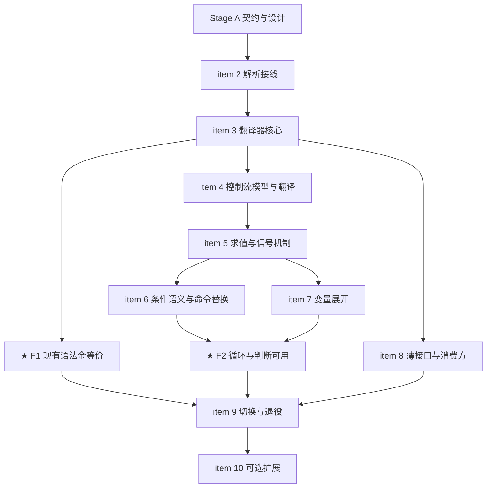

# nop-ai-shell Bash 前端替换 Roadmap — tree-sitter CST → CommandExpression

> Last updated: 2026-10-05（R1 对抗审查后修订）
> Sources: `../analysis/nop-treesitter-bash-shell-interaction.md`（裁定——本次**触发信号 #1 命中**，控制流同属"手写 parser 不支持且报错拒绝"的信号范畴），
> `../design/nop-ai-agent/nop-ai-shell-syntax-spec.md`（Tier 矩阵 owner doc——现把控制流标为 ❌ 拒绝，本路线推翻之），
> `../design/nop-ai-shell/04-bash-syntax.md`（Java 模型设计），
> `docs-for-ai/03-modules/nop-treesitter.md`（bash blob + corpus 100/100），
> `nop-ai/nop-ai-shell/src/main/java/io/nop/ai/shell/parser/BashSyntaxParser.java`（被替换物）

## Purpose

用 nop-treesitter（纯 Java tree-sitter 运行时，bash 上游 corpus 100/100）替换手写的
`BashLexer` + `BashSyntaxParser` 解析前端，并把外部使用层收敛为**一个薄接口 + 上下文对象**。
表达式树扩展**循环、判断**等控制流与**变量展开**（`$VAR` / `$?`）。只覆盖最常见语法；
子集外构造**结构化拒绝**（node kind + 源文本 + 字节偏移），不再 fail-fast 于任意 token。

Terminal goal：仓库回归**单一 bash 语法权威**（tree-sitter），手写 lexer/parser 退役；
guardrail 对畸形输入退化为精确拒绝而非崩溃。Enables
`./tools/mission-driver.sh run nop-ai-shell-bash-cst-frontend` to drive the implementation
autonomously. Roadmap contains no implementation details — each `planned` stage is owned
by its execution plan.

**本次替换的用户裁定**（约束所有 stage）：

- 外部使用层用**薄接口**，不要求与旧接口一致；
- 协调环境（命令注册表、checker、fs、env、cwd、io、线程池、后台任务 sink、限制）通过
  **上下文对象**传入，不再走多参构造；
- 支持循环、判断等控制流语法，**且循环变量/退出码可用**（见 Work item 7 的范围裁定）；
- 只处理最常见语法，子集外显式拒绝。

## Work Items

> **This is the only dynamic state block. Update status only here.**
> The roadmap is a human-AI alignment artifact: humans set items and their order;
> AI takes the first `todo` item, drafts/executes plans (humans don't review individual
> plans), and writes the item back to `done` when closure audit passes.

- 1. 设计收口：金等价协议（等价基准 + 偏差白名单）、word 表示裁定、换行策略、控制流信号机制与边界捕获规则、循环终止安全、`$( )` 隔离级别、变量展开范围、双上下文命名与分工、优先级裁定；更新 `nop-ai-shell-syntax-spec.md`（Tier 矩阵 + 推翻控制流拒绝裁定）、`04-bash-syntax.md`（模型章节）、`../analysis/nop-treesitter-bash-shell-interaction.md` 裁定（触发信号补记）：`todo`
- 2. 解析接线：nop-ai-shell 增加 nop-treesitter 依赖（仅核心运行时 API）；CST 解析入口；结构化拒绝类型（语法错误：首 ERROR/MISSING 节点位置；子集外构造：node kind + 源文本 + 偏移）: `todo`
- 3. 翻译器核心：CST → 现有 CommandExpression 子集（序列/Logical/Pipeline/Simple/Redirect/Background/Subshell/Group、前缀赋值、重定向双挂载点分流、word 按裁定展平）；金等价按 item 1 协议执行（非白名单用例全一致 + 白名单逐条评审记录）: `todo`
- ★ **Milestone F1：现有语法金等价**（unlocks when 2 + 3 done，按 item 1 协议验收）：`todo`
- 4. 控制流模型与翻译：新增模型节点（If/While/Until/For/Break/Continue/Return）+ CST 映射（`if_statement` 含 `elif_clause`/`else_clause`、`while_statement` 按关键字分流 while/until、`for_statement` + `do_group`、`break/continue/return statement`）: `todo`
- 5. 控制流求值与信号机制：按 item 1 裁定的信号载体在 CompletionStage 链中传播 break/continue/return；循环/subshell/pipeline/background 边界捕获规则；循环终止安全（每迭代 cancel 检查 + 最大迭代数/超时，超限 exit 124 或结构化拒绝）: `todo`
- 6. 条件语义与命令替换：退出码条件；`test_command`（`[ ]` 与 `[[ ]]` 同节点）内建判定子集（字符串相等/比较、数值比较、文件存在类）；`$( )` 按 item 1 裁定的隔离级别递归执行: `todo`
- 7. 变量展开：`$VAR` / `$?`（范围裁定见 item 1；glob 与完整 Tier 2 展开不在本路线）: `todo`
- ★ **Milestone F2：循环与判断可用**（unlocks when 4 + 5 + 6 + 7 done——含变量展开，避免"语法过、语义空壳"）：`todo`
- 8. 薄接口落地：单入口接口 + 会话级上下文对象实现（含 item 1 裁定的全部携带项），迁移 `ShellCommandExecutor` 装配与 `nop-ai-agent` 消费方: `todo`
- 9. 切换与退役：默认切换新前端；删除 `BashLexer` / `BashSyntaxParser` 及其专属测试；模块文档、`04-bash-syntax.md`、`nop-ai-shell-syntax-spec.md`、裁定文档、`source-anchors` 同步: `todo`
- 10. （可选）`case` 语句、herestring、`>|`（clobber）、`<<-`、c-style `for((;;))`: `todo`

## Status values

| Status | Meaning |
| --- | --- |
| `todo` | Not started, no plan |
| `planned` | Has execution plan, passed draft review |
| `done` | Complete, passed closure audit |

> Milestone status is derived: when its dependent work items are all `done`, the milestone auto-flips to `done`.

## Framework / platform reuse

| Capability | Provider | Notes |
| --- | --- | --- |
| bash 语法解析（blob + `BashScanner` 29 外部 token） | `nop-treesitter`（已建成，corpus 100/100） | 直接复用；nop-ai-shell 只依赖核心运行时 API（`TSParser` / `Language` / compat `TreeSitterBash`） |
| 畸形输入不抛异常（GLR 停滞回退） | `nop-treesitter` | 返回含 ERROR/MISSING 的树，结构化拒绝的直接前提 |
| heredoc 语法（外部 token；`extractHeredoc` 参照实现） | `nop-treesitter` | 手写 lexer 的行扫描逻辑整体废弃 |
| `CommandExpression` 层级 + visitor + `CommandFactory` + `ICommandChecker` | `nop-ai-shell`（保留） | 只增控制流节点，不重写 |
| 执行/异步/后台任务 | `ShellCommandExecutor` / `ExecutionResult` / `IBackgroundJobSink`（保留） | 装配方式改上下文对象；控制流求值复用其 visitor 骨架 |
| 拒绝形态参照 | `io.nop.treesitter.shell` 的 `UnprovenScript(Reason.SYNTAX_ERROR)` | **参照不依赖**——分析层"不求值、不出表达式树"的契约不破坏 |

## Current baseline

- 手写 `BashLexer` + `BashSyntaxParser`（595 行递归下降）产出 `CommandExpression` 层级
  （`SimpleCommand` / `PipelineExpr` / `LogicalExpr` / `SubshellExpr` / `BackgroundExpr` /
  `GroupExpr` / `Redirect`），由 `ShellCommandExecutor` 的 visitor 求值
- `ShellCommandExecutor` 持有**可变会话状态**（exportedEnv / currentWorkingDir /
  backgroundJobSink）并实现 `Closeable`；协调环境以 4 参构造注入；外部消费方 `nop-ai-agent`
- 语法覆盖为设计上的子集（Tier 矩阵在 `nop-ai-shell-syntax-spec.md`），遇到不认识的构造
  fail-fast `ParseException`；`&&`/`||` 优先级与 bash 不一致（AND=4 > OR=3，bash 为等优先
  级左结合）；newline 被当作普通空白（`echo a\necho b` 被吞成一条命令）
- `nop-treesitter` bash 语法 corpus 100/100（上游 v0.25.1，与 codex 同 commit）；
  畸形输入已保证不抛异常
- ~~两个 bash parser 静默分歧的风险~~ ✅ 本路线以"单一语法权威"消除（切换后手写 parser 删除）

## Stage table

| # | Stage | Owner plan | Depends on | Critical path | Reuse |
|---|---|---|---|---|---|
| A | 契约与设计 | (item 1) | — | yes | 既有裁定与 Tier 矩阵 |
| B | 前端替换 | (items 2, 3) | A | yes | nop-treesitter 全部 |
| C | 控制流与展开 | (items 4, 5, 6, 7) | B | yes | 求值器 visitor 骨架 |
| D | 薄接口与消费方 | (item 8) | B（可与 C 并行） | no | `IShellCommandExecutionContext` 既有概念 |
| E | 收口 | (items 9, 10) | C + D | yes | — |

## Stage details

### Stage A — 契约与设计

Goal: 把用户裁定与审查发现落成可执行规格，修正裁定文档。本 stage 是后续一切的地基。

Deliverables（每条都是必须有明确结论的裁定，不允许留白）:

1. **金等价协议**：(a) 等价基准——模型类无 `equals`，定义规范化 dump 通道用于 diff；
   (b) **偏差白名单**——旧行为与 bash/新设计冲突的用例逐条列出并裁定以谁为准，已知成员：
   8 个断言 `ParseException` 的错误路径用例（改断言为结构化拒绝）、`VAR= | echo`（旧抛异常，
   bash 语义为合法管道，新前端必须接受）、`&&`/`||` 优先级（旧 AND>OR，裁定以 bash 等优先
   级左结合为准）、换行策略（旧当空白吞并，裁定 newline = `;` 语句终结符）；(c) F1 门禁
   表述——非白名单用例全部一致 + 白名单逐条评审记录在案。
2. **word 表示裁定**：B/C 阶段 `SimpleCommand.args` 维持扁平 `String`（波及面小），定义
   展平规则以复刻旧剥离怪癖（word 首子节点为 `string` → 剥外层引号，否则取源文本原样；
   `--include='*.log'` 类拼接词保留原文）；结构化 word 推迟到确有结构化消费需求的项
   （`$( )` 定位、后续 Tier 2 展开）再立项。
3. **换行策略**：newline = `;` 语句终结符（bash 语义），进偏差白名单。
4. **控制流信号规格**：break/continue/return 的信号载体（信号异常 / 结果扩展 / wrapper，
   三选一并写明理由）、在 `CompletionStage<ExecutionResult>` 链中的传播方式、在
   loop / subshell / pipeline / background 四类边界的捕获规则（每类边界逐一裁定）。
5. **Return 与 `exit` 语义**：无函数定义（out of scope）的前提下 `return` 的语义（sourced-
   script 语义或明确移出范围）；`exit N` 的裁定（agent 高频 `cmd || exit 1`）。
6. **循环终止安全**：每迭代 cancel-token 检查、最大迭代数/超时上限、超限行为（exit 124 或
   结构化拒绝）。syntax-spec 当初拒绝控制流的核心理由即无限循环，推翻裁定必须承接该责任。
7. **`$( )` 隔离级别**：子 shell 快照（参照既有 subshell 快照实现）或共享会话；替换内的
   `&` 后台任务归属（拒绝或仍登记全局 sink）；与 `Closeable` / `IBackgroundJobSink`
   契约（body 预解析执行、非 re-parse）的共存方式；递归深度限制。
8. **变量展开范围**：`$VAR` / `$?` in-scope（item 7）；glob 与完整 Tier 2 明确 out-of-scope。
9. **双上下文命名与分工**：新**会话级**上下文对象（构造期协调环境 + 会话可变状态归属）
   与既有**命令级** `IShellCommandExecutionContext`（每条命令的 io/env/cwd 视图）的名字、
   字段分工与转换点——禁止第三种重叠上下文。
10. **CST 映射表与拒绝清单**：映射表须覆盖双挂载点（`command` 内联 `file_redirect` /
    `herestring_redirect` vs `redirected_statement` 包裹节点——compound 语句与
    heredoc_redirect 只走后者）、`until` 并非独立节点（`while_statement` 按关键字分流）、
    `test_command` 同时承载 `[ ]` 与 `[[ ]]`；拒绝清单显式含 `>|`（clobber）、`<<-`、
    函数定义、进程替换、`${x//pat/rep}`、`$(( ))`、brace expansion、extglob、
    `c-style for`（item 10 可升级部分项）。
11. **文档更新**：`nop-ai-shell-syntax-spec.md`（Tier 矩阵改写 + 第十节拒绝控制流裁定推翻
    补记——补记须说明控制流属"手写 parser 不支持且报错拒绝"的信号范畴，虽不在信号清单
    原文字样内）；`04-bash-syntax.md` 模型章节（新节点）；`../analysis/nop-treesitter-bash-shell-interaction.md`
    触发信号补记 + 修正其"EMPTY_VALUE 为手写 parser 外部 token"的错误记载（实为
    nop-treesitter `BashScanner` 的 token，旧 parser 对纯赋值命令是抛异常）。

Out of scope: 具体实现代码。

Module area: `nop-ai/nop-ai-shell`（设计文档在 `ai-dev/design/nop-ai-shell/` 与
`ai-dev/design/nop-ai-agent/`）。

### Stage B — 前端替换

Goal: tree-sitter 成为解析前端，既有语法按金等价协议对齐。

Deliverables: `nop-ai-shell` 对 `nop-treesitter` 的依赖与 CST 解析入口；结构化拒绝类型
（语法错误：首 ERROR/MISSING 节点位置；子集外：node kind + 源文本 + 偏移）；翻译器核心
（B 阶段只做既有子集映射，word 按 Stage A 裁定展平）；金等价按 item 1 协议执行。

Out of scope: 控制流语法、薄接口、变量展开、删除旧 parser（旧 parser 在本阶段保留作
交叉验证基准）。

Module area: `nop-ai/nop-ai-shell`（依赖 `nop-treesitter`）。

### Stage C — 控制流与展开

Goal: 循环与判断**可用**（含变量展开，非语法空壳）。

Deliverables: item 4（模型 + 翻译）、item 5（求值 + 信号 + 终止安全）、item 6（条件语义 +
`$( )`）、item 7（`$VAR` / `$?` 展开）——四项各自一个 plan；嵌套场景（循环体内含管道/
重定向/子循环/命令替换）必须有测试。

Out of scope: `case`、函数定义、进程替换、`${x//pat/rep}`、`$(( ))`、brace expansion、
extglob、glob 展开（结构化拒绝清单；item 10 视需要升级部分项）。

Module area: `nop-ai/nop-ai-shell`。

### Stage D — 薄接口与消费方

Goal: 外部使用层收敛为单入口 + 会话级上下文对象。

Deliverables: 薄接口实现（单入口方法 + 按 Stage A 裁定的上下文对象，含线程池与后台任务
sink 携带项）；`ShellCommandExecutor` 装配迁移；`nop-ai-agent` 消费方迁移；旧构造路径
移除（按 Stage A 裁定）。

Out of scope: 语法覆盖扩展。

Module area: `nop-ai/nop-ai-shell`、`nop-ai/nop-ai-agent`。

### Stage E — 收口

Goal: 单一语法权威 + 文档同步。

Deliverables: 默认前端切换为新实现；删除 `BashLexer` / `BashSyntaxParser` 及其专属测试
（非白名单断言已按协议迁移）；`docs-for-ai` 模块页、`04-bash-syntax.md`、
`nop-ai-shell-syntax-spec.md`、裁定文档、`source-anchors` 同步；可选项（item 10）视需要立项。

Out of scope: 新语法覆盖（除非 item 10 立项）。

Module area: `nop-ai/nop-ai-shell`、`docs-for-ai/03-modules/`。

## Dependency graph

## Cross-cutting concerns

| 陷阱 | 规则 |
|---|---|
| 树含 ERROR/MISSING | 一律拒绝并给出位置，**不允许带病产出表达式树**（GLR 停滞回退已保证解析层永不抛异常） |
| 金等价 | 只按 item 1 协议执行：等价基准 + 偏差白名单 + F1 门禁；禁止"静默改测试让门禁通过" |
| word 展平 | 按 Stage A 裁定复刻旧剥离怪癖；禁止引入第三种引号语义 |
| 换行 | newline = `;` 语句终结符（bash 语义）；旧"当空白吞并"行为进白名单废弃 |
| `2>&1` | 是带 fd 的 `file_redirect(descriptor)`，不是文件名 word |
| 重定向双挂载点 | `command` 内联 redirect 与 `redirected_statement` 包裹节点分流（compound 语句与 heredoc_redirect 只走后者），Stage A 映射表必须写明分流依据 |
| 引号内 `;` `\|` | 属 `string_content`，CST 结构天然无歧义——不得在翻译器里做文本级二次扫描 |
| `A= cmd` 前缀赋值 | `command` 无 `command_name` + `variable_assignment`；旧 parser 对纯赋值是抛异常，新前端按 bash 语义接受（白名单成员） |
| `until` / `[[ ]]` | `until` 并非独立 CST 节点（`while_statement` 按关键字分流）；`[ ]` 与 `[[ ]]` 同为 `test_command` |
| 运行期展开 | `$VAR` / `$?` 按 item 7 在求值器实现；glob / 完整 Tier 2 不在本路线——translator 只保留引号/拼接/替换的 CST 结构，不得丢 |
| 双上下文 | 新会话级上下文 vs 既有命令级 `IShellCommandExecutionContext` 的分工按 Stage A 裁定，禁止第三种重叠上下文 |
| 双 parser 窗口 | 交叉验证只存在于 Stage B/C；Stage E **必须删除**手写 parser——不允许长期双权威 |
| 行为变更 + 跨模块依赖 | plan-first；Stage A 的裁定补记先行，否则不动代码 |

## Rules

- 状态只更新上方 Work Items 块；stage details 不写状态。
- AI 取第一个 `todo` 项起草/执行 plan；closure audit 通过后才写 `done`。
- milestone 状态派生：依赖项全 `done` 即 `done`，不得提前。
- 每个工作项一个 plan（~5-15 文件）；超了就拆（item 4/5 即按此规则从原单一"控制流"项拆出）。
