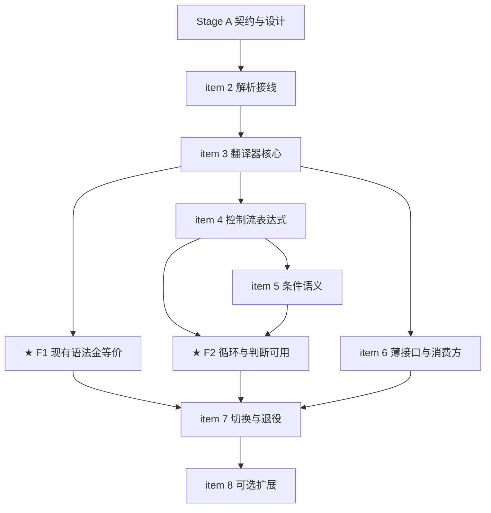

# nop-ai-shell Bash 前端替换 Roadmap — tree-sitter CST → CommandExpression

> Last updated: 2026-10-05
> Sources: `ai-dev/analysis/nop-treesitter-bash-shell-interaction.md`（裁定——本次**触发信号 #1 命中**），
> `ai-dev/design/nop-ai-shell/04-bash-syntax.md`（现有语法规格与 Tier 矩阵），
> `docs-for-ai/03-modules/nop-treesitter.md`（bash blob + corpus 100/100），
> `nop-ai/nop-ai-shell/src/main/java/io/nop/ai/shell/parser/BashSyntaxParser.java`（被替换物）

## Purpose

用 nop-treesitter（纯 Java tree-sitter 运行时，bash 上游 corpus 100/100）替换手写的
`BashLexer` + `BashSyntaxParser` 解析前端，并把外部使用层收敛为**一个薄接口 + 上下文对象**。
表达式树扩展**循环、判断等控制流**语法。只覆盖最常见语法；子集外构造**结构化拒绝**
（node kind + 源文本 + 字节偏移），不再 fail-fast 于任意 token。

Terminal goal：仓库回归**单一 bash 语法权威**（tree-sitter），手写 lexer/parser 退役；
guardrail 对畸形输入退化为精确拒绝而非崩溃。Enables
`./tools/mission-driver.sh run nop-ai-shell-bash-cst-frontend` to drive the implementation
autonomously. Roadmap contains no implementation details — each `planned` stage is owned
by its execution plan.

**本次替换的用户裁定**（约束所有 stage）：

- 外部使用层用**薄接口**，不要求与旧接口一致；
- 协调环境（命令注册表、checker、fs、env、cwd、io、限制）通过**上下文对象**传入，
  不再走多参构造；
- 支持循环、判断等控制流语法；
- 只处理最常见语法，子集外显式拒绝。

## Work Items

> **This is the only dynamic state block. Update status only here.**
> The roadmap is a human-AI alignment artifact: humans set items and their order;
> AI takes the first `todo` item, drafts/executes plans (humans don't review individual
> plans), and writes the item back to `done` when closure audit passes.

- 1. 设计收口：薄接口 + 上下文对象规格、表达式节点扩展、CST→表达式映射规格、子集外拒绝规格；更新 bash-shell-interaction 裁定（触发信号 #1 命中）与 `04-bash-syntax.md`: `todo`
- 2. 解析接线：nop-ai-shell 增加 nop-treesitter 依赖（仅核心运行时 API）；CST 解析入口；结构化拒绝类型（语法错误位置、子集外构造）: `todo`
- 3. 翻译器核心：CST → 现有 CommandExpression 子集（序列/Logical/Pipeline/Simple/Redirect/Background/Subshell/Group、前缀赋值、word 内部结构保留）；金等价：现有 `BashSyntaxParserTest` 全用例双跑 diff: `todo`
- ★ **Milestone F1：现有语法金等价**（unlocks when 2 + 3 done）：`todo`
- 4. 控制流表达式：新增模型节点（If/While/Until/For/Break/Continue/Return）+ 翻译器映射（`if/elif/else`、`while`、`until`、`for-in`）+ 求值器支持: `todo`
- 5. 条件语义：退出码条件；`test` / `[[ ]]` 内建（字符串/数值/文件判定子集）；`$( )` 命令替换递归执行: `todo`
- ★ **Milestone F2：循环与判断可用**（unlocks when 4 + 5 done）：`todo`
- 6. 薄接口落地：单入口接口 + 上下文对象实现，迁移 `ShellCommandExecutor` 内部装配与 `nop-ai-agent` 消费方: `todo`
- 7. 切换与退役：默认切换新前端；删除 `BashLexer` / `BashSyntaxParser` 及其测试；模块文档、`04-bash-syntax.md`、裁定文档同步: `todo`
- 8. （可选）`case` 语句、herestring、c-style `for((;;))`: `todo`

## Status values

| Status | Meaning |
| --- | --- |
| `todo` | Not started, no plan |
| `planned` | Has execution plan, passed draft review |
| `done` | Complete, passed closure audit |

> Milestone status is derived: when its dependent work items are all `done`, the milestone auto-flips to `done`.

## Framework / platform reuse

| Capability | Provider | Notes |
| --- | --- | --- |
| bash 语法解析（blob + `BashScanner` 29 外部 token） | `nop-treesitter`（已建成，corpus 100/100） | 直接复用；nop-ai-shell 只依赖核心运行时 API |
| 畸形输入不抛异常（GLR 停滞回退） | `nop-treesitter` | 返回含 ERROR/MISSING 的树，结构化拒绝的直接前提 |
| heredoc 语法（外部 token + `extractHeredoc` 参照实现） | `nop-treesitter` | 手写 lexer 的行扫描逻辑整体废弃 |
| `CommandExpression` 层级 + visitor + `CommandFactory` + `ICommandChecker` | `nop-ai-shell`（保留） | 只增控制流节点，不重写 |
| 执行/异步/后台任务 | `ShellCommandExecutor` / `ExecutionResult` / `IBackgroundJobSink`（保留） | 装配方式改上下文对象，求值逻辑不动 |
| 拒绝形态参照（`Unproven[SYNTAX_ERROR]`） | `io.nop.treesitter.shell` | **参照不依赖**——分析层"不求值、不出表达式树"的契约不破坏 |

## Current baseline

- 手写 `BashLexer` + `BashSyntaxParser`（595 行递归下降）产出 `CommandExpression` 层级
  （`SimpleCommand` / `PipelineExpr` / `LogicalExpr` / `SubshellExpr` / `BackgroundExpr` /
  `GroupExpr` / `Redirect`），由 `ShellCommandExecutor` 的 visitor 求值
- `ShellCommandExecutor` 以 4 参构造注入协调环境（registry / executor / checker / fileSystem），
  外部消费方 `nop-ai-agent`
- 语法覆盖为设计上的子集（Tier 1/2/3 矩阵），遇到不认识的构造 fail-fast `ParseException`
- `nop-treesitter` bash 语法 corpus 100/100（上游 v0.25.1，与 codex 同 commit）；
  畸形输入已保证不抛异常
- ~~两个 bash parser 静默分歧的风险~~ ✅ 本路线以"单一语法权威"消除（切换后手写 parser 删除）

## Stage table

| # | Stage | Owner plan | Depends on | Critical path | Reuse |
|---|---|---|---|---|---|
| A | 契约与设计 | (item 1) | — | yes | 既有裁定与 Tier 矩阵 |
| B | 前端替换 | (items 2, 3) | A | yes | nop-treesitter 全部 |
| C | 控制流 | (items 4, 5) | B | yes | 求值器 visitor 骨架 |
| D | 薄接口与消费方 | (item 6) | B（可与 C 并行） | no | `IShellCommandExecutionContext` 既有概念 |
| E | 收口 | (items 7, 8) | C + D | yes | — |

## Stage details

### Stage A — 契约与设计

Goal: 把用户裁定落成可执行的规格，修正裁定文档。

Deliverables: 薄接口与上下文对象的契约设计（单入口、上下文携带项清单：命令注册表 /
checker / fs / env / cwd / io 流 / 递归深度与超时限制）；控制流表达式节点清单及其求值
语义；CST 节点 → 表达式的映射表与子集外拒绝清单（node kind 分级：映射 / 拒绝）；
`../analysis/nop-treesitter-bash-shell-interaction.md` 补记"触发信号 #1 已命中"及本路线取代"并行"裁定的范围
（仅解析前端，分析层契约不变）；`04-bash-syntax.md` Tier 矩阵按新覆盖更新。

Out of scope: 具体实现代码。

Module area: `nop-ai/nop-ai-shell`（设计文档在 `ai-dev/design/nop-ai-shell/`）。

### Stage B — 前端替换

Goal: tree-sitter 成为解析前端，既有语法行为金等价。

Deliverables: `nop-ai-shell` 对 `nop-treesitter` 的依赖与 CST 解析入口；结构化拒绝类型
（语法错误：首 ERROR/MISSING 节点位置；子集外：node kind + 源文本 + 偏移）；翻译器核心
（B 阶段只做既有子集映射）；金等价验证——现有 `BashSyntaxParserTest` 全用例以双跑方式
diff 新旧表达式树，全部一致后旧断言原样迁移。

Out of scope: 控制流语法、薄接口、删除旧 parser（旧 parser 在本阶段保留作交叉验证基准）。

Module area: `nop-ai/nop-ai-shell`（依赖 `nop-treesitter`）。

### Stage C — 控制流

Goal: 循环与判断可用。

Deliverables: 新表达式节点（条件为命令序列、按退出码判定；`test` / `[[ ]]` 内建的常用
判定子集：字符串相等/比较、数值比较、文件存在类；`$( )` 命令替换经引擎递归执行）；
`if/elif/else`、`while`、`until`、`for-in` 的翻译与求值；`break` / `continue` / `return`
的控制流信号；嵌套（循环体内含管道/重定向/子循环）。

Out of scope: `case`、函数定义、进程替换、`${x//pat/rep}`、`$(( ))`、brace expansion、
extglob（结构化拒绝清单，item 8 视需要升级部分项）。

Module area: `nop-ai/nop-ai-shell`。

### Stage D — 薄接口与消费方

Goal: 外部使用层收敛为单入口 + 上下文对象。

Deliverables: 薄接口实现（单入口方法 + 上下文对象，按 Stage A 契约）；`ShellCommandExecutor`
的多参构造装配迁移为上下文对象构建；`nop-ai-agent` 消费方迁移；旧构造路径标注 deprecated
或直接移除（按 Stage A 裁定）。

Out of scope: 语法覆盖扩展。

Module area: `nop-ai/nop-ai-shell`、`nop-ai/nop-ai-agent`。

### Stage E — 收口

Goal: 单一语法权威 + 文档同步。

Deliverables: 默认前端切换为新实现；删除 `BashLexer` / `BashSyntaxParser` 及其专属测试
（金等价断言已迁移）；`docs-for-ai` 模块页、`04-bash-syntax.md`、裁定文档、`source-anchors`
同步；可选项（item 8）视需要立项。

Out of scope: 新语法覆盖（除非 item 8 立项）。

Module area: `nop-ai/nop-ai-shell`、`docs-for-ai/03-modules/`。

## Dependency graph

## Cross-cutting concerns

| 陷阱 | 规则 |
|---|---|
| 树含 ERROR/MISSING | 一律拒绝并给出位置，**不允许带病产出表达式树**（GLR 停滞回退已保证解析层永不抛异常） |
| `2>&1` | 是带 fd 的 redirect，不是文件名 word——翻译时按 fd 判定 |
| 引号内 `;` `\|` | 属 `string_content`，CST 结构天然无歧义——不得在翻译器里做文本级二次扫描 |
| `A= cmd` 前缀赋值 | `command` 节点无 `command_name` + `variable_assignment`，对应既有 `EMPTY_VALUE` 语义 |
| 运行期展开 | `$VAR` / glob / word splitting 的**求值语义仍在求值器**；translator 只保留引号/拼接/替换的 CST 结构，不得丢 |
| 双 parser 窗口 | 交叉验证只存在于 Stage B/C；Stage E **必须删除**手写 parser——不允许长期双权威 |
| 行为变更 + 跨模块依赖 | plan-first；Stage A 的裁定补记先行，否则不动代码 |

## Rules

- 状态只更新上方 Work Items 块；stage details 不写状态。
- AI 取第一个 `todo` 项起草/执行 plan；closure audit 通过后才写 `done`。
- milestone 状态派生：依赖项全 `done` 即 `done`，不得提前。
- 每个工作项一个 plan（~5-15 文件）；超了就拆。
