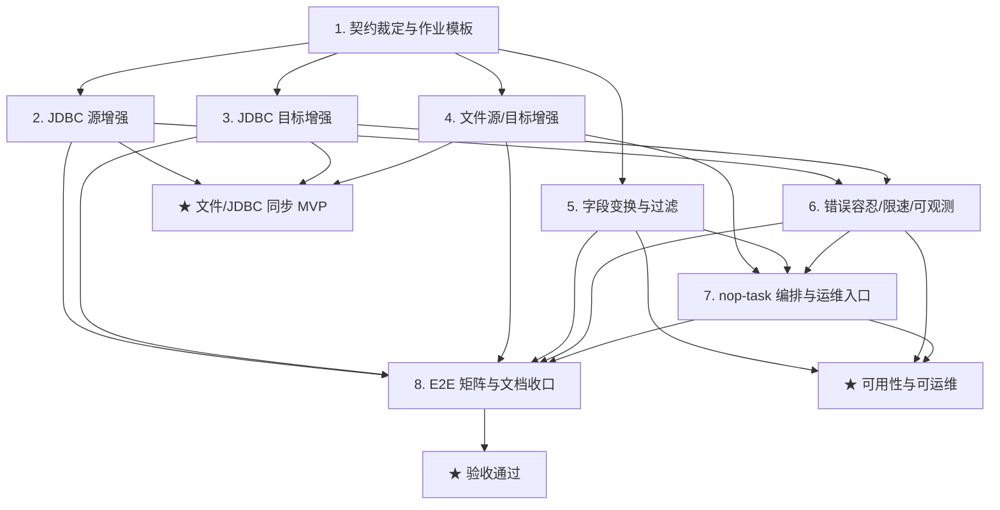

# nop-batch Addax-like 文件与 JDBC 数据同步 Roadmap

> Last updated: 2026-10-28
> Sources:
> - `~/sources/Addax`（Addax 源码，Apache-2.0；33 reader + 33 writer，核心 104 文件/约 1.6 万行，插件 211 文件/约 4 万行）
> - `ai-dev/backlog/nop-etl-platform-completion-roadmap.md`（ETL 平台面总 roadmap；本 roadmap 不重复其编排/治理项）
> - `docs-for-ai/03-modules/nop-batch.md`、`docs-for-ai/02-core-guides/batch-dsl.md`
> - `nop-batch/nop-batch-dsl/src/test/java/io/nop/batch/dsl/sync/TestFileJdbcSyncUseCases.java`（本 roadmap 的 bootstrap 验证）
> - 需求来源：2026-10-28 会话——确认 Addax 不依赖 Kafka；评估基于 nop-batch + nop-task 复刻 Addax 文件/JDBC 同步能力的可行性

## Purpose

本 roadmap 把「基于 nop-batch + nop-task 的 Addax-like 数据同步工具」收敛为可交付、可验证的产品面，范围严格限定在**数据文件与 JDBC**：

- 源/目标：本地文件（CSV/Excel/文本）、JDBC 数据库（经 nop-dao dialect）。
- 执行：nop-batch 的 loader → processor → consumer chunk 管线。
- 编排：nop-task（`batch:Execute` 步骤）承载同步作业，nop-job 承载调度。

终端目标：用户能用一份声明式配置定义「文件 ↔ JDBC」同步作业，支持字段映射、过滤、批量写入、错误容忍、断点续跑与调度，并通过典型用例的自动化配置验证。

**不在本 roadmap 内**：非 JDBC 数据源（Kafka/HBase/ES/S3/MongoDB 等）、CDC 增量、Flink/Spark 引擎、Addax `job.json` 1:1 兼容、连接器生态扩张（见 `ai-dev/backlog/nop-etl-platform-completion-roadmap.md`）。

不含实现细节。每个 WI 由独立执行计划承载（`ai-dev/plans/00-plan-authoring-and-execution-guide.md`）。

## Evidence Ledger（证据底账，2026-10-28 闭合）

1. **Addax 的能力大头在插件，不在引擎**：`~/sources/Addax/plugin/reader` 33 个、`plugin/writer` 33 个；核心 `core/src/main/java` 104 文件、约 1.6 万行，插件 211 文件、约 4 万行。
2. **nop-batch 管线已具备**：Loader→Processor→Consumer，DSL 定义 `batch.xdef:9-18`，chunk 事务/并发/rateLimit 属性在 `batch.xdef:9-12`。
3. **重试/跳过/续跑已具备**：`retryPolicy`/`loadRetryPolicy`/`skipPolicy` 在 `batch.xdef:41-50`；状态与记录级幂等见 `docs-for-ai/03-modules/nop-batch.md`。
4. **JDBC 源已具备**：`jdbc-reader` 声明 `querySpace/fetchSize/sqlName/maxRows/streaming/partitionIndexField` + `<sql>`/`<query>`（`batch.xdef:130-135`）；实现 `JdbcBatchLoaderProvider`（`nop-batch/nop-batch-jdbc/.../loader/JdbcBatchLoaderProvider.java:182-230`）。
5. **JDBC 目标已具备但不自动大小写映射**：`jdbc-writer` 可省略 `<fields>` 并由表元数据推断（`JdbcBatchConsumerProvider.java:89-99`），但写入列是否命中取决于 `BeanTool.hasProperty(record, fromName)`（`JdbcInsertBatchConsumer.java:66-99`）——普通 `Map` 的大小写敏感（`ID` vs `id`）会生成空列 SQL。
6. **文件读写已具备**：`file-reader`/`file-writer`/`excel-reader`/`excel-writer`（`batch.xdef:97-120,171-183`），底层复用 nop-record（`FileBatchSupport.java:47-130`）。
7. **nop-task 集成已具备**：`batch:Execute` 宏标签（`nop-batch/nop-batch-dsl/.../xlib/batch.xlib:11-60`）+ `/nop/task/lib/batch-common.task.xml`；现有测试 `TestBatchTaskDsl` 用 task.xml 调 batch。
8. **exp 工具边界**：`ImportDbTool`/`ExportDbTool` 只覆盖「文件→库」「库→文件」，且是 CLI 形态（`nop-batch/nop-batch-exp/.../ImportDbTool.java`、`ExportDbTool.java`；唯一生产依赖 `nop-runner/nop-cli-core/pom.xml`）。
9. **无 splitPk/where/增量语义**：`jdbc-reader` 只有 SQL/query/partitionIndexField，没有 Addax reader 的 splitPk 区间切分与 where/start-end 增量参数（对照 `batch.xdef:130-135` 与 Addax `plugin/reader/mysqlreader` 的 split 实现）。
10. **无写模式与前置/后置 SQL**：`jdbc-writer` 只有 `allowInsert/allowUpdate/keyFields`（`batch.xdef:190-202`），无 truncate/replace、preSql/postSql。
11. **错误与限速粒度不足**：仅有 `rateLimit`（条/秒）与全局 `maxSkipCount`（`batch.xdef:12,48-50`），无 Addax 的 errorLimit（条数/百分比）、字节/秒限速、脏数据落盘。
12. **方言面**：nop-dao 内置约 15 个 dialect（mysql/mariadb/oracle/postgresql/mssql/db2/h2/duckdb/dm/tdengine 等，见 `nop-persistence/nop-dao/src/main/resources/_vfs/nop/dao/dialect/`），足以覆盖 JDBC 同步主场景；非 JDBC 源不在范围。
13. **Bootstrap 验证已通过**：`TestFileJdbcSyncUseCases` 三个用例（JDBC→JDBC 250 行、JDBC→CSV 250 行、CSV→JDBC 120 行含 processor 变换）在 `./mvnw -q -pl nop-batch/nop-batch-dsl test -Dtest=TestFileJdbcSyncUseCases` 下 `Tests run: 3, Failures: 0, Errors: 0`。
14. **Bootstrap 暴露缺口**：CSV→JDBC 若不写 `<fields>` 会因第 5 条生成 `insert into sync_csv_jdbc () values ()`；当前配置需显式列出字段，与 Addax 的自动列映射体验有差距。
15. **平台复用优于重建**：nop-job 已有 cron/分片/cancel/rerun（见 `ai-dev/backlog/nop-etl-platform-completion-roadmap.md` 证据底账 1-3），nop-task 已有 30+ step 类型；本 roadmap 不自建调度与流程引擎。

## Work Items

> **这是唯一动态状态块。只在这里改状态。**
> 人类确定条目与顺序；AI 取第一个 `todo`，起草/执行计划，closure audit 通过后写回 `done`。

- 1. 契约裁定与同步作业模板（配置格式、能力矩阵、错误/限速语义）：`todo`
- 2. JDBC 源增强（splitPk 区间切分、where/增量、列裁剪、流式读取）：`todo`
- 3. JDBC 目标增强（列映射、写模式、pre/post SQL、schema 校验）：`todo`
- 4. 文件源/目标增强（CSV/Excel/文本、目录/通配、压缩、追加/覆盖）：`todo`
- 5. 字段变换与过滤（映射/改名/常量/默认值/类型转换/去重/脱敏子集）：`todo`
- 6. 错误容忍、限速与可观测（errorLimit、脏数据、字节限速、统计报告）：`todo`
- 7. nop-task 编排与运维入口（多表顺序同步、CLI、nop-job 调度、取消/重跑）：`todo`
- 8. 端到端验证矩阵与文档收口（H2 + MySQL/PostgreSQL 矩阵、owner doc）：`todo`
- ★ **Milestone: 文件/JDBC 同步 MVP**（2+3+4 完成）：`todo`
- ★ **Milestone: 可用性与可运维**（5+6+7 完成）：`todo`
- ★ **Milestone: 验收通过**（8 完成且 1-7 全部 done）：`todo`

## Status values

| Status | Meaning |
| --- | --- |
| `todo` | 未开始，无执行计划 |
| `planned` | 已有执行计划并通过 draft review |
| `done` | 完成，且独立 closure audit 通过 |

> Milestone 状态派生：其依赖 WI 全部 `done` 后才可标 `done`。

## Framework / Platform Reuse

| 能力 | 提供方 | 约束 |
| --- | --- | --- |
| Chunk 执行引擎 | `nop-batch-core`（`BatchTaskBuilder`/`BatchTask`） | 不新建执行引擎；不改 chunk 语义 |
| 任务 DSL | `batch.xdef` + `batch.xlib` | 优先扩展 schema，不新建平行 DSL（WI1 裁定） |
| JDBC 读写 | `nop-batch-jdbc`（`jdbc-reader`/`jdbc-writer`） | 在 provider 层增强，不绕过 nop-dao |
| ORM 读写 | `nop-batch-orm` | 仅在需要实体语义时使用 |
| 文件/Excel | `nop-batch-dsl` + `nop-record` + `nop-report-core` | 复用 record model/CSV/Excel IO |
| 编排 | `nop-task`（`batch:Execute`） | 同步作业包成 task，不重复建流程引擎 |
| 调度/分片/取消 | `nop-job` | 复用 cancelFire/rerunFire/partition |
| 状态/续跑/幂等 | `nop-batch` `IBatchStateStore` + `historyStore` | 语义为 at-least-once，sink 需幂等 |
| 方言/类型 | `nop-dao` dialect + `StdSqlType/StdDataType` | 不手写方言分支 |
| 测试基座 | `nop-autotest` + localDb(H2) | 典型用例优先 H2；外部库用可选 profile |
| CLI | `nop-runner/nop-cli-core` | 复用 `run-task` 入口，不新建 CLI 框架 |
| 参考实现 | Addax（Apache-2.0） | 可移植算法/配置语义，须保留版权声明；不引入 GPL |

## Current Baseline（2026-10-28 核对）

**已具备：**

- nop-batch 的 chunk 管线、事务档位、retry/skip/rateLimit、状态存储与记录级幂等。
- `jdbc-reader`/`jdbc-writer`、`file-reader`/`file-writer`/Excel reader/writer。
- nop-task `batch:Execute` 集成；nop-job 调度/取消/重跑。
- `nop-batch-exp` 的 DB↔文件 CLI 导入导出。

**Bootstrap 验证（spike，非 WI 完成态）：**

- `TestFileJdbcSyncUseCases`：JDBC→JDBC、JDBC→CSV、CSV→JDBC 三用例全部通过。
- 结论：**核心链路可行，文件/JDBC 同步 MVP 不需要重写引擎**。
- 已暴露缺口：CSV→JDBC 需显式 `<fields>`（Map 大小写敏感，`JdbcInsertBatchConsumer.java:66-99`）；无 splitPk/增量/写模式/errorLimit/字节限速/多文件通配。

**主要缺口（本 roadmap 落点）：**

- 缺少面向同步作业的**声明式契约**与能力矩阵（WI1）。
- JDBC 源缺 Addax 式并行切分与增量条件（WI2）。
- JDBC 目标缺自动列映射、写模式、pre/post SQL（WI3）。
- 文件面缺多文件/目录、压缩、追加、文件名模板（WI4）。
- 变换、错误容忍、限速、报告粒度不足（WI5/WI6）。
- 编排与运维入口仅 CLI 级，缺多表作业模板与调度接线（WI7）。
- 缺跨文件/JDBC 的 E2E 矩阵与使用文档（WI8）。

## Stages

| # | Stage | Owner plan | Deps | Critical path | Reuse |
| --- | --- | --- | --- | --- | --- |
| 1 | 契约裁定与同步作业模板 | 待建 plan | — | **Yes** | `batch.xdef`/`batch.xlib`/nop-task |
| 2 | JDBC 源增强 | 待建 plan | 1 | **Yes** | `JdbcBatchLoaderProvider`/nop-dao |
| 3 | JDBC 目标增强 | 待建 plan | 1 | **Yes** | `JdbcBatchConsumerProvider`/nop-dao |
| 4 | 文件源/目标增强 | 待建 plan | 1 | No（可与 2/3 并行） | nop-record/CSV/Excel IO |
| 5 | 字段变换与过滤 | 待建 plan | 1 | No | XPL processor/record mappings |
| 6 | 错误容忍、限速与可观测 | 待建 plan | 1,2,3 | No | batch retry/skip/rateLimit/metrics |
| 7 | nop-task 编排与运维入口 | 待建 plan | 2,3,4,5,6 | **Yes** | nop-task/nop-job/nop-cli |
| 8 | E2E 矩阵与文档收口 | 待建 plan | 2-7 | **Yes** | nop-autotest/localDb |
| ★ | Milestone: 文件/JDBC 同步 MVP | — | 2+3+4 done | — | — |
| ★ | Milestone: 可用性与可运维 | — | 5+6+7 done | — | — |
| ★ | Milestone: 验收通过 | — | 1-8 done | — | — |

## Stage details

### 1. 契约裁定与同步作业模板

> Status: see Work Items above

**Goal:** 固定「同步作业」的配置形态、能力边界与错误/限速语义，避免后续各 WI 各造一套 DSL。

**Deliverables:**
- 决定并记录：继续用 `*.batch.xml` + task 模板，还是新增轻量 `*.sync.xml`（要求能编译到 batch model，不新建执行引擎）。
- 定义源/目标/变换/错误/限速的配置契约与默认值；给出文件/JDBC 能力矩阵（支持/不支持/后续）。
- 固化 `CSV/Excel/文本 ↔ JDBC` 四类模板与命名规范；明确 at-least-once 与 sink 幂等责任。
- 交付设计文档（ai-dev/design/nop-batch-sync/）+ 可加载的示例模板。

**Out of scope:** 具体 provider 实现、非 JDBC 源、Addax `job.json` 兼容。

**Module / area:** `nop-batch/nop-batch-dsl`、`docs-for-ai/02-core-guides/batch-dsl.md`、`docs-for-ai/03-modules/nop-batch.md`。

### 2. JDBC 源增强

> Status: see Work Items above

**Goal:** 让 `jdbc-reader` 具备 Addax reader 的常用取数能力。

**Deliverables:**
- splitPk 区间切分（generate N 段查询）或等价 partition 方案；与 nop-job 分区参数衔接。
- `where`/增量条件（start/end、时间戳/自增键）、列裁剪、表名+列名模式。
- 流式读取、fetchSize、类型映射与 null 处理；分页/游标语义与断点续跑对齐。
- 判别性测试：多段切分不重不漏、增量边界、空表、大小写/特殊标识符。

**Out of scope:** 非关系型源；CDC。

**Module / area:** nop-batch/nop-batch-jdbc/loader、`nop-batch/nop-batch-dsl`、`nop-dao`。

### 3. JDBC 目标增强

> Status: see Work Items above

**Goal:** 让 `jdbc-writer` 达到「配置即可写」的 Addax 体验。

**Deliverables:**
- 自动列映射（Map 大小写不敏感/`from` 自动推导），修复第 5/14 条证据暴露的空列 SQL。
- 写模式：insert、update、upsert/duplicate-key、truncate+insert；`keyFields` 语义明确。
- preSql/postSql、批量大小、失败回滚边界；目标表 schema 预检（列缺失/类型不兼容早失败）。
- 判别性测试：自动映射、upsert 幂等、pre/post SQL 顺序、坏数据报错信息。

**Out of scope:** 跨库分布式事务；异构 schema 自动迁移。

**Module / area:** nop-batch/nop-batch-jdbc/consumer、`nop-batch/nop-batch-dsl`、`nop-dao`。

### 4. 文件源/目标增强

> Status: see Work Items above

**Goal:** 覆盖企业常见文件同步形态，而不是只有单文件 CSV。

**Deliverables:**
- CSV/Excel/定长文本：分隔符、引号、编码、表头/无表头、null 表示、字段类型。
- 多文件/目录/通配输入；压缩文件（gz/zip）读取；单文件或按分片输出。
- 写模式 truncate/append、文件名表达式（含参数/日期）、输出目录自动创建。
- 判别性测试：多文件合并、压缩输入、编码/分隔符、追加不覆盖。

**Out of scope:** 二进制附件同步；对象存储。

**Module / area:** `nop-batch/nop-batch-dsl`（file/excel）、`nop-record`、`nop-report-core`。

### 5. 字段变换与过滤

> Status: see Work Items above

**Goal:** 用声明式配置完成 Addax transformer 的常用子集。

**Deliverables:**
- 字段映射/改名/常量/默认值/类型转换/表达式派生。
- 行过滤、去重（键）、简单脱敏（掩码/截断）子集。
- 复用 XPL processor 与 `nop-record` mappings；提供可测试的内置函数/标签。
- 判别性测试：类型转换失败策略、默认值、过滤后计数、脱敏结果。

**Out of scope:** Groovy 脚本兼容、复杂 UDF 市场。

**Module / area:** `nop-batch/nop-batch-dsl` processors、`nop-record`、`docs-for-ai/02-core-guides/batch-dsl.md`。

### 6. 错误容忍、限速与可观测

> Status: see Work Items above

**Goal:** 让同步作业具备可运维的失败边界与容量控制。

**Deliverables:**
- errorLimit（条数/百分比）+ 脏数据落盘/查询；与 skipPolicy 的映射关系。
- 速率限制：条/秒（已有）与字节/秒；并发/jitter 与目标库压力说明。
- 每表/每作业统计（读/写/跳过/耗时/字节），接入 metrics 与日志。
- 判别性测试：超过 errorLimit 失败、脏数据可追溯、限速生效。

**Out of scope:** 全链路 tracing 平台；告警中心。

**Module / area:** `nop-batch/nop-batch-core`、`nop-batch-dsl`、`nop-batch-jdbc`。

### 7. nop-task 编排与运维入口

> Status: see Work Items above

**Goal:** 把单表同步提升为可调度、可传参、可取消/重跑的作业。

**Deliverables:**
- 同步作业 task 模板：参数校验 → 前置检查 → `batch:Execute` → 后置检查/通知。
- 多表顺序/并行同步、表清单参数、失败继续/中止策略。
- CLI 入口（复用 `run-task`）；nop-job cron/分片接线；cancel/rerun 与 batch 状态对齐语义。
- 判别性测试：多表作业、失败分支、参数透传、取消后状态。

**Out of scope:** 图形化编排（见现有 ETL roadmap WI4）；自建调度中心。

**Module / area:** `nop-task`、`nop-batch/nop-batch-dsl`、`nop-runner/nop-cli-core`、`nop-job`。

### 8. 端到端验证矩阵与文档收口

> Status: see Work Items above

**Goal:** 用可重复的配置验证证明「文件/JDBC 同步」可用，并同步 owner doc。

**Deliverables:**
- 验证矩阵：JDBC→JDBC、JDBC→文件、文件→JDBC、文件→文件；覆盖 insert/upsert、增量、errorLimit、多文件、编码。
- H2 默认必跑；MySQL/PostgreSQL 作为可选 profile（有容器则跑，无容器跳过并记录）。
- 扩展 `TestFileJdbcSyncUseCases` 为参数化矩阵；保留 bootstrap 三用例。
- 更新 owner doc：`docs-for-ai/02-core-guides/batch-dsl.md`、`docs-for-ai/03-modules/nop-batch.md`、`docs-for-ai/INDEX.md`（如需路由）、`docs-for-ai/04-reference/xdefs/batch.xdef` 副本。
- 运行 `node ai-dev/tools/check-doc-links.mjs --strict` 并记录结果。

**Out of scope:** 性能压测基线（另立 roadmap/benchmark）。

**Module / area:** `nop-batch/nop-batch-dsl/src/test`、`docs-for-ai/`。

## Dependency graph

## Cross-cutting concerns

| Concern | Notes |
| --- | --- |
| Protected Areas | ORM 模型（`model/*.orm.xml`）、`nop-*-api`、codegen/`_gen`、`nop-core`/`nop-xlang` 变更走 plan-first；不得手改生成文件 |
| Schema 扩展 | 优先扩展 `batch.xdef`/`batch.xlib`；新增字段须同步 `docs-for-ai/04-reference/xdefs/batch.xdef` 副本 |
| 一致性语义 | nop-batch 为 at-least-once；同步目标必须幂等（upsert 或 truncate+insert），文档必须写明 |
| 大小写/标识符 | JDBC 元数据大小写因库而异；所有列映射必须有可预测规则与测试（H2/MySQL/PG） |
| 方言 | 新 SQL 生成必须走 `IDialect`/`StdSqlType`，禁止字符串拼接方言分支 |
| 依赖 | 不新增 GPL/AGPL 运行时；Addax 代码移植须保留 Apache-2.0 声明 |
| 测试 | 每个 WI 必须有判别性测试；默认 H2，外部库可选 profile；禁止只测「不抛异常」 |
| 临时文件 | 一律 `<project-root>/_tmp/` |
| 文档 | Reconcile-on-touch：改能力/配置即更新 owner doc；完成前跑 doc link checker |

## Rules

- 本文件是状态索引与粗分解，不是执行计划；Stage details 不写复选框/实现步骤。
- 每个 `planned`/`done` WI 由独立执行计划承载；状态只在 Work Items 块变更。
- WI 完成判定：独立 closure audit（不同 task_id 子 agent）对照 exit criteria 与 live code；禁止自审。
- 若改动超出「文件 + JDBC」范围，先改本文档的范围硬边界，再立新 roadmap。
