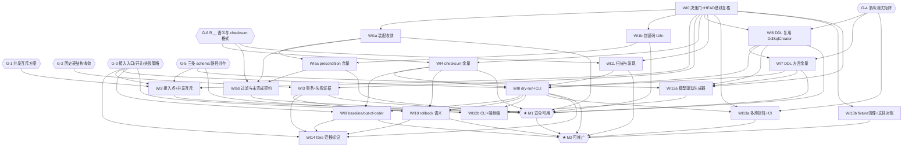

# nop-db-migration 完善路线图（DB Migration Hardening & Productization）

> **来源调研**：`ai-dev/analysis/2026-10/2026-10-12-flyway-liquibase-vs-nop-db-migration-source-analysis.md`（flyway 13.10.0 / liquibase ≈5.0.x 源码级三方对比 + 12 维度缺口矩阵）
> **来源审计**：`ai-dev/audits/check/db-migration.md`（2026-08-19）+ **`ai-dev/audits/check2/db-migration.md`（2026-08-23，16 条）**
> **Last updated**：2026-10-18（v6 增补 WI14 fake 迁移标记：`migrate --fake` / `rollback --fake`；adoption 增强，不入 M1/M2 分母）
> **审查方式**：多轮独立子 agent 交叉审查（Round 1 三路：A 代码事实 / B 结构可执行性 / C 复用真实性与覆盖完整性；Round 2 三路：D/E/F 同角度分维；Round 3 两路：G 修复验收 + H 盲审；Round 4 终局确认 J），逐轮收敛后修订至 **v4**；Round 4 提出的 8 处措辞级订正已在 **v5** 落地，Round 5 终局确认判 `consensus-reached`。
>
> **v2 修订摘要（Round 1 → v2，6 项 BLOCKER 全部处置）**：
> 1. **基线重锚 HEAD**：v1 的 Current Baseline 与 WI1/WI4/WI5/WI7 范围抄的是 2026-08-19 审计快照，**漏掉 master 上的 `fb3f860729`（2026-08-24，"check2 16 条全部修复"）**。经 A/C 两路独立发现、本人逐条复核属实：checksum 已覆盖变更内容并在 `migrate()` 内比对（`MigrationEngine.java:164-185`，`isValidateChecksum` 默认 true 且有读取点 `:176`）、`R__` 已按 checksum 变化重跑、5 个 precondition checker 已接入并在执行前评估（`:101-107` 注册 / `:245` 调用）、`ignore`/`failOnError`/`contexts`/`labels`/`runOn==NEVER` 已接线、未知 change type 已响亮抛 `ERR_DB_MIGRATION_UNKNOWN_CHANGE_TYPE`、`DbMigrationErrors` 12 个常量已是规范 `define("nop.err.db-migration.*")` 形态、`DdlSyntax` 族助手已实现 AUTO_INCREMENT/COMMENT/ALTER COLUMN 分族。**v1 把已完成项当交付物排期** → v2 全部改为"余量"口径。
> 2. **审计遗留计数更正**：v1 写"5 项 P1 + 7 项 P2 裁定暂缓"（A、C 两路独立判定失实）。实为 2026-08-19 审计 P1 8 项 / P2 11 项中，明确"暂缓/需立项"的 **P1 = 3**（xdef 契约接线、dbtool 无锁、DDL 方言余项）+ **P2 = 3**（历史表双定义、checksum、全库发现 N+1）+ 1 项部分暂缓（DEFAULT 字面量化）；其余均为已修复/部分修复。
> 3. **WI2 载体纠正（C 路 BLOCKER）**：v1 开"把空的 `DbMigrationInitializer.initialize()` 变成真实接入点"。但 `ICoreInitializer` 走 **ServiceLoader**，`INITIALIZER_PRIORITY_REGISTER_REFLECTION = 2820` **早于** `INITIALIZER_PRIORITY_IOC = 4900`，此时 IoC 未起，**无法 `@Inject` `IJdbcTemplate` / 锁管理器**。正确载体是平台既定模式：**普通 IoC bean + `ioc:condition`/`if-property` + `ioc:after`**（先例 `dbtool-defaults.beans.xml:11-16`、`orm-defaults.beans.xml:90-109`）。复用表补此行，并把 `ICoreInitializer` 列为"禁止的做法"。
> 4. **三路径共存与 executeMark 无声遗漏（C 路 BLOCKER×2）**：新增 **G-5**（db-migration / dbtool auto-upgrade / orm schema init 的执行顺序与 primacy，`DataBaseSchemaInitializer` 此前在 v1 全文零出现）；`executeMark`（xdef:438 声明、无执行器、`type=null` 走 `executeChange` 的静默 `return`）进 **WI5b**，与"静默跳过零容忍"原则对齐。
> 5. **WI8 越界与超粒度工作项拆分（B 路 BLOCKER + MAJOR）**：WI8 的 CLI 子命令收窄为 `migrate/validate/dry-run`（`baseline`/`repair`/`rollback` 由 WI9/WI4/WI10 各自交付，不再依赖闭包外的能力）；WI1→WI1a/WI1b、WI5→WI5a/WI5b、WI12→WI12a/WI12b（沿用 eql roadmap 的 a/b 拆分先例）；WI7 经 HEAD 复核后范围大幅收窄（族分族已实现），不再需要拆分。
> 6. **图与表对账（B 路 4 处 MAJOR）**：依赖图删去与矩阵矛盾的 `WI1→WI2`、补 `WI0→WI2`、`WI1a→WI5a`、`WI4→WI10`；矩阵补 ★ M1/★ M2 行；Gate 表的"阻塞"列与矩阵同步（G-3/G-4/G-5/G-6 全部落到具体 WI 行）；WI12 Protected Area 补条件式 plan-first 判定；`R__` 与 checksum 格式升为独立门 **G-6**。
>
> **v3 修订摘要（Round 2 → v3）**：Round 2 三路独立复审（D 事实 / E 结构 / F 复用覆盖）结果为 D=`consensus-reached`、E=`changes-required`（3 BLOCKER + 3 MAJOR）、F=`changes-required`（0 BLOCKER + 5 MAJOR）。已全部处置：
> 1. **Gate↔矩阵↔Mermaid 三处对齐**（E-BLOCKER-1）：G-3=WI2/8/9/12b、G-4=WI6/7/13、G-5=WI2/12a/12b、G-6=WI4/5b/11，四门三处一致。
> 2. **补 2 条缺失依赖边**（E-BLOCKER-2）：`WI0→WI12a`、`WI4→WI8`；同时删除矩阵中无依据的 `WI1a→WI6`。
> 3. **CLI 子命令归属闭环**（E-BLOCKER-3）：WI8 = 命令壳 + `migrate`/`validate`/`dry-run` + 暴露 WI4 repair API；`baseline`/`info`（WI9）与 `rollback`（WI10）挂 WI8 壳并补 `WI8→WI9`、`WI8→WI10` 边；WI4 收窄为 API。
> 4. **WI5a/WI5b 出口解耦 + executeMark 进 Gate**（E-MAJOR-4/5）：补 `WI5a→WI5b`；WI5b 出口只约束 `executeChange`；executeMark 二选一升入 G-6 并阻塞 WI5b。
> 5. **WI1b 移入 M1**（E-MAJOR-6 + F）：消除"新错误常量 i18n 键在 M1 缺席"的丢键中间态。
> 6. **F 路 MAJOR**：第 18 行"同一张表"改为"可作用于同一批业务表"；基线测试数 95→**98**（HEAD 实测）；多库先例改为 `nop-dao` dialect testcontainers 矩阵（主先例）；Ledger 补 L9–L14（onFail/嵌套、include/includeAll、回滚自动生成、多 querySpace、恢复续跑、maven 侧）；fixture 清理并入 WI13（v4 拆为 WI13b）；`DEFAULT` 口径改为 4 处（**该处「2 处无校验」系 v3 误判，v4 已纠正为校验缺口 0，见 v4 摘要第 1 条**）。
> 7. **锚点订正**：`OrmDbDiffer.genDiffDdl:126`、`DataBaseUpgrader:129`；`WI1b` 出口改为常量↔yaml 键集合脚本对账。
>
> **v4 修订摘要（Round 3 → v4）**：Round 3 两路独立复审（G=修复验收、H=盲审）均判 `changes-required`，但分歧面已收敛到同一批问题（两路都命中 DEFAULT 口径这一处事实错误）。已全部处置：
> 1. **DEFAULT 口径纠正（G-MAJOR-1/2 + H-BLOCKER-1，根因同一处）**：`AlterColumnExecutor:80` 在 dialect 分支之前统一调用 `DdlSyntax.checkDefaultValue`，已覆盖 `:114`/`:138` 两个拼接点——**"2 处连校验都无"为假**（v3 摘要该子句未核实即写入，是本次最实质的教训）。统一为「**4 处裸拼待字面量化、校验缺口 0**」，矩阵与 Phase 中残留的"3 处/三处"一并改齐。
> 2. **M1 证据自洽（H-MAJOR-2）**：G-4 证据分两档（M1 档最小集供 WI6/WI7 出口；M2 档全矩阵归 WI13a），WI6/WI7 出口与 M1 里程碑行同步，消除"依赖 WI7 却把证据载体 WI13 放在 M2"的矛盾。
> 3. **删除无依据的 `WI6→WI2` 边（H-MAJOR-3）**：`MigrationHistoryManager` 已直接经 `IJdbcTemplate` 写历史表，"历史表写入要走 dao"不成立；同时消除与排序原则"WI2 先于功能补齐"的冲突。
> 4. **CLI 壳归属闭环补齐（H-MAJOR-6）**：WI12b 的 `generate` 子命令挂 WI8 壳，补 `WI8→WI12b` 边。
> 5. **WI5a 依赖 WI1b（H-MINOR-8）**：新错误常量的 i18n holder 注册排序前置于常量引入，消除 M1 内丢键中间态的最后一条路径。
> 6. **WI10 收敛为改注释（H-MAJOR-5）**：`migration.xdef:482-484` 承诺"自动生成回滚 SQL"与实现不符——按实现改注释，自动生成归 Ledger L11；触碰 xdef 标注条件式 plan-first。
> 7. **WI4 的 `validCheckSums` 降级为 G-6 裁决项（H-MAJOR-4）**：该词是 Flyway 词汇，nop 契约中不存在，不得由 plan 自行发明。
> 8. **WI13 拆 a/b（H-MINOR：超粒度）**：WI13a 多库矩阵+CI、WI13b fixture 清理+文档对账，各自独立出口；G-4 只阻塞 WI13a。
> 9. 其余精度订正：WI9 出口枚举三种漂移；WI8 改用平台原生 `DdlSqlCreator` 预览并注明 `nop-cli-core` 需新增模块依赖；WI5b 补"改 xdef 须重生成 `_gen`"；WI6 出口去掉无出处的"10 个既有测试"；`ExistsKind` 枚举行号表述；WI5a 出口限定为"SQL 中不再查询"；WI11 的 Delta 覆盖先验证现状再立项。
>
> **对来源调研报告的修正**：v2 引用该报告时，凡涉及 nop 侧"无 validate / 从不校验"的表述，一律按上文第 1 条以 **HEAD 复核结果**为准；报告本身的同类过期表述已单独订正。

## Purpose

`nop-db-migration` 是平台内唯一声明式、可版本化的数据库迁移引擎（`migration.xdef` DSL + 16 个已注册 executor + 5 个 precondition checker），但截至本图它**在仓库内零生产调用方**，且无并发锁、无事务、无 dry-run / baseline / repair / out-of-order、多库仅 H2 实测——三方矩阵口径下"未达到超过，且未达到可用"。

本路线图的目标**不是**把它补成第四好的通用版本化迁移工具（Flyway/Liquibase 在该赛道已充分竞争），而是：

1. **先让它变成安全可用的平台内部能力**：有调用方、有锁、有事务、有失败证据、契约不再静默失效（WI1a–WI7 → ★ M1）。
2. **充分复用 Nop 平台已有的机制**，不重新发明——分布式锁、方言感知元数据探测、事务模板、模型驱动 DDL、**条件装配与启动排序**、VFS/Delta、IoC 注册、`@InjectValue`、错误码 i18n 生成链路、`nop-cli` 命令框架（见「Framework / platform reuse」，每行都有 live 代码锚点，且已通过独立审查）。
3. **做出 Flyway 与 Liquibase 都没有的差异化能力**：由 `nop-dbtool.OrmDbDiffer` 产出的**模型驱动变更文件**——Flyway 的 diff 是商业版，Liquibase 的 diff 需连两个库；"ORM 模型 → 版本化迁移历史"这个组合两家都没有（WI12a/WI12b）。

本文件不含实现细节。每个 `planned` 阶段由其执行计划拥有。mission 启动命令：`./tools/mission-driver.sh run nop-db-migration`（mission.json 尚未创建，见文末「Roadmap Closure 前置」）。

## Status values

合法 token 为 `todo` / `ready` / `planned` / `done` 四个（`tools/mission-driver/src/roadmap-check.mjs:14` 的 `VALID_STATUSES`）。本图只用 `todo` / `planned` / `done`。流转：draft review 通过 → `todo` 改 `planned`；独立 closure audit 通过 → `planned` 改 `done`（**不得提前**）。

## Work Item Status

> **全文件唯一的动态状态区。更新状态只改这里。**
> 状态流转：draft review 通过 → `todo` 改 `planned`；独立 closure audit 通过 → `planned` 改 `done`（不得提前）。
> 格式约束：header 必须是 `## Work Item Status`，状态必须是该行**最后一个反引号 token**（`roadmap-check.mjs` 的 `BULLET_RE`）。
> 拆分命名沿用 eql roadmap 先例（WI5a/WI5b、WI12a/WI12b），`a`/`b` 是**独立工作项**，各有自己的状态。

- **WI0** 六道决策门裁决 + **HEAD 基线复核**（v1 基线失真的根因就是没做这步）+ DDL 形状棘轮快照 + 可加载方言清单: `todo`
- **WI1a** 装配收敛：16 executor / 5 checker 归一到 `default.beans.xml` 单路径 + 死代码 `MigrationExecutor` 收敛 + `DbTypeFilterExecutor` 内部表委托: `todo`
- **WI1b** 错误码 i18n 聚合：把 `DbMigrationErrors` 注册进 `TestGenErrorCodesYaml` 的 holder 清单（zh-CN 生成 / en 手维护双轨）+ 键补齐: `todo`
- **WI2** 接入点与并发互斥：**IoC bean + `ioc:condition`/`if-property` + `ioc:after`**（⛔ 非 `ICoreInitializer`）+ 复用 `IResourceLockManager` 互斥 + 与 dbtool auto-upgrade 共用锁（⚠️ 阻塞门 G-1/G-3/G-5）: `todo`
- **WI3** 事务边界与失败证据：per-migration 事务 + `error_message` 持久化 + 历史表双定义收敛（⚠️ ORM 模型 plan-first，阻塞门 G-2）: `todo`
- **WI4** checksum 余量：`repair` / `clearChecksums` 逃生舱 **API**（CLI 子命令由 WI8 暴露）+ 确定性序列化复核（比对/校验/`R__` 重跑已在 `fb3f860729` 落地，不再重复交付）（⚠️ 阻塞门 G-6）: `todo`
- **WI5a** precondition 余量：3 个 checker 迁 `IJdbcTemplate.exists*` 消灭 `INFORMATION_SCHEMA` + **未知 precondition fail-loud**（live 仍是静默 `continue`）+ `customCondition` 补测试: `todo`
- **WI5b** 过滤与未完成契约：`runOn` ALWAYS/ON_CHANGE 重跑语义 + `contexts`/`labels` 匹配统一 + **`executeMark` 处置（实现或删契约）** + `type=null` 响亮（不再静默 `return`）（⚠️ 阻塞门 G-6）: `todo`
- **WI6** DDL 复用 `DdlSqlCreator` + `ddl_*.xlib`：**含变更模型→`IEntityModel`/`IColumnModel` 适配层**（非"直接换调用"）+ createView/renameTable 的 xlib tag 扩展: `todo`
- **WI7** DDL 方言余量：`DEFAULT` 字面量化（4 处裸拼、校验缺口 0）+ 族硬编码 → `DialectModel.features` 能力位 + `dialect.xdef`↔`_gen` 漂移回流（⚠️ 改 xdef 需官方生成器重生成）: `todo`
- **WI8** dry-run / SQL 预览 + `nop-cli` 命令**壳**（`migrate` / `validate` / `dry-run` + WI4 repair 暴露；`baseline`/`info` 由 WI9、`rollback` 由 WI10 挂本壳注册）: `todo`
- **WI9** baseline / out-of-order / 缺失检测 + `baseline` / `info` 子命令（挂 WI8 壳；三种漂移：已 baseline 未迁移 / 库里有文件没有 / 文件版本更低）: `todo`
- **WI10** rollback 语义：rollback 执行结果落历史表 + `rollback` 子命令（挂 WI8 壳） + `migration.xdef` 回滚注释与实现一致: `todo`
- **WI11** 扫描与发现：VFS 递归 + 多格式后缀白名单 + Delta 覆盖迁移文件 + **`R__` 命名与版本语义落档**（⚠️ 阻塞门 G-6）: `todo`
- **WI12a** 模型驱动变更生成器：`OrmDbDiffer` diff 结果 → `.migration.xml` 变更文件（`nop-dbtool` 侧，拒绝 drop 约束保持）: `todo`
- **WI12b** WI12a 的 CLI 子命令 + 端到端接线（模型→生成→执行→再 diff 为空）（`nop-db-migration` / `nop-cli-core` 侧）: `todo`
- **WI13a** 多库测试矩阵（主先例：`nop-dao` dialect testcontainers 矩阵）+ CI 门禁（⚠️ 阻塞门 G-4）: `todo`
- **WI13b** 测试 fixture 清理（14 个零引用文件 + `<custom>` 契约漂移）+ owner doc 对账与 `docs/db-migration/*` 误导源更正: `todo`
- **WI14** fake 迁移标记：`migrate --fake` / `rollback --fake`（只写/删历史记录、不执行 change SQL；显式 flag + 审计标记；与 checksum/baseline/validate 的交互契约）: `todo`
- ★ **里程碑：M1 安全可用**（WI1a + WI1b + WI2 + WI3 + WI4 + WI5a + WI5b + WI6 + WI7 全部 done）: `todo`
- ★ **里程碑：M2 可推广**（M1 + WI8 + WI9 + WI10 + WI11 + WI13a + WI13b 全部 done）: `todo`

## Framework / platform reuse

**本表是本路线图的核心约束**：每个 WI 起草计划时必须先查此表，禁止重建已有能力。所有条目均经打开 live code 核实，并已通过独立审查子 agent 的逐条复验（Round 1 角度 A/C）。

| 平台已有机制 | 提供者（live 锚点） | 本路线图如何复用 | 禁止做的事 |
|---|---|---|---|
| **分布式锁** | `io.nop.commons.concurrent.lock.IResourceLockManager.runWithLock(resourceId, holderId, reason, task)`（`nop-kernel/nop-commons/.../lock/IResourceLockManager.java:51-61`）；**DB 级实现** `nop-sys/nop-sys-dao/.../lock/SysDaoResourceLockManager.java`（落 `nop_sys_lock` 表，`nop-sys/model/nop-sys.orm.xml:435`，以 `ioc:default="true"` 注册于 `nop-sys/.../app-dao.beans.xml:24`）；进程内 `LocalResourceLockManager` | WI2 迁移互斥直接 `runWithLock("db-migration/<querySpace>", ...)` | ❌ 不要照抄 Flyway 的 advisory lock + `InsertRowLock` 哨兵行三层锁——那是"没有平台锁可用"时的解法（G-1 只裁决回退形态与鸡生蛋处理） |
| **方言感知元数据探测** | `IJdbcTemplate.existsTable / existsColumn / existsIndex / existsForeignKey / existsSequence / existsView`（`nop-persistence/nop-dao/.../jdbc/impl/JdbcTemplateImpl.java:459,493,507,521,535,549`，dialect `ExistsKind` 模板优先（枚举定义 `:562-568`）+ 各方法内 JDBC metadata 兜底） | WI5a 的 3 个 checker 全部改走这套；WI2/WI3 历史表存在性判定同 | ❌ 不要再手写 `SELECT COUNT(*) FROM INFORMATION_SCHEMA.*`（审计 P1/P2 缺陷根因） |
| **条件装配与启动排序** ⭐ v2 新增 | `ioc:condition` / `if-property` / `ioc:after` / `ioc:force-init`（`nop-kernel/nop-xdefs/.../schema/beans.xdef`）；生产先例 `nop-dbtool-core/.../beans/dbtool-defaults.beans.xml:11-16`（`ioc:after="nopOrmSessionFactory,io.nop.orm.initialize.DataBaseSchemaInitializer"` + `if-property nop.orm.db-differ.auto-upgrade-database`）、`nop-orm/.../beans/orm-defaults.beans.xml:90-109`（schema init / data init / addTenantCol 三个同型先例） | WI2 的接入点 = **普通 IoC bean + `ioc:condition`/`if-property`（开关）+ `ioc:after`（顺序）**；G-3/G-5 的"默认关、按需开、谁先谁后"用同一机制表达 | ⛔ **不要把逻辑放进 `ICoreInitializer.initialize()`**：`INITIALIZER_PRIORITY_REGISTER_REFLECTION=2820` **早于** `INITIALIZER_PRIORITY_IOC=4900`（`nop-core/.../CoreConstants.java`），pre-IoC 阶段无法 `@Inject`；`DbMigrationInitializer` 当前正是这个 order |
| **事务管理** | `IJdbcTemplate.txn()` → `ITransactionTemplate.runWithoutTransaction`（`TransactionTemplateImpl.java:170`）/ `runInTransaction`（`:228`）；`ITransactionManager.getDialectForQuerySpace`（`ITransactionManager.java:38`） | WI3 per-migration 事务；DDL 非事务库按能力位降级 | ❌ 不要自己开 `Connection` 手写 commit/rollback |
| **模型驱动 DDL 生成** | `io.nop.orm.ddl.DdlSqlCreator`（`nop-orm/.../ddl/DdlSqlCreator.java`，Java 门面，内部经 `XLang.getTagAction(dmlLibPath, tag).generateText(...)` 调 xlib，**无需 xpl 桥接**）+ 9 个 `nop-orm/src/main/resources/_vfs/nop/orm/xlib/ddl/*.xlib`；生产调用方 `OrmDbDiffer`、`DataBaseSchemaInitializer`、`AddTenantColInitializer` 等 | WI6 的 DDL 主路径。⚠️ **接入 API 现成、模型适配待建**：`DdlSqlCreator` 吃 `IEntityModel`/`IColumnModel`，db-migration 传的是 `ColumnDefinition`/`StdSqlType` 变更模型，中间要一层适配器；且无 `createView`/`renameTable` 入口需扩 xlib tag | ❌ 不要继续在 `executor/*` 手写 `StringBuilder`；❌ 不要按"直接换调用"估成本 |
| **方言能力位与类型映射** | `IDialect`（`nop-persistence/nop-dao/.../dialect/IDialect.java`，423 行 / 约 89 个声明方法）；`<features>` 定义于 **live** `nop-kernel/nop-xdefs/src/main/resources/_vfs/nop/schema/orm/dialect.xdef:84-103`（34 个属性 = 32 `supportXxx` + 2 `useXxx`）；18 个 `*.dialect.xml`（`nop-dao/src/main/resources/_vfs/nop/dao/dialect/`，`x:extends` 组合）；`DialectManager.getDialect(name)`（`DialectManager.java:73`） | WI7 用 `stdToNativeSqlType` / `getBooleanValueLiteral` / `getDateTimeLiteral` / `getCreateSequenceSql` / `isSupportXxx` 判定语法形态 | ❌ 不要只用 `escapeSQLName` 就宣称"支持方言"；❌ 引用 `dialect.xdef` 时别引 `nop-file/.../_dump/` 下的生成物 dump（v1 即因此引错行号） |
| **xdef → `_gen` 生成链** | `nop-dao/.../dialect/model/_gen/` 9 个生成类（`_DialectFeatures` 等，头注自述 generate from `/nop/schema/orm/dialect.xdef`）；⚠️ **`nop-persistence/nop-dao/pom.xml` 无 codegen 插件**——生成靠官方生成器手动触发，不会在 build 时自动重生成 | WI7 改 `dialect.xdef` 后必须显式重生成 `_gen`，并消除已存在的漂移（`supportLateral`/`supportValuesTableSource`/`supportRollup`/`supportCube`/`supportUpsert`/`supportReturningForInsert`/`supportReturningForDelete` 七个位 xdef 已声明、`_DialectFeatures` 未回流） | ❌ **禁止手改 `_gen/` 与 `_*.java`**（AGENTS.md 生成物红线）；❌ 不要假设 `mvn install` 会帮你重生成 |
| **文件发现 / Delta 分层** | `VirtualFileSystem.instance().getChildren(path)`（`MigrationFileScanner.java:118`，**已在用**）；`DeltaResourceStore`（`nop-kernel/nop-core/.../resource/store/DeltaResourceStore.java`） | WI11 递归扫描 + 多后缀 + 让应用用 Delta 覆盖平台迁移文件 | ❌ 不要退回 `ClassLoader.getResources` 手工枚举 |
| **DSL 解析** | `DslModelParser(SCHEMA_PATH).parseFromResource(...)`（`MigrationFileScanner.java`）+ `migration.xdef`（`nop-kernel/nop-xdefs/.../db-migration/migration.xdef`）；XDSL 支持 XML/JSON/YAML/XLSX 等价 | WI11 的多格式 = **改扫描后缀白名单**，解析层零改动 | ❌ 不要为 YAML 迁移文件另写 parser |
| **IoC 装配** | `nop-persistence/nop-db-migration/src/main/resources/_vfs/nop/db-migration/beans/default.beans.xml`（`nopMigrationEngine` / `nopMigrationExecutor` 16 键 / `nopDbTypeFilterExecutor`）；`IPreconditionChecker` 实际按 **precondition 模型 Class** 注册（`MigrationEngine.registerPreconditionChecker(Class<?>, checker)`），非按 `getPreconditionType()` | WI1a 把引擎内存注册（`MigrationEngine.java:73-114`）与 beans 装配收敛为单一路径 | ❌ 不要新增第三条注册路径 |
| **配置注入** | `@InjectValue("@cfg:nop.orm.db-differ.auto-upgrade-database-specify-query-spaces|")`（`nop-orm/.../initialize/DataBaseSchemaInitializer.java:43`） | WI2/WI8 的**细粒度项**（`failFast`、`validateChecksum`、`paths`、`installedBy`…） | ❌ 不要用 `@InjectValue` 表达"整个功能开不开"——那是 `ioc:condition`/`if-property` 的职责；❌ 不读 `System.getProperty` |
| **启动初始化（IoC 形态先例）** | `nop-dbtool-core/.../initialize/DataBaseUpgradeInitializer.java:35-39`（`@PostConstruct` 调 `upgrade()`，bean 经 `dbtool-defaults.beans.xml` 条件装配） | WI2 照此形态实现；空的 `DbMigrationInitializer` 保留为无关痛痒的注册或由 G-3 裁决废弃 | ❌ 见上"条件装配"行的 ⛔ |
| **CLI 命令框架** | `nop-runner/nop-cli-core/.../commands/`（`CliReverseDbCommand` / `CliDiffCommand` / `CliValidateCommand` 等） | WI8、WI12b 增子命令；⚠️ `CliDiffCommand` 是**模型文件间** diff、`CliReverseDbCommand` 是库→模型逆向，**都不等于**"模型 vs 库"（那是 `OrmDbDiffer.genDiffDdl`），故 WI12a 不重复造 | ❌ 不新建独立 CLI 模块或自写参数解析 |
| **错误处理与 i18n 生成链** | `NopException` + `ErrorCode`；`DbMigrationErrors`（`io/nop/db/migration/DbMigrationErrors.java:24-83`，**12 个常量已是规范形态**）；聚合生成器 `nop-cli-core/src/test/java/io/nop/cli/TestGenErrorCodesYaml.java:14-71`（按固定 holder 清单**整体覆写** zh-CN、en 手工维护）→ `_vfs/i18n/{en,zh-CN}/nop-cli-errors.i18n.yaml` | WI1b 把 `DbMigrationErrors` 注册进 holder 清单并补键 | ❌ 不要只"改 yaml"——不进 holder 清单，下次重生成会静默丢键；❌ 不抛 bare `RuntimeException`（已清零，保持） |
| **内容哈希工具** | `StringHelper.md5Hash`（`nop-commons/.../util/StringHelper.java:1466`）/ `HashHelper`；引擎已在用（`MigrationEngine.calculateChecksum`） | WI4 复用，不自造哈希 | ❌ 不要自己拼 CRC/MD5 |
| **测试基建** | **主先例（同一 persistence 栈内）**：`nop-persistence/nop-dao/src/test/java/io/nop/dao/dialect/` 的多库方言矩阵（`TestMySQLDialect` / `TestPostgreDialect` / `TestOracleDialect` / `TestSQLServerDialect` / `TestMariaDBDialect` / `TestPostgresWindowFrameMatrix`，`@EnabledIfSystemProperty("nop.test.docker.enabled")` + `jdbc:tc:` URL；⚠️ `TestDialectCapabilityMatrix` 无 docker 门控，不属此列）；辅：`nop-stream/nop-stream-runtime/pom.xml` 的 testcontainers 依赖；Nop AutoTest / `CoreInitialization.initialize()` 后 `DialectManager.getDialect("h2")` 可直接加载；`CoreMetrics` 已被引擎使用（`MigrationEngine.java:243,254`） | WI0 棘轮骨架 + WI13a 多库矩阵 | ❌ 不为多库测试另造容器启动方式（**同栈已有 docker 门控矩阵，不得退回 nop-stream 先例**） |
| **模型驱动比对** | `nop-dbtool`：`OrmDbDiffer.genDiffDdl`（`nop-dbtool-core/.../diff/OrmDbDiffer.java:126`，三重载 `:98/:109/:126`；现调用方 `DataBaseUpgrader.java:129`）、`DataBaseUpgrader`（拒绝 drop：类注释 `:35` + `DiffType.remove` 过滤 `:132`）、`JdbcMetaDiscovery` | WI12a 把 diff 结果**落成版本化变更文件**，而非直接执行 | ❌ 不绕过 `OrmDbDiffer` 另写 schema diff |
| **三条 schema 演进路径的既有形态** | ① `nop-orm` `DataBaseSchemaInitializer`（只 CREATE 不 ALTER，`if-property nop.orm.init-database-schema`，`ioc:after=nopOrmSessionFactory`）② `nop-dbtool` `DataBaseUpgradeInitializer`（diff 后 ALTER，`if-property nop.orm.db-differ.auto-upgrade-database`，`ioc:after` 前者）③ 本引擎（尚未接线） | **G-5 的裁决对象**；三者用同一套条件装配表达互斥与顺序 | ❌ 不要默认"三条路径可以无序共存"（同一列被 ALTER 两次 / schema 不一致） |

## Current Baseline

> **口径：全部以 2026-10-12 的 HEAD 为准**（v1 曾因沿用 2026-08-19 审计快照而失真，见文首 v2 修订摘要第 1 条）。

| 项 | 基线（HEAD 实测） |
|---|---|
| 模块规模 | `nop-persistence/nop-db-migration` main **10,560 LOC** / 测试类 **10 个**（HEAD 实测 `@Test` **98** 个；`fb3f860729` 提交时为 95、基线 58）/ `executor` 18 文件 / `precondition` 6 文件 |
| 生产调用方 | **0**（`nopMigrationEngine` bean 无人消费；`DbMigrationInitializer.initialize()` 为空方法） |
| 并发锁 | **0** 锁代码（Flyway 三层锁 / Liquibase 锁表均无对应物） |
| 事务 | **0** 事务代码 |
| ✅ **已由 `fb3f860729`（2026-08-24）落地** | xdef 解析 CCE（19 个 `_gen` 类重生成）· **checksum 覆盖变更内容 + `migrate()` 内比对 + `isValidateChecksum` 默认 true（`MigrationEngine.java:164-185`、`MigrationContext.java:27`）** · **`R__` 按 checksum 变化重跑** · **5 个 precondition checker 接入并在执行前评估（`:101-107`/`:245`）** · `ignore`/`failOnError`/`contexts`/`labels`/`runOn==NEVER` 接线 · 未知 change type 响亮 `ERR_DB_MIGRATION_UNKNOWN_CHANGE_TYPE` · `recordMigration` UPDATE-or-INSERT · `DbMigrationErrors` 12 常量规范形态 · `DdlSyntax` 族助手（AUTO_INCREMENT 三形态 / 内联 COMMENT vs `COMMENT ON` / `ALTER COLUMN` 分族）· DEFAULT 裸拼接补校验 |
| **余量（本路线图范围）** | 无 dry-run / baseline / fake / repair / clearChecksums / out-of-order / `info()` 输出 · 无锁无事务无入口 · **3 个 checker 仍查 `INFORMATION_SCHEMA`**（`TableExistsChecker:40`、`ColumnExistsChecker:41`、`ForeignKeyExistsChecker:41`；`IndexExistsChecker` 已改 `DatabaseMetaData`）· **未知 precondition 仍静默 `continue`**（`MigrationEngine.java:281-283`）· **`DEFAULT` 4 处裸拼待字面量化**（`CreateTableExecutor:100-101`、`AddColumnExecutor:103-104`、`AlterColumnExecutor:114`/`:138`；**校验缺口 0**——四处均由 `DdlSyntax.checkDefaultValue` 覆盖，`AlterColumnExecutor:80` 为统一入口；缺的是 `IDialect.getBooleanValueLiteral`/`getDateTimeLiteral` 字面量化）· `DdlSyntax` 按 `getName().toLowerCase()` 硬编码 6 族而非查 `DialectModel.features`（`:49-71`）· `dialect.xdef`↔`_gen` 漂移 7 个能力位 · **`executeMark`（xdef:438）无执行器且 `type=null` 走静默 `return`（`MigrationEngine.java:294-297`）** · 历史表双定义（手写 8 列 `version` PK vs `app.orm.xml` `id` PK 含 `error_message`）· 扫描单层 + 单后缀 · 仅 H2、无 CI job |
| 审计遗留计数（v2 更正） | 2026-08-19 审计：P0×1（已修）/ P1×8 / P2×11 / P3×2。其中明确"暂缓/需立项"= **P1 3 项**（xdef 契约接线、dbtool 无并发互斥、DDL 方言余项）+ **P2 3 项**（历史表双定义、checksum 弱校验、全库发现 N+1）+ 1 项部分暂缓（DEFAULT 字面量化）。**2026-08-23 check2 的 16 条已于 `fb3f860729` 全部修复**（`ai-dev/audits/check2/db-migration.md`） |
| 差异化能力状态 | `OrmDbDiffer` diff 已能产出 DDL（供 `DataBaseUpgrader` 直接执行），但**没有"落成版本化变更文件"的通路** → WI12a/WI12b |

## 排序原则

- **基线必须锚 HEAD**。v1 的最大教训：把审计快照当现状，导致已完成项被当交付物排期。任何 WI 起草前先做该模块的 HEAD 复核（WI0 交付之一），并把结论写进 plan 的 Phase 0。
- **没有调用方就没有风险面，也没有收益**。接入点与锁（WI2）排在功能补齐之前，否则补的全是死代码。
- **静默跳过零容忍**。任何 change type 未注册、precondition 未知、`type` 为空的路径必须响亮失败或显式留痕——live 上 `executeChange` 对 `type==null` 仍 `return`、`checkPreconditions` 对未知 checker 仍 `continue`，这是 WI5b/WI5a 的头号目标。
- **复用优先于实现**。凡「Framework / platform reuse」表已有的能力，plan 中不得出现等价自制实现；确需自研必须在 Phase 0 写明复用为何不成立。
- **多库结论纪律**：G-4 裁决前，多库结论一律标 `[未实测]`，不得写进 `docs-for-ai/`。

## 前置决策门（Gate）

以下问题不解决就会阻塞对应 WI，必须由人裁决，AI 不得自行假设（AGENTS.md「AI Must Ask Before」第 1 条）。**"阻塞"列与「依赖与门控矩阵」严格同步，改动需两处一起改。**

| Gate | 问题 | 阻塞 | 为什么阻塞 | 裁决人 |
|---|---|---|---|---|
| **G-1 并发互斥方案** | (a) 复用 `SysDaoResourceLockManager`（DB 级、带 lease 自愈、平台现成）；(b) Flyway 式历史表哨兵行（零额外依赖、要自写重试与过期）；(c) 仅进程内 `LocalResourceLockManager`（多副本无效） | WI2 | 鸡生蛋：`nop_sys_lock` 可能还没建，且 db-migration → nop-sys-dao 的模块依赖方向未定（当前 `nop-db-migration` 只依赖 nop-core/nop-xlang/nop-dao/nop-orm）；(a) 不可用则必须回退 (b)，实现形态完全不同 | 平台负责人 |
| **G-2 历史表结构收敛方向** | (a) 收敛到 `app.orm.xml` ORM 实体 + dao（结构单一、自动建表、天然带 `error_message`）；(b) 保留手写 DDL 并补 `error_message` 列，处置 `app.orm.xml` | WI3 | (a) 触发 **ORM 模型结构变更 = plan-first 保护区域**，必须先有 plan；(b) 需设计已有历史表数据的兼容迁移 | 平台负责人 |
| **G-3 接入入口、开关与失败策略** | 谁调用？开关用哪个 `if-property` 名？失败是否**阻断启动**（`failFast`）？迁移文件默认目录？（该命名约定供 WI11 参考，**WI11 本身不由本门阻塞**）用 `ioc:after` 排在谁后面？ | WI2、WI8、WI9、WI12b、WI14 | **产品可见行为**变更（默认开 = 所有 Nop 应用启动行为改变）；载体已由 v2 修订摘要第 3 条定死为条件装配，本门裁决具体参数 | 产品负责人 |
| **G-4 多库测试矩阵** | 扩到哪几个库？真库来源（**主选 `nop-dao` dialect testcontainers 矩阵** / 辅 nop-stream 惯例 / CI service / 仅本地 docker）？哪些结论允许只标 `[未实测]`？**证据分两档：M1 档（WI6/WI7 出口所需的最小集，如 H2 + 1 个真库）与 M2 档（全矩阵 + CI，WI13a）**？ | WI6、WI7、WI13a | 没有矩阵就无法判定 DDL 方言改造是否真修好；引入 testcontainers 会改 CI 形态（`.github/workflows/*` 需评估） | 平台负责人 |
| **G-5 三条 schema 演进路径的共存优先级** ⭐ v2 新增 | db-migration（版本化） / dbtool `auto-upgrade-database`（模型驱动 ALTER） / orm `init-database-schema`（只 CREATE）三者的**执行顺序、primacy、互斥**——以谁为准？同一列如何避免被 ALTER 两次？默认各自开还是互斥？ | WI2、WI12a、WI12b | dbtool auto-upgrade 是**生产可触达路径**；三者可作用于**同一批业务表**（ORM 模型表 ∩ 迁移文件目标表），同一库、同一启动期，无序共存会产生不确定 schema。这是来源调研报告 Open Question 3，v1 无声吞掉 | 产品负责人 / 平台负责人 |
| **G-6 `R__` 语义、checksum 序列化格式与未完成契约** ⭐ v2 新增，v3 扩围 | `R__` 命名约定与"内容变即重跑、历史 update 不 insert"已实现，但**产品可见的命名/版本契约**未正式确认；checksum 序列化格式（现为 `JsonTool.stringify(change)` + md5）跨版本稳定性与兼容策略；**`executeMark`（`migration.xdef:438` 有声明无执行器）是"实现执行器"还是"删除声明"** | WI4、WI5b、WI11 | 属"产品可见行为 + 无历史数据包袱期的唯一窗口"；格式一旦有历史记录就难改；executeMark 是**平台公共契约**的二选一，AI 不得自行假设（AGENTS.md「AI Must Ask Before」第 1 条） | 产品负责人 |

**WI0 必须产出**：六道门的书面裁决 + 回写本表（改写对应 Gate 行的"阻塞"列）+ **HEAD 基线复核清单**（对本图 Current Baseline 每行做一次 live 复验）+ "当前 DDL 生成形状"棘轮快照存 `ai-dev/audits/` + 可加载方言清单（枚举 `/nop/dao/dialect/*.dialect.xml` 逐个 try-load，**不把数量写死进断言**）。

## 依赖与门控矩阵

> 与「前置决策门」的"阻塞"列**严格同步**；依赖边同时在文末 Mermaid 图中存在（Round 1-B 路 4 处 MAJOR 即源于两处不一致）。

| ID | 交付物（可验证） | 依赖 | 阻塞门 | Protected Area |
|---|---|---|---|---|
| WI0 | G-1..G-6 书面裁决、HEAD 基线复核清单、DDL 形状棘轮快照、可加载方言清单 | — | — | 否（只读 + 审计落盘） |
| WI1a | 装配单路径、死代码收敛、`DbTypeFilterExecutor` 内部表委托；引擎仍可通过 bean 装配 | WI0 | — | 否（`_vfs` 非 underscore，但改动 beans 需重跑安装） |
| WI1b | `DbMigrationErrors` 进入 `TestGenErrorCodesYaml` holder；`nop-cli-errors.i18n.yaml` 双语键齐 | WI0 | — | 否（条件式：仅当改动落到 `nop-api-core` 才升 plan-first） |
| WI2 | IoC bean 接入点 + `if-property` 开关 + `ioc:after` 顺序 + `runWithLock` 互斥 + 共用锁 | WI0 | **G-1、G-3、G-5** | 否（不新增 ORM 模型；改 `DbMigrationInitializer` 形态属框架集成，需 plan 备案） |
| WI3 | per-migration 事务 + `error_message` 持久化 + 历史表单一定义 | WI0 | **G-2** | ⚠️ **是**：`app.orm.xml` / `nop-sys.orm.xml` 同族 ORM 模型结构变更 → plan-first + 回归测试 |
| WI4 | `repair` / `clearChecksums` **API**（CLI 子命令由 WI8 暴露）+ 确定性序列化复核记录 | WI0 | **G-6** | 否（不触历史表结构） |
| WI5a | 3 个 checker 迁 `IJdbcTemplate.exists*`；未知 precondition 抛 `ERR_DB_MIGRATION_UNKNOWN_PRECONDITION`（新常量）；`customCondition` 补测试覆盖 | WI1a、WI1b | — | 否（不改模型） |
| WI5b | `runOn` ALWAYS/ON_CHANGE、`contexts`/`labels` 匹配统一、`executeMark` 处置（实现或删 xdef 契约）、`type=null` 响亮 | WI1a、WI5a | **G-6** | ⚠️ **条件式**：若选择"删契约"则改 `migration.xdef` → 算平台公共契约变更，plan-first；若选择"实现执行器"则否 |
| WI6 | DDL 主路径改走 `DdlSqlCreator` + 变更模型→ORM 模型适配层 + createView/renameTable xlib tag | WI0 | G-4（证据口径） | 否（改 `nop-orm/xlib/*.xlib` 属既有 tag 家族扩展；新增 tag 需回归） |
| WI7 | `DEFAULT` 字面量化 4 处（校验缺口 0，缺字面量化）、族硬编码 → `DialectModel.features`、xdef↔`_gen` 漂移回流 | WI6 | G-4（证据口径） | ⚠️ **条件式**：改 `dialect.xdef` → 改 `nop-kernel/nop-xdefs` 公共 schema，且需手动重生成 `nop-dao/_gen`（无 build 管线），plan-first |
| WI8 | CLI 命令**壳** + `migrate` / `validate` / `dry-run` 三个子命令 + 把 WI4 的 repair API 暴露为子命令 + dry-run SQL 预览输出 | WI4、WI6、WI7、WI11（扫描供输入） | **G-3** | 否 |
| WI9 | `baseline` / `out-of-order` / 缺失检测 + `baseline` / `info` 子命令（挂 WI8 壳） | WI4、WI8 | G-3 | 否 |
| WI10 | rollback 结果落历史表 + `rollback` 子命令（挂 WI8 壳） + **修正 `migration.xdef` 回滚注释使其与实现一致（改注释，不引入自动生成，自动生成见 Ledger L11）** | WI3、WI4、WI8 | — | ⚠️ **条件式**：触碰 `migration.xdef` → 平台公共契约变更，plan-first（同 WI5b/WI7） |
| WI11 | VFS 递归 + 多后缀白名单 + Delta 覆盖 + `R__` 命名语义落档 | WI0 | **G-6** | 否 |
| WI12a | `OrmDbDiffer` diff → `.migration.xml` 落盘（dbtool 侧，拒绝 drop 约束保持） | WI6、WI7、WI0 | **G-5** | ⚠️ **条件式**：若新增跨模块公共 API（如 `nop-dbtool-api`）→ plan-first；仅内部类则否 |
| WI12b | `generate` 子命令（**挂 WI8 壳**）+ 模型→生成→执行→再 diff 为空的端到端 | WI12a、WI8 | G-3、G-5 | 否（新增 CLI 命令） |
| WI13a | 多库 testcontainers 矩阵（主先例：`nop-dao` dialect 矩阵）+ CI job（矩阵至少覆盖 migrate/validate/dry-run） | WI0、WI8 | **G-4** | 否 |
| WI13b | 测试 fixture 清理（`V1.0.0~V1.0.13` 14 个零引用文件 + `V1.0.8` 的 `<custom>` 契约漂移）+ owner doc / `docs/db-migration/*` 对账更正 | WI0 | — | 否 |
| WI14 | `migrate --fake` 只写历史记录不执行 SQL；`rollback --fake` 只删记录不执行 down；CLI 挂 WI8 壳；显式 flag + 审计标记；与 checksum/baseline/validate 的交互契约 | WI3、WI8、WI9、WI10 | **G-3** | ⚠️ 条件式：新增历史表 fake 标记列 → `app.orm.xml`/历史表结构变更 → plan-first；复用现有列则否 |
| ★ M1 | = WI1a + **WI1b** + WI2 + WI3 + WI4 + WI5a + WI5b + WI6 + WI7 全部 done（**WI1b 纳入 M1**，避免"新错误常量的 i18n 键在 M1 缺席"的丢键中间态；**证据口径=G-4 M1 档最小集**，全矩阵在 WI13a） | 各自 | G-1..G-6 全部裁决完毕 | — |
| ★ M2 | = M1 + WI8 + WI9 + WI10 + WI11 + WI13a + WI13b 全部 done | M1 | 同上 | — |

> 与 v1 的差异（B 路对账结果）：① 删除矩阵中"WI1→WI2"这条**无依据**的边（WI2 依赖的是锁方案与载体，不是装配收敛）；② 补 `WI6→WI2`（历史表写入路径；**该边已在 v4 删除**，见 v4 摘要第 3 条）；③ 补 `WI1a→WI5a`、`WI1a→WI5b`；④ 补 `WI4→WI9`、`WI4→WI10`；⑤ ★ M1/★ M2 进矩阵；⑥ WI8 依赖从"WI9/WI4/WI10"改为"WI6/WI7/WI11"（B 路 BLOCKER 的直接修复）；⑦ Protected Area 列从"全部是/全部否"改为逐条条件式判定。
> **与 v2 的差异（Round 2 E/F 路对账结果）**：⑧ 删除矩阵中无依据的 `WI1a→WI6`（装配收敛与 DDL 重写无依赖关系）；⑨ 补 `WI0→WI12a`；⑩ 补 `WI4→WI8`（validate 子命令用 checksum API）、`WI8→WI9` / `WI8→WI10`（baseline/rollback 子命令挂 WI8 壳）；⑪ WI5b 补依赖 `WI5a`（"无静默分支"出口同时覆盖两者）；⑫ `executeMark` 二选一升入 **G-6** 并阻塞 WI5b；⑬ **WI1b 移入 M1**（避免新错误码 i18n 键丢键中间态）；⑭ WI4 收窄为 API（CLI 子命令统一归 WI8）；⑮ WI13 增 fixture 清理；⑯ 多库先例改为 `nop-dao` dialect testcontainers 矩阵（同栈，主先例）；⑰ Gate 表"阻塞"列与矩阵、Mermaid 三处一次性对齐（G-3=WI2/8/9/12b、G-4=WI6/7/13——**v4 起 G-4 改为 WI6/7/13a，以 v4 摘要与 Gate 表为准**；G-5=WI2/12a/12b、G-6=WI4/5b/11）；v4 起 WI13 拆为 WI13a/WI13b，**G-4 只阻塞 WI13a**（G-4 成员变化以 v4 摘要为准）。
>
> **注**：★ 里程碑是"成员集合"而非"工作项"，WI0（前置只读）不计入 M1/M2 分母；M1 达成即含 WI1b，故不存在"新错误常量键未注册"的中间态。

## Phase Details

> 每个 WI 的实现细节属于其**执行计划**（`ai-dev/plans/`），此处只定义交付物、可验证出口与"余量口径"。**所有 WI 起草计划前必须先重读「Framework / platform reuse」表。**

### WI0 — 决策门裁决 + HEAD 基线复核（前置，只读）

- 产出六道 Gate 的裁决记录，写回本图 Gate 表的"阻塞"列与各 WI 的门列。
- 对 Current Baseline 的每一行做 live 复验（v1 教训：不复验就失真）。
- `DdlSqlCreator` 在 H2 上对全模块 fixture 生成 DDL，快照存 `ai-dev/audits/`，作为 WI6/WI7 的形状棘轮基线。
- 出口：六道门有结论 + 棘轮快照 + 可加载方言清单。

### WI1a — 装配收敛

- 单一注册路径（`default.beans.xml` + 引擎内存注册，择一为唯一源）；死代码 `MigrationExecutor` 收敛；`DbTypeFilterExecutor` 委托内部表而非复制一份。
- 出口：`registerDefaultExecutors` / `registerDefaultPreconditionCheckers` 与 beans 不再双轨；16 executor + 5 checker 行为不回归。

### WI1b — 错误码 i18n 聚合

- `DbMigrationErrors` 注册进 `TestGenErrorCodesYaml` holder 清单；zh-CN 重新生成、en 手维护补齐；`nop-cli-errors.i18n.yaml` 键与常量一一对应。
- 出口：`DbMigrationErrors` 的常量名集合 == `nop-cli-errors.i18n.yaml` 中 `nop.err.db-migration.*` 键集合（用脚本对账，不靠人工）；`node ai-dev/tools/check-doc-links.mjs --strict` 无新增 broken link。

### WI2 — 接入点与并发互斥

- 载体（已定死，非 G-3 内容）：**普通 IoC bean + `ioc:condition`/`if-property` + `ioc:after`**，先例 `dbtool-defaults.beans.xml:11-16`。⛔ 不进 `ICoreInitializer`（pre-IoC，order 2820 < 4900）。
- 互斥按 G-1 裁决形态；与 dbtool auto-upgrade 共用同一把锁（G-5）。
- 出口：默认关闭时启动行为零变化；开启时与 `DataBaseSchemaInitializer`/`DataBaseUpgradeInitializer` 的顺序可断言。

### WI3 — 事务边界与失败证据

- per-migration 事务；失败时把异常摘要写入 `error_message`；历史表按 G-2 裁决收敛为单一定义。
- 出口：失败迁移有可查询证据；历史表不再双定义。

### WI4 — checksum 余量

- `repair` / `clearChecksums` **API**（CLI 子命令由 WI8 注册，避免命令壳归属反复）；`repair` / `clearChecksums` 已能覆盖"跳过校验"诉求；若还要引入 `validCheckSums` 式显式白名单（**Flyway 词汇，nop `migration.xdef` 中现无此契约**），属新增产品契约，须先并入 **G-6** 裁决，不得在 plan 中自行发明；确认序列化格式（`JsonTool.stringify` + md5）跨版本稳定性记录在案（G-6）。
- 出口：手工改历史 checksum 后能通过 API 恢复；`R__` 重跑语义不回归（`fb3f860729` 已有 `testVersionedChecksumMismatchThrows` 等覆盖）。

### WI5a — precondition 余量

- `TableExistsChecker` / `ColumnExistsChecker` / `ForeignKeyExistsChecker` 迁 `IJdbcTemplate.exists*`；未知 precondition 抛 `ERR_DB_MIGRATION_UNKNOWN_PRECONDITION`（新常量，i18n 键由 WI1b 的 holder 注册保证不丢）；`customCondition`（XPL precondition）补测试覆盖。
- 出口：SQL 中不再查询 `INFORMATION_SCHEMA`（解释性注释可保留）；`checkPreconditions` 对未知 precondition 不再 `continue`。

### WI5b — 过滤与未完成契约

- `runOn` ALWAYS/ON_CHANGE 重跑语义；`contexts`/`labels` 匹配在 `MigrationContext`/`MigrationEngine` 间统一；**`executeMark` 按 G-6 裁决实现执行器或从 `migration.xdef` 删除声明**（⚠️ 若触碰 `migration.xdef`，须用官方生成器重生成 `_gen`，同 WI7）；`type==null` 改为响亮失败。
- 出口：**仅约束 `MigrationEngine.executeChange`** 无静默分支（precondition 侧的静默由 WI5a 出口覆盖）。

### WI6 — DDL 复用 `DdlSqlCreator`

- 变更模型（`ColumnDefinition`/`StdSqlType`/`IndexDefinition`）→ `IEntityModel`/`IColumnModel` 适配层；DDL 主路径改走 `DdlSqlCreator`；`createView`/`renameTable` 需扩 `ddl_*.xlib` tag。
- 出口：WI0 棘轮快照形状不劣化（允许方言精度提升，不允许丢约束）；既有测试类全绿 + 适配层新测试通过；多库结论按 G-4 **M1 档证据集**验证，其余标 `[未实测]`。

### WI7 — DDL 方言余量

- `DEFAULT` 四处裸拼改字面量化（复用 `IDialect.getBooleanValueLiteral` / `getDateTimeLiteral`；四处校验已齐，不再补校验）；`DdlSyntax` 族硬编码 → 查 `DialectModel.features` 能力位；`dialect.xdef`↔`_gen` 漂移回流（7 个能力位）。
- ⚠️ 改 `dialect.xdef` 必须用官方生成器重生成 `nop-dao/_gen`（`nop-persistence/nop-dao/pom.xml` 无 codegen 插件），**禁止手改 `_gen`**。
- 出口：新增能力位后，既有 dialect.xml 通过 `x:extends` 覆盖仍生效；多库结论按 G-4 **M1 档证据集**验证，其余标 `[未实测]`（全矩阵在 WI13a）。

### WI8 — dry-run + nop-cli（收窄）

- 交付 CLI 命令**壳** + 子命令：`migrate` / `validate` / `dry-run`，并把 WI4 的 repair API 暴露为子命令。dry-run **直接调 `DdlSqlCreator` 生成但不落库**（"LoggingExecutor 式"仅为概念类比，平台无该类）。⚠️ `nop-cli-core` 需新增对 `nop-db-migration` 的模块依赖（现仅有 `nop-dbtool-core`）。
- `baseline` / `info`（WI9）与 `rollback`（WI10）子命令**挂本 WI 的壳**，由对应 WI 交付语义并注册子命令——三者不在本 WI 内实现语义。
- 出口：三个子命令 + repair 在 H2 上可跑通端到端。

### WI9 — baseline / out-of-order / 缺失检测

- `baseline` 标记既有 schema；out-of-order 策略；"库里有文件没有"的缺失检测；`baseline` / `info` 子命令（挂 WI8 壳）。
- 出口：三种漂移状态均可被 `validate` 明确报告——① 已 baseline 但未迁移；② 库里有、文件没有（缺失）；③ 文件版本低于库内已记录（out-of-order）。

### WI10 — rollback 语义

- rollback 结果落历史表；`rollback` 子命令（挂 WI8 壳）；**修正 `migration.xdef` 回滚注释与实现一致——按实现改注释（引擎对无 rollback 的变更报 `No rollback defined`），不引入自动生成**（自动生成是 Ledger L11 的暂缓项，本 WI 不做）。
- 出口：rollback 后历史表可追溯。

### WI11 — 扫描与发现

- VFS 递归（现 `MigrationFileScanner.java:118` 已用 `getChildren`，扩展为递归）；多后缀白名单（XML/JSON/YAML）；Delta 覆盖（⚠️ 先验证 `DefaultVirtualFileSystem`/`DeltaResourceStore` 现状再立项，可能已部分成立）；`R__` 命名与版本语义落档（G-6）。
- 出口：应用可用 Delta 覆盖平台迁移文件；多格式 fixture 全绿。

### WI12a — 模型驱动变更生成器（dbtool 侧）

- `OrmDbDiffer.genDiffDdl` → 产出 `.migration.xml` 变更文件（保持拒绝 drop 约束）。
- 出口：生成的变更文件可被 `MigrationFileScanner` 识别并执行。

### WI12b — CLI 子命令 + 端到端

- `generate` 子命令**挂 WI8 的命令壳**注册（与 baseline/rollback 同规则）；端到端：模型变更 → 生成 → 执行 → 再 diff 为空。
- 出口：e2e 脚本可复现。

### WI13a — 多库测试矩阵 + CI

- **主先例：`nop-persistence/nop-dao/src/test/java/io/nop/dao/dialect/` 的 docker 门控 testcontainers 多库方言矩阵**（`@EnabledIfSystemProperty("nop.test.docker.enabled")` + `jdbc:tc:`）；nop-stream 惯例仅作辅。CI job（矩阵至少覆盖 migrate/validate/dry-run）。
- 出口：`./mvnw test -pl nop-db-migration -am` 在矩阵上全绿。

### WI13b — fixture 清理 + 文档对账

- 删除 `src/test/resources/_vfs/nop/db-migration/migrations/` 下 14 个零引用的 `V1.0.0~V1.0.13` 文件；修正 `V1.0.8__custom_change.migration.xml` 的 `<custom>` → xdef 契约 `customChange`；`docs-for-ai/` 与 `docs/db-migration/*` 对账（后者标注"非权威来源"）。
- 出口：fixture 目录与 xdef 契约一致；owner doc 覆盖本模块全部公开机制。

### WI14 — fake 迁移标记

- **`migrate --fake`**：把待执行迁移标记为已应用，只写历史记录，不执行 change SQL；**`rollback --fake`**：只删除历史记录，不执行 down SQL（语义对齐 TypeORM `--fake`）。
- 必须显式 flag；历史记录保留操作者与 fake 标记（复用现有列，或新增列——新增列走 plan-first）。
- 与 checksum/baseline/validate 的交互：fake 记录带迁移文件 checksum，`validate` 不视为 pending；已 applied 再 fake、fake 不存在版本、fake 与 baseline 冲突均显式失败。
- 出口：H2 E2E——fake 后物理表未创建但历史记录存在、validate 通过、非 fake 路径零变更；fake rollback 后记录消失；危险操作有显式保护与审计日志。
- 注：WI14 是 adoption 增强（存量库/手工执行过迁移的场景），刻意不纳入 M1/M2 分母；是否纳入里程碑由后续裁定。

## 依赖图（Mermaid）

> 与「依赖与门控矩阵」**逐条对应**（任一改动需两处同步）。Gate 用菱形表示，是"阻塞"而非"产出"依赖。

> WI12a / WI12b（差异化能力）**刻意不在 M1/M2 内**：它们依赖 G-5 与 WI6/WI7 的形状稳定，属于"可推广"之后的独立能力线；是否纳入里程碑由 WI0 裁决后决定。

## Cross-cutting concerns

| 关注点 | 要求 | 出处 |
|---|---|---|
| 静默失败零容忍 | 任何 change type 未注册、precondition 未知、`type==null` 必须响亮失败或显式留痕；不允许 `continue`/`return` 掩盖 | WI5a、WI5b |
| 复用优先 | 「Framework / platform reuse」表内的能力禁止自制；确需自研须在 plan Phase 0 写明理由 | 本图核心约束 |
| 基线锚 HEAD | 任何 WI 起草前做 HEAD 复验，结论写进 plan Phase 0 | WI0、排序原则 |
| 三路径共存 | db-migration / dbtool auto-upgrade / orm schema init 的顺序与互斥必须显式表达在条件装配上，不得默认共存 | G-5、WI2、WI12a |
| 生成物红线 | `dialect.xdef` 改动 → 用官方生成器重生成 `nop-dao/_gen`（无 build 管线）；禁止手改 `_gen/`、`_*.java`、`_*.xmeta` | WI7、AGENTS.md |
| 多库结论纪律 | G-4 裁决前多库结论一律标 `[未实测]`，不得写入 `docs-for-ai/` | 排序原则 |
| i18n 双轨 | 新错误码必须进 `TestGenErrorCodesYaml` holder 清单，否则下次重生成静默丢键 | WI1b |
| 测试与证据 | 每个 WI 的 plan 必须给出可运行的验证命令；WI6/WI7 需对照 WI0 棘轮快照 | Verification Checklist |
| 文档同步 | `docs-for-ai/04-reference/` 增加 db-migration 章节；`docs/db-migration/*.md` 标注非权威来源 | WI13b |

## 已裁决 / 暂缓（Ledger）

> 本图**不做的事**，以及为什么。后续新增暂缓项必须记录到此。

| ID | 暂缓内容 | 原因 | 何时重启 |
|---|---|---|---|
| L1 | 照抄 Flyway `InsertRowLock` 哨兵行 + advisory lock 三层锁 | 平台已有 `IResourceLockManager`/`SysDaoResourceLockManager`，重写等于放弃平台复用（G-1 只裁决回退形态） | G-1 裁定 (a) 不可用时 |
| L2 | 把 `registerDefaultExecutors` 换成 ServiceLoader SPI | 会与 `default.beans.xml` 形成第二条注册路径；当前 bean 装配已够用 | 需要第三方扩展点时 |
| L3 | 补 `rowCount` / `sqlCheck` / `dbms` precondition checker（Liquibase 21 项对照） | 无生产调用方诉求；先让 5 个既有 checker 零 `INFORMATION_SCHEMA` | 有真实调用方提出 |
| L4 | 支持裸 `.sql` 迁移文件（Flyway 式） | `customChange` / `sql` change type 已能表达；无用户诉求 | 有真实调用方提出 |
| L5 | 迁移文件 `MigrationState` 状态机（pending/applied/failed 等） | 历史表 + `info()` 输出已覆盖 90% 场景 | WI9 的 `info()` 落地后评估 |
| L6 | 观测性：把 `CoreMetrics` 埋点扩成 dashboard / 告警 | 引擎已用 `CoreMetrics`（`:243,254`）；面板属运维侧 | 平台有统一观测需求时 |
| L7 | `nop-dbtool` 与 `nop-orm` 两条路径的合并（只留一条） | 属架构级重构，超出"完善 nop-db-migration"范围 | G-5 裁决方向明确后 |
| L8 | 历史表数据的多租户隔离（tenantId 列） | 平台级 tenant 语义未定；过早加列会成为负担 | 平台 tenant 方案定稿后 |
| L9 | precondition `onFail` 四值（HALT/CONTINUE/MARK_RAN/WARN）+ `and/or/not` 嵌套（Liquibase 21 项对照） | 无生产调用方诉求；先让 5 个既有 checker 零 `INFORMATION_SCHEMA` 且 fail-loud（WI5a） | 有真实调用方提出 |
| L10 | 迁移文件 `include` / `includeAll` 显式引入 | VFS 递归 + Delta 覆盖（WI11）已能表达等价语义 | WI11 落地后仍有诉求 |
| L11 | 回滚自动生成（Liquibase `createInverses` 等价） | 矩阵 #6 nop 判 🟡；WI10 只做显式 `<rollback>` 落历史表；自动生成属增强 | WI10 落地后评估 |
| L12 | 多 querySpace 迁移编排（多库各自历史表 / 锁粒度 / 执行顺序） | `MigrationContext.querySpace` 现为单值 `"default"`；生产多库诉求未出现 | 有真实调用方提出（WI2 先交付单 querySpace） |
| L13 | 半途失败后的恢复 / 续跑语义（per-migration 事务只解决单迁移原子性） | WI3 已覆盖单迁移原子性 + 失败证据；整体续跑需先有真实故障场景 | WI3 落地后评估 |
| L14 | maven 侧调用（构建期执行迁移） | WI8 只覆盖 nop-cli；maven 插件属独立交付物，无诉求 | 有 CI/构建侧诉求 |

## Rules

- 本路线图**不含实现细节**。每个 WI 的 `planned` 阶段由其执行计划（`ai-dev/plans/`）拥有。
- **Gate 是硬阻塞**：门未裁决，对应 WI 不得进入 `planned`。AI 不得自行假设（AGENTS.md「AI Must Ask Before」第 1 条）。
- **图与表同步**：「依赖与门控矩阵」与 Mermaid 依赖图任一改动需两处同步；Gate 表的"阻塞"列与矩阵同步。
- 状态只在「Work Item Status」区块内更新；格式为行末 `: \`todo\`` / `: \`planned\`` / `: \`done\``。
- 每个 WI 的 plan 必须引用本图的「Framework / platform reuse」表，并说明复用了哪几行。
- `planned` → `done` 需独立 closure audit（不同 subagent / task_id），对照本图出口条件与 plan exit criteria；**不得自我审计**。

## Roadmap Closure 前置

- 全部 Work Item 状态为 `done`，或未完成项已显式移入「已裁决 / 暂缓」并记录原因。
- 全部 Gate 已裁决且结论回写 Gate 表。
- ★ M1、★ M2 里程碑达成。
- `docs-for-ai/04-reference/` 已有 db-migration 章节且与实现一致。
- `node ai-dev/tools/check-doc-links.mjs --strict` 对本图 0 broken links。
- mission 尚未启用；若要接入 mission-driver 自动循环，需在仓库根新建 `missions` 目录下的 mission 配置文件：
  - 文件命名 nop-db-migration.json（创建于仓库根 `missions/`），`roadmapPath` 指向本文件，`plansDir`/`auditsDir` 均在 `ai-dev/` 下（AGENTS.md 禁止写 `docs/`）。
