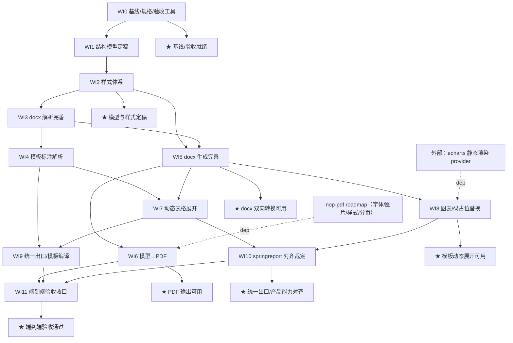

# Word 文档模型 Roadmap — docx ↔ 通用文档结构（OfficeDocModel）↔ docx/pdf

> Last updated: 2026-11-11（WI0–WI8 完成，plan 2515–2523；WI9–WI11 未启动）
> 位置：按仓库 roadmap 惯例存放于 ai-dev/backlog/。书写约定：未来交付物路径用普通文本书写、不加反引号；已存在的文档路径用反引号，持续受 check-doc-links 保护。
> Sources:
> - `ai-dev/design/word-editor/online-word-model-design.md`（**主设计输入**；含模型分层、内嵌模板语义、与 springreport 的三层对比结论 §13）
> - 现有实现：`nop-format/nop-office-doc-model`（OfficeDocModel/OfficeParagraphModel/OfficeRunModel/WordTable/WordTableCell + `_gen` 生成模型）、`nop-format/nop-ooxml/nop-ooxml-docx`（`OfficeDocModelParser`/`OfficeDocModelWriter`/`OfficeDocXmlBuilder`/`WordOfficePackage`/`WordTemplateParser`）、`nop-format/nop-office-model`（OfficeFont/WordRunStyle/WordParagraphStyle/WordCellStyle/WordTableStyle/OfficeBorder/颜色）、`nop-report/nop-report-docx`（`XptWordTemplateParser`/`XptWordTableRenderer`/`WordTableToExcelTableTransformer`）
> - 元模型：`nop-kernel/nop-xdefs/.../_vfs/nop/schema/office/doc.xdef`、`word-table.xdef`、`word-paragraph-style.xdef`、`word-run-style.xdef`、`word-cell-style.xdef`、`word-table-style.xdef`、`font.xdef`
> - 下游复用：`ai-dev/backlog/nop-pdf-report-export-roadmap.md`（WI6「模型→PDF」复用其字体/图片/样式/分页能力与视觉验收工具；WI8 图表图片 provider 依赖其 WI7/echarts roadmap）
> - 参考实现：`~/sources/springreport`（已启动下载；SpringReport 开源报表平台，支持 Word 模板动态填充，Apache-2.0，但其 Word→PDF 依赖付费 Aspose-Words、OnlyOffice 设计器闭源——只作能力对版，不引入其依赖/代码）、`~/sources/print/*`（8 个打印/报表设计器）
> - 需求来源：2026-10-17 会话——"下载 springreport 到 ~/sources；考虑其中的 word 编辑，写一个 roadmap 在本项目中实现一个 docx 解析得到某种类似 nop-excel 的通用 doc 结构，然后再根据这个结构生成 docx、pdf 等。这需要另外一个 roadmap"

## Purpose

本 roadmap 编排 Nop 平台 **通用 Word 文档模型**的落地：建立一个与 `nop-excel` 同构的、可双向转换的文档结构，作为 Word 静态编辑与动态模板生成的统一中间层。

1. **docx → OfficeDocModel**：把 `.docx` 解析为强类型通用文档结构（页面/节/页眉页脚、段落/标题/列表/表格/图片/超链接/分页/分隔线、run 样式），并把 docx 中的模板标注（if/for、`expr:`/`xpl:` 超链接、`xpt:table` 批注）解析为**内嵌在模型节点上的模板语义**。
2. **OfficeDocModel → docx**：从模型生成完整 `.docx`，支持静态文档与含模板语义的动态文档，round-trip 保真。
3. **OfficeDocModel → pdf**：从同一模型直接渲染 PDF（复用 nop-pdf 能力，不依赖 Aspose/OnlyOffice），使 Word 文档具备与 nop-report 一致的 PDF 导出。
4. **模型驱动模板**：以模型承载数据集绑定、动态表格展开（复用 `nop-report-docx`）、图表/二维码/条码占位替换，支撑 springreport 风格的 Word 模板设计与在线编辑后端。

**范围硬边界**（改动须先改本节）：

- **模型是权威结构，模板语义内嵌**：遵循 `workbook.xdef` 的做法，在 `doc.model/page.model/paragraph.model/run.model/table.model/row.model/cell.model` 内嵌模板语义；**不引入 springreport 式的外挂 JSON settings 对象**，产品管理类字段（模板名/分类/发布/权限/预览缓存）留在模型之外。
- **复用既有 OOXML/模板基础设施**：docx 读写走 `nop-ooxml-docx`，动态表格走 `nop-report-docx`；不重写 OOXML 编解码，不新建第二套 Word 模板引擎。
- **不把 ExcelStyle 当 Word 样式**：Word 样式独立（WordRunStyle/WordParagraphStyle/WordCellStyle/WordTableStyle），共享叶子模型沉淀到 `nop-office-model`。
- **PDF 引擎不换**：模型→PDF 经 nop-pdf（PDFBox），不引入 Aspose-Words/OnlyOffice；与 `nop-pdf-report-export-roadmap.md` 的无引擎更换边界一致。
- **不引入 springreport 的代码或付费依赖**：只作能力对版；其水印/logo 与闭源组件不使用。
- **不做前端设计器/编辑器 UI**（产品化编辑层外部化）；不做 PPT/大屏。
- **不提交大体积 docx 语料入库**（样本尽量程序合成或小样本）。

不含实现细节。每个 WI 由独立执行计划承载（`ai-dev/plans/00-plan-authoring-and-execution-guide.md`）；roadmap 就绪后可经 mission-driver draft 生成 mission config 驱动（当前未立项 mission）。

## Work Item Status

> 唯一动态状态块。勾选 = 独立 closure audit 通过（完成判定见 Cross-Cutting）；未勾选 = `todo`（无计划），起草 plan 并通过 draft review 后标注 `planned`。WI 编号全文件递增不重排；**deps 是唯一并行屏障**。每个 WI 以独立 plan 承载。

### M0 — 基线与验收基础设施

- [x] WI0 基线梳理、规格固化与 docx 视觉验收工具：把 `ai-dev/design/word-editor/online-word-model-design.md` 提升/收敛为 docs-for-ai owner doc（模型能力矩阵、docx 读写契约、模板语义内嵌规则、边界）；整理 springreport / apache-poi / docx4j / mammoth 参考索引；建立 docx 复杂样本语料 + docx↔pdf 渲染视觉验收（LibreOffice headless 或 PDFBox 渲染对照，复用 nop-pdf roadmap 的图像 diff 工具若可用）（Deliverable: owner doc + 语料 + docx 验收工具 + 参考索引；deps: 无；Item Type: Decision + Proof）

### M1 — 通用文档结构模型

- [x] WI1 结构模型定稿：在 `doc.xdef`/`word-table.xdef` 补齐块级与行内类型——块级 `paragraph/title/list/table/image/hyperlink/separator/pageBreak`，行内 `text/tab/br/hyperlink` run；页面设置（宽高/方向/页边距）、节（section）、多节页眉页脚、资产（图片资源）；`makeXxx()`/clone/freeze 与 `ExcelSheet/ExcelCell` 体验对齐。含模型单测（Deliverable: 结构模型 + 便捷方法 + 测试；deps: WI0；Item Type: Feature）
- [x] WI2 样式体系：WordRunStyle/WordParagraphStyle/WordCellStyle/WordTableStyle 完善（粗体/斜体/下划线/删除线/高亮/上下标/字体/字号/颜色/对齐/行距/缩进/标题级别/列表样式）；命名样式/默认样式/基样式继承解析；叶子模型沉淀到 `nop-office-model`。含样式往返单测（Deliverable: 样式体系 + 测试；deps: WI1；Item Type: Feature）

### M2 — docx → 模型（解析）

- [x] WI3 docx 解析完善：覆盖全块类型与 run 样式、列表编号、图片/关系/绘图锚点、超链接、表格（横纵合并/列宽/行高/边框/底纹/单元格对齐）、多节页眉页脚、页面设置与背景/水印、批注；对残缺/非标准 docx 容错。含解析单测 + 样本对版（Deliverable: 解析器完善 + 测试；deps: WI2；Item Type: Feature）
- [x] WI4 模板标注解析：docx 中 `if:`/`for:` 段落标记、`expr:`/`xpl:`/`tpl_expr:` 超链接、`xpt:table` 批注 → 内嵌 `model`（doc/page/paragraph/run/table/row/cell），与 `XplGenConfig`/`XptWordTemplateModel` 语义对齐。含标注解析单测（Deliverable: 模板标注 → 内嵌 model + 测试；deps: WI3；Item Type: Feature）

### M3 — 模型 → docx（生成）

- [x] WI5 docx 生成完善：`OfficeDocModelWriter`/`OfficeDocXmlBuilder`/`docx-gen.xlib` 覆盖全部块类型与样式、多节页眉页脚、图片嵌入（关系/ContentTypes/媒体部件）、列表、分页/分隔线、水印；产物为可打开的标准 `.docx`。含 docx→模型→docx round-trip 语义等价测试（Deliverable: 生成器完善 + round-trip 测试；deps: WI2、WI3；Item Type: Feature）

### M4 — 模型 → PDF（生成）

- [x] WI6 PDF 生成：新增 OfficeDocModel→PDF 渲染器，复用 nop-pdf/nop-report-pdf 的字体回退、图片嵌入、表格绘制、分页与页眉页脚能力（对齐 `nop-pdf-report-export-roadmap.md` 已落地的样式/图片/字体 WI），替代 Aspose 方案。含 PDF 渲染断言 + 视觉验收（线宽/颜色/布局）（Deliverable: doc-model PDF 渲染器 + 测试 + 视觉 golden；deps: WI5 + nop-pdf roadmap 相关 WI；Item Type: Feature + Proof）

### M5 — 模板动态展开

- [x] WI7 动态表格与数据绑定展开：复用 `nop-report-docx`（`XptWordTableRenderer`/`WordTableToExcelTableTransformer`），实现 table/row/cell model 的纵向/横向/分组展开、分组小计、表达式求值；doc/page 级循环与生命周期钩子。含展开端到端测试（Deliverable: 动态展开 + 测试；deps: WI4、WI5；Item Type: Feature）
- [x] WI8 图表/二维码/条码占位替换：图片占位 + 绑定定义（`doc.model`/`table.model` 内嵌）+ 运行时替换；图表图片经 echarts 静态渲染 provider（依赖 `echarts-server-render-roadmap.md`），二维码/条码经现有扩展。含替换端到端测试（Deliverable: 占位替换 + 测试；deps: WI5 + 外部图表 provider；Item Type: Feature）

### M6 — 统一出口与产品能力对齐

- [ ] WI9 统一出口与 docx 模板编译：静态 docx 与含模板语义的动态文档统一生成出口；把现有 `WordTemplateParser`/`XptWordTemplateParser` 机制模型化（docx → 模型 → XPL/XPT 编译链路），保留高级 `xpl` 逃生口与原始 OOXML 扩展保留。含编译链路测试（Deliverable: 统一出口 + 模板编译 + 测试；deps: WI4、WI7；Item Type: Feature）
- [ ] WI10 springreport 能力对齐裁定：对照 springreport 的三层（文档结构层/模板配置层/产品化编辑层）逐项裁定吸收项——`firstpageHeaderFooterShow`、`watermark`、`charts`、`codes`、vertical/horizontal/group 扩展策略、`paramMerge`——明确进入模型 vs 留外部的归属；产出对齐结论文档（不复制其代码/依赖）。含必要补齐实现（Deliverable: 对齐裁定 + 补齐；deps: WI7、WI8；Item Type: Feature + Decision）

### M7 — 端到端验收与收口

- [ ] WI11 端到端验收与文档收口：docx 语料 round-trip（docx→模型→docx 语义等价）+ 模型→PDF 视觉验收 + 模板动态填充/预览/导出端到端验收；更新 owner doc（模型能力矩阵、读写/生成契约、模板语义规则、已知限制）与 `docs-for-ai/INDEX.md` 路由、`01-repo-map/module-groups.md` 模块登记、`04-reference/source-anchors.md`；当日 ai-dev/logs 状态一致（Deliverable: 端到端验收报告 + 文档/路由收口；deps: WI1–WI10 完成或显式裁定；Item Type: Proof）

- [x] ★ **Milestone: 通用文档模型与样式定稿**（WI1–WI2 完成后勾选）
- [x] ★ **Milestone: docx 双向转换可用**（WI3–WI5 完成后勾选）
- [x] ★ **Milestone: Word 文档 PDF 输出可用**（WI6 完成后勾选）
- [x] ★ **Milestone: Word 模板动态展开可用**（WI7–WI8 完成后勾选）
- ★ **Milestone: 统一出口与 springreport 能力对齐**（WI9–WI10 完成后勾选）
- ★ **Milestone: 端到端验收通过**（WI0–WI11 全部完成后勾选）

## Current Baseline（2026-10-17 核对）

**已存在（可用）：**

- **模型模块** `nop-format/nop-office-doc-model`（约 30 文件）：`OfficeDocModel`/`OfficeDocPageModel`/`OfficeParagraphModel`/`OfficeRunModel`/`WordTable`/`WordTableRow`/`WordTableCell`/`WordTableColumnConfig` + 内嵌模板模型（`OfficeDocTemplateModel`/`OfficeDocPageTemplateModel`/`OfficeParagraphTemplateModel`/`OfficeRunTemplateModel`/`WordTableTemplateModel`/`WordTableRowTemplateModel`/`WordTableCellTemplateModel`/`WordTableColumnTemplateModel`）。`TestWordTableStructure`（9 用例）验证表格结构/clone/addColumn/makeModel。
- **元模型** `/nop/schema/office/doc.xdef`（pages/page/header/body/footer + 各层 model）与 `word-table.xdef`、`word-*-style.xdef`、`font.xdef`。
- **共享模型** `nop-format/nop-office-model`：`OfficeFont`、`WordRunStyle`/`WordParagraphStyle`/`WordCellStyle`/`WordTableStyle`、`OfficeBorder`/`WordBorderStyle`、颜色 `OfficeColorHelper`、对齐/下划线/字体族等枚举。
- **docx 读写** `nop-format/nop-ooxml/nop-ooxml-docx`：`OfficeDocModelParser`（解析 body/config、超链接模板语义、页眉页脚，以及 `if:`/`for:` 到 testExpr/loop 字段的映射并含嵌套合并）、`OfficeDocModelWriter` + `OfficeDocXmlBuilder`（生成**段落与表格**、run 样式/对齐/间距/字体/下划线/高亮、表格横纵合并/列宽、页面设置，含一个 round-trip 测试）、`OfficeDocXmlBuilder` 块分派**仅支持 OfficeParagraphModel + WordTable**；`WordOfficePackage`/`WordTemplateParser`/`WordHyperlink`；`docx-gen.xlib`（Drawing/r-br 等标签）。
- **模板桥接** `nop-report/nop-report-docx`：`XptWordTemplateParser`/`XptWordTableParser`/`XptWordTableRenderer`/`WordTableToExcelTableTransformer`（docx 表格接入 NopReport 展开）。
- **既有 docx 语料**：`nop-ooxml-docx/src/test/resources/docx/*.docx`（simple/tpl/loop/br/el/header-footer/background/link-expr/payment 等）。

**主要缺口（本 roadmap 的落点）：**

- **模型**：块类型不全（无 list/title/hyperlink/image/separator/pageBreak 的强类型块）；行内 run 类型不全（无 tab/br/hyperlink 的独立类型）；无多节 section、无背景/水印、无列表编号模型；资产/图片模型未成型。
- **生成**：`buildBlock` 仅覆盖段落+表格，无法生成列表/图片/超链接/分页；无多节页眉页脚、无图片媒体部件写入的完整路径、无水印。
- **解析**：块类型/样式/列表/图片/超链接/表格细节/多节页眉页脚覆盖不完整（现有测试偏模板语义映射，非结构全覆盖）；无容错策略文档。
- **模板**：`XplGenConfig`/`xpt:table` 尚未完全迁移为内嵌 model；与 `nop-report-docx` 动态表格的统一出口未打通。
- **输出**：**无 PDF 生成**（springreport 走付费 Aspose；Nop 需纯 nop-pdf 路线）。
- **图表/码**：`WordChartBinding`/`WordCodeBinding` 仅在设计中，未实现。
- **验收**：无 docx/pdf 视觉验收工具，round-trip 仅 1 个用例，无复杂语料对版。

## Framework / Platform Reuse

| 能力 | 提供方 | 约束 |
| --- | --- | --- |
| 文档模型 | `nop-format/nop-office-doc-model` + `doc.xdef`/`word-*.xdef` | 模型独立建设；与 `ExcelWorkbook` 同构但不复用 ExcelStyle |
| 共享叶子模型 | `nop-format/nop-office-model`（OfficeFont/样式/边框/颜色/对齐） | Excel/Word 共用；抽取原则见设计 §7 |
| OOXML docx 包读写 | `nop-format/nop-ooxml/nop-ooxml-docx`（WordOfficePackage/OfficeDocModelParser/Writer） | 复用；不重写 OOXML 编解码 |
| 模板标注机制 | `WordTemplateParser`/`XptWordTemplateParser`（`expr:`/`xpl:`/`xpt:table`） | 模型化，不绕开、不替换 |
| 动态表格展开 | `nop-report-docx`（XptWordTableRenderer/WordTableToExcelTableTransformer） | 复用；与模型 table/row/cell.model 对齐 |
| PDF 渲染 | `nop-pdf`/`nop-report-pdf`（经 `nop-pdf-report-export-roadmap.md`） | 不换引擎；复用字体/图片/样式/分页能力 |
| 图表图片 | echarts 静态渲染 provider（`echarts-server-render-roadmap.md`） | 仅消费图片产物；不在此造图 |
| 视觉验收 | nop-pdf roadmap WI0 的 PDF→PNG golden/diff 工具 | 复用；补 docx→PDF 语料对照 |
| 参考实现 | ~/sources/springreport（Apache-2.0，能力对版）+ ~/sources/print/* | 只作对版；不引入其代码/付费依赖（Aspose/OnlyOffice/PPT 闭源） |
| 测试基座 | nop-autotest + `docs-for-ai/02-core-guides/testing.md` | round-trip 语义等价 + 视觉 golden |

## Stages

| # | Stage | Owner plan | Deps | Critical path | Reuse |
| --- | --- | --- | --- | --- | --- |
| 0 | 基线/规格/docx 验收工具 | WI0 | — | **Yes** | nop-pdf 验收工具 |
| 1 | 结构模型定稿 | WI1 | WI0 | **Yes** | nop-office-doc-model |
| 2 | 样式体系 | WI2 | WI1 | **Yes** | nop-office-model |
| 3 | docx 解析完善 | WI3 | WI2 | **Yes** | OfficeDocModelParser |
| 4 | 模板标注解析 | WI4 | WI3 | No | XplGenConfig/XptWordTemplateModel |
| 5 | docx 生成完善 | WI5 | WI2、WI3 | **Yes** | OfficeDocModelWriter/xlib |
| 6 | PDF 生成 | WI6 | WI5 + nop-pdf roadmap | **Yes** | nop-pdf/nop-report-pdf |
| 7 | 动态表格展开 | WI7 | WI4、WI5 | No | nop-report-docx |
| 8 | 图表/码占位替换 | WI8 | WI5 + 图表 provider | No | echarts provider |
| 9 | 统一出口与模板编译 | WI9 | WI4、WI7 | No | WordTemplateParser |
| 10 | springreport 能力对齐 | WI10 | WI7、WI8 | No | springreport（对版） |
| 11 | 端到端验收与收口 | WI11 | WI1–WI10 | **Yes** | 全部 |

## Stage Details

### WI0. 基线、规格与 docx 视觉验收工具

> Status: see Work Item Status above

**Goal:** 固化模型能力契约，建立 docx/pdf 视觉验收，作为后续 WI 的完成门。

**Deliverables:**
- 把 `online-word-model-design.md` 收敛为 docs-for-ai owner doc（能力矩阵/契约/边界/内嵌模板规则）。
- docx 复杂样本语料（程序合成或小样本）+ docx→PDF/PNG 视觉验收（复用 nop-pdf roadmap 工具）。
- springreport / POI / docx4j / mammoth 参考索引与能力对版矩阵。

**Out of scope:** 任何模型/生成器功能改动。

**Module / area:** `ai-dev/design/word-editor/`、`docs-for-ai/`、nop-ooxml-docx 测试。

### WI1. 结构模型定稿

> Status: see Work Item Status above

**Goal:** 通用文档结构覆盖 Word 常见编辑（段落/标题/列表/表格/图片/超链接/分页/分隔线）与页面/节/页眉页脚。

**Deliverables:**
- 补全块级/行内类型与页面设置/节/多节页眉页脚/资产模型。
- `makeXxx()`/clone/freeze 与 `nop-excel` 对齐。
- 模型单测。

**Out of scope:** 样式细节（WI2）、模板语义（WI4）。

**Module / area:** nop-format/nop-office-doc-model、nop-xdefs（office schema）。

### WI2. 样式体系

> Status: see Work Item Status above

**Goal:** Word 样式完整并支持命名/默认/继承。

**Deliverables:**
- 四类样式模型完善 + 命名/默认/基样式继承。
- 叶子模型沉淀 `nop-office-model`。
- 样式往返单测。

**Out of scope:** 文档结构（WI1）。

**Module / area:** nop-format/nop-office-model、nop-format/nop-office-doc-model。

### WI3. docx 解析完善

> Status: see Work Item Status above

**Goal:** docx 全结构可靠解析为模型。

**Deliverables:**
- 全块类型/run 样式/列表编号/图片/超链接/表格细节/多节页眉页脚/页面设置/水印/批注。
- 残缺 docx 容错。
- 解析单测 + 样本对版。

**Out of scope:** 模板标注（WI4）。

**Module / area:** nop-format/nop-ooxml/nop-ooxml-docx。

### WI4. 模板标注解析

> Status: see Work Item Status above

**Goal:** docx 内的模板标注解析为内嵌 model。

**Deliverables:**
- `if:`/`for:`/`expr:`/`xpl:`/`tpl_expr:`/`xpt:table` → 各层 model。
- 与 `XplGenConfig`/`XptWordTemplateModel` 语义对齐。
- 标注解析单测。

**Out of scope:** 生成（WI5）、展开（WI7）。

**Module / area:** nop-format/nop-ooxml/nop-ooxml-docx。

### WI5. docx 生成完善

> Status: see Work Item Status above

**Goal:** 模型生成标准 docx，覆盖全部已建模能力。

**Deliverables:**
- writer/xlib 覆盖全块类型+样式+多节页眉页脚+图片媒体部件+列表+分页/分隔线+水印。
- docx→模型→docx round-trip 语义等价测试。

**Out of scope:** 动态展开（WI7）、PDF（WI6）。

**Module / area:** nop-format/nop-ooxml/nop-ooxml-docx。

### WI6. 模型 → PDF

> Status: see Work Item Status above

**Goal:** 同一模型直接渲染 PDF，替代付费 Aspose 方案。

**Deliverables:**
- OfficeDocModel→PDF 渲染器（复用 nop-pdf 字体/图片/表格/分页/页眉页脚）。
- PDF 渲染断言 + 视觉 golden（线宽/颜色/布局）。

**Out of scope:** 图表渲染引擎（WI8 只消费 provider 图片）。

**Module / area:** nop-format/nop-office-doc-model（或 nop-ooxml/nop-ooxml-docx 的 pdf 子包）、nop-format/nop-pdf。

### WI7. 动态表格与数据绑定展开

> Status: see Work Item Status above

**Goal:** 模板表格按数据集展开。

**Deliverables:**
- table/row/cell model 纵向/横向/分组展开 + 小计 + 表达式求值；doc/page 级循环。
- 复用 `nop-report-docx`。
- 端到端展开测试。

**Out of scope:** 图表/码（WI8）。

**Module / area:** nop-report/nop-report-docx、nop-format/nop-office-doc-model。

### WI8. 图表/二维码/条码占位替换

> Status: see Work Item Status above

**Goal:** 占位图片在运行时替换为图表/码。

**Deliverables:**
- 图片占位 + 绑定定义（内嵌 model）+ 运行时替换；图表经 echarts provider。
- 端到端替换测试。

**Out of scope:** 图表静态渲染引擎。

**Module / area:** nop-format/nop-office-doc-model、nop-report/nop-report-docx。

### WI9. 统一出口与 docx 模板编译

> Status: see Work Item Status above

**Goal:** 静态与动态文档统一生成；docx 模板模型化编译。

**Deliverables:**
- 统一生成出口；docx → 模型 → XPL/XPT 编译链路；保留 `xpl` 逃生口与原始 OOXML 扩展。
- 编译链路测试。

**Out of scope:** 产品化编辑层。

**Module / area:** nop-format/nop-ooxml/nop-ooxml-docx、nop-report/nop-report-docx。

### WI10. springreport 能力对齐裁定

> Status: see Work Item Status above

**Goal:** 明确 springreport 各能力的归属（模型内 vs 外部），并补齐。

**Deliverables:**
- 逐项裁定 `firstpageHeaderFooterShow`/`watermark`/`charts`/`codes`/扩展策略/`paramMerge`。
- 对齐结论文档 + 必要补齐实现。

**Out of scope:** 复制 springreport 代码/依赖。

**Module / area:** nop-format/nop-office-doc-model、`ai-dev/design/word-editor/`。

### WI11. 端到端验收与文档收口

> Status: see Work Item Status above

**Goal:** round-trip + PDF 视觉 + 模板动态填充全绿，文档/路由收口。

**Deliverables:**
- docx 语料 round-trip 语义等价 + 模型→PDF 视觉验收 + 模板动态填充/预览/导出验收。
- owner doc/INDEX/模块登记/源码锚点；日志一致。

**Out of scope:** 无。

**Module / area:** nop-ooxml-docx、nop-office-doc-model、docs-for-ai/。

## Dependency Graph

## Cross-Cutting（每个 WI 的完成判定）

1. **验证门**：`./mvnw test -pl <module> -am` 绿（触及多模块跑 `./mvnw clean install -T 1C`）；命令口径以 `docs-for-ai/00-start-here/project-context.md` Verification Commands 为准。
2. **round-trip 语义等价红线**：任何「读写 docx」的 WI 必须以 `docx → 模型 → docx → 模型` 的**语义等价**断言验收（文本/结构/样式关键属性一致，非字节一致）；仅结构单向测试不算完成。
3. **视觉优先（PDF）**：模型→PDF 的 WI 必须产出实际 PDF + 逐页 PNG，做线宽/颜色/布局断言（复用 `nop-pdf-report-export-roadmap.md` WI0 工具），禁止只做文本级断言。
4. **生成物禁改**：不手编辑 `_` 前缀与 `_gen` 生成物；模型改动走 `doc.xdef`/`word-*.xdef` 源，生成类经 precompile 重生成。
5. **错误处理**：两档惯例（`docs-for-ai/02-core-guides/error-handling.md`）；模块内部用模块级异常 + English 消息，公共 API 用 `NopException` + ErrorCode + `.param(...)`。
6. **模块边界**：`nop-office-doc-model`/`nop-office-model` 不依赖 nop-report/nop-excel 的业务模型；docx 读写留在 `nop-ooxml-docx`；动态展开留在 `nop-report-docx`。不得反向依赖。
7. **许可边界**：springreport 仅对版参考（Apache-2.0；其 Aspose/OnlyOffice/PPT 为闭源付费件，禁用其代码与依赖）。
8. **跨 roadmap 依赖**：WI6 依赖 `nop-pdf-report-export-roadmap.md` 的字体/图片/样式/分页能力；WI8 依赖 `echarts-server-render-roadmap.md` 的图片 provider；未就绪时对应 WI 只到桩验证，不得虚报完成。

## Rules

- 本文件是状态索引与粗粒度分解，不是执行计划；每个 `planned` WI 由独立执行计划承载。
- 状态只在顶部 Work Item Status 块变更（勾选 / `planned` 标注）；Milestone 勾选是所有依赖 WI 完成后派生。
- WI 编号全文件递增，不重排；**deps 是唯一并行屏障**。
- 未启动 WI 的交付物描述不含实现步骤与复选框。
- 若需在执行中增删/排序 WI，先停止 mission 再改本文件。
