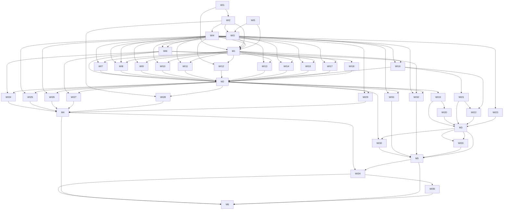

# nop-message 消息封装（Kafka / Pulsar）审计与改进 Roadmap

> Last updated: 2026-10-01（v3：经第三轮独立审查再修 8 处——缺陷总数由 50 更正为 58（新增 F-52 至 F-59 共 8 条遗漏缺陷）、MSG-F-58 的触发条件经复核不可达故改述为潜在陷阱（越界提交实际被 `:248` 的 `throw` 阻断）、D8 补上执行锚点（WI24）、D1 与 Hard constraint 的第三态冲突已收敛（「忽略全部选项」不再是合法状态）、M5 补齐四条聚合边；另回改 D3（一次性 seek 无法表达 `ALWAYS_SEEK_TO_END`，改用 rebalance listener）、D5（返回协议缺终止拒绝与部分提交信号，故记为 b-prime 而非简单不引入）、新增 D11（事务语义）、MSG-F-51 补记先例不可迁移的三点原因。v2：经三轮独立子代理对抗审查后重写。v1 的 6 项事实断言被证伪或需改述——Kafka seek 非 stub 实为首次 poll 前的空操作、cancelToken 非死字段、Pulsar 无固定退避、ProducerRecord 重载无 timestamp 参数、resolveGroupId 失败模式是分区饥饿而非 rebalance 抖动、SPI 主源码实现数是 11 非 9。另新增 37 项此前遗漏的缺陷（F-04 至 F-16 共 13 项、F-17 至 F-40 共 24 项），并按审查意见重构：引入能力声明机制为 Phase A 门控裁定、删除 AckMode 工作项、DLQ 拆分为三层、共享契约测试骨架前移至 Phase A。mission-driver 解析实测 35 工作项 + 6 里程碑全部识别，无静默丢弃。实测踩到 BULLET_RE 陷阱：4 条状态行因括注内含半角右括号被静默丢弃，已修正并纳入 Rules 门禁。经第二轮独立子代理审查再修 14 处：4 处「死字段 / 从未调用 / 真幂等」过度断言、4 处基线计数错误、5 项遗漏缺陷、1 处证据强度不足的先例引用）
> 位置：按仓库 roadmap 惯例存放于 `ai-dev/backlog/`。书写约定：未来交付物路径用普通文本书写、不加反引号；已存在的文档路径用反引号，持续受 check-doc-links 保护。
> mission-driver 兼容：本块采用 `## Work Item Status` 与 `- WI<n> 名称: \`status\`` 形态，状态集为 `todo` / `ready` / `planned` / `done`（`tools/mission-driver/src/roadmap-check.mjs:14`）。**状态行尾部括注必须是单层非嵌套**——`BULLET_RE` 只允许一组 `（…）` 且其内不得再出现 `（）` 或半角 `)`，否则整行匹配失败并被**静默丢弃**。改任何状态行后必须重跑 `parseRoadmapMarkdown` 核对条目数仍为 35。里程碑行必须写作 `★ **里程碑：M<n> …**（解锁条件 …）：\`status\``，`★` 与 `**里程碑` 之间不得插入编号。
> mission 状态：**已就绪**。`missions/nop-message-encapsulation.json` 已建，`plansDir` 为 `ai-dev/plans/nop-message`，`auditsDir` 为 ai-dev/audits/nop-message（mission 启动后创建，按书写约定不加反引号）。前置裁定 D1 至 D11 未落档前，除 WI1 至 WI5 外全部工作项不得起草。
> 数据口径：全部 file:line 于 2026-10-01 从源码实测核对，经三轮独立子代理对抗审查逐条复核。Pulsar `TopicName` 行为由 `pulsar-common` 实际执行验证，非推断。外部 broker 集群行为（真实 rebalance 时序、真实分区分配结果）**未在本仓库验证**，凡依赖该口径的完成判定必须以 gated 真实 broker 测试为准。

> Sources:
> - `ai-dev/archived/2026-05/31-nop-message-pulsar-implementation-plan.md`（Pulsar 首版，Non-Goals 显式排除 seek 并保留空壳方法 + TODO → 本 roadmap MSG-F-03 推翻）
> - `ai-dev/plans/nop-stream-production/2026-08-03-2124-2-kafka-message-service.md`（Kafka 首版，Non-Goals 显式排除事务 → 本 roadmap MSG-F-13 改为显式拒绝）
> - `nop-kernel/nop-xlang/src/main/java/io/nop/xlang/backend/EvalBackendCapability.java` + `EvalBackendRegistry.java`（平台内已有的「声明式能力集 + 注册期 fail-fast」先例，MSG-F-51 的落地模板）
> - `docs-for-ai/02-core-guides/error-handling.md`（两层错误策略、`nop.err.[模块].[子域].[错误]` 前缀、丢弃异常前留证）
> - `ai-dev/backlog/nop-stream-sql-roadmap.md`（本 roadmap 的格式与 mission-driver 兼容基线，最新且已实测可解析）
> - Spring 对照基线：`spring-kafka`（`KafkaTemplate` / `@KafkaListener` / `ContainerProperties` / `AckMode` / `DefaultErrorHandler` + `DeadLetterPublishingRecoverer` / `CommonErrorHandler` / `KafkaTransactionManager` / Micrometer `KafkaMetrics`）与 `spring-pulsar`（`PulsarTemplate` / `@PulsarListener` / 原生 `deadLetterPolicy` / transactions）

## Purpose

回答「nop 对 Pulsar 和 Kafka 的封装是否正确」，并把结论转成可执行的检查 / 验证 / 改进工作项。

**立场：SPI 骨架是对的，两个后端实现是不对等的，而且不对等的方式比预想的更糟。**

`IMessageService` 只有两个抽象方法、其余全 `default`，broker 切换靠 `beans.xml` + `ioc:default="true"` 覆盖——这套骨架符合 Nop 规范，**不需要重写**，且比 Spring 更强：spring-kafka 与 spring-pulsar 是两个独立构件、两套监听注解、无共同父类型；Nop 用一套 `IMessageService` + 一套 `MessageSubscribeOptions` + 一次 beans 覆盖统一了它们。这是「公分母 + 显式拒绝」策略成立的根本理由，必须保留。

但公分母策略有一个前提：**能力差异必须可声明、可查询、可 fail-fast**。当前缺失这个机制，导致后果是同一 SPI 字段在不同后端有三种以上的语义，且**全部静默**。已实测确认的最尖锐一例：`getAckTopic` 返回 `"ack-" + topic`，而 Pulsar 的 `topic` 来自 `message.getTopicName()`（全名），实测 `TopicName.get("ack-persistent://public/default/orders")` 直接抛 `IllegalArgumentException: Invalid topic domain: 'ack-persistent'`——**Pulsar 后端的请求-响应通道当前 100% 不可用**，且异常被消费循环吞掉，表现为请求消息无限重投。

**本 roadmap 的核心命题**：不是「补功能」，而是**先建立能力声明与可校验的拒绝机制（Phase A 裁定 + Phase B 门禁），再据此消除静默违约**。跳过 Phase A 直接修单个 bug，会在下一次新增后端时原样复发。

紧急度声明：当前最严重的运行时风险是**毒消息**（无 DLQ、无重试上限、退避策略不生效）与 **Pulsar 请求-响应全断**，两者均在 Phase B 之前已在线上形态存在。按 `docs-for-ai/00-start-here/project-context.md` 当前 autonomy 等级，Phase A 可直接执行。

Does not contain implementation details. Each `planned` stage is owned by its execution plan.

## 前置裁定（Gate D1—D11，未落档对应工作项不得起草）

| ID | 待裁问题 | 选项 | 建议 | 负责项 |
| --- | --- | --- | --- | --- |
| D1 | 能力声明机制形态 | (a) 仅 owner doc 矩阵；(b) `MessageCapability` 枚举 + `IMessageService.getCapabilities()` + **每次 `subscribe` / `sendAsync` 入口强制调用的校验器**；(c) 各后端自建元数据 | **(b)**。注意：**空集默认本身是 fail-open**，因为没有任何机制强制调用方查询——那正是本 roadmap 要治的病。因此枚举本身不是门禁，**门禁是 `MessageOptionsValidator`，且必须挂在每个 `subscribe` 与 `sendAsync` 入口而非 `init`**（IoC 构造的 bean 没有 Eval 那样的注册点，见 MSG-F-51）。另须裁定：9 个非 broker 后端各自声明什么。注意**「忽略全部选项」不是合法的第三态**——Hard constraint 只承认生效 / 类型化错误 / 一次性 WARN 三态，故此类后端必须声明为「逐字段一次性 WARN」，否则即构成 MSG-F-56 那类违规。该裁定须在 WI2 的矩阵中逐后端落表，不得留空 | WI6 |
| D2 | 信封元数据契约 | (a) 维持现状各自拼装；(b) 定义最小公共信封契约（messageId / topic / eventTime / key / headers 往返保真）+ 每后端差异表 | **(b)**，这是最常被消费的契约却完全无契约 | WI24 |
| D3 | Kafka seek 起点解析 | (a) 挂 `ConsumerRebalanceListener.onPartitionsAssigned` 逐次重解析；(b) 首次 poll 后一次性 seek；(c) 删除 seek API，起点改由 `auto.offset.reset` 表达 | **(a)**。原推荐的 (b) 与本裁定自身的理由冲突：一次性 seek 无法表达 `ALWAYS_SEEK_TO_END`（其 javadoc 是「每次重新连接都从最新开始」），而现有实现的注释也自认「executed once before the poll loop starts」。(c) 可表达 `INIT_SEEK_TO_BEGIN` 但表达不了 ALWAYS，故只能作 (a) 的降级路径 | WI7 |
| D4 | `SubscriptionType` 中立化 | (a) 四值重命名 `EXCLUSIVE/UNIQUE` 等；(b) 三值中立枚举 `SINGLE_ACTIVE / LOAD_BALANCED / ORDERED_BY_KEY` + 后端映射表；(c) 维持现状 | **(b)**，且**加性引入**（新枚举与旧枚举并存 + 映射 + 弃用），不做破坏性重命名 | WI27 |
| D5 | 是否引入 `AckMode` | (a) 引入 RECORD/BATCH/MANUAL/MANUAL_IMMEDIATE；(b) 不引入容器级常量，但**必须补两个返回协议缺失的信号** | **(b')**。返回协议是按消息语义 ack，粒度优于容器级常量，故不引入 `AckMode`。但原 (b) 论证有漏洞：协议**无法表达「这条是毒消息，不要重投」**，也**无法表达「批量只提交到第 k 条」**——前者是 D6 与 WI21 / WI22 的失败终点所必需，后者是 WI25 部分成功裁定所必需。因此 (b') 要求同时新增终止拒绝信号与部分提交信号，二者均为 SPI 变更（plan-first） | WI6 |
| D6 | DLQ 归属 | (a) SPI 层加 `deadLetterTopic` + `maxRetries`；(b) 分三层：SPI 只加终止拒绝信号与带上下文的失败回调 / 后端原生能力 / `nop-retry` 桥 | **(b)**，9 个实现中 5 个（Local / Redis / MQTT / TDengine / DB）无 DLQ substrate；(a) 会制造第三个重试机制。终止拒绝信号依赖 D5(b')，二者必须同批落地 | WI16 |
| D7 | `resolveGroupId` 身份模型 | (a) 去掉全局 `groupId` 回退，`subscribeName` 为主身份；(b) 全局 `groupId` 降级为前缀 `${groupId}.${subscribeName}`；(c) 维持现状 | **(b)**，`nop-stream` 控制面按 nodeId 分 topic + `nop-rpc-core` 共享消费组，(c) 是可用性风险 | WI13 |
| D8 | `@ConfigBean` 兼容策略 | (a) 字段改名即破坏；(b) 加性优先 + 弃用期 + 迁移说明；(c) 冻结选项类不再增字段 | **(b)**，`MessageSubscribeOptions` 与 `MessageSendOptions` 带 `@DataBean`，字段名即用户 YAML 键；MSG-F-59 的 `cancelToken` 键即是「声明了但无人兑现」的配置键实例 | WI24 |
| D9 | 错误码前缀 | (a) 保留 `nop.message.kafka.*`；(b) 迁 `nop.err.message.kafka.*` | **(b)**，与 `error-handling.md` 一致；实测无任何 i18n / properties 引用这些前缀，迁移成本低 | WI26 |
| D10 | 空壳模块与 codec 归属 | (a) 保留 `nop-message-model` / `-codec` 待实现；(b) 删除 `nop-message-model`；(c) codec SPI 落 `nop-api-core` | **(b) 立即删除** `nop-message-model`；(c) 降级为 Follow-up，需先有 D2 的信封契约与非 String payload 实证需求 | WI31 |
| D11 | Kafka 与 Pulsar 的事务语义对外承诺 | (a) 两者都保留 `transactional` 字段，Kafka 抛类型化错误、Pulsar 实现并修 MSG-F-52 的每消息建事务；(b) 删除 `transactional` 与 `transactionTimeout` 两字段（breaking，plan-first）；(c) 保留并仅修 Pulsar 侧粒度 | 建议 **(b)**：当前两个字段无任何后端能完整兑现，保留即违反本 roadmap 自身的「不得声明却从不读」约束；若选 (a) 则必须同时接受 D5(b') 的终止拒绝信号并修 MSG-F-52 | WI14 |

## Findings

> 58 条已确认缺陷 + 1 条平台先例，共 59 个 `MSG-F-nn` 编号。编号与工作项 `WI<n>` 独立编号，避免语义碰撞。证据列给出实测锚点。

### P0 — 静默错误结果 / 数据正确性

| ID | 缺陷 | 证据 |
| --- | --- | --- |
| MSG-F-01 | **Kafka `seekToPosition()` 是首次 poll 前的空操作**：`start()` 先 `seekToPosition()` 再 `runTask()`，而 `consumer.assignment()` 在首次 `poll()` 前恒为空集，故 `INIT_SEEK_TO_BEGIN` / `INIT_SEEK_TO_END` / `ALWAYS_SEEK_TO_END` / `seekToTime` 全部静默 no-op。唯一生效分支是 `seekToMessage` 的抛错 | `KafkaConsumeTask.java:87-99`、`:129,132,135,138`、`:153,157` |
| MSG-F-02 | Kafka seek 抛错被消费线程吞掉：`catch → LOG.error → active=false → return`，调用方已持有 `isCancelled()==false` 的死订阅。**两后端对调用方都是静默**，不存在「一个 fail-loud 一个静默」的差别 | `KafkaConsumeTask.java:89-98` |
| MSG-F-03 | Pulsar `seekToPosition()` 空方法体 + `// TODO`，全部 seek 字段静默忽略，`PulsarErrors` 无对应错误码 | `PulsarConsumeTask.java:70-73` |
| MSG-F-04 | **Pulsar 请求-响应通道全断**：`getAckTopic` 拼 `"ack-" + topic`，Pulsar 的 `topic` 是 `message.getTopicName()` 全名。实测 `TopicName.get("ack-persistent://public/default/orders")` → `IllegalArgumentException: Invalid topic domain: 'ack-persistent'`；短名 `ack-orders` 合法。故每次 reply 必抛，单条与批量两条路径共 3 个抛出点，异常均被 catch 吞掉 → `negativeAcknowledge` → 请求消息无限重投 | `IMessageSubscriber.java:18`、`PulsarConsumeTask.java:138,171,175,186-188`、`pulsar-common` 实测 |
| MSG-F-05 | Pulsar 消息级异常被 `consume()` / `batchConsume()` 的 catch 吞掉（均不 rethrow）→ `runTask` 的 catch 对消息级失败**不可达** → `onException` 永不被调用、`sleep(1000)` 退避是死代码、毒消息退化为无退避重投自旋。**两后端退避行为相反** | `PulsarConsumeTask.java:147-151,180-183` 对比 `:87-98` |
| MSG-F-06 | Kafka `batchConsume()` catch 无 `consumer.seek()`，单条路径有 → 批量失败后 position 已前移整批且 `commitSync` 被跳过，运行期内该批被跳过；`enableAutoCommit=true` 时永久丢失 | `KafkaConsumeTask.java:300-304` 对比 `:247` |
| MSG-F-07 | Kafka `commitSync()` 无参提交越过未派发记录：`onMessageBatch` 返回少于记录数时尾部记录既未 ack 也被提交 → at-most-once 静默丢失，且发生在**成功路径**而非异常路径 | `KafkaConsumeTask.java:286-298,306-308` |
| MSG-F-08 | Kafka 批内 `ConsumeLater` 混合：循环继续处理后续记录并发送 reply，下轮重放导致 reply 重复；后续记录抛错时 seek 到更大 offset，早期 `ConsumeLater` 记录永不重投 | `KafkaConsumeTask.java:225-240,247` |
| MSG-F-09 | Kafka `ConsumeLater.getDelay()` 被丢弃（仅 debug 打印），只 seek 回同 offset 后继续 for 循环，下次 poll 立即重投 → **100% CPU 自旋**。Pulsar `reconsumeLater` 原生正确 | `KafkaConsumeTask.java:225-231` 对比 `PulsarConsumeTask.java:169` |
| MSG-F-10 | `max.poll.interval.ms` 既未配置也不可配置（`KafkaConsumerConfig` 无该字段，`buildConsumerProps` 未设），叠加 `maxPollRecords=500` + 逐条无超时 `FutureHelper.getResult` → 慢 handler 触发踢出与 rebalance + `CommitFailedException`（被吞） | `KafkaMessageService.java:146-171`、`KafkaConsumerConfig.java:33`、`KafkaConsumeTask.java:255-257` |
| MSG-F-11 | `batchReceiveTimeout` 被直连为 Kafka `poll(Duration)`，与选项 javadoc 声明的「不足 batchReceiveCount 时的等待时间」语义不符；取值接近默认 `max.poll.interval.ms` 时必然周期性踢出 | `KafkaMessageService.java:278-279`、`MessageSubscribeOptions.java:33-36` |
| MSG-F-12 | `resolveGroupId` 全局 `groupId` 优先 → 同组内异构订阅使内置分配器把 topic A 分区分给只订阅 topic B 的成员 → **永久分区饥饿**（不只是 rebalance 抖动）；`subscribeName` 并非死字段：`KafkaConsumerConfig.groupId` 无默认值且仓库无 YAML 设置，故**默认配置下 `subscribeName` 就是消费组 id**；缺陷是全局 `groupId` 对它的**静默优先级遮蔽** | `KafkaMessageService.java:295-304,268-271` |
| MSG-F-13 | Kafka `transactional=true` 零处置，`ConsumeContext.commit()/rollback()` 为 no-op，且**无** `subscriptionType` 那样的 WARN | `KafkaConsumeTask.java:320,325-338`、对比 `KafkaMessageService.java:244` |
| MSG-F-14 | `LocalMessageService.handleMessageResult` 未处理 `ConsumeLater` → 把 `ConsumeLater` 对象本身发到 ack topic。同一返回值第三种语义 | `LocalMessageService.java:184-192` |
| MSG-F-15 | `LocalMessageService` 按 consumer 身份去重订阅、按 consumer 身份移除，取消其一即静默取消另一持有者 | `LocalMessageService.java:108-111,150` |
| MSG-F-16 | Pulsar 批量路径按 `responses` 迭代并 `it.next()` 取消息：responses 多于消息 → `NoSuchElementException` → 整批负确认重放（含已发 reply）；少于消息 → 尾部消息永不 ack → 重复投递。**与 MSG-F-07 方向相反的第二个 bug** | `PulsarConsumeTask.java:129-144` |

### P1 — 可靠性与生命周期

| ID | 缺陷 | 证据 |
| --- | --- | --- |
| MSG-F-17 | `batchReceiveCount` 在**两后端都未被真正使用**：Kafka 仅作布尔门，批量大小由 `max.poll.records` 决定；Pulsar 用无参 `batchReceive()`，`batchReceiveTimeout` 亦被忽略 | `KafkaConsumeTask.java:180`、`PulsarConsumeTask.java:111` |
| MSG-F-18 | `PulsarConsumerConfig.maxTotalReceiverQueueSizeAcrossPartitions` 声明 + 访问器，零调用点 | `PulsarConsumerConfig.java:16,34-40` |
| MSG-F-19 | `PulsarClientConfig.enableTransaction` **零生产调用点**（唯一读取点是 `TestPulsarIoC.java:31`），而 `newTransaction` 与 `newConsumeContext` 都不看它 | `PulsarClientConfig.java:15,25-31`、`PulsarMessageService.java:161-167` |
| MSG-F-20 | `IMessageConsumer.onException(Exception)` 默认空实现且**签名拿不到 topic / offset / messageId** → 无法实现有意义的默认行为。两后端都调用它，但受 MSG-F-05 影响对消息级失败不可达 | `IMessageConsumer.java:41-42`、`PulsarConsumeTask.java:89`、`KafkaConsumeTask.java:190` |
| MSG-F-21 | 退避常量两后端硬编码不可配置；消费任务构造器已有 `consumeErrorBackoffMs` 参数，但生产调用方两后端都传硬编码常量，无可配置入口 | `KafkaMessageService.java:286-287`、`PulsarMessageService.java:243-244` |
| MSG-F-22 | 无 DLQ、无重试上限、无失败终点语义 | 全模块无相关实现 |
| MSG-F-23 | 无任何可观测性：无 metrics、无 consumer lag、无健康检查 | 两后端均无 |
| MSG-F-24 | Pulsar 消费线程非 daemon 且未命名；Kafka 是 daemon 且命名但 N 路 fan-out 线程名重复 | `PulsarMessageService.java:242`、`KafkaMessageService.java:281-285` |
| MSG-F-25 | `KafkaMessageSubscription.cancel()` 与 `Cancellable.cancel()` **同为非原子 check-then-act**，并发 cancel 会双跑 body 导致双 `consumer.close()` / 双 `awaitTermination`；缺陷真实存在但**不是两后端差异** | `KafkaMessageService.java:330-334`、`Cancellable.java:40-46` |
| MSG-F-26 | `cancel()` 从调用线程直接 `consumer.close()`，与消费线程 `poll()` 竞态；`pause()` / `resume()` 同 | `KafkaMessageService.java:337,367,376` |
| MSG-F-27 | 两后端 `destroy()` 顺序相反：Kafka 先订阅后 producer（正确），Pulsar 先 producer 后订阅 → 关闭期在途发送打已关闭 producer | `KafkaMessageService.java:100-122`、`PulsarMessageService.java:90-128` |
| MSG-F-28 | `extraProps` 最后 `putAll`，可静默覆盖 `group.id` / `bootstrap.servers` 与全部调优键，绕过 `resolveGroupId` 且在 beans 模型中不可见 | `KafkaMessageService.java:140-142,167-169` |
| MSG-F-29 | Pulsar `subscribeName` 为 null 时不设 subscriptionName → Pulsar 生成随机订阅名 → 每次重启新游标；Kafka 同样缺失则抛 `ERR_GROUP_ID_NOT_CONFIGURED`。同一缺失字段两种相反失败模式 | `PulsarMessageService.java:222-224`、`KafkaMessageService.java:268-271` |
| MSG-F-30 | Pulsar `destroy()` 后 `getProducer` 返回 null → NPE；无 `initialized` 标志，`init/destroy` 不可重入。Kafka 有类型化错误码 | `PulsarMessageService.java:134-145,182` |
| MSG-F-31 | 非 String `ApiMessage.getData()`：Kafka JSON 编码，Pulsar 直接塞进 `Schema.STRING` → 发送期序列化失败 | `KafkaMessageService.java:224-233`、`PulsarHelper.java:99` |
| MSG-F-32 | `concurrency>1` + `Exclusive`：Pulsar 同 subscriptionName 开 N 个 consumer 被 `builder.subscribe()` 拒绝 → 整段 subscribe 抛错；javadoc 却承诺「exclusive 下忽略该参数」。三后端三种行为 | `MessageSubscribeOptions.java:39-40`、`PulsarMessageService.java:196-208` |
| MSG-F-33 | `buildApiMessage` 先设框架元数据头再拷贝上游头 → 上游同名头可覆盖真实 topic / partition / offset / messageId | `KafkaHelper.java:56-71`、`PulsarHelper.java:34-61` |
| MSG-F-34 | `KafkaConsumerConfig` javadoc 声称 groupId 在 `init()` 校验，实际在 `doSubscribe` | `KafkaConsumerConfig.java:13-15,20-21` 对比 `KafkaMessageService.java:268-271` |
| MSG-F-35 | `StreamTopicNaming.LEGAL_TOPIC_PATTERN` 声明后从未使用 | `StreamTopicNaming.java:55` |
| MSG-F-36 | `PulsarConsumeTask.schedule()` 零调用方 | `PulsarConsumeTask.java:75-77` |
| MSG-F-37 | `MultiMessageSubscription` 空列表 `allMatch` 返回 true → 构造窗口内 `isSuspended` / `isCancelled` 误报；列表与构造线程共享且无同步 | `MultiMessageSubscription.java:20-27` |
| MSG-F-38 | `ReflectionMessageSubscriptionRegistrar.register()` 抛错时已建订阅无 try/finally 清理 → 启动失败泄漏 consumer 与线程 | `ReflectionMessageSubscriptionRegistrar.java:86-87` |
| MSG-F-39 | `KafkaProducer.send()` 在 `max.block.ms` 耗尽时**同步抛**，`sendAsync` 会直接抛而非返回失败 `CompletionStage` → 违反 `IMessageSender.send()` 的 `FutureHelper.syncGet` 契约；现有测试全部 mock `producer.send` 故不可见 | `KafkaMessageService.java:208`、`IMessageSender.java:26-28` |
| MSG-F-40 | 错误码前缀 `nop.message.kafka.*` / `nop.message.pulsar.*` 不符 `nop.err.[模块].[子域].[错误]`；`MessageCoreErrors` 是空接口 | `KafkaErrors.java:16`、`PulsarErrors.java:13` |
| MSG-F-52 | Pulsar `transactional=true` 时**每条消息**新建一个 broker 事务：单条路径每消息一次 `newConsumeContext`，批量路径每批一次 → 粒度不一致且每消息一次 broker 往返。由 WI14 与 D11 承载 | `PulsarConsumeTask.java:123,162,190-196`、`PulsarMessageService.java:161-167` |
| MSG-F-53 | 「一次性 WARN」这一第三态被实现为**每次调用都 WARN**：`sendAsync` 带 delay、`subscribe` 带 subscriptionType、`seekToPosition` 遇未知模式均逐次打印，热发送路径上会打爆日志；Pulsar 模块 `LOG.warn` 零处，其静默路径根本没有第三态 | `KafkaMessageService.java:202,244`、`KafkaConsumeTask.java:142`、`nop-message-pulsar/src` |
| MSG-F-54 | Pulsar 消费线程**不可唤醒**：`stop()` 只翻转 `active`，`receive()` 无超时阻塞且无 wakeup 等价物 → 在下一条消息到达前 `stop()` 是空操作 | `PulsarConsumeTask.java:102-104,155` 对比 `KafkaConsumeTask.java:170` |
| MSG-F-55 | **六个错误码声明后从未引用**，违反本 roadmap 自身的「禁止声明了但从不读」约束：`ERR_KAFKA_CONSUMER_CREATE_FAILED` / `ERR_KAFKA_SERIALIZATION_FAILED` / `ERR_KAFKA_SEND_FAILED` 与全部三个 `ERR_PULSAR_*_CREATE_FAILED` | `KafkaErrors.java:30,34,42`、`PulsarErrors.java:18,21,24`，实测零引用 |
| MSG-F-56 | `LocalMessageService.subscribe` **完全不读** `MessageSubscribeOptions` 的任何字段。按 Hard constraint「每个字段在每个后端必须有显式三态处置」，这是全仓范围的违规且当前无工作项认领 | `LocalMessageService.java:144-157` |
| MSG-F-57 | `MessageSubscribeOptions.transactionTimeout` 静默缺省为 0 → `if (timeout > 0)` 跳过 `withTransactionTimeout`，回落 broker 默认且无 WARN | `PulsarConsumeTask.java:193`、`PulsarMessageService.java:163-164` |
| MSG-F-58 | `commitSync()` 无参提交**所有已分配分区**，而单条路径的 per-record 循环有两道阻断：失败记录在 `:248` 直接 `throw` 跳出循环，`anyConsumeLater` 为真时 `:252` 的守卫也跳过提交——**故跨分区越界提交当前不可达**。属潜在陷阱而非现行缺陷：一旦 `enableAutoCommit=true`（`KafkaConsumerConfig:30,67` 允许），两道阻断同时失效，跨分区与批内越界提交变为可达。MSG-F-06 / F-07 / F-08 均按单分区推理，未指出该 API 性质 | `KafkaConsumeTask.java:216-258,248,252` |

### P2 — 契约与产品化

| ID | 缺陷 | 证据 |
| --- | --- | --- |
| MSG-F-41 | `nop-bom/pom.xml` 缺 `nop-message-kafka` / `nop-message-model` / `nop-message-codec` **三个**条目（core / pulsar / debezium 均在） | `nop-bom/pom.xml:693,700,706` |
| MSG-F-42 | `nop-message-model`（两个空类）与 `nop-message-codec`（无 src 目录）空壳 | `MessageModel.java:10-12`、`nop-message/nop-message-codec/pom.xml` |
| MSG-F-43 | `nop-message` 在 `docs-for-ai/` 无 owner doc，仅 4 个文件 6 处顺带提及 | `reusable-modules-overview.md:28,61`、`nop-ai-gateway.md:59`、`module-groups.md:17`、`source-anchors.md:273,294` |
| MSG-F-44 | 消息层自身无 E2E；Kafka / Pulsar 仅有 nop-stream 数据面 gated E2E 间接覆盖 | `TestDataPlaneKafkaBackendE2E` / `TestDataPlanePulsarBackendE2E` 位于 `nop-stream-runtime` |
| MSG-F-45 | `MessageSendOptions.sendTimeout` **全仓零消费**（`MessageRpcClient:81` 写入后无人读）；`cancelToken` 仅 `RpcMessageSender:52` 消费，11 个主源码 `IMessageService` 实现全忽略 | 实测 grep |
| MSG-F-46 | 现有测试对上述全部 P0 **零覆盖**；`TestKafkaConsumeTask.seekToBeginHonoredNotStubbed:161-168` 用 mock 造出非空 assignment，把 MSG-F-01 的缺陷**认证为正确行为** | 实测 |
| MSG-F-47 | SPI 变更回归面是 **11 个主源码实现 + 23 个测试文件内的实现**：主源码含 `DelegateMessageService`（位于 `nop-api-core` Protected Area 内部，首要回归目标）与基准实现 `RemoteTransportWriteBench` 的 `DelayedMessageService`；测试侧实现数量随分支增长，不宜硬编码 | `DelegateMessageService.java:12`、`RemoteTransportWriteBench.java:124`、实测 grep |
| MSG-F-48 | 信封元数据契约缺失：Pulsar 设 `nop-id` / `nop-publish-time` / `nop-sequence-id`，Kafka 全不设 → 依赖 `nop-id` 去重的消费者在 Kafka 侧得 null | `PulsarHelper.java:34-61`、`KafkaHelper.java:46-73` |
| MSG-F-49 | 两后端**均不依赖** `nop-message-core`（只依赖 `nop-core` + broker client）→ 共享契约测试与 topic 合法化下沉都需改模块图 | `nop-message/nop-message-kafka/pom.xml`、`nop-message/nop-message-pulsar/pom.xml` |
| MSG-F-50 | `concurrency` 语义跨后端四义（Kafka 组内成员 / Pulsar 同订阅多 consumer / Local 完全忽略 / SysDao 每 JVM 独立轮询），SPI 与 owner doc 均未声明 | `LocalMessageService.subscribe`、`SysDaoMessageService` |
| MSG-F-59 | SPI 类型自身缺陷：`TopicMessage` 是 `@DataBean` 但**无 `equals` / `hashCode` 且无无参构造器**，而它是批量 API 的载荷；`MessageSendOptions.cancelToken`（接口类型）是 `@DataBean` 字段，因而 `cancelToken` 成为一个无人兑现的可写 YAML 键（与 D8 交互） | `TopicMessage.java:15-31`、`MessageSendOptions.java:26` |

### 平台先例（非缺陷，作为 D1 的落地模板）

| ID | 内容 | 证据 |
| --- | --- | --- |
| MSG-F-51 | 平台内已有「声明式能力集 + 注册期 fail-fast」先例：`IEvalExecutionBackend.getCapabilities()` → `Set<EvalBackendCapability>` → `EvalBackendRegistry.register()` 对空 / 非法能力集 fail-fast → `EvalBackendRouter` 单跳降级 + `EvalBackendObservation`。**可迁移部分仅限「声明集合 + 注册期拒绝空集」**；三点不可直接类比：(a) Eval 的注册钩子由 `META-INF/services` 驱动，而 `IMessageService` 实现由 NopIoC 从 `beans.xml` 构造，**不存在等价的注册点**；(b) `EvalBackendRouter` 自身含静默分支（其 javadoc 明示 force-interpreter 诊断模式为静默），故 Eval 并不满足本 roadmap 的「不得静默」约束；(c) Eval 是**互斥槽位**模型，消息能力是**每后端特性集**，无槽位归属概念 | `nop-kernel/nop-xlang/src/main/java/io/nop/xlang/backend/` |

## Work Item Status

> 唯一动态状态块。状态语义：`todo` 未开工 / `ready` 前置齐备可起草 / `planned` 已有承载 plan / `done` 独立 closure audit 通过。**状态 token 只允许这四个**。本块只放 bullet，禁止放表格。每个 WI 以独立 plan 承载，写前必读 `ai-dev/plans/00-plan-authoring-and-execution-guide.md`。Item Type 取 `Fix` / `Decision` / `Proof` / `Feature`。

### Phase A — 基线、裁定与防线

- WI1 nop-message 四模块与 SPI 全量审计基线: `done`（deps 无；Item Type Proof；完成判定 产出 ai-dev/analysis/2026-10/nop-message-audit-baseline.md，每条 finding 编号 `MSG-F-nn` 并给三态裁定 confirmed / already-correct / watch-only，confirmed 逐条给 file:line；本项不含代码变更）
- WI2 SPI 字段乘后端能力矩阵: `done`（deps WI1；Item Type Proof；完成判定 产出矩阵覆盖 MessageSendOptions 与 MessageSubscribeOptions 与 SeekMode 与 SubscriptionType 与 onMessage 五种返回值语义与信封元数据，每格三态标注 support / typed-reject / warn-once；矩阵作为 D1 至 D10 裁定与 WI6 的输入）
- WI3 D1 至 D11 前置裁定落档: `done`（deps WI2 WI5；Item Type Decision；完成判定 十一条裁定各落 ai-dev/design/nop-message/ 下对应设计文档，含负责人与日期；未落档并注明负责人与日期的视为未裁，对应 WI 不得起草）
- WI4 共享契约测试骨架: `done`（deps WI2；Item Type Proof；对应 MSG-F-49 与 MSG-F-46；完成判定 新增 broker 无关的 `AbstractMessageServiceContractTest`，覆盖 send 与五种 onMessage 返回值语义与 ConsumeLater 与 batch arity 与 suspend-resume-cancel 与 destroy 幂等；`LocalMessageService` 作为首个 extend 者全绿；骨架成为 WI6 至 WI28 每项的必跑回归面）
- WI5 Spring 对照分析落档: `done`（deps 无；Item Type Proof；完成判定 产出 ai-dev/analysis/2026-10/nop-message-spring-comparison.md，六维度含 ack 与错误处理与事务与容器生命周期与可观测性与测试支持；必须显式记录 AckMode 与 RetryTopic 与 CommonErrorHandler 三项为不采纳并给出理由，防止后续 agent 重新导入）
- ★ **里程碑：M1 基线与前置裁定完备**（解锁条件 WI1 至 WI5 全部 done）：`done`

### Phase B — 静默违约清零（P0）

- WI6 能力声明机制与选项校验器: `done`（deps WI3 WI4；Item Type Feature；完成判定 按 D1 新增 `MessageCapability` 与 `IMessageService.getCapabilities`，门禁为挂在每个 `subscribe` 与 `sendAsync` 入口的 `MessageOptionsValidator` 而非空集默认；按 D2 落信封契约；按 D5 的 b-prime 落终止拒绝与部分提交信号；覆盖全部 11 个主源码实现的编译与回归）
- WI7 Kafka seek 起点解析与失败可达调用方: `done`（deps WI4；Item Type Fix；对应 MSG-F-01 与 MSG-F-02；完成判定 按 D3 裁定以 rebalance listener 逐次重解析起点，且 `seekToMessage` 拒绝必须到达 `subscribe` 调用方；`seekToMessage` 拒绝必须到达 `subscribe` 调用方而非被消费线程吞掉；删除或重写 `TestKafkaConsumeTask.seekToBeginHonoredNotStubbed`，改为非 mock 或 poll-first 断言）
- WI8 Pulsar seek 实现或类型化拒绝: `done`（deps WI3 WI4；Item Type Fix；对应 MSG-F-03；完成判定 空方法体与 TODO 消除，按 D3 裁定实现 `SeekMode` 映射或对不支持字段抛 `PulsarErrors` 类型化错误码；两种形态均须有断言该行为的测试）
- WI9 Pulsar 请求-响应通道修复: `done`（deps WI4；Item Type Fix；对应 MSG-F-04；完成判定 ack topic 派生不再对全名 topic 做前缀拼接；新增覆盖 Acknowledge 与非 null reply 的端到端用例，断言 reply 落到合法 topic 且消费者可收到；同步修复 `getAckTopic` 默认实现的 javadoc 契约）
- WI10 Pulsar 异常传播修复: `done`（deps WI4；Item Type Fix；对应 MSG-F-05；完成判定 `consume` 与 `batchConsume` 的 catch 改为 rethrow 或走统一失败回调，使 `runTask` 的退避与 `onException` 对消息级失败可达；新增断言 handler 抛错时退避与失败回调均被触发的测试）
- WI11 Kafka 批量路径回退与提交边界: `done`（deps WI4；Item Type Fix；对应 MSG-F-06 与 MSG-F-07 与 MSG-F-08 与 MSG-F-58；完成判定 批量失败按首个未成功 record 回退 seek；`commitSync` 边界不越过未派发记录且按分区收敛；新增回归测试逐条覆盖四个编号）
- WI12 Kafka ConsumeLater 延迟语义: `done`（deps WI4；Item Type Fix；对应 MSG-F-09；完成判定 `getDelay` 被真正 honored 而非丢弃，消除 CPU 自旋；新增测试断言延迟期间不发生立即重投）
- WI13 resolveGroupId 身份模型修正: `done`（deps WI4；Item Type Fix；对应 MSG-F-12 与 MSG-F-28；完成判定 按 D7 裁定实现，且断言默认配置下 `subscribeName` 仍是生效的消费组身份；新增多 topic 隔离测试断言不同订阅不共享分区分配域，且断言 `subscribeName` 在默认配置下真实生效）
- WI14 Kafka 与 Pulsar 事务语义显式化: `done`（deps WI3；Item Type Fix；对应 MSG-F-13 与 MSG-F-52 与 MSG-F-57；完成判定 按 D11 裁定实现，同时修 Pulsar 每消息建事务的粒度问题；`ConsumeContext.commit/rollback` 的 no-op 在 javadoc 与设计文档中与 at-least-once 基线一并声明；测试断言所选形态）
- WI15 MessageSendOptions 字段接线: `done`（deps WI4；Item Type Fix；对应 MSG-F-45 与 MSG-F-39；完成判定 `sendTimeout` 接入两后端发送路径并有超时测试；`cancelToken` 接入发送前检查与中断，或按 `RpcMessageSender` 已有语义对齐两后端；不得保留既不消费也不拒绝的字段）
- WI16 消费失败回调与终止拒绝信号: `done`（deps WI3；Item Type Decision；对应 MSG-F-20；完成判定 按 D6 与 D5 的 b-prime 裁定新增带 topic 与 message 与 attempt 与 throwable 的失败回调，并以终止拒绝信号替换 `onException` 的空表达能力；默认实现按 error-handling.md 留证要求记录完整上下文 WARN；判定为 SPI 签名变更故须 plan-first）
- WI17 max.poll.interval.ms 与 poll 语义修正: `done`（deps WI4；Item Type Fix；对应 MSG-F-10 与 MSG-F-11；完成判定 `max.poll.interval.ms` 可配置且与 `max.poll.records` 和处理耗时自洽；`batchReceiveTimeout` 不再直连为 `poll` 时长或该语义被显式声明；新增慢 handler 不触发踢出的测试）
- WI18 静默违约门禁化: `done`（deps WI6；Item Type Feature；对应 MSG-F-01 与 MSG-F-03 与 MSG-F-46 与 MSG-F-53；完成判定 扩展 `ai-dev/tools/check-silent-wrong-result.mjs` 新增 message-options 规则族与 warn-once 规则族，沿用既有 baseline 与 invariant-ok 裁决协议；接入 `.github/workflows/` 既有 compliance 或 maven 工作流并登记到 `ai-dev/tools/package.json`；提供正反双向 self-test；实测能捕获 MSG-F-01 与 MSG-F-03 与 MSG-F-53 三类形态）
- ★ **里程碑：M2 无静默违约**（解锁条件 WI6 至 WI18 全部 done）：`done`

### Phase C — 生命周期与可靠性

- WI19 线程模型与有界关闭: `done`（deps M2；Item Type Fix；对应 MSG-F-24 与 MSG-F-54；完成判定 消费线程统一 daemon 且命名且 fan-out 可区分，且 `stop` 在无新消息时仍能有界退出；关闭路径有界不依赖 `close` 隐式解阻；两后端统一采用 `LifeCycleSupport`；新增关闭时序测试；承载 plan `ai-dev/plans/nop-message/19-wi19-thread-model-bounded-shutdown.md`）
- WI20 destroy 顺序与并发幂等: `done`（deps WI19；Item Type Fix；对应 MSG-F-25 与 MSG-F-26 与 MSG-F-27 与 MSG-F-30；完成判定 两后端 destroy 顺序统一为订阅先于 producer；`cancel` 与 `Cancellable` 共同改为原子幂等；消除跨线程 `consumer.close` 与 `poll` 竞态；新增并发 cancel 与关闭期在途发送测试；承载 plan `ai-dev/plans/nop-message/20-wi20-destroy-order-cancel-idempotency.md`）
- WI21 分层 DLQ 与失败终点: `done`（deps WI16；Item Type Feature；对应 MSG-F-22 与 MSG-F-53；完成判定 按 D6 三层裁定交付：Pulsar 原生 `deadLetterPolicy` 与 `maxDeliveries` 接线进 `PulsarConsumerConfig`；Kafka 应用级重发布按需启用；`nop-retry` 桥消费 WI16 的失败回调；不新增无法实现的后端 DLQ 义务；承载 plan `ai-dev/plans/nop-message/21-wi21-layered-dlq.md`）
- WI22 失败重试计数与退避策略: `done`（deps WI16 WI21；Item Type Feature；对应 MSG-F-21 与 MSG-F-22 残面；完成判定 每消息 attempt 计数可查询且跨重启语义明确；消费错误退避改为可配置且有上限；毒消息到达上限后进入失败终点而不再空转；跨重启 attempt 语义在设计文档中显式声明；承载 plan `ai-dev/plans/nop-message/22-wi22-retry-cap-backoff.md`）
- WI23 LocalMessageService 语义对齐: `done`（deps WI4；Item Type Fix；对应 MSG-F-14 与 MSG-F-15 与 MSG-F-56；完成判定 `ConsumeLater` 不再被发到 ack topic；重复订阅的取消不再交叉影响另一持有者；`subscribe` 对每个选项字段给出显式处置；与两后端语义差异在设计文档中显式登记；承载 plan `ai-dev/plans/nop-message/23-wi23-local-semantics.md`）
- ★ **里程碑：M3 生命周期与可靠性达标**（解锁条件 WI19 至 WI23 全部 done）：`done`

### Phase D — 契约一致性

- WI24 信封元数据与 payload 契约: `done`（deps WI6；Item Type Fix；对应 MSG-F-33 与 MSG-F-31 与 MSG-F-48 与 MSG-F-59；完成判定 按 D8 裁定，本项所有选项字段与信封字段的改动一律加性引入并给弃用期，不得直接重命名 `@DataBean` 字段；按 D2 契约补齐两后端信封元数据对称性；上游同名头不可覆盖框架元数据头；非 String payload 两后端行为一致；`encodeValue` 重复实现去重；承载 plan `ai-dev/plans/nop-message/24-wi24-envelope-contract.md`）
- WI25 批量消费契约与 arity 对齐: `done`（deps WI4；Item Type Decision；对应 MSG-F-16 与 MSG-F-17；完成判定 按 D5 的 b-prime 裁定部分提交信号，裁定 `onMessageBatch` 是全批成败还是按记录；两后端响应列表与记录列表 arity 不匹配均有确定行为；`batchReceiveCount` 两后端接线；逐条回归测试；承载 plan `ai-dev/plans/nop-message/25-wi25-batch-contract.md`）
- WI26 错误码前缀对齐: `done`（deps WI3；Item Type Fix；对应 MSG-F-40 与 MSG-F-55；完成判定 按 D9 裁定迁移至 `nop.err.message.*`；六个从未引用的错误码删除或接线；`MessageCoreErrors` 填充非空；确认无 i18n 与 properties 引用旧前缀；错误码一致性门禁通过；承载 plan `ai-dev/plans/nop-message/26-wi26-error-code-prefix.md`）
- WI27 concurrency 与 subscriptionType 交互契约: `done`（deps WI6；Item Type Fix；对应 MSG-F-32 与 D4 与 D5；完成判定 `concurrency` 与 `SubscriptionType` 的组合行为两后端确定且不再硬失败；按 D4 裁定加性引入中立枚举与映射表并对旧枚举给出弃用路径；javadoc 与实现一致；承载 plan `ai-dev/plans/nop-message/27-wi27-subscription-contract.md`）
- WI28 多 JVM 与 concurrency 语义契约: `done`（deps WI2；Item Type Decision；对应 MSG-F-50；完成判定 设计文档显式声明 `concurrency` 在四类后端的语义差异；`nop-cluster` 部署下的行为边界写入 owner doc 输入；`MessageSubscribeOptions` javadoc 与实现一致；承载 plan `ai-dev/plans/nop-message/28-wi28-concurrency-design.md`）
- WI29 死配置字段清理: `done`（deps WI4；Item Type Fix；对应 MSG-F-18 与 MSG-F-19 与 MSG-F-29 与 MSG-F-34 与 MSG-F-35 与 MSG-F-36 与 MSG-F-37 与 MSG-F-38；完成判定 `enableTransaction` 与 `maxTotalReceiverQueueSizeAcrossPartitions` 与 `PulsarConsumeTask.schedule` 与 `StreamTopicNaming.LEGAL_TOPIC_PATTERN` 四项删除或接线；`MultiMessageSubscription` 空列表语义与共享列表同步修正；`ReflectionMessageSubscriptionRegistrar` 启动失败路径补清理；`extraProps` 覆盖优先级显式化并可断言；Pulsar 随机 subscriptionName 与 destroy 后 NPE 消除；`KafkaConsumerConfig` javadoc 漂移修正；承载 plan `ai-dev/plans/nop-message/29-wi29-dead-config-cleanup.md`）
- ★ **里程碑：M4 契约一致**（解锁条件 WI24 至 WI29 全部 done）：`done`

### Phase E — 可观测性与测试完备

- WI30 消息指标暴露: `done`（deps M2；Item Type Feature；对应 MSG-F-23；完成判定 发送与消费与失败三类计数器与计时器按 `351-repo-wide-core-metrics` 已确立的平台口径注册，不新建体系；consumer lag 单独评估 AdminClient 依赖与 broker 不可达时的失败语义后再决定是否纳入）
- WI31 空壳模块处置与 BOM 补登: `done`（deps WI3；Item Type Fix；对应 MSG-F-41 与 MSG-F-42；完成判定 按 D10 删除 `nop-message-model`；`nop-message-codec` 按 D10 结论删除或降级为 Follow-up；`nop-bom/pom.xml` 补登三个模块条目）
- WI32 契约测试扩充至全矩阵: `done`（deps WI4 WI6；Item Type Proof；对应 MSG-F-47；完成判定 WI4 骨架扩展覆盖 WI2 矩阵全部格；两后端各 extend 一次并全绿；11 个主源码实现逐个记录覆盖或显式豁免理由）
- WI33 gated 真实 broker E2E: `todo`（deps M3；Item Type Proof；对应 MSG-F-44；charter 扩展承接 WI17：增补慢 handler 踢出时序场景；完成判定 新增 gated 测试覆盖重启恢复与毒消息与 DLQ 投递与 seek 与请求-响应五类场景；门控属性名在测试类与文档中一致声明且默认跳过；不得以跳过态标记 done）
- ★ **里程碑：M5 可运维**（解锁条件 WI30 至 WI33 全部 done）：`todo`

### Phase F — 文档与收口

- WI34 owner doc 与文档收口: `todo`（deps M4 M5；Item Type Proof；对应 MSG-F-43；完成判定 新建 docs-for-ai/03-modules/nop-message.md，含 broker 切换写法与配置 bean 全字段语义表与每字段三态矩阵与 DLQ 与事务与 seek 能力边界与多 JVM 语义；登记 `docs-for-ai/INDEX.md` 与 `docs-for-ai/04-reference/source-anchors.md` 并分配独立锚点 ID 前缀；对齐既有 4 处顺带提及；须新增 owner doc 并使本 roadmap 引用零断链；存量断链以不增加为判据）
- WI35 独立收口审计: `todo`（deps WI34；Item Type Proof；完成判定 由独立子代理以不同 task_id 逐项核验 WI1 至 WI34 的退出条件并对照 58 条缺陷逐条给出 closed / open / ruled-out 结论，产出 ai-dev/audits/nop-message/ 下的验收报告）
- ★ **里程碑：M6 产品化达标**（解锁条件 M4 与 M5 与 WI34 与 WI35 全部 done）：`todo`

## Status values

| Status | Meaning |
| --- | --- |
| `todo` | Not started, no plan |
| `ready` | 前置齐备可起草 |
| `planned` | Has execution plan, passed draft review |
| `done` | Complete, passed closure audit |

> Milestone status is derived: 里程碑仅在其解锁条件全部 `done` 时才可翻转为 `done`，禁止提前标记。

## Hard constraints（closure audit 强制）

- **不得静默违约**：`MessageSendOptions` / `MessageSubscribeOptions` / `SeekMode` / `SubscriptionType` / `onMessage` 五种返回值语义 / 信封元数据，每个字段在每个后端必须有显式三态处置（生效 / 类型化错误 / 一次性 WARN）。禁止「声明了但从不读」的配置字段与保留在生产代码里的空方法体 TODO。
- **保留静默的仅限一种情形**：文档与 owner doc 同时声明的显式降级，且必须有一次性 WARN。
- **SPI 骨架不重写，但允许收窄式新增**：`IMessageService` / `IMessageSender` / `IMessageSubscriber` / `IMessageConsumer` 的极简形态（各 1 个抽象方法）不得膨胀为多接口矩阵。`default` 方法新增（如 `getCapabilities()`）属收窄式新增，不视为骨架重写。
- **Protected Area 判定**：`nop-api-core` 承载 `io.nop.api.core.message.*` 且为全平台公共 API，虽未列入 `AGENTS.md` 的 Protected Areas 表，仍按 plan-first 对待——**任何 `MessageSubscribeOptions` / `MessageSendOptions` / `IMessageConsumer` / `IMessageService` 的字段增删改或方法签名变更均为 Protected Area 变更**，触发项为 WI6、WI9、WI15、WI16、WI24、WI25、WI27。同任务须补 `AGENTS.md` Protected Areas 表的 `nop-api-core` 行（docs bug，按 AGENTS.md 同任务修复规则）。
- **SPI 变更回归面是 11 个主源码实现**（另有 23 个测试文件内的实现，随分支增长不硬编码）：`LocalMessageService` / `SysDaoMessageService` / `LettucePubSubService` / `MqttServerMessageService` / `TdMessageService` / `DBMessageService` / `DataPlaneMessageServiceAdapter` / `DelegateMessageService`（位于 `nop-api-core` 内部，首要回归目标）/ `MockMessageService`（test）/ `PollingJdbcMessageService`（test）/ `RemoteTransportWriteBench` 的 `DelayedMessageService` / Kafka / Pulsar。
- **行为变更的额外必答回归方**：任何触及 `onMessage` 返回值协议或 `getAckTopic` 派生的工作项，必须把 `nop-rpc-core`（`MessageRpcClient` / `MessageRpcServer` 请求-响应）与 `nop-graphql-message`（`GraphQLMessageSubscriptionRegistrar`）列为必答回归证据——这两条是请求-响应路径，语义变更在那里是生产事故而非静默行为变化。
- **不引入 AckMode**（D5 已裁定）：`onMessage` 返回值协议已是 ack 抽象且粒度更细，禁止新增容器级 ack 模式常量。
- **DLQ 不进 SPI 配置**（D6 已裁定）：SPI 只承载带上下文的失败回调；DLQ 机制分后端原生与 `nop-retry` 桥两层。
- **broker 切换机制不得改变**：继续用 `beans.xml` + `ioc:default="true"` 同 id 覆盖，不得引入注解扫描或条件装配。
- **错误处理两层策略**：新增错误码进 `KafkaErrors` / `PulsarErrors` 或新建 `MessageErrors`（`NopException` + `ErrorCode.define` + 英文描述），不得抛裸 `RuntimeException`。
- **不引入新依赖**：`nop-message-kafka` / `-pulsar` 的第三方依赖版本仍由 `nop-kernel/nop-dependencies/pom.xml` 统一管理（当前 `kafka.version=3.5.0` / `pulsar.version=2.8.0`）。
- **可观测性复用平台口径**：不新建指标体系，遵守 `351-repo-wide-core-metrics` 已确立的命名与注册方式。
- **模块图变更须显式声明**：两后端当前均不依赖 `nop-message-core`，WI4 与 WI30 若需下沉共享代码，必须在对应工作项中显式声明 pom 依赖变更。
- **改 `_` 前缀生成物禁令**：本 roadmap 不涉及 `_gen/` / `_*` 文件；如实现中需改模板则停手上移一层。
- **外部行为不验证不宣称**：真实 broker 的 rebalance 时序与分区分配结果无法在本仓库静态验证，凡依赖该口径的完成判定必须以 WI33 的 gated 测试为准，不得以 mock 断言代替。

## Design Decision Points

见上方 `## 前置裁定（Gate D1—D11）` 表。**未落档并注明负责人与日期的裁定视为未裁，对应 WI 不得起草。**

## Framework / Platform Reuse

| Capability | Provider | Notes |
| --- | --- | --- |
| 声明式能力集 + 注册期 fail-fast | `nop-xlang` 的 `EvalBackendCapability` / `EvalBackendRegistry` / `EvalBackendRouter` | WI6 的落地模板，MSG-F-51；平台自有模式，非 Spring 移植 |
| broker 切换 / bean 覆盖 | NopIoC `beans.xml` + `ioc:default="true"` | 现有机制已正确，只需 owner doc |
| 配置 bean | `@DataBean` + `@ConfigBean` | 沿用现状；`@ConfigBean` 意味字段名即用户 YAML 键，见 D8 |
| 错误码 | `ErrorCode.define` + `NopException.description` | 沿用现状；前缀按 D9 迁移 |
| 声明式订阅 | `@MessageListener` / `@MessageSubscription` + `ReflectionMessageSubscriptionRegistrar` | 已有，无需新造 |
| 并发扇出 | `MultiMessageSubscription` | 已有；空列表语义按 MSG-F-37 修 |
| 异步等待 | `FutureHelper.syncGet` / `getResult` / `waitAll` | 已有；`getResult` 无超时是 MSG-F-10 的一环 |
| 生命周期 | `io.nop.commons.service.LifeCycleSupport` | `SysDaoMessageService` / `MessageRpcClient` 已用，两后端未用，WI19 统一 |
| DLQ / 重试引擎 | `nop-retry`（`IRetryEngine` + 死信存储）+ `SysDaoMessageService` 的 `IRetryPolicy` | D6 第三层；避免造第三个重试机制 |
| topic 合法化 | `nop-stream-runtime/transport/StreamTopicNaming` | 下沉前须先修 MSG-F-35 的死字段 |
| 静默违约门禁 | `ai-dev/tools/check-silent-wrong-result.mjs` | 扩展而非新建；沿用既有 baseline 与 invariant-ok 协议 |
| 空壳扫描 | `ai-dev/tools/scan-hollow-implementations.mjs` | 实测对 `PulsarConsumeTask.seekToPosition` 空方法体返回 0 findings，故不可单独依赖 |
| 指标 | micrometer 组合注册表（`351-repo-wide-core-metrics`） | WI30 复用，不新建 |
| 测试 | JUnit 5 + `nop-autotest-junit` + mockito | mock 不足以验证 seek 与 rebalance，须配 WI33 gated 测试 |

## Verification baseline

| Purpose | Command | Applies to |
| --- | --- | --- |
| 消息模块测试 | `./mvnw test -pl nop-message/nop-message-core,nop-message/nop-message-kafka,nop-message/nop-message-pulsar,nop-message/nop-message-debezium -am -T 1C` | 每个代码类工作项 |
| 下游生产消费方回归 | `./mvnw test -pl nop-stream/nop-stream-runtime -am -T 1C` | WI6、WI11、WI12、WI13、WI15、WI17、WI24、WI30 |
| SPI 回归面 | `./mvnw test -pl nop-kernel/nop-api-core,nop-sys/nop-sys-dao,nop-network/nop-vertx/nop-vertx-mqtt-server,nop-persistence/nop-nosql/nop-nosql-lettuce,nop-persistence/nop-orm-drivers/nop-orm-tdengine,nop-ai/nop-ai-agent -am -T 1C` | WI6、WI9、WI15、WI16、WI24、WI25、WI27 |
| 请求-响应必答方 | `./mvnw test -pl nop-network/nop-rpc/nop-rpc-core,nop-service-framework/nop-graphql/nop-graphql-message -am -T 1C` | WI9、WI16、WI24、WI25 |
| 静默违约门禁 | `node ai-dev/tools/check-silent-wrong-result.mjs` 退出 0。**实测当前全仓退出 1**（存量违规），故本行的「退出 0」在 WI18 完成前不可达；WI18 必须先补 baseline 或模块级 scoping 机制，否则该门禁无法作为任何工作项的完成判定 | WI18 起的每个代码类工作项 |
| 空壳扫描 | `node ai-dev/tools/scan-hollow-implementations.mjs --module nop-message --severity high`。**实测当前退出 0 且零发现**，即对本模块的空 `seekToPosition` 返回 0 findings，故不可单独依赖 | WI8、WI18、WI19、WI29 |
| 文档链接 | `node ai-dev/tools/check-doc-links.mjs --strict` 退出 0。**实测当前退出 1**（`fixture-bundle.md` 等存量断链），WI34 的完成判定须以「本 roadmap 不新增断链且存量错误数不增加」表述，或先清零存量 | 每个改文档的工作项与 WI34 |
| plan 收口 | `node ai-dev/tools/check-plan-checklist.mjs <plan> --strict` 退出 0 | 每个 plan |
| gated 真实 broker | 见 WI33 声明的门控属性，默认跳过 | WI33 |

## Dependency Graph

> 图中三类边语义不同：**WI → WI** 是调度依赖，必须与状态行的 `deps` 逐一对应（已实测零差异）；**WI → ★** 与 **★ → ★** 是解锁条件聚合，不是调度依赖；**★ → WI** 是里程碑在前置裁定完成后向 Phase B 放行工作项的显式边（对应状态行 deps 中的 `M<n>`）。排期时只以 WI → WI 边为准；状态行仅在需要表达「必须等某里程碑收口」时才声明 `M<n>` 依赖，其余聚合边不重复声明。

## Stages

| # | Stage | Phase | Deps | Critical path |
| --- | --- | --- | --- | --- |
| WI1 至 WI5 | 基线、裁定与防线 | A | — | **Yes** |
| WI6 至 WI18 | 静默违约清零 | B | M1 | **Yes** |
| WI19 至 WI23 | 生命周期与可靠性 | C | 全部落在 M1；仅 WI19 直接依赖 M2，WI23 直接依赖 WI4 | Yes |
| WI24 至 WI29 | 契约一致性 | D | 全部落在 M1；WI24 与 WI27 直接依赖 WI6 | No，可与 C 并行 |
| WI30 至 WI33 | 可观测性与测试 | E | 状态行声明：WI30 依赖 M2、WI33 依赖 M3、WI31 依赖 WI3、WI32 依赖 WI4 与 WI6；图中另有 M3 到 WI30 与 WI33 的放行边，M5 的解锁条件为 WI30 至 WI33 全部 done | No，WI32 依赖 WI6 |
| WI34 至 WI35 | 文档与收口 | F | M4 + M5 | No |

## Cross-cutting concerns

- **毒消息是当前最大运行时风险**：无 DLQ、无重试上限，且退避在 Pulsar 侧因 MSG-F-05 完全不生效。Phase B 完成后仍需 Phase C 才算可运维。
- **MSG-F-04 使 Pulsar 后端的请求-响应通道当前不可用**，`nop-rpc-core` 与 `nop-graphql-message` 在 Pulsar 上不可部署。该项是 WI9，不应因「不在 nop-stream 数据面路径上」而降级。
- **Kafka 是 nop-stream 数据面的生产后端**，其修复需同步验证 `nop-stream-runtime` 的 `KafkaStringWireCodec` 与 `TestDataPlaneKafkaBackendE2E` 不回归。
- **控制面共享消费组**：MSG-F-12 影响 `nop-stream` 按 nodeId 分 topic 的控制面与 `nop-rpc-core`，属可用性风险而非调优问题。
- **`nop-message-debezium` 与 `kafka-clients` 版本耦合**（实现 Kafka Connect `OffsetBackingStore`），升级 `kafka.version` 时须一并验证。
- **mock 不足以验证本 roadmap 的核心断言**：MSG-F-01 与 MSG-F-10 与 MSG-F-12 的正确性只能由 WI33 的 gated 真实 broker 测试判定，以 mock 断言结项视为 hollow。
- **`scan-hollow-implementations.mjs` 对本模块的已知空方法体返回 0 findings**，故不可作为唯一门禁，必须配 WI18 的规则族。

## Rules

- 状态只在 `## Work Item Status` 的状态 token 通道维护；**token 只允许 `todo` / `ready` / `planned` / `done`**；blocked 与 deferred 等语义写入括注；**该块只放 bullet，禁止放表格**。
- **状态行尾部括注必须单层非嵌套**，其内不得出现 `（）` 或半角 `)`，否则整行被解析器静默丢弃；改任何状态行后必须重跑 `parseRoadmapMarkdown` 核对条目数仍为 35 工作项 + 6 里程碑。
- WI 编号递增不重排；Follow-up 以 `FU-n` 编号，晋级从 WI36 起顺延取号。
- **deps 是唯一并行屏障**；门控判据见 `## 前置裁定` 表，新增能力须先归类再排期。
- **每条前置裁定的落档义务**：D1、D2、D4、D8 落 ai-dev/design/nop-message/message-contract-design.md〔未来交付物〕；D3、D5、D6、D7、D9、D10 落 ai-dev/design/nop-message/backend-semantics-design.md〔未来交付物〕。未落档并注明负责人与日期的视为未裁，对应 WI 不得起草。
- **Prefer zero platform change**：`nop-api-core` / `nop-core` / `nop-xlang` / `nop-xdef` 是 Protected Areas，Protected Area 路线必须先穷尽后才提出平台外方案。
- 改错误码前缀或选项字段名必须加性优先（新增 + 弃用期 + 迁移说明），禁止直接破坏性重命名。
- 本 roadmap 运行期间冻结；中途发现的新缺陷按下方 Follow-up 规则追加，不在执行中改动既有工作项定义。
- 每个显著变更按 `ai-dev/logs/00-log-writing-guide.md` 更新当日日志；裁定与设计产出分别落 `ai-dev/design/` 与 `ai-dev/analysis/`。
- **门禁现状必须如实记录**：`check-silent-wrong-result.mjs` 与 `check-import-order.mjs` 当前全仓退出 1（存量违规），`check-doc-links.mjs --strict` 亦退出 1。WI18 落地前，任何以「门禁退出 0」为完成判定的工作项都不可达——这是 WI18 的前置性来源，不得以「存量问题」为由跳过。
- 与 `ai-dev/backlog/nop-stream-productization-roadmap.md` 的边界：不重开其已完成项；数据面连接器与作业治理不在本 roadmap 内。

## Follow-up Backlog

> 以下条目**不计入** mission-driver 进度分母。晋级条件达成时按 WI36 起顺延取号纳入 Work Item Status。

| ID | 条目 | 晋级条件 |
| --- | --- | --- |
| FU-1 | 通用序列化 / codec SPI（原 v1 的 WI23）。当前仅一份实现、一种 wire 格式，属推测性泛化 | 出现实证的非 String payload 需求，或 D2 信封契约落地后确认需要多格式 |
| FU-2 | consumer lag 指标（依赖 `AdminClient`，broker 不可达时的 scrape 失败语义是新增失败类别） | WI30 完成后按需评估 |
| FU-3 | 多 broker 故障转移 / 主备切换 | 出现跨机房部署需求 |
| FU-4 | `nop-stream` source / sink 连接器侧的 Kafka / Pulsar 专属优化 | nop-stream roadmap 提出需求 |
| FU-5 | `KafkaMessageService` 与 `PulsarMessageService` 的 `sendMulti` 原生批发送优化（当前继承默认逐条循环） | 吞吐压测给出基线后 |

## Current baseline

**已实现但不对等。** 两后端结构对称（`XxxMessageService` + `XxxConsumeTask` + `XxxHelper` + 3 个 config bean + `XxxErrors`），main 代码 Kafka 1188 行 / Pulsar 813 行，IoC 接线正确（8 个 bean 全部 `ioc:default="true"`），错误处理走 `ErrorCode` + `NopException` + 英文描述，可读性良好。但存在 **58 条已确认缺陷（另有 1 条平台先例 MSG-F-51 非缺陷，合计 59 个 `MSG-F-nn` 编号）**，其中 16 条为静默错误结果，含两条当前在线的硬故障：MSG-F-04（Pulsar 请求-响应全断）与 MSG-F-09（Kafka `ConsumeLater` CPU 自旋）。

**测试现状**：Kafka 30 个测试 / Pulsar 13 个测试，其中仅约 6 个与 2 个触及真实逻辑。**对全部 P0 零覆盖**；`TestKafkaConsumeTask.seekToBeginHonoredNotStubbed:161-168` 用 mock 造出非空 assignment，把 MSG-F-01 的缺陷认证为正确行为，修复时必须一并处理。

**前序计划遗留的显式 Non-Goals（本次重新开启）**：
- `ai-dev/archived/2026-05/31-nop-message-pulsar-implementation-plan.md` 声明「不实现 SeekMode/seekTo」并「保留空壳方法 + TODO」→ MSG-F-03 推翻（空 TODO 违反 Hard constraint）。
- `ai-dev/plans/nop-stream-production/2026-08-03-2124-2-kafka-message-service.md` 声明「不做 Kafka 事务」→ MSG-F-13 保留不做，但要求从静默改为显式拒绝。

**Main risks:**
- D1 至 D11 十一条裁定未落档前，除 WI1 至 WI5 外全部工作项阻塞；其中 D6 与 D8 若裁定不当，会把 SPI 推向 Spring 式的膨胀。
- WI16 的失败回调与 WI6 的能力声明都是 `nop-api-core` 签名变更，触发 plan-first，需 11 个主源码实现的回归证据。
- WI25 的批量契约裁定会改变 `IMessageConsumer.onMessageBatch` 默认实现的语义，需连带评估 11 个主源码实现。
- Phase B 共 13 个工作项，若 D1 能力声明机制落地顺利，WI6 至 WI18 中约半数可归并为「按矩阵逐格修复」，实际 plan 数可能少于工作项数。
- FU-1 的 codec SPI 需在 D2 信封契约落地后才可判断，避免重演 `IDataPlaneWireCodec` 与通用 codec 的职责重叠争议。