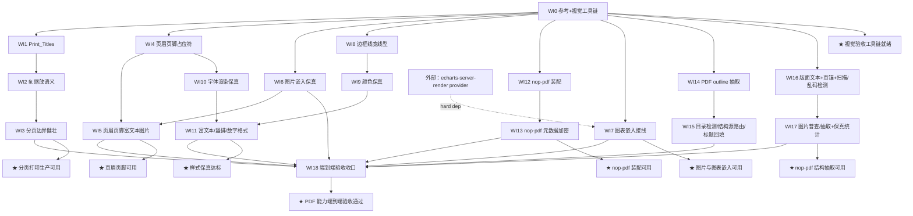

# PDF 能力完善 Roadmap — nop-report-pdf 渲染保真 + nop-pdf 装配与结构抽取

> Last updated: 2026-10-17（起草，全部 WI 未启动）
> 位置：按仓库 roadmap 惯例存放于 ai-dev/backlog/。书写约定：未来交付物路径用普通文本书写、不加反引号；已存在的文档路径用反引号，持续受 check-doc-links 保护。
> Sources:
> - `ai-dev/analysis/2026-09/2026-09-05-nop-report-pdf-visual-audit.md`（F1–F14 缺陷全量清单与证伪结论，已 resolved，是 export 主线基线）
> - `ai-dev/plans/2260-nop-report-pdf-quality.md`（已完成；Non-Blocking Follow-ups 是 export 主线的主要输入）
> - `ai-dev/design/nop-report/pdf-pagination.md`、`ai-dev/design/nop-report/pdf-font-strategy.md`
> - `ai-dev/backlog/echarts-server-render-roadmap.md`（图表静态渲染引擎提供方，WI7 的硬依赖）
> - `docs-for-ai/03-runbooks/generate-report.md`、`docs-for-ai/03-modules/nop-report.md`
> - 姊妹 roadmap：`ai-dev/backlog/nop-docx-document-model-roadmap.md`（Word 通用文档模型；其「模型→PDF」复用本 roadmap 的字体/图片/样式/分页能力，本 roadmap 的视觉验收工具链供其复用）
> - **nop-pdf 结构抽取需求来源**：`~/workspace/card-knowledge-base`（信用卡规范知识库，473 篇 PDF；PDF→outline→markdown→结构抽取流水线）。关键输入：`~/workspace/card-knowledge-base/docs/audits/pdf-outline-census-2026-10.md`（473 PDF outline 普查：368/473 带 outline、outline ≡ 目录页的无损结构化版）、`~/workspace/card-knowledge-base/docs/architecture/analyzed-pipeline-design.md`（S0–S7 阶段）、`~/workspace/card-knowledge-base/tools/analyzed-pipeline/src/core/pdfio.mjs`（outline 抽取 + 页文本）、`~/workspace/card-knowledge-base/tools/lib/headingize.mjs`（outline/TOC 驱动标题回填）、`~/workspace/card-knowledge-base/tools/scripts/pdf-outline-census.py`、`~/workspace/card-knowledge-base/schemas/image-registry.schema.yaml`；对版黄金：`~/workspace/card-knowledge-base/analyzed/**/outline.yaml`（473 份）
> - 参考素材：`~/sources/print/`（8 个打印/报表设计器：report-designer、openprint、fastprint-designer、vue-plugin-hiprint、vue-print、open-press、myprint、vue-print-designer）；本次已启动下载 `~/sources/pdfbox|OpenPDF|x-easypdf|jasperreports`（用 `~/sources/download-github.sh` 重试脚本，含 60 次重试循环）
> - 需求来源：2026-10-17 会话——"完善 nop-pdf 和 nop-report 导出为 pdf 的情况，需要正确处理分页打印、页眉页脚、图片嵌入、图表嵌入等；测试时必须查看实际渲染结果与截图，确保线条粗细、颜色、布局满足要求"；随后追加——"card-knowledge-base 中有很多 PDF 处理的要求，比如抽取 outline，这些功能都增加到 nop-pdf 中"

## Purpose

本 roadmap 编排 Nop 平台 **PDF 能力**的三条改进主线，把它们推进到"生产级、视觉保真、可自动验收"：

1. **nop-report-pdf**（报表→PDF 渲染/导出）：补齐分页打印、页眉页脚、图片/图表嵌入、样式保真（线宽/颜色/字体/布局）的能力面与细节，使任意报表模板（单页、宽表、长表、fit 缩放、套打、CJK、富样式、含图含表）导出的 PDF 与模板设计意图一致，并以"实际渲染截图 + golden/图像 diff"验收。
2. **nop-pdf 装配/后处理**（PDF 低层工具箱·写侧）：当前仅具备解析/抽取能力，本 roadmap 赋予其**生成与装配**能力（合并、拆分导出、盖章/水印、给已有 PDF 追加页码/页眉页脚、图片→PDF、元数据/加密），使导出后的 PDF 可被合并、加密封章、批量后处理。
3. **nop-pdf 文档结构抽取/分析**（PDF 低层工具箱·读侧，card-knowledge-base 需求）：补齐 **PDF outline（书签）抽取**、目录页检测、结构源路由与标题回填、版面感知文本抽取 + 页锚、扫描/乱码检测、图片普查与机械化保真统计，使 nop-pdf 能支撑规范文档的知识化流水线（不依赖 MinerU/pypdf 等外部引擎，纯 Java/PDFBox 实现）。

**范围硬边界**（改动须先改本节）：

- **不更换渲染引擎**：nop-report-pdf 保持 PDFBox 3.0.8 直接渲染展开后工作簿模型的路线；不做 xlsx→PDF 转换，不迁移到 OpenPDF/iText。OpenPDF/x-easypdf/JasperReports 仅作对版与设计参考。
- **nop-pdf 结构抽取用纯 Java 实现（PDFBox）**，不引入 MinerU/marker/docling/pypdf 等外部引擎或 Python 运行时；对版基准是 card-knowledge-base 的 `analyzed/**/outline.yaml` 与 image-registry 契约（以样本 PDF 为 fixture，而非把该知识库的 Node/Python 工具移植进 nop-pdf）。
- **图表引擎不在本 roadmap**：ECharts 服务端静态渲染（JVM GraalJS + Canvas2D shim、JFreeChart 退役、ChartModel→option 适配）由 `ai-dev/backlog/echarts-server-render-roadmap.md` 全权负责。本 roadmap 只做 **PDF 侧接线与视觉验收**（消费图表图片 provider），WI7 以该 provider 存在为完成前提。
- **xlsx/HTML 渲染器零改动**，除非共享模型（ExcelSheet/ExcelPageSetup/ExcelHeaderFooter/ExcelImage）需要承载新字段。
- **不提交字体二进制入库**（保持系统字体自动发现 + VFS 机制）；内置 CJK 子集字体仅作后续可选增强。
- **不提交 card-knowledge-base 的原始 PDF 入库**（含版权规范原文，体积大）；采样 fixture 只保留可公开的极小样本或程序合成 PDF。
- **不做报表设计器/UI**；不做大数据量性能优化（534 页 28s 已可接受），只要求不回归。

不含实现细节。每个 WI 由独立执行计划承载（`ai-dev/plans/00-plan-authoring-and-execution-guide.md`）；roadmap 就绪后可经 mission-driver draft 生成 mission config 驱动（当前未立项 mission）。

## Work Item Status

> 唯一动态状态块。勾选 = 独立 closure audit 通过（完成判定见 Cross-Cutting）；未勾选 = `todo`（无计划），起草 plan 并通过 draft review 后标注 `planned`。WI 编号全文件递增不重排；**deps 是唯一并行屏障**。每个 WI 以独立 plan 承载。

### M0 — 基础设施：参考实现与视觉验收工具链

- [ ] WI0 参考实现获取 + PDF 视觉验收工具链：**PDFBox 引擎基线升级到最新 3.0.8（2026-10-17 已完成：`nop-dependencies` 属性 3.0.3→3.0.8 + 去掉 `nop-pdf` 模块显式 pin，nop-pdf/nop-report-pdf 解析一致、测试全绿）**；下载 apache/pdfbox（引擎与 examples）、LibrePDF/OpenPDF、dromara/x-easypdf、TIBCOSoftware/jasperreports 到 ~/sources（已用重试脚本启动；`~/sources/print/` 8 个设计器作版式对版参考）；新建 **PDF→PNG 渲染 + golden 快照 + 图像 diff** 工具（渲染 DPI 口径、抗锯齿归一化、SSIM/像素容差、指定区域线宽/颜色采样），落到 nop-format/nop-pdf 测试支撑包（或 nop-autotest 扩展；仓库现无像素 diff 工具）；产出"工具使用与验收口径"说明落 ai-dev/analysis 当月目录（Deliverable: 参考仓库就位 + 视觉验收工具 + 口径裁定；deps: 无；Item Type: Decision + Proof）

### M1 — 分页打印（pagination）

- [ ] WI1 模板级分页声明（Print_Titles）：nop-ooxml-xlsx 解析器读取 definedNames 中的 print titles → ExcelSheet/ExcelPageSetup 模型承载 repeatRowRange/repeatColRange → PdfSheetRenderer 消费（优先于 `nop.report.pdf.repeat-header-rows`/`repeat-key-columns` 全局缺省），使模板声明与 Excel 打印语义一致。含解析单测 + PDF 续页/侧页断言（Deliverable: 解析器 + 模型字段 + 渲染消费 + 测试；deps: WI0；Item Type: Feature）
- [ ] WI2 fit 缩放语义与页幅约束：`fitToWidth`×`fitToHeight` 支持"缩放到 N 页宽 × M 页高"目标语义（当前仅布尔比例，与 Excel 语义有差）；自动缩小到目标页数并设**最小可读字号阈值**（低于阈值告警而非无限缩小）；缩放与重复块占位的交互复验。含缩放用例 golden（Deliverable: 缩放策略 + 测试；deps: WI1；Item Type: Feature）
- [ ] WI3 分页边界健壮性：超页行（单行高于打印区）、跨拆分边界的合并单元格重建/裁剪策略、手动分页符（rowBreaks/colBreaks）、空白尾行尾列裁剪、重复块的边界一致性。含边界用例 golden（Deliverable: 边界处理 + 测试；deps: WI2；Item Type: Feature）

### M2 — 页眉页脚（headers/footers）

- [ ] WI4 页眉页脚占位符与作用域：求值 Excel 占位符（`&P` 当前页/`&N` 总页/`&D` 日期/`&T` 时间/`&A` 工作表名/`&F` 文件名/`&Z` 路径等）；区分**每工作表页码 vs 全局页码**（配置 `nop.report.pdf.page-number-scope`）；首页不同 / 奇偶页不同（oddHeader/evenHeader/firstHeader 语义）；页眉页脚字体样式保真。含占位符求值单测 + 多页渲染断言（Deliverable: 占位符引擎 + 作用域/奇偶首页 + 测试；deps: WI0；Item Type: Feature）
- [ ] WI5 页眉页脚富文本与图片：左/中/右分区内的多字体混排、logo 图片嵌入（复用图片嵌入路径）、分区对齐与越界裁剪保真。含图片页眉 golden（Deliverable: 富文本 + 图片页眉页脚 + 测试；deps: WI4、WI6；Item Type: Feature）

### M3 — 图片嵌入（image embedding）

- [ ] WI6 图片嵌入保真：DPI 与尺寸换算（EMU/像素/点相互换算正确，`noChangeAspect` 等比、显式宽高）；`rotateDegree` 旋转；alpha 透明（PNG 透明通道）；图片缓存与内存（大图/多图不 OOM，保持 per-document 复用）；缺图/损坏图占位（当前灰色块）；页面裁剪与套打 `print=false` 行为回归。含旋转/透明/DPI golden（Deliverable: 图片子系统保真 + 测试；deps: WI0；Item Type: Feature）

### M4 — 图表嵌入（chart embedding）

- [ ] WI7 PDF 图表嵌入接线与验收：定义/消费**图表图片 provider SPI**（对接 `echarts-server-render-roadmap.md` 的静态渲染产物，PNG/SVG；若该 roadmap 尚未落地，先以桩 provider 打通 `PdfSheetRenderer.renderCharts` 管线）；`PdfSheetRenderer` 增 `renderCharts`（镜像 `renderImages` 路径：锚点→坐标→裁剪→绘制，矢量优先/SVG→PDF，否则高 DPI 栅格）；逐图视觉验收（结构语义必须一致、样式尽量贴近）。注意跨 roadmap 依赖：provider 未就绪时本 WI 只完成 PDF 侧接线与桩验证，完成判定延后（Deliverable: SPI + renderCharts + 图表 PDF golden；deps: WI0 + 外部图表 provider；Item Type: Feature + Proof）

### M5 — 样式保真（线宽 / 颜色 / 字体 / 布局）

- [ ] WI8 边框线宽/线型保真：以模型真实边框宽度（pt/EMU，来自 Excel 边框定义）驱动 `drawBorderLine`，替换 `OfficeLineStyle` 枚举到 0.5/1/1.5/2pt 的硬编码映射；四边独立宽度、DOUBLE 双线间距、DASHED/DOTTED/DASH_DOT 节距按 Excel 语义；缩放/线宽补偿。含线宽采样 golden（Deliverable: 边框保真 + 测试；deps: WI0；Item Type: Feature）
- [ ] WI9 颜色保真：扩展颜色解析（8 位 hex `#AARRGGBB`、indexed/theme 调色板、rgba/alpha），填充/字体/边框三路统一走 `ColorHelper`，修正当前 `parseColor` 对命名色/`rgba` 的不完整覆盖；渐变填充（`ExcelStyle` 渐变）调研与裁定。含颜色采样 golden（Deliverable: 颜色保真 + 测试；deps: WI8；Item Type: Feature）
- [ ] WI10 字体渲染保真：伪粗体/斜体（TTF/OTF 无 bold/italic 变体时合成），真实变体发现（`<name>-Bold` 等已部分存在，补齐 italic）；字体子集与 ToUnicode 正确性（复制/搜索）。含字体 golden（Deliverable: 字体子系统保真 + 测试；deps: WI4；Item Type: Feature）
- [ ] WI11 单元格富文本与竖排/数字格式：单元格内富文本 run（同格多字体，需 nop-excel 模型支持）、竖排文本（`rotation`）、数字格式（`formatExpr`/Excel 格式串）渲染。含富文本/竖排 golden（Deliverable: 富文本 run + 竖排 + 数字格式 + 测试；deps: WI10、WI9；Item Type: Feature）

### M6 — nop-pdf 文档装配与后处理

- [ ] WI12 nop-pdf 生成/装配 API：合并（多 PDF → 一）、拆分导出增强、盖章/覆盖层（overlay/stamp 已有 PDF 指定页指定位置）、水印（文字/图片，可倾斜/透明度）、给已有 PDF **追加页眉页脚/页码**；图片（PNG/JPEG）→PDF 入口。复用 PdfDoc/PdfBoxHelper，接口按仓库两档错误处理惯例。含单测 + 装配 golden（Deliverable: 装配 API + 测试；deps: WI0；Item Type: Feature）
- [ ] WI13 nop-pdf 文档属性与保护：文档元数据（Title/Author/Subject/Keywords/Creator/Producer）、加密与权限（owner/user password、打印/复制权限）、PDF/A 合规校验调研（参考 veraPDF，仅裁定不急实施）。含元数据/权限单测（Deliverable: 元数据 + 加密 + PDF/A 裁定；deps: WI12；Item Type: Feature + Decision）

### M7 — nop-pdf 文档结构抽取与分析（card-knowledge-base 需求）

- [ ] WI14 PDF outline（书签）抽取：以 PDFBox 遍历文档 catalog 的 outline 树 → **扁平化条目 `{title, depth(1-based), page(1-based|null)}`**，覆盖：命名目标（named destination）、页索引引用目标、显式页号目标、父节点自带目标（与 card-kb pypdf/pdfjs 语义对齐）、文档序保留、坏 outline 降级为空列表、`page-end` 推算（下一条带页条目）、按 (title,page) 去重、stats（entries/max-depth/unresolved-pages）；输出 outline.yaml 契约（`analyzed/**/outline.yaml` schema），以 card-kb 样本 PDF 作 fixture 对版（Deliverable: outline 抽取 + schema + 对版测试；deps: WI0；Item Type: Feature）
- [ ] WI15 目录页检测与结构源路由 + 标题回填：目录行正则（dot-leader/≥2 空格 + 尾部页码三形态：物理页、逻辑页 `3-1`、中文汇编卷 `附件一-1`；行尾容 `\r`）；结构源优先级 **outline > toc-regex > 重建 > chunk** 及确定性守卫（toc 可行窗口=前 20%、大文档 chunk 覆盖）+ 决策审计；按 outline/目录在页锚处回填 markdown 标题、保留 outline 层级（headingize v2 等价，替代纯行数分块）（Deliverable: 目录检测 + 路由 + 标题回填 + 测试；deps: WI14；Item Type: Feature）
- [ ] WI16 版面感知文本抽取 + 页锚 + 扫描/乱码检测：页级文本保留真实换行（hasEOL 语义）、控制字符剥离、空白归一化、单页字符上限；多列/间距版面保真（`pdftotext -layout` 等价，基于 PDFBox 位置信息，复用/扩展 `extract` 包 `ExtractStripper`）；输出 `` 页锚；**无可抽取文本层（扫描件）检测 → 硬错误**（禁止静默产出空文本）；U+FFFD/乱码检测与质量指标（Deliverable: 版面文本 + 页锚 + 扫描/乱码检测 + 测试；deps: WI0；Item Type: Feature）
- [ ] WI17 图片普查/抽取与机械化保真统计：逐页图片清单（`get_images(full=True)` 等价：PDResources XObject 遍历，含跨页重复、宽高、大小 KB、页码），面积阈值 keep/skip 分类；图片裁剪落盘 + registry YAML（对齐 `image-registry.schema.yaml`：seq/file/page/width/height/size-kb）；文档机械化统计（页数、字符数、U+FFFD 数、标题数、表格行列数、图片数）供保真对账（Deliverable: 图片普查/抽取 + 统计 + 测试；deps: WI16；Item Type: Feature）

### M8 — 端到端视觉验收与文档收口

- [ ] WI18 全链路验收与文档收口：**export 侧**——现有 20 个 demo 模板 + 新增分页/页眉页脚/图片/图表/样式/装配 fixture，全链路渲染逐张转 PNG，对 golden 做线宽/颜色/布局 diff 断言 + 人工截图抽查；失败项回灌对应 WI。**抽取侧**——以 card-kb 样本 PDF 验证 outline/目录/页锚/图片普查抽取结果与 `analyzed/**/outline.yaml` 及 image-registry 对版（结构语义一致）。更新 owner doc（PDF 能力矩阵：导出/装配/抽取三面、配置面、已知限制）与 `docs-for-ai/INDEX.md` 路由、`01-repo-map/module-groups.md` 模块登记、`04-reference/source-anchors.md`；当日 ai-dev/logs 状态一致（Deliverable: 端到端验收报告 + 文档/路由收口；deps: WI1–WI17 完成或显式裁定；Item Type: Proof）

- ★ **Milestone: 视觉验收工具链就绪**（WI0 完成后勾选）
- ★ **Milestone: 分页打印生产可用**（WI1–WI3 完成后勾选）
- ★ **Milestone: 页眉页脚可用**（WI4–WI5 完成后勾选）
- ★ **Milestone: 图片与图表嵌入可用**（WI6–WI7 完成后勾选）
- ★ **Milestone: 样式保真达标**（WI8–WI11 完成后勾选）
- ★ **Milestone: nop-pdf 文档装配可用**（WI12–WI13 完成后勾选）
- ★ **Milestone: nop-pdf 结构抽取可用**（WI14–WI17 完成后勾选）
- ★ **Milestone: PDF 能力端到端验收通过**（WI0–WI18 全部完成后勾选）

## Current Baseline（2026-10-17 核对）

**已存在（可用）：**

- **nop-report-pdf**（约 2200 LOC，PDFBox 3.0.8 直渲）：两遍拆分（单页不拆、分页时按扣除重复块重拆）、续页重复表头行 + 列拆分页重复关键列 + 四块网格角块、fit 缩放/水平垂直居中、多页默认页码（`default-page-footer`）、页眉页脚（模板显式配置时，**字面文本**）、图片嵌入（页面裁剪 + `print=false` 排除 + 缺图灰块）、CJK 字体目录发现 + 逐字形回退 + TTC 切分、单元格文本裁剪、边框虚线/双线、控制字符归一化。测试 23 个全绿；`TestPdfExportAudit`/`NoFontInjection` 20 模板端到端全绿（plan 2260 收口证据）。
- **决策记录**：`ai-dev/design/nop-report/pdf-font-strategy.md`（字体来源/回退/环境前提）、`ai-dev/design/nop-report/pdf-pagination.md`（分页/重复块/页码/图片裁剪 D1–D4 与已知限制）。
- **nop-pdf**（解析/抽取工具箱）：`PdfDoc`（loadFromFile、getNumberOfPages、getPageText/getAllText、selectPages/selectPageRange/selectPage、splitIntoPages、extractTables、getTablesHtml、save）、`extract` 包（结构化解析 → HTML/txt/image 导出、表格/段落/TOC/虚线检测）、`tabula` 包（表格抽取算法）、`PdfBoxHelper`（几何/字体度量换算）。**无任何生成/写入/装配能力**；`extract` 的 `SimpleTocDetector` 仅支持最简单的点线目录页，无 PDF outline（书签）抽取、无页锚输出、无扫描件/乱码检测、无逐页图片普查。
- **card-knowledge-base 需求基线**（`~/workspace/card-knowledge-base`，473 PDF）：S0–S7 流水线需要 PDF outline 抽取（368/473 带 outline、outline ≡ 目录页无损结构化版）、目录页正则 + 结构源路由、页锚 `<a id="pdf-page-N">`、扫描/乱码检测、逐页图片普查 + registry、机械化保真统计；现有 golden `analyzed/**/outline.yaml`（473 份）可作对版基准。
- **视觉验收雏形**：`nop-report-demo/.../TestPdfExportAudit` 用 PDFBox `PDFRenderer` 以 110dpi 逐页转 PNG 落 `_tmp/report-pdf-audit/`，但**无 golden/图像 diff 断言**（仅人工看）。
- **参考素材**：`~/sources/print/`（8 个打印/报表设计器）；本次下载 pdfbox/OpenPDF/jasperreports 成功，x-easypdf 网络重试中。

**主要缺口（本 roadmap 的落点）：**

- **分页**：无模板级 Print_Titles（仅全局配置默认第 1 行/列）；`fitToWidth/Height` 仅布尔比例，无"N 页宽×M 页高"与最小字号阈值；超页行/跨页合并单元格/手动分页符/空白尾行列未处理。
- **页眉页脚**：占位符（`&P/&N/&D/&A/&F/&Z`）未求值（字面文本）；无每工作表 vs 全局页码；无首页/奇偶页不同；无富文本与图片页眉。
- **图片**：DPI 换算/`rotateDegree`/`noChangeAspect`/alpha 透明未见专项处理与验收；缺图占位为灰块。
- **图表**：nop-report-pdf **不支持任何图表嵌入**（依赖 echarts roadmap 的 provider）。
- **样式**：边框线宽硬编码枚举映射（忽略模型真实宽度）；颜色解析不完整（无 8 位 hex/indexed/theme/alpha）；字体无伪粗体/斜体、无富文本 run；数字格式未专项。
- **nop-pdf**：无合并/拆分导出增强/盖章/水印/页码后处理/图片→PDF；无元数据/加密/权限/PDF-A。
- **nop-pdf 结构抽取**：无 PDF outline（书签）抽取；目录页正则仅最简形态；无结构源路由与标题回填；无页锚输出；无扫描件/乱码检测；无逐页图片普查/registry；无机械化保真统计。
- **验收**：无像素 diff 工具，无 golden 快照，视觉回归靠人工；抽取无对版测试。

## Framework / Platform Reuse

| 能力 | 提供方 | 约束 |
| --- | --- | --- |
| PDF 引擎 | Apache PDFBox 3.0.8（nop-pdf、nop-report-pdf 共同依赖；2026-10-17 由 3.0.3 升级） | 不换引擎；`PDType0Font` 绑定 PDDocument，**严禁跨文档缓存字体实例** |
| 字体发现/回退 | nop-report-pdf `FontManager` + `PdfRenderer.fontForText` | 沿用现有四段解析与逐字形回退；CI 环境需 CJK 字体（pdf-font-strategy D3） |
| 表格拆分 | `nop-kernel/nop-core` `TableSplitHelper` | 分页几何切分复用；不重写 |
| 打印几何 | `nop-format/nop-excel` `ExcelPrintHelper`（纸张/打印区/页眉页脚高度） | 复用；页幅语义扩展改此处 |
| 展开模型 | `nop-report-core` `ExpandedSheetGenerator` / `IExcelSheet` | 三种输出共享；不改展开引擎 |
| 图表静态渲染 | `nop-chart-echarts`/`nop-canvas2d`（echarts-server-render-roadmap） | 仅消费其图片产物接入 PDF；不在此 roadmap 造图 |
| 图像渲染（验收） | PDFBox `PDFRenderer.renderImageWithDPI` | 视觉验收工具复用；新增加 golden/diff 层 |
| outline/文件结构 | PDFBox `PDDocumentCatalog.getDocumentOutline()` / `PDOutlineItem` / named destination | nop-pdf outline 抽取复用；对版语义见 card-kb `pdfio.mjs` |
| 页文本/位置 | PDFBox `PDFTextStripper`（含 `TextPosition`）/ nop-pdf `extract` 包 `ExtractStripper` | 版面文本复用；新增页锚/扫描检测 |
| 图片普查 | PDFBox `PDResources.getXObjectNames()`（`PDImageXObject`） | 复用；新增逐页清单/registry |
| 表抽取 | nop-pdf `tabula`（Basic/Spreadsheet ExtractionAlgorithm） | 复用；新增行列数统计对账 |
| 抽取对版契约 | card-kb `analyzed/**/outline.yaml` + `~/workspace/card-knowledge-base/schemas/image-registry.schema.yaml` | 结构语义对版基准；不移植其 Node/Python 工具 |
| 参考实现 | ~/sources/pdfbox·OpenPDF·x-easypdf·jasperreports + ~/sources/print/* | 仅对版/设计参考；不引入运行时依赖 |
| 测试基座 | nop-autotest + `docs-for-ai/02-core-guides/testing.md` | golden 断业务不变量，防快照漂移 |

## Stages

| # | Stage | Owner plan | Deps | Critical path | Reuse |
| --- | --- | --- | --- | --- | --- |
| 0 | 参考实现 + 视觉验收工具链 | WI0 | — | **Yes** | PDFBox PDFRenderer |
| 1 | 模板级 Print_Titles | WI1 | WI0 | **Yes** | ooxml 解析器 / TableSplitHelper |
| 2 | fit 缩放语义与页幅约束 | WI2 | WI1 | **Yes** | ExcelPrintHelper |
| 3 | 分页边界健壮性 | WI3 | WI2 | **Yes** | TableSplitHelper |
| 4 | 页眉页脚占位符/作用域 | WI4 | WI0 | No（可并行） | ExcelHeaderFooter 模型 |
| 5 | 页眉页脚富文本/图片 | WI5 | WI4、WI6 | No | WI6 图片路径 |
| 6 | 图片嵌入保真 | WI6 | WI0 | No | PdfImageHelper |
| 7 | 图表嵌入接线 | WI7 | WI0 + 图表 provider | No | echarts roadmap |
| 8 | 边框线宽/线型 | WI8 | WI0 | No | Excel 边框模型 |
| 9 | 颜色保真 | WI9 | WI8 | No | ColorHelper |
| 10 | 字体渲染保真 | WI10 | WI4 | No | FontManager |
| 11 | 富文本 run/竖排/数字格式 | WI11 | WI10、WI9 | No | nop-excel 模型 |
| 12 | nop-pdf 装配 API | WI12 | WI0 | No（独立轨） | PdfDoc/PdfBoxHelper |
| 13 | nop-pdf 元数据/加密 | WI13 | WI12 | No | PDFBox 加密 API |
| 14 | PDF outline 抽取 | WI14 | WI0 | No（独立轨） | PDFBox outline API |
| 15 | TOC 检测 + 结构源路由 + 标题回填 | WI15 | WI14 | No | PDFTextStripper |
| 16 | 版面文本 + 页锚 + 扫描/乱码检测 | WI16 | WI0 | No | extract 包 ExtractStripper |
| 17 | 图片普查/抽取 + 保真统计 | WI17 | WI16 | No | PDFBox PDResources / tabula |
| 18 | 端到端验收与收口 | WI18 | WI1–WI17 | **Yes** | 全部 |

## Stage Details

### WI0. 参考实现与视觉验收工具链

> Status: see Work Item Status above

**Goal:** 建立"实际渲染截图 + golden/diff"验收能力，作为全部后续 WI 的完成门。

**Deliverables:**
- 下载并核对 pdfbox/OpenPDF/x-easypdf/jasperreports 到 ~/sources；整理 `~/sources/print/` 版式参考索引。
- 视觉验收工具：PDF→PNG（DPI 口径固定）、golden 快照、图像 diff（SSIM/像素容差）、区域线宽/颜色采样断言；落 nop-format/nop-pdf 测试支撑包或 nop-autotest 扩展。
- 裁定：栅格化 DPI/抗锯齿归一化口径、容差阈值、金标准更新流程。

**Out of scope:** 任何渲染器功能改动。

**Module / area:** `nop-format/nop-pdf/src/test`（或 nop-autotest）、`ai-dev/analysis/`。

### WI1. 模板级分页声明（Print_Titles）

> Status: see Work Item Status above

**Goal:** 模板声明的重复标题行/列（等价 Excel Print_Titles definedNames）在 PDF 分页生效。

**Deliverables:**
- nop-ooxml-xlsx 解析 definedNames print titles → 模型字段（repeat rows/cols 范围）。
- PdfSheetRenderer 消费模型声明，优先于全局配置默认；与四块网格重复块协同。
- 解析单测 + 续页/侧页 PDF 断言 + golden。

**Out of scope:** 页幅缩放（WI2）、页眉页脚。

**Module / area:** nop-format/nop-ooxml-xlsx、nop-format/nop-excel、nop-report/nop-report-pdf。

### WI2. fit 缩放语义与页幅约束

> Status: see Work Item Status above

**Goal:** fit 缩放语义与 Excel 对齐，缩放有可读性下限。

**Deliverables:**
- `fitToWidth`×`fitToHeight` 的"N 页宽×M 页高"目标缩放；最小可读字号阈值与告警。
- 缩放与重复块占位（dx/dy）的交互复验。
- 缩放用例 golden。

**Out of scope:** 分页边界（WI3）。

**Module / area:** nop-report/nop-report-pdf、nop-format/nop-excel。

### WI3. 分页边界健壮性

> Status: see Work Item Status above

**Goal:** 分页边界不溢出、不丢内容、不残留多余空白。

**Deliverables:**
- 超页行（单行高于打印区）、跨拆分边界合并单元格重建/裁剪策略。
- 手动分页符（rowBreaks/colBreaks）；空白尾行尾列裁剪。
- 边界用例 golden。

**Out of scope:** 页幅缩放（WI2）、页眉页脚。

**Module / area:** nop-report/nop-report-pdf、nop-format/nop-excel（若需 breaks 字段）。

### WI4. 页眉页脚占位符与作用域

> Status: see Work Item Status above

**Goal:** 页眉页脚支持 Excel 占位符与页码作用域，替换当前字面文本。

**Deliverables:**
- 占位符求值引擎（`&P/&N/&D/&T/&A/&F/&Z` 等）。
- 每工作表 vs 全局页码配置；首页不同 / 奇偶页不同。
- 字体样式保真；占位符求值单测 + 多页渲染断言 + golden。

**Out of scope:** 富文本/图片页眉（WI5）。

**Module / area:** nop-report/nop-report-pdf、`nop.report.pdf.*` 配置。

### WI5. 页眉页脚富文本与图片

> Status: see Work Item Status above

**Goal:** 页眉页脚支持多字体混排与 logo 图片。

**Deliverables:**
- 左/中/右分区多字体混排、图片嵌入、对齐与裁剪保真。
- 图片页眉 golden。

**Out of scope:** 页眉页脚布局模板化。

**Module / area:** nop-report/nop-report-pdf。

### WI6. 图片嵌入保真

> Status: see Work Item Status above

**Goal:** 图片在 PDF 中按模板语义正确缩放/旋转/透明/缓存。

**Deliverables:**
- DPI/尺寸换算、`noChangeAspect`、`rotateDegree`、alpha 透明。
- 图片缓存/内存约束、缺图占位改进。
- 旋转/透明/DPI golden。

**Out of scope:** SVG 支持（除非 WI0 裁定纳入）、图表（WI7）。

**Module / area:** nop-report/nop-report-pdf（PdfImageHelper）。

### WI7. PDF 图表嵌入接线与验收

> Status: see Work Item Status above

**Goal:** 报表中的图表能出现在导出的 PDF 中，视觉对版。

**Deliverables:**
- 图表图片 provider SPI（对接 echarts roadmap 产物）；无 provider 时静默跳过。
- PdfSheetRenderer.renderCharts（镜像 renderImages；矢量优先/高 DPI 栅格）。
- 图表 PDF golden + 逐图视觉验收。

**Out of scope:** 图表引擎本身（echarts roadmap 负责）。

**Module / area:** nop-report/nop-report-pdf、nop-format/nop-excel（SPI 若需）、nop-report/nop-chart-report（若存在）。

### WI8. 边框线宽/线型保真

> Status: see Work Item Status above

**Goal:** 边框线宽/线型按模型真实值渲染。

**Deliverables:**
- 用模型边框宽度（pt/EMU）替换枚举硬编码；四边独立宽度、DOUBLE 间距、虚线节距。
- 缩放/线宽补偿；线宽采样 golden。

**Out of scope:** 颜色（WI9）。

**Module / area:** nop-report/nop-report-pdf（PdfStyleHelper）、nop-format/nop-excel。

### WI9. 颜色保真

> Status: see Work Item Status above

**Goal:** 填充/字体/边框颜色完整解析并正确渲染。

**Deliverables:**
- 扩展解析（8 位 hex/indexed/theme/alpha），三路统一 ColorHelper。
- 渐变填充调研与裁定。
- 颜色采样 golden。

**Out of scope:** 字体（WI10）、富文本（WI11）。

**Module / area:** nop-report/nop-report-pdf、nop-format/nop-excel（ColorHelper）。

### WI10. 字体渲染保真

> Status: see Work Item Status above

**Goal:** 字体渲染保真且可复制/搜索。

**Deliverables:**
- 伪粗体/斜体、真实变体发现、字体子集/ToUnicode。
- 字体 golden。

**Out of scope:** 富文本 run/竖排/数字格式（WI11）；内置 CJK 子集字体入库。

**Module / area:** nop-report/nop-report-pdf（FontManager）。

### WI11. 单元格富文本与竖排/数字格式

> Status: see Work Item Status above

**Goal:** 单元格内富文本与竖排、数字格式正确渲染。

**Deliverables:**
- 富文本 run（同格多字体，需 nop-excel 模型支持）、竖排文本（`rotation`）、数字格式。
- 富文本/竖排 golden。

**Out of scope:** 字体发现（WI10）。

**Module / area:** nop-report/nop-report-pdf、nop-format/nop-excel（富文本 run 模型）。

### WI12. nop-pdf 生成/装配 API

> Status: see Work Item Status above

**Goal:** nop-pdf 从"只读"升级为可生成/装配 PDF 的工具箱。

**Deliverables:**
- 合并、拆分导出增强、盖章/覆盖层、水印（文字/图片）、给已有 PDF 追加页眉页脚/页码、图片→PDF。
- 单测 + 装配 golden。

**Out of scope:** 文本/表格抽取（已有）。

**Module / area:** nop-format/nop-pdf（core 包）。

### WI13. nop-pdf 元数据与保护

> Status: see Work Item Status above

**Goal:** 导出 PDF 可设属性与权限。

**Deliverables:**
- 元数据（Title/Author/Subject/Keywords/Creator/Producer）、加密与权限、PDF/A 调研（verapdf）。
- 元数据/权限单测。

**Out of scope:** 数字签名（后续）。

**Module / area:** nop-format/nop-pdf。

### WI14. PDF outline（书签）抽取

> Status: see Work Item Status above

**Goal:** nop-pdf 能抽取 PDF 原生 outline 为结构化条目树，语义对齐 card-kb。

**Deliverables:**
- PDFBox 遍历 catalog outline 树 → 扁平 `{title, depth(1-based), page(1-based|null)}`；覆盖命名目标/页索引引用/显式页号/父节点目标/文档序/坏 outline 降级空/`page-end` 推算/(title,page) 去重/stats。
- outline.yaml 契约（对齐 `analyzed/**/outline.yaml` schema）。
- 以 card-kb 样本 PDF 作 fixture 对版测试。

**Out of scope:** TOC 页正则/标题回填（WI15）；图片（WI17）。

**Module / area:** nop-format/nop-pdf（新增 outline 抽取 API）。

### WI15. 目录页检测与结构源路由 + 标题回填

> Status: see Work Item Status above

**Goal:** 无 outline 或需交叉验证时，从目录页恢复结构并按结构回填标题层级。

**Deliverables:**
- 目录行正则（dot-leader/≥2 空格 + 页码三形态：物理页 / 逻辑页 `3-1` / 中文汇编卷 `附件一-1`；行尾容 `\r`）。
- 结构源优先级 outline > toc-regex > 重建 > chunk + 确定性守卫（toc 前 20% 窗口、大文档 chunk 覆盖）+ 决策审计轨迹。
- 按 outline/目录在 `<a id="pdf-page-N">` 页锚处回填 markdown 标题、保留层级（headingize v2 等价）。

**Out of scope:** AI 大纲重建（属使用方 AI，nop-pdf 只提供确定性原语）。

**Module / area:** nop-format/nop-pdf。

### WI16. 版面感知文本抽取 + 页锚 + 扫描/乱码检测

> Status: see Work Item Status above

**Goal:** 页级文本抽取保住版面与页码锚点，坏输入显式失败。

**Deliverables:**
- 页级文本保留真实换行、控制字符剥离、空白归一化、单页字符上限；多列/间距版面保真（`pdftotext -layout` 等价，基于 PDFBox 位置信息）。
- `` 页锚输出。
- **无可抽取文本层（扫描件）检测 → 硬错误**（禁止静默产出空文本）；U+FFFD/乱码检测与质量指标。

**Out of scope:** OCR（扫描件由使用方提供或外部 OCR，nop-pdf 只报错）。

**Module / area:** nop-format/nop-pdf（复用/扩展 `extract` 包 `ExtractStripper`）。

### WI17. 图片普查/抽取与机械化保真统计

> Status: see Work Item Status above

**Goal:** 逐页图片清单与裁剪落盘，产出机械化保真统计。

**Deliverables:**
- 逐页图片清单（PDResources XObject 遍历：页码/宽高/大小 KB/跨页重复），面积阈值 keep/skip 分类。
- 图片裁剪落盘 + registry YAML（对齐 `image-registry.schema.yaml`：seq/file/page/width/height/size-kb）。
- 机械化统计（页数、字符数、U+FFFD、标题数、表格行列数、图片数）供保真对账。

**Out of scope:** 图片视觉分类/文字化（属使用方 AI）。

**Module / area:** nop-format/nop-pdf。

### WI18. 端到端验收与文档收口

> Status: see Work Item Status above

**Goal:** export 视觉验收 + 抽取对版验收通过，文档/路由收口。

**Deliverables:**
- export：20 demo 模板 + 新增 fixture 全链路渲染 + golden diff + 人工抽查；失败回灌。
- 抽取：card-kb 样本 PDF 的 outline/目录/页锚/图片普查结果与 `analyzed/**/outline.yaml` 及 image-registry 对版（结构语义一致）。
- owner doc 能力矩阵（导出/装配/抽取三面）/配置面/已知限制；INDEX/模块登记/源码锚点；日志一致。

**Out of scope:** 无。

**Module / area:** nop-report/nop-report-demo、nop-report/nop-report-pdf、nop-format/nop-pdf、docs-for-ai/。

## Dependency Graph

## Cross-Cutting（每个 WI 的完成判定）

1. **验证门**：`./mvnw test -pl <module> -am` 绿（触及多模块跑 `./mvnw clean install -T 1C`）；命令口径以 `docs-for-ai/00-start-here/project-context.md` Verification Commands 为准。
2. **视觉优先红线**：凡涉及渲染外观的 WI，必须产出 `_tmp/` 下的实际 PDF + 逐页 PNG 截图，并以 WI0 工具做线宽/颜色/布局断言；**禁止只做文本级断言**（plan 2260 教训：文本断言无法发现溢出/叠压/颜色偏差）。人工截图抽查结论写入对应 plan 与 ai-dev/analysis。
3. **抽取对版红线**：nop-pdf 抽取类 WI（WI14–WI17）以 card-kb `analyzed/**/outline.yaml` 与 image-registry 契约为对版基准（结构语义一致，页码 1:1）；测试用样本 PDF fixture（可程序合成或可公开小样本），**不把 card-kb 的 Node/Python 工具或原始 PDF 带进 nop-entropy 仓库**。
4. **生成物禁改**：不手编辑 `_` 前缀与 `_gen` 生成物；模型/解析器/渲染器一律改源模型或源解析代码。
5. **错误处理**：两档惯例（`docs-for-ai/02-core-guides/error-handling.md`）——模块内部与 AI 生成代码用模块级异常 + English 消息，公共 API 用 `NopException` + ErrorCode + `.param(...)`；错误码在 i18n yaml 注册并通过 `check-error-param-consistency.mjs`。
6. **模块边界**：nop-pdf 保持通用 PDF 工具箱，不依赖 nop-excel/nop-report；nop-report-pdf 依赖关系不变。不得反向依赖。
7. **字体与文档绑定**：`PDType0Font` 绑定 PDDocument，禁止跨文档缓存字体实例（pdf-font-strategy D4）。
8. **跨 roadmap 依赖**：WI7 以 `echarts-server-render-roadmap.md` 的图表 provider 为硬依赖；provider 未就绪时 WI7 只到"桩验证"，不得虚报完成。

## Rules

- 本文件是状态索引与粗粒度分解，不是执行计划；每个 `planned` WI 由独立执行计划承载。
- 状态只在顶部 Work Item Status 块变更（勾选 / `planned` 标注）；Milestone 勾选是所有依赖 WI 完成后派生。
- WI 编号全文件递增，不重排；**deps 是唯一并行屏障**。
- 未启动 WI 的交付物描述不含实现步骤与复选框。
- 若需在执行中增删/排序 WI，先停止 mission 再改本文件。
