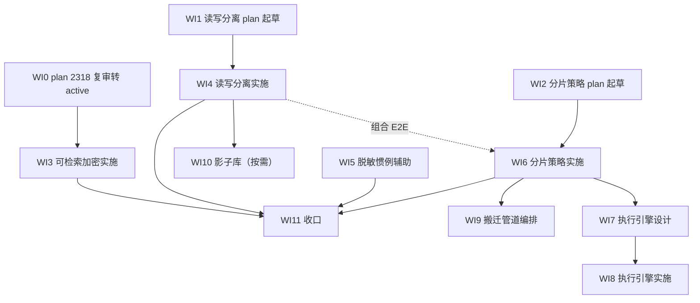

# nop 数据访问层中间件能力 Roadmap（ShardingSphere 对标收敛）

> Last updated: 2026-10-05（v1：立项。基于 2026-10-05 ShardingSphere master（5.5.4-SNAPSHOT）对比分析核定缺口，及当日三份产出——plan 2318（可检索加密，draft）、分片策略配置设计（草案）、读写分离设计（草案）——组织为依赖有序的开发序列）
> 位置：按仓库 roadmap 惯例存放于 `ai-dev/backlog/`。书写约定：未来交付物路径用普通文本书写、不加反引号；已存在的文档路径用反引号，持续受 check-doc-links 保护。
> Sources:
> - `ai-dev/analysis/2026-10/2026-10-05-shardingsphere-vs-nop-orm-gap-analysis.md`（缺口核定 primary；SS master 裁剪事实与既有裁定清单）
> - `ai-dev/plans/2318-orm-enc-assisted-query-columns.md`（可检索加密执行计划，draft，已过一轮对抗审查）
> - `ai-dev/design/nop-orm-sharding-strategy-design.md`（分片策略配置目标设计，草案）
> - `ai-dev/design/nop-dao-readwrite-splitting-design.md`（读写分离目标设计，草案）
> - `ai-dev/design/nop-orm-scope-and-non-goals.md`（XA/脱敏/读写分离归属等既有裁定）
> - `docs-for-ai/02-core-guides/eql-and-database-compatibility.md`、`docs-for-ai/01-repo-map/module-groups.md`

## Purpose

把 ShardingSphere 对比确认的剩余缺口收敛为**一条依赖有序的开发序列**，目标状态：

1. **可检索加密**（enc 列 assisted/like 辅助列）生产可用——plan 2318 承载。
2. **读写分离**（DataSource 层）生产可用——nop-dao 承载。
3. **分片**：策略配置 + 单分片路由生产可用；跨分片执行引擎（fan-out+归并）完成设计并按需实施。
4. **数据搬迁管道**编排层可用（分片扩容/机房迁移场景）。
5. 脱敏按 meta 层裁定只补惯例辅助；影子库按需启动。

排序原则：价值/成本比与依赖深度（读写分离与可检索加密无相互依赖且模块面不重叠，先行并行；分片配置先行于执行引擎与搬迁；影子库最后且按需）。

## Current Baseline（2026-10-05 核对）

**已具备（不进入本 roadmap）**：透明列加密生产可用（enc 标签 + binder 增强）；分布式 ID（snowflake/uuid/编码规则）；EQL 编译期方言翻译；多 querySpace 多数据源装配（nopDataSource_ 前缀 collect-beans）+ DynamicDataSource 手动切换；nop-metadata 应用层跨库联邦（BI 场景）；nop-tcc 补偿事务；CDC 底座（nop-stream-connector-debezium 源 + nop-stream-connector-jdbc exactly-once sink）与 nop-batch chunk 读写；本地事务 + best-effort 事务组。

**就位的文档**：plan 2318（draft，一轮对抗审查通过，含 bulk-update 归业务层用户裁定）；分片策略配置设计与读写分离设计（草案，均含拒绝清单；分片设计含删除 selectShards 死 SPI 面的裁定）。

**既有硬裁定（本 roadmap 全程有效）**：XA/2PC non-goal；ORM 层脱敏引擎 non-goal（脱敏是 xmeta 层概念，脱敏展示字段 + 敏感字段不发布模式）；读写分离归 DataSource 层（策略单点）；bulk UPDATE SET 涉及 enc 列归业务层校验（owner doc 声明限制）；无静默错误结果（缺分片键/不可检索谓词/从库全挂均 fail-fast）。

**对标面事实**：SS master 已删除 db-discovery、traffic、CosId/NaNoid、SM 系加密、模糊加密、Bitronix；读写分离只剩静态分组——对齐目标以 master 为准，不对齐已裁撤能力。

## Work Item Status

> 唯一动态状态块。勾选 = 独立 closure audit 通过（完成判定见 Cross-Cutting）；`todo` = 无计划，`planned` = 已有通过 draft review 的执行计划。WI 编号全文件递增不重排；**deps 是唯一并行屏障**。每个 WI 以独立 plan 承载，写前必读 `ai-dev/plans/00-plan-authoring-and-execution-guide.md`。

### M0 — 计划与裁定门（无前置，可全部立即开工）

- [x] WI0 plan 2318 独立复审并转 active：按 AGENTS.md Protected Area（ORM 模型语义扩展 plan-first）完成独立 plan audit（不复用起草 session），确认扩展属性路线、Phase 结构与 bulk-update 裁定记录完备；audit 发现的问题回 plan 修订后重审（Deliverable: audit 证据写入 plan 2318 + Plan Status 转 active；deps: 无；Item Type: Decision）——2026-10-05 完成：独立 auditor APPROVE（30 项 baseline 事实全 PASS、4 Minor 已修正入 plan），Plan Status 已转 active，证据见 plan 2318 头部 Draft Review Evidence
- [x] WI1 读写分离执行 plan 起草：承载 `ai-dev/design/nop-dao-readwrite-splitting-design.md`，按 plan guide 走对抗审查（含想象性分析：openConnection 路径、statementKind 传播、主从分流在单测环境的测试形态）；ORM 侧改动边界（只读意图传播、无路由逻辑）写入 Non-Goals（Deliverable: 新 plan（编号顺延）过 draft review；deps: 无；Item Type: Decision）——2026-10-05 完成：ai-dev/plans/2319-dao-readwrite-splitting.md 两轮独立审查（第 1 轮 REJECT 修复 1 Blocker+2 Major，第 2 轮 APPROVE），Plan Status 已转 active
- [ ] WI2 分片策略配置执行 plan 起草：承载 `ai-dev/design/nop-orm-sharding-strategy-design.md`，含 selectShards 死面删除与缺分片键 fail-fast 的行为变更项、DDL N 表展开对 auto-upgrade 的回归面、TestOrmShardTable 既有测试的迁移（Deliverable: 新 plan 过 draft review；deps: 无；Item Type: Decision）

### M1 — 独立能力落地（三条线模块面不重叠，可并行）

- [ ] WI3 plan 2318 实施：Phase 0–5 按计划执行（契约裁定落 design → 元数据校验 fail-fast → 写路径派生（queueSave/queueUpdate 挂点）→ EQL/QueryBean 编译期改写（before-analyze + SqlParameterMarker param builder）→ GenSqlHelper 路径改写 → DDL/回填/文档收口）（Deliverable: 代码 + focused/E2E 测试 + owner doc；deps: WI0；Item Type: Feature）
- [ ] WI4 读写分离实施：ReadWriteRoutingDataSource 装饰器（nopDataSource_ querySpace 装配）+ 三级判定（hint > 事务内主库 > 只读意图从库）+ 负载均衡/故障冷却 + 只读意图传播（openConnection 路径、JdbcQueryExecutor 只读语句）+ 配置面与 sql-lib 只读标注（Deliverable: 代码 + 测试 + owner doc；deps: WI1；Item Type: Feature）
- [ ] WI5 脱敏惯例辅助：meta 层裁定残余——常用 mask 工具函数（keep-first/last-n、特殊字符遮盖等，SS 算法清单仅作参考）+ xmeta 脱敏展示字段 + not-pub 发布控制的 owner doc 文档化（Deliverable: 工具函数 + 文档；deps: 无；Item Type: Feature + Proof）

### M2 — 分片单分片路由

- [ ] WI6 分片策略配置实施：策略注册表 + 5 内置算法（mod/hash-mod/range/interval/inline-XScript）+ ShardSelection 两级路由（分表/分库/组合）+ 绑定表同策略隐式 + 缺分片键 fail-fast（missing-shard-policy）+ selectShards 死面删除 + DdlSqlCreator/OrmDbDiffer N 表展开；若 WI4 已落，含分片×读写分离组合 E2E（Deliverable: 代码 + 测试 + owner doc；deps: WI2；Item Type: Feature）

### M3 — 分片执行引擎（分片域收口）

- [ ] WI7 执行引擎设计：多 querySpace 单 SQL 执行、连接与事务边界（与 best-effort 事务组的关系）、归并语义（排序/分组/聚合/分页）、跨分片 JOIN 边界、广播表重审（新 design 文档，拒绝项须含"是否维持不做"的再裁定）（Deliverable: design 文档过评审；deps: WI6；Item Type: Decision）
- [ ] WI8 执行引擎实施 plan 起草 + 实施：承载 WI7 设计（Deliverable: plan + 代码 + 归并正确性测试矩阵 + E2E；deps: WI7；Item Type: Feature）

### M4 — 数据搬迁管道

- [ ] WI9 搬迁编排设计与实施：全量+增量+一致性校验作业编排（底座：nop-stream-connector-debezium 源 + nop-stream-connector-jdbc exactly-once sink + nop-batch chunk/断点续传）；分片扩容语义（N→M 片）依赖 WI6 策略模型，机房迁移场景无该依赖（Deliverable: 设计落 design + 作业实现 + 幂等/一致性测试；deps: WI6（扩容场景）；Item Type: Feature）

### M5 — 按需与收口

- [ ] WI10 影子库（按需启动）：触发条件 = 全链路压测需求出现，未满足前不启动；实施形态复用 WI4 的路由/hint 基建（DataSource 层影子库对 + 匹配规则）（Deliverable: 待触发时另立 plan；deps: WI4；Item Type: Feature）
- [ ] WI11 roadmap 收口：组合 E2E（分片 + 读写分离 + 可检索加密三能力叠加的端到端测试）、docs-for-ai 全面一致性核对（orm-model-design / eql-and-database-compatibility / 服务层数据访问文档）、独立 closure audit（Deliverable: 收口证据 + 文档核对；deps: WI3 + WI4 + WI5 + WI6（WI8/WI9/WI10 完成或显式按需/延期裁定）；Item Type: Proof）

## Follow-up Backlog

> 次级事项登记，不计入进度分母，不参与完成判定。晋级为正式 WI 时从 WI12 起顺延取号。

- 广播表：随 WI7 执行引擎设计重审（现裁定拒绝：超出单 querySpace 事务模型）。
- OLTP 跨库联邦（Calcite 式下推）：不立项——BI 场景已由 nop-metadata 应用层聚合覆盖，OLTP 随机跨库查询场景出现时重估。
- DistSQL/注册中心治理面：不做——模型驱动 + 静态配置 + NopIoC 是 nop 的替代哲学。
- SS mask 算法全集清单：仅作 WI5 工具函数选型参考，不承诺对齐。

## Dependency Graph

## Framework / Platform Reuse

- 多数据源装配（nopDataSource_ 前缀 collect-beans）、DynamicDataSource ThreadLocal 原语：WI4/WI10 直接复用。
- CompiledSql.statementKind、ITransactionTemplate.openConnection(querySpace) 统一连接入口：WI4 只读意图传播的挂点，零 SQL 解析。
- IShardSelector/ShardSelection、GenSqlTransformer marker 改写、useShard/shardProp 模型属性：WI6 在既有骨架上落地策略注册表，不改路由模型。
- EncodedDataParameterBinder/ITextCipher/AESTextCipher、TestColumnEnhancer 测试基建：WI3 的加密兼容回归基线。
- nop-stream-connector-debezium/jdbc、nop-batch chunk/断点续传：WI9 搬迁编排的既有底座。
- HashHelper.hmacSha256、DdlSqlCreator/OrmDbDiffer：WI3 辅助列摘要与 WI6 N 表展开。

## Cross-Cutting（每个 WI 的完成判定）

1. **独立 closure audit**：不同 task_id 的独立子 agent 审计通过后才勾选 Work Item Status，证据写入承载 plan（plan guide Closure Audit Rule）。
2. **端到端验证**（plan guide #22）：WI3 从模型声明到查询命中全链路；WI4 从配置装配到主从分流生效；WI6 从策略配置到表名改写与 N 表 DDL；WI8 从跨分片查询到归并结果正确。
3. **接线验证**（plan guide #23）：新增组件（派生挂点、路由 DataSource、策略注册表）必须断言被运行链路真实调用，防空壳。
4. **无静默跳过**（plan guide #24）：缺分片键、不可检索谓词、从库全挂、策略配置缺失等一律显式失败。
5. **owner doc 同步**：每个实施 WI 的 Phase 级 exit criteria 含 docs-for-ai 更新项（无则显式声明 No owner-doc update required）。
6. **测试范围**：`./mvnw test -pl <受影响 persistence 模块> -am`，跨模块面按承载 plan 固化的回归清单；文档/链接检查 `node ai-dev/tools/check-doc-links.mjs --strict` 退出码 0。

## Rules

1. 状态只在 Work Item Status 的 checkbox 通道维护，不设第二状态面；WI 编号全文件递增不重排。
2. deps 是唯一并行屏障；M1 三条线（WI3/WI4/WI5）模块面不重叠，设计上允许并行推进。
3. 设计决策变更（含推翻既有草案设计中的裁定）落 `ai-dev/design/` 对应文档并在本 roadmap 留版本注记，不在 WI 描述里就地改写。
4. 实施细节（类签名、代码）不进 roadmap；每 WI 的 what/exit criteria 由承载 plan 定义。
5. WI10 影子库在触发条件（全链路压测需求）出现前不得启动；启动时本条不算 scope 变更。
6. 本 roadmap 不改变 `ai-dev/design/nop-orm-scope-and-non-goals.md` 的任何既有裁定；若实施中发现冲突，先回该文档修订再推进 WI。
