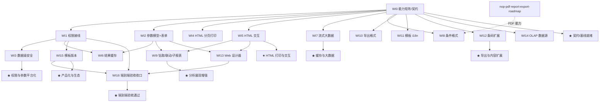

# nop-report 能力补强 Roadmap — 从报表库到平台级报表引擎

> Last updated: 2026-10-22（WI0–WI12 完成；residual 已登记）
> 位置：按仓库 roadmap 惯例存放于 ai-dev/backlog/。书写约定：未来交付物路径用普通文本书写、不加反引号；已存在的文档路径用反引号，持续受 check-doc-links 保护。
> Sources:
> - `ai-dev/analysis/2026-10/2026-10-17-nop-report-feature-gap-vs-report-engines.md`（**主输入**：源码盘点 + 25 维能力矩阵 + P0/P1/P2 补强清单）
> - `docs-for-ai/03-modules/nop-report.md`、`docs-for-ai/03-runbooks/generate-report.md`、`docs-for-ai/02-core-guides/reporting-and-notification-integration.md`（现有 owner doc / runbook）
> - 现有实现：`nop-report/nop-report-core`（`IReportEngine`/`ReportEngine`/`ExpandedSheetGenerator`/`ReportDataSet`/`ReportFunctions`/`xpt-rt.xlib`）、`nop-report/nop-report-pdf`、`nop-report/nop-report-docx`、`nop-report/nop-report-ext`、`nop-report/nop-report-service|dao|api|web`、`nop-format/nop-excel`（`_XptCellModel`/HtmlReportRendererFactory）
> - 姊妹 roadmap（**职责边界，勿重复**）：`ai-dev/backlog/nop-pdf-report-export-roadmap.md`（PDF 分页/页眉页脚/图片/图表/样式保真/装配/抽取）、`ai-dev/backlog/echarts-server-render-roadmap.md`（图表静态渲染 provider）、`ai-dev/backlog/nop-docx-document-model-roadmap.md`（Word 通用文档模型）、`ai-dev/backlog/nop-datav-roadmap.md`（D3 权限分享导出 / D5 定时报告告警 / D6 AI-ChatBI）
> - 设计文档：`ai-dev/design/nop-report/pdf-pagination.md`、`ai-dev/design/nop-report/pdf-font-strategy.md`
> - 参考素材：`~/sources/report-engines`（本次下载：开源引擎源码 + 商业引擎文档，清单见该目录 README.md）、`~/sources/bi/*`（JimuReport/SpringReport/AJ-Report/DataEase/Superset/Metabase）、`~/sources/esProc`
> - 需求来源：2026-10-17 会话——"分析 nop-report 功能，下载其他商业/开源报表引擎资料，考虑 nop-report 还有什么功能可以补充改进；下载到 ~/sources"；随后追加——"增加 roadmap"

## Purpose

本 roadmap 编排把 `nop-report` 从「一个能力完备的报表**库**」推进到「配置化、可授权、可交互、可运维的**平台级报表引擎**」，补齐商业引擎（FineReport/润乾）与开源引擎（Jasper/BIRT/UReport）共有、而 nop-report 尚缺的能力面。

覆盖六条主线：

1. **安全与参数平台化**：报表/数据源权限接线（表已存在但渲染/取数不校验）、声明式参数模型 + 查询表单、数据级行/列权限。
2. **HTML 打印与交互**：HTML 分页打印保真（页眉页脚/重复表头）、超链接/钻取/折叠/排序/响应式。
3. **缓存与大数据**：结果文件缓存端到端落地、大数据集流式渲染。
4. **分析与展现增强**：条件格式规则引擎、正式子报表/主从/联动。
5. **导出与内容能力**：非 PDF 导出格式扩展、模板 i18n、条码/二维码码制扩展。
6. **产品化与生态（可选）**：Web 可视化设计器（复用 univer/luckysheet）、OLAP/多维数据源、模板版本管理。

**范围硬边界**（改动须先改本节）：

- **保持「Excel 单元格 + 展开 + 可逆计算」模型**：不改用 Jasper/BIRT 的 band（带区）模型；模板仍是 `.xpt.xlsx`/`.xpt.xml`，一展开结果驱动全部渲染器。
- **参数/权限/缓存语义内嵌模型**：遵循 `workbook.xdef` 内嵌 model 的做法，参数与授权元数据内嵌 XPT 模型或挂接 report definition 实体；**不引入外挂 JSON settings**。产品管理类字段（模板名/分类/发布/版本/预览缓存）留模型之外。
- **PDF 能力归姊妹 roadmap**：分页打印、页眉页脚、图片/图表嵌入、样式保真、PDF 装配、结构抽取一律由 `ai-dev/backlog/nop-pdf-report-export-roadmap.md` 承担，本 roadmap 不重复；HTML 分页只在「浏览器打印」语境（WI4）落地。
- **图表渲染引擎不在本 roadmap**：静态渲染 provider 由 `echarts-server-render-roadmap.md` 负责；本 roadmap 只消费其产物。
- **Word 文档模型归姊妹 roadmap**：Word 自由段落/页眉页脚/图表混排由 `nop-docx-document-model-roadmap.md` 负责；本 roadmap 不改 docx 生成路径。
- **定时报告/告警/AI 问数归 nop-datav**：D5/D6 由 `nop-datav-roadmap.md` 承担；本 roadmap 不做调度与推送，只保证被调度时可调用的渲染/缓存接口（WI6）。
- **Web 设计器不自研表格内核**：在线表格复用 univer/luckysheet（已下载 `~/sources/report-engines/opensource/univer`、`luckysheet`），仅建设单元格属性/参数表单配置层。
- **权限复用 nop-auth**：不自建权限模型，复用角色/资源权限与 `nop-report` 既有实体 `NopReportDefinitionAuth`/`NopReportDatasourceAuth`。
- **不引 GPL/AGPL 运行时依赖**：JimuReport/DataEase/Metabase 等仅作能力对版与设计参考，不引入其代码。
- **不做移动 App、不做大屏**（大屏归 nop-datav D4）；**不做报表设计器 UI 内核替换 Excel 工作流**。

不含实现细节。每个 WI 由独立执行计划承载（`ai-dev/plans/00-plan-authoring-and-execution-guide.md`）；roadmap 就绪后可经 mission-driver draft 生成 mission config 驱动（当前未立项 mission）。

## Work Item Status

> 唯一动态状态块。勾选 = 独立 closure audit 通过（完成判定见 Cross-Cutting）；未勾选 = `todo`（无计划），起草 plan 并通过 draft review 后标注 `planned`。WI 编号全文件递增不重排；**deps 是唯一并行屏障**。每个 WI 以独立 plan 承载。

### M0 — 基线与契约固化

- [x] WI0 能力矩阵与契约固化：把 `ai-dev/analysis/2026-10/2026-10-17-nop-report-feature-gap-vs-report-engines.md` 的能力矩阵与 `~/sources/report-engines` 参考索引收敛为 docs-for-ai owner doc 增补（参数/权限/缓存/交互契约、边界、已知限制）；在 ai-dev/design/nop-report 增设「参数模型」「权限接线」「HTML 分页」设计契约草案；建立 HTML 打印/交互的视觉与行为验收基线（复用 nop-pdf roadmap 的 PNG/diff 工具链；浏览器侧用 Playwright 截图）。（Deliverable: owner doc 增补 + 设计契约草案 + 验收基线；deps: 无；Item Type: Decision + Proof）

### M1 — 安全与参数平台化

- [x] WI1 报表/数据源权限接线：在 `IReportEngine` 渲染入口与数据集取数（`UseJdbcDataSet`/`UseOrmDataSet`/`UseQueryDataSet`/`JdbcDataSet`）统一插入授权检查，消费 `NopReportDefinitionAuth`/`NopReportDatasourceAuth` + nop-auth 角色/资源权限；未授权抛 `nop.err.report.*` 并给配置指引（复用两档错误处理惯例）；覆盖「配置权限表但不接线」现状（P1-3.6-002）。（Deliverable: 授权链路 + 测试；deps: WI0；Item Type: Feature）
- [x] WI2 声明式报表参数模型 + 查询表单：引入 ReportParameterModel（name/type/label/required/default/options 来源（SQL/字典/静态）/控件类型/联动/级联），内嵌 XPT 模型或挂接 report definition；模板 `${param.xxx}` 统一取值；生成 AMIS 查询表单与后端参数校验/默认值/级联接口；参数参与缓存键（WI6）。（Deliverable: 参数模型 + 查询表单 + 测试；deps: WI0；Item Type: Feature）
- [x] WI3 数据级安全（行/列权限）：按角色/部门/当前用户注入行级过滤谓词与列级脱敏——在取数前重写 SQL/query（或 ORM 追加条件），与 WI1 授权协同；提供声明式规则（如按 `orgId`/`tenantId` 自动附加）。（Deliverable: 行级过滤 + 列级脱敏 + 测试；deps: WI1；Item Type: Feature）

### M2 — HTML 打印与交互

- [x] WI4 HTML 分页打印保真：为 html/shtml 输出增加 `@page`/分页 CSS 与分页预览容器，复用 PDF 既有 `nop.report.pdf.repeat-header-rows`/`repeat-key-columns` 语义（表头/关键列重复），实现页眉页脚占位符的 HTML 等价；`linkExpr` 例外（见 WI5）。含 headless 浏览器分页截图 golden。（Deliverable: HTML 分页打印 + 测试 + golden；deps: WI0；Item Type: Feature + Proof）
- [x] WI5 HTML 交互与响应式：`linkExpr` 渲染为超链接、报表钻取跳转、列排序/折叠、条件行/列可见；窄屏/移动响应式容器；`editorId`/`viewerId` 交互钩子落地（WI5 已渲染为 `data-editor-id`/`data-viewer-id` 属性）。（Deliverable: 交互渲染 + 响应式 + 测试；deps: WI0；Item Type: Feature）

### M3 — 缓存与大数据

- [x] WI6 结果文件缓存端到端：把 `NopReportResultFile` 接入 `IReportEngine.getRenderer`/`generateFromXptModel` 前置缓存（按「报表 + 参数 + 数据版本」键控，含 TTL/手动失效/异步生成 + 轮询下载）；缓存命中不得越权（与 WI1 授权协同）；供 nop-datav D5 调度复用。（Deliverable: 缓存链路 + 失效/越权测试；deps: WI1、WI2；Item Type: Feature）
- [x] WI7 大数据集流式渲染：数据集游标/分页 + xlsx/html 渲染侧增量写出；内存上限/背压与超限告警；大报表（长表/宽表）性能基线不回归（PDF 侧流式由姊妹 roadmap 负责）。（Deliverable: 流式数据集 + 增量渲染 + 性能基线；deps: WI0；Item Type: Feature + Proof）

### M4 — 分析与展现增强

- [x] WI8 条件格式规则引擎：把 `styleIdExpr` 扩展为声明式规则集（表达式谓词/数值区间 + 样式，首中生效），经既有 styleId 机制三端一致（pdf 为字体子集）。（Deliverable: 规则集模型 + html/xlsx 测试；deps: WI0；Item Type: Feature）
- [x] WI9 钻取/联动/子报表：定义正式 subreport / 报表片段引用与参数传递（当前仅父子层级展开，无法引用另一模板）；主报表→明细钻取与报表间联动跳转；与 WI5 交互协同。（Deliverable: 子报表/片段 + 钻取 + 测试；deps: WI2、WI5；Item Type: Feature）

### M5 — 导出与内容能力

- [x] WI10 非 PDF 导出格式扩展：新增 CSV、图片（PNG，逐页/整表）、ODS、RTF，以及原生 xlsx 图表/数据透视还原；统一注册为 renderType 走 `IReportEngine`（`XptConstants.RENDER_TYPE_*`）；PDF 高级项（加密/签名/水印/PDF-A）不在本 WI（归姊妹 roadmap）。（Deliverable: 新增 exporter + 测试；deps: WI0；Item Type: Feature）
- [x] WI11 模板 i18n：模板文本/格式/字典按 locale 切换（XPT 模型 + `XptWorkbookModel`/`XptSheetModel` 本地化层），与前端 locale 协同。（Deliverable: 模板本地化 + 测试；deps: WI0；Item Type: Feature）
- [x] WI12 条码/二维码码制扩展：在 `ReportExtFunctions.QRCODE` 基础上扩展码制（Code128/EAN-13/PDF417/GS1 等）与尺寸/纠错级配置；xlsx/html/pdf 三端一致。（Deliverable: 码制扩展 + 三端测试；deps: WI0；Item Type: Feature）

### M6 — 产品化与生态（可选）

- [ ] WI13 Web 可视化设计器（轻量）：基于 univer/luckysheet 的在线表格 + 单元格属性面板（XptCellModel 指令可视化）+ 参数表单设计器 + 预览/发布；定位「浏览器内轻量编辑」，不改写 Excel 设计工作流（与 nop-docx 在线编辑同构）。（Deliverable: 设计器 + 测试；deps: WI2、WI5；Item Type: Feature）
  - **显式裁定（2026-10-22，roadmap 执行收口）**：转为独立前端工程立项。理由：①roadmap 定位 M6「产品化与生态（可选）」；②univer/luckysheet 集成+属性面板+参数表单设计器为完整前端工程（前端集成+设计器交互+预览/发布页面），非后端能力补强，无法在以 AutoTest 为验证门的本 roadmap 执行口径内交付；③无后端阻塞——WI2 参数 schema 接口（NopReportForm）已为其提供设计器数据源。前置：前端工程立项（依赖选型 univer/luckysheet 锁版）。
- [ ] WI14 OLAP/多维数据集数据源：接入 Calcite/Mondrian 类语义层（本地参考 `~/sources/bi/calcite`）为 `xpt-rt.xlib` 增加多维数据集标签/查询改写。（Deliverable: 多维数据源 + 测试；deps: WI0；Item Type: Feature）
  - **显式裁定（2026-10-22，roadmap 执行收口）**：转为独立 backlog（依赖自建语义层能力）。理由：接入 Calcite/Mondrian 与 `ai-dev/design/self-contained-design.md` 架构支柱禁令直接冲突（外部引擎成为取数能力链的语义层引擎）；自建 OLAP 语义层为独立大型工程（前置：xlang-eql 语义层扩展立项）。数据集侧已有多维分析替代面：ReportDataSet group/sort/sum 聚合 + EQL。
- [x] WI15 模板版本管理：**裁定由 git 承担**（模板为 repo 内文件，git 即版本管理；rptText 已裁定为 VFS 路径，DB 快照/回滚为无操作且与 git 双头管理漂移——裁定记录 plan 2501）。平台保留：version 乐观锁防并发覆盖、WI6 缓存数据版本键控。（Deliverable: 架构裁定记录；deps: WI1；Item Type: Decision）

### M7 — 端到端验收与文档收口

- [ ] WI16 全链路验收与文档收口：参数化报表（WI2）+ 权限（WI1/WI3）+ HTML 分页打印（WI4）+ 缓存（WI6）+ 交互/钻取（WI5/WI9）+ 新导出格式（WI10）端到端验收；更新 owner doc（`docs-for-ai/03-modules/nop-report.md` 能力矩阵、`docs-for-ai/03-runbooks/generate-report.md` 参数/权限用法、已知限制）与 `docs-for-ai/INDEX.md` 路由、`docs-for-ai/01-repo-map/module-groups.md` 模块登记、`docs-for-ai/04-reference/source-anchors.md`；当日 ai-dev/logs 状态一致。（Deliverable: 端到端验收报告 + 文档/路由收口；deps: WI1–WI15 完成或显式裁定；Item Type: Proof）

- ★ [x] **Milestone: 契约与验收基线就绪**（WI0 完成后勾选）
- ★ [x] **Milestone: 权限与参数平台化可用**（WI1–WI3 完成后勾选）
- ★ [x] **Milestone: HTML 打印与交互可用**（WI4–WI5 完成后勾选）
- ★ [x] **Milestone: 缓存与大数据可用**（WI6–WI7 完成后勾选）
- ★ **Milestone: 分析与展现增强达标**（WI8–WI9 完成后勾选）
- ★ [x] **Milestone: 导出与内容能力扩展完成**（WI10–WI12 完成后勾选）
- ★ **Milestone: 产品化与生态增强完成**（WI13–WI15 完成或显式裁定后勾选）
- [ ] WI17 条件格式视觉编码：数据条/色阶/图标集（OOXML conditionalFormatting 写出 + html/pdf 可视化等价；视觉 golden）。deps: WI8；Item Type: Feature。（WI8 拆分产出，residual 裁定见 plan 2496）
  - **显式裁定（2026-10-22，roadmap 执行收口）**：转为独立交付立项。理由：OOXML conditionalFormatting 写出部件 + html CSS 可视化 + pdf 绘制等价 + 视觉 golden 为绘制保真量级交付（与 pdf roadmap 同级），且表达式/区间条件样式（WI8）已覆盖条件格式主场景；pdf 侧对接 pdf roadmap 绘制管线。
- ★ **Milestone: 端到端验收通过**（WI0–WI16 全部完成后勾选）

## Current Baseline（2026-10-17 核对）

**已存在（可用）：**

- **引擎与展开**：`nop-report/nop-report-core`（`IReportEngine`/`ReportEngine`、`ExpandedSheetGenerator` + `CellRowExpander`/`CellColExpander`/`CellNullExpander`/`TableExpander`）；单元格文本/批注/配置 sheet 三入口；`XptCellModel` 全指令（展开/父子层级/过滤/动态样式/链接/字典域）。
- **数据集**：`ReportDataSet` 全方法（group/where/filter/sort/sum/avg/min/max/countIf/select/map…）+ `xpt-rt.xlib` 的 `UseJdbcDataSet`/`JdbcDataSet`(流式)/`UseOrmDataSet`/`UseQueryDataSet`。
- **公式与函数**：`ExcelFormulaParser` + 约 20 个函数（`ReportFunctions`：SUM/AVERAGE/COUNT/COUNTIF/SUMIF/RANK/ACCSUM/STDEV/VAR/MEDIAN/IF/CONCAT…）。
- **渲染器**：xlsx（`XlsxReportRendererFactory`）、html（`HtmlReportRendererFactory`）、shtml（`SimpleHtmlReportRendererFactory`）、pdf（`PdfReportRendererFactory`，PDFBox 直渲）；Word 表格走 `nop-report-docx` 的 `docx-gen.xlib`（**未注册为 renderType**）。
- **图表**：`ExpandedSheetChartGenerator`（系列/轴/标题 cell ref 动态绑定）。
- **套打**：`ExcelImage.print=false` 三端一致。
- **导入模板自动生成**：`ExcelTemplateToXptModelTransformer` + `ExcelReportHelper.saveXlsxObject/downloadXlsx/getHtmlForXlsxObject`。
- **运行时实体**：`NopReportDefinition`/`NopReportDataset`/`NopReportSubDataset`/`NopReportDatasetRef`/`NopReportDatasource`/`NopReportDefinitionAuth`/`NopReportDatasourceAuth`/`NopReportResultFile`；`nop-report-web` 实体 CRUD AMIS 页面。
- **条码/二维码**：`ReportExtFunctions.QRCODE`/`QRCODE_IMAGE`（经 `IQrcodeService`）。

**主要缺口（本 roadmap 的落点）：**

- **安全**：角色级报表/数据源权限表可配置但**渲染与取数链路不校验**（P1-3.6-002）；无数据级行/列权限。
- **参数**：参数只能由应用硬塞 `IEvalScope.setLocalValues`；无参数声明、控件元数据、默认值、校验、联动、级联；无查询表单。
- **HTML**：html/shtml 为普通表格流，浏览器打印无页眉页脚/重复表头/分页控制；`linkExpr`/`editorId`/`viewerId` 仅在模型层，无渲染层交互。
- **缓存/大数据**：`NopReportResultFile` 实体存在但引擎链路未见强制使用；无流式/增量渲染。
- **展现**：条件格式仅 `styleIdExpr`（无条件规则/色阶/数据条/图标集）；无正式子报表/片段引用（仅层级展开）。
- **导出**：仅 xlsx/html/shtml/pdf（+word 表格）；无 CSV/图片/ODS/RTF。
- **内容**：无模板 i18n；条码码制有限。
- **产品化**：无 Web 设计器；无 OLAP 数据源；无模板版本管理。

## Framework / Platform Reuse

| 能力 | 提供方 | 约束 |
| --- | --- | --- |
| 报表引擎/展开 | `nop-report-core`（`IReportEngine`/`ExpandedSheetGenerator`） | 保持现状；新能力挂接，不重写展开 |
| 单元格模型 | `nop-format/nop-excel`（`_XptCellModel`/`ExcelImage`/`ExcelWorkbook`） | 指令扩展走 xdef 源，不手改 `_gen` |
| HTML 渲染 | `nop-format/nop-excel`（`HtmlReportRendererFactory`/`SimpleHtmlReportRendererFactory`） | 分页/交互在此扩展 |
| PDF 渲染 | `nop-report-pdf`（经 `nop-pdf-report-export-roadmap.md`） | 不换引擎；PDF 能力归姊妹 roadmap |
| 数据源取数 | `xpt-rt.xlib`（`UseJdbcDataSet`/`JdbcDataSet`/`UseOrmDataSet`/`UseQueryDataSet`） | 授权/行级过滤/流式在此接线 |
| 权限 | nop-auth（角色/资源权限）+ `NopReportDefinitionAuth`/`NopReportDatasourceAuth` | 复用；不自建权限模型 |
| 查询表单/页面 | nop-amis / nop-web（AMIS schema） | 参数控件与设计器复用 |
| IoC/服务 | `@BizModel`/`beans.xml`（`docs-for-ai/02-core-guides/service-layer.md`） | 遵守 Nop IoC 约定 |
| API | GraphQL/crud（`docs-for-ai/02-core-guides/api-and-graphql.md`） | 参数/权限接口走标准 BizModel |
| 缓存/审计/版本 | `NopReportResultFile` + nop-sys | 复用；不建第二套 |
| 图表静态渲染 | echarts 静态渲染 provider（`echarts-server-render-roadmap.md`） | 仅消费图片产物 |
| Word 文档模型 | `nop-report-docx` / `nop-docx-document-model-roadmap.md` | Word 增强归姊妹 roadmap |
| 在线表格内核 | `~/sources/report-engines/opensource/univer`、`luckysheet` | 复用；不自研网格 |
| 调度/告警/AI | `nop-datav-roadmap.md`（D3/D5/D6） | 不重复；只提供可调用接口 |
| 参考实现 | `~/sources/report-engines`（FineReport/润乾/UReport/Jasper/BIRT…） | 只作对版；不引 GPL/AGPL 运行时依赖 |
| 测试基座 | nop-autotest + Playwright（`nop-entropy-e2e/README.md`）+ `docs-for-ai/02-core-guides/testing.md` | HTML 截图 + 端到端 |

## Stages

| # | Stage | Owner plan | Deps | Critical path | Reuse |
| --- | --- | --- | --- | --- | --- |
| 0 | 能力矩阵与契约固化 | WI0 | — | **Yes** | nop-report owner doc |
| 1 | 报表/数据源权限接线 | WI1 | WI0 | **Yes** | nop-auth + report auth 实体 |
| 2 | 参数模型 + 查询表单 | WI2 | WI0 | **Yes** | nop-amis / nop-excel |
| 3 | 数据级安全 | WI3 | WI1 | No | 取数标签重写 |
| 4 | HTML 分页打印 | WI4 | WI0 | **Yes** | HtmlReportRendererFactory |
| 5 | HTML 交互与响应式 | WI5 | WI0 | No | HtmlReportRendererFactory |
| 6 | 结果文件缓存 | WI6 | WI1、WI2 | No | NopReportResultFile |
| 7 | 大数据集流式渲染 | WI7 | WI0 | No | 取数标签 + 渲染器 |
| 8 | 条件格式规则引擎 | WI8 | WI0 | No | XptCellModel/三渲染器 |
| 9 | 钻取/联动/子报表 | WI9 | WI2、WI5 | No | 展开引擎 + HTML |
| 10 | 非 PDF 导出格式扩展 | WI10 | WI0 | No | IReportEngine renderers |
| 11 | 模板 i18n | WI11 | WI0 | No | XptWorkbookModel |
| 12 | 条码/二维码码制扩展 | WI12 | WI0 | No | ReportExtFunctions |
| 13 | Web 可视化设计器 | WI13 | WI2、WI5 | No | univer/luckysheet + AMIS |
| 14 | OLAP/多维数据源 | WI14 | WI0 | No | xpt-rt.xlib + Calcite |
| 15 | 模板版本管理 | WI15 | WI1 | No | nop-report-service |
| 16 | 端到端验收与收口 | WI16 | WI1–WI15 | **Yes** | 全部 |
| 17 | 条件格式视觉编码 | WI17 | WI8 | No | OOXML conditionalFormatting |

## Stage Details

### WI0. 能力矩阵与契约固化
> Status: see Work Item Status above

**Goal:** 固化能力契约与验收基线，作为后续 WI 完成门。

**Deliverables:**
- analysis 能力矩阵 + `~/sources/report-engines` 参考索引收敛为 owner doc 增补。
- ai-dev/design/nop-report 增设参数/权限/HTML 分页设计契约草案。
- HTML 打印/交互验收基线（PNG/diff + Playwright 截图）。

**Out of scope:** 任何引擎功能改动。

**Module / area:** `docs-for-ai/`、`ai-dev/design/nop-report/`。

### WI1. 报表/数据源权限接线
> Status: see Work Item Status above

**Goal:** 渲染与取数链路强制校验报表/数据源角色权限。

**Deliverables:**
- `IReportEngine` 渲染入口 + 取数标签授权检查；消费 auth 实体 + nop-auth。
- 未授权错误码 + 配置指引；授权链路测试。

**Out of scope:** 行/列级数据权限（WI3）。

**Module / area:** nop-report/nop-report-core、nop-report/nop-report-service。

### WI2. 声明式参数模型 + 查询表单
> Status: see Work Item Status above

**Goal:** 模板声明参数，平台生成查询表单，模板 `${param.xxx}` 取值。

**Deliverables:**
- ReportParameterModel（类型/默认/校验/候选来源/控件/联动/级联）+ 内嵌模型。
- AMIS 查询表单 + 参数解析/校验/级联接口。

**Out of scope:** 数据级权限（WI3）、设计器（WI13）。

**Module / area:** nop-format/nop-excel、nop-report/nop-report-core、nop-report/nop-report-web。

### WI3. 数据级安全（行/列权限）
> Status: see Work Item Status above

**Goal:** 按角色/用户注入行级过滤与列级脱敏。

**Deliverables:**
- 取数前 SQL/query 重写（行级）+ 列脱敏规则。
- 声明式规则（orgId/tenantId 自动附加）+ 测试。

**Out of scope:** 报表级授权（WI1）。

**Module / area:** nop-report/nop-report-core（xpt-rt.xlib 取数路径）。

### WI4. HTML 分页打印保真
> Status: see Work Item Status above

**Goal:** 浏览器打印具备分页/页眉页脚/重复表头。

**Deliverables:**
- `@page`/分页 CSS + 分页预览；复用 PDF repeat-header/key-columns 语义。
- 页眉页脚占位符 HTML 等价；headless 截图 golden。

**Out of scope:** PDF 分页（姊妹 roadmap）。

**Module / area:** nop-format/nop-excel（HtmlReportRendererFactory）。

### WI5. HTML 交互与响应式
> Status: see Work Item Status above

**Goal:** 超链接/钻取/排序/折叠/条件可见 + 响应式。

**Deliverables:**
- `linkExpr`/`editorId`/`viewerId` 渲染落地；列排序/折叠/条件可见。
- 窄屏响应式容器 + 测试。

**Out of scope:** 条件格式样式规则（WI8）。

**Module / area:** nop-format/nop-excel。

### WI6. 结果文件缓存端到端
> Status: see Work Item Status above

**Goal:** 结果缓存可命中/失效且不越权。

**Deliverables:**
- 缓存前置 + 键控（报表+参数+数据版本）+ TTL/失效/异步下载。
- 命中/失效/越权测试。

**Out of scope:** 数据源级缓存细分策略（可并入本 WI 裁定）。

**Module / area:** nop-report/nop-report-core、nop-report/nop-report-service。

### WI7. 大数据集流式渲染
> Status: see Work Item Status above

**Goal:** 大数据集不整体入内存，渲染增量写出。

**Deliverables:**
- 数据集游标/分页 + xlsx/html 增量写出；内存上限/背压。
- 长表/宽表性能基线（不回归）。

**Out of scope:** PDF 流式（姊妹 roadmap）。

**Module / area:** nop-report/nop-report-core、nop-format/nop-excel。

### WI8. 条件格式规则引擎
> Status: see Work Item Status above

**Goal:** 声明式条件格式（含色阶/数据条/图标集），三端一致。

**Deliverables:**
- 规则模型（表达式/区间 + 样式）+ 三端渲染。
- 规则求值测试 + 视觉 golden。

**Out of scope:** PDF 样式保真底层（姊妹 roadmap）。

**Module / area:** nop-format/nop-excel、nop-report/nop-report-core。

### WI9. 钻取/联动/子报表
> Status: see Work Item Status above

**Goal:** 正式子报表/片段引用 + 主从钻取 + 报表间联动。

**Deliverables:**
- subreport/片段引用与参数传递模型 + 展开实现。
- 钻取/联动端到端测试。

**Out of scope:** 交互渲染基础（WI5）。

**Module / area:** nop-report/nop-report-core、nop-format/nop-excel。

### WI10. 非 PDF 导出格式扩展
> Status: see Work Item Status above

**Goal:** 新增 CSV/图片/ODS/RTF 与原生 xlsx 图表/透视还原。

**Deliverables:**
- 新 exporter 注册为 renderType；统一出口。
- 各格式导出测试。

**Out of scope:** PDF 高级项（姊妹 roadmap）。

**Module / area:** nop-report/nop-report-core（renderers）。

### WI11. 模板 i18n
> Status: see Work Item Status above

**Goal:** 模板文本/格式/字典按 locale 切换。

**Deliverables:**
- XPT/`XptWorkbookModel` 本地化层 + locale 解析。
- 多语言模板测试。

**Out of scope:** 前端 locale 框架（复用）。

**Module / area:** nop-format/nop-excel、nop-report/nop-report-core。

### WI12. 条码/二维码码制扩展
> Status: see Work Item Status above

**Goal:** 扩展码制与配置，三端一致。

**Deliverables:**
- 新码制（Code128/EAN-13/PDF417/GS1）+ 尺寸/纠错配置。
- 三端渲染测试。

**Out of scope:** 图表静态渲染（姊妹 roadmap）。

**Module / area:** nop-report/nop-report-ext。

### WI13. Web 可视化设计器（轻量）
> Status: see Work Item Status above

**Goal:** 浏览器内轻量在线编辑（复用 univer/luckysheet）。

**Deliverables:**
- 在线表格 + 单元格属性面板 + 参数表单设计器 + 预览/发布。
- 设计器与引擎往返测试。

**Out of scope:** 替换 Excel 工作流；不自研网格内核。

**Module / area:** nop-report/nop-report-web。

### WI14. OLAP/多维数据源
> Status: see Work Item Status above

**Goal:** 接入多维语义层为数据源。

**Deliverables:**
- `xpt-rt.xlib` 多维数据集标签 + 查询改写。
- 多维取数测试。

**Out of scope:** 内建 OLAP 引擎。

**Module / area:** nop-report/nop-report-core。

### WI15. 模板版本管理
> Status: see Work Item Status above

**Goal:** 报表定义版本/发布/差异/回滚。

**Deliverables:**
- 版本模型 + 发布/回滚 + 差异；与权限协同。
- 版本管理测试。

**Out of scope:** 代码级版本控制。

**Module / area:** nop-report/nop-report-service。

### WI16. 全链路验收与文档收口
> Status: see Work Item Status above

**Goal:** 各主线端到端验收 + 文档/路由一致。

**Deliverables:**
- 参数化/权限/HTML 打印/缓存/交互/新导出端到端验收报告。
- owner doc/INDEX/模块登记/源码锚点/日志一致。

**Out of scope:** 无。

**Module / area:** nop-report/*、docs-for-ai/。

## Dependency Graph

## Cross-Cutting（每个 WI 的完成判定）

1. **验证门**：`./mvnw test -pl <module> -am` 绿（触及多模块跑 `./mvnw clean install -T 1C`）；命令口径以 `docs-for-ai/00-start-here/project-context.md` 为准。
2. **权限红线**：任何涉及取数/渲染的 WI 必须验证「未授权不可见/不可取数」与「授权后正常」，且缓存命中不越权（WI6）。
3. **HTML 视觉/行为验收**：HTML 相关 WI 必须用 headless 浏览器（Playwright）产出打印/交互截图或 DOM 断言，禁止只看 HTML 文本。
4. **模型优先、生成物禁改**：指令/模型扩展走 xdef 源（`nop-format/nop-excel`），不手编辑 `_` 前缀与 `_gen` 生成物，经 precompile 重生成。
5. **错误处理**：两档惯例（`docs-for-ai/02-core-guides/error-handling.md`）；模块内部用模块级异常 + English 消息，公共 API 用 `NopException` + ErrorCode + `.param(...)`。
6. **模块边界**：`nop-report` 不反向依赖 nop-datav / nop-docx 的更高层；PDF/Word 增强归各自姊妹 roadmap；调度/告警/AI 归 nop-datav。
7. **许可边界**：参考实现仅对版；不引入 GPL/AGPL（JimuReport/DataEase/Metabase）运行时依赖；在线表格内核复用 MIT/Apache 的 univer/luckysheet。
8. **跨 roadmap 依赖**：WI8 的 PDF 绘制依赖 `nop-pdf-report-export-roadmap.md`；未就绪时对应 WI 只到 HTML/xlsx 侧验证，不得虚报完成。
9. **防重建**：不得在 nop-report 内重复 nop-datav 的调度/告警/大屏/AI，或 nop-docx 的 Word 文档模型，或 pdf roadmap 的 PDF 保真。

## Rules

- 本文件是状态索引与粗粒度分解，不是执行计划；每个 `planned` WI 由独立执行计划承载。
- 状态只在顶部 Work Item Status 块变更（勾选 / `planned` 标注）；Milestone 勾选是所有依赖 WI 完成后派生。
- WI 编号全文件递增，不重排；**deps 是唯一并行屏障**。
- 未启动 WI 的交付物描述不含实现步骤与复选框。
- 若需在执行中增删/排序 WI，先停止 mission 再改本文件。
