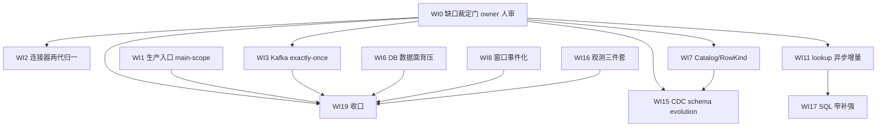

# nop-stream 五引擎对比缺口收敛 Roadmap（Flink / TDengine / Hazelcast / SeaTunnel 对标）

> Last updated: 2026-10-06（v1：立项。基于当日五方对比分析核定 P0/P1/P2 缺口与不跟进清单，吸收 `2026-10-02` SeaTunnel gap analysis 的 G1-G5 分级遗留，按价值/成本与依赖深度组织为开发序列。v2 同日：首轮独立审查 1 Blocker + 8 Major 全部修复——vision 引用改真实锚点、WI0 增 owner 人审门、WI15 挂 cdc-design defer 撤销条件、lookup join 改增量口径、F 表/H 编号去冲突、WI8 拆分、依赖图与 deps 对齐）
> 位置：按仓库 roadmap 惯例存放于 `ai-dev/backlog/`。书写约定：未来交付物路径用普通文本书写、不加反引号；已存在的文档路径用反引号，持续受 check-doc-links 保护。
> Sources:
> - `ai-dev/analysis/2026-10/2026-10-06a-nop-stream-vs-flink-tdengine-hazelcast-seatunnel-comparison.md`（缺口核定 primary；P0/P1/P2 分级与不跟进清单）
> - `ai-dev/analysis/2026-10/2026-10-02-seatunnel-core-vs-nop-stream-gap-analysis.md`（G1-G5 分级、CatalogTable 结构前置、Debezium 3.5+ 并行快照勘误）
> - `ai-dev/design/nop-stream/00-vision.md`（§四 Non-Goals 六行 + §六人审决策点 + §七裁决记录 #G36；经 WI0 唯一通道按先例回写裁决记录）
> - `ai-dev/backlog/nop-stream-productization-roadmap.md`（连接器 registry / 文档 / conf-validate 已 done；D-GAP P-REQ-15 = K8s defer + YARN/HPA exclude；main-scope 入口为 D1b Follow-up 候选；F-12..F-44 follow-up 表）
> - `ai-dev/backlog/nop-stream-cdc-roadmap.md`（Debezium 3.7 + 并行快照透传 WI1-8 全 done；schema evolution DDL 协调是 cdc-design 既有 defer，触发条件 = 首个真实需求）
> - `ai-dev/backlog/nop-stream-sql-roadmap.md`（31/31 done，含 WI14 静态维表 lookup join——WI11/WI17 的基线）
> - `ai-dev/backlog/nop-stream-flink-comparison-roadmap.md`、`ai-dev/backlog/nop-stream-r5-successors.md`（重叠排除与 successor 指针）
> - `docs-for-ai/03-modules/nop-stream-connectors.md`（8 工厂能力矩阵、legacy 冻结裁定、conf-validate/dry-run 语义——连接器面的单一事实源）

## Purpose

把五方对比确认的缺口收敛为**一条依赖有序的开发序列**，目标状态：

1. **Kafka 原生 exactly-once**（source offset 入 checkpoint + 2PC/幂等 sink）与**生产进程入口** main-scope 化，达到可对外部署的产品底线。
2. **连接器工程化**（成熟度分级 + OptionRule 参数声明 + dry-run sample）与**两代 API 归一**，使扩生态不再加深欠账。
3. **语义补强**：窗口事件化 + maxDelay 兜底出数、SUSPEND 停机语义显式化、范围重算/回补、维表 lookup 的异步增量（同步静态 lookup 已由 sql roadmap WI14 交付）。
4. **数据面与生产化外围**（DB 数据面背压归 M1 P0 主线 WI6）：对象存储 checkpoint 后端、可查询状态轻量版、CDC schema evolution 协调（须先撤销 cdc-design 既有 defer）。
5. **观测三件套**（busy/backpressured/idle 时间占比、watermark 级联 skew、边级队列填充比实时曲线）与 SQL/序列化窄补强。
6. 不跟进/已裁定项按三类归位写死（与 Rules 7 同口径）：A 类 vision §四 六行与 #G36（解禁唯一通道 = WI0，且须 owner 人审）、B 类 productization D-GAP 处置（K8s defer 维持、YARN/HPA/RuntimeTopology exclude）、C 类 analysis-scope 排除（双副本容错、SaveMode 自动建表、变更表/连续查询、滚动升级、框架级 CDC chunk 分发与 cdc-design 既有 defer 等，按各自触发条件走），防止本 roadmap 周期内反复重议。

排序原则：裁定门先行（vision 解禁与 go/defer/exclude 必须先于实现）；P0 主线（连接器与生产入口）无相互依赖且模块面不重叠，先行并行；结构前置与语义增强居中；观测与 SQL 补强依赖前置语义落地，收尾。

## Current Baseline（2026-10-06 核对）

**已具备（不进入本 roadmap）**：XDSL/Java/Delta 三入口合成 canonical `StreamModel`；4 窗口 + 8 trigger + 3 evictor + allowedLateness；完整 NFA CEP（限 Memory 后端，见 `nop-stream/README.md:22`）；真 barrier checkpoint（对齐 + unaligned + channel state + savepoint + 改并行度 reshard）；`STRICT_EXACTLY_ONCE` 与 JDBC ledger / file epoch 双 2PC sink；JDBC 租约 HA + 持久 epoch fencing（零 ZooKeeper）；Memory/RocksDB 双状态后端；BufferPool 反压；8 内建连接器工厂 + SPI registry + conf-validate/dry-run；Debezium 3.7 offset 进 checkpoint + 并行快照透传（cdc-roadmap done）；窄范围 SQL 全链含静态维表 lookup join（sql roadmap 31/31 done）；ops HTTP 健康状态机、五层指标标准集与 `nop.stream.io.channel.queue.size` 通道水位 gauge（productization items 16/32 done）。

**既有 roadmap 已收口/已登记（重叠排除）**：productization P-REQ 28 项三态全判（met×19 / pending-followup×4 / defer×3 / exclude×2）；sql roadmap done；cdc roadmap WI1-8 全 done；r5-successors 登记的 ST-12（TTL 清理仅在 checkpoint）、CON-11（2PC 整 epoch 内存无上限）、CC-06（checkpoint fan-out 阻塞）、ST-05/ST-18、CEP-05/06、AR-06/AR-08/AR-09（flow/XDSL 波次）等不重复立项；productization F-12..F-44 表不重复立项——本 roadmap 的 WI1（F-26、F-12 关注点）与 WI19（F-30/F-33/F-34/F-36 文档核对）吸收的行在 closure 时回写该表销号。

**既有硬裁定（本 roadmap 全程有效，WI0 只做确认与分类，不静默改写）**：
- **vision §四 Non-Goals 六行**：非等值/范围/广播双流 join、完整 SQL/Table 栈、PB 级大规模并行、复制 Flink Runtime 结构（不引入 Netty 网络栈等）、在线/自动 reshard、通用异步算子；**§七 #G36**：BroadcastState 永久排除；**2026-10-02 D2 收窄裁定**：窄 SQL/等值 join/静态维表 lookup 已交付（sql roadmap）。
- **productization D-GAP P-REQ-15**：K8s **defer（revisit 条件维持）**、YARN/HPA/RuntimeTopology **exclude**——K8s 不在 vision Non-Goals 内，本 roadmap 不改其 defer 状态。
- **cdc-design defer**：schema evolution DDL 协调 = defer，触发条件 = 首个真实需求，现以事件透传 + 告警 + 重同步手册兜底（`ai-dev/design/nop-stream/cdc-design.md`）——WI15 仅在 WI0 按真实需求撤销该 defer 后启动。
- **legacy 冻结裁定**（`docs-for-ai/03-modules/nop-stream-connectors.md`）：`SourceFunction` 不新增能力，debezium B 层表路由为已裁定例外——该例外的撤销/迁移归属由 WI0 裁定。
- **2PC 跨并行度 typed 拒绝（D1）**：`ERR_STREAM_2PC_SINK_PARALLELISM_CHANGE_UNSUPPORTED`（`docs-for-ai/03-modules/nop-stream-connectors.md`）——推翻须显式裁定，见 Follow-up。

**对标面事实**：nop-stream 的窗口/CEP/exactly-once 深度对 SeaTunnel 与 Hazelcast 反超；缺口集中在连接器生态工程化（8 vs ~84）、Kafka 原生 EO、生产入口（仍在 test sources）、触发-计算解耦与重算语义、观测指标三件套。

## Work Item Status

> 唯一动态状态块。勾选 = 独立 closure audit 通过（完成判定见 Cross-Cutting）。WI 编号全文件递增不重排；**deps 是唯一并行屏障**；M 编号为主题分组，不是执行顺序。每个 WI 以独立 plan 承载，写前必读 `ai-dev/plans/00-plan-authoring-and-execution-guide.md`；每个 WI = 一个 plan 的单一连贯交付面（多子交付物在描述内枚举，一次 closure audit 整体判定）。

### M0 — 裁定门（无前置，最先开工）

- [ ] WI0 五引擎对比缺口裁定（owner 人审门）：把对比分析的 P0/P1/P2 与不跟进清单逐条 go/defer/exclude 分类确认——(a) vision §四/#G36 相关（lookup 异步模式是否范围收窄解除、broadcast state go/defer/exclude）须经 owner 确认并按 §六/#G36 先例回写 `ai-dev/design/nop-stream/00-vision.md` 裁决记录；(b) productization D-GAP 处置与 cdc-design defer 维持或撤销（含 Kafka EO 与 nop-message-kafka 的边界划分、debezium B 层例外迁移范围、连接器两代归一迁移范围）（Deliverable: 裁定记录回写 `ai-dev/design/nop-stream/00-vision.md` 与对应设计文档 + 不跟进三类清单写死；deps: 无；Item Type: Decision）

### M1 — 生产化与连接器 P0 主线（各 WI 模块面不重叠，可并行）

- [ ] WI1 生产进程入口 main-scope 化：`JobCoordinatorMain`/`TaskManagerMain` 从 src/test 迁 main sources + 打包/启动脚本 + runtime pom 注释矛盾（productization F-26，F-12 provided 作用域关注点随迁核对；closure 时回写 productization F 表销号）（Deliverable: main-scope 入口可独立启动集群 + 启动文档；deps: 无；Item Type: Feature + Proof）
- [ ] WI2 连接器 API 两代归一迁移波次：按 WI0 裁定范围把存量 legacy source（message/debezium-cdc/batch-loader）迁 FLIP-27 `Source/SplitEnumerator/SourceReader`；debezium B 层表路由已裁定例外的撤销或迁移由 WI0 裁定（Deliverable: 迁移完成或显式剩余冻结清单 + 能力矩阵回归；deps: WI0；Item Type: Feature）
- [ ] WI3 Kafka 原生 exactly-once 连接器：source offset 入 checkpoint（REPLAYABLE）+ 事务/幂等 sink（复用 epoch 2PC 或 ledger 幂等），与 nop-message-kafka at-least-once 通道的适用边界写入 owner doc（Deliverable: 新连接器模块 + SPI 工厂 + kill-recover E2E 零重复；deps: WI0；Item Type: Feature）
- [ ] WI4 连接器工程化增强：registry 成熟度分级（实验/生产）+ OptionRule 式参数声明（类型/必填/敏感/校验规则进 XDSL 配置校验）+ conf-validate 增 dry-run sample 数据采样档（Deliverable: 分级与参数规则落 registry 描述符 + 校验器 + 文档；deps: 无；Item Type: Feature）
- [ ] WI5 Source 限速与倾斜感知 split 分配：rows/bytes 限速配置 + enumerator 倾斜感知分配策略（对 file/Kafka 等 split 型 source 生效，单写入者 source 如实 typed 标注不支持）（Deliverable: 限速与分配策略 + 倾斜场景测试；deps: 无；Item Type: Feature）
- [ ] WI6 DB 数据面生产者背压：DB 传输通道按 credit 式分片限流生产者（对比分析 P0-6 范围），替代无界写入——范围限定 DB 通道整形，不涉及 vision §四「复制 Flink Runtime 结构/Netty 网络栈」禁入面（Deliverable: 背压协议 + 满载测试；deps: 无；Item Type: Feature）

### M2 — 结构前置与流语义增强（P1，对齐 TDengine/Flink 子集）

- [ ] WI7 CatalogTable/RowKind 元数据抽象：含 tableId 多表标识与 INSERT/UPDATE/DELETE 变更语义的引擎级记录元数据（WI0 裁定落点：`StreamRecord` 升级 vs CDC 层消息信封），为 schema evolution 与生态 sink 前置（Deliverable: 抽象落地 + CDC 变更语义迁移 + 文档；deps: WI0；Item Type: Feature + Decision）
- [ ] WI8 窗口事件化与兜底出数（单一连贯面，子交付物：a. OPEN/CLOSE/IDLE/RESUME 窗口事件模型与外发；b. XDSL sideOutput 图级路由打通；c. maxDelay 超时强制关闭出数）（Deliverable: 三子项 + 事件时序测试；deps: 无；Item Type: Feature）
- [ ] WI9 SUSPEND/停机语义显式化：SUSPEND 期间后续数据处理选项显式化（补算 vs 跳过，IGNORE UNTREATED 类契约）并落 owner doc（Deliverable: 语义契约 + 状态机测试 + 文档；deps: 无；Item Type: Feature）
- [ ] WI10 范围重算与回补：时间范围 RECALCULATE 重放 + FILL_HISTORY 回补作业形态（复用 savepoint/restore 与 upsert sink 幂等）（Deliverable: 重算路径 E2E + 作业形态文档；deps: 无；Item Type: Feature）
- [ ] WI11 维表 lookup 异步增量：基线 = sql roadmap WI14 已 done（`ITableLookup` 桥接 + `IJdbcTemplate` 适配 + DSL 全链 + restore 缓存命中证据）；本 WI 只交付 delta——有界并发异步模式（范围以 WI0 裁定为界）+ 物化刷新策略（TTL/失效；含对比分析 P2-18 维表本地物化/lookup 缓存分层）+ 是否新增专用算子 vs 复用既有路径的形态裁定（Deliverable: 异步模式 + 刷新策略 + 形态裁定记录；deps: WI0；Item Type: Feature + Decision）
- [ ] WI12 性能组（JMH 基准先行，未达标即 exit 不实施）：水位 punctuation 节流间隔（关联 r5-successors AR-06 xpl watermark 生成器恒空——AR-06 由 r5 登记承载，本 WI 节流配置不阻塞其核销）+ 滑动窗口 frame/deduct 增量维护（或两阶段聚合）（Deliverable: 基准报告 + 达标项实现 + 收益数据；deps: 无；Item Type: Feature + Proof）

### M3 — 数据面与生产化外围

- [ ] WI13 checkpoint 对象存储后端：S3 兼容对象存储 checkpoint storage（对齐 `LocalFileCheckpointStorage`/`JdbcCheckpointStorage` 既有 SPI 形态）（Deliverable: 存储实现 + 恢复 E2E + 文档；deps: 无；Item Type: Feature）
- [ ] WI14 可查询状态轻量版：结果即状态官方模式（窗口/聚合结果落键控可查存储）+ ops REST keyed state 只读接口——不追通用 queryable state（Deliverable: 模式文档 + 查询接口 + 测试；deps: 无；Item Type: Feature + Proof）
- [ ] WI15 CDC schema evolution 协调：**前置闸门 = WI0 按"首个真实需求"触发条件撤销 cdc-design 既有 defer（owner 确认）**；协调形态（checkpoint 阻塞 vs fail-fast 二选一）随 WI0 裁定 + sink 侧 DDL 应用或显式拒绝（Deliverable: 协调协议 + DDL/拒绝路径测试 + cookbook 更新；deps: WI0 + WI7（表标识依赖）；Item Type: Feature）

### M4 — 观测与运维契约

- [ ] WI16 观测三件套：busy/backpressured/idle 时间占比指标 + watermark 级联 skew 指标 + 边级队列填充比与实时曲线——队列填充比复用既有 `nop.stream.io.channel.queue.size` gauge（productization item 32 已 done，fill% = depth/capacity 推导），不重复建设直测面（Deliverable: 指标族 + 级联 skew 测试 + owner doc 指标表更新；deps: 无；Item Type: Feature）

### M5 — SQL 与序列化补强

- [ ] WI17 SQL 窄补强（单一连贯面，子交付物：a. DISTINCT/HAVING——**显式 supersede** `ai-dev/design/nop-stream/sql-subset-and-semantics.md` 既有 DISTINCT fail-fast 钉码与 sql roadmap WI16 不支持清单；b. lookup join 接入 WI11 异步增量（同步静态 lookup 已 done，仅接增量）；c. changelog/retract 维持不做的复审裁定与终值语义文档化）——不扩完整 SQL 栈（Deliverable: SQL 能力矩阵更新 + supersession 声明 + 裁定记录；deps: WI11；Item Type: Feature + Decision）
- [ ] WI18 Avro/Schema Registry 格式层：format 层接入外部 Schema Registry + Avro 序列化（不内置 registry 服务）（Deliverable: format 插件 + 兼容测试 + 文档；deps: 无；Item Type: Feature）

### M6 — 收口

- [ ] WI19 roadmap 收口：组合 E2E（Kafka exactly-once + 窗口事件 sideOutput；lookup 异步链路如 WI11 已落地则纳入）、docs-for-ai 全面一致性核对（`docs-for-ai/03-modules/nop-stream-connectors.md` 能力矩阵 / `docs-for-ai/03-modules/nop-stream-user-guide.md` / `docs-for-ai/03-modules/nop-stream.md` 指标表——吸收 F-30/F-33/F-34/F-36 行并回写 productization F 表销号）、不跟进三类清单与 vision/D-GAP/cdc-design 裁定一致性终核、独立 closure audit（Deliverable: 收口证据 + 文档核对 + F 表销号；deps: WI0 + WI1 + WI3 + WI6 + WI8 + WI16（其余 WI 完成或显式按需/延期裁定）；Item Type: Proof）

## Follow-up Backlog

> 次级事项登记，不计入进度分母，不参与完成判定。晋级为正式 WI 时从 WI20 起顺延取号。

- **CEP × RocksDB 可用化**：现限 Memory 后端（`nop-stream/README.md:22` 自曝）；晋级条件 = 生产场景出现 CEP + 大状态诉求（Deliverable: 待触发时另立 plan；deps: 无；Item Type: Feature）。Why Not Blocking Closure：CEP 现网用例均为中小状态，Memory 后端 + checkpoint 可覆盖；晋级不随时间增加成本（状态序列化面与 r5-successors ST-05/ST-12 同域，届时一并考虑）。Successor Required: no。
- **broadcast state（对比分析 P2-19）**：vision §七 #G36 永久排除现行有效；WI0 若裁定重启，须按 #G36 先例走 owner 裁决回写 vision 后从 WI20 晋级，defer 则登记触发条件 = 出现配置分发/规则热更业务诉求。
- **message sink checkpoint 参与**：IMessageService sink 纳入 exactly-once 边界；触发条件 = 用户对平台消息通道提出丢弃零容忍诉求（现状 at-least-once 由后端承载）。
- **2PC 跨并行度恢复与 TCP 重连风暴**：前者需推翻既有 D1 typed 拒绝裁定（`ERR_STREAM_2PC_SINK_PARALLELISM_CHANGE_UNSUPPORTED`（`docs-for-ai/03-modules/nop-stream-connectors.md`），后者待现网故障证据出现；均从 WI20 起按需晋级。
- **JDBC CDC 库覆盖扩展（mysql/postgres 白名单之外）**：随客户库型诉求触发；其前置 schema evolution 协调以 WI15 为准。
- **slot/资源隔离模型（10-02 分析 G4c）**：触发条件 = 集群多租户/混部诉求出现（现单作业部署形态够用）。
- **ops Web 控制台 / 连接器 jar 动态上传 / 客户端 SDK（10-02 分析 G5）**：与 productization P-REQ-9（Web 控制台 defer 含 revisit 条件）同域，按其既有触发条件走，不在此重复立项。
- **框架级 CDC chunk 跨进程分发（10-02 分析 G2a 残余）**：cdc-design 已裁定为外围/延迟项（现以 Debezium 3.7 A 层并行快照透传兜底），按该 defer 的触发条件走。
- **滚动升级（Hazelcast 参照）**：不立项——epoch fencing + DB 租约下重启恢复成本已可接受，滚动升级收益不足。
- **r5-successors 指针**：ST-12 / ST-18 / CC-06 / CC-17 / ST-05 / CON-11 / CEP-05/06 / AR-06/AR-08/AR-09 / RD 系列仍由 `ai-dev/backlog/nop-stream-r5-successors.md` 承载，本 roadmap 不重复登记。

## Dependency Graph

（deps 为"无"的 WI——WI0/WI1/WI4/WI5/WI6/WI8/WI9/WI10/WI12/WI13/WI14/WI16/WI18——均可随时并行启动；WI12 内含 JMH 基准退出判定。deps 是唯一并行屏障，本图与各 WI 行内 deps 字段一一对应。）

## Framework / Platform Reuse

- **既有 checkpoint/状态基建**：`CheckpointedSourceFunction`、`SourceEnumeratorSnapshot`、operator state 双通道——WI3 Kafka source 与 WI2 迁移直接复用，零新协议。
- **2PC 契约**：`TwoPhaseCommitSinkFunction` + `JdbcTwoPhaseCommitSink` ledger 幂等 + file epoch/manifest——WI3 事务 sink 的复用面；WI15 协调协议挂 `CheckpointCoordinator` 既有 barrier 点。
- **SPI registry 与校验器**：`io.nop.stream.core.connector.registry` + `StreamConnectivityProber`——WI4 分级/OptionRule/sample 档的承载点，不新建注册面。
- **lookup 既有链路**：sql roadmap WI14 交付的 `ITableLookup`/`IJdbcTemplate` 与 DSL 全链——WI11 只加异步与刷新增量，WI17 只做接线。
- **savepoint/restore 与 upsert sink**：`executeWithSavepoint`/`restoreFromCheckpoint` 与 jdbc-2pc 幂等落库——WI9/WI10 的复用面。
- **ops HTTP 与指标**：`StreamOpsHttpServer` 既有 /metrics、五层指标标准集与 `nop.stream.io.channel.queue.size` gauge——WI16 指标族与 WI14 只读查询接口的挂点。
- **XDSL/xpl 体系**：`stream.xdef` 扩展面（sideOutput 路由、限速配置）+ xpl 生成器——WI8/WI5 声明面统一走 XDSL，不引第二配置体系。
- **nop-benchmark-stream**：WI12 的基准退出判定载体；delta 定制与 owner doc 体系承担全部 WI 的文档面。

## Cross-Cutting（每个 WI 的完成判定）

1. **独立 closure audit**：不同 task_id 的独立子 agent 审计通过后才勾选 Work Item Status，证据写入承载 plan（plan guide Closure Audit Rule）。
2. **WI0 人审证据**：涉及 vision §四/#G36 解禁与 cdc-design defer 撤销的裁定，必须附 owner 确认记录与 vision/设计文档回写 diff，方可勾选。
3. **端到端验证**（plan guide #22）：WI3 从 offset 恢复到跨两次运行零重复；WI8 从窗口事件发出到 sideOutput 下游消费；WI10 从 savepoint 重放到结果幂等回写；WI15 从上游 DDL 到 sink 协调完成或显式失败。
4. **接线验证**（plan guide #23）：新增指标、registry 分级、查询接口、背压协议必须断言被运行链路真实调用，防空壳（照抄 `TestStreamConnectorRegistryE2E` 模式）。
5. **无静默跳过**（plan guide #24）：能力不支持的配置（单写入者 source 开限速、无表标识的 sink 消费变更流）一律 typed fail-fast，不降级为 best-effort。
6. **owner doc 同步**：每个实施 WI 的 Phase 级 exit criteria 含 docs-for-ai 更新项（无则显式声明 No owner-doc update required）；连接器面变更同步 `docs-for-ai/03-modules/nop-stream-connectors.md` 能力矩阵（其为单一事实源）。
7. **测试范围**：`./mvnw test -pl <受影响 nop-stream 模块> -am`，跨模块面按承载 plan 固化的回归清单；文档/链接检查 `node ai-dev/tools/check-doc-links.mjs --strict` 退出码 0。

## Rules

1. 状态只在 Work Item Status 的 checkbox 通道维护，不设第二状态面；WI 编号全文件递增不重排。
2. deps 是唯一并行屏障（与依赖图一一对应）；M 编号为主题分组，不构成执行顺序约束。
3. 本 roadmap 不改写任何既有裁定文本：vision §四/#G36 的解禁、productization D-GAP 的状态变更、cdc-design defer 的撤销，唯一通道是 WI0（且须 owner 人审），裁定结果回写对应文档并在本 roadmap 留版本注记，不在 WI 描述里就地改写。
4. 实施细节（类签名、代码）不进 roadmap；每 WI 的 what/exit criteria 由承载 plan 定义。
5. 与既有 roadmap（productization / cdc / sql / r5-successors / flink-comparison）重叠的事项以既有登记为准，本 roadmap 不重复立项；WI1/WI19 对 productization F 表的吸收行须在 closure 时回写销号；发现新重叠时降级进 Follow-up Backlog。
6. WI12 性能组遵守基准先行退出路径：JMH 判定收益不足即按 Follow-up 形式登记"不做"裁定，不为完成勾选而强上实现。
7. 不跟进清单分三类管理，均经 WI0 确认写死：**A 类（vision §四/#G36）**——非等值/范围/广播 join、完整 SQL 栈、PB 级、复制 Flink Runtime（Netty/credit 式全量数据面）、在线/自动 reshard、通用异步算子、BroadcastState，解禁走 WI0 + owner 人审；**B 类（productization D-GAP）**——YARN/HPA/RuntimeTopology exclude、K8s defer（维持既有 revisit 条件，不改状态）；**C 类（analysis-scope 排除）**——双副本内存容错、SaveMode 自动建表、变更表/连续查询、框架级 CDC chunk 分发（cdc-design defer）、滚动升级。本 roadmap 周期内不得把 A/B 类静默重立项；新证据出现时先回对比分析补录再议。WI6 的 DB 通道背压是 A 类「credit 式全量跨 JVM 数据面」禁入面之外的通道整形，二者不得混淆。
