# nop-stream XDSL 声明面全功能补全与 12 场景验收 Roadmap

> Last updated: 2026-10-10（v23：WI24 E7-E8 验收套件落地（plan 2370）——E7 Table API 降级形态（TUMBLE 聚合终值 alice=25/bob=7 每 key 断言+DISTINCT 近似口径 WI9 引用+排除项钉；TestXdslScenarioE7）；E8 SeaTunnel 三例降级（1 源 4 分支 4 sink 零交叉+多表降级路由 WI20 模式+transform 级 SQL WI16 引用；TestXdslScenarioE8））
> 历史版本：2026-10-10（v22：WI23 E5-E6 验收套件落地（plan 2369）——E5 NewsTimer 降级形态（逻辑落 bean：per-key 缓冲+事件时间 timer flush；水位=源 emitWatermark 降级；TestXdslScenarioE5 FLUSH 计数断言）+ **契约事实：KeyedProcessFunction onTimer 签名用 ProcessFunction<IN,OUT>.OnTimerContext（无 getCurrentKey，flush 按注册 deadline 匹配）**；E6 AsyncIO 同步替代契约 fixture 化（TestXdslScenarioE6 DONE/TIMEOUT+容量断言））
> 历史版本：2026-10-10（v21：WI22 E3-E4 验收套件落地（plan 2368）——E3 SideOutput tap 通道归属钉（LONG=[long,word]）+ **发现 live defect：3 出边 tap vertex 吞无 tag 主路记录**（恒真 filter 对照实验实证；显式 @Disabled defect 钉+Deferred 登记+successor=引擎路由修复，登记 WI27 门禁）；E4 窗口 LEFT join 声明面 build+execute 钉（算子语义=TestEquiJoinHashSemantics 引用））
> 历史版本：2026-10-10（v20：WI21 E1-E2 验收套件落地（plan 2367）——E1 StateMachine 降级形态（per-key DFA process bean+checkpoint+双 sink filter 分流；限速=bean 内自限速；TestXdslScenarioE1：DFA 转移/告警分支/双 sink 断言）；E2 TopSpeedWindowing（global+DeltaTrigger bean（speed delta>50，DeltaTrigger.of 工厂）+TimeEvictor evictorId=time:5s+maxBy bean 聚合（aggregatorRef 需 sql provider 故 bean 面）；TestXdslScenarioE2 delta 跳变发射+maxBy 断言）；**E2 关键事实：TimeEvictor 驱逐无事件时间戳元素——source 须 collectWithTimestamp**（无 ts 元素 pane 清空零发射，对照实验实证））
> 历史版本：2026-10-10（v19：WI20 多表降级形态固化（plan 2366）——多表/tableId 声明面不新增（引擎 record 元数据=连接器职责，multi-engine R4 已交付 StreamRecord.tableId/withChangeMetadata）；降级形态固化=单表流+表标识字段 filter 路由→每 table 独立 sink（TestWi20TableTagRoutingPatternE2E 混合流零交叉断言；E8 场景归 WI24）；successor=owner 裁定 tableId 进 DSL 声明面）
> 历史版本：2026-10-10（v18：WI19 回补作业声明面落地（plan 2365）——file tailing 不做（WI0 裁定，触发条件登记 user guide：tailing 诉求→connector 工厂面扩展）；回补声明形态钉：jobTerminationMode=DRAIN 声明→env checkpoint config（TestWi19BackfillDeclaration：DRAIN/CANCEL 默认双钉）+ bounded 重放 source bean 声明面可用（TestWi19BoundedReplayDeclarationE2E）；引擎语义与幂等=multi-engine WI10 既有交付）
> 历史版本：2026-10-10（v17：WI18 BETWEEN 变通形态落地（plan 2364）——WI0(b) 维持排除项：变通模式=分流拆段+分段等值 join+union+谓词过滤（半开区间铺瓦），拓扑合法 build+边界三侧断言（TestWi18BetweenWorkaroundPattern，flow 模块）；E11/E12 全语义验收归 WI26；解除分支重启触发=owner 解除裁定回写 vision）
> 历史版本：2026-10-10（v16：WI17 异步算子默认分支落地（plan 2363）——WI0(a) 维持 Non-Goal：同步替代声明形态四要素契约（process bean 外部调用封装/有界容量 CAS 门/**超时显式降级（Future+deadline，慢调用→TIMEOUT: 降级输出）**/串行语义标注）+ 示范 E2E TestWi17SyncReplacementPatternE2E（**含超时降级钉与容量门单元钉**——本地串行模式容量门结构性不可达故单元级断言）；解除分支无需处置（Non-Goal 维持，重启触发=owner 解除裁定回写 vision）；E6 套件归 WI23）
> 历史版本：2026-10-10（v15：WI16 transform 级 SQL 裁定落地（plan 2362）——WI0(e) 执行：`<sql>` 顶层唯一约束不放宽，transform 级 SQL=Java-only（`ISqlStreamCompiler` SPI 按类型直调→parse→build，SPI 契约面锁定；形态测试 TestWi16TransformSqlJavaPath 落 sql 模块——delta=SPI 直调 vs 静态 facade 先例；E8 套件归 WI24）；user guide :289 顶层唯一约束钉引用修正（实际钉=flow TestSqlModelExpansion 双钉）；行内旧锚 :288-302 改写为 expandSqlModel :516/:521-530）
> 历史版本：2026-10-10（v14：WI15 端点属性处置落地（plan 2361）——consistencyCapability 接线为声明保真度校验（按值豁免 AT_LEAST_ONCE——xdef 默认 parse 注入故按值非存在性；声明 vs bean 实际 capability 不符 invalid-arg；合法匹配 build 通过有 Anti-退化钉；xpl 形态恒默认；source 侧默认不对称 residual 登记）；params/maxParallelism/outputType·inputType/custom params·source 维持拒绝（消息裁定口径）；linter 平行 capability 规则删除+R6 静态预检显式退役（引擎 guarantee 门+builder 声明失真维度）；两合同钉错误码迁移 not-implemented→invalid-arg）
> 历史版本：2026-10-10（v13：WI14 边级流控裁定落地（plan 2360）——四属性维持 typed 拒绝：接线三引擎级前置（声明载体/id 映射/链化语义，对抗性审查 live 查证）+ receiveWindow/packetSize 零消费点，登记引擎级 successor；拒绝面消息双侧改写（错误码保持 edge-attr-unsupported，合同账不破）；交付语映射=拒绝面回归钉+既有 TestBufferPoolWiring 消费端覆盖引用替代新背压测试）
> 历史版本：2026-10-10（v12：WI13 生命周期回调裁定落地（plan 2359）——onStart/onEnd/onError 显式记为 Java-only：runtime StreamJobEventBus 为指定接线缝（JOB_STARTED/JOB_FINISHED/JOB_FAILED 映射），但 streamCtx 类型/onStart 时机契约/本地 execute 路径总线/owner 授权四缺；声明面维持 fail-fast（NOT_IMPLEMENTED 双侧消息改写）；时机契约与「回调异常不得吞作业失败」条款落 user guide）
> 历史版本：2026-10-10（v11：WI12 五注册表族逐族处置落地（plan 2358）——`<streams>` 移除 schema 面（无消费点，parse 层拒遗留）；`<environments>` 接线（恰一档应用 deploymentMode、多环境拒绝、DISTRIBUTED×活动 checkpoint 组合拒绝）；`<requirements>` 接线（仅 TWO_PHASE_COMMIT_SINK 双向一致性 + DISTRIBUTED_EXECUTION 恒真，其余 typed reject）；`<checkpointParticipants>` 接线（id 拼写+函数携带型+bean instanceof CheckpointParticipant，xpl 形态拒绝）；`<coders>` 记 Java-only（错误码保持 NOT_IMPLEMENTED）；lint/builder 双面同步）
> 历史版本：2026-10-10（v10：WI11 sideInputs 有限维表注入声明面落地（plan 2357）——WI0(c) 裁定语义：from=Supplier bean（构建期 get() 一次物化只读快照并冻结）、to=map/filter/flatMap xpl-fn 形态（bean 形态拒绝）、sideInputs 绑定访问、broadcast 遗留默认 false typed 拒绝（毒默认记录）；七类校验前移 validateDag + lint/builder 双钉子放行；差异化判定四象限（sideInput=构建期小/静态维表、lookup=运行时大/热维表，互补共存，E11 富化主线维持 lookup）；两形态等价性 E2E + 变异探针）
> 历史版本：2026-10-09（v9：WI10 sideOutput 剩余面落地（plan 2356）——`<window lateData="tag">` 迟到数据侧输出声明面：xdef 属性 + validateSideOutputDeclarations 扩展（tag 全局唯一/宿主恰一/消费边恰一/from=宿主，全部前移 validateDag；`<window>` 是 virtual build point，tag 边从 aggregate/reduce 宿主顶点出发）+ buildWindow 接线 sideOutputLateData；`lateData=""` 经 xdef 归一化为未声明（探针实证）；主路径 tap（multi-engine WI8b）回归绿）
> 历史版本：2026-10-09（v8：WI9 内建聚合目录扩充落地（plan 2355）——maxBy（保留最大整记录）/distinct（窗口内精确 dedup 计数；WI0(d)「近似口径」措辞修正：与 SQL 面差异为作用域非精度）/composite（SqlRowAggregateSpec JSON 载体，resolver 级特判先于目录与标量解析）；topN 延后（fnId+expr 无双参槽，E10 复合断言由 composite 承担）
> 历史版本：2026-10-09（v7：WI8 早出结果落地（plan 2354）——earlyResultsPeriod 双处声明（CETT 事件时间轴，wm 先行一格机制、全量 pane fire、封顶窗端）+ 触发器槽位三面互斥（triggerId/emit=UPDATE/earlyResultsPeriod，按面计数节点覆盖合法）；Continuous 双轴参数化已由 WI5 目录交付；maxDelay 兜底已由 multi-engine WI8c 交付
> 历史版本：2026-10-09（v6：WI6 evictor 声明面放行落地（plan 2352）——evictorId 双处声明（strategy 属性/window 子元素，镜像 triggerId 形态）+ bean→count:N/time:<dur> 目录 + fire 路径 SPI 时序契约文档化；WI5 Deferred 的 trigger×evictor 组合位收口（两面正交：trigger 管.fire 时机、evictor 管 fire 路径 pane 裁剪；emit=UPDATE 与 evictorId 可共存）
> 历史版本：2026-10-09（v5：WI5 trigger 声明面放行落地（plan 2351）——注记：WI5 行的「非 DISCARDING accumulationMode 放行」半边由 D10（WI38，2026-10-08）构成（ACCUMULATING 放行接线）；ACCUMULATING_AND_RETRACTING 维持 spec-only 拒绝（D10 改判），非本 WI 解除事项，12 场景无依赖；triggerId 双处已放行（目录语法 + 组合矩阵 + 时序 E2E，矩阵表 B 行已迁表 A）
> 历史版本：2026-10-09（v4：WI0 五项触点裁定落地——(a) 异步算子维持 Non-Goal、(b) 区间 join 维持排除、(c) sideInputs broadcast 重定义为有限维表注入、(d) DISTINCT 精确口径归 `<sql>` 面 + 声明面近似口径、(e) `<sql>` 顶层唯一约束不放宽，裁定全文见 `ai-dev/design/nop-stream/00-vision.md` §六 #WI0-XDSL、承载 plan 2346；12 场景矩阵「接受降级」列 12/12 回填完毕。fail-fast 表行号漂移（2026-10-09 multi-engine/sql-enhancement 合并：sideOutput 已接线、sliding/session 参数化已交付、accumulationMode ACCUMULATING 已放行、maxDelay/emit 已接线）与锚点重钉归 WI1）
> 历史版本：2026-10-07（v3：二轮独立审查 APPROVE WITH CONDITIONS 的 2 Major + 8 Minor + 5 Nit 全修，三轮独立审查终裁 APPROVE 后按 N1–N7 做定点 tidy——transform 级 SQL WI 落地 WI0(e) 裁定（deps 补 WI0、Item Type 去 Decision）、收口 WI deps 补齐释放面 WI12–WI15、WI12 按「一次 delivery pass」拆分（五注册表族 / 三生命周期回调）、门禁 WI 增 4 条释放面 fixture 钉子、WI3 接办 R12/R13 的模型感知半边、E5 钉死默认分支并把「水位一等对象声明面」登记 Follow-up、WI20 补 WI0 逐场景目标形态引用、外部前置 WI8 行去 WI26、R5 存量基线按实测改为 1 处并注明另一策略面样例不计入、R10 注明 description 维度不进本轮 warning 面、锚点行号校正（回调 :446-450 / source :932-958 / sink :1037-1063）、WI5 补非 DISCARDING accumulationMode 放行、M3/M5 标题与 Cross-Cutting 端到端范围校正、矩阵列名改「基线（能力档）」以免与 WI 状态混淆；另修 v2 表述残留：header 场景归属、M2 标题、E3 基线判定记法、trigger 族计数）
> 位置：按仓库 roadmap 惯例存放于 `ai-dev/backlog/`。书写约定：未来交付物路径用普通文本书写、不加反引号；已存在的文档路径用反引号，持续受 check-doc-links 保护。
> Sources:
> - `ai-dev/analysis/2026-10/2026-10-06b-nop-stream-xdsl-vs-oss-stream-examples-portability.md`（缺口核定 primary：DSL 已实现面 / fail-fast 面 / 20 例三档映射）
> - `ai-dev/analysis/2026-10/2026-10-06a-nop-stream-vs-flink-tdengine-hazelcast-seatunnel-comparison.md`（五方能力对比，引擎侧缺口前提）
> - `nop-kernel/nop-xdefs/src/main/resources/_vfs/nop/schema/stream/stream.xdef`、`pattern.xdef`（XDSL schema 合同）
> - `nop-stream/nop-stream-flow/src/main/java/io/nop/stream/flow/builder/StreamModelDslBuilder.java`、`AdvancedTransforms.java`（真实执行链与 fail-fast 契约，即全部硬门锚点）
> - `docs-for-ai/03-modules/nop-stream-user-guide.md`（XDSL 章节 + 触发语义映射表）、`docs-for-ai/03-modules/nop-stream-sql.md`（SQL 纳入面/不支持清单）、`docs-for-ai/03-modules/nop-stream-connectors.md`（连接器能力矩阵）
> - `ai-dev/design/nop-stream/00-vision.md`（§三 #8 / §四 Non-Goals 六行 / §六人审决策点 / §七 #G36；解禁唯一通道 = WI0 且须 owner 人审）
> - `ai-dev/backlog/nop-stream-multi-engine-comparison-roadmap.md`（引擎侧外部前置：WI1 生产入口 / WI4 连接器参数规则化 / WI5 限速 / WI7 CatalogTable / WI8（a 窗口事件模型、b sideOutput 路由协议、c 兜底出数）/ WI10 重算 / WI11 lookup 异步 / WI15 CDC schema evolution / WI17a DISTINCT·HAVING / WI18 Avro）
> - `ai-dev/backlog/nop-stream-sql-roadmap.md`（WI14 静态维表 lookup done、WI16 DISTINCT 不支持清单——本 roadmap 的 SQL 面基线）
> - `nop-lint/docs/rule-catalog.md`、`ai-dev/tools/README.md`（检查门禁惯例：nop-lint 规则目录确定性生成 + `--check` 门禁、check-*.mjs 工具族与新工具登记义务）

## Purpose

把 XDSL 从「拓扑声明面强、窗口控制面与生态算子弱」补到「12 个外部典型样例场景全部有声明式落地路径并被单测钉住」，目标状态：

1. **窗口控制面声明化**：trigger / evictor / 早出结果 / sliding·session·global 参数化窗口（含 session 合并）全部进入声明面，解除当前 `triggerId` 双处 reject、xdef 无 evictor 面、窗口类型须 bean 三道硬门。
2. **拓扑旁路声明化**：`<sideOutput>` 图级路由（声明面接线）、`<sideInputs>` 有限维表注入、边级流控四属性、端点属性、无消费方注册表族与生命周期回调逐族处置。
3. **生态算子面的声明式表达**（受裁定与外部前置约束）：异步、多源聚合/区间谓词、持续源与回补、多表/分区键流、transform 级 SQL——每项要么补声明面，要么由 WI0 裁定的「声明式变通形态」固化验收，不留静默降级。
4. **12 场景验收套件**（E1–E12）：每场景一份 `.stream.xml` fixture + 一个单测类 + 接线与语义断言，按 2 场景一个 WI 交付，纳入 CI 门禁，含「XDSL 与 Java 双入口输出一致」钉子；另为不受场景覆盖的释放面（注册表族/回调/流控/端点属性）各留一条 fixture 回归钉子。
5. **XDSL 最佳实践检查门禁**：两层检查器（nop-lint XML 静态规则 + 模型感知 lint 子命令）覆盖 R1–R14，warn→error 两阶段消号，全仓 `.stream.xml` 零阻塞违规。
6. 裁定门前置：五项 vision/schema 触点（通用异步算子、非等值/区间 join、`<sideInputs broadcast>` 属性语义、DISTINCT SQL 口径、transform 级 SQL 是否放宽 `<sql>` 顶层唯一约束）先裁定再实现，避免用实现倒逼改裁定。

## Current Baseline（2026-10-06 核对）

**XDSL 已实现面（12 场景的既有地基）**：`keyBy`（`keyExpr` XLang 表达式）与 `union`；`<checkpoint>` 配置族（enabled/interval/timeout/minPause/processingGuarantee/storageType/storageConfig/jobId/pipelineId/jobTerminationMode）；map/flatMap/filter/reduce（bean 或内联 xpl）；参数化 `tumbling-event-time` + `duration`（ms/s/m）+ legacy 白名单（`global`/`tumbling-global`/`tumbling-event-time-1s`/`-5s`）；`allowedLateness`（strategy 与 window 节点双处，D9 已放行）；`aggregate`（bean 与 `aggregatorRef` 恰一，内建 sum/count/avg/min/max）；等值 join（`<joins>` + `joinRef`，INNER/LEFT/RIGHT/FULL；window join 限 INNER/LEFT + 参数化 duration + `timeout`）；声明式 CEP（`<patterns>` 含 `single`/`group`/7 个量词属性/`where`/`until`/`within`/`gapWithin`/`followKind`/`afterMatchSkipStrategy`/`afterMatchSkipTo`）；`custom`（customType bean）；事件时间（`watermarkStrategyBean` 或 xpl `timestampAssigner`+`watermarkGenerator`，三者至少一，`watermarkInterval=0` 逐事件已接线）；边 `FORWARD`/`HASH`+`keyExpr`；per-transform parallelism（`<window>` 为虚拟元素不可声明）；`<schemas>` 类型解析；`<sql>` 顶层生成器；Delta `x:extends`；`conf-validate`/`dry-run` 提交前校验工具族。

**「schema 有面但无执行消费方」的 fail-fast 面（代码锚点清单，逐项放行的对象）**：

| 面 | 代码锚点 | 放行归属 |
|---|---|---|
| `<sideOutput>` 节点恒拒绝 | `AdvancedTransforms.java:810-824` | WI10（协议前置 multi-engine WI8b） |
| `<sideInputs>` 注册表（含 `broadcast`）整体拒绝 | `StreamModelDslBuilder.java:425-427` | WI11（语义裁定 WI0(c)） |
| 边级 `flowControlPolicy`/`queueCapacity`/`receiveWindow`/`packetSize` 四属性 | `StreamModelDslBuilder.java:673-700`、firstDeclaredFlowControlAttr :836-848 | WI14 |
| strategy 级 `triggerId`、window 节点级 `triggerId` | `AdvancedTransforms.java:222-240`、:246-255 | WI5 |
| 非 DISCARDING 的 `accumulationMode` | `AdvancedTransforms.java:233-239` | WI5 |
| `<window>` 上的 `parallelism`（虚拟元素） | `AdvancedTransforms.java:181-189` | 保持拒绝（Rule 9 只做静态诊断） |
| `windowFnId` 白名单外取值（sliding/session 等须 bean） | `AdvancedTransforms.java:295-299` | WI7 |
| `HASH` 边指向 keyBy/union/join 与 `REBALANCE`/`BROADCAST` 分区 | `StreamModelDslBuilder.java:686/694/704/712` | 保持拒绝（Rule 9 只做静态诊断） |
| `<streams>`/`<environments>`/`<requirements>`/`<checkpointParticipants>`/`<coders>` 五注册表 | `StreamModelDslBuilder.java:419-460` | WI12 |
| `onStart`/`onEnd`/`onError` 生命周期回调 | `StreamModelDslBuilder.java:446-450` | WI13 |
| source 的 `params`/`maxParallelism`/`outputType`/`consistencyCapability` | `StreamModelDslBuilder.java:932-958` | WI15 |
| sink 的 `params`/`maxParallelism`/`inputType`/`consistencyCapability` | `StreamModelDslBuilder.java:1037-1063` | WI15 |
| `<custom>` 的 `params` 与 `<source>` 体 | `AdvancedTransforms.java:707-727` | WI15 |

全部为构建期 typed fail-fast（`ERR_STREAM_NOT_IMPLEMENTED`/`ERR_STREAM_WINDOW_ATTR_UNSUPPORTED`/`ERR_STREAM_EDGE_*` 等），无静默降级。WI1 负责把本清单固化为 owner doc 支持矩阵 + 每类钉子测试，作为后续放行的唯一底账。**（WI1 已落地，2026-10-09）**：上表为 2026-10-06 快照，行号已随 multi-engine/sql-enhancement 合并漂移，且 sideOutput（multi-engine WI8b 接线）、sliding/session 参数化（sql WI26）、ACCUMULATING（WI38/D10）、maxDelay（WI8c）、emit 两档（WI37/D11）已放行——live 台账以 `docs-for-ai/03-modules/nop-stream-user-guide.md` 「声明面支持矩阵（WI1 契约基线）」两表为准（表 A 已实现面 / 表 B fail-fast 面含锚点、钉子测试与放行归属），后续放行以该矩阵为单一事实源，本表不再逐行维护。

**既有硬裁定（本 roadmap 全程有效）**：vision §四 Non-Goals 六行（非等值/范围/广播双流 join、完整 SQL 栈、PB 级、复制 Flink Runtime/Netty、在线自动 reshard、通用异步算子）+ §六人审决策点 + §七 #G36（BroadcastState 永久排除）+ 2026-10-02 D2 收窄（窄 SQL 与等值 join 已交付）；`docs-for-ai/03-modules/nop-stream-sql.md` 不支持清单（DISTINCT 聚合、ORDER BY/LIMIT、CASE/CAST、HAVING/CTE、全局聚合、非等值 join、TIMESTAMP 列绑定）；connectors legacy 冻结裁定；2PC 跨并行度 typed 拒绝。

**检查门禁现状**：`ai-dev/tools/` 24 个 `check-*.mjs`（+ 生成器与辅助脚本；README Tool Index 登记 12 个）；`nop-lint` 平台规则 70 条（65 Java + 5 XML，XML 侧已有 `nop-bean-naming` 作用于 `beans.xml`、`nop-orm-*` 作用于模型 XML），规则目录 `nop-lint/docs/rule-catalog.md` 由 `ai-dev/tools/gen-lint-rule-catalog.mjs` 确定性生成并有 `--check` 门禁（新增规则必须登记并再生成），规则条数另有两处硬编码 census 断言（`TestProductionRuleCount`、`TestNopRuleSuites.EXPECTED_RULE_IDS`）。`.stream.xml` 已被 nop-lint 目标扫描覆盖（按末段扩展名归入 xml），但无任何 XDSL 专属规则；模型感知检查只有 `conf-validate`/`dry-run`（构建期校验/连通性探测，不含最佳实践预检）。

**检查规则存量命中基线（2026-10-06 实扫 37 份仓内 `.stream.xml`，全部 warning 级，不阻塞）**：R5 = 1（`test-param-agg.stream.xml` 用 `<window>` 无水位节点；另一份 `wi21-registry-wiring.stream.xml` 只声明 `windowingStrategies` 注册表而无 `<window>`/`<cep>` 节点，按现行信号不计入）；R7 = 0；R8 = 0；R9 = 0；R10 = 16（8 个非 kebab-case id：`deltaFilter`/`deltaLayerMap`/`intSrc`/`sL`/`sR`/`srcL`/`srcR`/`wi19DropB` + 8 处未命名 `<source>`/`<sink>`；`description` 维度本轮不进 warning 面——仓内 141 个 transform 元素 0 命中，全部转正后再分档）；R11 = 5（by-design 负控夹具：`test-loc-bad-edge`、`test-loc-parse-error`、`test-loc-bad-source-config`、`test-delta-failfast-extends`、`fraud-conf-validate-bad-edge`）；R12 = 2（同负控夹具）。WI4 消号台账以本基线为起点。

**外部前置（不在本 roadmap 内实现，见「外部前置」节）**：限速（multi-engine WI5）、连接器参数规则化（multi-engine WI4）、CatalogTable/RowKind（multi-engine WI7）、窗口事件模型 + sideOutput 路由协议 + 兜底出数（multi-engine WI8 子项 a/b/c）、重算/FILL_HISTORY 引擎语义（multi-engine WI10）、维表 lookup 异步增量（multi-engine WI11）、CDC schema evolution（multi-engine WI15）、Avro/coders（multi-engine WI18）、SQL DISTINCT·HAVING 精确面（multi-engine WI17 子项 a）、生产进程入口（multi-engine WI1）；静态维表 lookup 与 DISTINCT 钉码（sql roadmap WI14/WI16 done）。

## 12 场景验收矩阵（E1–E12）

> 验收唯一口径。来源列为 `2026-10-06b` 报告的样例编号（覆盖其全部 20 个条目）；「基线（能力档）」列是能力档记法（✅/⚠️/❌），非工作项状态面。「接受降级」列只在 WI0 裁定后回填；未裁定前一律 `待裁定`，禁止实现期自行降级。

| 场景 | 来源 | 核心语义 | 需要的声明面 | 验收测试（fixture + 单测） | 基线（能力档） | 接受降级（WI0 裁定） |
|---|---|---|---|---|---|---|
| **E1** | Flink StateMachineExample | per-key DFA + keyed state + checkpoint + 双 sink + 源限速 | 既有 `<process>` bean 承载状态；`<checkpoint>` 已有；限速属外部前置（multi-engine WI5） | xdsl-e1-statemachine.stream.xml + TestXdslScenarioE1：DFA 状态转移/告警分支/双 sink 输出/checkpoint 恢复断言 | ⚠️ 可移植（限速降级为 bean 内自限速） | 限速降级为 bean 内自限速（引擎侧 SourceRateLimiter 已由 multi-engine WI5 交付，XDSL 限速声明面属 Follow-up，fixture 不依赖）（WI0，2026-10-09） |
| **E2** | Flink TopSpeedWindowing | GlobalWindows + DeltaTrigger + TimeEvictor + maxBy | **WI5** trigger 面 + **WI6** evictor 面 + **WI7** global 参数化 + **WI9** topN/maxBy 聚合 | xdsl-e2-topspeed.stream.xml + TestXdslScenarioE2：跨 50m delta 的发射序列逐条断言 + evictor 物理驱逐断言 | ⚠️ 核心被 trigger/evictor 硬门挡住 | 无降级——trigger/evictor/参数化 global 由 WI5/WI6/WI7 交付（WI0，2026-10-09） |
| **E3** | Flink SideOutputExample | 分流侧输出 + 5s 滚动窗口 sum + 双 sink | **WI10** sideOutput 声明面接线（路由协议外部前置 multi-engine WI8 子项 b） | xdsl-e3-sideoutput.stream.xml + TestXdslScenarioE3：长词进侧输出下游顶点、短词进窗口聚合的分区归属断言 | ✅→⚠️ 套件待 WI22 | 无降级——sideOutput tap 已由 multi-engine WI8b 接线、lateData 声明面已由 WI10/plan 2356 交付（E2E TestLateDataSideOutputE2E），场景套件归 WI22（2026-10-09） |
| **E4** | Flink WindowJoin | 双流事件时间窗口等值 join | 既有 `<joins>` + 参数化 window join + `timeout` | xdsl-e4-windowjoin.stream.xml + TestXdslScenarioE4：匹配对即时发射 + outer 补齐在 watermark + 边界寿命 | ✅ 已可移植（补 fixture + 测试固化） | 无需降级 |
| **E5** | Flink CountNewsClicks + CountSales | keyed state + 事件时间 timer + 迟到缓冲 + 水位一等对象处理 | `process` bean 承载 state/timer；水位策略 bean；显式水位处理属 Java 面（声明降级） | xdsl-e5-newstimer.stream.xml + TestXdslScenarioE5：预发布点击缓冲、publishTime+1h 定时器 flush、idleness 恢复 | ⚠️ 可移植（逻辑落 bean） | 默认分支（逻辑落 bean，E5 fixture 钉死）；水位一等对象声明面登记 Follow-up，WI0 不另设触点 |
| **E6** | Flink AsyncIOExample | 异步 I/O ordered/unordered + capacity + timeout | **WI17**（默认分支：同步替代声明形态 + 容量/超时契约；解除分支：async 声明面） | xdsl-e6-async.stream.xml + TestXdslScenarioE6：capacity 排队上界 + timeout 语义 + 顺序/乱序完成断言 | ❌ 两端缺（vision §四异步算子） | WI0(a) 维持 Non-Goal——同步替代声明形态（process bean 承载外部调用 + 有界容量/超时行为契约 + 显式串行语义标注）（WI0，2026-10-09） |
| **E7** | Flink Table API 集（UpdatingTopCity / TemporalJoin / StreamWindowSQL） | retraction 物化 + LATERAL LIMIT TopN + `FOR SYSTEM_TIME` 时态 join + `COUNT(DISTINCT)` | **WI9** 聚合目录（DISTINCT 近似口径）；精确 SQL 面归外部前置 multi-engine WI17 子项 a；时态 join 属 vision §四排除项 | xdsl-e7-tablesql.stream.xml + TestXdslScenarioE7：TUMBLE 聚合终值断言 + DISTINCT 近似口径断言 + 不支持项 typed fail-fast 断言 | ❌→⚠️ 子集可移植（retraction 受 D1 终值语义约束 / 时态 join 不做） | 子集——retraction 受终值语义约束（断言窗口终值）；时态 join 不做（边界 = D2 静态维表边界——版本化维表不属静态维表——叠加 §四双流 Join 排除）；DISTINCT 走「SQL 精确口径（WI17a 已交付）+ 声明面近似口径（WI9）」双轨；不支持项 typed fail-fast 断言保留（WI0，2026-10-09） |
| **E8** | SeaTunnel 三例（多表 SQL transform / 四路 embedding fan-out / 多表多 sink 断言） | 多表路由 + transform 级 SQL + 四路并行分支 + 多 sink | **WI20** 多表面 + **WI16** transform 级 SQL 形态 + 既有 fan-out/multi-sink | xdsl-e8-seatunnel-multi.stream.xml + TestXdslScenarioE8：1 源 4 分支 4 sink 断言 + 多表降级形态断言 | ⚠️ 多表需 CatalogTable 外部前置 | 多表目标形态 = WI20 声明面（CatalogTable/RowKind 前置已由 multi-engine WI7 交付），「单表 + 表标识字段」为声明面不可用时的显式降级形态；transform 级 SQL 走 Java 编译产物形态（WI0(e) 维持 `<sql>` 顶层唯一约束）（WI0，2026-10-09） |
| **E9** | TDengine avg_current_stream + 触发词表 | sliding + MAX_DELAY 早出 + PARTITION BY 分区 + FILL_HISTORY 回补 + STREAM_OPTIONS 族 | **WI7** sliding 参数化 + **WI8** 早出结果 + **WI20** 分区多表 + **WI19** 回补 | xdsl-e9-tdengine-window.stream.xml + TestXdslScenarioE9：滑窗重叠发射序列 + MAX_DELAY 早出时刻 + 回补重算幂等断言 | ⚠️ 四要素拆解后分层可移植 | STREAM_OPTIONS 取子集——WATERMARK(d)≈水位策略、MAX_DELAY≈maxDelay（已接线）、迟到丢弃≈allowedLateness；IGNORE_DISORDER/DELETE_RECALC/ROLLUP BY/NOTIFY/EXPIRED_TIME/PRE_FILTER 等不做（边界 = §四「SQL API」Non-Goal 方言全覆盖排除，触发条件 = 真实 TDengine 方言诉求出现时重启裁定）；FILL_HISTORY 走 WI19 回补声明面（WI0，2026-10-09） |
| **E10** | Hazelcast TopNStocks + SessionWindow | 两级窗口（sliding→tumbling）+ 复合 topN 聚合 + session 窗口合并 | **WI7** 参数化 + session 合并 + **WI9** 复合聚合/topN | xdsl-e10-hazelcast-window.stream.xml + TestXdslScenarioE10：两级窗口滑移对齐约束 + 复合聚合多指标断言 + session 合并断言 | ⚠️ 可移植（复合聚合仍需 bean 或目录化） | 无降级——sliding 参数化已由 sql roadmap WI26 交付 XDSL 面（2026-10-09 核实）；session 合并接线与 global 参数化仍归 WI7；复合聚合由 WI9 补（WI0，2026-10-09） |
| **E11** | Hazelcast TransactionTracking + Enrichment | CEP TTL 超时 + 维表 lookup ×3 策略 + N 路批源 hashJoin + 异步 gRPC | 既有 CEP `<patterns>`（`within` 覆盖超时）+ **WI11** 有限维表注入 + **WI18** 多源聚合变通 + **WI17** 异步 | xdsl-e11-enrichment.stream.xml + TestXdslScenarioE11：START/END 配对与超时分支 + 维表富化等价性 + N 路变通形态断言 | ⚠️/❌ 混合（N 路 hashJoin 与异步缺） | N 路 hashJoin 走 union + 两路 join 变通（WI18 默认分支）；异步 gRPC 走同步替代（WI17 默认分支，WI0(a)）；维表富化走既有 lookup 形态（sql WI14 + multi-engine WI11 已交付）（WI0，2026-10-09） |
| **E12** | Hazelcast TradingVolumeOverTime + AccessLogStreamAnalyzer + SQL streaming | 早出部分结果 + tail 文件源 + `IMPOSE_ORDER`/`HOP`/时序 `BETWEEN` join | **WI8** 早出 + **WI19** 持续源与回补（按裁定）+ **WI18** 区间谓词（默认不做，变通） | xdsl-e12-early-tail.stream.xml + TestXdslScenarioE12：early-results 周期发射 + 乱序下部分结果断言 + tail 裁定形态断言 | ❌→⚠️ 早出缺、tail 与区间 join 缺；`CREATE JOB`/`SINK INTO` 生命周期与物化视图不属 XDSL 范围（见 Follow-up） | 早出由 WI8 交付；tail 源 **WI0 裁定不做**（触发条件 = 日志 tail 类场景真实诉求出现，Follow-up 已登记）→ WI19 落地 bounded 重放 + DRAIN 变通；`BETWEEN` 时序 join 走事件时间过滤变通（WI18 默认分支）；`CREATE JOB`/`SINK INTO` 不属 XDSL（Follow-up 已登记）（WI0，2026-10-09） |

## XDSL 最佳实践检查规则集（R1–R14）

> 检查门禁两层落点：**L1 = nop-lint XML 规则**（`nop/xdsl-*`，静态声明面，规则目录再生成受 `--check` 门禁）；**L2 = 模型感知 lint**（`StreamMaintenanceMain lint` 子命令，复用 `conf-validate`/`dry-run` 的构建期校验链，需 StreamModel 解析与类型信息）。上线 severity 一律 warning（Rule 4 两阶段），目标 severity 为消号后形态；存量命中见 Current Baseline 基线行。

| 规则 | 内容 | 层 | 上线 → 目标 severity | 可机械判定信号 |
|---|---|---|---|---|
| R1 | **作业模型**（`.stream.xml`）层的一致性：不得声明无执行消费方元素、不得依赖 test-scope 声明面；「生产进程入口」属 multi-engine WI1 范畴，本规则只覆盖模型层 | L2 | warning → error | 模型含无消费方元素即违规（test-scope 进程入口不在本规则范围） |
| R2 | 声明式优先：能用声明面表达的逻辑不得退化为 bean；bean 只允许承载状态/定时器/外部 IO | L2 | warning | 可声明面（窗口/join/CEP/聚合/限速等）与 bean 使用点交叉比对 |
| R3 | 状态归属：有状态逻辑必须落 `<process>` bean 或 CEP；声明面不得隐式持有状态；bean 状态读写须有 checkpoint 断言（Anti-Hollow） | L2 | warning → error | 声明面无状态 API（结构性满足）+ 测试侧断言存在性（CI 校验） |
| R4 | 类型声明：使用 `<window>`/`<aggregate>`/`<join>` 且未声明 `<schemas>` 即违规；解析后 out-type 为 `UnknownTypeInformation` 亦违规（join/custom/cep 现状默认落该形态，属存量命中） | L2 | warning | 静态面：`<schemas>` 缺失；运行面：out-type 类型解析结果 |
| R5 | 事件时间：使用 `<window>`/`<cep>` 必须声明 `timestampsAndWatermarks`（CEP 缺水位由构建期 WARN 升 error）；水位策略须显式声明乱序容忍/idleness | L1+L2 | warning → error | 模型含 `<window>`/`<cep>` 且无 `timestampsAndWatermarks` 节点（存量 1 处） |
| R6 | 幂等组合：声明 `STRICT_EXACTLY_ONCE` 时静态预检 REPLAYABLE source + 2PC sink 组合（引擎侧 validator 保留为最终关卡） | L2 | warning → error | 端点 capability 声明 vs `<checkpoint processingGuarantee>` |
| R7 | 凭据与敏感：连接器配置中的口令/密钥必须 `credential:{id}#{field}` 引用，禁止明文 | L1 | warning → error | 属性值匹配明文口令模式（存量 0） |
| R8 | Delta 化：变体作业须 `x:extends` 派生而非复制拓扑；派生文件不得整体重写父拓扑 | L1 | warning | 与父模型 fingerprint/拓扑重复度比对（存量 0） |
| R9 | 并行度与边：`parallelism` 不得声明在 `<window>`；HASH 边不得指向 keyBy/union/join；REBALANCE/BROADCAST 声明须有消费方。**L1 只为更早定位，最终关卡仍是构建期 validateEdgeDeclarations 与 conf-validate，不建第二套语义**（存量 0） | L1 | warning → error | 静态扫描 + 构建期校验双证 |
| R10 | 命名与文档：transform id 用 kebab-case 语义命名（不含物理表名/环境名）；source/sink 须命名；关键节点须有 `description`（存量 16） | L1 | warning | id 形态正则 + 必填属性缺失 |
| R11 | 提交前可验证：作业模型须能通过 `conf-validate` 与 `dry-run`（检查器串联两命令为 CI 步骤）；**by-design 负控夹具登记白名单后方可达 error**（白名单化归 WI4 消号台账，存量 5） | L2 | warning → error | 两命令退出码 + 负控夹具白名单 |
| R12 | 无声明无消费：模型不得声明无执行消费方元素（随 WI5–WI16 放行逐项转正；存量 2 为负控夹具） | L1+L2 | warning → info | 与构建期 fail-fast 面清单同源比对 |
| R13 | 测试接线：已登记场景（E1–E12）的 fixture 必须在场景注册表内且有对应单测；修改 fixture 必须同步测试 | CI+L2（WI2 裁定：L1 单文件 AST 无文件路径/注册表信号，原 L1 半边随 WI21 注册表落地以仓扫 check 工具实现） | warning → error | fixture 清单 ↔ 测试类注册表双向比对 |
| R14 | 平台复用：静态维表必须走 `IJdbcTemplate`/`IBatchLoader` 而非自建数据源；checkpoint/凭据/消息复用平台设施（依据 `ai-dev/design/nop-stream/00-vision.md` §三 #8 与 §十，以及 sql-subset-and-semantics 承袭该两条的裁定） | L2 | warning | 维表接线形态（bean 类型声明 + 自建连接检测） |

## Work Item Status

> 唯一动态状态块。勾选 = 独立 closure audit 通过（完成判定见 Cross-Cutting）。WI 编号全文件递增不重排；**deps 是唯一并行屏障**；M 编号为主题分组，不是执行顺序。每个 WI 以独立 plan 承载（写前必读 `ai-dev/plans/00-plan-authoring-and-execution-guide.md`），规模以「一次 delivery pass = 一个 plan」为准；超出则拆 WI。

### M0 — 裁定门（无前置，最先开工）

- [x] WI0 五项触点裁定（owner 人审门；2026-10-09 按 vision §六 WI0b 先例委托模式裁定，五项全默认方向，见 plan 2346 与 vision #WI0-XDSL）：逐场景确认 E1–E12 的目标形态与「接受降级」判定，并逐项裁定——(a) 通用异步算子（E6/E11 gRPC，vision §四 Non-Goal）；(b) 非等值/区间 join（E11/E12 `BETWEEN`，vision §四 排除项）；(c) `<sideInputs broadcast>` 属性语义重定义为「有限维表注入方式」而非流式广播（守 §七 #G36）；(d) DISTINCT SQL 面——精确口径已由外部前置 multi-engine WI17 子项 a 承接，本 roadmap 只裁「近似口径文档化 or 另立精确口径」；(e) transform 级 SQL 是否放宽 `<sql>` 顶层唯一约束（`StreamModelDslBuilder.java:288-302` 现为构建期拒绝）。本裁定是 (a)–(e) 的唯一授权通道，实现 WI 不得自行裁定（Deliverable: 裁定记录回写 `ai-dev/design/nop-stream/00-vision.md` 与对应设计文档 + 本 roadmap 12 场景矩阵「接受降级（WI0 裁定）」列逐行回填；deps: 无；Item Type: Decision）

### M1 — 契约基线与检查门（先行，后续放行的唯一权威底账）

- [x] WI1 声明面-消费方契约清单与 fail-fast 钉子基线（2026-10-09，plan 2347：9 钉补齐 + user-guide 声明面支持矩阵两表 + Baseline 指针移交；audit agent_dc5c2a79 APPROVE）：把 Current Baseline 的 fail-fast 锚点表与已实现面固化为 owner doc 清单（XDSL 章节新增「声明面支持矩阵」），每类 fail-fast 补一个构建期钉子测试，作为后续逐项放行的唯一底账（Deliverable: 清单落 `docs-for-ai/03-modules/nop-stream-user-guide.md` + 钉子测试套件；deps: 无；Item Type: Proof）
- [x] WI2 XDSL 最佳实践检查第一层（2026-10-09，plan 2348：6 条 nop-xdsl-* 规则 + suite 正控 + census 76 + 存量试扫对表零偏差；R13 L1 半边裁定移交 WI21 仓扫工具；audit agent_c3314554 APPROVE）（nop-lint XML 规则集：R5 水位声明 / R7 凭据明文 / R8 Delta 化 / R9 并行度与边 / R10 命名与描述 / R12 无声明无消费 / R13 测试接线静态面）：`nop/xdsl-*` 规则 + 规则单测 + **两处硬编码 census 断言同步**（TestProductionRuleCount 条数、TestNopRuleSuites.EXPECTED_RULE_IDS）+ `gen-lint-rule-catalog.mjs` 再生成过 `--check` 门禁；确认规则能匹配 XDSL 节点族（`<window>`/`<edge>`/`<joinSpec>` 等，`.stream.xml` 已按末段扩展名归入 xml 扫描）（Deliverable: 规则集 + 单测 + census 同步 + 目录再生成；deps: WI1；Item Type: Feature + Proof）
- [x] WI3 XDSL 最佳实践检查第二层（2026-10-09，plan 2349：StreamModelLinter 9 规则面 + lint 子命令三档退出码 + R6/R13/R14 显式 SKIP；首轮 audit REJECT 的错误码渲染 Major 修复后定点复审 APPROVE）（模型感知 lint 子命令：R1 模型层一致性 / R2 声明式优先退化提示 / R3 状态归属 / R4 类型声明 / R5 水位供给 / R6 幂等组合预检 / R11 串联 conf-validate+dry-run / R14 平台复用 / R12 与 R13 的模型感知半边（fail-fast 面同源比对 + 场景注册表双向比对））：`StreamMaintenanceMain lint` 子命令（沿用既有子命令形态与退出码 0/1/2），复用构建期 StreamModel 解析链，错误面复用既有 `nop.err.stream.*` 码（零新增码，对齐 sql roadmap §4d 纪律）（Deliverable: 子命令 + 规则实现 + 单测 + 运维文档；deps: WI1；Item Type: Feature）
- [x] WI4 检查门禁接线与存量基线梯度（2026-10-09，plan 2350：L1 compliance 作业 + baseline 24 entries 只减不增、L2 TestXdslCorpusLintGate 仓扫白名单门禁（双向防漂移）、消号台账落 user-guide；audit agent_82978a3d APPROVE）：CI 接线（lint 子命令 + nop-lint 规则两道）+ 存量 `.stream.xml` 全量扫描 + warn→error 两阶段基线登记（以 Current Baseline 基线行为起点，负控夹具白名单化归本 WI）（Deliverable: CI 配置 + 存量违规清单（含负控白名单）+ 消号台账；deps: WI2 + WI3；Item Type: Feature + Proof）

### M2 — 窗口控制面声明化（E2/E9/E10 的核心硬门）

- [x] WI5 trigger 声明面放行（2026-10-09，plan 2351：triggerId 双处放行——resolveTrigger 目录语法+bean 优先、节点覆盖 strategy、UPDATE 互斥、canMerge×session 拒绝；时序 E2E [3,10] 判别；A&R 半边由 D10 构成且维持 spec-only（v5 注记）；audit agent_204dac58 APPROVE）：strategy 与 window 节点的 `triggerId` 接线 + 非 DISCARDING `accumulationMode` 放行（放行即删对应 fail-fast 钉子测试改放行断言）+ trigger 目录解析（9 个具体 trigger 族 × 适用域）+ 与 CEP/allowedLateness/accumulationMode/evictor 的组合合法性矩阵（Deliverable: 声明面 + 目录 + 组合校验 + 时序测试；deps: WI1；Item Type: Feature）
- [x] WI6 evictor 声明面（2026-10-09，plan 2352：evictorId 双处声明（xdef+再生成恰 2 _gen 文件）+ resolveEvictor 目录（bean/count:N/time:<dur>）+ 物理驱逐 E2E [1,3,5,7] + SPI 时序契约文档化 + WI5 trigger×evictor Deferred 收口（v6 注记）；audit agent_c8f204c6 APPROVE）：evictorId 声明 + evictor 目录（Count/Time/Delta）+ 既有 SPI 时序契约（`evictBefore`/`evictAfter` 参数语义、元素时间戳按元素自身事件时间、`GlobalWindows` 下窗口状态有界）在声明面上的显式化（不新增 SPI 参数）+ 与 allowedLateness/accumulationMode 组合校验（Deliverable: 声明面 + 目录 + 驱逐生命周期断言（照抄 TestEvictorStateLifecycle 钉定面）；deps: WI5；Item Type: Feature）
- [x] WI7 窗口类型参数化与 session 合并接线（2026-10-09，plan 2353 收口剩余面：XDSL 声明路径 session 合并判别 E2E [85,200] + lateness 交互钉 [85,125,200]（两硬约束落实）+ legacy 白名单冻结/global 面说明；参数化与合并消费为 sql WI26 与既有算子链前置交付；audit agent_d9eecc3f APPROVE）：参数化 id 扩容到 sliding/session/global（duration 语义对齐外部 HOP/SESSION 口径）+ `MergingWindowAssigner` 消费（合并回调契约 + 合并与 allowedLateness 交互）+ legacy 白名单 id 兼容面显式化（Deliverable: 参数化目录 + 合并接线 + 滑窗重叠/会话合并测试；deps: WI1；Item Type: Feature）
- [x] WI8 早出结果与连续触发参数化（2026-10-09，plan 2354 收口剩余面：earlyResultsPeriod 双处声明（CETT 事件时间轴，wm 先行一格机制）+ 触发器槽位三面互斥（triggerId/emit=UPDATE/earlyResultsPeriod）+ 判别 E2E 六 fire 序列 + 反事实独立钉；Continuous 双轴=WI5 目录交付、maxDelay=multi-engine WI8c 交付；audit agent_66c31180 APPROVE）：`earlyResultsPeriod` 声明 + Continuous 触发族参数化（事件时间/处理时间两轴）+ 早出与迟到/allowedLateness 的交互契约（兜底出数引擎语义外部前置 multi-engine WI8 子项 c；本 WI 只做声明面与参数校验）（Deliverable: 声明面 + 周期发射时序测试；deps: WI5；Item Type: Feature）
- [x] WI9 内建聚合目录扩充（2026-10-09，plan 2355：maxBy/distinct/composite 三 fnId 落目录与 resolver 特判 + DISTINCT 双口径文档修正（窗口内精确 dedup，作用域非精度）+ pin 测试两层改写；topN 延后（双参槽缺失，E10 由 composite 承担）；audit agent_ceb76d45 APPROVE）：topN/maxBy + 复合聚合（多指标）+ distinct 计数近似口径（精确 SQL 面归 multi-engine WI17 子项 a；近似口径按 WI0(d) 裁定文档化），复合累加器经 `aggregators` 声明面接线（Deliverable: 聚合目录 + 复合累加器 + DISTINCT 口径落地；deps: WI0 + WI1；Item Type: Feature）

### M3 — 拓扑/旁路/注册表/端点放行面（E3/E8/E11）

- [x] WI10 `<sideOutput>` 声明面接线：schema 面 + builder 消费方接线（tag/condition → 侧输出下游顶点）+ 迟到数据侧输出（lateData tag，与 allowedLateness 联动）+ 与 CEP/窗口组合（**图级路由协议外部前置 multi-engine WI8 子项 b**，本 WI 不重写路由协议）；放行即删 fail-fast 钉子（Deliverable: 声明面与接线 + 双下游场景测试 + Anti-Hollow 接线断言；deps: WI1；Item Type: Feature）✅ 2026-10-09 plan 2356（主路径 tap 已由 multi-engine WI8b/plan 2332 交付；本 WI 交付 `<window lateData>`：钉子面经核实为空（trigger/lateness/earlyResults 已释放），新增 lateData 结构校验（validateDag 前移）+ sideOutputLateData 接线 + 变异探针断线必红；TestWi10LateDataDeclaration 8 + TestLateDataSideOutputE2E 1；audit agent 见 plan Closure）
- [x] WI11 `<sideInputs>` 有限维表注入声明面：sideInput 消费方接线 + 语义钉死为「构建期或低频更新的有限维表快照注入」（静态维表必须走 `IJdbcTemplate`/`IBatchLoader`）；与 sql roadmap WI14 已交付的 `keyBy`+`process`+`ITableLookup` 形态差异化——本 WI 的判定标准是「多维表/大维表/构建期注入/共享只读快照」四类场景下优于 process bean 形态，否则保留既有形态（**broadcast 属性语义重定义由 WI0(c) 裁定**）（Deliverable: 声明面 + 差异化判定记录 + 富化等价性测试；deps: WI0 + WI1；Item Type: Feature）✅ 2026-10-10 plan 2357（WI0(c) 语义落地：from=Supplier bean 构建期一次物化冻结、to=map/filter/flatMap xpl-fn 形态、sideInputs 绑定访问、broadcast 遗留默认拒绝；lint/builder 双钉子放行；差异化判定四象限=互补共存、E11 富化主线维持 lookup；TestWi11SideInputDeclaration 12 + TestSideInputEnrichmentE2E 等价性 + 变异探针；audit agent 见 plan Closure）
- [x] WI12 五注册表族逐族处置：`<streams>`（命名流引用）/`<environments>`/`<requirements>`/`<checkpointParticipants>`/`<coders>` 逐族「接线 or 移除 schema 面 or 显式记为 Java-only」三选一裁定并落地（coders 与 Avro format 面衔接外部前置 multi-engine WI18）（Deliverable: 逐族裁定表 + 落地改动 + schema 面与消费方一致性回归；deps: WI1；Item Type: Feature + Decision）✅ 2026-10-10 plan 2358（streams 移除（6 处破坏面按新契约改写）、三族接线（environments 状态面断言/requirements bean 级一致性/participants bean instanceof——两轮对抗性审查纠偏：requirements 组件句柄不可达改 bean 级同源校验、participants 类型表不可行改 bean 实校验）、coders Java-only 保持合同账码；TestWi12RegistryFamilies 14；audit agent 见 plan Closure）
- [x] WI13 生命周期回调声明面接线：`onStart`/`onEnd`/`onError` 三回调的消费方接线或显式 Java-only 记录（含回调时机与错误面契约、生命周期回调不得吞作业失败）（Deliverable: 接线或 Java-only 记录 + 回调时机测试；deps: WI1；Item Type: Feature + Decision）✅ 2026-10-10 plan 2359（Java-only 裁定：runtime StreamJobEventBus 为指定缝但四缺（streamCtx 类型/时机契约/本地路径总线/owner 授权——WI0 通道不含 WI13）；双侧消息改写、契约预设与不得吞失败条款落 user guide；交付语映射=时机契约文本记录+钉子 token 替代时机测试；audit agent 见 plan Closure）
- [x] WI14 边级流控声明面接线：边 `flowControlPolicy`/`queueCapacity`/`receiveWindow`/`packetSize` 四属性接线到 `FlowControlPolicy` 族（背压行为测试照抄既有 io 层观察面模式）（Deliverable: 四属性接线 + 背压行为测试；deps: WI1；Item Type: Feature）✅→裁定推迟 2026-10-10 plan 2360（v5 行内裁定注记先例）：对抗性审查 live 查证接线三引擎级前置不可达（core StreamModel 无边声明载体/模型 id↔vertex id（AtomicInteger 计数）断裂/链化吞边）+ receiveWindow/packetSize 零消费点——四属性维持 typed 拒绝（错误码保持 edge-attr-unsupported，双侧消息改写为裁定+successor 指针）；登记引擎级 successor（边配置通道+id 映射+链化语义+消费端补齐）；交付语映射=拒绝面回归钉（TestStreamModelEdgeContract 四钉+Linter+nop-lint fixture token 保持）+ 既有 TestBufferPoolWiring 消费端覆盖引用替代新背压测试；audit agent 见 plan Closure
- [x] WI15 端点属性消费面接线：source/sink 的 `params`/`maxParallelism`/`outputType`·`inputType`/`consistencyCapability` 接线（含能力矩阵一致性校验）；`<custom>` 的 `params` 与 `<source>` 体处置（**参数规则化声明——类型/必填/敏感/校验规则进 XDSL 配置校验——归外部前置 multi-engine WI4，本 WI 只做端点属性接线**）（Deliverable: 端点属性接线 + 能力一致性断言；deps: WI1；Item Type: Feature）✅ 2026-10-10 plan 2361（consistencyCapability 接线为声明保真度校验（按值豁免+bean 同源比对+合法匹配 Anti-退化钉+xpl 恒默认裁定；source 默认不对称 residual 登记）；其余四属性维持拒绝（消息裁定口径）；linter 平行面规则删除+R6 显式退役；两合同钉错误码迁移；TestWi15EndpointAttributes 6 + 迁移钉迁移 + 变异探针（退化实现必红）；audit agent 见 plan Closure）
- [x] WI16 transform 级 SQL 形态（落地 WI0(e) 裁定）：`<sql>` 顶层唯一约束（`StreamModelDslBuilder.java:288-302`）按裁定二选一——放宽则交付 transform 级 SQL 声明面（`StreamSqlCompiler` 复用路径）；不放宽则交付 Java-only 记录 + owner doc 指针，并以 E8 的「transform 级 SQL 走 Java 编译产物」形态验收（Deliverable: 裁定落地（声明面 or Java-only 记录）+ 形态测试；deps: WI0 + WI1；Item Type: Feature）✅ 2026-10-10 plan 2362（不放宽：顶层唯一约束钉保持（expandSqlModel :516/并存守卫 :521-530，TestSqlModelExpansion 双钉）；Java-only 路径=ISqlStreamCompiler SPI 按类型直调→parse→build（SPI 契约面五参锁定+fail-fast 面钉）；形态测试 TestWi16TransformSqlJavaPath 落 sql 模块（delta=SPI 直调）；E8 套件归 WI24；audit agent 见 plan Closure）

### M4 — 生态算子面（每项「补声明面」或「裁定后的变通形态固化」，禁止留白）

- [x] WI17 异步算子面（分叉交付）：**默认分支**（WI0(a) 维持 vision §四异步算子 Non-Goal）交付同步替代声明形态（`process` bean 承载外部调用 + 有界容量与超时的行为契约 + 显式串行语义标注）+ E6 降级验收；**解除分支**（WI0 裁定 go 并回写 vision）补 async 声明面（capacity/timeout/ordered·unordered 声明）（Deliverable: 分支二选一落地 + E6 验收；deps: WI0 + WI1；Item Type: Feature + Decision）✅ 2026-10-10 plan 2363（默认分支：四要素契约（封装/CAS 有界容量/超时显式降级/串行标注）落 user guide + 示范 E2E TestWi17SyncReplacementPatternE2E 行为断言（峰值≤容量/外部调用计数/降级路径/每记录外呼）；解除分支无需处置（Non-Goal 维持）；E6 套件归 WI23；audit agent 见 plan Closure）
- [x] WI18 多源聚合与区间谓词的声明式表达（分叉交付）：**默认分支**（区间/非等值 join 属 vision §四排除项）交付变通形态——`<union>` + 多次两路等值 join + `<process>` 聚合，配合事件时间过滤实现 `BETWEEN` 语义并固化为 E11/E12 验收用例；**解除分支**（WI0(b) 裁定 go）补区间谓词声明面（Deliverable: 分支二选一落地 + 变通形态正确性测试；deps: WI0；Item Type: Feature + Decision）✅ 2026-10-10 plan 2364（默认分支：变通模式=分流拆段+分段等值 join（ON 段键）+union+谓词过滤（半开区间铺瓦）；TestWi18BetweenWorkaroundPattern 拓扑合法 build+BETWEEN 边界三侧断言；E11/E12 全语义验收归 WI26；解除分支重启触发=owner 解除裁定回写 vision；audit agent 见 plan Closure）
- [x] WI19 持续源与回补作业声明面（分叉交付）：file tailing 持续源按 WI0 裁定（不做则交付 bounded 重放 + DRAIN 变通形态并登记触发条件）；FILL_HISTORY/RECALCULATE 作业形态声明面接线（引擎语义外部前置 multi-engine WI10）+ `jobTerminationMode`/DRAIN 语义与回补幂等契约（Deliverable: 分支落地 + 回补重算幂等断言；deps: WI0；Item Type: Feature + Decision）✅ 2026-10-10 plan 2365（file tailing 不做+触发条件登记；DRAIN 声明面钉（声明→env config 状态断言+CANCEL 默认钉）+ bounded 重放 source bean 声明面钉（runtime）；引擎语义/UPSERT 幂等=multi-engine WI10 既有交付（TestRecalculateBackfillE2E）；audit agent 见 plan Closure）
- [x] WI20 多表与分区键流声明面：多表/tableId 声明面接线 + 分区键传播形态（目标形态按 WI0 逐场景条款裁定——E8 多表形态；引擎语义外部前置 multi-engine WI7 CatalogTable/RowKind）；不可用时的声明式降级形态（单表 + 表标识字段）固化并登记（Deliverable: 声明面 + 降级形态 + 多表路由测试；deps: WI0；Item Type: Feature + Decision）✅ 2026-10-10 plan 2366（tableId 声明面不新增——引擎 record 元数据=连接器职责（multi-engine R4 StreamRecord.tableId 交付核对）；降级形态固化=单表流+tableTag 字段 filter 路由→每 table 独立 sink（TestWi20TableTagRoutingPatternE2E 混合流零交叉；E8 场景归 WI24）；successor=owner 裁定 tableId 进声明面；audit agent 见 plan Closure）

### M5 — 12 场景验收套件与门禁（套件 WI 每 WI 2 场景：1 份 fixture + 1 个单测类 + 接线与语义断言）

- [x] WI21 E1–E2 验收套件：StateMachine（DFA/checkpoint/双 sink，限速走外部前置降级形态）与 TopSpeedWindowing（delta 发射序列 + evictor 物理驱逐）（Deliverable: 2 fixture + TestXdslScenarioE1/E2 + 场景注册表条目；deps: WI5 + WI6 + WI7 + WI9；Item Type: Proof）✅ 2026-10-10 plan 2367（2 fixture+beans+双测试类落 runtime acceptance 包；E1=DFA 转移/告警分支/双 sink 断言（限速=bean 内自限速降级）；E2=delta 跳变发射+maxBy 断言（DeltaTrigger.of 工厂+DeltaFunction bean；maxBy 用 bean 聚合面——aggregatorRef 需 sql provider）；**E2 事实钉：TimeEvictor 驱逐无 ts 元素（对照实验实证）→ source collectWithTimestamp**；audit agent 见 plan Closure）
- [x] WI22 E3–E4 验收套件：SideOutputExample（侧输出分区归属）与 WindowJoin（匹配对发射 + outer 补齐 + 边界寿命）（Deliverable: 2 fixture + TestXdslScenarioE3/E4 + 场景注册表条目；deps: WI10；Item Type: Proof）✅ 2026-10-10 plan 2368（E3 tap 通道归属钉绿+主路径完整性 @Disabled defect 钉——**发现 live defect：3 出边 tap vertex 吞无 tag 主路记录**，Deferred 登记 successor=引擎路由修复，登记 WI27 门禁；E4 窗口 LEFT join 声明面钉（算子语义引用既有覆盖）；audit agent 见 plan Closure）
- [ ] WI23 E5–E6 验收套件：CountNewsClicks+CountSales（预发布点击缓冲 + 定时器 flush + idleness）与 AsyncIOExample（capacity 上界 + timeout + 完成顺序，按 WI17 分支形态）（Deliverable: 2 fixture + TestXdslScenarioE5/E6 + 场景注册表条目；deps: WI17；Item Type: Proof）
- [ ] WI24 E7–E8 验收套件：Flink Table API 集（终值语义 + DISTINCT 近似口径 + 不支持项 typed fail-fast）与 SeaTunnel 三例（1 源 4 分支 4 sink + 多表/transform 级 SQL 降级形态）（Deliverable: 2 fixture + TestXdslScenarioE7/E8 + 场景注册表条目；deps: WI9 + WI16 + WI20；Item Type: Proof）
- [ ] WI25 E9–E10 验收套件：TDengine 窗口聚合与触发词表（滑窗重叠序列 + MAX_DELAY 早出 + 回补幂等）与 Hazelcast 两级窗口/session 合并（滑移对齐约束 + 复合聚合 + 合并断言）（Deliverable: 2 fixture + TestXdslScenarioE9/E10 + 场景注册表条目；deps: WI7 + WI8 + WI9 + WI19 + WI20；Item Type: Proof）
- [ ] WI26 E11–E12 验收套件：TransactionTracking+Enrichment（CEP 超时分支 + 维表富化等价性 + N 路变通）与 early-results/tail/SQL streaming（周期发射 + 乱序部分结果 + tail 裁定形态）（Deliverable: 2 fixture + TestXdslScenarioE11/E12 + 场景注册表条目；deps: WI8 + WI11 + WI17 + WI18 + WI19；Item Type: Proof）
- [ ] WI27 验收门禁与矩阵固化：12 场景纳入 CI（失败即阻塞）+ 「XDSL 与 Java 双入口输出一致」钉子（照抄 fraud-example `s2JavaVariantMatchesXdslOutput` 模式，每场景一条）+ **不受场景覆盖的释放面各一条 fixture 回归钉子**（WI12 注册表族 / WI13 生命周期回调 / WI14 边级流控 / WI15 端点属性）+ 12 场景矩阵与检查器规则/owner doc 同步（Deliverable: CI 门禁 + 双入口一致性测试 + 4 条释放面回归钉子 + 矩阵同步记录；deps: WI4 + WI12 + WI13 + WI14 + WI15 + WI21 + WI22 + WI23 + WI24 + WI25 + WI26；Item Type: Proof）

### M6 — 收口

- [ ] WI28 roadmap 收口：12 场景全绿 + 两层检查器零阻塞违规（存量清单全消号、负控白名单登记完毕）+ owner doc 全面一致性核对（XDSL 章节支持矩阵/触发与窗口语义/迁移指南/连接器矩阵）+ vision·D-GAP·sql 裁定一致性终核 + 独立 closure audit（Deliverable: 收口证据 + 文档核对 + 存量消号清单；deps: WI0 + WI4 + WI12 + WI13 + WI14 + WI15 + WI27；Item Type: Proof）

## Follow-up Backlog

> 次级事项登记，不计入进度分母，不参与完成判定。晋级为正式 WI 时从 WI29 起顺延取号。

- **`CREATE JOB` / `SINK INTO` 作业生命周期与物化视图（Hazelcast SQL 面）**：不属 XDSL 范围——XDSL 是「作业模型」声明面，作业提交/生命周期归 ops REST 面（`StreamOpsHttpServer`）与外部前置 multi-engine WI1（生产入口）；触发条件 = 出现「以声明文件描述物化视图拓扑」的真实诉求。Why Not Blocking Closure：12 场景中仅 E12 的此项无声明面对应物，其余语义已由 E12 的其余断言覆盖。
- **file tailing 持续源**：WI0 裁定不做则登记触发条件 = 日志 tail 类场景真实诉求出现（现 file source 为有界 split + at-least-once 恢复语义；bounded 重放 + DRAIN 为变通形态）。
- **BroadcastState（vision §七 #G36 永久排除）**：WI11 已把 sideInput 语义钉死为有限维表注入，本项不晋级；若 WI0 裁定重启须按 #G36 先例走 owner 裁决。
- **COUNT(DISTINCT) 精确语义**：精确口径已由外部前置 multi-engine WI17 子项 a 承接；WI0(d) 若裁「近似口径」，此处登记精确口径的独立口径需求触发条件。
- **coders/Avro 序列化注册表**：随外部前置 multi-engine WI18 落地后回到 WI12 的族内收尾。
- **限速声明面**：外部前置 multi-engine WI5 落地后在本 roadmap 只做声明面接线（不重复实现引擎能力）。
- **高阶窗口语义**（Flink `SessionWindowing` 提前闭合检测、TDengine `DELETE_RECALC` 重算策略）：随 WI5–WI8 的组合校验矩阵扩展时评估立项。
- **迁移指南补章**：`docs-for-ai/03-modules/nop-stream-migration-guide.md` 的 XDSL 升级指引（新增声明面 + 放行后行为变化）随 WI5–WI16 逐项补，不单独立项。

## Dependency Graph

```mermaid
flowchart TD
    WI1[WI1 契约清单+钉子基线] --> WI2[WI2 L1 nop-lint 规则集]
    WI1 --> WI3[WI3 L2 lint 子命令]
    WI2 --> WI4[WI4 门禁接线+存量基线]
    WI3 --> WI4
    WI1 --> WI5[WI5 trigger 声明面]
    WI5 --> WI6[WI6 evictor 声明面]
    WI1 --> WI7[WI7 窗口参数化+session 合并]
    WI5 --> WI8[WI8 早出结果/连续触发]
    WI0[WI0 裁定门] --> WI9[WI9 聚合目录扩充]
    WI1 --> WI9
    WI1 --> WI10[WI10 sideOutput 声明面接线]
    WI0 --> WI11[WI11 有限维表注入]
    WI1 --> WI11
    WI1 --> WI12[WI12 五注册表族处置]
    WI1 --> WI13[WI13 生命周期回调接线]
    WI1 --> WI14[WI14 边级流控声明面]
    WI1 --> WI15[WI15 端点属性接线]
    WI0 --> WI16[WI16 transform 级 SQL 形态]
    WI1 --> WI16
    WI0 --> WI17[WI17 异步面/同步替代]
    WI1 --> WI17
    WI0 --> WI18[WI18 多源聚合/区间变通]
    WI0 --> WI19[WI19 持续源+回补声明面]
    WI0 --> WI20[WI20 多表/分区键声明面]
    WI5 --> WI21[WI21 E1-E2 套件]
    WI6 --> WI21
    WI7 --> WI21
    WI9 --> WI21
    WI10 --> WI22[WI22 E3-E4 套件]
    WI17 --> WI23[WI23 E5-E6 套件]
    WI9 --> WI24[WI24 E7-E8 套件]
    WI16 --> WI24
    WI20 --> WI24
    WI7 --> WI25[WI25 E9-E10 套件]
    WI8 --> WI25
    WI9 --> WI25
    WI19 --> WI25
    WI20 --> WI25
    WI8 --> WI26[WI26 E11-E12 套件]
    WI11 --> WI26
    WI17 --> WI26
    WI18 --> WI26
    WI19 --> WI26
    WI4 --> WI27[WI27 验收门禁+双入口一致+释放面钉子]
    WI12 --> WI27
    WI13 --> WI27
    WI14 --> WI27
    WI15 --> WI27
    WI21 --> WI27
    WI22 --> WI27
    WI23 --> WI27
    WI24 --> WI27
    WI25 --> WI27
    WI26 --> WI27
    WI0 --> WI28[WI28 收口]
    WI4 --> WI28
    WI12 --> WI28
    WI13 --> WI28
    WI14 --> WI28
    WI15 --> WI28
    WI27 --> WI28
```

（deps 为「无」的 WI——WI0/WI1——可随时并行启动。deps 是唯一并行屏障，本图与各 WI 行内 deps 字段一一对应。）

## 外部前置（跨 roadmap，本 roadmap 不重复实现）

| 能力 | 归属 roadmap WI | 受影响 WI | 未落地的降级形态 |
|---|---|---|---|
| 源限速 | multi-engine WI5 | E1 | bean 内自限速 |
| 生产进程入口（test-scope 现状） | multi-engine WI1 | 无场景依赖（R1 已限定为模型层） | owner doc 如实标注 |
| 连接器参数规则化（类型/必填/敏感/校验进 XDSL 配置校验） | multi-engine WI4 | WI15 | 端点属性接线 + 能力矩阵校验 |
| CatalogTable/RowKind 多表语义 | multi-engine WI7 | E8/E9、WI20 | 单表 + 表标识字段 |
| 窗口事件模型（子项 a）+ sideOutput 图级路由协议（子项 b） | multi-engine WI8 | WI10 | 无（协议前置，未落则 WI10 阻塞） |
| 兜底出数（maxDelay）引擎语义（子项 c） | multi-engine WI8 | WI8、WI25 | 无（语义前置，未落则 WI8 阻塞） |
| 重算/FILL_HISTORY 引擎语义 | multi-engine WI10 | E9/E12、WI19 | savepoint 恢复 + upsert sink 幂等手工重放 |
| 维表 lookup 异步增量 | multi-engine WI11 | E11 | 同步富化 bean |
| CDC schema evolution 协调 | multi-engine WI15（受 cdc-design defer 闸门） | 无场景依赖（E1 源为生成/file，非 CDC；CDC 变体不进本 roadmap 12 场景） | 事件透传 + 告警 + 重同步手册 |
| Avro/Schema Registry 格式层 | multi-engine WI18 | WI12（coders 族） | 内建 SimpleTypeSerializer |
| SQL DISTINCT/HAVING 精确面 | multi-engine WI17（子项 a） | E7、WI9 | 近似口径（WI0(d) 裁定） |
| 静态维表 lookup / DISTINCT 钉码 | sql roadmap WI14/WI16（done） | E7/E11 | 既有形态即基线（WI11 与之差异化） |

## Framework / Platform Reuse

- **`StreamModelDslBuilder`/`AdvancedTransforms` 单一执行链**：本 roadmap 全部声明面放行都落在同一 builder 内（不放第二配置体系、不引入旁路解析器）；既有 fail-fast 纪律（`failFastOnUnsupportedRegistries`/`validateEdgeDeclarations`/`failFastOnUnsupportedWindowStrategy`）是放行面改造的复用模板。
- **既有 fail-fast 错误面**：`nop.err.stream.*` 码族——放行面删除对应拒绝路径，新规则复用 `nop.err.*`，零新增码（对齐 sql roadmap §4d 纪律）。
- **窗口/触发/evictor 家族现成实现**：`io.nop.stream.core.windowing.triggers`（9 个具体 trigger 族，11 文件）与 `evictors`（Count/Time/Delta）已有类与专属单测——声明面只做目录解析与组合校验，不重写触发逻辑；`MergingWindowAssigner` 合并逻辑已在 `EventTimeSessionWindows` 内（`mergeWindows` :59-61）。
- **钉子测试资产**：`TestStreamModelDeltaExtends`（Delta）、`TestStreamConnectorRegistryE2E`（Anti-Hollow 接线证明）、fraud-example `TestS2FileAggregationE2E.s2JavaVariantMatchesXdslOutput`（双入口一致）、`TestEvictorStateLifecycle`/`TestEvictorIntegration`（驱逐生命周期）、`TestWindowOperatorTriggerAccumulatorCleanup`（trigger accumulator 清理）——场景套件与检查器测试照抄这些模式。
- **`StreamMaintenanceMain` 工具族**：`reset-state`/`reshard`/`conf-validate`/`dry-run` 已是维护门面（`StreamMaintenanceMain.java:50-67` switch + 退出码 0/1/2），`lint` 子命令沿用其 CLI 形态与结构化错误惯例。
- **nop-lint 平台规则体系**：XML 侧已有 `nop-bean-naming`/`nop-orm-*` 规则与 XML AST（`io.nop.lint.core.xml.XmlValueNode`）；规则目录由 `gen-lint-rule-catalog.mjs` 确定性生成并有 `--check` 门禁——L1 规则直接复用该机制（含规则单测与 positive control 自测惯例），并同步两处 census 断言。
- **平台最佳实践既有裁定**：`docs-for-ai/02-core-guides/code-style.md`、`docs-for-ai/02-core-guides/ioc-and-config.md`（NopIoC 无 private 注入、bean 必须 beans.xml 显式定义）、`docs-for-ai/02-core-guides/invariant-guards.md`、`docs-for-ai/02-core-guides/error-handling.md`，以及 `ai-dev/design/nop-stream/00-vision.md` §三 #8 与 §十（维表走 `IJdbcTemplate`/`IBatchLoader`、拒绝自建数据源与自管 HashMap 窗口状态）——R2/R3/R7/R14 的规则语义直接引用这些既有 owner doc，不另立标准。
- **Delta 定制机制**：`x:extends` 与分层 Delta 是 R8 与所有「变体作业」的唯一合法派生路径。

## Cross-Cutting（每个 WI 的完成判定）

1. **独立 closure audit**：不同 task_id 的独立子 agent 审计通过后才勾选 Work Item Status，证据写入承载 plan（plan guide Closure Audit Rule）。
2. **WI0 人审证据**：五项触点的裁定必须附 owner 确认记录与 vision/设计文档回写 diff，且 12 场景矩阵「接受降级」列逐行回填，方可勾选。
3. **端到端验证**（plan guide #22）：WI5–WI9 从声明落图到窗口实际发射/驱逐/合并与聚合目录求值；WI10 从侧输出路由到下游顶点收到数据；WI21–WI26 每场景端到端断言（12 场景矩阵逐行勾验）。
4. **接线验证**（plan guide #23）：新增声明面、路由、检查规则必须断言被运行链路或检查器真实调用，防空壳（照抄 `TestStreamConnectorRegistryE2E` 与检查器 positive control 模式）。
5. **无静默跳过**（plan guide #24）：放行面不得留下「声明了但静默忽略」路径；能力不支持的配置一律 typed fail-fast；检查器规则必须有「已知坏样例必须被拒」的正控自测（对齐 `check-lint-coverage-manifest.mjs self-test` 惯例）。
6. **放行三步法**：每个声明面放行必须同时完成「接线 + 删除对应 fail-fast 钉子测试并改为放行行为断言 + owner doc 更新」，三者缺一不得勾选（防双状态面）。
7. **owner doc 同步**：每个实施 WI 的 Phase 级 exit criteria 含 docs-for-ai 更新项（无则显式声明 No owner-doc update required）；XDSL 支持矩阵与触发语义表是声明面变化的单一事实源。
8. **测试范围**：`./mvnw test -pl nop-stream/nop-stream-flow -am` + 涉及模块（core/cep/runtime）回归；`./mvnw test -pl nop-lint/nop-lint-nop -am`（规则与 census）；检查器 `node ai-dev/tools/gen-lint-rule-catalog.mjs --check`；`node ai-dev/tools/check-doc-links.mjs --strict` 退出码 0。

## Rules

1. 状态只在 Work Item Status 的 checkbox 通道维护，不设第二状态面；WI 编号全文件递增不重排。
2. deps 是唯一并行屏障（与依赖图一一对应）；M 编号为主题分组，不构成执行顺序约束；跨 roadmap 的能力缺口只经「外部前置」节声明，不写进本文件 deps。
3. 本 roadmap 不改写任何既有裁定文本：vision §四/#G36 的解禁、`<sql>` 顶层唯一约束、`broadcast` 属性语义、sql 不支持清单的解禁，唯一通道是 WI0 的五项触点 (a)–(e)（且须 owner 人审），裁定结果回写对应文档并在本 roadmap 留版本注记。
4. **检查门禁两阶段**：新增规则先以 warning 上线并登记存量违规，随对应 WI 落地与存量消号再升 error（规则表的「目标 severity」列）；禁止一次性把存量违规升为阻塞（全仓 `.stream.xml` 基线含既有样例与 by-design 负控夹具）。
5. **降级必须显式**：E 场景的「接受降级」只在 WI0 裁定后成立，并在 12 场景矩阵该列登记；任何 WI 不得以「实现更省事」为由静默降级或跳过场景断言。
6. **变通形态是交付物**：vision/schema 触点的默认分支交付「声明式变通形态 + 固化测试」，变通形态进 owner doc 供用户选择，不得只写「不支持」了事。
7. 与既有 roadmap（multi-engine / sql / cdc / r5-successors / productization）重叠的事项以既有登记为准：引擎语义（sideOutput 路由协议、窗口事件模型、兜底出数、限速、CatalogTable、重算、lookup 异步、Avro、SQL DISTINCT 精确面、生产入口）归 multi-engine，本 roadmap 只做**声明面接线**并经「外部前置」节登记；发现新重叠时降级进 Follow-up Backlog。
8. **一个 WI 一个 plan 的 delivery pass**（roadmap authoring guide §Containment「too large and must be split」硬约束）：超出单一 delivery pass 的面必须拆 WI，不得以「一次 closure audit 整体判定」为由合并。
9. 实施细节（类签名、规则实现代码）不进 roadmap；每 WI 的 what/exit criteria 由承载 plan 定义。