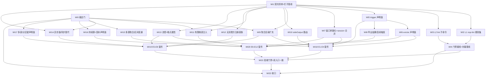

# nop-stream XDSL 声明面全功能补全与 12 场景验收 Roadmap

> Last updated: 2026-10-06（v1：立项。基于当日 XDSL 可移植性分析核定的 DSL 硬门与 12 例映射，叠加「XDSL 符合 nop 平台最佳实践」检查门禁，按依赖组织为声明面补全 + 场景验收两条主线）
> 位置：按仓库 roadmap 惯例存放于 `ai-dev/backlog/`。书写约定：未来交付物路径用普通文本书写、不加反引号；已存在的文档路径用反引号，持续受 check-doc-links 保护。
> Sources:
> - `ai-dev/analysis/2026-10/2026-10-06b-nop-stream-xdsl-vs-oss-stream-examples-portability.md`（缺口核定 primary：DSL 已实现面 / 13 类 fail-fast 面 / 12 例三档映射）
> - `ai-dev/analysis/2026-10/2026-10-06a-nop-stream-vs-flink-tdengine-hazelcast-seatunnel-comparison.md`（五方能力对比，引擎侧缺口前提）
> - `nop-kernel/nop-xdefs/src/main/resources/_vfs/nop/schema/stream/stream.xdef`、`pattern.xdef`（XDSL schema 合同）
> - `nop-stream/nop-stream-flow/src/main/java/io/nop/stream/flow/builder/StreamModelDslBuilder.java`、`AdvancedTransforms.java`（真实执行链与 fail-fast 契约，即全部硬门锚点）
> - `docs-for-ai/03-modules/nop-stream-user-guide.md`（XDSL 章节 + 触发语义映射表）、`docs-for-ai/03-modules/nop-stream-sql.md`（SQL 纳入面/不支持清单）、`docs-for-ai/03-modules/nop-stream-connectors.md`（连接器能力矩阵）
> - `ai-dev/design/nop-stream/00-vision.md`（§四 Non-Goals 六行 + §七 #G36；解禁唯一通道 = WI0 且须 owner 人审）
> - `ai-dev/backlog/nop-stream-multi-engine-comparison-roadmap.md`（引擎侧外部前置：WI5 限速 / WI7 CatalogTable / WI10 重算 / WI11 lookup 异步 / WI18 Avro）
> - `ai-dev/backlog/nop-stream-sql-roadmap.md`（WI14 静态维表 lookup done、WI16 DISTINCT 不支持清单——本 roadmap 的 SQL 面基线）
> - `nop-lint/docs/rule-catalog.md`、`ai-dev/tools/`（检查门禁惯例：nop-lint 规则目录确定性生成 + `--check` 门禁、check-*.mjs 工具族）

## Purpose

把 XDSL 从「拓扑声明面强、窗口控制面与生态算子弱」补到「12 个外部典型样例场景全部有声明式落地路径并被单测钉住」，目标状态：

1. **窗口控制面声明化**：trigger / evictor / 早出结果 / sliding·session·global 参数化窗口（含 session 合并）全部进入声明面，解除当前 `triggerId` 双处 reject、xdef 无 evictor 面、窗口类型须 bean 三道硬门。
2. **拓扑旁路声明化**：`<sideOutput>` 图级路由（含迟到侧输出）、`<sideInputs>` 有限维表注入、边级流控四属性、source/sink `params` 与能力属性、无消费方注册表族逐族处置。
3. **生态算子面的声明式表达**（受裁定与外部前置约束）：异步、多源聚合/区间谓词、持续源与回补、多表/分区键流——每项要么补声明面，要么由 WI0 裁定的「声明式变通形态」固化验收，不留静默降级。
4. **12 场景验收套件**（E1–E12）：每场景一份 `.stream.xml` fixture + 一个单测类 + 接线与语义断言，纳入 CI 门禁，含「XDSL 与 Java 双入口输出一致」钉子。
5. **XDSL 最佳实践检查门禁**：两层检查器（nop-lint XML 静态规则 + 模型感知 lint 子命令）覆盖 R1–R14，warn→error 两阶段消号，全仓 `.stream.xml` 零阻塞违规。
6. 裁定门前置：四项 vision 触点（通用异步算子、非等值/区间 join、广播语义边界、DISTINCT SQL 面）先裁定再实现，避免用实现倒逼改裁定。

## Current Baseline（2026-10-06 核对）

**XDSL 已实现面（12 场景的既有地基）**：多 sink/fan-out（fraud-s1 四链四 sink 已证）；等值 join（`<joins>` + `joinRef`，INNER/LEFT/RIGHT/FULL + 参数化 window join INNER/LEFT）；声明式 CEP（`<patterns>` 含 single/group/量词/where/until/within/gapWithin/followKind/afterMatchSkip*）；参数化 `tumbling-event-time` + `duration`（ms/s/m）+ legacy 白名单（global/1s/5s）；`allowedLateness`（strategy 与 window 节点双处，D9 已放行）；`reduce`/`aggregate`（bean 与 `aggregatorRef` 恰一，内建 sum/count/avg/min/max）；`union`；`custom`（customType bean）；事件时间（`watermarkStrategyBean` 或 xpl assigner+generator，`watermarkInterval=0` 逐事件已接线）；边 `FORWARD`/`HASH`+`keyExpr`；per-transform parallelism（`<window>` 为虚拟元素不可声明）；`<sql>` 顶层生成器；Delta `x:extends`；`conf-validate`/`dry-run` 提交前校验工具族。

**13 类「schema 有面但无执行消费方」的 fail-fast 面（逐项放行的对象）**：`<sideOutput>` 节点；`<sideInputs>` 注册表（含 broadcast）；边级 `flowControlPolicy`/`queueCapacity`/`receiveWindow`/`packetSize`；strategy 与 window 节点的 `triggerId`；非 DISCARDING 的 `accumulationMode`；`<streams>`/`<environments>`/`<requirements>`/`<checkpointParticipants>`/`<coders>` 五注册表；`onStart`/`onEnd`/`onError` 生命周期回调；source 与 sink 的 `params`/`maxParallelism`/`outputType`·`inputType`/`consistencyCapability`；`<custom>` 的 `params` 与 `<source>` 体。全部为构建期 typed fail-fast（`ERR_STREAM_NOT_IMPLEMENTED` / `ERR_STREAM_WINDOW_ATTR_UNSUPPORTED` 等），无静默降级。

**既有硬裁定（本 roadmap 全程有效）**：vision §四 Non-Goals 六行（非等值/范围/广播双流 join、完整 SQL 栈、PB 级、复制 Flink Runtime/Netty、在线自动 reshard、通用异步算子）+ §七 #G36（BroadcastState 永久排除）+ 2026-10-02 D2 收窄（窄 SQL 与等值 join 已交付）；`nop-stream-sql.md` 不支持清单（DISTINCT 聚合、ORDER BY/LIMIT、CASE/CAST、HAVING/CTE、全局聚合、非等值 join、TIMESTAMP 列绑定）；connectors legacy 冻结裁定；2PC 跨并行度 typed 拒绝；fraud-s1 §3.0 约束（声明形态取舍、4 CEP 链不共享 sink 台账）。

**检查门禁现状**：`ai-dev/tools/` 51 个工具（`check-*.mjs` 家族 + `rules/*.yml` + 自测式 positive control 惯例）；`nop-lint` 平台规则（65 条 Java + 5 条 XML，XML 侧已有 `nop-bean-naming` 作用于 `beans.xml`、`nop-orm-*` 作用于模型 XML）；规则目录 `nop-lint/docs/rule-catalog.md` 由 `gen-lint-rule-catalog.mjs` 确定性生成并有 `--check` 门禁（新增规则必须登记并再生成）。`.stream.xml` 尚无任何专属规则，模型感知检查只有 `conf-validate`/`dry-run`（连通性/构建期校验，不含最佳实践预检）。

**外部前置（不在本 roadmap 内实现，见「外部前置」节）**：限速（multi-engine WI5）、CatalogTable/RowKind（WI7）、重算/FILL_HISTORY 引擎语义（WI10）、lookup 异步增量（WI11）、Avro/coders（WI18）；静态维表 lookup 与 DISTINCT 钉码（sql roadmap WI14/WI16 done）。

## 12 场景验收矩阵（E1–E12）

> 验收唯一口径。来源列为 `2026-10-06b` 报告的样例编号；覆盖其全部 20 个条目（4 项目）。「接受降级」须经 WI0 裁定并在此登记，不得静默降级。

| 场景 | 来源 | 核心语义 | 需要的声明面 | 验收测试（fixture + 单测） | 基线判定 |
|---|---|---|---|---|---|
| **E1** | Flink StateMachineExample | per-key DFA + keyed state + checkpoint + 双 sink + 源限速 | `<process>` bean 承载状态；限速属外部前置 | `xdsl-e1-statemachine.stream.xml` + `TestXdslScenarioE1`：DFA 状态转移/告警分支/双 sink 输出断言 | ⚠️ 可移植（限速降级为 bean 内） |
| **E2** | Flink TopSpeedWindowing | GlobalWindows + DeltaTrigger + TimeEvictor + maxBy | **WI5** trigger 面 + **WI6** evictor 面 + **WI7** global 参数化 + **WI9** topN/maxBy 聚合 | `xdsl-e2-topspeed.stream.xml` + `TestXdslScenarioE2`：跨 50m delta 的发射序列逐条断言 + evictor 物理驱逐断言 | ⚠️ 核心被 trigger/evictor 硬门挡住 |
| **E3** | Flink SideOutputExample | 分流侧输出 + 5s 滚动窗口 sum + 双 sink | **WI10** sideOutput 路由（含 lateData tag）+ **WI5/6** trigger/evictor + 既有窗口 | `xdsl-e3-sideoutput.stream.xml` + `TestXdslScenarioE3`：长词进侧输出下游顶点、短词进窗口聚合的分区断言 | ⚠️ sideOutput 恒 fail-fast |
| **E4** | Flink WindowJoin | 双流事件时间窗口等值 join | 既有 `<joins>` + 参数化 window join + `timeout` | `xdsl-e4-windowjoin.stream.xml` + `TestXdslScenarioE4`：匹配对即时发射 + outer 补齐在 watermark + 边界寿命 | ✅ 已可移植（补 fixture + 测试固化） |
| **E5** | Flink CountNewsClicks + CountSales | keyed state + 事件时间 timer + 迟到缓冲 + 水位一等对象处理 | `process` bean 承载 state/timer；水位策略 bean；显式水位处理属 Java 面（声明降级） | `xdsl-e5-newstimer.stream.xml` + `TestXdslScenarioE5`：预发布点击缓冲、publishTime+1h 定时器 flush、idleness 恢复 | ⚠️ 可移植（逻辑落 bean） |
| **E6** | Flink AsyncIOExample | 异步 I/O ordered/unordered + capacity + timeout | **WI14**（默认分支：同步替代形态 + 容量/超时契约；解除分支：async 声明面） | `xdsl-e6-async.stream.xml` + `TestXdslScenarioE6`：capacity 排队上界 + timeout 语义 + 顺序/乱序完成断言 | ❌ 两端缺（vision §四异步算子） |
| **E7** | Flink Table API 集（UpdatingTopCity / TemporalJoin / StreamWindowSQL） | retraction 物化 + LATERAL LIMIT TopN + `FOR SYSTEM_TIME` 时态 join + `COUNT(DISTINCT)` | **WI9** 聚合目录 + **WI12**（SQL 面协同）；retraction 语义受 D1 终值语义约束 | `xdsl-e7-tablesql.stream.xml` + `TestXdslScenarioE7`：TUMBLE 聚合终值断言 + DISTINCT 近似口径断言 + 不支持项 typed fail-fast 断言 | ❌→⚠️ 子集可移植（retraction/时态 join/DISTINCT 缺） |
| **E8** | SeaTunnel 三例（多表 SQL transform / 四路 embedding fan-out / 多表多 sink 断言） | 多表路由 + transform 级 SQL + 四路并行分支 + 多 sink | **WI17** 多表面 + **WI12** + 既有 fan-out/multi-sink | `xdsl-e8-seatunnel-multi.stream.xml` + `TestXdslScenarioE8`：1 源 4 分支 4 sink 断言 + 多表降级形态断言 | ⚠️ 多表需 CatalogTable 外部前置 |
| **E9** | TDengine avg_current_stream + 触发词表 | sliding + MAX_DELAY 早出 + PARTITION BY 分区 + FILL_HISTORY 回补 + STREAM_OPTIONS 族 | **WI7** sliding 参数化 + **WI8** 早出结果 + **WI17** 分区多表 + **WI16** 回补声明 | `xdsl-e9-tdengine-window.stream.xml` + `TestXdslScenarioE9`：滑窗重叠发射序列 + MAX_DELAY 早出时刻 + 回补重算幂等断言 | ⚠️ 四要素拆解后分层可移植 |
| **E10** | Hazelcast TopNStocks + SessionWindow | 两级窗口（sliding→tumbling）+ 复合 topN 聚合 + session 窗口合并 | **WI7** + **WI9** 复合聚合/topN + session 合并接线 | `xdsl-e10-hazelcast-window.stream.xml` + `TestXdslScenarioE10`：两级窗口滑移对齐约束 + 复合聚合多指标断言 + session 合并断言 | ⚠️ 可移植但须聚合/窗口两个 bean 或参数化 |
| **E11** | Hazelcast TransactionTracking + Enrichment | CEP TTL 超时 + 维表 lookup ×3 策略 + N 路批源 hashJoin + 异步 gRPC | 既有 CEP `<patterns>`（`within` 覆盖超时）+ **WI11** 有限维表注入 + **WI15** 多源聚合变通 + **WI14** 异步 | `xdsl-e11-enrichment.stream.xml` + `TestXdslScenarioE11`：START/END 配对与超时分支 + 维表富化等价性 + N 路变通形态断言 | ⚠️/❌ 混合（N 路 hashJoin 与异步缺） |
| **E12** | Hazelcast TradingVolumeOverTime + AccessLogStreamAnalyzer + SQL streaming | 早出部分结果 + tail 文件源 + `IMPOSE_ORDER`/`HOP`/时序 `BETWEEN` join/`CREATE JOB` | **WI8** 早出 + **WI16** 持续源与回补（按裁定）+ **WI15** 区间谓词（默认不做，变通） | `xdsl-e12-early-tail.stream.xml` + `TestXdslScenarioE12`：early-results 周期发射 + 乱序下部分结果断言 + tail 降级/裁定形态断言 | ❌→⚠️ 早出缺、tail 与区间 join 缺 |

## XDSL 最佳实践检查规则集（R1–R14）

> 检查门禁两层落点：**L1 = nop-lint XML 规则**（`nop/xdsl-*`，静态声明面，规则目录再生成受 `--check` 门禁）；**L2 = 模型感知 lint**（`StreamMaintenanceMain lint` 子命令，复用 `conf-validate`/`dry-run` 的构建期校验链，需 StreamModel 解析与类型信息）。两层的 severity 分级与存量消号策略见 Rules 第 4 条。

| 规则 | 内容 | 层 | severity 基线 |
|---|---|---|---|
| R1 | 入口一致性：`.stream.xml` 为产品主入口；作业模型不得依赖 test-scope 类/jar；生产入口现状须如实标注 | L2 | warning |
| R2 | 声明式优先：能用声明面表达的逻辑不得退化为 bean（触发"可声明却 bean 化"提示）；bean 只允许承载状态/定时器/外部 IO | L2 | warning |
| R3 | 状态归属：有状态逻辑必须落 `<process>` bean 或 CEP；声明面不得隐式持有状态；bean 状态读写须有 checkpoint 断言（Anti-Hollow） | L2 | error |
| R4 | 类型声明：使用窗口/聚合/join 时以 `<schemas>` 显式声明列类型；出现 `UnknownTypeInformation` WARN 路径即违规 | L2 | warning |
| R5 | 事件时间：使用 `<window>`/`<cep>` 必须声明 `timestampsAndWatermarks`（CEP 缺水位由 WARN 升 error）；水位策略须显式声明乱序容忍/idleness | L1+L2 | error |
| R6 | 幂等组合：声明 `STRICT_EXACTLY_ONCE` 时静态预检 REPLAYABLE source + 2PC sink 组合（引擎侧 validator 保留为最终关卡） | L2 | error |
| R7 | 凭据与敏感：连接器配置中的口令/密钥必须 `credential:{id}#{field}` 引用，禁止明文 | L1 | error |
| R8 | Delta 化：变体作业须 `x:extends` 派生而非复制拓扑；派生文件不得整体重写父拓扑 | L1 | warning |
| R9 | 并行度与边：禁止在 `<window>` 声明 parallelism；HASH 边不得指向 keyBy/union；per-transform 并行度与 keyBy maxParallelism 冻结规则一致 | L1 | error |
| R10 | 命名与文档：transform id 用 kebab-case 语义命名（不含物理表名/环境名）；source/sink 须命名；模型与关键节点须有 `description` | L1 | warning |
| R11 | 提交前可验证：作业模型须能通过 `conf-validate` 与 `dry-run`（检查器串联两命令为 CI 步骤） | L2 | error |
| R12 | 无声明无消费：模型不得声明无执行消费方元素（防 schema 面再漂移；随 WI5–WI13 放行逐项转正） | L1+L2 | warning（放行后转 info） |
| R13 | 测试接线：新增/修改 `.stream.xml` 须同提交增加/更新对应单测；E1–E12 fixture 必须在场景注册表内 | L1+L2 | error（仅对已登记场景集） |
| R14 | 平台复用：静态维表必须走 `IJdbcTemplate`/`IBatchLoader` 而非自建数据源；checkpoint/凭据/消息复用平台设施（对齐 sql-subset §三#8 与 vision §十） | L2 | warning |

## Work Item Status

> 唯一动态状态块。勾选 = 独立 closure audit 通过（完成判定见 Cross-Cutting）。WI 编号全文件递增不重排；**deps 是唯一并行屏障**；M 编号为主题分组，不是执行顺序。每个 WI 以独立 plan 承载，写前必读 `ai-dev/plans/00-plan-authoring-and-execution-guide.md`；每个 WI = 一个 plan 的单一连贯交付面（多子交付物在描述内枚举，一次 closure audit 整体判定）。

### M0 — 裁定门（无前置，最先开工）

- [ ] WI0 12 场景范围与降级清单裁定（owner 人审门）：逐场景确认 E1–E12 的目标形态与「接受降级」判定，并裁定四项 vision 触点——通用异步算子（E6/E11 gRPC）、非等值/区间 join（E11/E12 `BETWEEN`）、sideInput 的广播语义边界（是否触 §七 #G36）、DISTINCT SQL 面（E7）——每项给 go（解除并回写 vision 裁决记录）/ defer（默认）/ exclude 三态（Deliverable: 裁定记录回写 `ai-dev/design/nop-stream/00-vision.md` 与对应设计文档 + 本 roadmap 12 场景矩阵「接受降级」列回填；deps: 无；Item Type: Decision）

### M1 — 契约基线与检查门（先行，后续放行的唯一权威底账）

- [ ] WI1 声明面-消费方契约清单与 fail-fast 钉子基线：把已实现面与 13 类 fail-fast 面固化为 owner doc 清单（XDSL 章节新增「声明面支持矩阵」），每类 fail-fast 补一个构建期钉子测试，作为后续逐项放行的唯一底账（Deliverable: 清单落 `docs-for-ai/03-modules/nop-stream-user-guide.md` + 钉子测试套件；deps: 无；Item Type: Proof）
- [ ] WI2 XDSL 最佳实践检查第一层（nop-lint XML 规则集：R5 水位声明 / R7 凭据明文 / R8 Delta 化 / R9 并行度与边 / R10 命名与描述 / R12 无声明无消费 / R13 测试接线静态面）：`nop/xdsl-*` 规则 + 规则单测 + `gen-lint-rule-catalog.mjs` 再生成过 `--check` 门禁；确认 `.stream.xml` 进入 nop-lint 目标扫描范围（缺则补 TargetScanner 映射）（Deliverable: 规则集 + 单测 + 目录再生成 + 扫描范围接线；deps: WI1；Item Type: Feature + Proof）
- [ ] WI3 XDSL 最佳实践检查第二层（模型感知 lint 子命令：R1 入口一致性 / R2 声明式优先退化提示 / R3 状态归属 / R4 类型声明 / R5 水位供给 / R6 幂等组合预检 / R11 串联 conf-validate+dry-run / R14 平台复用）：`StreamMaintenanceMain lint` 子命令，复用构建期 StreamModel 解析链，错误面复用既有 `nop.err.stream.*` 码（§4d 零新增码）（Deliverable: 子命令 + 规则实现 + 单测 + 运维文档；deps: WI1；Item Type: Feature）
- [ ] WI4 检查门禁接线与存量基线梯度：CI 接线（lint 子命令 + nop-lint 规则两道）+ 存量 `.stream.xml` 全量扫描 + warn→error 两阶段基线登记（存量违规进清单随各 WI 消号，不阻塞）（Deliverable: CI 配置 + 存量违规清单 + 消号台账；deps: WI2 + WI3；Item Type: Feature + Proof）

### M2 — 窗口控制面声明化（E2/E3/E5/E9/E10 的核心硬门）

- [ ] WI5 trigger 声明面放行：strategy 与 window 节点的 `triggerId` 接线（放行即删对应 fail-fast 钉子测试改放行断言）+ trigger 目录解析（8 trigger 族 × 适用域）+ 与 CEP/allowedLateness/accumulationMode/evictor 的组合合法性矩阵（Deliverable: 声明面 + 目录 + 组合校验 + 时序测试；deps: WI1；Item Type: Feature）
- [ ] WI6 evictor 声明面：evictorId 声明 + evictor 目录（Count/Time/Delta）+ `evictBefore`/`evictAfter` 时序语义与元素时间戳按元素自身事件时间的契约显式化 + 与 allowedLateness/accumulationMode 组合校验（Deliverable: 声明面 + 目录 + 状态生命周期断言（照抄 TestEvictorStateLifecycle 钉定面）；deps: WI5；Item Type: Feature）
- [ ] WI7 窗口类型参数化与 session 合并接线：参数化 id 扩容到 sliding/session/global（duration 语义对齐外部 HOP/SESSION 口径）+ `MergingWindowAssigner` 消费（合并回调契约 + 合并与 allowedLateness 交互）+ 白名单 id 兼容面显式化（Deliverable: 参数化目录 + 合并接线 + 滑窗重叠/会话合并测试；deps: WI1；Item Type: Feature）
- [ ] WI8 早出结果与连续触发参数化：`earlyResultsPeriod` 声明 + Continuous 触发族参数化（事件时间/处理时间两轴）+ 早出与迟到/allowedLateness 的交互契约（Deliverable: 声明面 + 周期发射时序测试；deps: WI5；Item Type: Feature）
- [ ] WI9 内建聚合目录扩充：topN/maxBy + 复合聚合（多指标）+ distinct 计数近似口径（依 WI0 对 DISTINCT 的裁定选择 SQL 面补齐或文档化近似），复合累加器经 `aggregators` 声明面接线（Deliverable: 聚合目录 + 复合累加器 + DISTINCT 口径裁定记录；deps: WI0 + WI1；Item Type: Feature + Decision）

### M3 — 拓扑与旁路声明面（E3/E8/E11）

- [ ] WI10 `<sideOutput>` 图级路由：tag/condition → 独立下游顶点（执行图新增侧输出边路由）+ 迟到数据侧输出（lateData tag，与 allowedLateness 联动）+ 与 CEP/窗口组合；放行即删 fail-fast 钉子（Deliverable: 侧输出边路由 + 双下游场景测试 + Anti-Hollow 接线断言；deps: WI1；Item Type: Feature）
- [ ] WI11 `<sideInputs>` 有限维表注入声明面：sideInput 消费方接线 + 语义钉死为「构建期或低频更新的有限维表快照注入」（静态维表必须走 `IJdbcTemplate`/`IBatchLoader`），**不引入 BroadcastState 类型**以守 §七 #G36 边界，broadcast 属性改为「注入方式」而非流式广播（Deliverable: 声明面 + 语义裁定记录 + 富化等价性测试；deps: WI0 + WI1；Item Type: Feature + Decision）
- [ ] WI12 无消费方注册表族逐族处置：`<streams>`（命名流引用）/`<environments>`/`<requirements>`/`<checkpointParticipants>`/`<coders>` 与 onStart·onEnd·onError 逐族「接线 or 移除 schema 面 or 显式记为 Java-only」三选一裁定并落地（coders 与 Avro format 面的衔接外部前置 multi-engine WI18）；SQL 面 unsupported 项（DISTINCT 等）同步核对（Deliverable: 逐族裁定表 + 落地改动 + schema 面与消费方一致性回归；deps: WI1；Item Type: Feature + Decision）
- [ ] WI13 边级流控与端点属性消费面接线：边 `flowControlPolicy`/`queueCapacity`/`receiveWindow`/`packetSize` 四属性接线 + source/sink 的 `params`/`maxParallelism`/`outputType`·`inputType`/`consistencyCapability` 接线（凭据引用与能力矩阵一致性校验）+ `<custom>` 的 `params`/`<source>` 体处置（Deliverable: 四属性与端点属性接线 + 背压行为测试 + 能力一致性断言；deps: WI1；Item Type: Feature）

### M4 — 生态算子面（每项「补声明面」或「裁定后的变通形态固化」，禁止留白）

- [ ] WI14 异步算子面（分叉交付）：**默认分支**（WI0 维持 vision §四异步算子 Non-Goal）交付同步替代声明形态（`process` bean 承载外部调用 + 有界容量与超时的行为契约 + 显式串行语义标注）+ E6 降级验收；**解除分支**（WI0 裁定 go 并回写 vision）补 async 声明面（capacity/timeout/ordered·unordered 声明）（Deliverable: 分支二选一落地 + E6 验收；deps: WI0 + WI1；Item Type: Feature + Decision）
- [ ] WI15 多源聚合与区间谓词的声明式表达（分叉交付）：**默认分支**（区间/非等值 join 属 vision §四排除项）交付变通形态——`<union>` + 多次两路等值 join + `<process>` 聚合，配合事件时间过滤实现 `BETWEEN` 语义并固化为 E11/E12 验收用例；**解除分支**（WI0 裁定 go）补区间谓词声明面（Deliverable: 分支二选一落地 + 变通形态正确性测试；deps: WI0；Item Type: Feature + Decision）
- [ ] WI16 持续源与回补作业声明面（分叉交付）：file tailing 持续源按 WI0 裁定（不做则交付 bounded 重放 + DRAIN 变通形态并登记触发条件）；FILL_HISTORY/RECALCULATE 作业形态声明面接线（引擎语义外部前置 multi-engine WI10）+ `jobTerminationMode`/DRAIN 语义与回补幂等契约（Deliverable: 分支落地 + 回补重算幂等断言；deps: WI0；Item Type: Feature + Decision）
- [ ] WI17 多表与分区键流声明面：多表/tableId 声明面接线 + 分区键传播形态（引擎语义外部前置 multi-engine WI7 CatalogTable/RowKind）；不可用时的声明式降级形态（单表 + 表标识字段）固化并登记（Deliverable: 声明面 + 降级形态 + 多表路由测试；deps: WI0；Item Type: Feature + Decision）

### M5 — 12 场景验收套件（单元测试；每场景一份 fixture + 一个单测类 + 接线与语义断言）

- [ ] WI18 E1–E4 验收套件：StateMachine / TopSpeedWindowing / SideOutputExample / WindowJoin 四场景 fixture 与单测（含 E2 的 delta 发射序列与 evictor 物理驱逐、E3 的侧输出分区归属断言）（Deliverable: 4 fixture + 4 测试类 + 场景注册表条目；deps: WI5 + WI6 + WI7 + WI9 + WI10 + WI13；Item Type: Proof）
- [ ] WI19 E5–E8 验收套件：CountNewsClicks+CountSales / AsyncIOExample / Flink Table API 集 / SeaTunnel 三例四场景 fixture 与单测（含 E5 的预发布点击缓冲与定时器 flush、E7 的终值语义与不支持项 typed fail-fast 断言）（Deliverable: 4 fixture + 4 测试类 + 场景注册表条目；deps: WI9 + WI12 + WI13 + WI14 + WI17；Item Type: Proof）
- [ ] WI20 E9–E12 验收套件：TDengine 窗口聚合与触发词表 / TopNStocks+SessionWindow / TransactionTracking+Enrichment / early-results+tail+SQL streaming 四场景 fixture 与单测（含 E9 的滑窗重叠序列与 MAX_DELAY 早出、E10 的两级滑移对齐与 session 合并、E11 的 CEP 超时与 N 路变通）（Deliverable: 4 fixture + 4 测试类 + 场景注册表条目；deps: WI6 + WI7 + WI8 + WI11 + WI15 + WI16；Item Type: Proof）
- [ ] WI21 验收门禁与矩阵固化：12 场景纳入 CI（失败即阻塞）+ 「XDSL 与 Java 双入口输出一致」钉子（照抄 fraud-example `s2JavaVariantMatchesXdslOutput` 模式，每场景一条）+ 12 场景矩阵与检查器规则/owner doc 同步（Deliverable: CI 门禁 + 双入口一致性测试 + 矩阵同步记录；deps: WI4 + WI18 + WI19 + WI20；Item Type: Proof）

### M6 — 收口

- [ ] WI22 roadmap 收口：12 场景全绿 + 两层检查器零阻塞违规（存量清单全消号）+ owner doc 全面一致性核对（XDSL 章节支持矩阵/触发与窗口语义/迁移指南/连接器矩阵）+ vision·D-GAP·sql 裁定一致性终核 + 独立 closure audit（Deliverable: 收口证据 + 文档核对 + 存量消号清单；deps: WI0 + WI4 + WI21；Item Type: Proof）

## Follow-up Backlog

> 次级事项登记，不计入进度分母，不参与完成判定。晋级为正式 WI 时从 WI23 起顺延取号。

- **file tailing 持续源**：WI0 裁定不做则登记触发条件 = 日志 tail 类场景真实诉求出现（现 file source 为有界 split + at-least-once 恢复语义；bounded 重放 + DRAIN 为变通形态）。
- **BroadcastState（vision §七 #G36 永久排除）**：WI11 已把 sideInput 语义钉死为有限维表注入，本项不晋级；若 WI0 裁定重启须按 #G36 先例走 owner 裁决。
- **COUNT(DISTINCT) 精确语义**：WI0 裁定维持不支持则文档化为「≈ 计数窗口 + evictor 近似」口径；若要求精确则触发 SQL 面 + 状态集算子立项。
- **coders/Avro 序列化注册表**：随外部前置 multi-engine WI18 落地后回到 WI12 的族内收尾。
- **限速声明面**：外部前置 multi-engine WI5 落地后在本 roadmap 只做声明面接线（不重复实现引擎能力）。
- **E2/E3 之外的高阶窗口语义**（如 Flink `SessionWindowing` 的提前闭合检测、TDengine `DELETE_RECALC` 重算策略）：随 WI5–WI8 的组合校验矩阵扩展时评估是否立项。
- **迁移指南补章**：`docs-for-ai/03-modules/nop-stream-migration-guide.md` 的 XDSL 升级指引（新增声明面 + 放行后行为变化）随 WI5–WI13 逐项补，不单独立项。

## Dependency Graph

（deps 为「无」的 WI——WI0/WI1——可随时并行启动。deps 是唯一并行屏障，本图与各 WI 行内 deps 字段一一对应。）

## 外部前置（跨 roadmap，本 roadmap 不重复实现）

| 能力 | 归属 roadmap WI | 受影响 WI | 未落地的降级形态 |
|---|---|---|---|
| 源限速 | multi-engine WI5 | E1 | bean 内自限速 |
| CatalogTable/RowKind 多表语义 | multi-engine WI7 | E8/E9 | 单表 + 表标识字段 |
| 重算/FILL_HISTORY 引擎语义 | multi-engine WI10 | E9/E12 | savepoint 恢复 + upsert sink 幂等手工重放 |
| 维表 lookup 异步增量 | multi-engine WI11 | E11 | 同步富化 bean |
| Avro/Schema Registry 格式层 | multi-engine WI18 | WI12（coders 族） | 内建 SimpleTypeSerializer |
| 静态维表 lookup / DISTINCT 钉码 | sql roadmap WI14/WI16（done） | E7/E11 | 既有形态即基线 |
| CDC schema evolution 协调 | multi-engine WI15（受 cdc-design defer 闸门） | 场景 E1 的 CDC 源变体 | 事件透传 + 告警 + 重同步手册 |

## Framework / Platform Reuse

- **`StreamModelDslBuilder`/`AdvancedTransforms` 单一执行链**：本 roadmap 全部声明面放行都落在同一 builder 内（不放第二配置体系、不引入旁路解析器）；`failFastOnUnsupportedRegistries`/`validateEdgeDeclarations` 是既有 fail-fast 纪律的复用模板。
- **既有 fail-fast 错误面**：`nop.err.stream.*` 码族（`ERR_STREAM_NOT_IMPLEMENTED`/`ERR_STREAM_WINDOW_ATTR_UNSUPPORTED`/`ERR_STREAM_EDGE_*` 等）——放行面删除对应拒绝码路径，新规则复用 `nop.err.*`，零新增码（对齐 sql roadmap §4d 纪律）。
- **窗口/触发/evictor 家族现成实现**：`io.nop.stream.core.windowing.triggers`（8 trigger）与 `evictors`（3 evictor）已有类与专属单测——声明面只做目录解析与组合校验，不重写触发逻辑；`MergingWindowAssigner` 合并逻辑已在 `EventTimeSessionWindows` 内。
- **钉子测试资产**：`TestStreamModelDeltaExtends`（Delta）、`TestStreamConnectorRegistryE2E`（Anti-Hollow 接线证明）、fraud-example `s2JavaVariantMatchesXdslOutput`（双入口一致）、`TestEvictorStateLifecycle`（驱逐生命周期）——场景套件与检查器测试照抄这些模式，不另造风格。
- **`StreamMaintenanceMain` 工具族**：`conf-validate`/`dry-run` 已是提交前校验门面，`lint` 子命令沿用其 CLI 形态与结构化错误/退出码惯例。
- **nop-lint 平台规则体系**：XML 侧已有 `nop-bean-naming`/`nop-orm-*` 规则与 tree-sitter XML 节点（`XmlValueNode`）；规则目录由 `gen-lint-rule-catalog.mjs` 确定性生成并有 `--check` 门禁——L1 规则直接复用该机制（含规则单测与 positive control 自测惯例）。
- **平台最佳实践既有裁定**：`docs-for-ai/02-core-guides/code-style.md`、`docs-for-ai/02-core-guides/ioc-and-config.md`（NopIoC 无 private 注入、bean 必须 beans.xml 显式定义）、`docs-for-ai/02-core-guides/invariant-guards.md`、`docs-for-ai/02-core-guides/error-handling.md` 与 sql-subset §三#8/§十 —— R2/R3/R7/R14 的规则语义直接引用这些既有 owner doc，不另立标准。
- **Delta 定制机制**：`x:extends` 与分层 Delta 是 R8 与所有「变体作业」的唯一合法派生路径。

## Cross-Cutting（每个 WI 的完成判定）

1. **独立 closure audit**：不同 task_id 的独立子 agent 审计通过后才勾选 Work Item Status，证据写入承载 plan（plan guide Closure Audit Rule）。
2. **WI0 人审证据**：四项 vision 触点的裁定必须附 owner 确认记录与 vision/设计文档回写 diff，方可勾选。
3. **端到端验证**（plan guide #22）：WI5–WI8 从声明落图到窗口实际发射/驱逐/合并；WI10 从侧输出路由到下游顶点收到数据；WI18–WI20 每场景端到端断言（12 场景矩阵逐行勾验）。
4. **接线验证**（plan guide #23）：新增声明面、指标、路由、检查规则必须断言被运行链路或检查器真实调用，防空壳（照抄 `TestStreamConnectorRegistryE2E` 与检查器 positive control 模式）。
5. **无静默跳过**（plan guide #24）：放行面不得留下「声明了但静默忽略」路径；能力不支持的配置一律 typed fail-fast；检查器规则必须有「已知坏样例必须被拒」的正控自测（对齐 `check-lint-coverage-manifest.mjs self-test` 惯例）。
6. **放行三步法**：每个声明面放行必须同时完成「接线 + 删除对应 fail-fast 钉子测试并改为放行行为断言 + owner doc 更新」，三者缺一不得勾选（防双状态面）。
7. **owner doc 同步**：每个实施 WI 的 Phase 级 exit criteria 含 docs-for-ai 更新项（无则显式声明 No owner-doc update required）；XDSL 支持矩阵与触发语义表是声明面变化的单一事实源。
8. **测试范围**：`./mvnw test -pl nop-stream/nop-stream-flow -am` + 涉及模块（core/cep/runtime）回归；检查器 `node ai-dev/tools/<checker> self-test`；`node ai-dev/tools/gen-lint-rule-catalog.mjs --check`；`node ai-dev/tools/check-doc-links.mjs --strict` 退出码 0。

## Rules

1. 状态只在 Work Item Status 的 checkbox 通道维护，不设第二状态面；WI 编号全文件递增不重排。
2. deps 是唯一并行屏障（与依赖图一一对应）；M 编号为主题分组，不构成执行顺序约束；跨 roadmap 的能力缺口只经「外部前置」节声明，不写进本文件 deps。
3. 本 roadmap 不改写任何既有裁定文本：vision §四/#G36 的解禁、sql 不支持清单、connectors legacy 冻结、2PC 跨并行度 typed 拒绝，唯一通道是 WI0（且须 owner 人审），裁定结果回写对应文档并在本 roadmap 留版本注记。
4. **检查门禁两阶段**：新增规则先以 warning 上线并登记存量违规，随对应 WI 落地与存量消号再升 error；禁止一次性把存量违规升为阻塞（全仓 `.stream.xml` 基线含既有样例）。
5. **降级必须显式**：E 场景的「接受降级」只在 WI0 裁定后成立，并在 12 场景矩阵登记；任何 WI 不得以「实现更省事」为由静默降级或跳过场景断言。
6. **变通形态是交付物**：vision 触点的默认分支交付「声明式变通形态 + 固化测试」，变通形态进 owner doc 供用户选择，不得只写「不支持」了事。
7. 与既有 roadmap（multi-engine / sql / cdc / r5-successors / productization）重叠的事项以既有登记为准；WI12/ WI17 与外部前置的衔接只做声明面，引擎能力不重复实现；发现新重叠时降级进 Follow-up Backlog。
8. 实施细节（类签名、规则实现代码）不进 roadmap；每 WI 的 what/exit criteria 由承载 plan 定义；每 WI 一 plan。