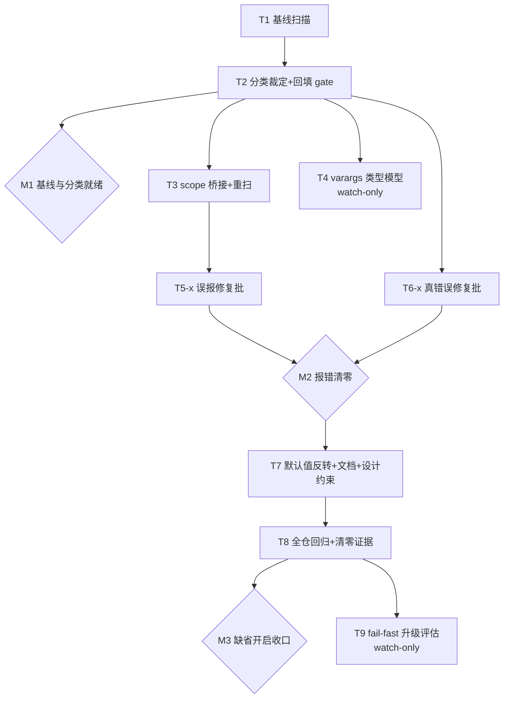

# XLang 类型检查缺省开启 Roadmap

> Status: active
> Last updated: 2026-10-27（**创建**：立项「缺省开启类型推导/类型检查 + 配置可关 + 全仓类型检查报错清零」三目标；工作项 T1/T2 与 T7-T9 定稿，T3-T6 修复系列为占位，待 T2 分类 gate 回填）
> Sources（实施前必读证据底账，每条带 live 定位）：
> - `nop-kernel/nop-xlang/src/main/java/io/nop/xlang/XLangConfigs.java:44` — 开关 `nop.xlang.type-inference.enabled`（`CFG_XLANG_TYPE_INFERENCE_ENABLED`），**默认 `false`**；经 AppConfig varRef 体系，yaml/properties/System property 均可覆盖
> - `nop-kernel/nop-xlang/src/main/java/io/nop/xlang/compile/DefaultExecutableExprCompiler.java:37-46` — 唯一消费点：`CFG_XLANG_TYPE_INFERENCE_ENABLED.get()` 为 true 时执行 `TypeInferenceProcessor`，错误仅 `LOG.warn("nop_xlang_type_inference_error: ...")`，**不中断编译（软失败/advisory）**
> - `nop-kernel/nop-xlang/src/main/java/io/nop/xlang/compile/TypeInferenceProcessor.java` — 推导引擎本体（编译期 AST 静态类型推导 + 兼容性检查）；配套 `GenericTypeInferencer` / `UnionTypeNarrower` / `TypeInferenceState` / `TypeErrorCollector`
> - `nop-kernel/nop-xlang/src/main/java/io/nop/xlang/XLangErrors.java:1177-1195` — `ERR_TYPE_INFER_*` 错误码 7 个（assign-type-mismatch / undefined-variable / incompatible-types / return-type-mismatch / no-common-type / circular-dependency / type-var-conflict），当前只进 `TypeErrorCollector`
> - `ai-dev/analysis/2026-09/2026-09-05-xlang-type-inference-correctness-audit.md`（Status: open）— 引擎缺陷审计：18 项缺陷矩阵 + 测试评估 + 修复顺序；第一批 P1 与 plan 348 已收口绝大部分
> - `ai-dev/plans/348-xlang-type-inference-remaining-defects.md`（completed，2026-09-05）— 遗留缺陷收口计划；**显式 Deferred 三项**：① varargs/rest 对齐（`IFunctionType` 无 varargs 元数据）② 编译 scope 桥接（根 state 无 `IXLangCompileScope` 注入，外部变量全 ANY）③ 错误 fail-fast（产品决策，保持 advisory）
> - `ai-dev/design/xlang-package-layering-design.md` §三 — 行为不变式原文钉死「配置门控（`nop.xlang.type-inference.enabled` 默认 off）全部保持不变」；**默认值反转时该 owner 文档须同任务修订**（Reconcile-on-touch）
> - `nop-kernel/nop-xlang/src/test/java/io/nop/xlang/compile/TestTypeInferenceProcessor.java:2095-2162` — 端到端测试需临时打开开关；`testConfigDisabled/Enabled` 仅验证配置读写
> - deepwiki/nop-xlang（architecture/flows/error-model/glossary）对「默认关闭、唯一软失败环节」有描述，**非规范性来源**（以代码与 docs-for-ai 为准）

**Why**：XLang 的编译期静态类型检查（类型推导管线）已存在且在所有表达式编译入口生效，但缺省关闭、且开启后错误仅以 WARN 日志暴露。长期关闭意味着：① 推导引擎缺陷不可见；② 全仓 DSL 模型与表达式的真实类型错误不可见——类型系统形同虚设。本 roadmap 落地三个目标：

1. **缺省开启**：`nop.xlang.type-inference.enabled` 默认值 `false → true`，全量激活编译期类型检查；
2. **配置可关**：既有配置项保持不变（名称、覆盖路径均不动），作为部署方回退阀；
3. **报错清零**：在缺省开启的口径下，全仓（本仓库全部模块与 `_vfs` 资源）的 `nop_xlang_type_inference_error` WARN 计数降为 0——引擎误报修复 + 真实类型错误修复双线收敛。

顺序纪律：**先在「开启但缺省关闭」状态下建基线、清报错，最后才反转默认值**。软失败语义（WARN 不中断编译）保证中间态不破坏任何运行时行为，风险可控。

## Work Items

> **这是唯一动态状态块。状态只在这里更新。**
> 人工设定条目与顺序；AI 取第一个 `todo`，起草/执行计划，closure audit 通过后标 `done`。
> T2 为回填 gate：T2 done 前，T5-x/T6-x 系列保持占位冻结，不得起草 plan；T2 done 后按分类矩阵回填定稿。

### 阶段一：基线与分类 gate

- T1. 全仓类型检查报错基线扫描（可复跑工具 + 清单落档）：`todo` — 依赖：无
  - 范围：可重复执行的扫描入口（落点与形态由 plan 裁定：主动遍历 `_vfs` 全部 XDSL 资源强制编译，或全量测试开启配置收集 WARN，或两者结合；扫描自身显式置 `nop.xlang.type-inference.enabled=true`，不依赖环境配置）；收集 `nop_xlang_type_inference_error` WARN 逐条记录（错误码、消息、资源路径、源位置），按模块 × 错误码 × 资源聚合；**载体覆盖口径显式化**（纳入/排除的资源类型清单——xpl/xlib/xjson/beans.xml 表达式/rule filter/Excel 公式/报表 xpt/metadata 计算字段等，参照 I11 扫描口径裁定先例）；精度评估副产物：外部变量全 ANY（scope 未桥接）的掩盖效应量化（含 ANY 跳过检查的错误占比），供 T2/T3 裁定；清单落 `ai-dev/analysis/2026-10/`（时效性，Status: open）
  - 验收：同一 commit 两次运行计数一致（含首次/二次运行的惰性缓存不漏扫证据）；清单逐条带资源定位且总数可对账；开启状态下全量测试不因 WARN 失败（软失败语义保持，扫描不得改变编译结果）
- T2. 报错分类裁定 + 修复条目回填 gate：`todo` — 依赖：T1
  - 范围：T1 清单逐条三分类——① **误报**（推导引擎缺陷/精度不足）→ 归 T5-x；② **真实类型错误**（模型/表达式层面）→ 归 T6-x；③ **合法不可推导**（动态类型/反射等引擎无法静态判定场景）→ 显式裁定豁免形态（保留 WARN / 引擎显式 escape 机制 / 修正写法），禁止以「静默忽略」收场；依据 T1 精度评估裁定 T3 是否立项与优先级、T4 是否立项；按分类矩阵回填本 roadmap T5-x/T6-x 具体批次条目
  - 验收：分类矩阵 100% 覆盖 T1 清单（每条有归类与归属条目，无未分类残留）；回填后的 T5-x/T6-x 条目带可验证验收标准（对应报错清零断言）；豁免裁定逐条带理由与处理形态，落档并回链本 roadmap；粒度符合「单 plan 可完成（约 5-15 文件 / 200-500 行 / 1-4 phases）」
- ★ **Milestone: 基线与分类就绪**（T1-T2 done）：`todo` — 派生：T1-T2

### 阶段二：引擎精度与误报清零（T2 done 前冻结，不得起草 plan）

- T3. 编译 scope 桥接（plan 348 Deferred 项①解锁）：`todo`（T2 可裁定改判推迟/不做，须记录理由） — 依赖：T2
  - 范围：`TypeInferenceState` 根 state 从 `IXLangCompileScope` 注入已知变量/函数类型（`LexicalScopeAnalysis` 已解析的外部变量不再落 ANY）；桥接后重跑 T1 扫描，增量报错并入分类矩阵走 T2 同款裁定，归属对应 T5-x/T6-x 批次
  - 验收：桥接有正反测试（注入类型的外部变量参与兼容性检查；未注入变量仍 ANY 不误报）；重扫清单与增量分类落档
- T4. varargs/rest 类型模型扩展（plan 348 Deferred 项②）：`todo`（**watch-only**——仅当 T1/T2 显示 varargs 类误报占比显著才转 `planned`） — 依赖：T2
  - 约束：`IFunctionType` 无 varargs 元数据属 `nop-core` 类型模型公共 API 变更，触发 Protected Area（跨模块公共 API → plan-first），须列全部 SPI 实现为回归面 + migration plan；不满足即保持 watch-only 并记录
- T5-x. 引擎误报修复批次（T2 后回填）：`todo` — 依赖：T2（T3 重扫增量归入）
  - 占位约束：每批 = 一组同根因的 `TypeInferenceProcessor`/`GenericTypeInferencer`/`UnionTypeNarrower` 缺陷修复，可引用审计报告缺陷编号定位；每批必须配回归测试；**禁止以删除检查、放宽为 ANY 等弱化手段「清零」**
- ★ **Milestone: 引擎误报清零**（T3-T5 全 done，T4 保持 watch-only 不阻塞）：`todo` — 派生：T3-T5

### 阶段三：真实类型错误修复（按模块分批，T2 后回填）

- T6-x. 真实类型错误修复批次（T2 后回填）：`todo` — 依赖：T2
  - 占位约束：每批 = 单模块或单类根因的模型/表达式层修复（改 DSL 模型、表达式写法、补显式类型标注）；跨模块的 DSL 规范级修复单列一批；**修复只动类型层面，不得改变运行时语义——若 WARN 揭示真实运行时 bug，升级为 `ai-dev/bugs/` bug note 单独裁定，不混入类型修复批次**
- ★ **Milestone: 真实类型错误清零**（T6 全 done）：`todo` — 派生：T6

### 阶段四：缺省开启收口

- T7. 默认值反转 + 配置契约文档化 + 设计约束修订：`todo` — 依赖：M2（T3-T6 全 done）
  - 范围：`CFG_XLANG_TYPE_INFERENCE_ENABLED` 默认值 `false → true`（`XLangConfigs.java:44`；**配置项名与覆盖机制不变**——「允许通过配置关闭」由既有 yaml/properties/System property 路径承载，不新增开关）；`ai-dev/design/xlang-package-layering-design.md` §三 行为不变式同任务修订（原文钉死「默认 off」，Reconcile-on-touch：本任务内改 owner 文档，不留副本冲突）；`docs-for-ai/02-core-guides/xlang-and-xpl-basics.md` 新增类型检查章节（开关语义、WARN 形态、关闭方法、错误码引用 `XLangErrors` 不复制）+ INDEX 路由同步；`TestTypeInferenceProcessor` 端到端测试与 `testConfigDisabled/Enabled` 形态适配（缺省开启后反向验证关闭路径）
  - 验收：缺省开启下 nop-xlang 全量测试全绿；`nop.xlang.type-inference.enabled=false` 关闭路径有显式测试（关闭后零推导 WARN，编译行为与反转前一致）；设计文档与 docs-for-ai 修订同任务落地，`check-doc-links.mjs --strict` 0 errors
- T8. 全仓回归 + 清零证据 + 收口审计：`todo` — 依赖：T7
  - 范围：`./mvnw clean install -T 1C` 全仓全绿（缺省开启状态）；重跑 T1 扫描确认 WARN 计数为 **0**（清零证据落档）；开启前后模型加载/编译耗时对比观测（供 release 评估）；三后端对拍套件（`TestFullCompareSuite`）复验无交互回归（类型推导在编译期产出 `returnTypeInfo`，java/truffle 后端消费同一 AST）
  - 验收：全量构建与全量测试全绿；扫描计数 0 证据可复跑；独立 closure audit（fresh session）通过
- T9. 错误暴露策略升级评估（fail-fast，plan 348 Deferred 项③）：`todo`（**watch-only 决策点**，不阻塞本 roadmap 收口） — 依赖：T8
  - 说明：报错清零后「WARN → 编译失败（strict 模式）」才有落地基础；属独立产品决策，本 roadmap 仅产出评估输入（清零证据 + 用户影响面），决策本身另立 roadmap/plan；如涉及新增配置项（如 strict 开关）须按 Protected Area 流程走 plan-first
- ★ **Milestone: 类型检查缺省开启收口**（T7-T8 done）：`todo` — 派生：T7-T8

## Status values

| Status | Meaning |
| --- | --- |
| `todo` | 未开始，无计划 |
| `planned` | 有计划，通过独立 draft review |
| `done` | 完成，通过独立 closure audit |

> Milestone 状态为派生：M1 = T1-T2 全 done；M2 = T3-T5 与 T6 全 done（T4 watch-only 不计入）；M3 = T7-T8 全 done。

## Framework / platform reuse

| Capability | Provider | Notes |
| --- | --- | --- |
| 推导引擎 | `TypeInferenceProcessor` / `GenericTypeInferencer` / `UnionTypeNarrower` / `TypeInferenceState`（nop-xlang compile 包） | 只修缺陷不重构；算法基线见审计报告 |
| 错误收集与错误码 | `TypeErrorCollector` + `XLangErrors.ERR_TYPE_INFER_*`（7 个） | 已定义，修复过程一般无需新增 |
| 配置开关 | `nop.xlang.type-inference.enabled`（AppConfig varRef） | 既有机制直接承载「配置可关」，不新增配置项 |
| 编译入口与作用域分析 | `XLangCompileTool` / `XplCompiler` / `LexicalScopeAnalysis` | T1 扫描与 T3 桥接的接入点 |
| 回归基座 | `TestTypeInferenceProcessor`（117 用例）+ `TestGenericTypeInferencer`（22 用例）+ `TestFullCompareSuite`（三后端对拍） | plan 348 已建；T5-x 每批在此上扩 |
| 裁定先例 | plan 348 Deferred 三项裁定 + `xlang-execution-optimization-roadmap.md` I11 扫描口径裁定 | T2/T3/T4 裁定直接引用，不重新论证 |

## Current baseline

**Already shipped:**
- 推导引擎核心路径正确：审计 P1 全修 + plan 348 收口（nop-xlang 测试基线 722/0，端到端 parser 路径有测试）
- 软失败集成已上线：错误仅 WARN（`nop_xlang_type_inference_error`），不中断编译，缺省关闭时零开销分支
- 错误码与收集器体系完备，配置开关机制经 AppConfig varRef 全环境可用

**Main gaps (blocking this roadmap):**
- 缺省关闭 → 全仓 DSL 模型与表达式的真实类型错误不可见，报错总量未知（无基线）
- scope 未桥接 → 外部变量全 ANY，兼容性检查大面积跳过，精度不足以支撑全量开启
- varargs/rest 无类型模型支撑（`IFunctionType` 元数据缺失）
- docs-for-ai 无类型检查任何文档；设计文档钉死「默认 off」不变式，需随反转同步修订

## Stages

| # | Stage | Owner plan | Deps | Critical path | Reuse |
| --- | --- | --- | --- | --- | --- |
| 1 | 全仓报错基线扫描 + 清单落档 | T1 | — | **Yes** | XplCompiler/XLangCompileTool |
| 2 | 分类裁定 + 修复条目回填 gate | T2 | T1 | **Yes** | 审计报告缺陷矩阵 |
| 3 | 编译 scope 桥接 + 增量重扫 | T3 | T2 | **Yes** | LexicalScopeAnalysis |
| 4 | varargs/rest 类型模型（watch-only） | T4 | T2 | — | — |
| 5 | 引擎误报修复批次 | T5-x | T2, T3 | **Yes** | plan 348 测试基座 |
| 6 | 真实类型错误修复批次 | T6-x | T2 | **Yes** | — |
| 7 | 默认值反转 + 文档 + 设计约束修订 | T7 | M2 | **Yes** | — |
| 8 | 全仓回归 + 清零证据 + closure audit | T8 | T7 | **Yes** | TestFullCompareSuite |
| 9 | fail-fast 升级评估（决策点，不阻塞收口） | T9 | T8 | — | — |

## Dependency graph

## 风险与纪律（本 roadmap 特有约束）

1. **报错总量未知**：修复工作量在 M1（T1-T2 done）前不可预估；T2 gate 回填机制即为此设计——禁止在 T2 前预估批次数量或跳过基线直接开修。
2. **「修复」不得变成「消灭信号」**：硬纪律——禁止以删除检查、放宽为 ANY、扫描口局部排除资源等弱化手段达成清零；豁免只能经 T2 显式裁定并记录处理形态。
3. **scope 桥接可能引发报错量级跳变**：桥接将外部变量从 ANY 变为有类型，新报错可能成批出现；T3 完成后必须重扫并走 T2 同款裁定，T5-x 批次划分以重扫清单为准。
4. **默认值反转为框架级用户可见行为变更**：软失败语义保证运行时行为不变（WARN advisory + 编译不中断），下游部署可用配置回退；本仓只承诺本仓资源报错清零，下游用户仓库的模型错误不在修复范围（advisory 语义 + 可配置关闭即承诺边界）。
5. **真错误与运行时 bug 分离**：WARN 揭示的真实运行时缺陷升级为 bug note 单独修，不混入类型修复批次、不借类型修复静默改行为。
6. **与执行后端的交互**：类型推导产物（AST `returnTypeInfo`）被 java/truffle 后端共享消费；T7/T8 回归必须含三后端对拍套件，防止推导变更引入执行层回归。
7. **Protected Area**：本 roadmap 触碰 `nop-xlang`（框架核心引擎）与可能的 `nop-core` 类型模型公共 API（T4）——各条目实施一律 plan-first，本 roadmap 即计划载体；T4 额外要求 SPI 回归面清单 + migration plan。
