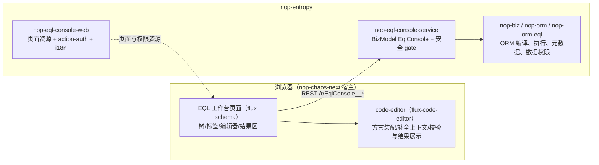

# EQL 在线编辑与测试工具 Architecture Baseline

## 1. 分层与依赖方向

约束：

- 依赖方向单向：前端 → 后端 API → ORM/EQL 内核；内核不得反向依赖控制台。
- 前端不直接连接数据库、不持有凭据；所有执行经后端 BizModel。
- 控制台模块依赖 `nop-biz`、`nop-orm`、`nop-orm-eql`、`nop-web`；不依赖 `nop-report`、`nop-metadata`、`nop-dev-tools`。
- 页面资源归属 `nop-eql-console-web`；后端 API 归属 `nop-eql-console-service`（分层理由见 `03-eql-console-api-and-security.md` §1）。

## 2. 核心对象职责契约

| 对象 | 所属层 | 职责 | 不负责 |
|---|---|---|---|
| `SqlDialectProfile` | 前端 `flux-code-editor` | 描述一种 SQL-like 方言的关键字/类型/CodeMirror 方言/格式化/补全模式/默认校验与执行配置（v1 不含函数补全） | 不承载 EQL 语义、不解析 SQL |
| `EntitySchema` / `EntityPropertySchema` | 前端契约 + 后端 DTO | 描述实体、属性、类型、关联，供补全与实体树 | 不描述物理表名/内部类名 |
| `SqlDiagnostic` | 前后端共用契约 | 结构化错误/告警：code、message、severity、1-based 行列 | 不携带堆栈/内部异常文本 |
| `EqlConsole`（BizModel） | 后端 service | 元数据、校验、执行、写操作（受控）的唯一入口与安全 gate | 不负责页面渲染、不做会话/连接管理 |
| 工作台页面 | 后端 web + 宿主 | 组合树/标签/编辑器/结果区；把页面 scope 与 API 接线 | 不复制后端语义逻辑 |

## 3. 关键决策

### D1 前端方言化：Dialect Profile 注册表，而非新增 renderer/language 分支

- 结论：在 `flux-code-editor` 中提供可注册的 `SqlDialectProfile`；EQL 只作为 profile 配置实例。`SQLDialect` 联合类型扩展为「内置名或 profile 名」，不再写死 switch。
- 理由：现有 `code-editor` 设计契约不为 SQL 注册平级 renderer type；CodeMirror `SQLDialect.define` 与 `sql-formatter` 的自定义 dialect 已具备配置化能力；`registerLanguage` 已存在运行期扩展点。
- 拒绝：新增 `eql-editor` renderer type（复制组件、破坏单协议）；在 `createBaseExtensions` 内写 EQL 分支（不可配置、不可扩展）。
- 兼容性：页面只依赖增量字段。**不承诺跨 bundle 版本执行兼容**：执行请求字段由 `sql` 改为 `eql`、参数由对象改为数组，页面与 bundle 必须同快照发布；旧 bundle 下仅编辑/渲染能力可用，执行链路不保证可用。页面不做运行时 bundle 版本探测。

### D2 补全元数据：EntitySchema + entity-path 模式，服务端出数据、前端算上下文

- 结论：方言 profile 声明补全模式；EQL profile 使用 `entity-path`。实体元数据由后端 `loadMeta` 聚合下发（含 querySpace/属性/关联），前端按 FROM/JOIN 别名绑定与光标路径计算候选。
- 理由：EQL 补全是实体属性导航（多级、to-one/to-many、`_some/_all`），扁平 `TableSchema` 无法表达；逐键请求服务端补全会引入延迟与状态同步问题，而元数据可一次性版本化下发。
- 拒绝：沿用单层 `alias.column` 正则补全（无法表达 EQL）；把 ORM 元数据硬编码进前端（不可配置、易漂移）；服务端逐键补全提案（v1 不引入网络往返）。

### D3 后端宿主：新建 `nop-eql-console` 模块组

- 结论：新建 `nop-eql-console-api`（DTO）、`nop-eql-console-service`（BizModel）、`nop-eql-console-web`（页面/权限/i18n）；不建 model/dao/meta/codegen（v1 无持久化实体）。可选 `nop-eql-console-app` 独立宿主，v1 先挂 demo 应用联调。
- 理由：控制台是「服务框架 + 持久化」的上层消费者；依赖方向正确、领域边界清晰、安全护栏可在一处收口。代码无 DDL、无凭据托管，不需要独立数据库。
- 拒绝：放进 `nop-sys`（系统管理域与任意 EQL 安全边界混杂）；扩 `nop-metadata`（其数据源/querySpace 与 ORM querySpace 是两套机制，易让前端误用）；扩 `nop-report`（`nop-report-core` 不依赖 ORM，需破坏分层）；放进 `nop-biz/dev`（无 web 页面归属）。

### D4 页面形态：后端 flux 页面，不新增宿主内置路由

- 结论：在 `nop-eql-console-web` 提供 `main.page.yaml`（AMIS 入口占位）+ `main.flux.yaml`（手写 flux 工作台 schema），菜单与权限资源放同模块 action-auth。
- 理由：Nop 页面由 PageProvider 下发、flux 模式自动优先加载同名 `flux.yaml`；避免在 `nop-chaos-next` 增加第二套内置页面注册与发版耦合。
- 拒绝：在 `nop-chaos-next` 增加 builtin page（三仓页面职责混乱、菜单仍需后端资源）；纯 AMIS 页面（工作台需要 resizable/tree/tabs/code-editor 的 flux 组合能力）。

### D5 执行与校验契约：显式 action 注入，删除硬编码端点

- 结论：`code-editor` 的 `execution.executeAction` 必填；`validation.action` 为可选新增；执行结果统一为「列元数据 + 行 + 统计」信封；新增 `publishResult`/`onResult` 供页面级结果区消费。删除 `/api/report/execSql` 兜底。
- 理由：字段级组件不拥有 transport 协议；后端无该端点实现；页面级结果区需要分页/导出而非组件内部 state。
- 拒绝：保留默认端点（死代码、模块职责越界）；把结果状态提升为宿主级会话协议（超出字段组件边界）。

### D6 安全模型：默认拒绝 + 服务端强制

- 结论：门控层次为「部署开关（`nop.debug=true`）→ 权限点（`EqlConsole:read/write`）→ 语句面（只读默认、DML 需配置）→ 执行护栏（limit/timeout/数据权限/禁用项）」。
- 强制项：编译与执行必须开启行级数据权限（`enableFilter=true`）；拒绝 `SELECT ... FOR UPDATE` 与 `@dump` 装饰器；不暴露 `disableLogicalDelete`；元数据 DTO 白名单投影。
- 理由：任意 EQL 默认 `enableFilter=false` 会绕过行级数据权限；执行层不拒绝 DML；REST 错误体会丢弃 `SourceLocation`。安全必须在 API 层收口，不能依赖前端。
- 拒绝：只靠前端只读开关；只靠数据库账号权限；把工具做成通用连接管理器。

### D7 交付：三仓同步链路是唯一交付路径

- 结论：前端改动经 `nop-chaos-flux` 单测/构建 → `nop-chaos-next` 打包 flux bundle 与 dist → `sync-site.sh` 同步到 `nop-entropy/nop-frontend-support/nop-web-site` → entropy 页面与 E2E 验证。禁止手改 `nop-web-site` 产物。
- 理由：`nop-web-site` 是构建产物；现存同步脚本已包含生产构建防呆与 gzip 处理。
- 拒绝：直接把 flux 源码复制进 entropy（双份源码漂移）；在 entropy 内维护第二套前端构建。

### D8 参数与 Hint 策略：位置参数 + 结构化装饰器，不做注释语义

- 结论：EQL 语言层 v1 只支持 `?` 位置参数；控制台用「命名参数映射 + 顺序」提供命名 UX（请求仍为有序数组）。注释只做语法容忍、不承载语义；控制/Hint 一律用结构化 `@decorator`，控制台对装饰器执行白名单（允许 `@enableFilter`、`@querySpace` 一致性校验；拒绝 `@dump` 与未知装饰器）。
- 理由：EQL 参数编译按出现顺序编号、执行按索引取值，语言级命名参数需改文法/AST/公共 API 与生成管线（plan-first，成本高且与平台 `${}`/`:param` 概念重叠）；注释在 lexer 被送入 HIDDEN channel，AST/生成器不保留，按注释解析 hint 必须改文法且难以校验；装饰器已结构化、可扫描、可门控。
- 拒绝：v1 语言级命名参数（`:name` + Map 绑定）；把普通注释当语义；宽松忽略未知装饰器（会静默 no-op 并绕过安全门控）。语言级命名参数与数据库 hint 透传（`@dbHint` 或限定 `/*+ */`）列入 v2 评估，见 roadmap WI-31。

## 4. 单一事实源（SSOT）

| 事实 | 唯一 owner | 其他位置只允许 |
|---|---|---|
| 产品定位/成功标准/Non-goals | `00-vision.md` | 摘要 + 链接 |
| 分层/依赖方向/决策 D1—D8 | `01-architecture-baseline.md` | 链接 |
| 前端协议字段与语义（profile/EntitySchema/诊断/执行/结果） | `02-frontend-dialect-and-editor-contract.md` | 链接 |
| 后端 API、安全矩阵、配置键、权限点、错误模型 | `03-eql-console-api-and-security.md` | 链接 |
| 页面/菜单/交付与验收 | `04-workbench-page-and-delivery.md` | 链接 |

## 5. 兼容性约束

- `SQLEditorConfig` 现有字段语义不变；新增字段必须可选、缺省行为与改造前一致。
- 内置 5 个 SQL 方言的行为必须与改造前逐字节等价（profile 化只是注册方式变化）。
- 未提供 profile 或 profile 非法时降级到 `standard` 方言并告警，不得抛错阻断渲染。
- 页面级结果区为增量能力：未配置 `publishResult` 的既有页面行为不变。
- **明确 breaking change**：删除 `code-editor` 历史硬编码执行端点 `/api/report/execSql`；依赖该 fallback 的页面必须显式配置 `execution.executeAction`。除此之外未配置新字段时行为不变。
- 执行字段从 `sql` 改名为 `eql`：仅影响配置了非标准执行端点的页面，迁移需同步后端入参名。
- 后端 API 新增字段向后兼容；错误码/权限点命名在 v1 内冻结，变更需同步本目录与使用文档。
