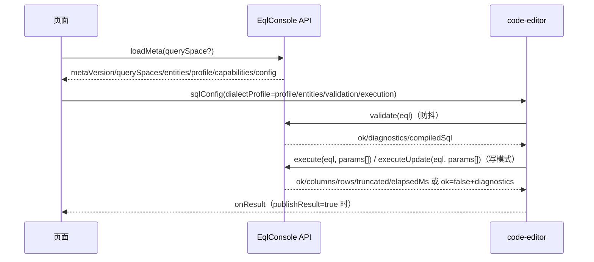

# EQL 工作台页面与三仓交付设计

适用范围：`nop-eql-console-web` 提供的页面与菜单资源、`nop-chaos-next` 宿主接线、以及 `nop-chaos-flux → nop-chaos-next → nop-entropy` 的交付链路。协议字段见 `02-frontend-dialect-and-editor-contract.md` 与 `03-eql-console-api-and-security.md`。

## 1. 页面形态

页面是「后端下发 flux schema」的工作台，不是 `nop-chaos-next` 内置路由。

```text
┌──────────────────────────────────────────────────────────────────────┐
│ 工具栏：querySpace ▾ | 实体过滤 | 执行(⌘/Ctrl+Enter) | 校验 | 格式化 | │
│        只读/写开关(受配置) | 历史上限 | 清空结果                      │
├───────────────┬──────────────────────────────────────────────────────┤
│ 实体树         │ 标签页 1 | 标签页 2 | +                               │
│  ▾ querySpace  │ ┌──────────────────────────────────────────────────┐ │
│    ▾ EntityA   │ │ code-editor（language=sql, dialectProfile=EQL）  │ │
│      · prop    │ │  - EQL 文本 / entity-path 补全 / 诊断下划线      │ │
│      ▸ rel     │ └──────────────────────────────────────────────────┘ │
│                ├──────────────────────────────────────────────────────┤
│                │ 结果区：结果表格 / 消息 / SQL 预览 | 分页/导出/耗时   │
└───────────────┴──────────────────────────────────────────────────────┘
```

职责：

- 实体树：展示 `loadMeta` 的 querySpace/实体/属性；点击实体插入 `SELECT ... FROM Entity e` 模板，点击属性插入属性路径。
- 标签页：每个标签独立保存 EQL 文本、选中数据源、结果快照；切换不丢状态；标签状态存页面 scope（刷新可恢复为缺省单标签）。
- 编辑器：`code-editor` + `language: 'sql'` + 内联 EQL profile；不新增 renderer type。编辑器允许注释语法，但注释不承载语义；控制/Hint 使用 decorator。
- 结果区：页面级结果区（`publishResult` + `table` + 分页 + 复制为 CSV/JSON + 消息/SQL 预览）；不使用文件下载作为 v1 验收（文件导出属 V2）。
- 工具栏：只读默认；写开关仅在 `config.allowWrite=true` 时展示，且每次切换需二次确认。

## 2. 页面资源与菜单

| 资源 | 路径（`nop-eql-console-web/src/main/resources/_vfs/nop/eql-console/`） | 说明 |
|---|---|---|
| AMIS 入口占位 | pages/EqlConsole/main.page.yaml（模块内 `_vfs/nop/eql-console/` 下） | 与 flux 版同名；flux 模式**优先加载**同名 `main.flux.yaml` |
| Flux 工作台 | pages/EqlConsole/main.flux.yaml（模块内 `_vfs/nop/eql-console/` 下） | 手写 flux schema：resizable/tree/tabs/table/code-editor/data-source |
| 权限与菜单 | auth/nop-eql-console.action-auth.xml（模块内 `_vfs/nop/eql-console/` 下） | 菜单资源 + `EqlConsole:read/write` 权限点 |
| i18n | `i18n/*.i18n.yaml` | 页面文案与错误提示 |

约束：

- 页面不内联大段 EQL 关键字/实体清单；这些从 `loadMeta` 注入。
- 冻结的页面标识：页面 URL `/nop/eql-console/pages/EqlConsole/main.page.yaml`；菜单资源 id `eql-console-main`；权限资源 `EqlConsole:read` / `EqlConsole:write`。
- 页面加载顺序：先加载 `data-source`（loadMeta）；加载中编辑器可渲染但禁用；元数据失败（含 Bean 未注册/无权限）时页面显示「未启用/无权限」状态与重试入口，编辑器保持禁用，不进入半配置状态。
- `nop.debug` 只门控后端 Bean；页面/菜单资源是静态文件。生产「页面/菜单不出现」由**不装配模块**保证；若已装配但未启用，页面显示「未启用」，菜单是否出现由 app 的 action-auth 装配决定。设计不承诺运行时自动隐藏菜单。
- 菜单/权限资源必须在宿主应用的 `app.action-auth.xml` 中以 `x:extends` 引入（demo 应用需显式增加）；否则菜单与 `EqlConsole:read/write` 权限点不会加载。
- 页面本身由 PageProvider 以 publicAccess 提供，页面加载不是鉴权边界；数据与执行的鉴权全部在 `EqlConsole` API 层完成（页面匿名可加载，但无权限时 API 返回 `permission-denied`，页面显示未授权态）。
- 菜单资源 ID 与页面 URL 在 v1 冻结；改名视为破坏性变更。
- 稳定测试 marker（E2E 契约）：`data-testid` 至少包含 `eql-console-root`、`eql-console-entity-tree`、`eql-console-editor`、`eql-console-execute`、`eql-console-write-toggle`、`eql-console-result`；新增 marker 只能增量添加。

## 3. 数据流



## 4. 三仓交付链路

唯一交付路径：

1. `nop-chaos-flux`：`flux-code-editor` 单测/类型检查/构建；`pack:flux-bundle` 产出 `@nop-chaos/flux` tgz。
2. `nop-chaos-next`：`import-flux-to-libs.sh` 拷贝 tgz → `repack-flux-and-refresh.sh` 刷新依赖 → `rebuild-flux-and-build.sh` 全量构建 → `sync-site.sh` 把 `apps/main/dist` 同步到 `nop-entropy/nop-frontend-support/nop-web-site/src/main/resources/META-INF/resources/`。
3. `nop-entropy`：重新构建 `nop-web-site` 资源，启动 `nop-demo/nop-quarkus-demo`（flux 模式）验证页面与 API。

契约：

- `nop-web-site` 是构建产物，禁止手改；同步脚本的生产构建防呆（`nop-shared-import-map`）必须通过。
- 页面依赖的 profile/validation/onResult 能力属于新 bundle；旧 bundle 下仅编辑/渲染能力可用，**不承诺执行可用**（执行字段 `sql→eql` 与参数形态变化），页面与 bundle 必须同快照发布；不承诺运行时 bundle 版本探测（当前无握手机制）。
- 后端 API 与页面可独立发布；页面新增字段必须为增量字段（旧 bundle 忽略未知字段），但**执行链路不承诺旧 bundle 兼容**（`sql→eql` 字段与 params 数组），灰度期间不保证执行可用。

## 5. 验收契约

### 5.1 前端（flux）

- `flux-code-editor` 单测覆盖：profile 解析/降级、entity-path 多级与集合算子、诊断 offset 换算、执行结果映射、未配置新字段时的零行为变化。
- 现有 13 语言、5 方言、diff/colorize/fullscreen/变量面板回归测试全绿。

### 5.2 后端（entropy）

- `loadMeta/validate/execute/executeUpdate` 契约测试（H2 dev profile）；诊断样本矩阵全覆盖（design 03 §4.3，含重复列名、自带 LIMIT/OFFSET、无 WHERE 写操作、@dump 拒绝）；断言 code + 位置或显式 `no-location`。
- 安全测试：`nop.debug=false` Bean 不注册；无权限时断言响应体 `status/code`（不是 HTTP 403）；action-auth 未开启或 `IActionAuthChecker` 缺失时入口 fail-closed；dev/E2E profile 显式开启 action-auth 并提供登录夹具；只读下 DML 被拒；`enableFilter=true` 时 FILTER 条件进入执行 SQL（用自定义 `IEntityFilterProvider` 单测钉死，不依赖 demo 的 `enable-data-auth` 配置）；`FOR UPDATE`/`@dump`/无 WHERE 的 UPDATE/DELETE/自带 LIMIT-OFFSET 被拒；limit 截断；超时注入 30s 生效（必过，不得以显式降级收口）。
- 元数据 DTO 白名单断言（不含物理表名/类名/SQL 片段）；v1 元数据可见性边界（持有 `EqlConsole:read` 可见全部实体/属性名）有测试钉死。

### 5.3 端到端（demo 应用）

- Playwright 场景（主路径）：登录（E2E 登录夹具）→ 打开页面（`eql-console-root`）→ 展开实体树（`eql-console-entity-tree`）→ 补全并插入路径 → 执行合法 EQL 断言结果 → 执行非法 EQL 断言诊断（code + 定位或 `no-location`）→ 只读模式执行 DML 断言被拒（断言响应体 code）→ 切换标签状态保持。E2E webServer 需带 `-Dnop.auth.enable-action-auth=true`。
- 增强能力（格式化/复制导出/历史/写开关二次确认/元数据加载失败态）由前端单测与页面验收覆盖；不作为 E2E 必过项。标签状态保持属于主路径，纳入 E2E。
- E2E 使用 `nop-entropy-e2e/packages/nop-web-e2e` 的 flux 模式 webServer 配置；测试串行执行。

### 5.4 文档

- 设计变更同步本目录；使用说明进入 `docs-for-ai/`（实现落地后）；`node ai-dev/tools/check-doc-links.mjs --strict` 必须 0 error。
