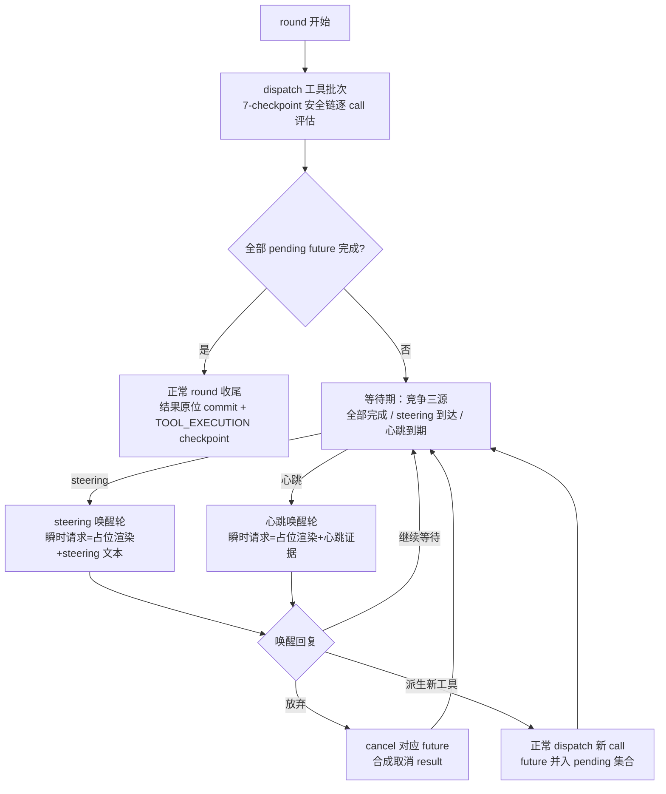

# nop-ai-agent 异步工具执行模型 设计

**日期**：2026-10-02
**范围**：`nop-ai/nop-ai-agent`（engine/message/reliability）、`nop-ai/nop-ai-toolkit`（bash 工具）、`nop-ai/nop-ai-shell`（shell 执行器）、`nop-kernel/nop-xdefs`（tool schema）
**状态**：active
**实施编排**：`ai-dev/backlog/nop-ai-agent-refactor-roadmap.md` M1（WI3 占位协议 / WI4 心跳 / WI5 steering 唤醒 / WI6 相位检查点 / WI25 后台模式按本文档实施）

---

## 一、设计结论

1. **等待优先**：round 同步等待全部工具完成保持为默认执行路径。工具自然完成走既有 round 边界回填，round 语义不解体。
2. **唤醒源仅两个**：steering 输入到达、心跳 timer 到期。不采用"单工具完成即唤醒"——避免 round 语义解体与 turn 膨胀。
3. **占位是派生态**：运行中工具的占位 tool result 仅存在于唤醒请求构造期，永不写入 session 历史；真实结果到达后按 callId 原位插入 tool_call 之后。三条不变量（§三.2）由全部实施 WI 共同维护。
4. **心跳带进度证据**：心跳 payload 携带运行中工具清单 + 已等待时长 + 沙箱增量输出缓冲尾部；模型判断为主路径，机械超时按工具类型分层降级为兜底。
5. **工具级后台模式（runInBackground）是与占位唤醒并列的第二形态**：模型可对声明了后台能力的工具选择后台执行，立即获得启动确认，真实结果经完成通知桥入 mailbox 驱动后续轮次。
6. **唤醒轮不是 react loop 迭代**：不消耗迭代预算、不触发 ISustainer；唤醒轮回复可携带新工具调用，经正常 dispatch 路径并入原批次等待集合。

## 二、背景与动机

长时工具（mvn install 类数十分钟任务）在现有执行模型下两条路径均不可用：默认 `toolTimeoutMs`（300s，`DefaultAgentEngineConfig.java:152`）下长任务 5 分钟被 `orTimeout` 杀为错误结果（`AgentToolDispatcher.java:271-283`）；调大超时则 `awaitToolFutures` 的 `allOf().get()` 阻塞整轮（`:304-319`），期间模型零推理、无进度可见性，steering 等至 round 边界。执行模型与"模型在等待期间保持推理能力"的目标存在结构性差距。

本设计在**不改变真相模型**（快照 + journal 范式）的前提下补齐该差距：等待期保持 mailbox 可见 + 心跳 timer，即可让模型在等待期间重新获得输入处理与判断能力，无需引入事件循环或事件溯源。

## 三、核心设计

### 1. 执行形态总览

### 2. 三条不变量（占位协议契约）

1. **派生态渲染**：占位 tool result 仅在唤醒请求构造期存在，不入 session 历史。消息列表"有 tool_call 无 tool_result"即 running 态的判定依据。实现构件：`OpenToolCallResolver`（消息级开放判定）+ `ToolCallPlaceholderRenderer`（占位渲染，每开放 callId 恰一份、不修改上下文）。
2. **原位插入**：真实结果到达后按 callId 插入对应 tool_call 之后（批次连续 tool_call/tool_output 区段末尾），非尾部追加。任一请求中同一 callId 的 tool_result 至多一份。实现锚点：`AgentToolDispatcher.commitToolResults`（正常/reenter 两路径共用同一插入 helper）。
3. **差集可判定**：崩溃恢复的开放 tool_call 集合 = 快照消息 × `TOOL_EXECUTION` checkpoint（callId 幂等键，`CheckpointType.java:26`）差集，不依赖任何新增持久结构。三态语义：(a) 消息级开放且无 checkpoint = never-committed orphan（恢复告警，`AgentSessionLifecycle` restore 验证环节接线）；(b) 消息级闭合（含 deny 错误 result）= 终态不告警；(c) 开放但有 checkpoint = commit→sync 崩溃窗口（归既有 messageCount 告警语义）。**WI6 相位修订（plan 2287）**：committed 集合仅计**终态**（无相位段）checkpoint——相位化 DISPATCHED/EXECUTING checkpoint 描述在飞执行，计入会静默消灭状态 (a) 孤儿告警；相位裁决（COMPLETED>EXECUTING>DISPATCHED>NEVER_STARTED，COMPLETED 以下=显式失败不盲目重跑）见 `nop-ai-agent-reliability.md` 相位裁决节。实现构件：`OpenToolCallResolver.filterNeverCommitted/filterCommittedButUnsynced/resolveExecutionPhase`。

### 3. 唤醒轮语义（裁定③）

唤醒轮 = 等待期内由 steering 或心跳触发的瞬时 LLM 请求。与 react loop 迭代的边界：

| 维度 | react loop 迭代 | 唤醒轮 |
|---|---|---|
| 迭代预算（currentIteration/maxIterations） | 消耗 | 不消耗 |
| ISustainer 咨询 | MAX_ITERATIONS 自然退出时咨询 | 不触发（该机制语义不变） |
| 前置门槛 | cancel→pause→WAIT_FOR→forceStop→assessGoal→压缩 | cancel + pause + forceStop 硬闸（唤醒请求构造前检查，防唤醒请求自身溢出） |
| LLM 调用 | LlmCallCoordinator（retry/熔断/执行级中间件） | 同左（retry/熔断/PRE/POST_LLM_ATTEMPT 全保留） |
| 输出内容 guardrail | 输出 guardrail 检查（POST_REASONING/POST_CALL 机制 + checkOutputGuardrail 快速路径） | **照常适用**（适用快速路径机制或其等价抽取，非 9 个 lifecycle 钩子点）：命中 BAIL → 放弃该唤醒回复，按继续等待处理并记审计 |
| 会话级 lifecycle 钩子（9 点）与 EXECUTION_COMPLETED | 触发 | 不触发（完成语义不适用于唤醒轮） |
| 持久化 | LLM_TURN checkpoint + session 同步 | ctx.addMessage 随下一次正常 checkpoint（TOOL_EXECUTION/LLM_TURN）落盘，不新增 checkpoint 类型；崩溃窗口内 steering 靠输入幂等（WI7）重投，心跳丢失无害 |

**唤醒轮实现补充裁定**（plan 2285 执行钉定；实现构件：等待会话 `AgentToolDispatcher.ToolPhaseSession`、fail-soft 入口 `LlmCallCoordinator.doWakeupCallWithRetry`、编排 `ReActAgentExecutor.runHeartbeatToolPhase/runHeartbeatWakeupTurn`、进度接缝 `IToolProgressTracker` + toolkit `BashExecutionTracker`）：

- **唤醒轮 LLM 失败语义 = fail-soft**：唤醒调用经 LlmCallCoordinator 专用入口（retry/熔断/执行级中间件保留），重试耗尽的终态失败只记日志并回到等待分片（下一节拍重试），不置 ctx failed、不发布 EXECUTION_FAILED、不触发 invokeOnError——工具仍在运行，LLM 瞬时不可用不应终结执行。常规迭代的失败语义不变。
- **模型切换审计跳过**：唤醒轮不写 model-switched 审计消息、不动 state.lastModelKey（审计属迭代语义）。
- **usage 归账**：唤醒轮 usage 照常累计（ctx.tokensUsed + usageRecorder），但不落 LLM_TURN checkpoint。
- **入 ctx 顺序**：心跳/steering 消息先入 ctx，assistant 回复后入（会话时序）。
- **放弃的 checkpoint 语义**：合成取消 result 对齐安全链 deny 先例——不写 TOOL_EXECUTION checkpoint（消息级闭合即终态，不污染不变量③三态判定）。

**steering 唤醒轮（WI5 Phase A）**：等待期 steering 到达时模型空闲（无在飞请求可打断）——等待循环以 steering probe（200ms 量子感知）检测队列，命中即以非破坏性快照构造瞬时请求（占位 + steering 消息），LLM 成功后执行 drain-commit（steering 消息先/回复后入 ctx）；失败路径 steering 留队列不回灌（下轮 probe 重试）；guardrail BAIL 特例：弃置回复但 steering 消息必须入史（真实用户输入）。裁决复用同一三选项协议。COMPLETED 事件优先于 STEERING_PENDING（边界 drain 兜底消费，不丢失）。facade 路径（heartbeat 关闭模式）不接 probe——steering 仍只在 round 边界消费（语义不变）。

**Phase B（在飞 LLM 请求打断-重建）立项裁定：不立项**（2026-10-02，plan 2286）。理由：Phase A 已覆盖等待期 steering 的及时处理（模型在工具等待期本就空闲，无需打断在飞请求）；在飞打断-重建要求请求可取消、新输入与占位状态合流、迟到响应按 turn 边界丢弃，改造成本覆盖流式语义且当前无场景驱动。successor 条件：出现流式 UI 桥接或亚秒级 steering 延迟需求时再立项。

**唤醒轮响应能力**：assistant 回复可携带三种决策之一——继续等待、放弃（cancel 对应工具 future 并合成取消 result）、并行独立工作（回复携带新 tool_use）。**决策线协议**：回复文本 `WAIT` = 继续等待（不可解析时默认）；`ABANDON <callId>`（或裸 `ABANDON` = 全部）= 放弃；回复携带 tool_calls = 并行独立工作（全量安全链后并入 pending）。派生工具调用的约束：

- 立即经**正常 dispatch 路径**执行：全量通过 7-checkpoint 安全链（`AgentSecurityConsultation.buildCheckpointChain:113-285`，逐 call 评估 `ReActAgentExecutor:1185-1193`）与 PRE_TOOL_ATTEMPT 执行级中间件，安全覆盖无豁免；
- 新 future 并入原批次 pending 集合，原 round 继续等待全部 pending 完成；
- 不计入迭代预算（归唤醒轮语义）；
- 后续唤醒请求中与其他运行中工具同样全量占位渲染（同一不变量）。

**唤醒轮上下文构造**：steering/心跳消息与其 assistant 回复作为事实记录入上下文；占位不入史（不变量①）。多轮心跳消息入史后真实结果原位插入造成的时间序倒置是不变量②的已接受代价。

### 4. provider 请求构造契约（裁定①）

唤醒请求的合法构造形态：占位 tool result 紧随未完成 tool_use 之后的**同一 user 轮**，steering/心跳文本以文本块后置于同轮 tool_result 之后（Anthropic 合并同角色轮）或作为紧随其后的独立 user 消息（OpenAI 的 tool 消息与后续 user 消息序列）；Gemini 以同轮 functionResponse 承载。约束来源：各 provider 官方契约要求 tool 输出紧随对应 tool_use/tool_calls/functionCall 之后、Anthropic 要求 tool_result 块先于同消息文本块且同角色相邻轮合并。

**双份 tool_result 不可达**：不变量①+②使占位与真实结果在任一请求中结构性互斥（占位仅在请求构造期存在、真实结果原位替换），因此不依赖任何 provider 对同 callId 双份 tool_result 的容忍度——这是放弃"占位入史后追加"形态的决定性理由。

**Anthropic 请求侧实现形态**（plan 2284 修正落地）：`AnthropicDialect.getRole` 将 tool_output 映射为 user 角色；`convertMessage` 中 tool_result 块先于文本块、工具输出不重复产出 text 块、tool_call 的 arguments JSON 寄居伪影 text 块源头清除（仅 tool_use 块）；`buildBody` 将相邻同角色消息合并为单一轮（块序保持消息序；合并轮顶层 providerHints 保留首个携带者，放置语义由 WI20 复核钉定）。OpenAI 侧 1:1 保序无需修正。

验证方式：dialect 级单测断言唤醒请求的 JSON 形态（`TestAnthropicDialect.testWakeupRequestFormToolResultBeforeText`、`TestOpenAiDialect.testWakeupRequestFormToolMessagesFollowToolCalls`）；live provider probe 为 watch-only residual（当前环境无 API key）。

### 5. 超时分层与心跳兜底（裁定②）

三层模型（内层优先）：

1. **模型 per-call 自选 timeout**：既有 `tool-call.xdef` timeoutMs 属性（BashExecutor 默认 30s），纳入第 2 层策略封顶；
2. **引擎级工具类型分层**：新增策略配置面 `toolTimeoutPolicy`——按工具名/tags 覆盖默认值与硬上限（cap），全局 cap 兜底无覆盖工具；
3. **心跳模型判断为主路径**：心跳轮模型裁决"继续等待"的工具免疫机械超时，至策略硬上限为止；机械超时仅兜底心跳不可用或模型未裁决场景。

推导约束：单工具等待期心跳轮数上界 = 策略硬上限 / heartBeatIntervalMs；封顶口径为单工具（唤醒轮派生的工具各获独立 cap 窗口，整轮聚合等待的治理兜底为 forceStop 硬闸 + 心跳模型判断），不存在单工具无界等待。

**工具内 wall-time 交互**：心跳裁决的"继续等待"只覆盖 dispatcher 层机械超时（orTimeout 兜底）；工具自级的 per-call wall-time（如 bash timeoutMs）仍由工具自身到期执行——模型裁决继续等待不能延长工具内部时限，需要更长时限时模型应在下次调用自选更大 timeoutMs（第 1/3 层交互边界）。

配置命名契约：`heartBeatIntervalMs`（默认 60_000——mvn 类场景输出增量 60s 可见性优于事件循环范式的 10min 粒度）、`toolTimeoutPolicy`（per-tool 覆盖 + 全局 cap）。

### 6. 等待实现与交互边界（裁定④）

- **等待实现 = CompletableFuture 组合**：等待期竞争三源（全部 pending 完成 / steering 到达 / 心跳 timer），保持可中断纪律（`awaitToolFutures` 的可中断 get 先例，`AgentToolDispatcher.java:312-319`）；不引入 event loop，不重写引擎主循环。
- **占位模式采用范围 = 全量**：等待期唤醒请求中所有运行中工具一律占位渲染；正常 round 完成路径零占位开销。拒绝按工具类型白名单（§四）。
- **7-checkpoint 安全链**：占位是请求构造期渲染，不经过安全链（安全链评估真实 dispatch）；占位不触发 PRE/POST_TOOL_ATTEMPT（无 attempt）；真实结果 commit 仍走 POST_TOOL_ATTEMPT + TOOL_EXECUTION checkpoint，语义不变。
- **POST_CALL guardrail**：占位不经 POST_CALL（会话级执行完成点，执行未完成不触发）；唤醒轮回复的内容 guardrail 适用（§三.3）。guardrail 覆盖面无净裁减。
- **溢出恢复环**：唤醒请求构造前执行 forceStop 硬闸检查；溢出→压缩→重试恢复环（autonomous roadmap WI5）落地后该检查自动升级为压缩重算，实施 WI 执行时复核吸收。
- **进度证据接缝**（plan 2285 修正：原 capturedRef 锚点为无生产流量的接缝）：bash 类工具的进度证据与进程取消通道落在 toolkit 的 `IBashSandbox` 接缝——`BashSandboxRequest` 携带 callId，host/docker 实现维护 callId 寻址的运行中登记（增量输出尾部快照 + 进程句柄），execute 开始登记/结束注销；agent 侧经 `IToolProgressTracker` 适配查询/取消（无实现时显式空值=证据不可用，非静默）。agent 侧 `ISandboxBackend`（NoOp/DockerSandboxBackend）为未接线的 shell-exec 预留面，与本机制无关。WI25 后台任务 registry 复用同一 tracker。
- **唤醒请求占位插入位置**：占位插入发生在请求副本（ctx 快照拷贝），锚定为该占位自身 callId 所在连续 tool_call/tool_output 区段末尾——多轮心跳/并行派生后历史含多个区段，逐占位按自身 callId 锚定保证 tool_result 紧随各自 tool_use（与不变量②同一区段语义，复用同一 list 级 helper）。

### 7. 工具级后台模式 runInBackground（裁定⑤，plan 2301 已落地）

**形态边界**：

- 开放面：bash/shell 类长时工具，经 tool.xdef `<background-capable>!boolean=false</background-capable>` 元素声明（**落地修订 plan 2301：不用 tags——tags 是可见性过滤机制（plan 296），加 `background` tag 会使 activeTags 不含该 tag 的 agent 隐藏 bash**）；模型在工具参数上设 `runInBackground: true`（camelCase，对齐既有 timeoutMs/workingDir 命名）选择后台执行；
- 不开放：subagent 类（call-agent）——member spawn 已有异步编排面，开放模型自选后台构成双通道；文件读写类——毫秒级完成无后台语义。

**语义**：置真时调用立即返回启动确认（taskId）；真实结果经完成通知桥入 mailbox 作为新输入驱动下一轮。**完成通知不是第三唤醒源**——经由既有 mailbox/steering 通道，"唤醒源仅 steering/心跳"的裁定不破。完成通知**恰好一次**（claim 令牌）；**输出读取单一通道**（plan 2301 落地裁定：不设"输出文件路径"——registry 内存有界 tail（8KB）+ 总字节，模型经 task-output 工具凭 taskId 读取；zcode 的 TaskOutput 双结果通道已废弃即此教训，读取幂等不消费 claim）。

**超时独立分层**：`backgroundTaskTimeoutMs` 默认 3_600_000 模型 per-call 可调、硬上限 1h（映射沙箱 wallSeconds）；后台任务 registry（`DefaultBackgroundTaskRegistry`）提供跨调用可寻址的状态/输出 tail/进度快照（RUNNING 期 live tail 复用 IToolProgressTracker，§6 进度证据接缝）。

**既有 `&` 语义修复**：`&` 接入后台任务 registry 闭环（shell 侧 SPI `IBackgroundJobSink`，确认携带 `[taskId=...]`）；registry 未就绪时 `&` 显式报错（exit 126，快速失败），不维持失联现状。落地契约详见 `04-tool-invocation.md` §4.5。

## 四、拒绝了什么

| 被拒方案 | 拒绝理由 |
|---|---|
| 全量事件循环 + 工具完成即唤醒（unreal 形态） | 改造面覆盖引擎主循环与 round 语义；等待期唤醒场景下模型本就空闲（阻塞在工具上、无在飞请求），完成即唤醒的取消/重建机制用不上；turn 膨胀不可控 |
| session 事件溯源（log 即真相、消息是投影） | 本特性三样持久物（唤醒事实/派生开放集合/恢复判定）在快照+journal 范式内全有位置；迁移成本覆盖恢复/发散检测/接管锁全链，收益不成立 |
| 纯机械超时（现状/dsh timeout-policy 路线） | 对数十分钟真实负载直接不可用；无进度证据时无法区分慢与死锁 |
| 占位按工具类型白名单 | 任何工具都可能慢，白名单徒增配置面与漏配风险；占位仅构造期渲染，全量采用零持久开销 |
| 唤醒轮回复仅允许文本决策 | 收窄已钉定的"并行独立工作"选项，且派生工具经正常 dispatch 路径即可获得完整安全覆盖，无安全理由收窄 |
| call-agent 模型自选后台 | member spawn 已有异步编排面，双通道增加治理面而无增量能力 |
| 心跳间隔 10min（unreal 默认） | mvn 类场景输出增量粒度太粗，模型判死锁的证据密度不足；60s 在请求成本与证据密度间平衡 |

## 五、与已有设计的关系

- `nop-ai-agent-react-engine.md` §5.2：正常 round 边界 drain 语义保持不变，本设计只增加等待期唤醒轮；§5.5 心跳三选项语义由 §三.3 落地。
- `nop-ai-agent-react-engine.md` §5.5 与 `04-tool-invocation.md` §4.4：唤醒轮/心跳的目标形态描述以本文档为实施契约权威。
- `04-tool-invocation.md` §4.5：runInBackground 形态边界由本文档 §三.7 收口。
- `guardrail-contract.md`：7-checkpoint 安全链对唤醒轮派生工具调用全量适用；POST_CALL 的占位/唤醒轮边界见 §三.6，覆盖面无净裁减。
- `nop-ai-agent-session-and-storage.md` §8.3：三不变量是快照+journal 范式内的派生态契约，不引入新持久结构。
- `nop-ai-agent-channel-connector.md` / mailbox 体系：完成通知桥与 steering 共用 mailbox/steering 通道。
- autonomous roadmap WI5（溢出恢复环）/WI7（输入幂等）：与本设计的协同条款见 §三.3/§三.6/§三.3 持久化行。
