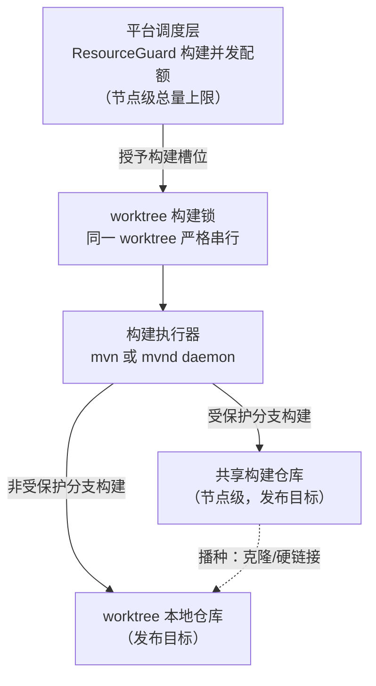

# Agent 构建调度与 Maven 仓库隔离设计

**日期**：2026-10-08
**范围**：nop-ai-maven（构建/仓库原语）、nop-ai-agent（worktree 生命周期、ResourceGuard 构建配额）、部署运行环境（Java/Node 工具链）
**状态**：active（设计基线；实现为显式 successor）
**决策来源**：2026-10-08 平台维护者裁定——不定制 mvnd，构建统一调度由平台外层实现；maven 仓库按受保护分支区分发布目标

---

## 一、设计结论

1. **构建排队在平台外层做，不定制 mvnd fork**。mvnd 仅作为可选 daemon 执行器受益于构建复用；串行化、并发上限等调度语义全部由平台层实现（同一套 ResourceGuard 抽象，与模型并发度同构）。
2. **构建并发是 ResourceGuard 的一等配额维度**：节点级并发构建总量由平台配额控制；同一 worktree 内构建严格串行（工作区文件锁，持有者进程死亡自动释放，超时强杀）。
3. **仓库隔离按受保护分支区分发布目标**：受保护分支（默认主干，可配置列表）构建的产物发布到共享构建仓库（节点级）；非受保护分支的 worktree 构建一律 install 到 worktree 本地仓库。**硬约束：全局可见的构建产物只能来自受保护分支构建。**
4. **消费侧播种**：worktree 本地仓库从共享仓库播种（克隆/硬链接，只播种已存在工件，不触发网络下载），第三方依赖不在每个 worktree 重复下载。
5. **nop-ai-maven 的 DeltaVFS 是仓库隔离的产品原语**：base 仓库只读 + delta 仓库可写，`findArtifact` 优先 delta、回落 base，`install` 恒进 delta。
6. **mvnd 组合约束**：`maven.repo.local` 是 mvnd 的 DISCRIMINATING 选项——不同 worktree 的仓库路径自动路由到不同 daemon 池，per-worktree 仓库隔离与 mvnd 天然兼容，组合零冲突。
7. **工具链范围只含 Java 与 Node**：构建/运行环境的版本与位置由平台注入，agent 进程不可改写；构建在受控执行环境（沙箱分级，服务器端推荐容器沙箱，fail-closed）中进行。

## 二、背景与动机

多 agent 并行工作时有第二类稀缺资源：编译构建（CPU / 内存 / 磁盘 IO）。它与 LLM 并发度控制同构但机制不同——构建是重进程操作，且对工作区有写副作用。必须回答三个问题：

1. **排队谁来做**：构建工具自身没有跨调用协调能力（见 §3.1 事实依据），并发的两个构建在同一工作区会互相破坏（`target/` 竞争写、本地仓库竞争下载与 install）。
2. **产物发布到哪**：多个 worktree 并发 `install` snapshot 到同一个本地仓库会互相覆盖，污染主干构建；完全不共享又导致每个 worktree 全量重建依赖仓库（GB 级体积与分钟级时间）。
3. **跨 worktree 依赖如何表达**：worktree B 需要依赖 worktree A 的产物时，唯一显式通道应是 A 进主干——否则依赖关系不可追溯。

## 三、核心设计

### 3.1 调度分层：平台配额 → worktree 串行 → daemon 执行

事实依据（构建工具无跨调用协调，调度必须在外层）：mvnd 客户端不排队——`DaemonConnector.connect()` 只连「空闲且兼容」的 daemon，否则直接新建，并发 N 个命令即 N 个 daemon 并行；daemon 端 accept 循环一次只服务一个客户端，但客户端从不排队（mvnd 上游源码锚点：client 侧 `DaemonConnector` 的 connect 方法、daemon 侧 `Server` 的 accept/handler 循环）。普通 `mvn` 更无任何协调。



worktree 构建锁语义（伪代码）：

```
acquire 构建槽位（平台配额，tryAcquire，满则排队或拒绝）
acquire worktree 构建锁：
    锁 = {worktree}/.build.lock（FileChannel 文件锁，持有者进程死亡自动释放）
    未获取 → 等待（同 worktree 严格串行）
    获取 → 注入 -Dmaven.repo.local={按 §3.2 选定的发布目标仓库}
        → 执行构建（平台超时 → 强杀进程树 → 标记失败）
        → finally 释放锁与槽位
```

锁的超时与死亡释放语义：持有者 kill -9 后文件锁由操作系统回收，下一个等待者获得锁前先检测上次构建是否留下残留锁状态（陈旧标记则清理）。

### 3.2 仓库隔离：受保护分支决定发布目标

| 构建发生地 | 分支类型 | install 发布目标 | 下游可见性 |
|-----------|---------|----------------|-----------|
| 主工作区 | 受保护分支（默认主干，可配置列表） | 共享构建仓库（节点级） | 本节点全部 worktree 可消费 |
| worktree | 非受保护分支 | worktree 本地仓库（worktree 内或平台数据目录下） | 仅本 worktree |

**发布目标由构建包装器强制注入**（`-Dmaven.repo.local`），不依赖构建脚本自觉：受保护分支之外的构建进程对共享仓库**只读**——隔离不靠约定，靠仓库路径注入 + 权限/包装器强制。

**播种**：worktree 创建时从共享仓库播种本地仓库——按仓库索引复制/硬链接已存在的工件（macOS 用 clonefile，Linux 用硬链接，其他回退目录复制），不触发任何网络下载。播种后的 worktree 仓库是独立可写副本，下载缺失依赖时只进本地仓库。

**跨 worktree 依赖纪律**：worktree 间不直接消费彼此产物。worktree A 的成果要被其他人依赖，唯一通道是 A 的分支合入受保护分支并触发主干构建——依赖关系因此可追溯、产物因此全局可见。平台不提供 worktree 到 worktree 的临时发布通道。

**与 nop-ai-maven 原语的关系**：`DeltaVirtualFileSystem` / `DeltaWorkspaceReader`（base 只读 + delta 可写，findArtifact 优先 delta、install 恒进 delta）是本隔离模型的解析层原语；共享仓库/本地仓库分别是 base 与 delta 的物理实例化。

**worktree 生命周期联动**：worktree 回收（branch-affinity §3.4.6 / §3.4.7）时，其本地仓库一并回收；worktree 构建锁先于目录删除释放。

### 3.3 与 worktree 生命周期的关系

- worktree 创建（branch-affinity §3.4.3）完成后执行仓库播种，播种耗时计入 worktree 就绪时间。
- 同一 (project, branch) 单活跃 session 的亲和约束（branch-affinity §3.4.8）保证同一 worktree 不会有并发构建竞争；worktree 构建锁防御的是同 session 内的并发工具调用。
- 构建配额维度挂载于 ResourceGuard（actor-runtime-vision §5 / Phase 5）：`BUILD_CONCURRENCY_PER_NODE`（节点级总量），与 `CONCURRENT_ACTORS_PER_TENANT` 同一套 `checkConcurrent → QuotaDecision` 契约。

### 3.4 Java/Node 工具链边界

- **范围**：只支持 Java（Maven 工具链）与 Node（npm/pnpm 工具链）。其他语言的构建/运行支持是显式 Non-Goal。
- **工具链注入**：平台在 worktree 就绪时探测并注入 `JAVA_HOME` / `NODE_HOME`；项目版本 pin（`.java-version` / `.nvmrc`）由平台解析执行。agent 进程不得改写平台注入的工具链环境变量——工具链版本是平台资产，不是 agent 可变状态。
- **受控执行**：构建与测试命令经沙箱分级执行（security-and-permissions §7.1；服务器端推荐容器沙箱，fail-closed，沙箱启动失败拒绝执行，不回退 host）。

### 3.5 git CLI 工程约束（与 remote-service-platform §3.3 L2 联动）

agent 场景的 git 调用统一走系统 git CLI（branch-affinity §5.8b），进程环境必须满足：

- 机器可读输出：`--porcelain` / `-z`；locale 固定（`LC_ALL=C`）。
- **环境清洗**：子进程环境显式剔除 `GIT_ASKPASS`、`GIT_SSH_COMMAND`、`GIT_CONFIG_*` 等宿主持有的凭证/代理配置——agent 的 git 子进程不得继承宿主凭证；认证由平台注入的凭据通道提供。
- 超时 + 进程树销毁；`.git/index.lock` 冲突按 branch-affinity §3.4.8 的锁约定重试。
- 沙箱内 git 操作按部署策略收敛 `safe.directory` 等安全配置，不全局放开。

## 四、拒绝了什么

| 拒绝项 | 理由 |
|--------|------|
| 定制 mvnd（fork 内实现排队/调度） | 需长期维护 fork 并跟随 maven 上游；排队语义缺失是客户端架构使然，外层调度同时覆盖 mvn 与 mvnd，通用性更好。若未来语义验证充分，可考虑向 mvnd 上游贡献排队 PR，但不作为本平台依赖 |
| 全部 worktree 共享一个本地仓库并发写 | 下载/解包竞争损坏仓库；snapshot install 互相覆盖污染主干构建 |
| 每 worktree 全量重建仓库（不播种） | GB 级磁盘与分钟级时间开销，不可接受；播种后增量近零 |
| worktree 到 worktree 的临时发布通道 | 依赖关系不可追溯，破坏「全局可见 = 已进受保护分支」纪律 |
| 支持其他语言工具链 | 范围约束（00-vision 渐进式增强）；Java/Node 已覆盖本平台目标场景 |
| agent 自选工具链版本 | 工具链是平台资产；agent 可声明需求，由平台解析与注入 |

## 五、与已有设计的关系

- `nop-ai-agent-branch-affinity-scheduling.md` — worktree 生命周期（§3.4）、双环境共存（§3.2.2）、提交与合并模型（§3.6）、git CLI 选型（§5.8b）的出处；本篇的仓库隔离与构建锁挂接其上
- `nop-ai-agent-actor-runtime-vision.md` §5 / Phase 5 — ResourceGuard 配额契约；`BUILD_CONCURRENCY_PER_NODE` 为其新增维度
- `nop-ai-agent-remote-service-platform.md` — 构建并发作为平台一等配额的定位出处；§3.5 的 git 环境清洗与其 L2 密钥边界联动
- `nop-ai-agent-security-and-permissions.md` §7.1 — 沙箱分级与 fail-closed 约束的出处
- `nop-ai-toolkit mavenvfs（WI16/plan 2453 迁入 toolkit）` — DeltaVFS 仓库原语的模块级说明
- `docs-for-ai/03-modules/nop-ai.md` — nop-ai 模块组使用侧文档
