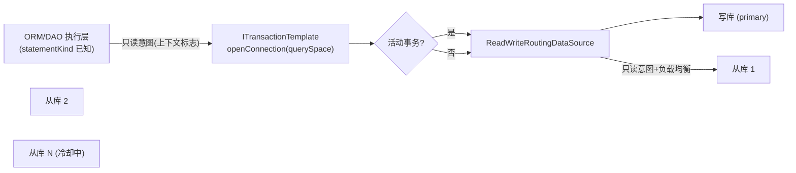

# nop-dao 读写分离设计

**日期**：2026-10-05
**范围**：`nop-persistence/nop-dao`（DataSource 层、事务模板连接获取）、装配（`dao-defaults.beans.xml`）
**状态**：active（2026-10-06 经 plan 2319 实施，端到端可用；使用契约见 `docs-for-ai/02-core-guides/datasource-and-readwrite-splitting.md`）
**灵感来源**：Apache ShardingSphere readwrite-splitting 功能面对比确认的缺口（生产诉求最普遍、移植成本最低的核心项）

---

## 〇、实施裁定（Decision，plan 2319 Phase 3 落档）

| 裁定点 | 结论 | 理由 |
|---|---|---|
| default querySpace 路由替换时机 | **初始化器 bean 生命周期**（`nopReadWriteDataSourceInitializer` 的 `init`，容器装配期执行），不设显式配置开关 | "开关"语义已由配置本身承担：配置存在即启用、为空即零行为变更（不注册任何东西）。独立开关只增加一种中间状态（配置了但未启用），无使用场景 |
| 物理数据源 bean 命名前缀 | **`nopReadWriteDs_`** | `DefaultTransactionManager` 以 `ioc:collect-beans name-prefix="nopDataSource_"` 收集数据源为 querySpace；读写分离物理库沿用该前缀会被误收集为幻影 querySpace。专用前缀天然隔离两个 collect-beans 面 |
| hint 承载形态 | nop-dao 本地 ThreadLocal（`ReadWriteHint`，对齐 `DynamicDataSource.runWith`/`QuerySpaceEnv.runWithQuerySpace` 先例），不进 `IContext` | 与 §3.4 裁定一致：作用域原语 try/finally 恢复，避免 proxy 上下文依赖 |
| 只读意图桥接点 | `JdbcTemplateImpl.runWithConnection` 的 `withTxn` 调用处（`withTxnForSql`），以 REPLICA 作用域包裹整个 `withTxn` 执行 | `withTxn` 无 SQL 参数无法感知语句语义；连接获取点（`JdbcTransaction.getConnection()` 懒取）在该作用域内，语义等价。显式 PRIMARY hint 与已打开事务不被覆盖 |
| ORM 只读标记范围 | 仅 `JdbcQueryExecutor` 对 `statementKind==SELECT` 的 transform 后 SQL（§五"ORM 侧唯一允许的改动"） | ORM 层不引入任何路由逻辑；`findPage` 等分页路径经 `SQL.begin(sql)` 重建，标志经复制面保留 |
| 配置承载形态 | `nop.dao.readwrite` 字符串/JSON 配置引用（`DaoConfigs.CFG_DAO_READWRITE`），事后解析 | 对齐 `nop.dao.config.query-space-to-dialect` String 配置先例，键名与 §3.2 一致 |

---

## 一、设计结论

1. **路由器是 DataSource 层的装饰器**：`ReadWriteRoutingDataSource`（实现 `javax.sql.DataSource`，包装一写多读物理库）由装配初始化器注册进事务管理器（default querySpace 替换 `defaultFactory`，非 default querySpace 经 `addQuerySpace`）。事务管理器、`ITransactionTemplate`、ORM 会话对它完全无感知——这是 `nop-orm-scope-and-non-goals.md` §3.5"读写分离路由归 DataSource 层、策略单点"裁定的直接落地。
2. **读写判定三级输入**：显式 hint（`forcePrimary`/`forceReplica`，与 `DynamicDataSource.runWith` 同族的 ThreadLocal 原语）> 事务上下文（活动事务内一律主库）> 语句语义（无事务 + 只读语句 → 从库；写语句或语义未知 → 主库 fail-safe）。语句语义来自既有元数据（EQL 编译产物 `statementKind`、ORM 各操作的已知类型），**不做任何运行期 SQL 解析**。
3. **意图传播与路由执行分离**：DAO/ORM 执行层只传播"只读意图"（上下文标志，随 `ITransactionTemplate.openConnection(querySpace)` 这条统一连接获取路径传递），不参与路由决策；负载均衡、故障剔除、事务内策略全部收敛在路由 DataSource 内。
4. **一致性契约显式化**：事务内读 = 主库（对齐 ShardingSphere `TransactionalReadQueryStrategy.PRIMARY` 缺省语义）；不做隐式写后读粘滞（write-then-read sticky）——需要强一致读的业务用事务或显式 hint，不引入时序上难以推理的隐式语义。
5. **故障处理进程内自治**：从库获取连接失败立即换下一台；连续失败进入冷却，冷却期满半开重试。不依赖注册中心（ShardingSphere master 已删除 db-discovery，静态分组 + 进程内探活即上游现状）。

## 二、背景与动机

现状事实（均已核实）：

- 全仓无任何读写分离实现（检索 `readwrite|replica|读写分离` 零命中）；`nop-orm-scope-and-non-goals.md` §3.5 已将读写分离划归 DataSource 层，该层至今空白。
- 多数据源装配现成：`dao-defaults.beans.xml` 以 `ioc:collect-beans name-prefix="nopDataSource_"` 收集每个 querySpace 一个 DataSource bean，`DefaultTransactionManager` 按 querySpace 组织事务工厂。
- 连接获取统一入口现成：`ITransactionTemplate.openConnection(querySpace)`；事务内 `JdbcTransactionFactory`/`JdbcTransaction` 从 DataSource 取连接并绑定事务。
- ThreadLocal 切换原语现成：`DynamicDataSource.runWith(dataSource, task)`（手动切换整个 DataSource 引用）。
- 语句语义元数据现成：EQL 编译产物 `CompiledSql` 携带 `statementKind`（SELECT/DML），ORM 按主键 load/save/delete 等操作类型也是已知的——只读判定不需要解析 SQL 文本。

动机：读扩展是最普遍的生产诉求（OLTP 应用读远多于写），而 nop 当前的多 querySpace 机制只支持"按业务域分库"，不支持"同库主从读写分流"。ShardingSphere master 的读写分离收敛为静态分组 + 负载均衡 + 事务内读策略，正是低成本可对齐的形态。

## 三、核心设计

### 3.1 组件与数据流



路由判定语义（伪代码，语义契约）：

```
getConnection():
  if 显式 hint 存在:            # forcePrimary / forceReplica
      按 hint 选库（forceReplica 且无可用从库 → 抛错，不静默回主库）
  elif 当前上下文存在活动事务:
      主库                       # 事务内读策略，缺省且 v1 唯一取值
  elif 只读意图标志为真:
      从库池按负载均衡算法选一台（故障剔除/冷却过滤后）
  else:
      主库                       # 写语句或语义未知，fail-safe
```

### 3.2 配置契约（`nop.dao.readwrite`，JSON 文本）

```json
{
  "nop.dao.readwrite": {
    "default": {
      "write-ds": "nopReadWriteDs_default_write",
      "read-ds": ["nopReadWriteDs_default_read1", "nopReadWriteDs_default_read2"],
      "load-balancer": "round-robin",
      "weights": { "nopReadWriteDs_default_read1": 8 },
      "replica-fail-threshold": 3,
      "replica-cooldown-seconds": 30
    }
  }
}
```

顶层 key = querySpace 名（default querySpace 用 `"default"`）。承载形态为字符串/JSON 配置引用（`DaoConfigs.CFG_DAO_READWRITE`），与 `nop.dao.config.query-space-to-dialect` 的"String 配置事后解析"先例一致；yaml 场景下即 `nop.dao.readwrite` 键下的嵌套对象。

物理库仍是普通 DataSource bean（HikariDataSourceFactory 既有体系），**bean 名前缀 `nopReadWriteDs_`**（实施裁定见 §〇，避免与 `nopDataSource_` 的 collect-beans 碰撞产生幻影 querySpace）。装配初始化器解析本配置组装 `ReadWriteRoutingDataSource` 并注册进事务管理器。未配置读写分离的 querySpace 行为不变（直连既有单库 bean）；配置为空时初始化器不注册任何东西。

### 3.3 一致性契约

| 场景 | 路由 | 理由 |
|---|---|---|
| 活动事务内的任何语句 | 主库 | 从库读破坏事务内一致性；一个事务一个库（无 XA，既有裁定） |
| 无事务 + SELECT（含 QueryBean/EQL/sql-lib 只读项） | 从库 | 复制延迟可容忍的读扩展场景 |
| 无事务 + DML / 原生 SQL 未标注 | 主库 | fail-safe：语义未知宁走主库 |
| 显式 `forceReplica` | 从库（不可用则报错） | 显式要求不静默降级 |
| 显式 `forcePrimary` | 主库 | 写后立即读、报表等强一致场景 |

**写后读（write-then-read）不在隐式保证范围**：同一请求内先写后读、且不在事务内时，读可能命中未同步的从库。需要强一致读的业务必须使用事务（事务内=主库）或显式 `forcePrimary`。拒绝隐式 sticky 的理由见 §四。

### 3.4 意图传播的边界

- 只读意图是**调用方声明**（EQL `statementKind==SELECT` 且无事务、ORM 只读操作路径），不是运行期推断——不解析 SQL 文本，与 ShardingSphere 的 parse-route 管线不同，这是 nop"元数据已知情"架构的天然简化。
- sql-lib 的原生 `<sql>` 项无法可靠判定语义时缺省主库；允许在 sql-lib item 上显式标注只读（模型声明，仍非解析）以获得从库路由。
- hint 原语与 `DynamicDataSource` 的 ThreadLocal 机制同族：后者切换"整个 querySpace 数据源"，前者在单 querySpace 内切换"主/从"，二者正交可叠加。

### 3.5 故障处理

从库 `getConnection()` 抛异常：立即按负载均衡顺序尝试下一台；全部不可用 → 抛错（携带各从库失败摘要），**不静默回退主库**（否则从库故障会静默演变为全量主库压力，失去可观测性）。连续失败 N 次（`replica-fail-threshold`）的从库进入冷却期，跳过选择；冷却期满半开放一台探测连接，成功则恢复。状态为进程内存量，无外部依赖。

## 四、拒绝了什么

| 被拒方案 | 拒绝理由 |
|---|---|
| ORM 层路由（按语句改写 querySpace） | 违反 §3.5 策略单点裁定；且只覆盖 ORM 路径，裸 JDBC/nop-batch/第三方直连不受益 |
| 运行期 SQL 解析判定读写（ShardingSphere parse 管线） | nop 的 statementKind 与操作类型元数据已免费存在，解析是无谓成本与风险面；未标注语义缺省主库即 fail-safe |
| 隐式写后读粘滞（write-then-read sticky） | 引入"写过之后多久内读走主库"的时序语义，跨请求/异步边界无法一致推理；nop 已有显式工具（事务=主库、`forcePrimary`），显式优于隐式 |
| 事务内读策略 FIXED/DYNAMIC（ShardingSphere 全集） | 事务内在从库读需要会话级复制一致性论证，v1 只提供 PRIMARY 语义；有明确场景再扩展 |
| 从库故障静默回退主库 | 故障被吞掉，全量压力静默压向主库；宁可响亮失败（与平台"无静默错误"原则一致） |
| 注册中心动态发现/剔除（旧版 db-discovery 形态） | 引入 zk/etcd 依赖与运维面；上游 master 已删除该能力；进程内探活+冷却已覆盖静态分组场景 |
| 独立代理进程（ProxySQL/SS-Proxy 形态） | nop 是应用内嵌框架，进程内路由零额外运维；代理形态留给确实需要语言异构接线的场景 |
| 连接池层多池 + readonly hack | 依赖具体池实现的私有语义，不可移植 |

## 五、与已有设计的关系

- 本设计是 `nop-orm-scope-and-non-goals.md` §3.5（读写分离归 DataSource 层）的落地设计，不改任何 ORM 层语义；该文档无需变更。
- 与分片设计（`nop-orm-sharding-strategy-design.md`）正交且可叠加：分片路由产出 `ShardSelection(querySpace, shardName)`，读写分离在 querySpace 的 DataSource 内部再做主从分流；分库分表+读写分离的组合 = 分片策略的 `query-space-pattern` 指向配置了读写分离的 querySpace。
- 事务模型不变：一个事务一个库（主库），跨库仍按既有 best-effort 事务组语义（XA non-goal 既有裁定）。
- 实施挂点：`nop-persistence/nop-dao` 的 `io.nop.dao.jdbc.datasource`（路由 DataSource 与 hint 原语）、`ITransactionTemplate.openConnection` 路径（只读意图传递）、`dao-defaults.beans.xml`（装配）；ORM 侧唯一允许的改动是执行层传播只读意图（`JdbcQueryExecutor` 对 `statementKind==SELECT` 且无事务的路径），不含任何路由逻辑。
