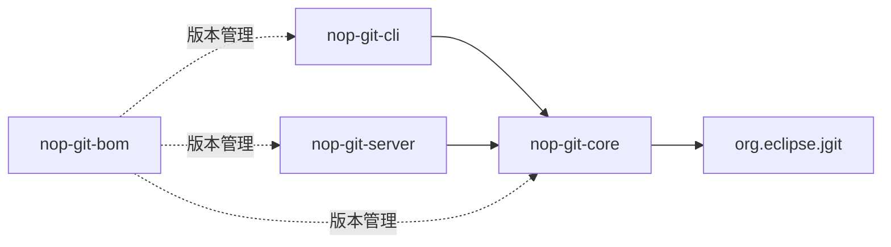
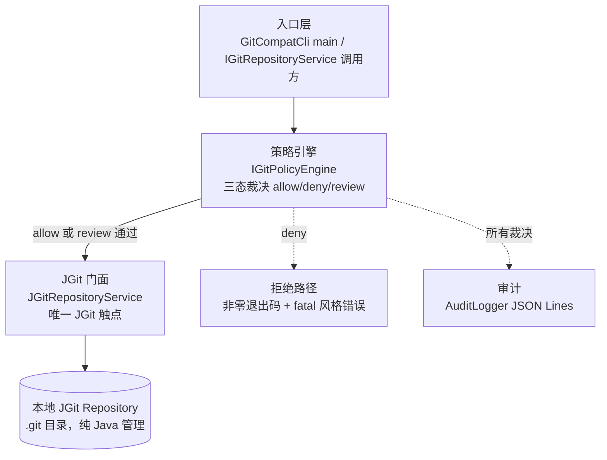

# nop-git Architecture Baseline

> 本档为规范性文档：只描述当前有效设计；变更历史见 git 与 AI 开发记录区的时效性文档。

---

## 一、模块拓扑

```
nop-tools/nop-git/
├── nop-git-bom        # 依赖版本管理（JGit 版本唯一声明点）
├── nop-git-core       # API 门面 + JGit 适配层 + 策略引擎 + 审计（无 CLI 依赖）
├── nop-git-cli        # git 兼容命令行入口（main + 参数解析 + 输出格式化）
└── nop-git-server     # （可选，靠后）GitServlet HTTP 端点
```

依赖方向（单向，禁止反向）：



- `nop-git-core` 是唯一允许 import `org.eclipse.jgit` 的模块（vision §五 架构支柱测试）。
- CLI 仿照 nop-rg 的 multi-module 布局；平台根 BOM 增加 nop-git-bom import。

## 二、四层执行架构



## 三、核心对象职责契约

| 对象 | 职责 | 不负责 |
|---|---|---|
| `IGitOperationRequest` | 一次 Git 操作的归一化描述：子命令名、归一化选项集合、目标分支、涉及路径、远程名/URL、原始命令行 | 执行、裁决 |
| `IGitPolicyEngine` | 加载分层 YAML 策略；对 `IGitOperationRequest` 做 allow/deny/review 裁决；输出命中规则 ID | 执行 Git 操作、格式化输出 |
| `IGitRepositoryService` | 语义化 Git 操作门面：open/init/status/add/commit/log/branch/checkout/reset/clean/push…；每个公开方法先经 `IGitPolicyEngine` 裁决再执行；`AutoCloseable` | 参数解析、CLI 输出格式 |
| `GitCompatCli` | 解析 git 风格 argv → `IGitOperationRequest`；调用策略引擎与门面；按原生 git 纯文本格式输出；映射退出码 | 策略逻辑、JGit 调用细节 |
| `GitOutputFormatter` | 将门面结果格式化为原生 git 兼容文本（porcelain、unified diff、oneline 等），无 ANSI 色码 | 任何执行逻辑 |
| `GitAuditLogger` | JSON Lines 审计：时间戳、原始命令、归一化操作、命中规则、裁决、实际结果 | 裁决决策 |

关键约束：

1. **CLI 与 API 共用策略引擎**：`GitCompatCli` 解析后、`IGitRepositoryService` 每个公开方法内部，两点都调用同一 `IGitPolicyEngine` bean（同一配置源），防止 Java 侧注入绕过 CLI。
2. **对外不暴露 JGit 类型**：`IGitRepositoryService` 的签名只使用自有类型（`NopGitStatus`、`NopGitCommit`、`NopGitRef` 等）。源码是代码层面唯一事实，接口方法清单以源码为准，本档只锚定契约方向。
3. **Repository 生命周期**：每次 CLI 调用创建一个 service 实例，try-with-resources 关闭；并发写同一仓库由调用方串行化（JGit `Repository` 非线程安全）。
4. **分支名不硬编码**：当前分支经 repository 状态获取；空仓库（无 HEAD）时 `log` 输出空、`rev-parse HEAD` 返回原生风格错误，`init` 后的默认分支跟随配置（`init.defaultBranch`，默认 `master` 与 JGit 一致，可配 `main`）。

## 四、配置与目录约定

- 策略配置：`.nop-git/policy.yaml`（项目根）→ `~/.nop-git/policy.yaml`（用户级）→ 内置默认。合并语义 strict：deny 始终优先。配置随仓库版本化，变更可审计可回滚。
- 审计日志：`.nop-git/audit.log`（JSON Lines）。
- 伪装版本号：`git --version` 输出真实存在的 git 语义版本（如 `git version 2.45.0`），由配置项声明，不编造不存在的版本，避免触发工具版本比较逻辑异常。

## 五、错误处理

- 平台两层错误策略适用于 API 面：`nop-git-api` 类公共错误用 `NopException` + 专属 `ErrorCode`（`nop-git` 前缀）；CLI 面向 AI 工具，输出必须伪装成原生 git 错误格式（`fatal:` / `error:` / `warning:` 前缀 + 原生退出码语义：0 成功、1 失败、128 致命），策略 deny 用退出码 1 + `fatal: policy denied: <原因>`。
- 全部错误消息英文（平台约定），策略 deny 的 `<原因>` 取自策略配置的 message 字段。

## 六、拒绝了什么

- **从零实现 git 对象模型** —— 见 vision §五自完备裁定。
- **直接 exec 系统 git 进程桥接**（有 git 时转发、无 git 时 JGit）—— 两套执行路径导致输出/语义漂移，parity 无法稳定保证；JGit 单路径 + golden 对照测试更可控。客户环境本来就没有系统 git。
- **策略拦截只做在 CLI 层** —— Java API 调用方可绕过；两层共用引擎是硬约束。
- **策略配置用 JSON/数据库** —— 策略需随仓库版本化、人可读可 review，YAML 是业界 AI 代理策略引擎的通用选择；数据库引入运行时依赖且不可随分支携带。
