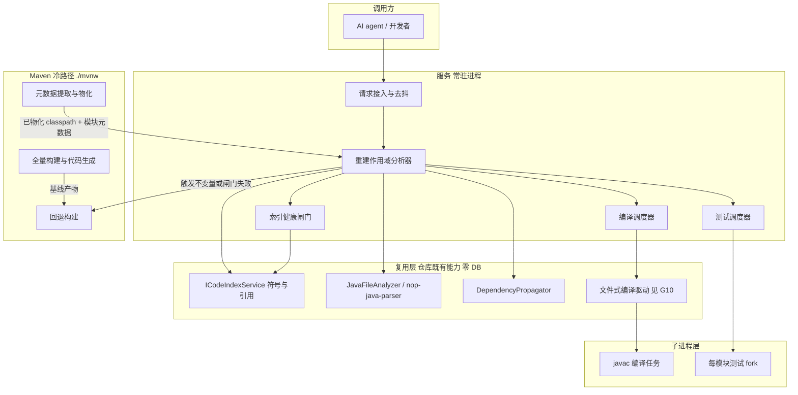
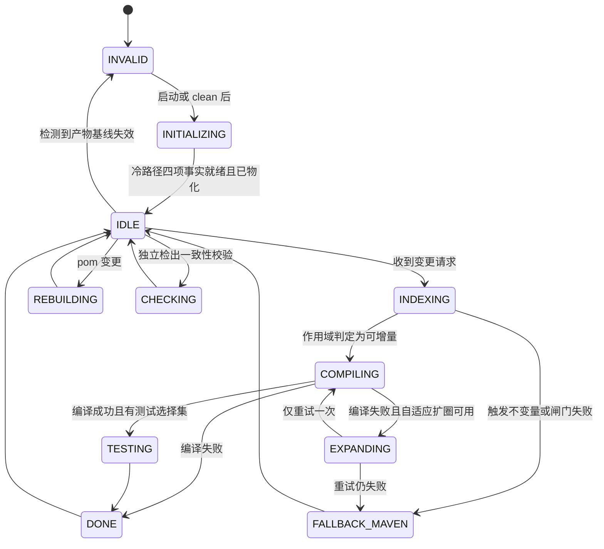

# AI 增量编译与测试服务 — Architecture Baseline

**日期**：2026-10-08（第三轮实测修订）
**状态**：草案。目标基线，实现未启动
**前置**：[00-vision.md](00-vision.md)。ROI 与替代方案见 [03-alternatives-and-roi.md](03-alternatives-and-roi.md)

标注约定见 Vision §头。

---

## 一、设计结论

1. **正确性不变量优先于增量效率**。六类场景（跨模块污染、`clean` 后状态失效、AOP 产物缺失、删除文件残留、数据/模型驱动测试、索引召回不足）**一律走 Maven 回退**，不尝试优化。
2. **classpath 必须物化为 reactor 目录**【实测】。`dependency:build-classpath` 对 intra-project 依赖给出的是 `target/project-local-repo` 下的 **jar 快照**，直接使用会让服务编译到冻结的上游产物，产生假绿。快照中禁止出现 jar 形式的 intra-project 依赖。
3. **跨模块阻断必须带签名谓词**【裁定】。有下游依赖方**不是**无条件回退条件——只改方法体是二进制兼容的，下游既有产物仍然有效。实测 64.3% 的编辑不触及签名；加上签名谓词后适用面从 3.8% 升到 **63.4%**。上一版把"有下游"当作无条件回退，误杀了 92.8% 的编辑中的绝大部分，是本设计最严重的一次错误。
4. **生成代码与 AOP 产物不进入增量路径，但按模块能力分级而非一刀切**。生成只覆盖部分模块，AOP 产物只落在 10 个叶模块；过度回退正是上一版把适用面压垮的原因之一。
5. **注解处理器按模块判定，不存在"全仓库无处理器"**【实测】。10 个 pom 配置了处理器（`nop-xlang-truffle` 的 truffle DSL 处理器生成主源码），2 个模块显式 `<proc>full</proc>`，`nop-kernel-cli` 用 `-proc:only`。启用处理器的模块恒回退 Maven。
6. **测试在隔离子进程中执行**。同 JVM 执行与本仓全局容器静态生命周期、`reuseForks` 语义、`dev:` VFS 的 cwd 依赖都不兼容。完整契约见 [02-test-execution.md](02-test-execution.md)。
7. **编译能力需自建**【实测】。既有 `nop-javac` 的生产接口无编译入口、只接受内存源码、无 release 通道，且正被 AOP 生产链消费；改造它需要评估波及面（G10）。

## 二、背景与动机

AI 编辑呈高频、小步、局部特征。本仓有三个放大因素：

1. **构建链上有代码生成**：每次构建执行 `CodeGenTask`（四个 execution，跨 `generate-sources`/`compile`/`generate-test-resources` 三个阶段），源码树有 291 个 `_gen` 目录、1,163 个生成 `.java`。跳过生命周期不等于跳过生成。
2. **每次验证的瓶颈是构建骨架，不是编译**【实测】。骨架成本 2.2–2.5s 且与模块大小无关；javac 在 3 文件模块上的边际成本为 0。**成本随并发放大**（8 路并发时每次调用 6.4–8.8s），而 javac 边际成本不变。详见 Vision §二。
3. **测试是数据驱动的**：1,015 个 `_cases` 文件与大量 XLang 模型驱动快照断言，它们**不产生任何 Java 符号引用**。只按符号引用做测试召回，对数据/模型变更**确定性漏测**。

因此本设计的收益来源是**绕开构建骨架**，而适用面由**下游依赖判定**决定——这两点是全文的主线。

## 三、系统分层



## 四、模块归属与依赖方向

归属属【待裁 G2】，推荐放在既有开发期工具组之下、与现有常驻调试服务子模块同级。理由：该组已在 reactor 内，语义上正是"开发期工具/常驻服务"，且避免新建顶层模块组的全套登记成本与 API 门禁。

不变式：

- **不新增 `-api` 模块**，契约保持内部接口。
- 依赖方向单向：服务 → `nop-code-core` / `nop-code-lang-java` / `nop-java-parser`。
- **不得依赖 `nop-code-service`**——【实测】它有 26 个依赖、需 IoC 容器与 13 个 ORM 实体、默认内存数据源重启即丢，且每次符号查询走多次 SQL 往返；而 `nop-code-core` 只有 7 个依赖、零 ORM 引用，传播器与 Java 分析器都在这一层。把构建工具变成必须启动应用容器的组件是纯粹的自我设障。
- 不得进入任何发布型模块的 classpath。

## 五、核心对象职责契约

| 对象 | 职责 | 关键契约 |
|------|------|---------|
| `IBuildFeedbackService` | 对外唯一入口 | 一次变更请求 → 一份构建反馈；见 §九 |
| `IRebuildScopeAnalyzer` | 判定重建范围 | 输入变更集，输出编译集、测试集、回退决定；**不得**产出"编译通过"这类结论 |
| `IGeneratedSourcePolicy` | 判定生成产物 | 输入路径与变更类型，输出"是否生成产物"与处置方式 |
| `IMavenProjectMetadataStore` | 冷路径元数据 | 保存并校验模块元数据；提供 classpath 物化与模块能力分级判定 |
| `IIndexHealthGate` | 索引可信度 | 索引不可信时**否决**增量路径，转为回退，不得降级为"尽力而为" |
| `IFileSourceCompiler` | 增量编译执行 | 输入编译集与已物化 classpath，输出结构化诊断。**与既有内存编译封装是适配关系而非复用**，见 G10 |
| `ISelectedTestRunner` | 受选测试执行 | 输入测试选择集与模块上下文，输出测试执行反馈；**必须**隔离子进程 |

命名遵循仓库约定：不用子系统懒前缀（本子系统内一切都是"增量的"），过通用名必须限定（`TestExecutor` 在 Java 生态过于拥挤）。实现类名跟随接口限定。

**能力边界**：Java 分析器硬编码语言级别 JAVA 21 且类型求解器为反射式（**无源码求解器**），因此**不做类型级判定**——它能给出"谁引用了这个符号"，给不出"这个调用是否类型正确"。后者由编译器保证。

## 六、模块能力分级

按能力分级而非一刀切回退。**过度回退是上一版把适用面从 63.4% 压到 3.8% 的直接原因**。

| 级别 | 判定来源（effective-pom） | 处置 |
|------|--------------------------|------|
| L0 纯手写 | 无代码生成 execution、无非空模板目录、无注解处理器 | 快路径 |
| L1 带生成 | 有 `precompile`/`precompile2`/`postcompile` 模板目录 | 变更落在**生成产物与模型文件**时回退 Maven；变更落在**手写源码**时可走快路径（生成产物已是基线产物） |
| L2 带注解处理器 | 有 `annotationProcessorPaths` 或显式 `proc` | 该模块回退 Maven |
| L3 特殊 | AOP execution 声明 / `argLine` 需 JVM 模块开关 / `skipTests=true` | 恒回退 |

关键区分：**"这个模块有代码生成"不等于"改这个模块必须走 Maven"**。只有改到生成产物或其输入模型时才必须走。

【实测】AOP 覆盖面比预想小：`aop` execution 只在 3 个 pom 声明，`__aop.class` 实际只落在 **10 个叶模块**。因此 AOP 感知按这 10 个模块精确处理，不全仓一刀切。

## 七、变更路由（伪代码，语义契约）

**每条分支都必须显式给出测试子句。** 上一版把"模型文件"与"`_gen/`"分支放在"数据/模型驱动测试"分支之前并直接结束，导致模型变更**编译成功但一个测试都不跑**——在平台最核心的模型驱动测试路径上确定性假绿。

```
输入：变更集

if 变更含 pom.xml:
    → 冷路径重建元数据 + 该模块全量测试
    → 若 pom 变更涉及源码根/输出目录/资源根增删：旧布局产物不会被自动清除，
      且仍留在构建输出中参与后续执行。此时不得原地 clean（会作废 IDE 增量状态），
      处置为：标记该模块基线失效 → 委托一次带清理的构建，或禁用增量结论至下次完整重建

if 变更含 XLang 模型文件 或 codegen 模板目录:
    → 回退 Maven 构建该模块（生成可能跨模块写源码）
    → 按 §八 反查消费该模型的测试模块集合 → 那些模块全量测试
      （不能只测所在模块：模型可被其他模块的测试消费）

if 变更含 _gen/ 下的文件:
    → 回退 Maven 构建该模块 → 按 §八 反查消费方 → 那些模块全量测试

if 变更落在测试数据或测试语料目录（判定规则见 §八）:
    → 按 §八 反查消费该数据的测试模块集合 → 那些模块全量测试

if 变更是配置类资源（bootstrap / beans 定义 / 服务注册 / properties / 日志配置）:
    → 该模块全量测试
      理由：codegen 自身会初始化容器并读同一份配置，它能改变生成代码，
            也决定容器测试的装配结果，因此不是"惰性资产"

if 变更是普通资源文件:
    → 不涉及编译与测试，结束

if 变更是测试源文件:
    → 该模块全量测试

otherwise（手写主源码）:
    → 进入编译作用域分析（§八 之 §9）
```

两条易漏的路由细节：

1. **文件监听必须区分"用户写入"与"构建期写入"**。codegen 与 AOP 会写 `_gen/` 与构建产物目录；不做区分会导致无限回退循环。
2. **写后洁净校验必须覆盖测试运行期写入工作树的全部位置**，实测至少包含模块的测试数据目录与运行产物目录（含其中嵌入本机绝对路径的子目录名）。无论这些路径是否已被版本控制忽略——**忽略不等于无副作用**：它们会把本机路径写进工作树，跨机器复用时造成混淆。

## 八、数据与模型驱动测试的判定【裁定：规则而非枚举】

上一版用后缀枚举（4 个），实测漏掉 7 类以上，包括 lint 子系统整个语料库（188 个夹具 + 155 个规则 + **113 个期望文件**）——而"改期望值去迎合一个回归"正是 AI 最容易犯的错。枚举会静默腐化，必须用规则：

```
判定为"测试数据/语料"（伪代码，语义契约）：
    若路径位于名为 _cases / _vfs/test / _gen 的目录下
    或 位于 src/{main,test}/resources 下且后缀在 XLang/xdef 解析器注册表内
    或 文件名匹配 gen-*.xgen
    或 资源文件名以 _ 开头（保留文件）
    → 判定成立，启动期枚举该注册表并断言，禁止硬编码清单
```

跨模块归属：实测存在测试读取**其他模块**的测试数据（相对路径逃逸）。因此必须建立"数据 → 消费测试模块"的反向索引；凡含跨模块读取的模块，其数据变更一律升级为**跨模块全量测试**。否则会出现"跑了数据的宿主模块全量、真正的消费方从未运行"。

测试文件识别**不能**依赖索引的测试标志字段——符号索引**没有这个字段**【实测】，既有实现只用路径启发式写了一条反向关系，且该启发式漏掉 `*Tests.java`、`*IT.java`、`*Spec.java` 与抽象基类。测试文件集合由本服务按路径后缀 + 抽象基类传递闭包自行维护。

## 九、编译作用域算法（伪代码，语义契约）

```
Step 1  索引更新
    对变更文件中每个文件重新解析，得到符号集合与签名前后对比
    签名指纹取自符号模型的 signature 字段现场计算
    （文件指纹只有内容哈希/时间/大小三个粒度，没有签名字段；
      方法级引用索引当前不存在，故不做方法级收窄）

Step 2  直接编译集 C = 变更文件集

Step 3  跨模块判定（本设计的核心，见 §七-I1）
    若变更模块 M 存在 intra-project 下游依赖方：
        若签名未变更 → 下游产物二进制兼容，不重建，放行
        若签名变更   → 判定为跨模块污染，回退 Maven 并带上游链
    无下游依赖方 → 直接放行

Step 4  符号级传播
    seed = C 中签名发生变化的符号
    用 DependencyPropagator.propagate 做 BFS，跳查询由本服务注入
    三条语义修正必须写进实现约束：
        (a) propagate 返回符号 id 集合，需映射回文件路径
        (b) propagate 遍历 caller 与 callee 双向边，会系统性放大集合；
            若只要"谁依赖我"，须在跳查询内只取反向边
        (c) propagate 无"签名是否变化"谓词（只有跳数参数），
            "签名未变则不传播"必须由调用方用签名 diff 自行实现

Step 5  递归
    对传播集中签名也变化的符号继续传播
    深度按模块规模自适应
    依据：绝对量闸门在多口径下近乎恒真（通过率 47%–100%），
          真正起作用的是 Step 3 的下游判定与 Step 4 的签名谓词

Step 6  闸门（全部满足才走增量编译）
    编译集绝对量 ≤ 阈值（初值 8）
    且 编译集 / 模块文件数 ≤ 阈值（初值 0.6）
    0 个 Java 文件的模块跳过该检查
    且 不触发 §十 任一不变量
    且 索引健康闸门通过
    任一不满足 → 回退 Maven

Step 7  测试选择（伪代码，语义契约）
    识别测试文件：路径后缀集合 + 抽象基类传递闭包（不依赖索引标志字段）
    对每个测试文件，查其引用了哪些符号
    命中"签名变化的符号"的测试类进入选择集
    若变更只涉及方法体，保持类级选择，不收窄
    若命中 §八 的数据/模型判定 → 相关模块全量测试，不接受选择集
    若测试成员由运行时决定（动态测试、运行时扫描的 suite 家族、
      磁盘数据决定的变体集合）→ 该测试类必须整类全跑
    若索引健康闸门不通过 → 该模块全量测试
```

绝对量 + 比例双闸门的原因：比例型判据在 9 文件的中位数模块上等价于"3 个文件就 33%"，会把正常编辑全部推回 Maven；固定比例在 0 文件模块上退化为恒真。

## 十、正确性不变量

以下六条是本设计的底线。违反任何一条都会产生**假绿**（编译或测试"通过"但结论错误），因此必须**结构性强制**，而非可选检查。

### I1 跨模块污染（含签名谓词）

【实测】intra-project 依赖约 1,610 条、分布 380 个 pom；**73.4% 的叶模块、92% 的 Java 文件**至少有一个下游依赖方。判定完全取自 effective-pom 的依赖关系，**不需要符号索引**。

【实测】`dependency:build-classpath` 对 intra-project 依赖给出的是 `target/project-local-repo/.../<module>.jar` 形式的 **jar 快照**；Maven 自己在同一次运行中也会告警"class 文件比打包产物新，请执行完整 package 构建"。

```
若变更模块 M 存在 intra-project 下游依赖方：
    判定签名是否变更
        未变更 → 放行（下游产物二进制兼容）
        已变更 → 不走增量编译器
                委托 ./mvnw -pl M -am <升级到产出测试产物的阶段> compile test-compile
                反馈标记 downstreamRebuilt = true 与被重建的下游模块列表
无论有无下游：
    物化后的 classpath 中不得残留任何 intra-project jar 条目（否则编译到冻结产物）
```

三条容易做错的细节：

1. **签名谓词是本 invariant 的核心，不是优化**。没有它，92.8% 的编辑会被误判为需要跨模块重建，适用面从 63.4% 塌到 3.8%。
2. **方向不能反**：污染来自**下游**，动作必须覆盖下游（或至少声明下游产物已失效），只构建上游不解决下游陈旧。委托参数里的"带依赖链"只解决**上游**缺失。
3. **回退命令需分档**：停在测试编译阶段**不进入打包阶段**，若依赖链中存在产出测试产物的模块（【实测】本仓 8 个以上模块消费此类产物），会解析到**上一次**打包留下的产物包——这是"安全网自身假绿"的典型形态。存在此类依赖时必须升级到产出该产物的阶段。

### I2 `clean` 使状态失效

产物目录既可能**缺失**，也可能**存在但陈旧**。失效检测必须以输出目录内容为准，而非仅存在性。

```
任何 clean 执行后（含一致性校验）→ 服务状态置 INVALID
INVALID 状态下不接受增量请求，直到冷路径四项事实重新提取完毕
版本校验不得只比对 pom 哈希：输出目录的内容基线也必须参与判定
```

元数据快照不写在产物目录内（`clean` 删不掉它），所以"快照存在"不等于"快照有效"。**模块级 clean 不删除仓库根的产物目录**，因此失效检测必须逐模块进行。

### I3 AOP 产物

AOP 机制：codegen 在 `compile` 阶段扫描**已编译的 `.class`**，生成 `<Class>__aop.java`，再用内存编译器编译并**直接把字节写入模块输出目录**。产物【实测】18 个 `.class` 全在产物目录；`__aop.java` 共 25 个（21 在产物目录 + 4 个测试 fixture/文档在源码树）。

【实测】**代理是继承 + `super.method()` 转发**，不是内联旧逻辑。因此：

| 变更类型 | 是否需要重建代理 | 理由 |
|---------|----------------|------|
| 只改方法体 | **不需要** | 代理转发到父类实现，方法体变化自动生效 |
| 签名 / 返回类型 / checked exception / 构造器变化 | **需要** | 签名写在 static 初始化块里，变更表现为初始化器异常——响亮失败，但产物仍陈旧 |
| **注解被移除** | **需要** | 判定条件不能只看"变更文件是否携带注解"——移除后文件不再携带 |
| 类的直接超集变化 | **需要** | 【实测】代理面沿继承链计算（含继承的 public 方法与祖先的 protected 方法），因此注解落在基类上时，多个子类的代理都需重建，且可能跨模块 |
| 新增类且任一祖先传递闭包含带注解方法 | **需要** | 同上 |

因此判定输入是**代理面集合的变化**，不是"文件是否携带注解"：

```
代理面变化 = {文件新增 AOP 注解}
           ∪ {文件移除 AOP 注解}
           ∪ {类的直接超类变化}
           ∪ {新增类且祖先传递闭包含带注解方法}
           ∪ {注解注册表内容变化}
触发时 → Phase 1/2 回退 Maven 编译该模块
       → Phase 3 自动对受影响模块集合重跑代理生成（主 + 测试两轮）
```

两条额外约束：

- 【实测】注解登记表从 classpath 全域 VFS 扫描 `*.annotations`，**任何模块都可注册**；加载失败时告警后返回空注册表 → 一个代理都不生成而构建仍绿（告警易被淹没，因此需启动期断言非空）。
- 派生产物（代理类）不计入影响分析的符号集合，但必须计入产物一致性清单。

### I4 删除残留

删除源文件后，其 `.class` 仍留在输出目录且在 classpath 上，会让对其的引用**继续编译通过、测试通过**——这是 AI 编辑最高频的操作，失败被推迟到不可控时刻。

【实测】逐项核验了可能的残留形态：

| 产物 | 是否需处理 |
|------|-----------|
| 嵌套类与匿名类 `Foo$*.class` | 需要（`Foo$*.class` 覆盖，含非静态内部类与 enum-switch 合成类） |
| lambda 生成类 | **不存在**——本仓 0 个，Java 17 用 invokedynamic |
| record 的伴随类 | 不产生额外类 |
| 包注解产物 `package-info.class` | 需要（【实测】本仓 29 个）——文件通配式清理会漏掉它 |
| 嵌套类的代理类 | 需要——【实测】其命名由嵌套类的简单名推导，与同包顶层类**存在命名冲突**，文件名通配式匹配不到 |
| 服务注册资源 `META-INF/**` | 需要 |

因此清理**必须由变更前的语法树计算**，不得用文件名通配：

```
action = delete 时：
    由变更前的 AST 计算被删文件声明的全部类型简单名集合（含内部类/匿名类）
    凡输出目录中 .class 的顶层名 ∈ 该集合，或以该集合中某名为前缀，
    或该包内存在以其为基名的代理类 → 一律删除
    强制把索引中引用了该符号的文件纳入重编译集
    若无法从索引反查引用者 → 回退带清理的构建
    若被删类曾被 AOP 代理 → 按 I3 处理
```

索引侧的删除能力已存在，缺的是产物清理。

### I5 数据与模型驱动的测试

1,015 个 `_cases` 文件、XLang 模型文件、页面定义驱动快照断言，但**不产生任何 Java 符号引用**。仅按符号引用召回，对这些变更的漏测是确定性的。判定规则见 §八。

### I6 索引召回无上界

【实测】Java 分析器使用反射式类型求解器（**无源码求解器**），项目内类若不在索引器 classpath 上不可解析；方法解析失败被捕获后仅 DEBUG 日志并静默丢弃（不产生任何边），整文件解析失败更是直接返回空结果、无任何信号。引用查询有 10,000 上限（`limit<=0` 时的默认，可被调用方覆盖；命中上限发 WARN）。

因此"传播深度超限则回退"只覆盖**过扩散**，对**欠扩散**零覆盖。

```
索引健康闸门（任一不满足 → 索引不可信 → 该模块回退 Maven）：
    分析器语言级别 >= 该模块的编译 release        ← 方向性不等式，见下
    分析返回空的文件数在基线容差内
```

**语言级别闸门必须是方向性不等式**。分析器当前固定按 Java 21 语法解析，而构建是 release 17（且 release 是**按 execution** 的，`nop-core` 的测试编译 execution 覆写为更低值）。写成等式会让服务对几乎所有模块**永久拒绝启动**——超集方向才是安全的：Java 21 解析器能解析 17 代码；残余风险（接受 21 语法而编译器拒绝）表现为**编译器报错**，是响亮失败而非假绿。

"未解析引用比例"这一看似自然的指标**不可实现**（解析失败分支没有可导出的计数器），不得作为闸门。可观测的替代形态是"分析返回空的文件数"。

自适应扩圈（编译失败 → 编译集扩大 → **仅重试一次** → 仍失败则回退）能把"编译器可检出的漏判"从假绿降级为"慢但正确"。但它**救不回三类场景**：删除残留（陈旧 `.class` 仍满足编译器）、上游冻结 jar、**测试召回**（未选中的测试根本没被编译，无失败信号）。因此测试召回只能靠保守放宽，不能靠重试。

## 十一、Maven 冷路径

### 11.1 触发时机

服务首次启动；任意 `pom.xml` 变更；手动触发；以及**任何执行过 `clean` 之后**（见 I2）。

### 11.2 必须提取的四类事实

| 事实 | 来源 | 用途 |
|------|------|------|
| 全量构建产物（含代码生成与 AOP） | `./mvnw -T 1C compile test-compile` | 提供基线 `.class`；跳过它则 AOP 织入缺失 |
| 生产 classpath | `dependency:build-classpath`（compile scope） | 经物化后作为编译输入 |
| 测试 classpath | `dependency:build-classpath`（test scope） | 经物化并定序后作为测试输入 |
| effective-pom | `help:effective-pom` | 每 execution 的 release、源码根、注解处理器、argLine、系统属性、skipTests、资源过滤 |

### 11.3 classpath 物化（强制）

```
对 classpath 中每个 intra-project 依赖条目：
    替换为该模块的编译输出目录（main 用主输出目录，test scope 用测试输出目录）
    并记录 classpathMode = "reactor-directories"
断言：物化后 classpath 中不得残留任何 intra-project 的 jar 条目
断言：每个替换目标目录当前存在且内容基线有效
任一断言失败 → 状态置 INVALID，不接受增量请求
```

不做物化，上游一改，所有下游增量编译都在编译冻结 jar，产生假绿。

### 11.4 元数据快照内容

按字段分组（不在此列举字面结构）：

| 分组 | 内容 |
|------|------|
| 构建身份 | Maven 版本（运行时实测，与 `./mvnw` 实际版本比对，不一致即拒绝启动）、JDK 主版本、各 execution 的编译 release |
| 变更检测 | 每个 `pom.xml` 的内容哈希 |
| 模块拓扑 | 模块名、源码根、测试源码根、资源根、输出目录、测试输出目录 |
| 编译输入 | 已物化的生产 classpath（含顺序）、classpath 模式标记 |
| 测试输入 | 已物化并定序的测试 classpath、`argLine`、`systemPropertyVariables`、环境变量需求、`skipTests` |
| 处理器 | 每模块是否启用注解处理器及其处理器路径 |
| 能力分级 | 每模块的 L0–L3 级别（见 §六） |
| 健康 | 索引健康快照、分析返回空的文件数、索引构建时的分析器语言级别 |

### 11.5 构建环境固化

【实测】本仓 `.mvn/` 下只有 `jvm.config` 与 wrapper，**无** `maven.config`、**无** `extensions.xml`；但构建实际使用 per-worktree 的本地仓库路径，且用户级 settings 中注册了兄弟工作树的仓库来源（若该路径存在，会导致 SNAPSHOT 解析到别处的旧产物）。

因此固化的最小集：`./mvnw` 绝对路径、Maven 版本、本地仓库路径、`settings.xml` 路径与内容哈希、JDK 主版本、`.mvn/jvm.config` 内容。任一漂移即拒绝增量请求，**不得**退化为"继续但不校验"。

## 十二、增量编译

### 12.1 编译能力来源

【实测】`nop-kernel/nop-javac` 的生产接口**没有编译方法**（只有源码解析与动态类加载器）；其编译器实现只接受**内存源码**、返回**内存字节**，**无输出目录参数、无 release 通道**，并把 `-source/-target` 硬编码为运行 JDK 版本。因此它**无法**承载本设计的需求，且它正被 AOP 生产链消费，改造波及面需评估（G10）。

**参考实现（plexus-compiler-javac）**——构建侧对 javac 的成熟封装，其调用形态是本设计的直接参照：

```
1. 由配置装配 CLI 风格的 String[] 选项：
     -d <输出目录>、-classpath、--module-path、-sourcepath、
     --release（每 execution 从 effective-pom 读）、-encoding、
     -implicit:<显式策略>、-proc:、-processorpath、-s <生成源目录>、-g、自定义透传
2. 标准 file manager（不包装）+ 源文件按【文件对象】传入
   （StandardJavaFileManager.getJavaFileObjects(File...)，不是内存源码对象
   —— 这是与本仓现有封装的关键差异；
   注：getJavaFileObjectsFromStrings 是字符串源码 API，不适用于磁盘源文件）
3. 编译器实例池 + 复用策略（复用同一实例 / 每次新建 / 复用已创建）
   解决"编译器非线程安全、须串行化"的约束
4. 诊断经收集器转成结构化消息（含级别、文件、行列、消息）
```

### nop-javac 能力矩阵（G10 收口状态，2026-10-09）

| 能力 | 状态 | 锚点 |
|------|------|------|
| 磁盘源文件 → 磁盘输出目录 | **已具备** | `JdkJavaCompiler.compileFiles` |
| `--release`（按 execution 覆盖） | **已具备** | `JavaCompileOptions.release` |
| 编码 / 源码路径 / classpath | **已具备** | `JavaCompileOptions` |
| `-implicit:` 显式策略 | **已具备** | 默认语义见 §12.2 |
| 注解处理（`-proc:` / `-processor` / `-processorpath`） | **已具备** | 处理器路径与处理器类均可指定 |
| 生成源目录（`-s`）/ 模块路径 / 自定义透传 | **已具备** | 同上 |
| 结构化诊断（级别 + 来源 + 文件 + 行 + 列 + 消息 + 错误码） | **已具备** | `JavaDiagnostic` |
| 成功判据（不只依赖 `call()`） | **已具备** | `getTask` 之前的前置自校验 |
| 编译器复用 | **已具备（默认关闭）** | 三参 `compileFiles` 重载；默认每次新建 |
| 注解处理器**发现/编排逻辑本身** | **仍缺** | 属本服务职责，不在编译底座范围 |
| 跨 JVM / 外部 javac 进程派生 | **仍缺（有意不做）** | 见 `ai-dev/design/nop-javac/README.md` §五 |
| 产物一致性对拍（与 Maven 产物逐字节比对） | **仍缺** | 属本服务职责，编译底座只保证能按 effective-pom 语义编译 |

原 §12.1 中"两个开关缺失"的表述已过时：`--release` 与 `-implicit:` 现均已具备。

裁定（已由 `ai-dev/design/nop-javac/` D2 反转）：**不另建约 200 行的独立薄驱动**，编译能力落进 `nop-kernel/nop-javac` 现有封装。理由：可复用其诊断模型与错误码体系，避免同一编译能力出现第二套诊断语义。代价是该模块成为编译底座的唯一归属方，变更半径是**全部激活 `exec-maven-plugin` 的 139 个模块**（`GenAopProxy` 的真实触发方；`nop-codegen` 自身不激活该插件、其测试树内无调用点，`nop-core-framework/nop-ioc` 是唯一可观察的测试承载方）。**不引入 plexus 的配置抽象**（其配置模型与本仓元数据模型不匹配）仍成立。

各编译开关的**实测行为矩阵**（含校验责任划分）见 `ai-dev/design/nop-javac/01-compile-switch-matrix.md`；成功判据契约（`CompilationTask.call()` 单独不足以判定成功）见 `ai-dev/design/nop-javac/README.md` §3.3。

在确定的编译能力之上需要四项本服务特有的语义：

1. **编译输入三类路径的来源**：classpath 为 §11.3 物化结果；输出目录为模块主输出目录；源码路径为模块源码根（源码树内的 `src/main/java/**/_gen` 已天然在源码根内，**无需额外加入**；唯一在源码根之外的是 AOP 产物目录，而它不在增量路径上）。
2. **每 execution 的 release**：从该模块 effective-pom 读取，不硬编码。
3. **诊断结构化**：只收集错误级诊断并结构化为"文件 + 行 + 列 + 消息 + 错误码 + 建议动作"。框架警告级诊断（如隐式加载文件的强制警告）单独归集，用于观测编译集实际扩散量。
4. **注解处理器按模块判定**，启用处理器的模块不走此路径。

### 12.2 隐式编译策略（必须显式指定）

编译器从源码路径隐式载入文件时默认会写出 `.class`，这会**覆盖**生成代码的产物，与 Maven 产物字节不同，导致一致性校验每天误报一次并触发无限全量重建；同时这些隐式写入**不可观测**。

裁定：显式关闭隐式产出（`-implicit:none`）。**代价的性质经实测更正**：`-implicit:none` 是**静默不生成**该隐式文件的 class，`call()` 返回 `true`、**零诊断**——**不会**报错（初稿此处写作"一旦需要源码路径上的文件即报错"，是错误的）。因此"隐式扩散"**不会**变成响亮失败，不能依赖 javac 报错来触发回退。真正的可观测手段只有**输出目录内容比对**。收益是产物纯净；扩散可见性须由本服务在产物比对环节自行实现，而非依赖编译器反馈。由于 `_gen` 变更本就走回退，这个代价可接受。

### 12.3 并发模型

一个编译执行器实例，调用串行化——编译器与文件管理器均非线程安全。**实例复用**按构建侧的成熟做法处理（池化 + 显式复用策略），而不是每次新建。并行分片列入后续 Phase，且必须按模块分片并独占输出目录。

### 12.4 与构建侧增量的关系【裁定：不重复造轮子，只补缺口】

【实测】构建侧的"增量"是两级**纯时间戳**启发式，无任何符号或依赖分析：

| 级别 | 机制 | 后果 |
|------|------|------|
| ① 文件集闸门 | 与上次构建记录的输入文件**集合**比对，集合变化即整模块全量重编 | 【实测】8 个月内 35.8% 的事件是新增文件、2.0% 是删除 ⇒ **37.8% 的编辑仅因增删文件就触发整模块全量**，与改动大小无关 |
| ② 陈旧判定 | 源文件时间戳比对应 class 新即重编（本仓未配置安全时间窗） | 任何 touch 都触发 |

本设计**不替换**这两级，而是补它们缺的一层：按符号签名判定实际受影响的编译集。因此：

- 本设计对增删文件免疫（增删只影响该文件自身与其反向依赖者），不受文件集闸门拖累。
- 本设计仍须与上述两级**并存**：冷路径与回退路径仍走构建侧，其增量行为不受本服务影响。
- 不得把本服务的判定结果写回影响构建侧的增量判定——两者是独立路径，混用会产生难以复现的产物状态。

## 十三、增量测试

完整的执行契约（隔离模型、cwd、classpath 定序、快照安全、超时、反馈字段）独立成篇，见 [02-test-execution.md](02-test-execution.md)。此处仅记录三条与编译耦合的决策：

1. 测试编译走**独立且定序**的 classpath（测试输出目录在前、主输出目录次之、依赖在后），禁止跨模块合并。
2. 测试选择集为 §九 Step 7 的产物；命中 I5 时不接受选择集。
3. 测试执行与编译**解耦**：编译回退到 Maven 后，测试选择集必须**重新判定**（I5 与 I6 在回退后仍成立），不得沿用回退前的选择集。

## 十四、服务使用契约

面向 AI 调用方，必须可编程决策。

### 14.1 状态机



### 14.2 请求与反馈

请求入参：请求标识（调用方生成，用于日志关联）、变更文件列表（路径 + 动作 + 模块标识 + 源码类别）、可选截止时间。

反馈必须暴露的可观察面（不逐字段列举字段定义，只列必须可见的语义）：

| 面 | 语义要求 |
|---|---|
| 请求身份 | 回显请求标识；列出被去抖合并掉的其他标识 |
| 变更摘要 | 变更文件数、动作分布、触发的路由分支 |
| 编译状态 | 三态：成功 / 失败 / 跳过（**禁止用空列表表达"跳过"**） |
| 编译诊断 | 结构化：文件、行号、列、消息、错误码；错误码需附**建议动作**（重试同一输入 / 修好再重试 / 交给 Maven / 放弃） |
| 跨模块状态 | 签名是否变更、下游是否被重建、被重建的下游模块列表（下游产物是否仍有效，调用方据此决定能否信任结论） |
| 测试状态 | 四态：成功 / 失败 / 因编译失败未跑 / 无选择集而跳过 |
| 测试反馈 | 以 JUnit 唯一标识为主键（变体与动态测试下"类#方法"不唯一）；含显示名、状态、异常类型与消息、**过滤框架与测试基建帧后的首个用户栈帧**、标准输出摘录、耗时、是否需要重跑、是否写过测试数据目录 |
| 回退 | 是否回退 + **枚举化**的回退原因（自由文本无法编程） |
| 一致性置信 | 三态：精确 / 启发式 / 已回退。调用方据此决定是否信任本次结论 |
| 隐式编译 | 本次被隐式编译的文件列表（用于观测扩散与产物审计） |
| 序号与耗时 | 单调序号、开始时间、编译耗时、测试耗时 |

### 14.3 幂等、并发与超时

| 契约 | 裁定 |
|------|------|
| 去抖 | 默认 300ms【初值】窗口内合并同工作树的多次保存，只对合并后集合产出一次反馈，被合并的标识在反馈中列明 |
| 顺序 | 反馈带单调序号；窗口内按序号丢弃过期请求，防止索引与产物错配 |
| 并发 | 编译调用**串行化**（编译器与文件管理器非线程安全），单工作线程 + 队列。测试执行可并行（不同子进程之间） |
| 重建期请求 | **排队**并返回"已排队 + 队列位置"，不返回错误 |
| 超时 | 请求级截止时间；超时返回"已完成到哪一步"，并从队列摘除 |
| 回退不可取消 | 一旦进入回退即不可取消，但必须可被状态查询观测 |
| 状态查询 | 返回状态、状态进入时间、索引版本、pom 哈希、最近请求标识、降级原因列表、队列长度 |

### 14.4 对外暴露

【G6 建议】默认仅 CLI。该端点可触发构建并写产物目录，属于**高权限本地端点**；经网络暴露会引入一整类本设计不需要的安全裁定。

## 十五、错误处理与回退

### 15.1 编译回退触发条件

| 条件 | 动作 |
|------|------|
| 变更含 `pom.xml` | 冷路径重建 |
| 变更含模型文件或 `_gen/` 文件 | 委托构建该模块（生成可能跨模块写源码） |
| **签名变更且模块有 intra-project 下游依赖方（I1）** | 委托构建该模块 + 覆盖下游，命令按测试产物依赖分档 |
| 变更含 AOP 代理面变化（I3） | 委托构建该模块 |
| 变更含注解处理器模块的源码 | 委托构建该模块 |
| 删除且无法反查引用者（I4） | 委托带清理的构建（唯一允许清理的增量路径） |
| 传播闸门失败 | 委托构建该模块 |
| 索引健康闸门不通过（I6） | 委托构建该模块 |
| 编译执行器抛出未预期异常 | 委托构建该模块 |
| `clean` 执行后（I2） | 状态 INVALID，冷路径重建 |
| 一致性校验发现差异 | 独立检出全量重建 + 记录 |
| 收到 non-goal 模块的变更 | **显式拒绝**，不静默跳过 |

所有回退**必须覆盖依赖链**。不带依赖链时上游产物缺失或过期会让构建直接失败，回退这条安全网本身会失效。

### 15.2 测试回退触发条件（独立于编译回退）

| 条件 | 动作 |
|------|------|
| 模块内任一符号签名变化 | 该模块全量测试 |
| 变更命中 I5 的数据/模型条件 | 相关模块全量测试（含跨模块消费方） |
| 测试源变更 | 该模块全量测试 |
| 测试选择依赖运行时决定（动态测试、suite 扫描、磁盘变体） | 该测试类整类全跑 |
| 测试需要外部环境（容器、集群、外部中间件） | 记为"外部环境缺失，跳过"——**不是失败** |
| 编译回退到 Maven | 测试选择集**重新判定**，不沿用 |

编译侧的回退不能覆盖测试侧：回退编译后若仍只跑那个依赖失效索引的选择集，测试侧仍然裸奔。

### 15.3 一致性校验

按 Vision §5.2 的 oracle 执行，且必须：

- 在独立检出中进行，**禁止**在工作树上原地清理（否则删掉服务正在使用的构建产物，并作废开发者 IDE 的增量状态）。
- 校验期间服务进入 `CHECKING` 状态并**拒绝增量请求**，不允许交叉。并发保护只覆盖 pom 重建是不够的。
- 覆盖率现实：全量编译是分钟级、GB 级产物重写，频率与范围属【待裁 G5(b)】。

## 十六、拒绝了什么

| 替代方案 | 拒绝理由 |
|----------|---------|
| 从零建设符号索引 | 已有索引、引用查询、增量检测、依赖传播；平行建设违反约束 6.3 |
| 引入 `nop-code-service` 作为符号来源 | 需 IoC 容器 + 数据库；`nop-code-core` 的 7 依赖零 ORM 路径已足够 |
| 复用既有编译封装做文件式增量编译 | 【实测】无编译入口、只吃内存源码、无 release 通道，且正被 AOP 生产链消费 |
| Eclipse JDT | 受自完备约束明确拒绝（架构支柱外移到不可控外部系统），且本仓已有 JavaParser 链路 |
| Gradle 替代 | 465 个 pom、137 个模块生效声明代码生成、AOP 在 compile 阶段读已编译产物、多处 JDK 门控 profile；迁移成本远大于收益 |
| 全局关闭注解处理 | 10 个模块启用处理器，其中 truffle DSL 处理器生成主源码；全局关闭会静默丢失生成物 |
| 生成模块一刀切全量回退 | 实测生成只覆盖部分模块、AOP 产物只落 10 个叶模块。一刀切正是把适用面从 63.4% 压到 3.8% 的原因 |
| 用"有下游依赖"作为无条件回退条件 | 同上，且忽略了方法体变更的二进制兼容性。这是本设计最严重的错误假设 |
| 同 JVM 执行测试 | 与全局容器静态生命周期、`reuseForks` 语义、`dev:` VFS 的 cwd 依赖都不兼容 |
| 开启测试 JVM 内并行以提速 | 与 CI 行为不一致会产生"本地绿 CI 红"；本仓已记录并行与容器测试不兼容 |
| 用"跑一次全量构建比对"做一致性校验 | 清理会删掉要比对的产物，且摧毁服务自身 classpath 来源 |
| 复刻 Maven 资源过滤语义 | 自造不一致来源；直接回退更便宜 |
| 新增顶层模块组 | 登记成本与 API 门禁成本高于放入既有开发期工具组（待人裁定） |
| 修改代码生成管线 | 生成仍由 Maven 生命周期驱动，服务只消费产物 |

## 十七、与已有设计的关系

| 设计 | 关系 |
|------|------|
| [nop-code](../nop-code/README.md) | 符号能力来源。本服务只取其**零 DB 层**（`nop-code-core` + `nop-code-lang-java`）。既有分析器的边界（语言级别硬编码、反射式类型求解、解析失败仅 DEBUG、引用查询有上限、无测试标志字段）由本服务的保守放宽与健康闸门吸收 |
| [nop-lint](../nop-lint/README.md) | **互补而非重复**：它已有常驻 LSP、增量解析、快速档与跨文件文本规则，覆盖单文件数十毫秒级反馈；本服务做它做不到的**类型检查 + 增量编译 + 测试选择**。其 `ScopeAnalyzer` 是作用域/遮蔽解析器（4 个查询方法），**不是符号引用引擎**，不可当作符号来源 |
| [nop-bytecode](../nop-bytecode/README.md) | 漏测率 oracle 侧用于计算字节码可达性闭包；其测试夹具是 G10(c) 的参考实现。二者正交：它消费编译产物，本服务生产编译产物 |
| [nop-refactor](../nop-refactor/README.md) | **边界**：其 verify 契约是 diff + 语法完整性 + 残留 lint 诊断 + 统计，**不含编译、不含测试选择**。本服务不合并其载荷。若后续要合并，需先按 precedence 规则修订被让位文档 |
| [self-contained-design](../self-contained-design.md) | 自完备约束，逐条对齐见 Vision §十 |
| [xdef-declarative-validation-design](../xdef-declarative-validation-design.md) | 模型校验的权威所有者；本服务显式不滑向模型校验 |
| [docs-for-ai 测试指南](../../../docs-for-ai/02-core-guides/testing.md) | 测试基础设施与快照语义的规范来源 |

## 十八、风险与缓解

| 风险 | 影响 | 缓解 |
|------|------|------|
| 服务持悬空 classpath 照常启动（I2） | 全部增量结论不可信 | 状态机 + 产物内容基线判定 + 清理后强制 INVALID |
| 跨模块污染（I1） | 下游产物陈旧导致假绿 | 签名谓词 + classpath 物化 + 回退分档 |
| AOP 织入缺失或陈旧（I3） | 带事务/缓存/单会话的测试静默失真 | 代理面变化检测 + Phase 1/2 回退、Phase 3 自动重建 |
| 删除残留（I4） | 删类后引用继续编译通过 | AST 计算清理 + 强制重编译引用者 + 反查失败即回退 |
| 数据/模型变更漏测（I5） | 确定性漏测 | 规则化判定 + 跨模块数据反向索引 |
| 索引欠扩散（I6） | 假绿 | 健康闸门 + 自适应扩圈；并明确测试召回不可依赖重试 |
| **把单机实测当通用成本** | 收益预期失真，可能低估也可能高估 | 成本按机器与负载参数化（Vision §2.3）；上线必须实测目标机器基线 |
| 符号索引与实际文件状态不一致 | 影响分析遗漏或误判 | 文件监听触发索引更新 + 定期一致性校验 |
| 服务自身成为需维护的有状态组件 | 崩溃后状态丢失、版本升级成本 | 走零 DB 依赖层（无 ORM 实体、无应用容器），符号分析为纯计算，重启后按需重建 |
