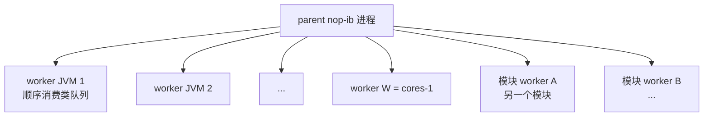

# 测试 worker JVM 复用与执行模型通用化设计

**范围**：`nop-tools/nop-ib`（JUnit 执行器）；被测模块为任意 Maven + JUnit Platform 项目（不限于 Nop 平台）
**状态**：active

> 本档为规范性文档：只描述当前有效设计；变更历史见 git 与 AI 开发记录区的时效性文档。
> 隔离/快照/超时的底座契约见 [02-test-execution.md](02-test-execution.md)；本文只描述其上的"复用层"。

---

## 一、设计结论

| 编号 | 决策 | 理由 |
|---|---|---|
| WR-D1 | **持久 worker JVM 模型**：每模块 W 个常驻 worker 进程（W 默认 = cores-1），每个 worker 从 parent 顺序拉取测试类执行；类间执行重置钩子。**不再每类一个 fork**。per-class fork 保留为污染兜底（差分重跑）与重置不可用时的显式降级 | root pom 的 surefire `reuseForks=true` 已在生产上验证"同 JVM 顺序跑全模块类"的兼容性；消除 5168 次 JVM 启动 |
| WR-D2 | **ClassLoader 不新建**：worker 内直接使用其启动 classpath（模块测试 classpath，启动即定死），跨类复用 AppClassLoader。禁止 per-class 新建 URLClassLoader | 设计 02 §四：Nop 测试基类按 class 文件位置反推目录并断言 `target`，child-first loader 使资源定位返回空；且 loader 泄漏/元空间不可控 |
| WR-D3 | **重置 = 可插拔 SPI**：`TestEnvironmentResetter`（before/after 两钩子 + 优先级），由**被测项目**提供实现，经 ServiceLoader 或配置类名发现。通用层（System.properties 快照恢复 + 快照开关强制置 false）内建且不可关闭 | Nop 项目叠加 `CoreInitialization.reinitialize()` 钩子；非 Nop 项目零成本接入——这就是执行模型推广到一般项目的机制 |
| WR-D4 | **零假绿兜底三件套**：差分重跑（worker 内失败 → 新鲜 per-class fork 重跑一次，fresh 结果为准并登记污染告警）、worker 轮换（每 ≤K 类退役）、重置钩子抛异常即退役 worker | 复用的唯一风险是跨类污染；用检测+兜底替代穷举重置（静态缓存不可枚举） |
| WR-D5 | **复用盈亏判据内建**：重置钩子耗时总和超过该类独立 fork 的启动成本（实测标定）时，该模块自动降级 per-class fork，并在 JSON 中记录降级原因 | 重置贵于启动时复用是负收益；不靠人工判断 |
| WR-D6 | **模块间并行执行**：`-pl`/affected 的模块列表由 M 个模块 worker 并行处理（测试互不读写彼此产物），与模块内 W worker 叠加，消除与 `mvn -T 1C` 的并行维度差 | 整仓 sweep 场景对齐 mvn 的双层并行 |

## 二、worker 协议

worker 是一个长驻 JVM（fork 侧同现在的 IbJUnitRunner 运行环境），stdin/stdout 行协议：

```
parent → worker: {"cmd":"run","class":"io.x.Y"}   /  {"cmd":"shutdown"}
worker → parent: {"class":"io.x.Y","tests":n,"failures":f,...,"resetMs":r,"runMs":t}
```

- **拉式派发**：parent 在收到上一条结果后才派发下一类 → 负载自动均衡，慢类不占队列；
- **崩溃检测**：worker 非正常退出 = parent 读到 EOF → 未完成类标记 `workerCrashed`，派发给新 worker，并触发该类的差分重跑；
- **超时**：单类执行超时（`nop.ib.forkTimeoutSeconds`）→ parent 杀 worker → 同上兜底；挂死类不能再阻塞模块（per-class fork 模型已有的性质保持）；
- **cwd 硬约束**不变：worker 启动目录 = 模块 basedir；classpath = 模块物化 test classpath，禁止跨模块合并。

## 三、重置 SPI 与通用化

**零编译依赖的反射契约**：resetter 是被测项目提供的普通类，约定两个可选静态方法（反射调用，不引入任何对 nop-ib 的编译依赖）：

```
public static void resetBefore(String testClass)   // 类执行前：恢复/重初始化（可缺省）
public static void resetAfter(String testClass)    // 类执行后：销毁/清理（可缺省）
```

- 发现顺序：仓库根 `nop-ib.config.json` 的 `test.resetters` 类名列表 → ServiceLoader（`io.nop.ib.junit.TestEnvironmentResetter` 接口，可选路径）→ 都没有则仅通用层；
- 方法缺失/类缺失/抛异常：跳过并记入该类执行结果的 reset 告警（异常 ⇒ worker 退役）；


- 通用层固定执行顺序：快照 System.properties（before）→ 执行 → 恢复（after）→ 强制 `nop.autotest.force-save-output=false`、`nop.autotest.disable-snapshot=false`；
- Nop 平台的实现（`reinitialize()` 钩子）由 Nop 测试支撑模块提供，nop-ib 不硬编码任何 `io.nop.*` 类名——**nop-ib 核心对 Nop 平台零依赖**，这是推广到非 Nop 项目的边界；
- 配置面（仓库根 `nop-ib.config.json`，版本化 / CLI 覆盖）：`test.resetters`、`test.parallelism`、`test.forkTimeoutSeconds`、`test.workerMaxClasses`、`test.runner(junit|surefire)`。所有配置对任意 Maven 项目同义——model.json 本就来自 Maven 自身导出，非 Nop 项目只需能被 effective-pom/dependency:list 描述即可接入。

## 四、执行拓扑（并行最大化）



- 模块层（M）× 类层（W）双层并行，总 fork 数 = ΣW×M ≤ cores-1 的乘积约束由 parent 统一许可控制；
- L2/L3 回退、产物缺失、surefire 显式退出通道等既有降级语义全部保持。

## 五、拒绝了什么

| 方案 | 拒绝理由 |
|---|---|
| per-class 新建 URLClassLoader（同 JVM 换 loader） | 违反 02 §四 child-first 禁令；loader 泄漏与元空间不可控；且静态状态本就不随 loader 切换而重置，隔离是假的 |
| 穷举重置所有静态缓存 | 不可枚举；第三方缓存无法覆盖。用 worker 轮换 + 差分重跑兜底替代 |
| 固定 worker 批次（先分好 K 类再派发） | 慢类阻塞批次尾；拉式派发负载均衡优于静态切分 |
| 对所有模块默认启用复用 | 重置成本（如 reinitialize 秒级）高于 JVM 启动成本的模块是负收益（WR-D5 自动降级）；对照门未过的模块先 per-class fork |

## 六、正确性门（不变式）

1. 失败判定只信**权威执行环境**的结果：worker 内失败必须差分重跑定责，fresh fork 通过 ⇒ 污染告警 + fresh 结果为准；
2. 未执行的测试不得计为通过；重置钩子失败 ⇒ 该类不产出任何"通过"结论（worker 退役 + fresh 重跑）；
3. cwd / classpath 定序 / 禁跨模块合并 / 快照开关强制 / 看门狗等 02 契约逐条保持；
4. 与 surefire 的对照门（IB-G3 同语料双跑）在复用模型上**逐模块**重跑通过后才作为默认；对照差异即降级该模块并登记。

## 七、性能验收门（规范性）

复用模型作为默认执行器的**前提**是通过以下对照门；未通过则该范围自动降级 per-class fork / surefire 并显式登记：

| 门 | 度量 | 基线（mvn） | 验收 |
|---|---|---|---|
| G-A 模块级对照 | 每个测试模块 fork vs surefire 双跑 | 各模块 surefire 失败集 | 失败集逐一相等；差异 ⇒ 该模块降级登记 |
| G-B 切片墙钟 | 固定 4 模块切片（treesitter/jq/javac/stream-cep） | `mvn test -T 1C` = 12.0s（2026-11-14 实测） | nop-ib 严格 < 基线 |
| G-C 全仓 sweep | 全部测试模块 | `mvn test -T 1C` 全仓墙钟（验收时实测基线） | nop-ib 严格 < 基线，且失败集 parity |
| G-D AI 循环 | 单模块 `check` | 现状 4.5s | 复用后 ≤ 现状 |

墙钟对照须在同一机器、空闲态、连续三次取中位数；数字写进执行 plan 与 `docs-for-ai`。

## 八、与已有设计的关系

- [02-test-execution.md](02-test-execution.md)：底座契约（cwd/classpath/快照/超时），本文是其上的复用层；
- [05-nop-ib-engine-design.md](05-nop-ib-engine-design.md)：IB-D8 两阶段路线——本文是"阶段二自研启动器"的完成形态；
- `nop-autotest`（Nop 侧 resetter 实现的宿主模块）：提供 `reinitialize()` 钩子实现，nop-ib 不依赖。
