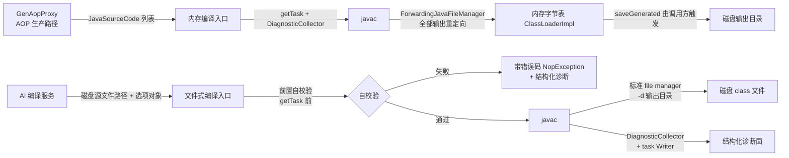

# nop-javac 编译能力设计

**日期**：2026-10-09（更新于 2026-10-09）
**范围**：`nop-kernel/nop-javac`（`io.nop.javac`、`io.nop.javac.jdk`、`io.nop.javac.janino`）
**状态**：active
**灵感来源**：`ai-dev/design/nop-incremental-build/01-architecture-baseline.md` §12（G10）

---

## 一、设计结论

1. **编译能力归属本模块**。文件式编译（磁盘源文件 → 磁盘输出目录 → 结构化诊断）在 `nop-javac` 内落地，不新建独立模块，也不在别处建第二套编译封装。
2. **`IJavaCompileTool` 不承载编译方法**。编译能力只挂在具体类 `JdkJavaCompiler` 上；三个既有接口的签名一律不变。
3. **成功判据不能只依赖 `CompilationTask.call()`**。javac 的解码级/选项级失败会完全绕开 `javax.tools` 的两个结构化通道，`call()` 仍返回 `true`。契约要求：编译入口在调用 javac **之前**完成前置自校验，任何失败显式抛带错误码异常。
4. **诊断必须有结构化访问面**，且结构化面必须能表达前置自校验产生的失败——否则"已修好的假绿"会在只读 javac 诊断时重新静默。
5. **兼容性红线**：内存编译路径与既有 7 个 public 方法语义不变；`GenAopProxy` 生产路径行为不变。

---

## 二、背景与动机

`ai-dev/design/nop-incremental-build/` 的 G10 要求一份能按构建侧语义编译的编译底座。本模块的既有能力与之有两处结构性差距：

- **输入形态**：只接受内存源码（内部构造 `string:///` URI 的 `JavaFileObject`），没有磁盘源文件入口。
- **产物形态**：所有输出被重定向到内存字节表，落盘要靠调用方事后调 `saveGenerated`；没有输出目录概念，因此无法与既有产物共存、无法做产物一致性对拍。

同时，本模块被 AOP 生产链消费。`GenAopProxy`（源码归属 `nop-kernel/nop-codegen`）在**声明了 `exec-maven-plugin` 的 139 个模块**的 `compile` 阶段运行。`nop-codegen` 自身不激活该插件、其测试树内也没有任何 `GenAopProxy` 调用点——**`nop-core-framework/nop-ioc` 是这条链路唯一可观察的测试承载方**。这个事实决定了本设计的兼容性红线与验证方式。

---

## 三、核心设计

### 3.1 落位与接口边界

| 对象 | 职责 | 契约 |
|------|------|------|
| `JdkJavaCompiler` | **唯一**编译能力归属方。承载内存编译与文件式编译两个入口 | 编译方法只在此类上；不实现任何既有接口 |
| `IJavaCompileTool` | Janino 侧工具接口 | **不含编译方法**（见 §四 D1） |
| `IJavaSourceParser` / `IDynamicClassLoader` | 解析与动态类加载 | 签名不变 |

新增能力的可见性遵循：`io.nop.javac.jdk` 包**内**的实现细节（选项装配、file manager 工厂）通过包级或 `protected` 接缝暴露给同包测试，**不得**为了测试把 `io.nop.javac` 提升为可访问 `io.nop.javac.jdk` 包级成员。

### 3.2 两条编译路径并存

两条路径的**产物语义不同**（内存字节 vs 磁盘目录），因此结果类型分离，不共用一个结果类型——见 §四 D6。

### 3.3 成功判据契约（live defect A / A2）

实测（JDK 26.0.1）确定的三条硬约束：

| 约束 | 实测证据 |
|------|----------|
| **不存在**"`call()` 返回 `true` 且 `DiagnosticCollector` 含 ERROR"的输入 | 约 50 组输入（9 类编译错误 + 13 组注解处理场景 + 多个 `-XD` 内部开关）全部为 `call()==false` 或 `call()` 抛出。故"`isSuccess()` 加一个无 ERROR 条件"是**空操作** |
| **给 `getTask` 传真实 `Writer` 对解码级/字符集级诊断捕获 0 字节** | 该 Writer 只捕获 `-d` 指向普通文件时的 javac 崩溃文本，而该场景 `call()` 本就为 `false`。故"接一条 Writer 通道"**不是**修复手段 |
| 解码级失败的真实信号只在进程级 `System.err`，且必须在 javac 加载其 `Log` 类**之前**替换才能捕获 | 早期替换捕获 184 字节、晚期替换捕获 0 字节；属非线程安全的全局状态 |

**因此契约是**：编译入口在 `getTask` **之前**完成三项前置自校验——字符集名合法性、源文件在声明编码下可解码、输出目录形态合法——任一失败即显式失败。同时 `getTask` / `call` 两处失败一律映射为带错误码异常，**不得有未包装的 `Throwable` 逃逸**（捕获范围必须覆盖 `Throwable`：实测各阶段异常类型不同——`getTask` 抛 `IllegalArgumentException`、`call()` 抛 `IllegalStateException`、javac 内部抛 `java.lang.Error`、处理器可抛 `RuntimeException`/`Error`）。`fileManager.close()` 沿用既有的 `IOException` → `LOG.warn` 处理，非本计划引入。

**内存路径的 D9 残余（显式记录，非静默延后）**：上述 `Throwable` 包装**只施加于文件式入口**。内存编译路径不做包装，理由须精确表述：它的**选项面**全部硬编码且合法（`-source`/`-target` 取运行 JDK 版本、`-classpath` 由调用方给字符串），因此实测到的三类异常（`--release` 与 `-source` 冲突、`-target` 过旧、`-d` 指向普通文件）**在该路径上不可达**；而施加包装会改变 `GenAopProxy` 的错误契约（它当前依赖未包装异常经 `NopException.adapt` 归一），构成对 AOP 生产路径的 live 行为变更。**但"所有失败分支不可达"是不准确的**：实测空源文件列表会从 `call()` 抛出未包装的 `IllegalStateException`（"无源文件"）——这是 javac 对空输入的既有行为，与开关面无关。分类：`watch-only residual`。后继归属：若内存路径将来获得可设定选项面（使上述异常形态变为可达），必须在同一改动中施加包装并补断言异常类型的回归测试。

**task Writer 通道的定位**：文件式编译入口给 `getTask` 传入非 null Writer，承接 javac 内部的崩溃文本（如 `-d` 指向普通文件时的 `java.lang.Error`）。它**不是**解码级失败的观测手段（实测捕获 0 字节），但把它丢弃会让一类真实故障变得完全不可见。

**被明确排除**的替代方案：劫持 `System.err`。它对内存输入完全不可达（内存源码覆写 `getCharContent`，javac 从不解码），且要求在 javac 类加载前替换全局流。

### 3.4 诊断契约

诊断以结构化形式暴露（`JavaDiagnostic`）：问题级别、诊断来源、源文件标识、行号、列号、消息、错误码。

**文件标识取值规则**：取 `JavaFileObject` 的 URI 字符串，而非 `getName()`。实测 `getName()` 对 `string:///` 输入返回的是**路径**（`/demo/X.java`），会丢失 URI scheme，无法区分内存输入与磁盘输入；取 URI 后磁盘输入得 `file://...`（携带真实文件路径）、内存输入得 `string:///`（既有行为，不改）。

**来源必须覆盖两条通道**，且诊断类型显式标注来源：
- `javac` — 来自 javac 收集器（语法/语义错误）
- `validation` — 来自本模块前置自校验（编码与输出目录类失败）——**这是唯一能观测到 live defect A 那类失败的来源**

校验失败**不抛异常而返回失败结果**：`isSuccess()` 为 false、诊断可结构化读出、不产出任何 class。抛异常会让这类失败脱离诊断面，等于把它重新变成调用方看不见的静默。真正需要抛的是 D9 覆盖的"javac 抛出异常"那一类。

**源码片段是两条编译路径的共享逻辑**（`JavaSourceSnippet`）。这一点不是风格选择而是正确性要求：源码可读性判断若只存在于内存路径，磁盘输入就会再次退化为静默的占位符——正是 live defect B 的形态。文件式路径的诊断带**非空**片段，是 B 已修复的验收面。

**源码不可得时**：记录日志，返回占位语义，且 `codeOfConcern` / `codeOfConcernLong` 为**空串**——不得对占位符文本做切片。历史实现按占位符长度（27）裁剪高亮区间再 `substring`，会产出"从占位符里切出来的 Code of concern"——误导性文本比无值更糟。

**自校验来源的诊断没有片段**：前置自校验不经过 javac `Diagnostic`，因此无源码片段可给（返回 `null`）。这是契约而非缺陷，服务侧据此可区分"javac 说错了"与"本模块拒绝了这个配置"。

### 3.5 编译选项与开关校验责任

选项以独立对象（`JavaCompileOptions`）承载：输出目录、classpath、`release`、编码、源码路径、隐式编译策略、注解处理开关与处理器路径、生成源目录、模块路径、自定义透传。

**结果类型分离**：文件式编译返回独立的结果类型（产物在磁盘目录），内存编译的结果类型保持 `final` 与既有签名不变。二者的产物语义不同，不共用一个类型。

**校验责任划分原则**：javac 静默接受的非法取值由本模块显式拒绝，理由是"静默"直接违反服务端的失败可观测性要求。已实测必须由本模块自校验的形态：

| 形态 | javac 行为 | 本模块契约 |
|------|------------|-----------|
| 输出目录为空串 | `call()` 返回 `true`、零诊断 | `getTask` 前显式失败 |
| 输出目录指向已存在的普通文件 | `call()` 返回 `false`、collector 零诊断 | 显式失败且带错误码 |
| 编码名不存在 | `call()` 返回 `true`、零诊断、**无任何产物** | `getTask` 前显式失败 |
| 源码在声明编码下不可解码 | `call()` 返回 `true`、零诊断、产物内容损坏 | `getTask` 前显式失败 |
| `release` 与 `source/target` 冲突 | `getTask` 抛 `IllegalArgumentException` | 映射为带错误码异常 |
| `release` 缺失或过旧 | `call()` 抛 `IllegalStateException` | 映射为带错误码异常 |

**默认态与兼容性**：内存编译路径的选项基线（`-source`/`-target` 取运行 JDK 版本、`-classpath` 拼装、Windows `file:/` 前缀处理）必须与今日完全等价，且该等价性由选项装配缝的断言测试锁定。编译器复用策略的**默认态为"每次新建"**——默认态若改为复用，即构成对 AOP 生产路径的行为变更。

### 3.6 编译器复用契约

**默认态是"每次新建编译器"**——等价于引入复用能力之前的行为。默认态若改为复用，即构成对 AOP 生产路径的行为变更。

复用只针对**编译器实例**；file manager 始终每轮新建并在 finally 关闭（复用 file manager 会让 javac 内部上下文跨轮污染）。实测 `ToolProvider.getSystemJavaCompiler()` 每次返回不同实例，因此复用必须显式持有字段。

**非法状态转换显式失败**：未 acquire 就 release、重复 release 一律抛带错误码异常。

**源文件对象必须由传给 `getTask` 的那个 file manager 产出**（实测踩坑）：`-encoding` 在 task 的 context 中解析，而 `PathFileObject` 的解码走创建它的 manager 的 charset 通道。若用一个**独立的**输入 manager 产出源文件对象，`-encoding` 会**静默失效**——源文件被按 UTF-8 解码，含不可映射字符时产出替换字符，且不产生任何诊断。故只有当 file manager 缝被替换为非 `StandardJavaFileManager` 时才启用独立的输入 manager。

### 3.7 注解处理契约

实测前提：处理器只经 `annotationProcessorPaths` 进入处理器路径，不进 classpath；JDK 23+ 在无 `-proc` 标志时默认 `-proc:none`。因此"配置了处理器路径"与"实际启用处理"是两件事，owner 契约必须分两栏表述。

**隐式编译策略**：`-implicit:none` 是**静默不生成**隐式 class，**不是报错**——javac 对此零诊断。任何按"隐式扩散会响亮失败"来设计回退的下游都是基于错误前提。其可观测性只能来自**输出目录内容比对**，不能来自诊断。

**开关的断言面分层**（实测决定，非风格选择）：

| 开关类别 | 可靠断言面 | 原因 |
|---------|-----------|------|
| 隐式编译策略、自定义透传、处理器开关 | 产物差异 / 诊断差异 | javac 行为确定 |
| `-processorpath`、`--module-path` | **选项装配** | javac 在处理器不在 `-processorpath` 上时会回退到宿主 JVM 的 `java.class.path`，故"观察处理器是否被发现"在进程内恒为真，是假测试面 |
| 隐式 class 策略本身 | **输出目录内容** | javac 对 `-implicit:none` 零诊断 |

`-implicit:` 与 `-proc:` 是**单 token 开关**（`-implicit:class`），拆成两个选项元素会被 javac 判为"无效的标记"。

---

## 四、关键决策

### D1 — `IJavaCompileTool` 不承载编译方法

**选择**：接口保持不变，编译能力只挂在 `JdkJavaCompiler`。

**理由**：该接口全仓仅 1 个实现、**0 个消费者**，janino 侧也没有批量编译能力。挂 `default` 方法会得到"新功能默认不支持"的死接口方法；挂抽象方法则迫使 janino 侧抛"不支持"。两条路都产出零消费者或无实现的契约面。

### D2 — 落位本模块，反转 `nop-incremental-build` §12.1

**选择**：薄驱动落进 `nop-javac`，而非另建约 200 行的独立薄驱动。

**理由**：复用本模块的诊断模型、错误码体系与 classpath 解析，避免同一编译能力出现第二套诊断语义——两套诊断语义会让下游无法区分"错误来自哪个编译入口"。

**代价（已接受）**：本模块成为编译底座的唯一归属方，变更半径是全部激活 `exec-maven-plugin` 的 139 个模块，而非表面上的少数直接调用方。因此兼容性红线的验证必须落在唯一可观察的承载方（`nop-ioc` 的构建产物）上。

**被修正的上游表述**：§12.1 原写作"源文件按路径字符串传入"，实际构建侧走的是**按文件对象**传入（`getJavaFileObjects(File...)`）；`getJavaFileObjectsFromStrings` 是字符串源码 API，不适用于磁盘源文件。

### D6 — 结果类型分离，不扩展 `JavaCompileResult`

**选择**：新增并列的结果类型表达文件式编译产物；`JavaCompileResult` 保持 `final`、保持其 public 构造函数签名、保持既有 7 个 public 方法的语义。

**理由**：`JavaCompileResult` 的产物是内存字节表（经包级私有的类加载器），文件式编译的产物是磁盘目录——两者无法用同一类型表达。扩展它必然要求去掉 `final` 或改 public 构造函数签名，而这两者都是公共契约变更，收益不足以抵消变更半径（139 个 AOP 模块）。

**位置约束**：新结果类型必须与产物字节的持有方同包，否则取不到产物。

---

## 五、拒绝了什么

| 方案 | 拒绝理由 |
|------|----------|
| **新建独立编译模块 + 薄驱动** | 会产生第二套诊断语义与错误码体系；见 D2 |
| **给 `isSuccess()` 增加"无 ERROR 诊断"条件** | 实测为空操作——javac 已在 `call()` 内做了这件事（`call()` 返回 `true` 时 collector 恒无 ERROR） |
| **接一条 task `Writer` 通道作为假绿修复** | 实测对解码级/字符集级诊断捕获 0 字节 |
| **劫持进程级 `System.err` 捕获解码级诊断** | 必须在 javac 类加载前替换全局流、非线程安全、且对内存输入完全不可达 |
| **把编译方法挂到 `IJavaCompileTool`** | 见 D1 |
| **让内存路径与文件式路径共用结果类型** | 见 D6 |
| **复用 file manager** | javac 内部上下文会跨轮污染；复用只允许复用编译器实例，file manager 每轮新建并在 finally 关闭 |

---

## 六、验证契约

| 层面 | 验证方式 |
|------|----------|
| 内存路径行为未变 | 选项装配缝的基线断言 + 既有用例 + `GenAopProxy` 调用序列复刻 |
| AOP 生产链路未变 | 删除 `nop-ioc` 的 AOP 产物 class 与生成源目录后重建，确认由 `exec:aop` → `GenAopProxy` → 编译入口 → `saveGenerated` 重新生成（`nop-codegen` 不承载该路径） |
| 假绿已修 | 非法编码名、不可映射字符两个场景各有一个经编译入口驱动的用例，断言失败且不产出 class；**不得**依赖 `System.err` 捕获 |
| 句柄释放 | 可注入计数的 file manager 断言 `close()` 次数与时机。**不采用**"Windows 上 JAR 被锁定"作为断言面（该语义在 macOS 上不存在，用 rename/delete 或 fd 计数会得到恒真结果） |
| 诊断可读 | 每个结构化字段各有断言；文件式输入携带真实路径；源码不可得时有日志且 `codeOfConcern*` 为空 |

---

## 七、与已有设计的关系

- **上游**：`ai-dev/design/nop-incremental-build/01-architecture-baseline.md` §12（G10 编译能力缺口）。本设计**反转**其 §12.1 的"自建薄驱动"裁定（D2），并**纠正**其 §12.2 关于 `-implicit:none` 会报错的表述（实测是静默不生成）。
- **下游**：AI 增量编译服务以本设计的能力矩阵为输入，其作用域分析、索引接入、测试调度、回退编排不在本模块范围内。
- **实测基线**：JDK 26.0.1。`-proc` 默认值、`Processor` 接口形状、编码类诊断是否进入 `DiagnosticCollector` 三项**仅在该版本实测**，JDK 21 需重测后才可声称跨版本成立。