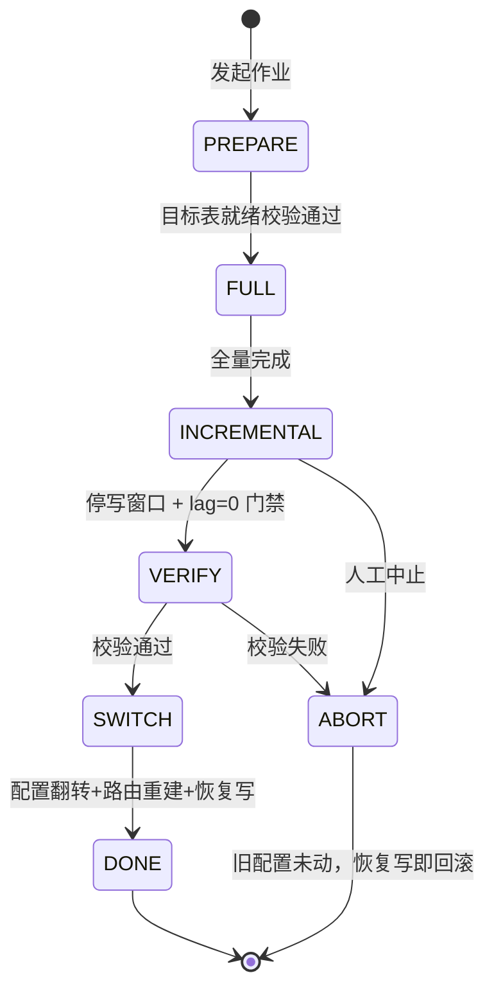

# nop-orm 数据搬迁管道编排设计

**日期**：2026-10-05
**范围**：搬迁编排层（新设计，随 roadmap WI9 实施）；数据面复用 `nop-batch`、`nop-stream/nop-stream-connector-debezium`、`nop-stream/nop-stream-connector-jdbc`；路由面依赖 `nop-dao`/`nop-orm` 分片配置（plan 2320 已落地）
**状态**：草案（roadmap `ai-dev/backlog/nop-persistence-middleware-roadmap.md` WI9；Deliverable = 本设计，作业实现由 WI9 承载 plan 定义）
**灵感来源**：Apache ShardingSphere kernel/data-pipeline 作业形态（InventoryTaskSplitter / IncrementalTask / DataMatch ConsistencyChecker / RateLimitAlgorithm——仅理念对标，不照抄其分布式作业协议）

---

## 一、设计结论

1. **作业模型 = 独立搬迁编排器（migration job 状态机）+ 阶段执行面委托**：全量委托 nop-batch chunk 作业，增量委托 nop-stream 流作业，切换与校验是编排器自带的门禁步骤。编排器只做阶段状态迁移与门禁判定，不碰数据面。
2. **切换 = 停写窗口内的单点配置翻转，不是数据面两阶段提交**：停写（运维门）→ 增量追平 lag=0 → 一致性校验 → `nop.orm.shard` 配置整体翻转为新策略 → 路由按新配置重建 → 恢复写。校验失败时旧配置未动，回滚 = 恢复写入，无损。
3. **扩容并存期裁定：应用整体按旧策略读写，新 M 片只是搬迁目标**——路由层不引入双策略并存、双写、读旧写新语义；并存期在物理数据面（直读直写），不在路由面。
4. **增量捕获 = Debezium CDC（v1 白名单 mysql/postgres）**，复用既有 `debezium-cdc` source + `jdbc-2pc` sink（UPSERT_DELETE）底座；应用侧双写拒绝。白名单外数据库 v1 只支持"停写全量"形态。
5. **搬迁数据面完全在物理表层（JDBC 直读直写）**：读源不经过 ORM 路由（缺分片键 fail-fast 是业务查询契约，hash-mod 旧分片区间不可反推），写目标按新策略计算出的物理表直写 keyed UPSERT；路由引擎本身不参与搬迁运行期。
6. **一致性校验三级（count → 抽样 checksum → 逐行 checksum）全部应用侧计算**，按物理列值规范化串做稳定 hash；加密列按密文原样比对（搬迁是字节级复制），脱敏展示字段是 compute 派生属性、不进入比对面。校验门禁只在"停写 + lag=0"后执行。
7. **使用契约**：编排配置 = JSON 配置串 `nop.orm.migration`（与 `nop.orm.shard`、`nop.dao.readwrite` 同构的部署属性层）；错误码 `ERR_DAO_MIGRATION_*` 族登记 `DaoErrors`；指标族 `nop.orm.migration.*`；v1 不建新控制台 UI，全量阶段任务天然出现在 nop-batch 既有任务管理面，编排 job 状态提供只读 GraphQL 查询。

## 二、背景与动机

### 2.1 roadmap 定位

WI9（`ai-dev/backlog/nop-persistence-middleware-roadmap.md` M4）承载两个场景：**分片扩容**（N→M 片，依赖 WI6/plan 2320 策略模型）与**同构机房迁移**（整库搬到另一组数据源，无策略依赖）。`ai-dev/design/nop-orm-sharding-strategy-design.md` §3.5 已裁定：扩容是数据搬迁问题而非 DDL 问题——auto-upgrade 只建新表（N 表展开见该设计 §3.5/§6.3 与 `ai-dev/plans/2320-orm-sharding-strategy.md`），存量数据迁移归本设计。

对标参考（仅理念）：ShardingSphere data-pipeline 将一次迁移组织为 inventory 拆分（按唯一键区间 split，`InventoryTaskSplitter`）+ 增量任务（`IncrementalTask`）+ 一致性检查（`PipelineDataConsistencyChecker`，CRC32/DataMatch 两族）+ 限流算法 SPI（`JobRateLimitAlgorithm`）的作业族。nop 的对应物不需要其分布式作业协议（注册中心/job item 调度），因为 nop 已有两个各自成熟、断点语义完备的执行面（nop-batch、nop-stream），缺的只是把它们按四阶段串起来的编排层与切换协议。

### 2.2 底座事实（均已核实 live code）

**CDC 源**：`DebeziumCdcSourceFunction`（`nop-stream/nop-stream-connector-debezium/src/main/java/io/nop/stream/connector/debezium/DebeziumCdcSourceFunction.java`）实现 `CheckpointedSourceFunction`（`:59-61`），CDC offset 经 `NopStreamOffsetBackingStore` 进 nop checkpoint operator state（键 `cdc-offsets`，`:70`、snapshot `:350-365`、restore `:369-399`），一致性语义 `REPLAYABLE`（`:321-323`）；并行 B 层按表名 hash 路由 subtask（`validateParallelism` `:438-467`），并行时 schema history 按实例名隔离（`:661-677`）。connectorType 白名单 mysql/postgres、offset 真相源契约见 `ai-dev/design/nop-stream/cdc-design.md` §3.2/§3.4；注册名 `debezium-cdc`（`nop-stream/nop-stream-connector-debezium/src/main/java/io/nop/stream/connector/debezium/DebeziumCdcSourceConnectorFactory.java:31`）。

**exactly-once sink**：`JdbcTwoPhaseCommitSink`（`nop-stream/nop-stream-connector-jdbc/src/main/java/io/nop/stream/connector/jdbc/JdbcTwoPhaseCommitSink.java`）每个 checkpoint epoch 一个 JDBC 事务，数据批 + ledger 行（复合键 `sink_namespace+epoch_id+subtask_id`）同 commit（`:627-706`），ledger 查重即幂等提交守卫（`:649-665`）；`dmlMode = INSERT|UPSERT|UPSERT_DELETE`（`:107-133`），keyed 模式批内同 key last-write-wins 保序折叠（`:920-981`），方言 upsert 语句由 `UpsertStatements.buildNativeUpsertSqlText`（`nop-persistence/nop-dao/src/main/java/io/nop/dao/jdbc/UpsertStatements.java:92`）生成，仅 mysql/mariadb/postgresql（H2 供测试）（`:1052-1064`）。注册名 `jdbc-2pc`（`nop-stream/nop-stream-connector-jdbc/src/main/java/io/nop/stream/connector/jdbc/JdbcTwoPhaseCommitSinkConnectorFactory.java:31`）。**注意：sink 的 `tableName` 是 final 单表字段（`:165`），不支持按行动态路由目标表。**

**nop-batch**：作业模型是 XDef 模型（`nop-kernel/nop-xdefs/src/main/resources/_vfs/nop/schema/task/batch.xdef`，根属性 batchSize/concurrency/rateLimit/jitterRatio/startLimit `:9-14`），非 XMind。读写面：`orm-reader`/`jdbc-reader`（`:125-136`，均支持 `partitionIndexField` 分区过滤）、`orm-writer`/`jdbc-writer`（`:186-203`）、loader `dispatcher` 分区拆分（`:80-85`）、retryPolicy/skipPolicy（`:41-50`）。执行器 `BatchTask`（`nop-batch/nop-batch-core/src/main/java/io/nop/batch/core/impl/BatchTask.java`）按 concurrency 起 chunk 循环（`:134-137`），任一 chunk 失败 fail-fast 取消其余线程（`:228-237`），每 chunk 后持久化状态（`:302-303`）。断点存储 `DaoBatchStateStore`（`nop-batch/nop-batch-dao/src/main/java/io/nop/batch/dao/store/DaoBatchStateStore.java`）：`NopBatchTask` 行按 `(taskName,taskKey)` 唯一，条件 UPDATE 启动闸门原子裁决并发启动（`:142`、`:187-194`），重启恢复 completedIndex 等计数并置 `recoverMode`（`:174-190`）；任务状态字典 created/running/paused/completed/failed/cancelled/killed（`nop-batch/nop-batch-meta/src/main/resources/_vfs/dict/batch/task-status.dict.yaml`）。orm 读分页是 keyset 游标：`OrmQueryBatchLoaderProvider.load` 以 `dao.findNext(lastEntity, ...)` 推进（`nop-batch/nop-batch-orm/src/main/java/io/nop/batch/orm/loader/OrmQueryBatchLoaderProvider.java:123-131`；`IEntityDao.findNext` `nop-persistence/nop-dao/src/main/java/io/nop/dao/api/IEntityDao.java:276`）。限流旋钮：`BatchTaskBuilder.rateLimit`（`nop-batch/nop-batch-core/src/main/java/io/nop/batch/core/BatchTaskBuilder.java:237-238`）落到 `RateLimitConsumer`（`:419-420`）。

**同族先例**：`EncAssistedBackfiller`（`nop-persistence/nop-orm/src/main/java/io/nop/orm/enc/EncAssistedBackfiller.java`）确立"分页读 + 批量写、直接走 JDBC 不经 ORM session、幂等重算覆盖"的存量数据工具先例（类契约 `:31-52`，主键序 offset 分页 `:100-110`）；并显式声明"建议离线执行""分片实体仅回填缺省 querySpace"（`:51`）——搬迁管道是它的多分片、带增量、带校验的一般化。

**分片策略面（2320 已落地）**：策略配置为 JSON 配置串 `nop.orm.shard`（`DaoConfigs.CFG_ORM_SHARD`，`nop-persistence/nop-dao/src/main/java/io/nop/dao/DaoConfigs.java:83`），`ConfigShardSelector.init()` 启动期解析注册表（`nop-persistence/nop-dao/src/main/java/io/nop/dao/shard/ConfigShardSelector.java:66`），SPI 终态含 `getShardNames`/`getShardTableName`（`:171`、`:179`，供 DDL 展开消费）；DDL N 表展开入口 `ShardDdlHelper.shardTableNames`（`nop-persistence/nop-orm/src/main/java/io/nop/orm/ddl/ShardDdlHelper.java:45-56`），三建表调用点（`DataBaseSchemaInitializer` / `OrmDbDiffer`+`DataBaseUpgrader` / `AutoTestCaseDataBaseInitializer`，见 `ai-dev/plans/2320-orm-sharding-strategy.md` Current Baseline #5 与 Phase 3）。运行期路由 `GenSqlTransformer.collectShardSelections(sql, paramValues)`（`nop-persistence/nop-orm/src/main/java/io/nop/orm/sql/GenSqlTransformer.java:112`），缺分片键 fail-fast `ERR_ORM_SHARD_CONDITION_MISSING`（`:141-157`）。

**其他**：nop-job 调度入口 `IJobScheduler`（`nop-job/nop-job-api/src/main/java/io/nop/job/api/IJobScheduler.java:27`）；`NopBatchTask` 已有 `flowId`/`flowStepId` 挂钩字段（`nop-batch/nop-batch-dao/src/main/java/io/nop/batch/dao/entity/_gen/_NopBatchTask.java:69-73`）——编排器与批次任务行的关联点现成。nop-batch 与 nop-stream 的互适配（BatchLoaderSourceFunction 等）见 `ai-dev/design/nop-stream/connector-design.md` §3。

## 三、范围与 Non-Goals

**In scope**：nop 平台自身 useShard 实体的分片扩容（N→M）与同构机房迁移（同一 ORM 模型、同方言数据库家族，换数据源落点）的作业编排：全量搬迁、增量追平、一致性校验、路由切换的契约与失败语义。

**Non-Goals**：

1. **通用异构数据库迁移工具**：不做 ShardingSphere 式迁移矩阵（80+ 连接器生态、异构 schema 转换、schema evolution DDL 协调）；CDC 能力边界即 `ai-dev/design/nop-stream/cdc-design.md` §3.2 白名单（mysql/postgres）。
2. **双写 / 灰度切流 / 无窗口在线切换**：切换采用停写窗口协议（§4.2），不做应用双写改造与按比例读切流。
3. **路由层双策略并存语义**：新旧策略的交替是一次配置事件，不是路由引擎特性（§4.2）。
4. **白名单外数据库的增量搬迁**：无 binlog/WAL CDC 的数据库 v1 只支持停写全量形态，显式声明而非静默降级。
5. **自动扩容触发与容量监视**：扩容由人工发起，管道不监视数据量。
6. **Web 控制台 UI**：观测走既有面（§4.7）。

## 四、核心设计

### 4.1 作业模型：四阶段状态机 + 执行面委托（裁定 1）

一次搬迁作业 = 编排器持有的显式状态机，五个状态、两条出路（完成 / 中止回退）：



阶段与执行面的委托关系：

| 阶段 | 执行面 | 断点机制 | 幂等语义 |
|---|---|---|---|
| PREPARE 目标校验 | 编排器（目标物理表存在性/结构比对，复用 auto-upgrade 产物） | 编排 job 状态行 | 只读，可重复 |
| FULL 全量 | nop-batch 作业：物理 JDBC 直读旧分片（keyset/offset 分页）→ keyed UPSERT 写目标 M 片 | `DaoBatchStateStore`/`NopBatchTask`（启动闸门 + 计数恢复） | keyed UPSERT 重放安全 |
| INCREMENTAL 增量 | nop-stream 作业：`debezium-cdc` source → shard-router → `jdbc-2pc` sink × M（UPSERT_DELETE） | checkpoint operator state（offset）+ epoch ledger | 2PC + upsert/delete 幂等 |
| VERIFY 校验 | 编排器门禁步骤（§4.4） | 编排 job 状态行 | 只读，可重复 |
| SWITCH 切换 | 编排器 + 配置翻转（§4.2） | 编排 job 状态行 | 翻转到同一目标配置幂等 |

**裁定：不用 nop-batch 单一作业表达四阶段**——batch 是单任务 chunk 读写循环模型（`batch.xdef` 无阶段概念），增量追平是长驻流式作业不是 chunk 终止作业；两者断点语义异构（`NopBatchTask` 行 vs checkpoint operator state），强行统一只会造出第三种残缺恢复语义。**也不用 nop-wf 表达编排**——工作流的持久化/恢复模型为人工审批语义设计，机器状态机的门禁判定（lag=0、校验通过）不是审批节点；编排器仅为全量阶段 batch 任务打 `flowId`（字段已存在，`nop-batch/nop-batch-dao/src/main/java/io/nop/batch/dao/entity/_gen/_NopBatchTask.java:69-73`）建立任务行关联，v1 不引入工作流定义。**切换不做数据面两阶段提交**——XA/2PC 是平台级 non-goal（roadmap Current Baseline 硬裁定；CDC sink 的 epoch 2PC 是流内幂等机制，不是跨库分布式事务）；切换的原子性由"路由配置是单点事实"保证（§4.2）。

编排 job 状态本身持久化于独立的状态行（新 ORM 实体或既有存储承载，归实施 plan 裁定），语义契约：**状态迁移只能由编排器推进，且每一步迁移前检查前置门禁**；编排器重启后按状态行从最后完成的阶段继续，绝不隐式回退阶段。

### 4.2 扩容场景（N→M）：配置翻转切换协议（裁定 2）

与 2320 策略配置的关系：`nop.orm.shard` 是部署环境属性（`ai-dev/design/nop-orm-sharding-strategy-design.md` §3.1），扩容前后是同一配置面的两个版本。**并存期（搬迁进行中）应用整体按旧策略读写，新 M 片只是搬迁管道的写入目标**——路由引擎不知道新策略的存在。切换协议（伪代码，语义契约）：

```
VERIFY → SWITCH 门禁（停写窗口内顺序执行）：
1. 增量追平判定：源库写入已停（运维停写门）且
   增量流 lag == 0（源位点静止满静默期，且目标端 2PC epoch 全部提交）
2. 执行一致性校验（§4.4，count 必选 + 抽样/逐行按配置）
3. 校验通过 → 将 nop.orm.shard 整体翻转为新策略配置（单一配置点，原子生效）
   → 路由组件按新配置重建（v1 可接受应用滚动重启；运行期热重建为优化项）
   → 允许恢复写入（此后业务读写全部落新 M 片）
4. 校验失败 → 保持旧配置不动，允许恢复写入（无损回滚），作业停在 ABORT
```

关键裁定与理由：

- **拒绝双写并存**：路由层无双写原语（一条 SQL 单 querySpace 是硬约束，`ai-dev/design/nop-orm-sharding-strategy-design.md` §3.2），内置双写意味着新的写入通道与冲突消解语义，超出编排层边界。
- **拒绝"读旧写新"**：读按旧策略、写按新策略要求路由层按行存在性判定（新片未搬完的行必须回落旧片），该语义不存在且无法用分片算法表达（hash-mod 反推不可行）。
- **配置翻转必须原子**：不存在"部分实体旧策略、部分实体新策略"的中间态——`nop.orm.shard` 是单一 JSON 串（`DaoConfigs.CFG_ORM_SHARD`），整体替换天然满足；实施 plan 须验证 `ConfigShardSelector` 重建前后的中间态不可见性。
- **目标表先行建立**：新 M 片物理表由 auto-upgrade/DDL N 表展开在 PREPARE 阶段建立并校验（2320 已覆盖，`ai-dev/plans/2320-orm-sharding-strategy.md` Phase 3），搬迁管道不建表、不改表。
- **机房迁移是本协议的退化形态**：表 1:1 映射（表名不变），"新策略配置"退化为 querySpace→数据源指向的翻转，增量阶段是无 router 的 1:1 CDC 镜像（cdc-design §六验收场景 1 即此形态），无 WI6 策略依赖——与 roadmap WI9 的依赖声明一致。

### 4.3 增量捕获选型：Debezium，不双写（裁定 3）

**裁定**：v1 增量 = Debezium CDC，复用 `debezium-cdc` source + `jdbc-2pc` sink 底座；应用侧双写被拒（侵入业务写路径、引入双写顺序/失败补偿问题，平台不可内置；与 ShardingSphere 借助 binlog 的路径同理）。

**范围边界（诚实声明）**：CDC 白名单 mysql/postgres（cdc-design §3.2）。白名单外数据库的搬迁 v1 只有 FULL → VERIFY → SWITCH 三段（无 INCREMENTAL），停写窗口从"最终追平"提前为"覆盖全量搬迁全程"，窗口长度要求显著更高——这是显式支持面，不是可静默降级的能力。H2 仅存在于测试面（jdbc-2pc 的 H2 识别即为此留的测试通道，`nop-stream/nop-stream-connector-jdbc/src/main/java/io/nop/stream/connector/jdbc/JdbcTwoPhaseCommitSink.java:1050-1063`）。

**N→M 扩容的增量流图**：源侧订阅旧 N 张物理表（`tableIncludeList`），事件经 shard-router 按新策略重算落点，fan-out 到 M 个 sink 分支：


- router 的输入是 `ChangeEvent` 的 after/key image 中的分片键值，调用与 `ConfigShardSelector` 同族的策略算法计算目标 `(querySpace, shardName)`——但**只在搬迁管道内消费**，不触碰运行期路由（§4.5 边界）。
- sink 侧不改造 `JdbcTwoPhaseCommitSink` 为动态表名（`tableName` final 是其幂等/ledger 契约的一部分），按目标分片 fan-out 出 M 个分支，每分支固定一张目标物理表；批内同 key 保序折叠（last-write-wins）与跨 epoch 位点序保证最终一致。
- 机房迁移退化为 source → 单 sink 分支（1:1 表映射），无 router。

### 4.4 一致性校验语义（裁定 4）

**三级校验，时序门禁**：count 对比（必选）→ 抽样 checksum（比例可配）→ 逐行 checksum（可选全量）。前两级可在增量追平中作为进度观测，**但作为切换门禁的校验结果只在"停写 + lag=0"之后产出**——期间源目标都在变，中途校验结果不具备门禁资格。

**比对计算在应用侧**：逐行按主键序双游标配对（扩容场景按逻辑表聚合：源 N 片之和 vs 目标 M 片之和；逐行配对按主键跨分片定位），行值规范化串（null 专用标记、数值 BigDecimal 规范化、时间统一精度、二进制固定编码）后计算稳定 hash；按主键区间分段聚合，段 hash 汇总，失配段二分定位。拒绝 DB 侧 CRC32/checksum 函数（SS DataMatch/CRC32 两族的路径）：方言绑定、且加密列语义与源库耦合。

**加密与脱敏边界**：

| 对象 | 裁定 | 理由 |
|---|---|---|
| enc 主列 | 按密文原样比对，不解密比明文 | 搬迁是字节级复制，密文一致即正确；解密比对扩大密钥面且无判定增益 |
| assisted/like 辅助列 | 作为普通物理列参与比对 | 辅助列由管道原样搬运（`EncAssistedBackfiller` 回填契约同样只落物理列） |
| 脱敏展示字段 | 不进入比对面 | 脱敏是展示层 compute 派生属性（`ai-dev/design/nop-orm-scope-and-non-goals.md` ORM 层脱敏裁定；工具面 `nop-kernel/nop-commons/src/main/java/io/nop/commons/util/MaskHelper.java`），不是物理列，没有可比对对象 |

### 4.5 失败与断点（裁定 5）

- **阶段内断点归各自执行面，编排器不管数据断点**：全量 = `DaoBatchStateStore` 的既有语义（`(taskName,taskKey)` 唯一、条件 UPDATE 启动闸门防并发重入、completedIndex 计数恢复、`startLimit`/`allowStartIfComplete` 门控）；增量 = nop-stream checkpoint（offset operator state）+ `jdbc-2pc` epoch ledger（恢复后未提交 epoch 重放，ledger 查重跳过）。
- **一切目标端写入 keyed UPSERT/UPSERT_DELETE，不用裸 INSERT**：使"任意点重跑"结构性幂等（重放的行覆盖而非重复）——全量 chunk 重放、增量 2PC 重放、`EncAssistedBackfiller` 幂等重算三种断点语义由此统一。全量写原语与增量 sink 共用同一方言 upsert 事实源 `UpsertStatements`（`nop-persistence/nop-dao/src/main/java/io/nop/dao/jdbc/UpsertStatements.java:65,92`）。
- **失败处置 fail-fast，无静默跳过**：全量 chunk 失败即停（`nop-batch/nop-batch-core/src/main/java/io/nop/batch/core/impl/BatchTask.java:228-237`）；增量引擎终死即任务失败（offset 不前推，`nop-stream/nop-stream-connector-debezium/src/main/java/io/nop/stream/connector/debezium/DebeziumCdcSourceFunction.java:96-105`）；校验失配即门禁拒绝。roadmap 硬裁定"无静默错误结果"在搬迁域的直接推论：失配明细（实体、主键、段 hash）必须落到校验报告，不允许"总体一致"掩盖行级差异。
- **部分失败的回滚语义**：SWITCH 之前的任何失败都不影响线上（旧配置未动、旧分片数据未改写，管道只写新 M 片）；回滚 = 修复后从断点续跑。**已过 SWITCH 点的失败不存在回滚需求**——翻转与路由重建是窗口内最后动作，其后的语义就是正常业务运行。
- **搬迁期间的源端写入**：FULL/INCREMENTAL 期间源端正常写（不锁表不阻断业务），一致性由"全量快照 + 增量重放"最终收敛；唯一要求业务写入持续存在直到停写门（否则 lag=0 判定提前满足，需以静默期观测兜底）。

### 4.6 限流与在线影响（裁定 6）

- **全量阶段限流 = nop-batch 既有旋钮，不新造限流器**：`rateLimit`（records/s 标量）+ `batchSize` + `concurrency` + `jitterRatio`（batch.xdef `:9-14`；限流落点 `nop-batch/nop-batch-core/src/main/java/io/nop/batch/core/BatchTaskBuilder.java:419-420`）。拒绝 SS 式限流算法 SPI（`JobRateLimitAlgorithm`）：单消费者、无扩展需求，YAGNI；需要更细控时扩为 SPI 是加法不是破格。
- **增量阶段速率跟随源写入**，无独立限流面；sink 批分段 `maxBatchSize`（默认 1000，`nop-stream/nop-stream-connector-jdbc/src/main/java/io/nop/stream/connector/jdbc/JdbcTwoPhaseCommitSink.java:87`）是写入侧既有保护。
- **源读直连主库**：CDC 本身要求主库 binlog/WAL；全量读若走从库会引入复制延迟与位点一致性的额外复杂度，v1 明确不做。在线影响的诚实边界：全量搬迁对源主库有可感知的读负载，控制手段 = rateLimit 上限 + 低峰窗口 + 分区并行摊平扫描（`partitionIndexField`/`dispatcher`，batch.xdef `:80-85`、`:125-136`），没有免费午餐。
- **大表切片语义**：按物理表逐表切片；单表内由 batch keyset/offset 分页推进。不引入 SS 式"按唯一键区间静态拆 split 再分发"的协议（那是为多节点分发设计的，nop 单机执行面直接由 chunk 并发覆盖）。

### 4.7 使用契约（裁定 7）

**配置形态**：编排配置 = JSON 配置串 `nop.orm.migration`，与 `nop.orm.shard`（`ai-dev/design/nop-orm-sharding-strategy-design.md` §6.1）、`nop.dao.readwrite`（plan 2319）同构的部署属性层。语义字段（示意，不锁定 JSON 细节）：

```json
{
  "scenario": "rescale | relocate",
  "entity": "app.entity.NopOrder",
  "source-query-spaces": ["ds_0", "ds_1"],
  "target-strategy": { "…新 nop.orm.shard 策略片段（rescale 场景必填）…" },
  "target-query-space-mapping": { "…relocate 场景的新数据源指向…" },
  "incremental": { "enabled": true, "connector-name": "mig-order", "quiesce-seconds": 30 },
  "verify": { "count": true, "sample-ratio": 0.05, "full-checksum": false },
  "throttle": { "rate-limit": 5000, "batch-size": 1000, "concurrency": 4 },
  "batch-task-name": "orm-migration-order"
}
```

阶段执行体由平台内置模板参数化生成：全量阶段是标准 batch.xdef 作业模型（用户可 delta 定制 processor/consumer 行为），流作业图由编排器按 §4.3 构造——**用户不手写流图**，只声明场景参数。

**错误码**：`DaoErrors` 新增 `ERR_DAO_MIGRATION_*` 族（配置解析类：缺实体/缺目标策略/场景与字段矛盾；状态机类：非法阶段迁移、门禁未满足即切换；校验类：count 失配、checksum 失配带明细参数）。数据面错误复用既有码：路由策略解析 `ERR_DAO_SHARD_*`、sink 写入 `ERR_STREAM_*`、batch 任务门控 `ERR_BATCH_TASK_*`。

**可观测性**：指标族 `nop.orm.migration.*`（阶段进入/退出、全量行计数与速率、增量 lag、校验进度与结果、切换耗时），命名分层沿用 `ai-dev/design/nop-stream/observability-design.md` 约定；全量阶段复用 `IBatchTaskMetrics`，增量阶段复用 cdc 指标族（cdc-design §3.7）。结构化日志沿用 `nop.batch.*` 既有键风格（`nop-batch/nop-batch-core/src/main/java/io/nop/batch/core/impl/BatchTask.java:281-283`）。

**控制台集成面**：v1 不建新 UI。全量阶段任务天然出现在 nop-batch 既有任务管理面（`NopBatchTask` 的 GraphQL CRUD，`nop-batch/nop-batch-service`；状态字典 `task-status.dict.yaml`）；编排 job 状态提供只读 GraphQL 查询（最小 Biz 面，复用 crud 生成器）；编排入口 = 编排服务 Bean（编程触发，亦可由 nop-job 调度/人工运维触发），为全量阶段 batch 任务打 `flowId` 实现编排状态 ↔ 批次任务行的双向追溯。

## 五、拒绝了什么

| 被拒方案 | 拒绝理由 |
|---|---|
| 四阶段塞进单一 nop-batch 作业 | batch 无阶段状态机；增量是长驻流不是 chunk 终止作业；两套断点语义（NopBatchTask 行 vs checkpoint state）无法统一为一种而不残缺（§4.1） |
| nop-wf 表达搬迁编排 | 审批流持久化/恢复语义 ≠ 机器门禁状态机；flowId 字段已提供任务行关联，无需工作流定义（§4.1） |
| 数据面两阶段提交切换（XA/分布式 2PC） | 平台级 non-goal；路由配置是单点事实，切换原子性由配置翻转保证；CDC sink 的 epoch 2PC 是流内幂等机制，不外推为跨库事务（§4.1/§4.2） |
| 双写并存（写旧+写新，读旧） | 路由层无双写原语（单 SQL 单 querySpace 硬约束）；应用侵入 + 冲突消解复杂度超出编排层边界（§4.2） |
| 读旧写新（按行存在性路由） | 该路由语义不存在且无法用分片算法表达（hash-mod 区间不可反推）；新片数据不全期间无法判定落点（§4.2） |
| 增量捕获改应用双写 | 侵入业务写路径、双写顺序/补偿问题平台不可内置；Debezium 底座已 active 且 mysql/pg 白名单覆盖 v1 场景（§4.3） |
| DB 侧 CRC32/checksum 校验 | 方言绑定；加密列语义与源库耦合；应用侧规范化 hash 一个实现覆盖同构双端（§4.4） |
| 解密后比明文 | 扩大密钥面，无判定增益——密文一致即明文一致（§4.4） |
| 全量/增量经 ORM session 读写（orm-reader/orm-writer 承载搬迁数据面） | 业务路由契约（缺分片键 fail-fast、按当前配置改写表名）与搬迁的物理面操作冲突：旧策略期写新片会被路由改写回旧片；`EncAssistedBackfiller` 已确立 JDBC 直连先例（§4.5，orm-reader/jdbc-reader 形态取舍） |
| SS 式限流算法 SPI | 单消费者无扩展需求，YAGNI；batch rateLimit 标量已覆盖（§4.6） |
| SS 式唯一键区间 split 分发协议 | 为多节点分发设计；nop 单机执行面 chunk 并发 + 按表切片已覆盖（§4.6） |
| 从库读搬迁源 | 复制延迟与位点一致性复杂度无对应用户；CDC 本身要求主库（§4.6） |

## 六、与已有设计的关系

- **`ai-dev/design/nop-orm-sharding-strategy-design.md`**：本设计消费其策略配置面（`nop.orm.shard`、`ShardSelection`、分片名全集）；切换协议是其 §3.5"扩容是数据搬迁问题"裁定的兑现。本设计不改变该文档任何裁定；切换后的路由行为与单分片路由设计完全一致。
- **`ai-dev/design/nop-orm-sharding-execution-engine-design.md`（WI7/WI8，fan-out 执行引擎）**：正交——执行引擎服务业务跨分片查询，本设计只做单分片粒度的物理数据面操作；搬迁后的跨分片查询能力是否完备由该设计回答，本设计不依赖其落地。
- **`ai-dev/design/nop-stream/cdc-design.md`、`connector-design.md`**：增量阶段是其 DB→DB CDC 能力的编排级消费者（白名单、offset 真相源、2PC/ledger 契约全部沿用，无协议变更）。
- **`ai-dev/design/nop-dao-readwrite-splitting-design.md`（plan 2319）**：读写分离在切换后继续生效于新分片（querySpace 指向路由 DS 的既有组合语义）；本设计不改动其裁定。
- **`ai-dev/design/nop-orm-scope-and-non-goals.md`**：不触碰其任何既有裁定（XA/脱敏/读写分离归属等）。
- **实施时的挂点（live code 锚定见 §2.2）**：`ConfigShardSelector`（策略重算与配置翻转消费）、`ShardDdlHelper`（PREPARE 目标表全集校验）、`JdbcTwoPhaseCommitSinkBuilder`（增量 sink 分支构造）、`DaoBatchStateStore`/`BatchTaskRunner`（全量阶段承载与触发）、`UpsertStatements`（全量/增量共用写原语）。
