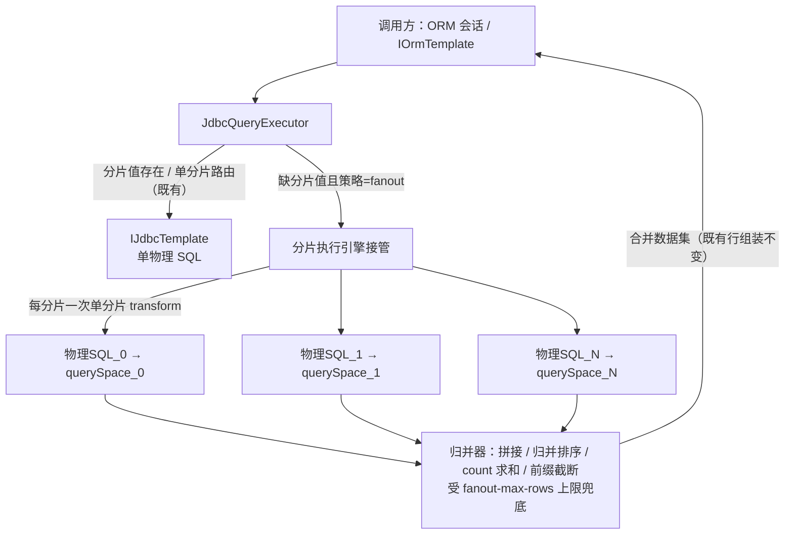

# nop-orm 分片执行引擎（fan-out 与归并）设计

**日期**：2026-10-05
**范围**：`nop-persistence/nop-orm`（查询执行漏斗、结果归并）、`nop-persistence/nop-dao`（shard SPI 扩展与配置契约）；`nop-persistence/nop-orm-eql` 预期零改动
**状态**：草案（roadmap `ai-dev/backlog/nop-persistence-middleware-roadmap.md` WI7；Deliverable = 本设计过评审，实施归 WI8）
**灵感来源**：Apache ShardingSphere sharding 执行引擎面对比；对 `nop-orm-sharding-strategy-design.md` §四"跨分片 fan-out 拒绝"的重新立项

---

## 一、设计结论

1. **拆分点 = 多次单分片 transform，不改 `GenSqlTransformer` 一次产多份**。执行引擎在 transform 之前判定接管，对分片全集逐个驱动既有单分片 transform 链路产出 N 份物理 SQL；"一条 SQL 一个 querySpace"的既有不变式每份物理 SQL 仍然成立，`GenSqlTransformer` 零改动。v1 执行形态为**串行**（调用线程逐分片执行），不引入新线程模型。
2. **fan-out 仅限 SELECT；跨分片读显式声明无统一快照语义**。跨分片写 v1 不进执行引擎（无分片键 DML 维持 `ERR_ORM_SHARD_CONDITION_MISSING` fail-fast）；若未来开启，事务语义复用既有 best-effort 事务组（`nop.dao.config.txn-group-map` 主组映射 + 自动子事务 + 顺序提交），不新建组提交机制——与 `nop-orm-scope-and-non-goals.md` §一.6 的 XA non-goal 完全一致。
3. **归并语义分级**：v1 支持"无序遍历拼接 / ORDER BY 内存归并排序（每分片仍下推排序）/ 无分组 count 求和 / 浅分页（每分片下推 offset+limit 后归并截断）"，全部受 `nop.orm.shard.fanout-max-rows` 行数上限兜底、超限显式失败；显式不做"分组聚合归并（GROUP BY/AVG/SUM/DISTINCT/HAVING）、跨分片 JOIN、写 fan-out"——两阶段聚合归并的正确性陷阱与内存风险在 v1 无对应收益。
4. **跨分片 JOIN 边界**：绑定表（同策略同分片值）单分片 JOIN 保持原生；其余跨分片 JOIN 显式错误码失败（`ERR_ORM_SHARD_FANOUT_NOT_SUPPORT`）——分片键不同的实体互相关联本身是分片设计反模式，响亮失败优于静默的内存 hash join。
5. **广播表维持拒绝**：v1 跨分片 JOIN 不支持使广播表失去唯一收益场景；跨分片非原子写会造成副本间不一致且静默渗入所有读结果，比业务写的不一致更糟。CDC 搬迁管道（WI9）成熟后以"一主多从订阅"形态重审，仍不进 OLTP 写路径。
6. **组合面全部复用既有契约**：读写分离在分片 querySpace 的 DataSource 内正交叠加（每份物理 SQL 的只读意图标记自然传播）；fan-out 结果组装进 ORM 一级缓存无身份冲突（分布式 ID 保证 `(entityName, id)` 跨分片唯一）；搬迁/回填走 nop-batch 逐分片作业，不经执行引擎。
7. **使用契约**：策略级 `missing-shard-policy: fanout`（`MissingShardPolicy` 第三取值）+ 全局开关 `nop.orm.shard.fanout-enabled`（缺省 false；关闭时 fanout 策略运行期退化为 fail，不静默降级）+ 行数上限 `nop.orm.shard.fanout-max-rows`；错误码新增 2 个（OrmErrors）、复用 2 个；可观测性 = 既有每分片 SQL 日志 + 引擎级 fanout 汇总日志与指标。

## 二、背景与动机

### 2.1 重新立项的条件已成熟

`nop-orm-sharding-strategy-design.md` §四以"执行引擎级能力，须连同连接管理、事务边界一起设计，独立立项"为由拒绝了 fan-out。该独立立项的前置——策略注册表、`ShardSelection` 二元组、绑定校验、TABLE marker 静态信息注入、DDL N 表展开——已按 plan `ai-dev/plans/2320-orm-sharding-strategy.md` 落地（设计文档 §六实现裁定记录）。roadmap 将本设计列为 WI7（M3 分片执行引擎），并要求拒绝项含"广播表是否维持不做"的再裁定。

落地后的行为缺口明确：useShard 实体缺分片键的查询按 `missing-shard-policy` fail-fast 或回落 default 分片，**没有"按分片全集扫描"的合法路径**——而"按租户分片、管理端全量报表"是分片体系的常规诉求。本设计为该缺口给出执行模型、事务边界与归并语义的完整裁定。

### 2.2 执行漏斗现状（均已核实 live code）

- **单一改写漏斗**：所有 ORM 查询/更新经 `JdbcQueryExecutor.transformEQL` 产出唯一一条物理 SQL（`nop-persistence/nop-orm/src/main/java/io/nop/orm/loader/JdbcQueryExecutor.java:153-158`），每次执行新建 `GenSqlTransformer` 实例；`executeQuerySql` 在 transform 后补只读意图标记并交给 `IJdbcTemplate.executeQuery`（`:82-99`）。
- **单 querySpace 不变式的两个锚点**：`GenSqlTransformer` 内部是单一 `querySpace`/`dialect` 字段，第二个不同 querySpace 抛 `ERR_ORM_NOT_SUPPORT_MULTIPLE_QUERY_SPACE_IN_ONE_SQL`（`nop-persistence/nop-orm/src/main/java/io/nop/orm/sql/GenSqlTransformer.java:222-230`，错误码定义 `nop-persistence/nop-orm/src/main/java/io/nop/orm/OrmErrors.java:321`）；`SQL` 对象本身只携带一个 querySpace，`JdbcTemplateImpl.runWithConnection` 以它定位唯一连接与事务（`nop-persistence/nop-dao/src/main/java/io/nop/dao/jdbc/impl/JdbcTemplateImpl.java:160-178`、`:225-232`）。
- **连接与事务**：一个事务一个连接一库——`JdbcTransaction` 懒取并缓存单连接（`nop-persistence/nop-dao/src/main/java/io/nop/dao/jdbc/txn/JdbcTransaction.java`）；事务注册表 `TransactionRegistry` 挂在 `IContext` 上，而 `IContext` 是 ThreadLocal（`nop-kernel/nop-api-core/src/main/java/io/nop/api/core/context/BaseContextProvider.java:15`）——**跨线程看不到已注册事务**。
- **best-effort 事务组的真实承载**：`DefaultTransactionManager.getMainTxnGroup` 按 `nop.dao.config.txn-group-map`（装配于 `nop-persistence/nop-dao/src/main/resources/_vfs/nop/dao/beans/dao-defaults.beans.xml:22`）把 querySpace 映射到主事务组；`TransactionTemplateImpl.getTxnState` 发现主组事务已注册时自动为该 querySpace 创建子事务并挂入主组（`nop-persistence/nop-dao/src/main/java/io/nop/dao/txn/impl/TransactionTemplateImpl.java:129-144`）；提交时主组**顺序**提交各子事务（`nop-persistence/nop-dao/src/main/java/io/nop/dao/txn/impl/AbstractTransaction.java:365-372`），子事务回滚失败仅记日志与 rollbackOnly（`:194-210`）。注意：`GroupTransaction` 类是 doCommit/doRollback 全空的占位实现且 main 代码零实例化点，事务组语义完全由上述主/子事务组合承载——本设计不复活该空壳类。多分片写路径已在既有事务组语义内工作（`nop-persistence/nop-orm/src/main/java/io/nop/orm/persister/EntityPersisterImpl.java:557-565` 按分片 querySpace 注册事务监听器）。
- **分页与执行抽象**：分页由方言 `IPaginationHandler.getPagedSql` 在单条 SQL 上完成（`JdbcTemplateImpl.java:387-392`）；仓库内**不存在**名为 ExecutorEngine 的执行框架，并行原语是 `GlobalExecutors` 线程池（`nop-kernel/nop-commons/src/main/java/io/nop/commons/concurrent/executor/GlobalExecutors.java`）与 `CompletionStage` 组合风格（`ITransactionTemplate.runInTransactionAsync`）。
- **SPI 现状**：`IShardSelector` = `selectShard` 值路由 + default 方法组，其中 `getShardNames`（分片名全集静态枚举，`nop-persistence/nop-dao/src/main/java/io/nop/dao/shard/IShardSelector.java:77`）现由 DDL N 表展开消费；`MissingShardPolicy` 现有 `NONE/FAIL/DEFAULT_SHARD` 三值（`nop-persistence/nop-dao/src/main/java/io/nop/dao/shard/MissingShardPolicy.java:25`）。

## 三、核心设计

### 3.1 执行模型：拆分点与执行形态

**接管点与触发条件**：执行引擎挂在 `JdbcQueryExecutor` 内部、`GenSqlTransformer` transform 之前——此时依据编译产物 TABLE marker 的静态信息（实体名 + `shardParamIndex`/`shardValue`，由 `nop-persistence/nop-orm-eql/src/main/java/io/nop/orm/eql/compile/ShardMarkerInjector.java` 编译期写入）与绑定策略裁决可判定"该查询缺分片值且策略为 fanout"。若接管点放在 transform 之后，`GenSqlTransformer.collectShardSelections` 已先抛 `ERR_ORM_SHARD_CONDITION_MISSING`（`GenSqlTransformer.java:139-144`），fan-out 无从发生。`IQueryExecutor` 契约不变，调用方（ORM 会话、`IOrmTemplate`）无感知。

**拆分点裁定：多次 transform，非一次产多份**。接管后引擎对分片全集逐个驱动既有单分片链路：

```
executeFanout(compiled, params, range):
    # 前置校验：statementKind==SELECT；SQL 内全部 fanout 实体绑定同一策略（同分片全集）
    shards = selector.selectAllShards(entityName)          # SPI 新增，与 getShardNames 的 DDL 枚举契约同源
    rows = []
    for shard in shards:                                   # v1 串行：调用线程逐分片执行
        sql = transformWithShard(compiled, params, shard)  # 显式 ShardSelection 驱动的单分片 transform（既有链路）
        rows.addAll(fetchRows(sql, perShardRange(range)))  # 连接经既有事务组/读写分离路径获取（§3.2）
    checkRowLimit(rows)                                    # 超 nop.orm.shard.fanout-max-rows 显式失败
    return callback(merge(rows))                           # 按支持集归并（§3.3），合并数据集走既有行组装
```

选择"多次 transform"而非"`GenSqlTransformer` 一次产出多份"的理由：transform 实例本就是每次执行新建的短生命周期对象（`JdbcQueryExecutor.java:155`），多次实例化成本可忽略；每份物理 SQL 仍然满足"一个 marker→ShardSelection 映射、一个 querySpace、一个 dialect"的既有不变式，`GenSqlTransformer` 及其 fail-fast 逻辑零改动；`QueryPlanCache` 复用语义不变（N 分片 N 个 PreparedStatement 缓存条目，策略设计 §3.6 已裁定）。



**执行形态：v1 串行**。三个依据：(a) 事务注册表是 ThreadLocal 域（§2.2），并行分片线程拿不到调用方已注册事务，事务内的并行分片连接将退化成各自的非事务连接——同一语句各分片读到不同隔离级别的数据，正确性不可推理；(b) 并行使连接占用放大 N 倍，OLTP 请求路径上对连接池是隐式背压；(c) 常见分片数（4–64）下串行归并的延迟可接受。与既有执行风格的关系：仓库无 ExecutorEngine 框架，nop 的异步组合子是 `CompletionStage` + `GlobalExecutors`；若未来需要并行，正确形态是先解决事务上下文跨线程传播（`IContext` 快照复制），再以 `runInTransactionAsync` 同族风格实现，v1 不预埋。

### 3.2 连接与事务边界

**跨分片读：无事务语义，显式声明**。N 份物理 SQL 使用 N 个独立连接（各自经既有 `withTxn(SUPPORTS)` 路径，`JdbcTemplateImpl.java:180-191`），不存在跨分片统一快照。活动事务内的 fan-out 读：各分片连接经 `TransactionTemplateImpl.getSubTransaction` 自动加入事务组（既有机制，`:129-144`），满足"事务内一律主库"的读写分离一致性契约，但**各分片仍是各自库的独立快照**——跨分片读的一致性等级 = "每分片内一致，分片间无全局快照"。需要跨分片强一致的业务必须走单分片键路由或其他应用层手段；该声明写入 owner doc，不做隐式补偿。

**跨分片写：v1 不进执行引擎**。无分片键的 UPDATE/DELETE 维持 `ERR_ORM_SHARD_CONDITION_MISSING` fail-fast（`missing-shard-policy: fanout` 对非 SELECT 语句一律按 fail 处理）。理由：非原子的跨分片 DML 出现在 OLTP 请求路径上是事故源，而"全表修正"类低频运维操作有更安全的既有出路——nop-batch 逐分片作业（事务边界清晰、可断点续传、可校验）。逐实体写路由（`EntityPersisterImpl.getShardSelection`，`:265`）不受影响：它本来就是每实体单分片写，多实体多分片时自然落入既有事务组语义。

**与 best-effort 事务组的关系（未来若开写 fan-out）**：裁定为复用既有机制而非新建——把各分片 querySpace 映射到同一主事务组（`nop.dao.config.txn-group-map` 配置层完成），子事务由 `TransactionTemplateImpl` 自动创建、主组顺序提交。部分提交风险（第 k 片提交失败后前 k-1 片已提交）与既有跨 querySpace 业务写完全同构，是 XA non-goal（`nop-orm-scope-and-non-goals.md` §一.6"跨数据源按 best-effort 顺序提交"）的直接推论；引擎不引入第二套组提交，也不提供"反向补偿"。该裁定使 v2 写 fan-out 的增量收敛为"放开语句类型白名单 + 错误信息携带各分片执行明细"，事务面零新增。

### 3.3 归并语义分级

| 构造 | v1 语义 | 归并方式与裁定理由 |
|---|---|---|
| 无 ORDER BY 的 SELECT | 支持 | 各分片结果顺序拼接（concat），行组装走既有 `transformRow` 链路 |
| ORDER BY | 支持 | **排序由归并器做内存排序**：每分片仍下推原 ORDER BY（分片内有序），引擎拉回全量后按同一比较器归并排序。这是"显式语义"而非 fail-fast：全量拉回 + 内存排序产出的是全量数据的**真序**，正确性无妥协；内存风险由 `fanout-max-rows` 上限兜底、超限显式失败。溢写磁盘不做（OLTP 跨分片查询超限即用法错误） |
| 无分组 count(*) | 支持 | 各分片 count 求和 |
| 分页（findPage / range） | 支持（浅分页） | 每分片下推 offset+limit（取各分片前缀，全局第 k 名必在每分片前 offset+limit 名内，正确性成立），归并排序后截断 `[offset, offset+limit)`；总数 = 各分片 count 求和。深分页的行数放大（offset+limit 乘分片数）由同一 `fanout-max-rows` 上限显式拦截 |
| GROUP BY / AVG / SUM(非 count) / DISTINCT / HAVING | **显式失败**（`ERR_ORM_SHARD_FANOUT_NOT_SUPPORT`） | 正确归并需两阶段聚合（AVG 须分解为 sum/count 对、DISTINCT 须全量去重、HAVING 依赖分组结果），是执行引擎深水区且 v1 无业务拉动；全量拉回内存聚合会与 ORM 行组装语义冲突（聚合行是计算值非实体行）。出路：带分片键单分片聚合（既有）、或 nop-metadata 应用层联邦（roadmap baseline 已有 BI 场景覆盖） |
| 跨分片 JOIN / FOR UPDATE / DDL / 存储过程 | **显式失败** | 见 §3.4 与 §3.2 |

分级原则：**正确性能完整保住的显式做（内存上限兜底），正确性需要深水区机制的显式拒**。上限语义统一为"归并行数（含每分片拉回行数）超过 `nop.orm.shard.fanout-max-rows` 即抛 `ERR_ORM_SHARD_FANOUT_ROW_LIMIT_EXCEEDED`"，缺省值（建议 10000）由 WI8 承载 plan 裁定。

### 3.4 跨分片 JOIN 边界

- **绑定表 JOIN（同策略同分片值）**：路由结果同一 querySpace 同名后缀，天然单分片，保持原生 JOIN——既有行为，引擎零参与（策略设计 §3.2 已裁定绑定表用"同策略名"隐式表达）。
- **其余跨分片 JOIN：v1 不支持，显式失败**。理由：(a) 归并 JOIN 需要两侧全量拉回 + 应用层 hash/nested-loop join，内存与正确性风险双高，且连接谓词语义（等值/非等值/多列）复杂；(b) nop 的 OLTP JOIN 几乎总沿外键，绑定表声明覆盖了"同分片关联"的合法场景，"分片键不同的实体互相关联"本身是分片设计反模式——fail-fast 把设计错误提前到开发期暴露，优于运行期静默消化；(c) 替代路径存在：应用层两步查询（先查 A、再按关联键 in 查 B，in 查询可走 fan-out 或单分片），分析型跨库关联由 nop-metadata 联邦承担。SQL 内出现多个 fanout 策略绑定的实体（隐含跨分片 JOIN 意图）同样按此错误码失败。

### 3.5 广播表重审

前置裁定（策略设计 §四）以"一条 SQL 写多个 querySpace，超出单 querySpace 事务模型"拒绝广播表。本设计重新立项后**维持拒绝**，且拒绝理由升级：

1. **收益面消失**：广播表的唯一价值是"小维度表各分片本地副本、JOIN 免跨分片"，而 v1 跨分片 JOIN 本就不支持——为不存在的收益引入跨分片非原子写，风险收益不成比例。
2. **不一致的代价不对称**：best-effort 事务组下广播写部分失败（第 3 片提交失败）造成各分片副本不一致，且**无自动修复路径**；业务写的不一致窗口是业务可补偿的，广播副本不一致会静默渗入此后所有读结果，违背"无静默错误"硬裁定。
3. **重审通道**：WI9 搬迁管道落地后，"广播"可表达为一主多从的 CDC 订阅（nop-stream-connector-debezium 源 + jdbc exactly-once sink，exactly-once 由 sink 保证），同步正确性由管道断点续传与校验作业保障，仍不进 OLTP 写路径。届时按需另立设计。

### 3.6 组合面

- **读写分离**（`nop-dao-readwrite-splitting-design.md` §五已声明正交叠加）：分片引擎只产出 querySpace，主从分流发生在各 querySpace 的 DataSource 内部；`JdbcQueryExecutor` 对 SELECT 的只读意图标记（`JdbcQueryExecutor.java:91-93`）对每份物理 SQL 自然生效，无事务的 fan-out 读自动落到各分片的从库。
- **动态 querySpace**（`CFG_ORM_ENABLE_DYNAMIC_QUERY_SPACE`）：物理 SQL 走既有 `withTxn` 路径，`useDynamicQuerySpace` 映射对每份物理 SQL 自动生效，无特殊处理。
- **ORM 一级缓存**：fan-out 结果按既有行组装进 session，L1 身份键 `(entityName, id)` 依赖 id 跨分片唯一——分布式 ID（snowflake/uuid/编码规则，roadmap baseline 已有）是分片体系的前置约束，写入 owner doc；违反该前提（多分片自增主键）会在 L1 缓存产生身份冲突，属分片接入方的模型责任。
- **回填（可检索加密）/ 搬迁（WI9）**：均走 nop-batch 按 `ShardDdlHelper.shardTableNames`（`nop-persistence/nop-orm/src/main/java/io/nop/orm/ddl/ShardDdlHelper.java:45-53`）的分片名全集逐片读写，不经执行引擎——批量域与 OLTP 执行域分离，互不依赖。
- **sql-lib / 原生 SQL**：不解析、不 fan-out；原生 SQL 的分片语义由 SQL 作者显式负责（与读写分离"不解析 SQL"的架构原则同构）。

### 3.7 使用契约

**配置**（对齐策略配置的 JSON 形态）：

```json
{
  "nop.orm.shard": {
    "strategies": {
      "order-mod": {
        "type": "hash-mod",
        "shard-count": 16,
        "missing-shard-policy": "fanout",
        "entities": ["app.entity.NopOrder"]
      }
    }
  },
  "nop.orm.shard.fanout-enabled": true,
  "nop.orm.shard.fanout-max-rows": 10000
}
```

三件套的语义与门控关系：

| 配置 | 级别 | 语义 |
|---|---|---|
| `missing-shard-policy: fanout` | 策略级 | 声明该策略绑定实体的缺分片值查询按分片全集展开；`MissingShardPolicy` 增加第四取值。对非 SELECT 语句恒按 fail 处理 |
| `nop.orm.shard.fanout-enabled` | 全局，缺省 false | 总开关。关闭时 fanout 策略**运行期退化为 fail**（抛 `ERR_ORM_SHARD_CONDITION_MISSING`，不静默降级单分片），启动期 WARN——保留"一键关闭"的应急刹车属性且不产生配置矛盾 |
| `nop.orm.shard.fanout-max-rows` | 全局 | 归并行数上限（含每分片拉回量），超限抛 `ERR_ORM_SHARD_FANOUT_ROW_LIMIT_EXCEEDED`；缺省值由 WI8 plan 裁定 |

**错误码清单**：

| 错误码 | 归属 | 语义 |
|---|---|---|
| `ERR_ORM_SHARD_FANOUT_NOT_SUPPORT` | OrmErrors（新增） | 不支持的跨分片构造：分组聚合、跨分片 JOIN、非 SELECT 的 fanout 请求、单 SQL 混用多个 fanout 策略；arg 携带构造名 |
| `ERR_ORM_SHARD_FANOUT_ROW_LIMIT_EXCEEDED` | OrmErrors（新增） | 归并行数超 `fanout-max-rows`；arg 携带实际行数与上限 |
| `ERR_ORM_SHARD_CONDITION_MISSING` | OrmErrors（复用，`:329`） | 全局开关关闭时 fanout 策略的运行期退化；非 SELECT 语句命中 fanout 策略 |
| `ERR_DAO_SHARD_CONFIG_INVALID` | DaoErrors（复用，`:83`） | 配置解析错误（如 fanout 声明在未绑定实体上） |

**可观测性**：每分片物理 SQL 的执行明细由既有日志与指标覆盖——`nop.jdbc.run` 日志逐条打印 querySpace 与耗时（`JdbcTemplateImpl.java:175`），`IDaoMetrics` 逐物理 SQL 计量。引擎层新增汇总契约：日志 `nop.orm.shard.fanout`（逻辑 SQL 名、分片数、归并行数、归并耗时）；指标 `nop.orm.shard.fanout.query`（计数/耗时）与 `nop.orm.shard.fanout.rows`（归并行数分布），失败按错误码维度计数。命名对齐平台小数点分层惯例。

## 四、拒绝了什么

| 被拒方案 | 拒绝理由 |
|---|---|
| `GenSqlTransformer` 一次产出 N 份物理 SQL | 需 transformer 内部感知分组渲染：单一 querySpace/dialect 字段与 marker→ShardSelection 1:1 映射、setQuerySpace fail-fast 全部要改，错误面侵入编译产物消费链；多次 transform 零改动达成同一效果 |
| EQL 编译期 fan-out 改写（UNION ALL 展开 N 分支） | 编译产物按 SQL 文本进 `QueryPlanCache`，N 是随扩容变化的部署属性；执行期值路由原则（策略设计 §3.6）已裁定静态编译/动态路由分野，编译期展开违背之 |
| 并行 fan-out（GlobalExecutors 线程池分发） | 事务注册表是 ThreadLocal 域（`BaseContextProvider.java:15`），并行分片线程拿不到调用方事务，事务内各分片退化为独立非事务连接——同语句跨分片隔离级别不一致；且连接占用放大 N 倍。先决条件（事务上下文跨线程传播）未解决前不预埋 |
| 流式 K 路归并 + 每分片游标（SS 形态，排序/分页的标准解） | 需要 N 个并行持有游标的连接，与"executeQuery 回调消费完即关闭"的 `IDataSet` 生命周期模型冲突；v1 内存归并在行数上限内语义等价且实现面小。列为 v2 演进（配合并行化一起做） |
| 归并行数超限时溢写磁盘 | OLTP 请求路径上超限即用法错误，响亮失败优于把执行引擎变成批处理引擎；大批量场景归 nop-batch |
| 跨分片写 fan-out（v1） | 非原子跨分片 DML 进 OLTP 请求路径是事故源；全表修正是低频运维操作，nop-batch 逐分片作业覆盖且事务边界清晰。v2 放开时事务面复用既有事务组（§3.2） |
| 独立的执行引擎组提交/补偿机制 | 与既有事务组语义重复且更弱化；XA non-goal 下 best-effort 顺序提交已是平台统一答案，第二套组提交必然产生语义分叉 |
| 广播表 | 维持拒绝且理由升级（§3.5）：收益场景（免跨分片 JOIN 的本地维度表）在 v1 不存在，部分失败造成无修复路径的副本不一致 |
| 归并器支持聚合下推（两阶段聚合） | 正确性陷阱密集（AVG 分解、DISTINCT 去重、HAVING 交互）且 v1 无业务拉动；分析场景已由 nop-metadata 联邦覆盖 |
| 裸 filename 风格的独立开关（如 per-request hint 强制单分片/fanout） | 与策略设计 §四拒绝 Hint 路由同因：隐式 ThreadLocal 语义可追溯性差；策略声明 + 全局开关两级已覆盖"按需启用/应急关闭" |

## 五、与已有设计的关系

- **`nop-orm-sharding-strategy-design.md`（前置契约）**：本设计是对其 §四 fan-out 拒绝的重新立项，落地后其 §3.4 路由判定伪代码的 missing-shard-policy 分支增加 fanout 取值、§3.6 执行期路由原则被本设计沿用；`ShardSelection` 二元组、策略注册表、绑定校验、DDL N 表展开全部原样复用，SPI 仅增 `selectAllShards`（与 `getShardNames` 的静态枚举契约同源）。两篇文档在本文转 active 时同步修订。
- **`nop-orm-scope-and-non-goals.md`**：不触碰任何既有裁定；§一.6 XA non-goal 与 best-effort 顺序提交是 §3.2 事务裁定的上位依据；§3.5"连接级资源归 DataSource 层"与归并器不碰连接池的边界一致。
- **`nop-dao-readwrite-splitting-design.md`**：正交叠加（§3.6）；"事务内一律主库"契约被 fan-out 读继承（各分片事务内连接均为该分片主库）。
- **`docs-for-ai/02-core-guides/concurrency-and-transactions.md`**：事务组顺序提交语义、ORM 一级缓存规则（fan-out 组装不覆盖已初始化字段）在跨分片场景下继续成立；实施后该 guide 需补"跨分片读无统一快照"契约条目（WI8 owner doc 项）。
- **roadmap 定位**：本设计承载 WI7（Decision），实施归 WI8（Feature：归并正确性测试矩阵 + E2E）；WI9 搬迁管道是广播表重审的再评估前提（§3.5）。
