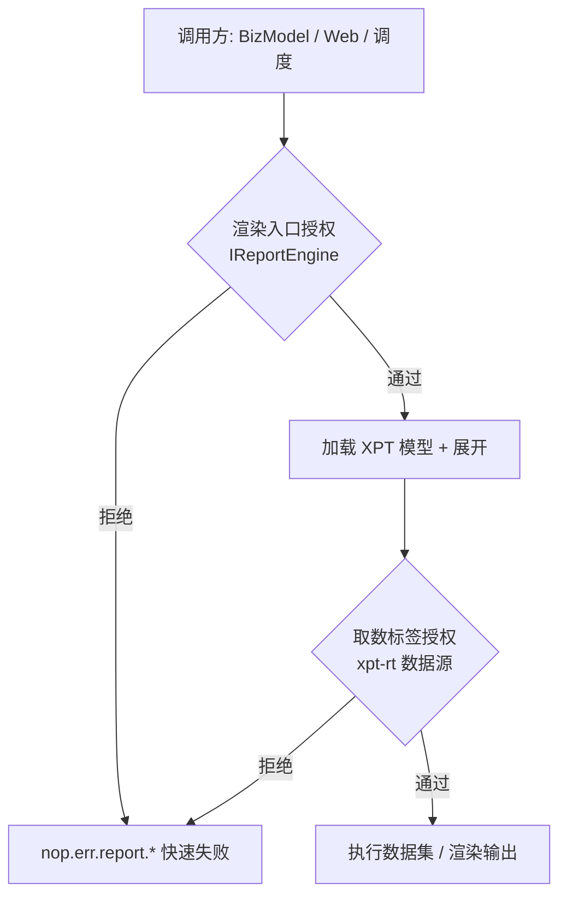

# 报表/数据源权限接线 设计

**范围**：`nop-report/nop-report-core`（渲染入口与取数标签）、`nop-report/nop-report-service`（授权数据读取）；权限模型复用 nop-auth
**状态**：草案（规范性文档；实施编排见 `ai-dev/backlog/nop-report-capability-roadmap.md`）

> 本档为规范性文档：只描述当前有效设计；变更历史见 git 与 AI 开发记录区的时效性文档。

---

## 一、设计结论

1. 授权检查在**渲染入口**（`IReportEngine.getRenderer` / `getRendererForXptModel`）与**数据集取数**（`xpt-rt.xlib` 的 `UseJdbcDataSet`/`JdbcDataSet`/`UseOrmDataSet`/`UseQueryDataSet` 执行路径）两处强制生效；不校验不渲染、不校验不取数。
2. 权限模型不自建：报表级消费 `NopReportDefinitionAuth`（角色 → 报表定义），数据源级消费 `NopReportDatasourceAuth`（角色 → 数据源），叠加 nop-auth 的角色/资源权限判定。
3. 未授权以 `nop.err.report.*` 错误码快速失败（公共 API 档：`NopException` + ErrorCode + `.param(...)`），错误消息带配置指引（如何给当前角色授权）。
4. 授权语义为 **deny-by-default 的可配置豁免**：未配置任何 auth 记录时的默认行为、以及管理角色的豁免口径，由实施计划裁定并落 owner doc；裁定原则是不放宽现状之外的暴露面。

## 二、背景与动机

平台已有角色级报表/数据源权限表（实体与 CRUD 页面齐备），但渲染与取数链路从不消费——「配置了权限等于没配置」，属安全缺口。平台级报表引擎要求：知道报表名不等于可以渲染它；拿到数据源名不等于可以取它的数。

## 三、核心设计

### 检查点

- **渲染入口**：以「报表路径 → 报表定义 → 角色集合」判定当前用户角色是否可渲染。直接以 `getXptModel` 加载 VFS 模板绕过运行时实体的路径，同样经过入口检查（以路径为键判定，不依赖实体存在）。
- **取数标签**：数据集标签执行时以「数据源名 → 数据源权限」判定；ORM/query 数据集无显式数据源名的，落报表级权限覆盖。取数检查独立于渲染入口检查——嵌套/子报表场景下每一层取数都要过自己的数据源权限。
- **缓存协同**：结果缓存命中前同样过渲染入口授权（授权不过，命中缓存也不返回）；缓存键不含用户身份，授权在键之外独立判定。

### 身份与角色

- 当前用户与角色取自 nop-auth 的会话上下文；无会话上下文（引擎嵌入式使用）时的口径：视为未授权，除非应用显式声明系统级调用豁免（服务间调度场景）。
- 授权判定结果在单次渲染请求内不缓存跨用户复用。

### 错误与指引

- 报表级拒绝与数据源级拒绝使用不同错误码（便于定位配置缺哪一层）；`.param` 携带报表路径/数据源名与所需角色提示。
- 错误消息为英文，配置指引说明如何配置 `NopReportDefinitionAuth`/`NopReportDatasourceAuth` 或调整角色。

### 边界

- 行级过滤与列级脱敏是**数据级安全**，不属本契约（取数前 SQL/query 重写另立设计）；本契约只回答「能不能渲染/能不能取数」。
- 不改变 nop-auth 本身的权限判定语义；不在 nop-report 内复制角色管理。
- `nop-report-web` 的 CRUD BizModel 沿用平台通用 CRUD 鉴权，本契约只覆盖引擎渲染/取数链路。

## 四、拒绝了什么

| 替代方案 | 拒绝理由 |
|----------|----------|
| 只在前端隐藏报表入口 | 绕过页面直接调接口即穿透；服务端必须强制 |
| 只在 CRUD BizModel 层校验 | 渲染入口是 `IReportEngine` 而非 CRUD BizModel；CRUD 校验管不到引擎链路 |
| 自建报表权限模型 | 平台已有 nop-auth 角色体系与 auth 实体；第二套模型必然漂移 |
| 授权检查放各渲染器内部 | 三渲染器各自实现必然不一致且易漏（新增渲染器即漏）；入口统一一处生效 |

## 五、与已有设计的关系

- `parameter-model.md`：参数校验与授权同处渲染入口链路，授权先于参数取数生效。
- 结果文件缓存契约：命中不越权是缓存链路的硬约束（见本档「缓存协同」）。
- 模板版本管理（后续能力）复用同一入口授权，不另立检查点。
