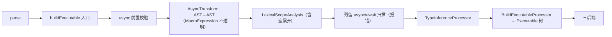

# XLang `async`/`await` 设计（AST 变换为 CompletionStage）

**日期**：2026-10-18（v8，经七轮独立审查修订）
**范围**：`nop-kernel/nop-xlang`（parser grammar / AST / 编译管线 / 运行时 helper / 生成物）
**状态**：草案（设计结论已定，独立审查已达成共识：无 BLOCKER；待实现）

---

## 一、设计结论

1. **`async` / `await` 作为 XLang 语法引入**；`await` 只在 async 函数（`async function` 声明、`async` 箭头函数）内合法，跨越非 async 函数边界是编译期错误。
2. **实现方式为 AST→AST 的 async 变换**：把 async 函数改造成**返回 `JsPromise`（`CompletionStage`）的普通同步函数**，把 `await` 改造成 promise 续延链。变换只产出既有 AST 节点 + 对新增 helper `JsAsync` 的调用，**执行层与三后端零新增节点 / 零新增翻译器**。
3. **内部统一按 `CompletionStage` 处理**：`JsAsync` 组合子把输入归一化为 JDK `CompletionStage`（`JsPromise` 是其一实现），用 `thenCompose`/`handle` 展平，**不依赖 `JsPromise.then` 的展平**（该 API 当前不展平，登记为独立已知缺陷）。**组合子对外返回 `JsPromise`**（包一层），保证同步调用方可 `.get`、可被 `await`。rejection 原因统一归一化（`CompletionException`/`ExecutionException`/`JsPromise.Rejected` 解包，已 `NopException` 透传）为带 `SourceLocation` 的 `NopException`。
4. **helper 调用约定**：需要求值上下文的组合子声明为 `@EvalMethod`（首个参数 `IEvalScope`，**构建时被剥离**，`EvalMethodInvoker` 运行时注入）。因此变换生成的是**不含 scope 的实参**：`JsAsync.then(prev, cont)`、`JsAsync.end(stage)`。**不得显式传 `$scope`**。`JsAsync` 作为类引用须可解析：加入 `JS_GLOBAL_VARS`（与 `Promise` 同机制），或在变换中合成 `ImportClassDefinition`。
5. **变换位置**：进入编译（`buildExecutable`）最前端，即宏展开完成之后、`LexicalScopeAnalysis` 之前（name-based）。**变换把 `MacroExpression` 子树视为不透明**（不深入改写）；**v1 不支持宏体 / 宏输出中的 async/await**，由「变换期对所有 `MacroExpression` 体扫描 + 变换后残留扫描」显式报错。
6. **跨 `await` 可变局部变量自动装箱**：复用 `LocalVarDeclaration.isUseRef() = isChanged() && isUsedInClosure()` 与 `BuildClosureBodyExecutable` 的引用捕获。
7. **控制流编码**：`return`/`break`/`continue` 用带标签结果值 `AsyncControlSignal` 编码（不用异常）。`then`/`tryCatch` 对上游信号短路透传（不调用 handler）；**`finallyDo` 例外——必须无条件执行 `fin`**（`return` 可能在 try 体内产生信号，finally 仍须运行），再按 §4.3.4 决定保留/覆盖。`JsAsync.end` 在函数边界把 `RETURN` 转成 resolve，残留 `BREAK`/`CONTINUE` 视为内部错误。
8. **尾调用与尾递归优化为硬性要求**：`return await e` 仅在**函数尾位**直接返回内部 stage（不二次 resolve）；循环自递归续延的 `loop()` 自调用**必须在 `JsAsync.then` 回调内**发出，经 `ContinuationExecutor` 单线程 trampoline 迭代推进 → Java 栈常数化。
9. **循环内 await 严格按 JS 语义**（§4.3.3）：`while`/`do-while`/`for`/`for-of`/`for-in`/`for-range` 均支持；`break`/`continue` 作用于最内层循环；`return` 退出函数；`for (let/const x of …)` 每轮**新绑定**；无 labeled break/continue。
10. **`finally` 严格对齐 JS 语义**（§4.3.4）：等 try/catch settle 后执行；正常完成**保留原结果**（返回值忽略）；抛错 → 覆盖为 rejection；`return` → **覆盖为 `RETURN` 信号**（不 resolve，交由函数边界处理）；含 await 时等待其完成。
11. **调度错误转 rejection（防挂死）**：`ContinuationExecutor.runLoop` 吞掉 `Throwable`（仅记日志）；**每个被调度的续延任务必须自行 catch 并 `completeExceptionally`**，否则抛错会使 stage 永不 settle。
12. **`Promise.all` / `allSettled` / `race` / `any` 必须实现**（§4.4），作为 `JsPromise` 增量静态方法。
13. **无对象语义，`this` 不在范围**（§4.8）。
14. **v1 输出限制**：async 函数为值返回语义，**不支持 `$out`**；对直接输出构造在后处理中检测报错（尽力而为），间接输出文档明示；三后端因执行同一树而彼此一致。
15. **AST `async` 标记与语法标签**：`XLangAST.xjava` 增 `async` 字段并重生成 `_gen/*`；grammar 用**带标签** `async=Async?`（裸 `Async?` 不生成属性；`<astAssign>` 生成无条件 setter）；两个 arrow 产生式都要加；需手改**模板管理但未被覆盖**的 `XLangASTBuildVisitor.java`。**v1 不支持 async 函数表达式**。

---

## 二、背景与动机

- XLang 求值栈全同步（`IExecutableExpression.execute(...) -> Object`、`IEvalFunction.invoke(...) -> Object`），无续延参数。
- `await`/`async` 已部分播种：lexer token、`AwaitExpression` AST/类型推断已生成，但无 parser 产生式、`BuildExecutableProcessor.processAwaitExpression` 会抛 `ERR_EXEC_NOT_SUPPORTED_AST_NODE`、无三后端翻译。
- 既有异步基础：`JsPromise extends CompletableFuture`（回调经 `ContinuationExecutor` 线程本地单线程 trampoline 调度）。
- 架构承诺：三后端对拍一致（`ai-dev/design/xlang-execution/01-architecture-baseline.md` §五）。前端一次性消费 async 语义满足之。

---

## 三、现状锚点（已对照代码核实）

| 构件 | 位置 | 现状 |
|------|------|------|
| `Async`/`Await` token | `model/antlr/XLangLexer.g4:139-140` | 存在（94/95） |
| keyword 收录 | `XLangCommon.g4:75`（`// \| Async`）、`:46-102` | `Async` 被注释、`Await` 缺失且都不在 `identifierOrKeyword_` → 死 token |
| `AwaitExpression` | `nop-kernel/nop-xlang/src/main/java/io/nop/xlang/ast/`（`AwaitExpression.java` 与 `_gen/` 下生成类）、`XLangAST.xjava:611` | 已生成（含 `argument`），visitor/printer/optimizer 已接线 |
| `FunctionDeclaration`/`ArrowFunctionExpression` | `XLangAST.xjava:310-332` | 无 `async` 字段 |
| `FunctionExpression` 产生式 | `XLangParser.g4:525-527,532` | 被注释（无函数表达式） |
| 类型推断 | `compile/TypeInferenceProcessor.java:1596` | 结果类型透传操作数类型 |
| Executable 构建 | `compile/BuildExecutableProcessor.java:1577-1580` 委托类内 `defaultProcess:296-299` | **抛 `ERR_EXEC_NOT_SUPPORTED_AST_NODE`**（残留 await 安全网） |
| 编译管线 | `compile/DefaultExecutableExprCompiler.java:28-48` | LSA → TypeInference（受开关）→ BuildExecutable |
| 宏展开 | `XplExprParser.java:31-36`；`XLangExprParser.parseFullExpr`；`LexicalScopeAnalysis.visitMacroExpression:975-997`（`:983` analyze 体、`:988` 递归 buildExecutable、`:996` replaceChild splice） | **非全部 parse 期**；部分在 LSA 内；宏体先被 analyze |
| 闭包/ref-slot | `LocalVarDeclaration.isUseRef()`（`:150-152`）、`Init/EnhanceRefSlotExecutable`、`BuildClosureBodyExecutable`、`EvalFrame.setRefValue/getRef` | "改且被闭包捕获 → `EvalReference`"，捕获引用对象 |
| 控制流退出 | `EvalRuntime.exitMode` + `Return/Break/ContinueExecutable`；`ExecutableFunction` 边界清空（`:98,119,140`） | 标志位，不跨函数边界 |
| `JsPromise.then` 展平 | `utils/JsPromise.java:87-106` | **不展平**（`next.complete(result)`）；`resolve` 不 adopt thenable |
| 续延执行环境 | `ExecutableFunction.call1:243` 新建 `EvalRuntime(scope)`；`EvalRuntime.java:10` 默认 `DisabledEvalOutput` | 闭包经 `IEvalFunction` 调用丢 `$out` |
| `@EvalMethod` 机制 | `MethodModelBuilder.buildEvalMethod`（剥离首参）、`EvalMethodInvoker`（运行时注入 scope） | **声明含 scope，调用不含** |
| 静态分派 | `BuildExecutableProcessor.buildMemberCall:1394` → `getUniqueMethod(argCount)`；另有值匹配回退 `StaticFunctionExecutable` | 同名同参个数会被置 null；避免同参个数重载 |
| `ContinuationExecutor` | `ContinuationExecutor.java:38-59` | 线程本地单线程 trampoline；`runLoop` **吞 Throwable** |
| AST 合成先例 | `LogFunctions.newLogMethod:114-128`；`JS_GLOBAL_VARS`（`LexicalScopeAnalysis.java:137-143`） | 成熟 |
| grammar 标签机制 | `AstGrammarBuilder.processAstChild`（仅 `ASSIGN` 生成属性）；先例 `readonly=ReadOnly?`、`optional=OptionalDot` | **必须 `async=Async?`** |
| 生成物入口 | `nop-kernel/nop-xlang/precompile/`（`gen-xlang-parser.xgen`、`gen-xlang-ast.xgen`）、`nop-kernel/nop-xlang/model/AntlrParserConfig.json` | 语法/AST 变更经此；`XLangASTBuildVisitor.java` 为模板管理但 `isAllowWrite=false` 不覆盖 |

---

## 四、核心设计

### 4.1 语法与 AST 载体

- **async 函数**：`async function` 声明、`async (…) => …` 箭头函数（**两个 arrow 产生式 `ArrowFunctionExpression_full` 与 `ArrowFunctionExpression_single` 都要加 `async=Async?`**）。v1 不支持 async 函数表达式（grammar 无 `FunctionExpression`）。
- **await 表达式**：`expression_single` 增 `Await argument=expression_single # AwaitExpression`，与 `!`/`-`/`+` 同前缀一元优先级 → `await a + b` = `(await a) + b`。
- **grammar 带标签**：`async=Async?`（生成 `ctx.async` 与 `setAsync(...)`）。裸 `Async?` 不产生属性；`<astAssign=async>` 生成无条件 `setAsync(true)`。
- **AST 载体**：`XLangAST.xjava` 为 `FunctionDeclaration`/`ArrowFunctionExpression` 增 `boolean async`；重生成 `_gen/*`（`precompile/gen-xlang-ast.xgen`）。
- **手改 `XLangASTBuildVisitor.java`**：重生成后 `_XLangASTBuildVisitor` 新增抽象方法 `FunctionDeclaration_async(Token)`/`ArrowFunctionExpression_async(Token)`；在**模板管理但不会被覆盖**的 `XLangASTBuildVisitor.java` 补齐实现（`token != null`）。**不可手改 `_` 前缀文件**。
- **保留字**：`Async`（恢复）与 `Await`（新增）加入 `keyword_`（仍可作属性名 `obj.await`）；`async`/`await` 加入 `Keywords.XLANG`，使运行时校验与语法一致。
- **编译期校验**（变换入口）：`await` 必须在最近 lexically-enclosing async 函数内，不得跨越非 async 函数/闭包边界；违反报 `ERR_XLANG_AWAIT_OUTSIDE_ASYNC`（带 loc）。

### 4.2 变换位置与管线（含宏不透明）

变换在 `DefaultExecutableExprCompiler.buildExecutable` **最前端**，为**可重入、幂等** pass（变换后树中不再有 async 函数或 `AwaitExpression` 出现在被处理范围内）。

**宏处理（v1 裁定）**：

- **变换不主动把 `MacroExpression` 当作常规变换路径深入**（避免在 LSA `replaceChild` splice 前改写宏体导致静默 miscompile）；但 LSA 展开宏体时会经递归 `buildExecutable`（`LexicalScopeAnalysis.java:988`）**再次进入变换**，故 pass 必须幂等。
- **变换期宏体扫描**：对所有 `MacroExpression` 子树（含未展开体）扫描，若含 async/await → 报 `ERR_XLANG_ASYNC_IN_MACRO`。
- **变换后残留扫描**：LSA 之后（`DefaultExecutableExprCompiler` 中 `LexicalScopeAnalysis` 与 `TypeInference` 之间）全树扫描，发现残留 async 函数 / `AwaitExpression` → 报 `ERR_XLANG_ASYNC_UNSUPPORTED_LOCATION`（覆盖"宏输出产生 async"）。该扫描须廉价，且避免与宏体扫描重复报告同一处。
- 「完整宏预展开 + 支持宏生成 async」列入后续版本 / 开放项。

**为什么在 LSA 之前**：合成续延是闭包，其捕获/ref-slot/slot 分配必须由 LSA 计算；LSA 之后变换会导致 outer 变量不被登记为 closure ref、可变变量按值捕获。

### 4.3 变换语义

#### 4.3.1 ANF 归一化（含新鲜名）

把表达式位置的 `await` 提取为紧邻 `let` 绑定，保持左到右求值顺序。临时名由作用域级**新鲜名生成器**产生（形如 `__async_0`，不与用户标识符冲突）。

#### 4.3.2 续延与 CompletionStage（统一处理 + 尾调用）

- async 函数体 → 返回 `JsPromise` 的同步表达式；函数清除 async 标记。
- **所有** async 函数体（含无 await 者）统一为：`return JsAsync.end(JsAsync.then(JsAsync.resolve(null), _ => <体求值>));`。两段职责：
  - **起点包裹**使函数体**同步 `throw`** 落入 `then` 任务内被转为 rejection（对齐 JS：async 函数**永不**同步抛出，总是返回 promise）。**不可**写成"无 await → `return JsAsync.resolve(<体>)`"——同步 `throw` 会同步逃逸，破坏调用方契约。
  - **函数边界 `JsAsync.end`** 把链终端的 `RETURN` 信号转成 resolve(value)。**不可省略**：`JsAsync.then` 只做"上游是信号则跳过续延原样上传"，不会把终端 `RETURN` 转为值；若省略 `end`，含"await 后非尾位 return"的函数的 promise 会 resolve 成信号对象而非 `v`。
- `await e` → `JsAsync.await(<locLiteral>, e)`；随后**一律用 `JsAsync.then(prev, cont)` 连接**（**不**用 `JsPromise` 裸 `.then`，**不**显式传 scope）。
- 起点包裹 + 边界：`JsAsync.end(JsAsync.then(JsAsync.resolve(null), _ => <链>))`（`then` 以 1 个实参调用续延，续延须为 1 参；同步段抛错由此转为 rejection；`end` 在边界把终端 `RETURN` 信号转 resolve）。
- `JsAsync.then` 内部：把 `prev` 归一化为 `CompletionStage`；signal-aware（上游为 `AsyncControlSignal` 则跳过 `cont` 原样上传）；否则在 `ContinuationExecutor.INSTANCE.execute(...)` 中调用 `cont`（**任务体 catch Throwable → `completeExceptionally`**）；`cont` 的结果先经 `toStage` 归一（普通值 → resolve 包裹；嵌套 stage/信号 → 对应处理）再 `thenCompose` 展平；上游失败透传。
- **尾调用（仅函数尾位）**：位于**函数尾位**的 `return await e` → 直接返回 `JsAsync.await(loc, e)`（不二次 resolve）。**非尾位（含循环体、组合子回调内）**的 `return await e` → `JsAsync.then(JsAsync.await(loc, e), v => JsAsync.returnSignal(v))`。
- **`return <expr>`**：变换在类型推断之前运行，**无法静态判断** `<expr>` 是否为 promise，故**一律**对**非尾位** `return <expr>` 经 `JsAsync.await(<loc>, <expr>)` 归一化（运行时 adopt thenable）后再 `JsAsync.returnSignal(v)`：`JsAsync.then(JsAsync.await(<loc>, <expr>), v => JsAsync.returnSignal(v))`（若 `<expr>` 本身已是 `return await e`，直接复用其 stage，不再二次 await）；**尾位** `return <expr>` 由外层 `thenCompose` adopt（调用方 `.get()` 得到解析值，与 JS 一致）。此为**函数返回值的 JS 语义**，与 §4.8「拒绝算子级隐式 await」不冲突（`p + 1` 仍不自动 await）。
- **无显式 `return`**：函数体无法返回值 → resolve(undefined)（不泄漏最后一条表达式语句的值）。
- `throw e` → 直接抛出（续延内即 rejection）。
- **位置字面量**：用 `Literal.valueOf(null, loc.toString())` 承载位置的**字符串**形式，`JsAsync.await` 内以 `SourceLocation.parse(String)` 还原（`toString()` 格式 `[line:col:len:pos]path?sheet!cell#ref`）。对**编译管线产生的位置无损**（极端情形：path 含 `?`/`#`/`!` 或 cell 无 sheet 时可能失真；管线不产生此类位置）。**不可**把 `SourceLocation` 对象本身作为 `Literal` 值——java 后端 `ExecToJavaTranslator.literal()` 仅支持 String/数值/集合等，遇到 `SourceLocation` 会 `unsupported`（触发后端翻译失败）。变换须保证合成节点带位置，避免 `loc.toString()` NPE。

#### 4.3.3 控制流（严格 JS 语义）

- **`if` / 三元 / 短路 / 可选链**：含 await 时降级为返回 CompletionStage 的条件表达式；不含则保持原语句。
- **`return`（非尾位）**：`AsyncControlSignal{kind=RETURN, value}`；**除 `finallyDo` 外的组合子**检测到上游信号即短路透传（`finallyDo` 须先无条件执行 `fin`，见 §4.3.4）；`JsAsync.end` 在函数边界把 `RETURN` 转 resolve。尾位可直接作为续延返回值。
- **循环含 await（严格 JS 语义）**：`while`/`do-while`/`for`/`for-of`/`for-in`/`for-range` → **自递归续延**：
  - `loop = () => test ? JsAsync.then(<CPS(body)>, r => handle(r)) : JsAsync.resolve(null);`
  - `handle`：normal → `loop()`；`CONTINUE` → `loop()`；`BREAK` → resolve；`RETURN` → 上传；
  - **尾递归**：`loop()` 自调用必须在 `JsAsync.then` 回调内（经 `ContinuationExecutor` 迭代推进），常数 Java 栈；
  - **每轮新绑定**：`for (let/const x of …)` / `for-in` / `for-range` 的循环变量在**每轮迭代的闭包内声明**（JS 语义，迭代闭包各捕获独立副本）；函数级声明按既有作用域共享；
  - `break`/`continue` 作用最内层循环；无 labeled break/continue（XLang 无标签）；
  - `for-of` 按迭代器/`Iterable` 语义；`for-in` 按属性名集合；`for-range` 与同步 `for-range` 迭代顺序一致。
- **拒绝异常编码控制流**（与 rejection 混淆）。

#### 4.3.4 try / catch / finally / using（JS 精确语义）

- **信号贯通规则**：`then`/`tryCatch` 在上游为 `AsyncControlSignal` 时**短路透传、不调用其 handler**；**`finallyDo` 例外——必须无条件执行 `fin`**（`return` 可能在 try 体内产生信号，finally 仍须运行；若按短路规则跳过 `fin`，`try { return 1 } finally { cleanup() }` 会漏掉 `cleanup()`，违反 JS 语义）。
- **try/catch**：`JsAsync.tryCatch(prev, onOk, onErr)`；body settle 成功走 `onOk`，失败走 `onErr(reason)`；`onErr` 内 await 继续链式。
- **finally（严格 JS）**：`JsAsync.finallyDo(prev, fin)`：
  1. 等 `prev` settle；
  2. 执行 `fin`（可含 await，等待 settle）；
  3. 若 `fin` **正常完成** → **保留**原 settle 结果（`fin` 普通返回值忽略）；
  4. 若 `fin` **抛错 / rejection** → **覆盖**为 `fin` 的失败；
  5. 若 `fin` 产生 **任意 `AsyncControlSignal`**（JS `finally { return/break/continue }`）→ **覆盖为重新发出该信号**（**不** resolve；`return` 由函数边界 `JsAsync.end` 转 resolve，避免在循环内被误判为 normal）；
  6. `fin` 含 await 时待其完成后按上述决定结果。
- **using**：资源释放等价 finally。
- **实现要求**：不得用裸 `whenComplete`（其返回值被忽略、无法表达 `finally { return }` 覆盖）；须用 `finallyDo` 显式编码。

#### 4.3.5 作用域模型

- 续延闭包**嵌套在它所续接的源语句块之内**；保证「声明点 → 所有引用点」通路连续（否则 `ERR_XLANG_UNRESOLVED_IDENTIFIER` / `ERR_XLANG_USE_VAR_BEFORE_DECLARATION`）。
- 每个合成续延**词法最内层**地位于同时包围其自由 `let` 声明与引用的块内。
- ANF 临时名用新鲜名生成器（§4.3.1）。

#### 4.3.6 变量捕获与 ref-slot

- 续延为箭头闭包，LSA 做正常捕获分析。
- 变量在 await 后被修改且被续延捕获 → `isUseRef()` → LSA 生成 `Init/EnhanceRefSlotExecutable` → `EvalReference`；`BuildClosureBodyExecutable` 捕获引用对象 → 共享 cell。
- 仅 await 前赋值、之后只读 → 按值捕获。
- 变换侧无需显式跨 await 装箱（前提：变换在 LSA 之前 + 续延为真正嵌套闭包 + 未落入宏体已分析子树）。

### 4.4 运行时契约（`JsAsync` + `JsPromise` 增量组合子）

新增 `io.xlang`… 即 `io.nop.xlang.utils.JsAsync`（同包）。**约定**：

- 参与静态分派的方法须 public static；**避免同名同参数个数的重载**。
- **类引用解析**：变换生成的 `JsAsync.xxx(...)` 中 `JsAsync` 标识符须解析为 `IMPORT_CLASS_REF`，否则静态分派失败。做法：把 `"JsAsync" → JsAsync.class.getName()` 加入 `JS_GLOBAL_VARS`（与 `"Promise"` 同级，`LexicalScopeAnalysis.java:137-143`），或由变换合成 `ImportClassDefinition`（`LogFunctions.newLogMethod` 先例）。
- **`@EvalMethod` 组合子**：声明含首参 `IEvalScope`（构建时被剥离），**变换生成的调用不含 scope**；scope 由 `EvalMethodInvoker` 注入。
- **全部组合子对外返回 `JsPromise`**（内部用 `CompletionStage.thenCompose`/`handle` 组合后包回），保证 `.get` 与 `await` 可用。
- **每个被调度任务 catch Throwable → `completeExceptionally`**（`ContinuationExecutor.runLoop` 吞异常）。

| helper | 声明 | 变换生成调用 |
|--------|------|--------------|
| `resolve` | `static JsPromise resolve(Object value)` | `JsAsync.resolve(v)` |
| `await` | `static JsPromise await(String locText, Object operand)` | `JsAsync.await(locText, e)`（`locText = loc.toString()`，内部 `SourceLocation.parse` 还原） |
| `then` | `@EvalMethod static JsPromise then(IEvalScope scope, Object prev, Object cont)` | `JsAsync.then(prev, cont)` |
| `tryCatch` | `@EvalMethod static JsPromise tryCatch(IEvalScope scope, Object prev, Object onOk, Object onErr)` | `JsAsync.tryCatch(prev, onOk, onErr)` |
| `finallyDo` | `@EvalMethod static JsPromise finallyDo(IEvalScope scope, Object prev, Object fin)` | `JsAsync.finallyDo(prev, fin)` |
| `end` | `static JsPromise end(Object stage)` | `JsAsync.end(stage)`（signal-aware：`RETURN`→resolve；`BREAK`/`CONTINUE`→内部错误；其余（含 rejection）透传。不调用续延，故无需 `IEvalScope`） |
| `returnSignal` | `static AsyncControlSignal returnSignal(Object value)` | 内部调用 |
| `isControlSignal` | `static boolean isControlSignal(Object v)` | 内部调用 |
| `AsyncControlSignal` | `{kind ∈ RETURN\|BREAK\|CONTINUE, value}`，用户不可构造 | — |

`await` 归一化：`CompletionStage`/thenable adopt；失败解包为带 `loc` 的 `NopException`。

**`JsPromise` 增量静态组合子**（`Promise` 裸名已映射到 `JsPromise`；**新增方法，不改既有 `then` 行为**）：

| 方法 | 语义 |
|------|------|
| `Promise.all(iterable)` | 全部 fulfill → resolve(`List`，顺序一致)；任一 reject → reject（首个） |
| `Promise.allSettled(iterable)` | 永不 reject；resolve 为每项 `{status, value/reason}` 的 `List` |
| `Promise.race(iterable)` | 首个 settle 即定结果 |
| `Promise.any(iterable)` | 首个 fulfill 即 resolve；全部 reject → reject（聚合原因） |

### 4.5 统一 CompletionStage 内部处理与 rejection 归一化

- 组合子以 `CompletionStage` 为组合基础（`JsPromise` 即其实现）；展平由 `thenCompose` 提供。
- rejection 归一化顺序：`JsPromise.Rejected` → `reason`；`CompletionException`/`ExecutionException` → cause；已 `NopException` → 透传；其余 → `NopException`（带 loc）。**在每个观测点（await、组合子回调）统一应用**。
- `JsPromise.thenJs` 不展平属独立已知缺陷（`next.complete(result)`），本设计不依赖它；是否修复列入开放项。

### 4.6 尾调用与尾递归优化（硬性要求）

- 函数尾位 `return await e` 直接返回内部 stage。
- 循环自递归续延的 `loop()` 自调用位于 `JsAsync.then` 回调内 → `ContinuationExecutor` trampoline 迭代推进，**Java 栈常数化**。
- 验收：大 N 循环内 await，栈深不随 N 增长（对拍 + 栈深直方图断言）。

### 4.7 输出与运行时状态限制（v1）

- 续延经 `IEvalFunction` 调用（`ExecutableFunction.call1` 新建 `EvalRuntime`，`out=DisabledEvalOutput`），续延内 `$out` 写入被丢弃。
- **v1 async 函数为值返回语义，不支持 `$out`**。
- **检测**：变换后对 async 函数子树扫描，命中直接输出构造（`$out` 全局引用、输出/collect 类 Executable 节点）→ 报错/警告（尽力而为；`c:print` 类标签产物尽量覆盖）。间接输出不保证，文档明示。
- **后端对拍不受影响**：三后端执行同一树、丢同样空输出，彼此一致。

### 4.8 async 传染、类型与 `this`

- async 函数返回 `JsPromise`；同步调用得 `JsPromise`，须 `JsAsync.then`/`.get`。
- 声明返回类型的 async 函数语义返回 `CompletionStage<T>`；`TypeInferenceProcessor` 变换后运行，看到普通函数返回续延链。
- **无对象语义，`this` 不在设计范围**；async 内 `this` 按既有行为处理或编译期拒绝（实现时定稿）。
- **拒绝算子级隐式 await**（`p + 1` 不自动等待）；但 **`return p` 的 promise adopt 是 JS 函数返回语义**，不算隐式传播。

### 4.9 三后端一致性

变换只产出既有节点 + `JsAsync`/`JsPromise` 调用；`BuildExecutableProcessor` 产出既有 Executable 节点；三后端执行同一树；**新增 Executable 节点 = 0、新增翻译器 = 0**。

### 4.10 调试与 SourceLocation

- 合成节点保留原 `SourceLocation`（`JsAsync.await` 显式接收 `loc`）。
- 续延闭包改变物理栈；v1 接受"断点落在源语句、栈帧为合成闭包"，续延感知调试列入后续版本。

---

## 五、变更面与交付物

| # | 交付物 | 类型 | 备注 |
|---|--------|------|------|
| D1 | `nop-kernel/nop-xlang/model/antlr/` 下 lexer/common/parser 三个 grammar 文件修改 | 源 | `async=Async?`（`functionDeclaration` + 两个 arrow 产生式）、await 一元、keyword_ |
| D2 | **重生成** `parse/antlr/*` 与 `_XLangASTBuildVisitor`（`precompile/gen-xlang-parser.xgen`） | 生成物 | 不可手改 |
| D3 | **手改** `XLangASTBuildVisitor.java`（实现 `FunctionDeclaration_async`/`ArrowFunctionExpression_async`） | 模板管理但未被覆盖，需手改 | 不改则抽象方法未实现、编译失败 |
| D4 | `XLangAST.xjava` 增 `async`；**重生成** `ast/_gen/*` | 源 + 生成物 | 不可手改生成物 |
| D5 | `AsyncTransform`（AST→AST，可重入、幂等，MacroExpression 不透明） | 新代码 | ANF、CPS、信号、作用域、尾调用 |
| D6 | 宏体扫描 + 变换后残留扫描 + 直接输出检测 | 新代码 | §4.2 / §4.7 |
| D7 | `io.nop.xlang.utils.JsAsync` | 新代码 | §4.4 |
| D8 | `AsyncControlSignal` | 新代码 | 控制流信号 |
| D9 | `JsPromise` 增 `all`/`allSettled`/`race`/`any` | 增量新代码 | 不改 `then` |
| D10 | `XLangErrors` 新增错误码 | 新代码 | `ERR_XLANG_AWAIT_OUTSIDE_ASYNC`/`ERR_XLANG_ASYNC_IN_MACRO`/`ERR_XLANG_ASYNC_UNSUPPORTED_LOCATION`/`ERR_XLANG_ASYNC_OUTPUT_UNSUPPORTED` |
| D11 | `Keywords.XLANG` 增 `async`/`await` | 源 | — |
| D12 | `JS_GLOBAL_VARS` 增 `"JsAsync"` 类引用（或变换合成 `ImportClassDefinition`） | 源 | §4.4 |
| D13 | 接入 `DefaultExecutableExprCompiler.buildExecutable` | 源 | pass + 残留扫描钩子 |
| D14 | 测试语料 + 三后端对拍用例 | 测试 | §九 |

**生成顺序**：D4（`XLangAST.xjava` 增 `async`）必须先于 D2（重生成 parser/visitor）——`grammar.initRuleReturnType` 读取 AST 属性类型（`@init.xrun:24-25`），属性缺失会 fail-fast。`JS_GLOBAL_VARS` 为 `Map.of(...)` 不可变，D12 需改字面量并 import `JsAsync`。

---

## 六、实现分期

| 期 | 范围 |
|----|------|
| 一期 | 直线、`if`/三元/短路、表达式内 await、`return`（含非尾位信号）、`throw`、函数尾位 `return await` 尾调用；宏体/宏输出 async → 报错；async 函数表达式 → 报错；直接 `$out` → 报错 |
| 二期 | 循环内 await（严格 JS 语义 + 尾递归 + BREAK/CONTINUE 信号 + 每轮新绑定）、`Promise.all/allSettled/race/any` |
| 三期 | try/catch/finally/using 内 await（JS 精确 finally + 统一信号贯通） |
| 四期 | `$out`/`EvalRuntime` 透传、续延感知调试、宏预展开使能宏生成 async、`this`/对象语义（如需） |

---

## 七、拒绝了什么

| 拒绝方案 | 理由 |
|----------|------|
| 新增 `AwaitExecutable` 节点 + 三后端翻译器 | 三后端均需感知挂起；java 无一等续延、truffle 造价高 |
| 修改 `execute`/`invoke` 增加续延参数 | 波及全部 Executable 节点与 Java 集成边界 |
| 阻塞式 await（`get()` + 虚拟线程） | 无并发组合，且与 `ContinuationExecutor` 同线程微任务死锁；仅兜底 |
| 依赖 `JsPromise.then` 展平 | 该 API 当前不展平；改用 `JsAsync.then` + JDK `thenCompose` |
| 异常编码 `return`/`break`/`continue` | 与 rejection 混淆；带标签值更清晰 |
| 显式向 `@EvalMethod` 组合子传 `$scope` | 构建时首参被剥离，会参数个数不匹配报未知方法；scope 由调用器注入 |
| 组合子只对 `then` 做信号短路 | 进入 try/finally 的 `return` 会丢失；须全部组合子统一贯通 |
| `finally { return }` 直接 resolve | 在循环内会被误判为 normal 而继续循环；须重新发出 `RETURN` 信号 |
| 隐式 await 传播（算子级） | 复合节点全部 CS-aware，工程量与歧义不可接受 |
| v1 支持 async 函数表达式 | grammar 无 `FunctionExpression` 产生式 |
| v1 支持宏体/宏输出 async | 宏体先被 analyze，合成闭包丢 ref-slot ⟹ 静默 miscompile；改为响亮报错 |
| `finally` 用裸 `whenComplete` | 无法表达 `finally { return }` 覆盖与 await |
| 循环内 await 用普通递归 | Java 栈随迭代增长；必须走 trampoline |
| 在 LSA 之后变换 | 合成闭包逃过捕获/ref-slot 分析 |

---

## 八、与已有设计的关系

- `ai-dev/design/js-builtin-globals-design.md`：`Promise` 全局对象族；`Promise → JsPromise` 映射见 `LexicalScopeAnalysis.java:137-143`。本设计登记 `JsPromise.then` 不展平为独立已知缺陷。
- `ai-dev/design/xlang-execution/01-architecture-baseline.md`：三后端等价红线。
- `ai-dev/design/xlang-java/01-architecture-baseline.md`：可变 slot 被闭包捕获 → 可变 cell。
- `ai-dev/design/xlang-console-design.md`：同批 JS 兼容扩展。
- owner doc（落地后更新）：`docs-for-ai/02-core-guides/xlang-and-xpl-basics.md`。

---

## 九、测试与验收

1. **语法**：async 声明/箭头（两产生式）；`await` 一元优先级；非 async 上下文报错；async 函数表达式报不支持；`obj.await` 作属性名可用。
2. **展平**：`await a; await b; return v` → `v`；`await f()` 且 f 自身含 await；嵌套 thenable。
3. **语义**：直线顺序；`throw`→rejection→await 抛带 loc `NopException`；非尾位 `return` 短路；**函数尾位 `return await e` 直接返回内部 stage**；**async 函数同步段 `throw` 返回 rejected promise（不同步抛）**。
4. **尾递归**：大 N 循环内 await 栈深不增；长 await 链常数栈。
5. **调度错误**：续延内抛错 → stage reject（不挂死）。
6. **变量**：跨 await 可变变量 ref-slot 生效；块级变量跨续延引用不报错；仅前赋值只读按值捕获；`for (let/const x of …)` 每轮新绑定（各捕获独立副本）。
7. **循环 JS 语义**：循环内 await 下 break/continue/return 正确；do-while/for/for-in/for-of/for-range 一致。
8. **finally JS 语义**：**try 体非尾位 `return` 时 finally 仍执行**；正常保留原结果；finally throw 覆盖；**finally `return` 覆盖且（嵌套于循环时）正确退出函数**；finally 含 await；对 rejection 的保留/覆盖。
9. **信号贯通**：非尾位 `return` 在 try 内、finally 内（二期在循环内）正确上传。
10. **Promise 组合子**：all（成功/首个失败）、allSettled、race、any（含全失败聚合）。
11. **输出限制**：async 内直接 `$out` 报错；间接输出文档明示。
12. **宏**：宏体/宏输出 async 报错；变换幂等；transform 不深入 MacroExpression。
13. **后端**：三后端对拍。
14. **不回归**：既有语料全绿；未用 async 的脚本 Executable 树逐节点不变。

验收口径：全期子集用例全绿且三后端一致；受限项给出可定位错误码；尾递归栈深断言通过；无挂死（错误转 rejection）。

---

## 十、开放问题

- [ ] async 函数返回类型注解 `CompletionStage<T>` 的推导呈现。
- [ ] `$out`/`EvalRuntime` 透传到续延（phase 4）。
- [ ] 宏完整预展开使能"宏生成 async"（phase 4）。
- [ ] `JsPromise.then` 不展平缺陷是否随本设计一并修复（当前靠 `JsAsync.then` 规避）。
- [ ] `Promise.any` 全失败聚合原因类型（对齐 JS `AggregateError`）。
- [ ] `this`/对象语义是否需要（当前不在范围）。
- [ ] `for-range` 与同步 `for-range` 精确对齐口径。
