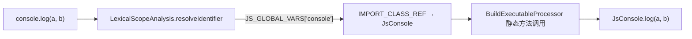

# XLang `console` 全局对象设计

**日期**：2026-10-18
**范围**：`nop-kernel/nop-xlang`（`LexicalScopeAnalysis.JS_GLOBAL_VARS`、`io.nop.xlang.utils.JsConsole`、表达式语料）
**状态**：草案（设计结论已定，待实现与验收）
**灵感来源**：`ai-dev/design/js-builtin-globals-design.md` 的三层命名空间策略

---

## 一、设计结论

1. **`console` 是裸名 JS 全局对象**，与 `Math` / `JSON` / `Number` / `Object` / `Date` / `Promise` 同属 JS 兼容全局对象族，经 `LexicalScopeAnalysis` 的 `JS_GLOBAL_VARS` 映射到 `io.nop.xlang.utils.JsConsole` 静态类，落地为**静态方法调用**语义（`console.log(x)` → `JsConsole.log(x)`）。不新增 `$` 前缀全局变量，不引入运行时对象实例。
2. **方法集**覆盖控制台最常用面：`log` / `info` / `warn` / `error` / `debug` / `trace`，全部接收可变参数，返回 `null`（对齐 JS `undefined`，可在表达式位置使用）。
3. **输出路由到 SLF4J 日志器**（logger 名固定为 `io.nop.xlang.console`），按方法名映射日志级别。**默认不写入 `$out`**——`$out` 承载模板/代码生成的业务输出，`console` 写入会污染生成文本。
4. **格式化遵循 JS `console` 直觉**，但以「平台可预测」为上限：原始值走 `String.valueOf`，`null` 显示 `null`，集合/Bean 走 JS 风格结构化显示；不做 `%c` / DOM / inspector 等浏览器专有语义。
5. **局部变量遮蔽全局对象**：脚本内 `let console = ...` 优先于全局 `console`（与 `Math` 的既有遮蔽测试同一机制，零额外成本）。

---

## 二、背景与动机

XLang / XScript 当前**没有** `console`：

- 现有日志入口是 `logInfo` / `logDebug` / `logWarn` / `logError` 等**宏函数**（`LogFunctions`），要求首个参数是**静态字符串**（防日志注入），无法写 `console.log(a, b, c)` 这种开发者最熟悉的调试语句。
- 现有 `debug()` / `v()`（`DebugHelper`）打印到 SLF4J，但不是 JS 直觉的 `console.log`。
- 现有 `$out` 是**业务输出流**（`IEvalOutput`），用于模板文本/Xml/Sql 输出，语义上不是"控制台"。

痛点：在 XScript 调试、`.xpl` 模板排查、代码生成逻辑验证时，用户（尤其有 JS 背景的用户）第一反应是 `console.log(...)`，当前会直接报"未解析标识符"。补充 `console` 是最低成本的 JS 兼容性补齐，且与 `js-builtin-globals-design.md` 已确立的全局对象策略完全一致。

---

## 三、核心设计

### 3.1 暴露机制：静态类映射，非运行时对象

`console` 注册进 `JS_GLOBAL_VARS`（`Map<裸名, 静态类名>`），解析路径与 `Math` / `JSON` 一致：标识符解析阶段映射为 `IMPORT_CLASS_REF`，`console.log(...)` 走静态方法调用。

**为何不用全局变量定义（`IGlobalVariableDefinition`）**：`$scope` / `$out` 这类需要**求值上下文状态**（`EvalRuntime`）的才是全局变量；`console` 是无状态工具对象，静态类映射既满足 `console.log(...)` 调用，又避免为每个求值实例分配对象。`Math.random()` 已证明该路径可行。

**为何不需要改初始化器**：`JS_GLOBAL_VARS` 是编译期静态映射（`LexicalScopeAnalysis` 内 `Map.of(...)`），注册即生效，无需在 `XLangCoreInitializer` 中追加注册代码。

### 3.2 方法契约

| JS API | 级别 | XLang 落地 |
|--------|------|-----------|
| `console.log(...args)` | INFO | 拼接参数后 `LOG.info` |
| `console.info(...args)` | INFO | 同 `log` |
| `console.debug(...args)` | DEBUG | `LOG.debug` |
| `console.trace(...args)` | TRACE | `LOG.trace` |
| `console.warn(...args)` | WARN | `LOG.warn` |
| `console.error(...args)` | ERROR | `LOG.error`；参数含 `Throwable` 时作为异常传入 |

- **签名**：每个方法统一为 `Object method(Object... args)`（可变参数），返回 `null`。可变参数保证任意数量实参可由同一方法承载，避免 Java 重载在 XLang 反射下按参数数量选错（与 `JsObject.assign`、`GlobalFunctions.parseInt` 的既有处理一致）。
- **返回 `null`**：对齐 JS `undefined`，允许 `let x = console.log(...)` 这类表达式位置调用，不改变求值栈。
- **空参数**：`console.log()` 输出空行，不报错。
- **错误对象**：`console.error(err)` 中 `err` 为 `Throwable` 时，以异常形式记录（保留栈），而不是只打 `toString`；多参数时取首个 `Throwable` 作为异常，其余作为消息参数。

### 3.3 输出路由

**决策**：固定输出到 SLF4J logger `io.nop.xlang.console`，不写 `$out`。

| 方案 | 结论 | 理由 |
|------|------|------|
| SLF4J logger（选定） | ✅ | 遵守平台日志配置与级别过滤；测试可捕获；CLI/服务端/代码生成统一；不污染业务输出 |
| 写 `$out` | ❌ | `$out` 是模板/生成的业务输出流，`console.log` 会混入生成文本/Xml/Sql，破坏产物 |
| 直接 `System.out` | ❌ | 绕过日志框架与配置，违反平台日志规范，服务端不可控 |

- logger 名固定为字符串常量，便于日志配置按前缀统一治理。
- 级别过滤交给日志框架：生产环境 `console.debug` 默认不输出属**预期行为**，非缺陷。

### 3.4 格式化契约

`console` 的显示语义以"JS 直觉 + 平台可预测"为准，明确定义边界：

| 输入 | 显示 |
|------|------|
| 原始值（String/Number/Boolean） | `String.valueOf`（与 JS 基本一致） |
| `null` | `null` |
| 集合（`List`/数组） | JS 风格 `[a, b, c]` |
| 映射（`Map`/结构化对象） | JS 风格 `{k: v, ...}` |
| 其他对象 / Bean | 优先 JS 风格结构化显示，退化到 `toString()` |
| 多参数 | 以单个空格连接（对齐 JS `console.log('a', 'b')` → `a b`） |

**不做**：`%c` CSS 占位符、`%o`/`%O` inspector、DOM 元素、`console.table` / `group` / `count` / `time` 等浏览器/Node 扩展面（XLang 场景不需要，列入 non-goals）。带 `%s`/`%d` 的格式化占位符**不承诺**支持——需要结构化消息时仍应使用 `logInfo("key:name={}", name)`。

### 3.5 命名与遮蔽

- 裸名 `console` 属于"JS 全局对象族"，与 `$` 前缀的全局变量（`$out` / `$scope`）分层，不冲突。
- 解析顺序保证局部变量优先：脚本内 `let console = {...}` 会先命中局部声明，`JS_GLOBAL_VARS` 仅在作用域链未命中时兜底。因此测试语料必须包含遮蔽回归用例。

### 3.6 与既有日志函数的关系

`console` **不替换** `logInfo` 等宏函数，两者分工：

- `logInfo("nop.err.xxx:name={}", name)`：面向**可治理的结构化日志**——静态消息模板、i18n 错误码、防注入，服务端可观测性首选。
- `console.log(a, b, c)`：面向**开发调试**的 JS 熟悉入口，动态拼接、任意类型直出。

文档需明确"生产代码优先 `logInfo`；`console` 用于调试"的定位，避免 `console.log` 泛滥。

---

## 四、拒绝了什么

| 拒绝方案 | 理由 |
|---|---|
| 用 `IGlobalVariableDefinition` 注册 `console` 运行时对象 | 无状态工具对象无需绑定求值上下文；静态类映射即可满足 `console.log(...)`，与 `Math`/`JSON` 一致 |
| 把 `console` 写入 `$out` | 污染模板/代码生成的业务输出流（见 §3.3） |
| 直接 `System.out` / `System.err` | 绕过日志框架，服务端不可控，无法按级别过滤 |
| 支持 `%c` / `console.table` / `group` / `time` 等浏览器+Node 扩展面 | 超出调试刚需，维护成本与语义歧义高；列入 non-goals |
| `console.error` 只做 `toString()` | 丢失异常栈，调试价值最低；必须识别 `Throwable` |
| 为 `console` 增加 `$console` 前缀别名 | 与 JS 直觉相悖；`Math`/`JSON` 均无 `$` 别名，保持一族一致 |

---

## 五、与已有设计的关系

- `ai-dev/design/js-builtin-globals-design.md`：本设计的母策略来源。`console` 是该文档 §2.1 三层命名空间策略中 **L1 裸名调用** 的又一实例，与该文档的 `Math` / `JSON` / `Number` / `Object` 同族。实现落地后，该文档的全局对象表与本文档应交叉引用。
- `ai-dev/design/xlang-execution/01-architecture-baseline.md`：`console` 是纯静态方法调用，不引入新的 Executable 节点，**三后端（解释器 / java / truffle）零差异**——不触碰后端选择机制与对拍语义。
- `docs-for-ai/02-core-guides/xlang-and-xpl-basics.md`：本设计落地后需在 owner doc 增补"JS 兼容 `console`"条目（与 `Math` / `JSON` 并列）。

---

## 六、测试与验收

在 `nop-xlang` 的表达式语料目录（`src/test/resources/io/nop/xlang/expr/exprs/`）新增 `console` 用例文件（与 `js-globals` 语料同格式）：

1. `console.log(1, "x")` 返回 `null`，且不抛错。
2. 六个级别的调用均成功（级别映射不阻塞调用）。
3. 局部变量 `let console = {log: ...}` 遮蔽全局 `console`。
4. `console.log([1,2,3])` / `console.log({a:1})` 结构化显示不抛错。
5. `console.error(new Error("x"))` 识别 `Throwable` 不抛错。
6. `console.log()` 空参数不抛错。

验收口径：既有 `js-globals.test.md` 不回归；三后端对拍中 `console` 用例行为一致（静态调用无后端分叉）。
