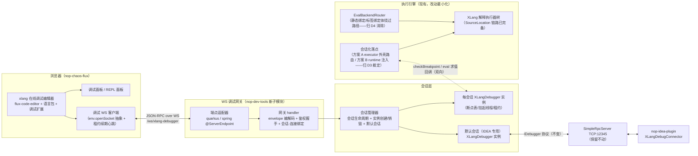
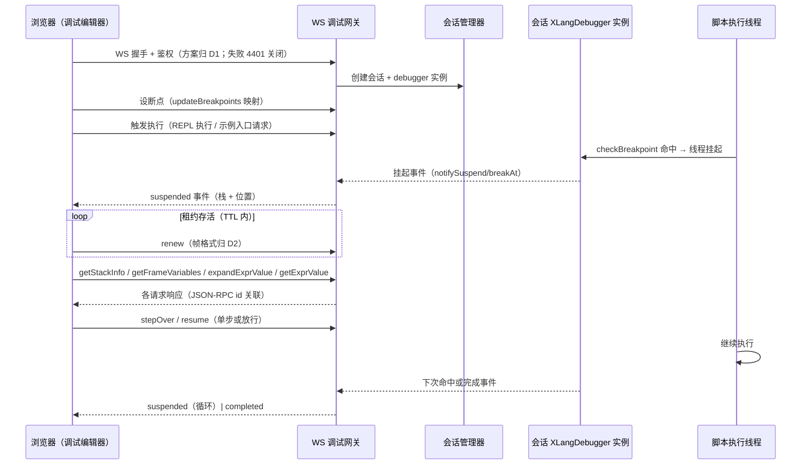
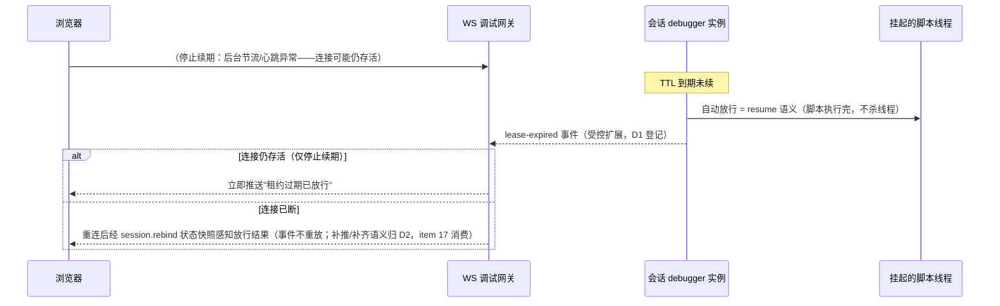

# XLang 在线开发调试编辑器 — D0 总体架构与协议总纲

**日期**：2026-10-16
**范围**：`nop-dev-tools/`（WS 调试网关新子模块 + `nop-xlang-debugger` 引擎会话化）、平台 WebSocket 基座复用（`nop-graphql-core` ws 包 + quarkus/spring 端点适配器）、`nop-chaos-flux` 前端基座
**状态**：active
**层级**：Vision + Architecture Baseline 双职（本目录当前唯一的内容文档；D1-D6 子域详设落地后本目录拆层，见 [README.md](README.md)）

---

## 一、设计结论

1. **传输容器**：调试通道复用平台 JSON-RPC over WebSocket 基座模式（`io.nop.graphql.core.ws.JsonRpcWebSocketHandler` 的鉴权/关闭码/keepalive 语义 + quarkus/spring 双端点适配器模式），新增**独立调试端点** `/ws/xlang-debugger`。GraphQL subscription 不作为调试传输容器（评估与拒绝理由见 §3.4）。
2. **网关模块归属**：`nop-dev-tools/` 下**新建子模块**承载 WS 调试网关，不扩展 `nop-xlang-debugger` 引擎模块（理由见 §3.5）。引擎模块的现有依赖面（`nop-xlang` + `nop-api-debugger` + `nop-rpc-simple`）保持不变。
3. **会话模型**：每个浏览器调试会话对应一个独立的 `XLangDebugger` 实例（含各自的断点表、挂起线程表、租约状态）；会话管理器负责实例创建/销毁与连接绑定。IDEA 桌面通道映射到**内建默认会话**，行为不变。会话化的注入落点（全局 executor 外壳内路由 vs runtime 级注入）是开放裁定，**归 D3**，本文档以中性的"会话化落点"表述，不预判方案。
4. **挂起生命周期**：租约续期模型——断点挂起时授予 per-thread TTL 租约，前端周期续期；到期未续 → **自动放行 = resume 语义**（脚本继续执行完，防请求线程泄漏），并向前端推送"租约过期已放行"事件；**close 语义**（中止挂起线程，抛 `ERR_XLANG_DEBUGGER_ALREADY_CLOSED`）仅用于会话销毁。机制警示：现有 `resume()` 是全局放行（唤醒全部挂起线程），per-thread 自动放行**不得直接复用**，实现机制归 D2/D3。TTL 参数、续期帧格式、宽限与多标签页归属归 D2。
5. **范围**：单实例先行——集群多实例消息转发、多人协同编辑、XDSL 资源保存/热发布均显式 out of scope（§3.6）。
6. **零开销红线**：`nop.xlang.debugger.enabled=false`（默认）时整个调试子系统不激活，执行路径零改动；`enabled=true` 且 web 开关未激活时，注入现状形态的 executor（行为与改造前完全一致）；web 激活后无 web 会话标识的执行走**默认会话兜底**（保持 IDEA 全局断点语义），会话分发本身只允许单分支判断级别的开销，非调试路径性能基准对比是 item 8/11 的验收项。
7. **前端基座**：nop-chaos-flux 现有 `flux-code-editor`（CodeMirror 6）上扩展——不引入 Monaco；新增 xlang 语言包、断点/装饰调试扩展、调试面板与 REPL 面板（架构归 D5，装配归 item 19）。
8. **调试后端语义**：在线调试仅承诺 interpreter 执行后端的断点语义；java/truffle 编译后端路径的调试支持不在本 roadmap 范围（D4 的联动矩阵中登记降级行为）。

## 二、背景与动机

平台已有完整的 XLang 调试引擎：`XLangDebugger`（条件断点/logpoint/stepInto/stepOver/stepOut/runToPosition/帧内表达式求值/懒展开变量树），断点检查在运行期由 `DebugExpressionExecutor` 包装完成、无需重编译；唯一消费通道是 TCP `SimpleRpcServer`（默认 `127.0.0.1:12345`）+ IDEA 插件，由 `nop.xlang.debugger.enabled`（默认 false）统一门控。

引擎能力与浏览器之间缺的是"通道 + 会话 + 前端"：无 WebSocket 暴露、全局单实例无会话隔离、挂起无租约（前端消失无法自动放行）、静态绑定编译产物绕过 executor 导致断点失效、无在线 eval REPL。本设计在不动引擎能力面与 IDEA 通道的前提下，补齐这三层。

平台已具备通用 WebSocket 基座：`nop-graphql-core` 的 `ws` 包提供 JSON-RPC 2.0 envelope、`IUserContextExtractor` 握手鉴权（失败 4401 关闭）、token 刷新、keepalive ping、重复订阅/解析失败关闭码；quarkus（`nop-quarkus-web`）与 spring（`nop-spring-web-starter`）各有 `/ws/jsonrpc` 端点适配器。网关必须复用该模式，不从零重造传输与鉴权。

## 三、核心设计

### 3.1 组件图

职责边界：

| 组件 | 职责 | 不负责 |
| --- | --- | --- |
| 调试 WS 客户端（前端） | 连接/重连/鉴权、续期心跳、断点 gutter 交互、面板渲染 | 协议编解码规则制定（以 D1 文档为准） |
| 端点适配器 | quarkus/spring WS 生命周期胶水（复用 `/ws/jsonrpc` 两份适配器模式） | 业务逻辑 |
| 网关 handler | envelope 编解码、`IUserContextExtractor` 握手鉴权、方法分发到会话、事件出站、连接-会话绑定（断连→宽限→放行→销毁） | 调试语义（单步/断点判定在引擎） |
| 会话管理器 | 每会话 `XLangDebugger` 实例生命周期、默认会话供给、会话路由 | 挂起/恢复线程原语（在引擎） |
| 每会话 debugger 实例 | 现有 `XLangDebugger` 全部能力 + 租约状态（item 10 扩展） | 传输 |
| 会话化落点 | 让执行流按会话找到正确的 debugger 实例；无会话时零开销直通 | ——（落点方案归 D3） |

### 3.2 端到端消息时序

正常路径（断点命中→续期→求值→放行→完成）：

租约过期分支（前端停止续期或失联）：

会话销毁分支：前端显式关闭会话 → close 语义中止挂起线程（`ERR_XLANG_DEBUGGER_ALREADY_CLOSED`）→ 销毁实例。断连后的宽限期与会话存活判定归 D2。

### 3.3 与 SimpleRpcServer + IDEA 的共存与开关策略

现状：`nop.xlang.debugger.enabled` 同时门控三件事——`SimpleRpcServer` 启动、`IDebugger` 服务注册、`EvalExprProvider.registerGlobalExecutor` 注入。三者一体开关。

目标态开关矩阵：

| `nop.xlang.debugger.enabled` | web 调试开关（`nop.xlang.debug-web.enabled`，默认 false；实现注册归 item 12） | 行为 |
| --- | --- | --- |
| false | 任意 | 全部不激活；执行路径零改动（现状默认态） |
| true | false | 仅 IDEA 通道：SimpleRpcServer + 默认会话，注入现状形态 executor；解释器路径行为与改造前一致，绑定单元执行按 D4 降级为解释器（断点可命中——有意缺陷修复，非回归破损；见 04-execution-backend-link §3.4） |
| true | true | IDEA 通道 + Web 通道并存：默认会话服务 IDEA；Web 会话各自独立实例；executor 按会话分发，无 web 会话标识走默认会话兜底 |

共存规则：

1. **IDEA 协议不变**：`SimpleRpcServer` 继续暴露现有 `IDebugger` 服务，映射到内建默认会话；`nop-idea-plugin` 零改动。
2. **默认会话也是会话**：默认会话只是会话管理器中的一个预置实例，会话路由对它无特判。
3. **executor 注入语义**：`enabled=true` 且 web 未激活 → 注入现状形态 executor（绑定默认会话唯一实例），行为与改造前完全一致；web 激活 → 注入按会话分发的 executor：有 web 会话标识路由到对应会话实例，**无 web 会话标识一律走默认会话兜底**（IDEA 全局断点语义不变，"无标识空转直通"不采纳——它会使并存态下 IDEA 断点失效）。分发的实现机制（全局外壳路由 vs runtime 级注入）归 D3，本条只锁定语义。
4. **互斥红线**：不允许出现"TCP 通道关、WS 通道开"的混合态——web 开关是 `debugger.enabled` 的下游开关。

### 3.4 WS 传输容器裁定

**决策**：JSON-RPC 2.0 envelope over WebSocket，复用 `JsonRpcWebSocketHandler` 的容器语义；独立端点 `/ws/xlang-debugger`；quarkus/spring 各一份端点适配器（照抄 `JsonRpcWebSocketEndpoint` 两份实现的结构）。

复用基座的哪些语义（锚定，实现不得偏离）：

- `IUserContextExtractor` 握手鉴权；无凭证或校验失败 → **4401 关闭**（禁止无鉴权调试通道）。
- token 刷新语义（刷新失败 4401 / 用户不一致 4403）。
- keepalive ping（现有 10s 周期模式）；解析失败 4400；4409 仅复用码值语义（冲突类关闭），调试语境下的触发条件与处置强度（拒绝新会话绑定 vs 断开整条连接）归 D1 裁定——不得照搬现有"重复订阅即断连"，多标签页打开同一会话是预期合法场景（§五 #8）。
- 请求-响应关联：带 `id` 的请求必有响应；无 `id` 消息为 notification 形态，**仅用于服务端→客户端事件出站**（承载 `IDebugNotifier` 事件）；入站无 `id` 请求的处置归 D1 裁定。

**GraphQL subscription 评估结论：拒绝**，理由：

1. 语义形态不匹配——调试协议以**命令-响应**为主（stepInto/resume/eval 各需关联响应），publisher 模型只适合单向事件流；硬套需 mutation 发命令 + subscription 收事件两条通道拼合，比单一 JSON-RPC 容器复杂。
2. `IDebugger` 是平面方法接口，JSON-RPC method → 方法是 1:1 映射表；GraphQL 需要额外维护 schema + resolver 翻译层，无对应收益。
3. 前端走 `env.openSocket` 通用 WS 抽象，不因 GraphQL 容器获得任何客户端能力减免。
4. 现有 handler 已提供鉴权/关闭码/keepalive/关联语义的全套容器件，GraphQL 层并不额外提供调试需要的任何一件。

**鉴权硬约束（转 D1 裁定具体方案）**：浏览器原生 WebSocket 无法携带自定义 Authorization 头——D1 必须在 cookie / 查询参数 / subprotocol / 首帧鉴权中裁定一种，并优先复用 `IUserContextExtractor` 契约。D0 锚定的只有约束本身：未鉴权连接不得进入会话创建。

### 3.5 网关模块归属裁定

**决策**：`nop-dev-tools/` 下新建子模块（占位名 `nop-xlang-debug-web`，正式命名在 item 12 的 plan 确定），依赖 `nop-xlang-debugger`（引擎 + 协议接口）与 WS 基座模块（`nop-graphql-core`），端点适配器依赖（quarkus/spring 侧）设为 optional/provided，由宿主应用按技术栈带入。

拒绝的替代方案：

- **扩展 `nop-xlang-debugger`**：会把 `nop-graphql-core`（及其传递依赖面）拖进引擎模块，而 IDEA 纯 TCP 场景永远不需要这些；引擎模块依赖面保持最小是会话化改造（item 8-10）低风险的前提。
- **放 `nop-graphql*` 侧**：调试网关是开发工具域（nop-dev-tools）的能力，不是 GraphQL 执行面的一部分；放错域会让模块分组（module-groups）与依赖方向双重失真。

### 3.6 范围裁定（显式 out of scope）

| 项 | 裁定 | 理由 |
| --- | --- | --- |
| 集群多实例消息转发 | 单实例先行，out of scope | 调试会话与本机执行线程强绑定，跨实例转发需要会话粘性与内部总线，一期价值/复杂度比低；留 follow-up，接口设计（会话标识全局化）不预设障碍 |
| 多人协同编辑 | out of scope | 与调试无关；magic-api 的协同消息族不采纳 |
| XDSL 资源保存/热发布/生产测试运行 | out of scope | 本 roadmap 只覆盖"编辑器内编写 + 编译诊断 + REPL 即时执行"；保存回写与热发布是"在线开发"另一半，留 follow-up |
| java/truffle 编译后端的调试 | out of scope | 断点语义仅承诺 interpreter 后端；编译后端在调试会话内的降级行为由 D4 联动矩阵登记 |
| 集群/协同以外的深度沙箱 | REPL 沙箱按 D6 裁定 | 属 REPL 安全域，不在总纲展开 |

### 3.7 协议分层声明（协议总纲）

| 层 | 归属 | 内容 |
| --- | --- | --- |
| 传输容器层 | **本文档（D0）** | JSON-RPC 2.0 over WS、端点路径、鉴权锚点（4401 语义）、关闭码复用、请求-响应/事件通知双形态、keepalive |
| 消息集层 | D1（01-ws-protocol） | envelope 字段 schema、`IDebugger` 方法→消息映射表、受控扩展事件登记（异常/租约过期）、版本化、鉴权具体方案、示例报文 |
| 会话/租约层 | D2（02-lease-lifecycle） | TTL/续期/宽限/多标签页归属、resume 与 close 双语义状态机 |
| 会话化机制层 | D3（03-sessionization） | 会话标识注入与透传、每会话实例生命周期、单步目标策略、方案 A/B 裁定 |

改协议先改设计：前后端协议分歧一律以 D1 文档为仲裁基准；本层只锁容器边界。D1/D2 辖区接缝显式声明：租约相关消息（renew / lease-expired）的 schema 登记与 method 映射归 **D1**，TTL 参数与状态机语义归 **D2**；两者冲突时 schema 以 D1 为准、语义以 D2 为准。

### 3.8 里程碑验收标准（XDBG-D0-02）

各里程碑的 done 判据（与 roadmap Work Items 的 ★ 项一一对应；代码/测试类判据 repo-observable，演示类判据见 M4 证据形式约定）：

**M1 设计收口**（items 1-7）

- [ ] `ai-dev/design/xlang-web-debugger/` 下 D0-D6 七份设计文档 + README 齐备，各自通过一轮独立对抗性评审且无未处置 Blocker（评审证据落盘：对应 plan 的 Closure 段 + 当日 `ai-dev/logs/`）
- [ ] `node ai-dev/tools/check-doc-links.mjs --strict` 退出码 0
- [ ] 分析遗留 open questions 全部呈"已裁定/转派"两态闭环
- [ ] D1-D6 之间无相互矛盾的裁定（协议以 D1 为准、租约以 D2 为准、会话化以 D3 为准）

**M2 会话化调试引擎**（items 8-11）

- [ ] 双会话并发调试回归测试绿：两会话各自断点/挂起/单步互不干扰
- [ ] IDEA 全链路回归绿：SimpleRpcServer + `IDebuggerAsync` 客户端路径行为与改造前一致（单线程常规路径；D3 §3.6/§3.7 声明的两处显式行为变更——stepX 无目标报错、多线程定向释放——按 D3 新语义断言）；`enabled=true` 且 web 未激活时注入的 executor 行为与改造前一致（绑定单元执行按 D4 §3.4 降级为解释器属有意缺陷修复，按可断点断言）
- [ ] 无 web 会话标识的执行走默认会话兜底（§3.3 规则 3 语义），`enabled=false` 路径零改动；会话分发开销有性能基准对比（相对基线无可测回归）
- [ ] 租约时序测试绿：续期成功 / 停止续期到期放行且脚本执行完 / close 与租约并发
- [ ] 调试会话内静态绑定路径与 xlib 标签路径断点可命中（或按 D4 裁定降级），非调试路径无性能回归

**M3 后端调试服务 MVP**（items 12-14）

- [ ] 集成测试覆盖：WS 握手未鉴权 4401、断点设置→命中→求值→放行全流程、断连→宽限→到期放行时序
- [ ] 日志/事件经网关按会话定向出站且顺序正确（攒批不乱序）
- [ ] REPL：未授权拒绝、越权用例被拦、取消/超时机制对死循环输入生效

**M4 端到端断点调试 demo**（items 15-19）

- [ ] 浏览器端全链路演示可用：编辑 xlang 源码 → 语法高亮 → 设断点 → 触发执行 → 命中高亮与挂起行标注 → 变量树懒展开 → 调用栈切换 → 表达式求值 → 单步 → 放行 → 完成（证据形式：可复现演示步骤 + 截图/录屏落盘 `ai-dev/logs/`；形式化回归由 M5 的 Playwright e2e 承接）
- [ ] 断连/恢复演示可用：断网后重连，会话与断点状态恢复；租约过期收到事件且 UI 反映（同上证据形式）
- [ ] 既有语言（js/ts/sql/json 等）编辑器功能零回归（vitest 回归绿）

**M5 功能完备**（items 20-23）

- [ ] flux 新包经 pack-flux-bundle 清单 → 宿主 registry/版本契约 → nop-web-site 产物刷新全链路走通
- [ ] 示例 XDSL 场景的后端集成测试绿
- [ ] Playwright e2e：断点→续期→单步→求值→放行→完成全链路 + 断连/租约过期路径，CI 可运行
- [ ] docs-for-ai 注册完成（module-groups / source-anchors / debugging-and-diagnostics）且 doc-links --strict 0 errors

**M6 审计收口**（items 24-27）

- [ ] 并发/安全/前端三份独立审计报告齐备（逐条 CONFIRMED/REFUTED + P0-P3 分级）
- [ ] 全部 P0/P1 修复清零，remediation plans 收口
- [ ] SimpleRpcServer+IDEA 通道与默认态（enabled=false）在收口时仍回归绿

## 四、拒绝了什么

- **Monaco 替换 CodeMirror**：用户已裁定以 flux 现有编辑器为基座；且 flux 侧已有语言注册/lint/补全/面板资产，引入 Monaco 是双栈维护。
- **照搬 magic-api 调试内核**：按请求重编译插桩（XLang 运行期 executor 包装无需重编译，且插桩方案要求"先设断点才能调试"）、CSV 文本协议（无法表达结构化变量树）、变量全量一次推送（已有懒展开协议）、固定超时静默放行（改租约续期 + 到期事件）。可借鉴的只有通道形态（WS 推送模型、日志攒批管道、前端交互范式）。
- **GraphQL subscription 作为调试传输容器**：见 §3.4。
- **复用 `/ws/jsonrpc` 端点承载调试**：该端点绑定 GraphQL subscription 的 executionService 签名与会话语义；调试协议有自己的方法集、会话绑定与生命周期，混用端点会让鉴权与会话管理互相牵制。
- **方案 A/B 之争在 D0 预判**：executor 外壳路由 vs runtime 注入的落点裁决需要 D3 的透传机制分析支撑，本文档仅以"会话化落点"中性占位。
- **一期实现集群转发**：见 §3.6。

## 五、D0 开放问题处置表

本设计立项时遗留的开放问题全部处置如下（"已裁定"= 本文档给出结论；"转派"= 归入 owner 子域文档，起草时必须消费）：

| # | 开放问题 | 处置 |
| --- | --- | --- |
| 1 | Web 传输端点挂哪 | **已裁定**（§3.4/§3.5）：独立端点 `/ws/xlang-debugger`，nop-dev-tools 新子模块 |
| 2 | 续期帧与心跳是否合帧 | 转派：消息 schema 登记与 method 映射归 **D1**，合帧/TTL/状态机语义归 **D2**（§3.7 接缝声明） |
| 3 | GraphQL subscription 是否有额外收益 | **已裁定**（§3.4）：拒绝，四条理由 |
| 4 | 会话化方案 A（executor 外壳路由）vs 方案 B（runtime 注入） | 转派 **D3**（§3.1 会话化落点中性占位） |
| 5 | 静态绑定绕过路径的消除策略（强制 interpreter / 按单元降级 / 加载期抑制） | 转派 **D4**（联动矩阵含 java/truffle 后端降级登记） |
| 6 | 在线 eval REPL 的安全边界（沙箱/权限/取消机制） | 转派 **D6** |
| 7 | Lezer grammar 三来源（新写 / treesitter 经验 / ANTLR 转译） | 转派 **D5** |
| 8 | 多标签页打开同一会话的租约归属与单步目标选择 | 拆分转派：租约归属 → **D2**；单步目标策略 → **D3** |
| 9 | 多人协作（协同编辑）是否纳入一期 | **已裁定**（§3.6）：out of scope，留 follow-up |
| 10 | 浏览器 WS 无自定义头的鉴权方案 | 锚定约束于 §3.4（4401 红线 + `IUserContextExtractor` 复用候选）；具体方案转派 **D1** |

## 六、与已有设计的关系

- `ai-dev/design/xlang-truffle/00-vision.md`：Truffle 一期明确不做 debugger；本文档是其后续工作立项。两文档边界：Truffle 侧负责执行提速，调试仅承诺 interpreter 后端（§3.6），D4 联动矩阵登记编译后端在调试会话内的降级行为。
- `ai-dev/design/xlang-execution/`：三后端（interpreter/java/truffle）选择机制与降级链是 D4 联动矩阵的输入；调试会话内的后端强制/降级策略不得绕过该设计的后端注册 SPI。
- `docs-for-ai/02-core-guides/debugging-and-diagnostics.md`：该文档覆盖 DevDoc/DevTool（元数据诊断），与 XLang 源码级调试器无重叠；item 23 在其中增补"在线调试"节。
- 平台 WebSocket 基座（`nop-graphql-core` ws 包 + 双端点适配器）：本文档 §3.4 是其对调试域的复用裁定；基座自身语义不变更。
