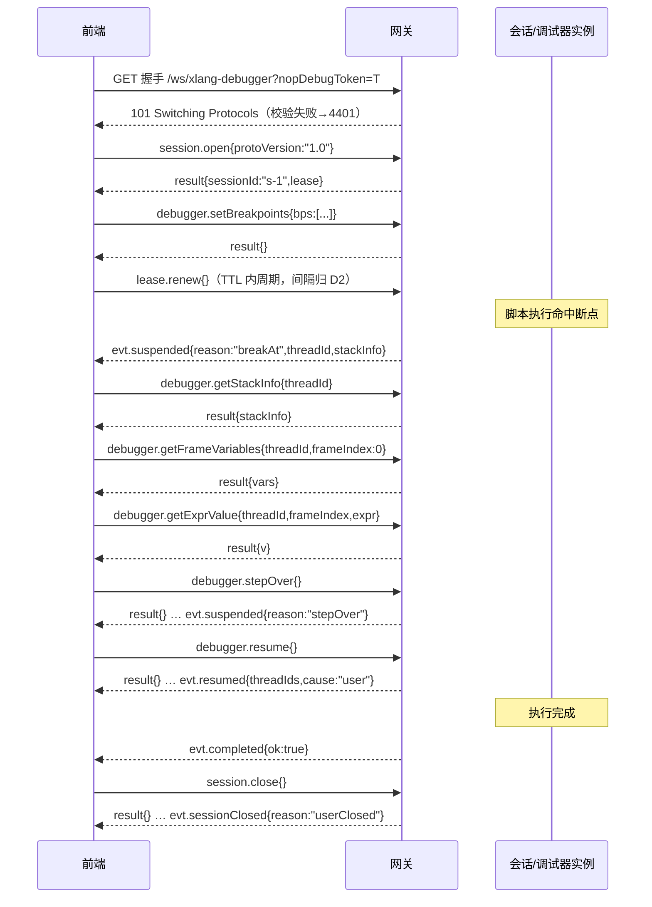
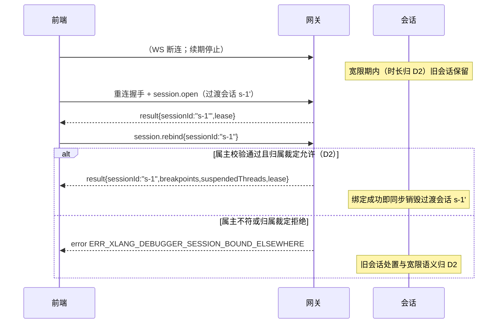

# XLang 在线调试 WebSocket 协议（D1）

**日期**：2026-10-16
**范围**：浏览器前端 ↔ WS 调试网关（`/ws/xlang-debugger`）的协议详设；实现归属 item 12（网关）/ item 17（前端客户端）
**状态**：active（前后端协议分歧以本文档为仲裁基准）
**上层约束**：[00-overview.md](00-overview.md) §3.4/§3.7（传输容器、鉴权锚点、辖区声明）

---

## 一、设计结论

1. **envelope** = JSON-RPC 2.0 文本帧。`id` 线上类型**必须为 string**（基座 `JsonRpcRequest.id` 为 String，网关原样回显）。客户端→服务端除豁免项（`pong`）外一律带 `id` 的请求；服务端→客户端的事件一律无 `id` 的 notification；保留方法名 `ping`/`pong`/`tokenRefresh`（语义沿用基座），`unsubscribe` 不进调试方法集。
2. **鉴权** = 握手 URL 查询参数携带平台 access token（`?nopDebugToken=<accessToken>`），端点适配器将其映射为 `Authorization: Bearer` 后复用 `ILoginService.extractFromHeaders` 校验链；失败 4401 关闭。一次性短时票据为后续加固方向（登记 follow-up，item 25 安全审计复核）。
3. **方法命名** = `debugger.<javaMethodName>` 机械映射 `IDebugger`（可 grep 对账）；会话/租约/事件用 `session.*`/`lease.*`/`evt.*` 命名空间，全部避开容器保留名。
4. **`waitSuspended` 与 `close` 不暴露**为调试 method：前者被 `evt.suspended` 服务端推送取代，后者由 `session.close`（会话销毁）承担；映射表中显式登记不暴露理由。
5. **版本化** = `session.open` 协商 `protoVersion`（当前 `"1.0"`）；additive-only 演进，未知字段忽略、未知方法 -32601、主版本不匹配报错（`ERR_XLANG_DEBUGGER_PROTOCOL_VERSION_UNSUPPORTED`）并 4400。
6. **错误承载** = 沿用基座形态：`error.errorCode`（平台字符串码）+ `error.data`；JSON-RPC 标准码用于协议层错误（-32700 仅保留不发射——解析失败时 id 未知，直接 4400）。入站无 `id` 消息以 `id:null` 回 -32600（不静默丢弃）；**豁免**：客户端 `pong` 为合法 notification，不计违规。
7. **4409 处置强度裁定** = 会话绑定冲突默认**拒绝新绑定**（`session.rebind` 返回 `errorCode`），不断开旧连接；仅协议级冲突触发关闭级处置（同连接重复绑定 → 4409）。多标签页打开同一会话是预期合法场景，归属规则归 D2。**会话属主红线**：会话与握手身份（boundUserId）绑定，跨用户操作他人会话一律拒绝。
8. **租约 schema（首版）**：`LeasePolicy = {ttlMs: int, renewIntervalMs: int}`（服务端授予策略）；`LeaseState = {expiresAtMs: long, suspendedThreadIds: long[]}`。字段语义（默认值、宽限、归属）归 D2，schema 形状归本档。

## 二、背景与动机

D0 已裁定传输容器（JSON-RPC over WS + 双端点适配器模式）与分层辖区（本文档 owning 消息集层）。本档把 `IDebugger` 引擎协议面 1:1 映射为浏览器可消费的 JSON-RPC 方法集，并登记引擎回调/新增产生源的出站事件，使 item 12（网关）与 item 17（前端客户端）可以背对背实现、以本文档对账。

## 三、核心设计

### 3.1 Envelope 与约束

请求（客户端→服务端，必带 `id`，string）：

```json
{ "jsonrpc": "2.0", "id": "42", "method": "debugger.getStackInfo", "params": { "threadId": 17 } }
```

响应（服务端→客户端，对带 `id` 请求必有且仅有一个；`id` 原样回显）：

```json
{ "jsonrpc": "2.0", "id": "42", "result": { "stackInfo": { "threadId": 17, "threadName": "http-exec-1", "stackTrace": [ { "sourcePath": "/app/demo.xpl", "line": 12, "funcName": "calc" } ] } } }
```

说明：`StackInfo` 的 `topElement`/`topLocation` 是 `@JsonIgnore` 派生属性，**不出站**（线上序列化不含）；前端需要挂起位置时读 `evt.suspended.location`。

```json
{ "jsonrpc": "2.0", "id": "43", "error": { "code": -32000, "message": "no suspended thread 18", "errorCode": "ERR_XLANG_DEBUGGER_THREAD_NOT_SUSPENDED", "data": { "threadId": 18 } } }
```

请求第二例（挂起帧内求值）：

```json
{ "jsonrpc": "2.0", "id": "44", "method": "debugger.getExprValue", "params": { "threadId": 17, "frameIndex": 0, "expr": "order.items.size()" } }
```

事件（服务端→客户端 notification，无 `id`）：

```json
{ "jsonrpc": "2.0", "method": "evt.suspended", "params": { "reason": "breakAt", "threadId": 17, "stackInfo": { /* StackInfo */ }, "location": { "sourcePath": "/app/demo.xpl", "line": 12 } } }
```

事件第二例（用户放行，与 `evt.leaseExpired` 互斥——见 §3.5）：

```json
{ "jsonrpc": "2.0", "method": "evt.resumed", "params": { "threadIds": [17], "cause": "user" } }
```

约束（网关强制，超限按错误处理；数值为实现基线，调整须改本档）：

| 约束 | 值 | 超限处置 |
| --- | --- | --- |
| 入站单帧最大 | 256 KB | error -32600（过大）并计数，超阈值 4400 |
| 求值表达式长度（`expr`） | ≤ 8 KB | error -32602（invalid params） |
| 每会话断点数 | ≤ 500 | error `ERR_XLANG_DEBUGGER_TOO_MANY_BPS` |
| `expandExprValue.keys` 数组长度 | ≤ 50 | error -32602 |
| 出站单响应帧最大 | 1 MB | 响应型列表类结果按下行截断规则先行控制；其余超限情形报 -32000 `ERR_XLANG_DEBUGGER_RESULT_TOO_LARGE` |
| 出站 DebugVariable 列表长度 | ≤ 1000 条/响应 | 截断至 1000 并在 result 附 `truncated: true` |
| 出站变量值序列化 | 懒展开（按 `keys` 逐层），禁止整树一次出站 | ——（协议层不允许） |
| `lease.renew` 频率 | 语义约束归 D2（不得快于 `renewIntervalMs`），执行归 item 12 | 高于频率 → error -32000（限流），不关闭连接 |

`params` 允许多余字段（忽略）；缺必填字段 → -32602。

### 3.2 鉴权方案裁定

**裁定：握手 URL 查询参数 `nopDebugToken` 携带平台 access token。**

流程：前端先经常规 HTTP 通道（带 `Authorization` 头）确认身份并取得可用 access token → `env.openSocket("/ws/xlang-debugger?nopDebugToken=<token>")` → 网关端点适配器把该参数映射为 headers map 的 `Authorization: Bearer <token>` → 复用 `ILoginService.extractFromHeaders` 校验 → 失败/缺失 **4401 关闭**（D0 红线）。连接建立后身份绑定该连接；`tokenRefresh`（保留方法）可旋转 token，刷新失败 4401、用户不一致 4403（沿用基座语义）。

四候选裁定表：

| 候选 | 裁定 | 理由 |
| --- | --- | --- |
| cookie | 拒绝 | 平台鉴权链路无 cookie 读取/签发路径（`extractFromHeaders` 只读 `Authorization`；biz-auth-core 无生产 cookie 鉴权）；引入 cookie 会为调试通道单独开一条身份链路 |
| subprotocol | 拒绝 | token 同样出现在握手头（`Sec-WebSocket-Protocol`）但语义被劫持；中间代理对未知 subprotocol 的丢弃/改写行为不可控；与非 WS 客户端（测试、工具）不兼容 |
| 首帧鉴权 | 拒绝（一期） | 可行但引入"已连接未鉴权"中间态：4401 语义从握手推迟到首帧后、鉴权前需隔离所有方法、增加一轮往返；收益不抵复杂度。若 item 25 安全审计要求 URL token 加固，优先演进为一次性短时票据而非首帧鉴权 |
| **查询参数（采纳）** | 采纳 | 复用 `extractFromHeaders` 校验链零改动；`env.openSocket(url)` 天然支持；token 为平台现有短 TTL access token（可 `tokenRefresh` 旋转）。已知代价：token 进入访问日志/代理日志——以短 TTL 缓解，一次性单用票据登记为 follow-up 加固 |

### 3.3 方法映射表（24 个引擎方法逐一登记）

命名空间：`debugger.*` = `IDebugger` 机械映射（含继承自 `IBreakpointManager` 的方法）。参数名与 Java `@Name` 一致。

**断点管理（IBreakpointManager，6/6）**

| Java 方法 | JSON-RPC method | params → result |
| --- | --- | --- |
| `addBreakpoint(bp)` | `debugger.addBreakpoint` | `{bp: Breakpoint}` → `{}` |
| `removeBreakpoint(bp)` | `debugger.removeBreakpoint` | `{bp: Breakpoint}` → `{}` |
| `setBreakpoints(bps)` | `debugger.setBreakpoints` | `{bps: Breakpoint[]}` → `{}` |
| `getBreakpoints()` | `debugger.getBreakpoints` | `{}` → `{bps: Breakpoint[]}` |
| `clearBreakpoints()` | `debugger.clearBreakpoints` | `{}` → `{}` |
| `getBreakpointAt(loc)` | `debugger.getBreakpointAt` | `{loc: {path,line}}` → `{bp: Breakpoint\|null}` |

**控制与状态（IDebugger，18 个自有方法逐一登记）**

| Java 方法 | JSON-RPC method | 裁定 |
| --- | --- | --- |
| `stepInto()` | `debugger.stepInto` | `{}` → `{}`；一期作用于该会话最后挂起线程（多线程挂起时的单步目标选择策略归 D3） |
| `stepOver()` | `debugger.stepOver` | 同上 |
| `stepOut()` | `debugger.stepOut` | 同上 |
| `suspend()` | `debugger.suspend` | `{}` → `{}` |
| `resume()` | `debugger.resume` | `{}` → `{}`；语义 = 放行**本会话**全部挂起线程（会话内全局），非跨会话 |
| `waitSuspended()` | **不暴露** | 轮询原语与推送模型冲突；由 `evt.suspended` 推送取代（引擎仍可内部使用） |
| `close()` | **不暴露** | 破坏性中止仅属会话销毁语义，由 `session.close` 承担（见 §3.4） |
| `muteBreakpoints(muted)` | `debugger.muteBreakpoints` | `{muted}` → `{}` |
| `updateBreakpoints(bps,muted)` | `debugger.updateBreakpoints` | `{bps,muted}` → `{}` |
| `isSuspended()` | `debugger.isSuspended` | `{}` → `{suspended}` |
| `isBreakpointsMuted()` | `debugger.isBreakpointsMuted` | `{}` → `{muted}` |
| `getSuspendedThreads()` | `debugger.getSuspendedThreads` | `{}` → `{threads: ThreadInfo[]}` |
| `runToPosition(bp)` | `debugger.runToPosition` | `{bp: Breakpoint}` → `{}`（临时断点语义） |
| `getExprValue(threadId,frameIndex,expr)` | `debugger.getExprValue` | `{threadId,frameIndex,expr}` → `{v: DebugVariable}` |
| `expandExprValue(threadId,frameIndex,expr,keys)` | `debugger.expandExprValue` | `{threadId,frameIndex,expr,keys: DebugValueKey[]}` → `{vars: DebugVariable[]}` |
| `getStackInfo(threadId)` | `debugger.getStackInfo` | `{threadId}` → `{stackInfo: StackInfo}` |
| `getScopeVariables(threadId)` | `debugger.getScopeVariables` | `{threadId}` → `{vars: DebugVariable[]}` |
| `getFrameVariables(threadId,frameIndex)` | `debugger.getFrameVariables` | `{threadId,frameIndex}` → `{vars: DebugVariable[]}` |

`Breakpoint = {sourcePath: string, line: int, condition?: string, logExpr?: string}`；`DebugVariable`/`DebugValueKey`/`StackInfo`/`ThreadInfo`/`StackTraceElement`/`LineLocation` 字段与 `io.nop.api.debugger` 同名类型一致（源码为字段事实，本档不重复罗列）。

**保留方法（沿用基座语义，不占调试命名空间）**：

- `ping`（服务端→客户端 notification，10s 周期 keepalive）。
- `pong`（客户端→服务端）：**豁免为合法 notification**（无 `id`、无响应、不计入 §3.7 无 id 违规计数）——基座 `handlePong` 即静默 no-op，此豁免是"入站一律带 id"规则的唯一例外。
- `tokenRefresh`：调试通道钉死一种形态——`{accessToken: string}` → `{refreshed: boolean}`（基座另接受 headers/authToken 形态，调试网关不采用）；新 accessToken 与握手 token 一样经 `Authorization: Bearer` 映射后走 `extractFromHeaders` 校验链（基座默认将 accessToken 放入 `x-access-token` 头而生产 extractor 不读该头——调试网关必须做 Authorization 映射，否则刷新必 4401）；刷新失败 4401、用户不一致 4403。
- `unsubscribe` **不采纳**进调试协议（无订阅概念）；客户端发送 → -32601。

对账说明：TCP 桌面通道的 `BreakpointHitMessage.type` 还含 `notice`（桌面重连通知场景）；WS 通道不设对应事件，重连后的状态补齐由 `session.rebind` 快照承担——这不是映射遗漏。

### 3.4 会话与租约消息（schema 归 D1，语义归 D2）

**红线（身份层，先于 D2 的归属语义）**：会话与握手 boundUserId 绑定；`session.rebind` 及一切跨连接会话操作必须校验会话属主 = 当前 boundUserId，违反 → error `ERR_XLANG_DEBUGGER_SESSION_BOUND_ELSEWHERE`（不区分"不存在/他属"，避免会话探测）。

| method | params → result | 辖区 |
| --- | --- | --- |
| `session.open` | `{clientInfo?: string, protoVersion: "1.0"}` → `{sessionId: string, protoVersion, lease: LeasePolicy}` | 连接↔会话 1:1 绑定（一期）。**重复 open**（同连接已绑定会话）→ error `ERR_XLANG_DEBUGGER_SESSION_ALREADY_OPEN` 并随即 4409 关闭（先回错误响应、后关闭）。`LeasePolicy={ttlMs, renewIntervalMs}`，取值语义归 D2 |
| `session.rebind` | `{sessionId}` → `{sessionId, breakpoints: Breakpoint[], suspendedThreads: ThreadInfo[], lease: LeaseState}` | 重连恢复；**仅登记 schema**——归属/竞态/宽限语义归 D2（属主校验红线除外，见上）。绑定成功时同步销毁重连流程产生的过渡会话（见 §3.9）。`LeaseState={expiresAtMs, suspendedThreadIds}`，语义归 D2。命名用 `rebind` 而非 `resume`，消歧 `IDebugger.resume()`（放行） |
| `session.close` | `{}` → `{}`；服务端随后推 `evt.sessionClosed` | close 语义（中止挂起线程 + 销毁实例）的状态机归 D2 |
| `lease.renew` | `{}` → `{lease: LeaseState}` | 租约续期；request 形态（带 id，可拿回 `LeaseState` 确认）；TTL/到期语义归 D2 |

无会话绑定时（未 `session.open`）调用任何 `debugger.*`/`lease.*` method → error `ERR_XLANG_DEBUGGER_NO_SESSION`（`session.*` 三方法除外）。

### 3.5 受控扩展事件登记（服务端 notification，无 id）

统一 method = `evt.*`；`params.type` 语义由事件名承载。**来源标注**：`engine-notifier` = 现有 `IDebugNotifier` 回调；`engine-ext` = 引擎层新增回调（item 10/13 落地）；`gateway` = 网关/会话层产生。

| 事件 method | params schema | 来源 | 合一/拆分裁定 |
| --- | --- | --- | --- |
| `evt.suspended` | `{reason: suspend\|stepInto\|stepOver\|stepOut\|breakAt, threadId, stackInfo: StackInfo, location: LineLocation}` | engine-notifier | `notifySuspend/notifyStepInto/notifyStepOver/notifyStepOut/notifyBreakAt` **5 回调合一**为 1 事件 + `reason` 字段（与 `BreakpointHitMessage.type` 对齐，`notice` 除外——见 §3.3 对账说明）；`location` 即 `LineLocation{sourcePath,line}` |
| `evt.log` | `{level, message, logger?, timestamp, sourcePath?, line?, threadId?}` | engine-notifier（`notifyLog/notifyWarn` → level=warn 归并）+ log 管道（item 13） | 单条；`sourcePath/line` 承接 logpoint 触发位置（logpoint 不产生 evt.suspended，位置信息仅此一条通道） |
| `evt.logs` | `{entries: evt.log[]}` | gateway（item 13 攒批 flush） | 攒批顺序/边界语义归 item 13，schema 以本档登记 |
| `evt.exception` | `{sourcePath?, line?, message, errorCode?}` | engine-ext（item 13） | 新增产生源，显式登记（对照桌面通道异常定位能力） |
| `evt.resumed` | `{threadIds: long[], cause: "user"}` | engine-ext（item 10） | 与 `evt.leaseExpired` **互斥发射**：用户 resume → 仅 `evt.resumed`；租约到期放行 → 仅 `evt.leaseExpired`（其语义已含"线程已放行"，不再补发 resumed，防 UI 双跳变）。`cause` 一期常量为 `"user"`，若 D2 引入其他放行原因在此登记扩展 |
| `evt.leaseExpired` | `{threadIds: long[]}` | engine-ext（item 10） | D0 裁定的"租约过期已放行"事件载体；唯一租约到期通知 |
| `evt.completed` | `{ok: boolean, result?: string, error?: {message,errorCode?}}` | gateway（item 12/14：REPL 执行或被调试脚本执行完成） | 新增产生源 |
| `evt.sessionClosed` | `{reason: userClosed\|graceExpired\|serverShutdown\|protocolError}` | gateway | 会话销毁终态通知（`graceExpired` = 断连宽限期满销毁，语义归 D2 §3.3/§3.6） |

事件可靠性约定：事件为 best-effort 推送，不重排不重放；断连窗口内的事件经 `session.rebind` 的状态快照补齐（哪些状态可补齐归 D2 裁定）。

### 3.6 版本化

- `session.open` 必带 `protoVersion`；服务端支持则回显同值，不支持主版本则报 `ERR_XLANG_DEBUGGER_PROTOCOL_VERSION_UNSUPPORTED` 并 4400 关闭。
- 演进规则：**additive-only**——新增 method、新增可选字段、新增事件 = minor 升位；改名/删除/改语义 = major 升位（新 URL 或新 protoVersion，不做原地破坏）。
- 未知 method → -32601；未知事件名（客户端侧）忽略；未知字段忽略。

### 3.7 错误语义

- 协议层错误用 JSON-RPC 标准码：-32600（无效请求，含入站无 id）、-32601（未知方法）、-32602（参数校验）、-32603（内部）。-32700 仅保留定义**不发射**（解析失败时 id 未知，按 §3.8 直接 4400）。
- 业务错误用 `-32000` + `error.errorCode`（平台字符串码）+ `error.data`（参数）。**承载位置裁定：沿用基座现状 `error.errorCode` 字段**，不另造 `error.data.code`（避免同一事实两个承载位）。
- 入站无 `id` 消息处置裁定：以 `id:null` 回 -32600 错误响应（fail-fast、不静默）；豁免 `pong`（§3.3）；其余同一连接重复违规由网关计数，超阈值 4400（阈值归 item 12 实现常量）。

**错误码登记总表**（新增码统一 `ERR_XLANG_DEBUGGER_` 前缀；登记落点 = `io.nop.xlang.XLangErrors`，由 item 12 落地注册）：

| errorCode | 状态 | JSON-RPC code | 触发 |
| --- | --- | --- | --- |
| `ERR_XLANG_DEBUGGER_ALREADY_CLOSED` | 既有 | -32000 | close 语义命中已销毁会话/挂起等待被中止 |
| `ERR_XLANG_DEBUGGER_THREAD_NOT_SUSPENDED` | 新增 | -32000 | 对未挂起线程求值/取栈/取变量；stepX 无挂起目标（触发面扩展归 D3 §3.6，D3 为语义权威） |
| `ERR_XLANG_DEBUGGER_TOO_MANY_BPS` | 新增 | -32000 | 断点数超 §3.1 上限 |
| `ERR_XLANG_DEBUGGER_RESULT_TOO_LARGE` | 新增 | -32000 | 出站结果超 §3.1 上限且不可截断 |
| `ERR_XLANG_DEBUGGER_NO_SESSION` | 新增 | -32000 | 未 session.open 调用调试 method |
| `ERR_XLANG_DEBUGGER_SESSION_ALREADY_OPEN` | 新增 | -32000 | 同连接重复 session.open（随后 4409） |
| `ERR_XLANG_DEBUGGER_SESSION_BOUND_ELSEWHERE` | 新增 | -32000 | rebind 属主不符或归属裁定拒绝（不区分不存在/他属） |
| `ERR_XLANG_DEBUGGER_PROTOCOL_VERSION_UNSUPPORTED` | 新增 | -32000 | protoVersion 主版本不支持（随后 4400） |
| `ERR_XLANG_DEBUGGER_RATE_LIMITED` | 新增 | -32000 | lease.renew 高频限流（阈值归 D2/item 12） |

### 3.8 关闭码映射表

| 关闭码 | 触发条件（调试语境） | 处置强度裁定 |
| --- | --- | --- |
| 4400 | 帧解析失败、protoVersion 不支持、协议违规超阈值 | 关闭连接 |
| 4401 | 握手无凭证 / token 校验失败 / tokenRefresh 无效 | 关闭连接（D0 红线） |
| 4403 | tokenRefresh 用户不一致 | 关闭连接 |
| 4409 | **仅协议级会话冲突**：同连接重复绑定、或 D2 裁定为不允许共享时的绑定冲突终态 | 会话绑定冲突默认**拒绝新绑定**（`session.rebind` 返回 `errorCode=ERR_XLANG_DEBUGGER_SESSION_BOUND_ELSEWHERE`），不断开既有连接；4409 是冲突升级的终态而非默认处置 |
| 1000 / 1001 | 正常关闭 / 服务端下线 | —— |

### 3.9 时序与示例

正常调试流（示例报文见 §3.1；此处补全顺序）：



断连重连流：



### 3.10 与 CSV 文本协议的对照（XDBG-D1-02）

被对照对象：magic-api 控制台的 CSV 文本协议——每帧为 `msgType,arg1,arg2,...` 逗号分隔文本，最后一个数组/对象参数按 JSON 解析，服务端按 msgType 反射路由；推送（断点命中/日志/异常）与控制（恢复/设断点）共用同一命名空间，无请求关联标识。

不采纳理由（本协议对照）：

1. **无请求-响应关联**：CSV 帧无 id，命令发出后无法匹配响应与错误；调试协议中求值/单步都是"发出命令→等待结果"的往返，必须有关联。JSON-RPC `id` 原生解决。
2. **位置参数无演进能力**：逗号分隔的位置参数一旦增加即破坏全部既有客户端；JSON-RPC 命名字段可 additive 演进。
3. **无错误模型**：CSV 协议错误只能靠专用 msgType 约定；JSON-RPC 有标准 error 三元组 + 本档 §3.7 的平台错误码承载。
4. **无结构校验与文档化能力**：CSV 无法表达嵌套 schema（断点条件、变量键路径）；JSON envelope 可被 schema 工具校验，前后端可背对背对账。
5. **类型表达弱**：CSV 把一切当字符串、靠约定解析，分隔符转义是经典事故源。

## 四、拒绝了什么

- **cookie 鉴权 / subprotocol / 首帧鉴权**：见 §3.2 裁定表。
- **每事件独立 method 命名空间外的自由命名**：`evt.*` 之外不再开放服务端推送通道，防止事件集发散（新增事件必须进 §3.5 登记表）。
- **`waitSuspended` 的 WS 暴露**：轮询原语在推送模型下制造空转请求，且其 200ms 轮询实现语义不适用于跨网络往返。
- **复用 GraphQL 的 `unsubscribe`**：调试协议无订阅生命周期，采纳只会制造"看似可退订"的假象。
- **一次性调试票据（一期实现）**：涉及新的签发/核销端点与 TTL 管理，一期以短 TTL access token 达标；登记为安全加固 follow-up（item 25 复核）。

## 五、与已有设计的关系

- [00-overview.md](00-overview.md)：本文档是其 §3.4 传输容器裁定的消息集层细化；§3.7 辖区接缝（租约 schema 归 D1、语义归 D2）在 §3.4/§3.5 中以"辖区"列落实。
- 02-lease-lifecycle（D2，立项后链接）：`LeasePolicy`/`LeaseState` 字段语义、续期间隔、宽限与多标签页归属的唯一权威。
- 平台 WS 基座（`JsonRpcWebSocketHandler` + 双端点适配器）：保留方法/关闭码/鉴权校验链的语义来源；本档为调试语境的映射表。
