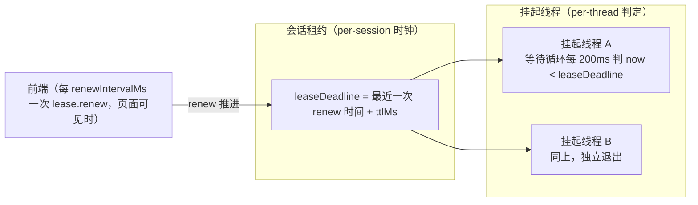
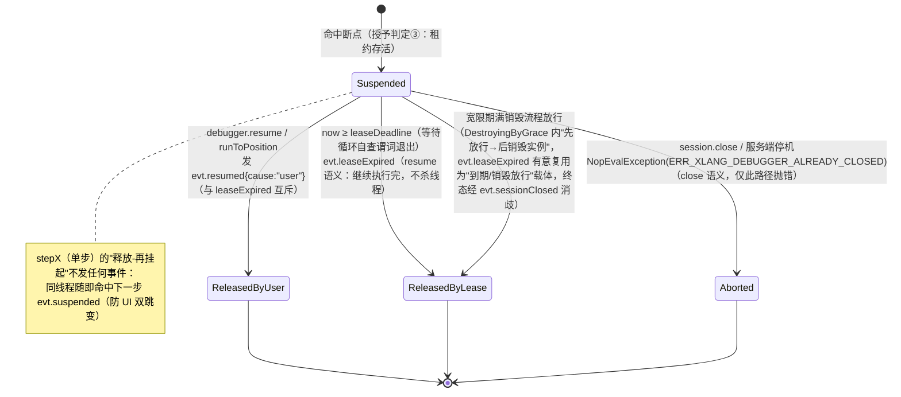
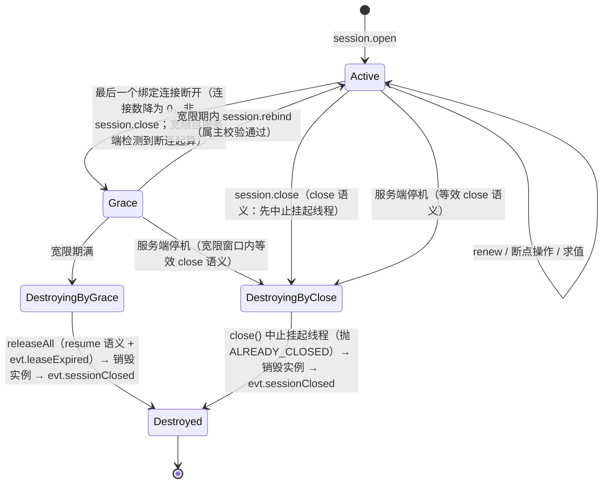
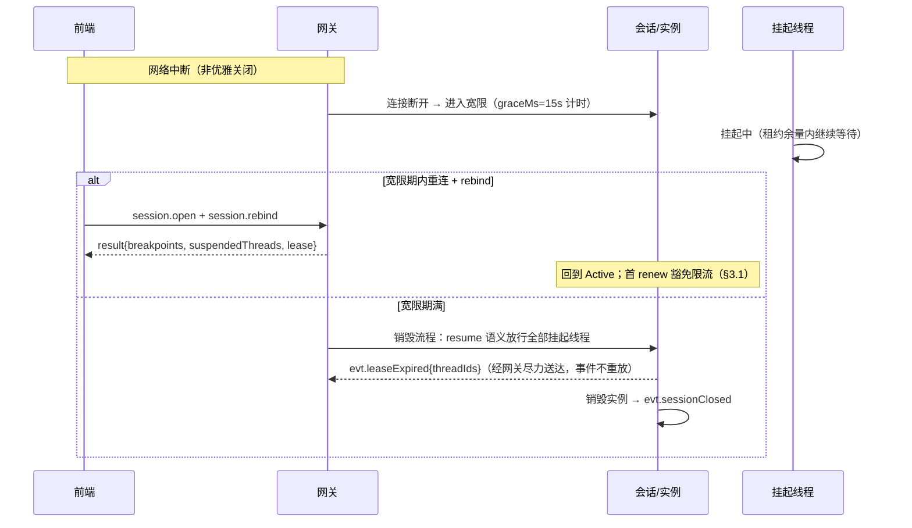

# XLang 在线调试 租约续期与生命周期（D2）

**日期**：2026-10-16
**范围**：调试会话租约模型（TTL/续期/宽限/归属/双语义 release）；实现归属 item 10（引擎）/ item 12（网关）/ item 17（前端）
**状态**：active（租约语义唯一权威；schema 以 [01-ws-protocol.md](01-ws-protocol.md) §3.4 为准）
**上层约束**：[00-overview.md](00-overview.md) §一.4（租约裁定 + `resume()` 全局放行红线）、§3.2（时序）

---

## 一、设计结论

1. **租约时钟 per-session，到期判定 per-thread**：一次 `lease.renew` 推进整个会话的租约截止时间；每个挂起线程在挂起等待循环内独立按该截止时间判定到期退出（挂起循环已有 200ms 轮询窗口，天然承载 deadline 判定）。
2. **两条互斥的自动终止路径**：**租约到期**（连接仍在、续期停）→ 仅放行挂起线程（resume 语义，`evt.leaseExpired`），会话不销毁，用户回前台续期后调试能力恢复；**宽限期满**（连接断开且未在宽限期内 rebind）→ 放行全部挂起线程后**销毁会话**。用户显式 `session.close` → **close 语义**（中止挂起线程，抛 `ERR_XLANG_DEBUGGER_ALREADY_CLOSED`）立即销毁，无宽限。
3. **租约已过期时新命中断点的线程不挂起**（无观察者，直接继续执行）——保证"前端消失后端不永久阻塞"对后续请求同样成立。
4. **多标签页 = 共享租约**：会话租约截止时间 = 全部绑定连接中最近一次续期推进的结果；任一绑定连接续期即续全会话。单步命令的多连接目标选择归 D3。
5. **renew 不与 keepalive ping/pong 合帧**：传输层健康（ping/pong）与业务租约语义（页面可见性驱动的续期）解耦——后台页签传输仍健在但 JS 被节流时，续期本应停止而 ping 照发；合帧会把两套语义焊死。
6. **参数基线**：TTL 30s、续期间隔 10s（3 倍容错）、断连宽限 15s；配置键 `nop.xlang.debug-web.lease.*`。
7. **`beforeunload` 主动 close 是 best-effort 优化**，服务端不得依赖它——宽限期机制兜底一切非优雅退出。

## 二、背景与动机

引擎挂起原语（`monitorWait` 200ms 轮询 + `close()` 中断）已保证"可中断、不永久阻塞"，但无租约语义：前端消失后挂起线程要么等全局 `resume()` 要么等显式 close，无人触发即占死请求线程。本档在不动挂起原语的前提下叠加租约时钟，并给"前端消失"定义三条处置路径（续期恢复 / 到期放行 / 宽限销毁）。D1 已钉死消息 schema（`LeasePolicy={ttlMs,renewIntervalMs}`、`LeaseState={expiresAtMs,suspendedThreadIds}`、`lease.renew` request 形态、`evt.leaseExpired` 与 `evt.resumed` 互斥）；本档裁其语义。

## 三、核心设计

### 3.1 租约模型

- **授予判定（有序，命中断点处执行）**：① 会话已销毁或销毁中（DestroyingBy* 进行中视同已销毁）或引擎已 closed → **不挂起**，直接继续执行（不抛 `ERR_XLANG_DEBUGGER_ALREADY_CLOSED`——抛错保留给"挂起中被 close 中止"路径；此处跳过挂起保证脚本执行完，见 §3.3 会话状态机 DestroyingBy* 路径）；② 租约已过期（`now ≥ leaseDeadline`）→ 不挂起，直接继续执行（记录 warn 日志，不推 `evt.leaseExpired`——该线程从未进入挂起态）；③ 否则正常挂起，纳入会话租约管辖。判定顺序 ① 先于 ②：稳态断网下宽限期满（15s）早于租约自然到期（≤30s），放行线程再次命中断点时走 ①，不会进僵尸会话空等。
- **续期推进**：`lease.renew` 校验（连接已绑定会话、频率不低于限流阈值）通过后置 `leaseDeadline = now + ttlMs`，已挂起线程在等待循环的下一次谓词检查（200ms 轮询窗口或 signalAll 唤醒后重查）中看到新 deadline 自然续命。返回 `LeaseState{expiresAtMs, suspendedThreadIds}`。
- **频率约束（承接 D1 §3.1 转派并细化，schema 不变）**：限流**按连接计量**（多标签页各自排程相位不同步，按会话计量会互相误伤），阈值 = `renewIntervalMs × 0.8`（20% 容差吸收网络抖动）；低于阈值回 error `ERR_XLANG_DEBUGGER_RATE_LIMITED`（限流不关闭连接、不计协议违规）。**前端契约**：收到 RATE_LIMITED 按退避重试（推迟下个排程点），视为非致命、不得因此停止续期循环。`session.rebind` 成功后的**首个 renew 豁免**限流（重连方需立即重建租约时钟）。
- **时钟域（D1 转派裁定的承接）**：`expiresAtMs` 为**服务端 epoch ms**；前端仅用于展示与排程提示，不得作为过期判定基准——休眠/休眠唤醒后客户端时钟不可信，一切判定以服务端为准，客户端唤醒后立即发一次 renew 即可复位。

### 3.2 参数表

| 参数 | 配置键 | 默认值 | 约束 |
| --- | --- | --- | --- |
| 租约 TTL | `nop.xlang.debug-web.lease.ttl-ms` | 30000 | ≥ 2 × renewIntervalMs；≤ 300000（5 分钟上限防 DoS 式长占） |
| 续期间隔 | `nop.xlang.debug-web.lease.renew-interval-ms` | 10000 | ≥ 2000；服务端以此为限流阈值（§3.1） |
| 断连宽限 | `nop.xlang.debug-web.lease.grace-ms` | 15000 | ≥ 0；0 = 断连立即走销毁路径（不推荐） |

数值为实现基线，调整须改本档。三值关系：TTL = 3 × renewInterval 给丢帧留 2 次容错；宽限期独立于 TTL（断连即开始计时，不看租约余量）。

**合帧裁定**：`lease.renew`（带 id request，D1 §3.4）不与 keepalive `ping/pong`（notification，D1 §3.3）合帧。理由：§一.5。前端行为对应关系——页面可见 → renew 照常；页面隐藏 → item 17 停止 renew（租约自然到期放行，符合"用户不在看"的语义）；页面隐藏但用户仍想保持调试（如等待长循环命中）→ item 17 提供"保持续期"开关，属前端策略，不影响本档语义。

### 3.3 双语义 release 状态机

线程挂起生命周期（每个挂起线程独立走一遍；授予判定见 §3.1 有序规则①②③——已销毁/租约过期的命中**不进入本状态机**，直接继续执行）：

实现约束（对 item 10 的硬要求）：

- **await 谓词线程局部化**：现有等待循环谓词是全局 `while (suspended && !closed)`，`resume()` 的 `signalAll` 配全局 `suspended=false` 会放行全部线程（红线禁止）。改造前提：挂起等待谓词改为线程局部组合——`该线程局部放行标志 ∨ 租约到期 ∨ closed`；唤醒用 signalAll 唤醒后由各线程重查自身谓词（不是"下一轮轮询才看到"，是醒来即查）。
- **专用 `releaseAll(resume 语义)` 入口**：宽限期满销毁放行需要"放行全部挂起线程但不置 closed、不抛错"的全局入口，与 `close()`（abort 语义：置 closed + 抛错）区分。租约到期放行**不需要**唤醒原语——线程在轮询窗口内自查谓词自退出。
- **全局 `suspended` 标志维护**：挂起集合清空（全部线程经任一 Released 路径离开）时同步清全局标志，否则 `isSuspended()` 永远 true、`waitSuspended()` 误报（该标志被 D1 `debugger.isSuspended` 暴露给前端）。
- **单线程定向唤醒原语**（per-thread notify）的真实消费方是 D3 的单步目标选择（多线程挂起时只唤醒目标线程）；item 10 落地谓词局部化时一并预留，但其行为契约归 D3。
- close 语义沿用现有 `close()`（置 closed → signalAll → 挂起线程抛错），行为不变；**新命中断点的线程**按 §3.1 ①跳过挂起，不抛错。

会话生命周期（网关持有）：

多标签页语义（与 §3.4 共享租约配套）：部分绑定连接断开（连接数 > 0）**不进入 Grace**，会话保持 Active，剩余连接的续期照常推进租约；宽限自**最后一个**连接断开起算。半开连接（对端失联但 TCP 未关）由 keepalive ping 探测，宽限自**服务端检测到断连**起算——检测延迟期间挂起线程的阻塞由租约 TTL 兜底，不产生无限等待。

**会话存活判定（D0 §3.2 转派裁定的承接）**：

| 触发 | 挂起线程 | 处置 |
| --- | --- | --- |
| 部分绑定连接断开（连接数 > 0） | 任意 | 会话保持 Active（§3.4 共享租约），不进宽限 |
| 宽限期满（连接数 = 0） | 有 | `releaseAll` resume 语义放行全部（推 `evt.leaseExpired`）→ 销毁会话与实例 |
| 宽限期满（连接数 = 0） | 无 | 直接销毁会话与实例 |
| 租约到期（连接仍在） | 有 | 仅放行挂起线程，会话**存活**（不销毁） |
| 租约到期（连接仍在） | 无 | 无操作（下次命中按 §3.1 ②不挂起规则） |
| `session.close` | 任意 | close 语义中止 → 销毁（无宽限） |

### 3.4 多标签页归属

**裁定：共享租约**。`session.rebind` 允许第二个绑定连接（属主校验通过后，D1 §3.4）；会话 `leaseDeadline` 由任一绑定连接的 renew 推进；到期判定看全体绑定连接中最近一次 renew。语义效果：任一页签在前台即维持会话租约；全部页签停止续期达 TTL → 挂起线程放行（会话仍存活，见 §3.3）。

- 拒绝"最后写者胜"（每连接独立租约、仅最后续期者生效）：实现需要按连接跟踪租约归属并在连接断开时回收，复杂度高且语义反直觉（A 页签刚续期、B 页签关闭导致 A 的断点失效）。
- 拒绝"单归属 + 抢占"：会把多屏调试（双显示器两页签）变成互踢。
- 多标签页并发操作断点表/单步命令的一致性（谁的单步生效、断点表覆盖顺序）不在本档——单步目标归 D3；断点表操作按到达顺序生效（后写覆盖，`debugger.setBreakpoints` 语义天然如此）。

### 3.5 边界时序

**断网 → 宽限 → 到期销毁**：

其余边界（文字时序，语义均出自 §3.1/§3.3）：

- **页面休眠**：休眠 → JS 停摆、WS 断开 → 同"断网"路径（宽限 15s 大概率耗尽 → 放行+销毁）。唤醒后前端重连 + rebind：若会话已销毁 → `session.rebind` 返回 error `ERR_XLANG_DEBUGGER_SESSION_BOUND_ELSEWHERE`（D1 裁定：不区分不存在/他属），前端按新会话重建（断点表在客户端有副本，重新 setBreakpoints）。
- **杀页签**（无 beforeunload 机会）：同"断网"路径。
- **beforeunload 优雅关闭**：前端尽力发 `session.close` 后再关闭——服务端收到则立即走 close 语义（中止 + 销毁，无宽限）；未收到（浏览器不保证 beforeunload 内 WS 帧送达）由宽限兜底。**裁定：这是 item 17 的 best-effort 优化，服务端语义不得依赖它。**
- **后台页签节流**（连接不断、JS 节流）：续期停 → 租约到期 → 仅放行挂起线程（`evt.leaseExpired`），会话存活；用户切回前台 renew 即恢复。这是"租约到期"与"宽限销毁"两条路径的核心差异场景。
- **服务端停机**：销毁全部会话（等效 close 语义），尽力推送 `evt.sessionClosed{reason:"serverShutdown"}`；前端重连后按"会话不存在"重建。

### 3.6 到期事件路径与快照可补齐清单

- `evt.leaseExpired{threadIds}` 是"租约到期放行"与"宽限期满销毁放行"两条路径共用的载体（有意复用；前端对后者的终态呈现以随后的 `evt.sessionClosed` 消歧）；用户放行走 `evt.resumed`（互斥，D1 §3.5）；随后的执行完成照常推 `evt.completed`（脚本执行完）。宽限期满销毁的 `evt.sessionClosed.reason` = **`graceExpired`**（本档裁定，已按 D1 additive 规则登记进其事件枚举）。
- 断连窗口内的事件不重放（D1 §3.5）。**快照可补齐裁定（D1 转派承接）**——`session.rebind` result 承载：断点表（全量）、挂起线程表（ThreadInfo）、租约状态（LeaseState）；挂起线程的栈/变量经 rebind 后按需 `getStackInfo`/`getFrameVariables` 重取。**不可补齐**（登记为限制，item 17 UI 不承诺）：断连窗口内的 `evt.log`/`evt.exception` 历史、已错过的 `evt.completed` 结果（若脚本在断连窗口内执行完成，一次性结果不可感知、不可恢复——当前协议无执行历史查询 method，如需该能力在 D1 走 additive 演进登记）。

### 3.7 职责分界

| 项 | 职责 |
| --- | --- |
| item 10（引擎） | `SuspendedThread` 租约字段（deadline 或引用会话时钟）；挂起循环内 deadline 判定退出；**per-thread 放行原语**（不复用全局 `resume()`）；租约过期/异常事件的 notifier 扩展回调；"租约已过期不挂起"判定 |
| item 12（网关） | 会话租约时钟与 renew 处理（含限流）；断连检测与宽限计时器；宽限期满销毁流程（放行+销毁）；`session.close` 的 close 语义触发 |
| item 17（前端） | renew 心跳（`renewIntervalMs` 排程）与页面可见性感知；beforeunload best-effort close；断连重连 + rebind 流程；`evt.leaseExpired` 的 UI 呈现（挂起行标注清除、"已放行"提示） |

### 3.8 出站通道拓扑（plan 2479 修订，item 24 审计 C-1/C-3 remediation）

事件出站（`evt.*`）**不得在任何网关锁（binder/manager 监视器锁、引擎 monitorLock、pipe 锁）或引擎/定时器线程上直接执行 WS IO**。落地铁律：

1. **每连接队列化**：出站帧经 `AsyncOutbound`（每连接有界队列 256 + 专职 daemon drain 线程，惰性启动/空闲自退出）——引擎回调线程、keepalive 定时器、持 B/M 锁路径只做非阻塞入队；停滞客户端只阻塞其专属 drain 线程，不持任何网关锁、不影响其他连接。
2. **丢弃语义**：队列满丢帧 + 按连接限频 warn（每 5s 窗口至多 1 条）；session 已 closed 的帧在 drain 时丢弃（best-effort 不重放，D1 §3.5）。
3. **生命周期**：`onClose` 不摘通道——断连后宽限路径事件（leaseExpired/logs/sessionClosed）仍可入队（drain 按 isClosed 丢弃死连接帧）；通道在 `onSessionDestroyed`（终态帧发出后）移除。
4. **多标签页 fan-out**：bridge 目标集合化（Set 去重），rebind 复用既有 bridge 追加目标——**废除 last-rebind-wins 单落点**，全部绑定连接对等接收事件（含 sessionClosed 广播）。前端审计 F-7 一并销案。
5. **已知残余（如实登记）**：drain 线程对半死 TCP 的 send 无 socket 级超时（共享 WS 适配器为 GraphQL 订阅通道共用，不可为调试通道单独改语义）——停滞连接占用其专属 daemon 线程直至容器写超时/连接消亡；有界于连接数、不持网关锁、无跨连接影响。
6. **到达次序注记**：请求/响应帧保持同步直发（happens-before 于事件帧入队）；同连接队列 FIFO 保事件帧全序；`close 响应先于 evt.sessionClosed`（D1 §3.9）不受队列化影响。

## 四、拒绝了什么

- **服务端单方固定超时（magic-api 式 60s 静默放行）**：无续期、无事件、用户切屏回来断点已飞；本档以租约续期 + 到期事件替代（D0 用户裁定 2）。
- **renew 与 ping/pong 合帧**：见 §3.2。
- **per-thread 独立租约（每挂起线程各自 TTL）**：会导致"续期只救最后一个挂起线程"的语义碎片；会话级时钟 + 线程级判定已覆盖多线程场景。
- **最后写者胜 / 单归属抢占（多标签页）**：见 §3.4。
- **杀线程作为到期处置**：D0 红线——到期放行必须是 resume 语义（脚本执行完，防请求线程泄漏与状态半途）；杀线程仅等价于 close 语义，保留给会话销毁。

## 五、与已有设计的关系

- [00-overview.md](00-overview.md) §一.4/§3.2：本档是其租约裁定的语义细化；`resume()` 全局放行红线在 §3.3 落为 per-thread 原语要求。
- [01-ws-protocol.md](01-ws-protocol.md) §3.4/§3.5：schema（LeasePolicy/LeaseState/renew/事件）以 D1 为准，本档裁语义并承接其三处转派（renew 频率阈值 §3.1、expiresAtMs 时钟域 §3.1、快照可补齐清单 §3.6）。
- 03-sessionization（D3，立项后链接）：多标签页/多连接下的单步目标选择；本档 §3.4 已声明该转派。
