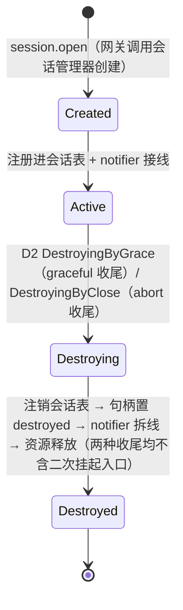

# XLang 在线调试 调试器会话化（D3）

**日期**：2026-10-16
**范围**：调试器会话化机制（方案裁定、会话标识注入与透传、每会话实例生命周期、单步目标策略、IDEA 兼容）；实现归属 item 8（标识+路由）/ item 9（生命周期+IDEA 回归）
**状态**：active
**上层约束**：[00-overview.md](00-overview.md) §一.3/§3.3（会话模型、默认会话兜底）、[02-lease-lifecycle.md](02-lease-lifecycle.md) §3.1/§3.3（授予判定、谓词线程局部化、定向唤醒消费方归本档）

---

## 一、设计结论

1. **方案 A 胜出**：保持单一全局 executor 外壳（`IExpressionExecutor` 实例），外壳内按**线程级会话标识**路由到对应会话的 `XLangDebugger` 实例；拒绝方案 B（runtime 级注入 `EvalRuntime`/choke point）。决定性论据是执行器传递的双机制事实：函数/标签调用边界一律重读全局静态槽位并 `new EvalRuntime`——基于 EvalRuntime 字段的会话标识在每个调用边界都会丢失，方案 B 必须改遍 nop-xlang 全部再取点（保护区 + 大侵入面）；而 ThreadLocal 方案下边界重取的仍是同一个全局外壳，按当前线程标识重新路由，天然存活。
2. **会话标识 = 执行入口设置的线程级标记**（ThreadLocal 语义），由"代表会话触发脚本执行"的入口（item 14 REPL、item 21 调试运行入口）设置；标记窗口覆盖 compile+execute 全程（与 IDEA 现状行为一致）；嵌套重入 save-restore；标记 API 是给 item 12/14/21 消费的**标记契约**（scope 语义），非公共引擎 API。
3. **路由规则**：有标记+会话存活 → 该会话实例；有标记+会话已销毁 → **跳过断点检查直通执行**（衔接 D2 §3.1①，保证脚本执行完，不落入默认会话）；无标记 → 默认会话兜底（IDEA 全局断点语义）；`enabled=true` 且 web 未激活 → 不装外壳，直注现状形态 executor（逐字节等价现状）。
4. **单步定向语义从零重建**：现状 `stepX()` 是全局释放（置全局 stepMode + `signalAll` 唤醒全部挂起线程）。目标语义：stepX 作用于**目标线程**（一期默认 = 会话内 `lastSuspendThread`，即最近挂起线程），配合 D2 §3.3 谓词线程局部化，仅释放目标线程；per-thread 定向唤醒原语的行为契约由本档 §3.6 定义（D2 §3.3 转派承接）。
5. **每会话实例** = `XLangDebugger` + 专属 `BreakpointManagerImpl` + `suspendedThreads` + 租约状态 + **专属 `IDebugNotifier` 接线**（出站到该会话的网关连接）；创建于 `session.open`，销毁于 D2 `DestroyingBy*`；服务端停机由 `XLangDebuggerInitializer.destroy()` 衔接（D2 §3.5）。
6. **IDEA 零改动**：默认会话（id=`default`）是会话管理器中的预置实例，`SimpleRpcServer` 照旧绑定它的 debugger；`nop-idea-plugin` 与 TCP 协议不变，回归基线 = 现状行为。
7. **跨线程不透传（一期裁定）**：脚本内显式新开线程/线程池执行的代码不携带会话标记 → 落默认会话（IDEA 语义）。理由与限制见 §3.3。

## 二、背景与动机

引擎 `XLangDebugger` 的全部状态已是实例字段，多实例化本身无障碍；障碍在**执行流如何找到正确的实例**。会话化的本质是给"执行流 → debugger 实例"建立路由。本档裁定路由机制并定义其全部行为边界，使 item 8/9 可以直接落地、D2 的租约状态机有明确的宿主。

## 三、核心设计

### 3.1 方案裁定：A（全局外壳 + 线程级标记路由）vs B（runtime 级注入）

| 维度 | 方案 A（采纳） | 方案 B（拒绝） |
| --- | --- | --- |
| 保护区 | 零触发：新类全部落 `nop-dev-tools`；nop-core 仅**复用**既有 `registerGlobalExecutor` | 触发：需改 `EvalRuntime`（nop-core）或 `XLang.execute` choke point（nop-xlang），plan-first + 全平台回归面 |
| 侵入面 | 一个新外壳类 + 会话管理器；`IExpressionExecutor` SPI、`EvalRuntime`、执行树零改动 | 决定性缺陷：函数/标签调用边界重读全局槽位并 `new EvalRuntime`（`ExecutableFunction.invoke/call0-3`、`ExecutableFunctionEvalAction.doInvoke`、`XLangSemantics`、`IXplTag`，树中段另有 `EvalBackendRouter`/`EvalStaticDegradedExecutable`/`BetweenOpExecutable`/`CompareOpExecutable` 再取点）——EvalRuntime 字段在边界处丢失，须改遍全部再取点才能透传 |
| IDEA 兼容 | 无标记即默认会话兜底，语义与现状同构（全局断点） | 需为无标记执行构造"默认 EvalRuntime 注入"特例，语义分叉多 |
| 性能 | 无标记路径 = 一次 ThreadLocal get + 分支；有标记路径多一次会话表查找 | 每次执行树构建携带字段，边界透传逻辑开销更大 |

方案 B 的唯一理论优势（标识随执行上下文跨线程传播）在 XLang 主路径上不成立——解释执行同线程递归（见 §3.3），而其代价（保护区 + 全部再取点改造）是确定要付的。

### 3.2 会话标识注入与透传

**标记契约**（本档定义语义，item 8 提供实现，item 12/14/21 消费）：

- `DebugSessionScope.withSession(sessionId, work)` 语义：执行 `work` 期间当前线程携带会话标识；进入时保存旧值（save），`work` 结束/异常时恢复旧值（restore，finally 语义）——嵌套重入不丢失外层标记。
- 标记值是**会话引用句柄**：身份字段（sessionId、实例句柄）不可变；`destroyed` 是由会话管理器在 Destroyed 迁移末端置位的**可见性受控状态位**（volatile/atomic 写，保证路由线程可见），不是裸字符串——路由时不再二次查表竞态。`withSession` 传入不存在/已销毁的 sessionId 时不报错，置为已销毁句柄（执行直通，与"会话刚销毁"路径一致；入口的会话存在性校验属 item 14/21 的 HTTP 层职责）。
- **窗口覆盖 compile+execute**：标记窗口包含脚本编译（编译期常量/宏求值同样路由进会话 debugger）。理由：与 IDEA 现状行为对齐（`enabled=true` 时编译期求值同样经过全局 executor，断点在编译期求值代码中可命中）；编译期挂起的阻塞风险由 D2 租约兜底（无人续期即到期放行）。**显式不采纳**"仅 execute 期携带"——它会在"编辑器内编译诊断 + 断点调试"两种场景间制造行为裂缝。
- **插入点枚举**（live 入口点，item 12/14/21 按此接线）：① item 14 REPL execute 端点（compile+execute 全程包裹）；② item 21 示例调试运行入口（同上）；③ item 12 网关**不设**插入点（网关只操作 debugger 实例，不执行脚本）。未列入口（普通业务请求、后台任务）不设标记，走默认会话兜底。

**透传保证（双机制论证）**：

- 树内：外壳实例作为方法接收者逐层传递（`expr.execute(this, rt)`），路由决策已在外壳入口做出，树内不再变更。
- 边界（函数/标签调用）：调用点重读全局槽位——拿到的是**同一个外壳实例**，按当前线程标记重新路由 → 同一会话。这是 ThreadLocal 方案在双机制传递下存活的机制根据。
- `EvalRuntime` 不携带任何会话信息（字段不动），边界新建 `EvalRuntime` 无影响。

### 3.3 跨线程边界

**裁定：一期不做跨线程透传**。脚本内显式创建的线程/提交线程池的执行体不携带标记 → 落默认会话（有 IDEA 断点语义，无会话断点语义）。理由：① XLang 解释执行主路径同线程递归，跨线程属罕见特性场景；② ThreadLocal 语义天然不跨线程，跨线程方案（InheritableThreadLocal 不可靠于线程池、任务包装侵入全部执行入口）成本高、收益低；③ 误路由风险被默认会话兜底语义约束（不会挂起进错误会话——默认会话仅响应 IDEA 断点表）。登记为限制：子线程内代码无法被会话断点命中；后续如需支持，走 additive 演进（执行入口显式传递标记，归 item 8 实现裁量）。

### 3.4 路由规则表

外壳入口伪代码（行为语义，非实现代码）：

```
route(expr, rt):
  ref = threadLocalMarker.get()
  if ref == null:
      return defaultSession.debugExecutor.execute(expr, rt)   # IDEA 兜底（仅 enabled=true 时外壳已装）
  if ref.destroyed:
      return plainExecute(expr, rt)                            # 已 Destroyed 后的迟到执行：跳过断点检查（D2 §3.1①）
  return ref.session.debugExecutor.execute(expr, rt)           # Destroying 窗口内的命中由实例内授予判定①兜住（见下）
```

**双层分工钉死**：路由层 `destroyed` 位在 Destroying→Destroyed 迁移**末端**置位，只管"已销毁后的迟到执行"；**Destroying 进行中窗口**的断点命中由会话实例 `checkBreakpoint` **最前部**的授予判定①承接（销毁中/已销毁 → 不挂起直接继续，归属 item 10 的引擎实现，D2 §3.1①）。两层叠加以覆盖置位时序的任意交错，不要求路由层感知 Destroying 中间态。

| 情形 | 行为 | 依据 |
| --- | --- | --- |
| `enabled=false` | 外壳不存在，`DefaultExpressionExecutor` 原样（零改动） | D0 §3.3 矩阵行 1 |
| `enabled=true`，web 未激活 | 不装外壳；直注 `DebugExpressionExecutor(defaultSession.debugger)`——与现状逐字节等价 | D0 §3.3 矩阵行 2 |
| `enabled=true`，web 激活，无标记 | 外壳路由 → 默认会话（IDEA 全局断点语义） | D0 §3.3 规则 3 |
| web 激活，有标记，会话存活 | 路由 → 该会话实例 | 本档 |
| web 激活，有标记，会话已销毁 | 路由层直通（不落入默认会话——防止死会话的执行泄漏进 IDEA 调试面） | D2 §3.1① |
| web 激活，有标记，会话销毁进行中 | 进入实例后由 `checkBreakpoint` 授予判定①不挂起放行 | D2 §3.1① + 本档双层分工 |

### 3.5 每会话实例生命周期



- **归属清单**：每会话实例持有专属 `BreakpointManagerImpl`（断点表互不可见）、`suspendedThreads`/`lastSuspendThread`/`tempBreakpoint`、租约状态（D2）、**专属 `IDebugNotifier`**——引擎事件回调出站到该会话的网关连接（`evt.*` 的 engine-notifier 来源）；`suspended`/`closed` 标志与 cleanupThread 均为实例内。原全局 `stepMode` 单字段被 §3.6 的重建取代：**per-thread 局部 step 判定状态**（挂在各挂起线程上）+ **会话级 `suspendOnce` 旗标**（§3.6.7）。
- **创建时机**：`session.open` 同步创建（含默认租约授予），失败（如引擎未启用）→ open 报错，不产生半初始化实例。
- **销毁路径（两种收尾，杜绝竞态）**：与 D2 §3.3 会话状态机一一对接——
  - **abort 收尾**（close/停机路径）：引擎 `close()`（置 closed → signalAll → 无并发放行的挂起中线程在出口凭 closed 抛 `ERR_XLANG_DEBUGGER_ALREADY_CLOSED`；与放行竞态的窗口按下方出口判定顺序处理）。
  - **graceful 收尾**（宽限路径）：`releaseAll`（resume 语义放行）后**不得调用 `close()`**——`closed` 置位会让"已被放行但尚未重新获得锁"的线程在出口误抛错、脚本中途死亡，违反 D2 resume 语义红线。宽限路径使用**不置 closed 的 dispose 收尾**：signalAll 唤醒 → 已放行线程凭局部放行标志正常返回继续执行 → 从会话表注销、句柄置 destroyed、notifier 拆线、释放资源。新命中按 §3.4 双层分工由授予判定①兜住。
  - **出口判定顺序（钉死，消 flaky）**：挂起等待出口先判局部放行/租约到期（正常返回、继续执行），仅当 `closed` 置位且无局部放行时才抛 `ERR_XLANG_DEBUGGER_ALREADY_CLOSED`——双标志并存的窗口（用户 resume 与 close 竞态）一律按正常放行处理（脚本执行完；close 语义只中止**当时仍在挂起等待**的线程，已在执行中的线程不可杀也不杀）。
- **服务端停机**：`XLangDebuggerInitializer.destroy()` 在关闭默认会话实例后，逐个销毁全部 web 会话实例（等效 close 语义，D2 §3.5 serverShutdown）——初始化器持有会话管理器引用完成清扫。

### 3.6 单步目标策略（现状全局释放的重建）

现状事实：`stepInto/stepOver/stepOut` 仅用 `lastSuspendThread` 做非空守卫，实际 `monitorNotify` 置**全局** stepMode、清全局 `suspended`、`signalAll` 唤醒**全部**挂起线程；stepOver/Out 判定混用 currentThreadId 查表与全局单字段 stepMode，多线程下语义竞争。

**目标语义（配合 D2 §3.3 谓词线程局部化从零建立）**：

1. **目标选择**：无参 stepX 的目标线程 = 该会话的 `lastSuspendThread`（最近挂起线程）；会话内无挂起线程时 stepX 报错 `ERR_XLANG_DEBUGGER_THREAD_NOT_SUSPENDED`（D1 已登记该码，语义扩展为"无目标"）。
2. **定向释放**：stepX 仅置**目标线程**的局部 step 模式与局部放行标志，经定向唤醒原语唤醒目标线程；其他挂起线程在 signalAll 后重查自身谓词（局部放行 ∨ 租约到期 ∨ closed）不满足，继续等待。stepOver/Out 的帧深度判定状态（原全局 stepMode）随目标线程局部化——多线程各自的 step 判定互不干扰，消除现状竞争。
3. **per-thread 定向唤醒原语行为契约（D2 §3.3 转派承接）**：`releaseThread(threadId)`——置该线程局部放行标志 → `signalAll` → 目标线程谓词满足退出挂起；其余线程重查谓词继续等待；对不存在/未挂起的 threadId 是 no-op（幂等）。**事件契约：经 releaseThread 的释放不发 `evt.resumed`**——stepX 的"释放-再挂起"全程零事件（同线程随即的再挂起由 `evt.suspended` 承载，防 UI 双跳变，D2 §3.3 note 的承接）。
4. **释放-再挂起组合**：目标线程退出挂起后执行至下一命中点（断点/单步位置）再挂起，`lastSuspendThread` 更新为它——连续 stepX 天然作用于同一线程的下一步。
5. **多标签页并发单步**：两条 stepX 按到达顺序生效（引擎锁串行化）：第一条释放当前 `lastSuspendThread`；若其再挂起，第二条作用于更新后的目标；**处理时刻无已挂起目标即报错**（含目标线程"已释放但尚未再挂起"的瞬态窗口——按处理时刻快照判定，不预测未来）。此为**定义行为**，非未定义竞争。
6. **指定线程单步**（多线程挂起且用户想步进非最近线程）：一期不提供，走 D1 additive 演进——stepX params 增加可选 `threadId`（缺省 = lastSuspendThread），schema 变更以 D1 登记。
7. **`debugger.suspend()`（SUSPEND 模式）归宿**：原全局 `stepMode` 的 SUSPEND 分支重建为**会话级 `suspendOnce` 旗标**——`suspend()` 置会话旗标，任一线程的下一 `checkBreakpoint` 命中旗标即挂起该线程并清除旗标（一次生效）。多线程挂起时暂停按钮作用于"下一个到达检查点的线程"，属会话级语义、不随 per-thread 局部化拆分。

### 3.7 IDEA 兼容

- 默认会话 id=`default`，`enabled=true` 时由初始化器预置；`SimpleRpcServer.addServiceImpl(IDebugger.class, default.debugger)` 绑定不变；TCP 协议面（`IDebugger`/`IDebuggerAsync`）不动。
- `nop-idea-plugin` 零改动；行为回归基线 = 现状：IDEA 设断点 → 任意执行命中（无标记执行走默认会话）→ stepX（无并发挂起时单线程场景与现状等价）→ resume。
- **有意的行为变更（默认会话同样生效，显式声明非回归破损）**：① 无挂起线程时 stepX 由现状的静默 no-op（LOG+return）改为报错 `ERR_XLANG_DEBUGGER_THREAD_NOT_SUSPENDED`——TCP 侧从无响应变异常响应，属错误面收紧；② 多线程同时挂起时 stepX 从"全局释放全部线程"变为定向释放目标线程——现状多线程 stepX 本身语义竞争（§3.6 现状事实），重建后行为更严格。两处变更均以本档为准，D0 M2 的"行为与改造前一致"按此限定解读（单线程常规路径等价）。
- **回归基线定义**（item 9 验收锚点）：`enabled=true` + web 未激活配置下，现有调试器单测/集成测试全绿（上述两处显式变更点除外，按新语义断言）；web 激活配置下 IDEA 全链路回归仍绿。
- **登记（item 24 审计覆盖点）**：条件/logpoint 求值内函数调用经边界重取会重入会话 debugExecutor → `checkBreakpoint` 重入——此为现状既有行为（全局 executor 下同样存在），会话化不放大，但 per-thread 化后的重入挂起语义列入并发深审清单。

### 3.8 实现职责分界与测试锚点

| 项 | 职责 | 测试锚点 |
| --- | --- | --- |
| item 8（会话标识+路由） | 标记契约实现（save-restore）、路由外壳、会话管理器（注册表 + 句柄 destroyed 位）、标记 API 供 12/14/21 消费 | 嵌套 action/函数调用透传（边界重取后路由不变）；无标记路径行为不变（现状回归）；有标记+已销毁直通 |
| item 9（生命周期+IDEA 回归） | 每会话实例创建/销毁、notifier 接线/拆线、默认会话预置、停机清扫、定向唤醒原语与 stepX 重建 | 双会话并发互不干扰（断点表/挂起/单步）；IDEA 全链路回归（两种开关组合）；多线程挂起定向单步 |

## 四、拒绝了什么

- **方案 B（runtime 级注入）**：见 §3.1 四维对比；其 EvalRuntime 字段方案在调用边界丢失标识是机制性缺陷而非实现难度。
- **EvalScope 携带标识**（经由 `IScope` 传播）：作用域是脚本语义层概念，把调试基础设施混入脚本可见状态；且 scope 同样受边界新建影响。
- **无标记直通（空转）**：D0 已显式不采纳——会使并存态下 IDEA 断点失效；本档路由规则表维持默认会话兜底。
- **跨线程透传（一期）**：见 §3.3。
- **stepX 增加 target 参数作为一期方案**：协议 additive 演进可后补（§3.6 第 6 条），一期以 lastSuspendThread 语义对齐现状 UX，避免首版协议膨胀。

## 五、与已有设计的关系

- [00-overview.md](00-overview.md) §一.3/§3.3：本档是其"会话化落点"占位的裁定落位；路由规则表逐行对应其开关矩阵与规则 3。
- [02-lease-lifecycle.md](02-lease-lifecycle.md) §3.1/§3.3：授予判定①的"跳过挂起"由本档路由第 5 行承接；谓词线程局部化与定向唤醒契约在本档 §3.6 成文。
- [01-ws-protocol.md](01-ws-protocol.md)：stepX 可选 threadId 的 additive 演进路径；`ERR_XLANG_DEBUGGER_THREAD_NOT_SUSPENDED` 语义扩展（无目标）需在 item 12 实现时于错误 message 体现。
- 04-execution-backend-link（D4，立项后链接）：本档路由仅覆盖 interpreter 可断点路径（`allowBreakPoint()=true`）；静态绑定绕过路径的消除归 D4——D4 消除后进入的执行仍经本档路由到达会话实例。
