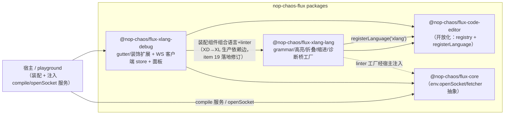

# XLang 在线调试 前端架构（D5）

**日期**：2026-10-16
**范围**：nop-chaos-flux 侧扩展架构——新包结构、flux-code-editor 开放化、renderer/装配集成、构建链、调试状态桥；实现归属 item 15（语言包）/ 16（调试扩展）/ 17（WS 客户端）/ 18（面板）/ 19（装配）
**状态**：active
**上层约束**：[00-overview.md](00-overview.md) §一.7（flux-code-editor 基座、不引 Monaco）、§3.1 组件图
**语法方案**：[06-grammar-spike.md](06-grammar-spike.md)（三来源裁定与 grammar 生产输入）

---

## 一、设计结论

1. **两个新包，职责正交**：`@nop-chaos/flux-xlang-lang`（语言包：grammar + 高亮/折叠/缩进 + 诊断桥工厂）与 `@nop-chaos/flux-xlang-debug`（调试域：断点 gutter/装饰扩展 + WS 调试客户端 store + 调试面板组件）。拒绝单包混合（语言无关调试能力与语言能力耦合，REPL 场景需要 lang 不需要 debug）与塞进 flux-code-editor（第三方语言先例污染通用包）。
2. **语言注册开放化 = registry Map 化（最小侵入）**：`createLanguageExtension`/`getLanguageParser` 两个 switch 内部改为内置注册表查找 + 新增 `registerLanguage` 扩展点；`createBaseExtensions` 的 language 特例 if 链（expression/sql 的 completion/linter/decoration）一并收敛——**注册表条目携带可选扩展**（`{ extension, parser?, completion?, linter?, decorations? }`）。既有 12 语言行为零回归是硬约束。
3. **类型层开放度裁定：半开放过渡**——`EditorLanguage` 封闭联合显式增补 `'xlang'` 成员（编译期安全），`registerLanguage` 运行时开放点接受 `string`（第三方语言可注册但出不了联合类型）；不放宽联合为裸 `string`（丢失既有语言的编译期检查），不做 declaration merging（复杂度不成比例）。半开放语义在 `registerLanguage` 的 JSDoc 契约成文。
4. **构建链**：`@lezer/generator` 为 flux-xlang-lang 的 **devDependency**；`lezer-generator` 生成命令固化为 `gen:grammar` script；**生成产物（parser/terms）落 `packages/flux-xlang-lang/generated/`（src 之外）并入库**——与 nop-xlang 的 ANTLR 生成物入库同构，避免所有贡献者为构建安装 generator。
5. **诊断对接为注入式**：语言包不依赖后端——`createXlangLinter({ compile })` 工厂接收宿主注入的编译服务（经 flux `env.fetcher`），返回 CodeMirror `linter()` 扩展；item 15 交付工厂，item 21/19 接线。
6. **调试状态桥 = zustand store 双向契约**（仓内既有惯例）：下行 store→编辑器（断点表/挂起行/异常标注经 CodeMirror Effect 分发到 state field）；上行编辑器→store（gutter 点击动作）→WS 客户端（item 17）。状态 schema、Effect 分类与上行动作命名一次定死（§3.4），item 16/17/18 可各自仅依本文档 + mock 并行开工。
7. **跨仓交付影响（登记，执行归 item 20）**：`flux-bundle`（@nop-chaos/flux）当前**不包含** flux-code-editor——xlang 在线编辑器进入宿主产物链需在 item 20 新增 bundle 清单项（或裁定宿主直接引 workspace 包），`pack-flux-bundle.mjs`/`check-flux-bundle-pack.mjs` 相应扩展。

## 二、背景与动机

flux-code-editor 已有 12 语言的封闭注册（switch 硬编码 + 官方 lang 包直调）、表达式扩展先例（linter/completion/decoration）、模板模式 StreamLanguage tokenizer、compartment 化的扩展注入点。XLang 语言能力与调试能力是两个正交关注点，且调试扩展需要与语言解耦（对 plaintext 也可用 gutter）。本档把扩展架构一次定死，使五个实现 item 无需再做结构决策。

## 三、核心设计

### 3.1 包结构与依赖方向

依赖红线：`flux-xlang-lang`/`flux-xlang-debug` 都不得依赖后端仓；后端交互只经 `flux-core` 的 `env` 抽象（`env.fetcher`/`env.openSocket`）。依赖方向单向：XL 不依赖 XD；XD 生产依赖 XL——**装配组件归 XD**（item 19 落地裁定，修订起草期"两新包互不依赖"：renderer definition 须可被生产宿主 import，装配放 playground 会 app 私有化、另立第三包过度设计；调试扩展本体（gutter/装饰）仍对"当前语言是否 xlang"不敏感）。

### 3.2 语言注册开放化（flux-code-editor 改造面）

三个分发点一次收敛：

| 分发点（live 位置） | 现状 | 改造后 |
| --- | --- | --- |
| `createLanguageExtension`（base.ts L60-88 switch） | 12 语言硬编码 | registry 查找 `languageRegistry.get(language).extension(language)` |
| `getLanguageParser`（base.ts L106-133 switch） | 同上（colorize 出口） | registry 条目可选 `parser` |
| `createBaseExtensions` 特例 if 链（L199-246：expression 的 completion/lint/friendlyNameDecoration、sql 的 tables 补全） | 语言特例散落 | 收敛进条目可选字段：`completion`/`linter`/`decorations`（工厂形态，入参 = options/env） |

注册表条目契约（语义，非代码）：`{ extension: (opts) => Extension, parser?: Parser, completion?: (opts) => Extension, linter?: (opts) => Extension, decorations?: (opts) => Extension }`；内置 12 语言在模块加载时以现值注册（行为逐字节等价现状），`registerLanguage(name, entry)` 供 flux-xlang-lang 注册 `'xlang'`、供第三方扩展。**零回归约束**：改造后既有语言的扩展集合与顺序不变（compartment 复用 `use-code-mirror` 现有机制）；registry 条目对两处"替换型"特例（sqlDialect、expression 的 template-mode）取**替换语义**（条目.extension 的返回值整体替换该语言分支原扩展），flux-code-editor 既有 vitest 断言全绿是 item 15 的验收项（仓内无快照基线，无需快照对账）。

类型层：`EditorLanguage` 联合增 `'xlang'`；`registerLanguage` 形参为 `string`（运行时开放）——半开放语义（§一.3）在其 JSDoc 声明：联合外语言可注册可用，但类型收窄需上游扩联合。

### 3.3 flux-xlang-lang（语言包）

- `generated/`：`xlang.parser.js` + terms（`gen:grammar` 产物，入库；**落包根 generated/ 而非 src/**）。门禁配套四件套：① `check:src-artifacts`（禁 .js/.d.ts 入包内 src，generated/ 在扫描域外）② `check:oversized-code-files`（扫描 `packages/**/*.js`，500/700 行 WARN/ERROR——真实 parser.js 远超 700 行，须加 OVERSIZED_EXEMPTIONS 条目）③ knip/jscpd 豁免条目 ④ eslint **无需豁免**（包级 lint 只扫 src，generated/ 天然逃逸）。tsc 配套三点：tsconfig.base `allowJs:false` → 须手写并随生成物维护 `.d.ts` shim（lezer-generator 不产 d.ts）；`tsconfig.build.json` `rootDir: src` → generated 不入 build include，dist 会发出指向包外的 import——开发态经 workspace-alias 解析、**打包面**（pack-flux-bundle 复制 dist + package.json files）须配 files/copy 步骤（copy-build-assets.mjs 先例）。逐项过 `pnpm check` 验证归 item 15。
- language 模块：`xlang()` 装配（parser + syntaxHighlighting 样式映射 + 折叠 + 缩进服务 + bracketMatching）；closeBrackets 属全局基础扩展（createBaseExtensions 已有），不进语言包——对标官方 lang 包形态（`case 'yaml': return yaml()` 的等价物）。
- diagnostics 模块：`createXlangLinter({ compile, debounceMs })` 工厂——编译诊断→`Diagnostic[]`（行号映射 + severity）；compile 由宿主注入（`env.fetcher`）。**open question（登记）**：编译诊断端点与 payload schema（行号/severity 映射的事实源）的 owner 归 item 14（REPL compile 服务，按 D6 裁定落地）——D6 立项时必须定义该端点，item 19/21 接线依赖它。
- grammar 生产输入：见 [06-grammar-spike.md](06-grammar-spike.md) §四（spike grammar 为起点，补全 XLang 语义面）。

### 3.4 flux-xlang-debug（调试包）

- state 模块（debug store）：zustand store——**下行状态 schema**（与 [01-ws-protocol.md](01-ws-protocol.md) 事件形状对齐）：`{ breakpoints: Breakpoint[]（全量镜像，对应 debugger.getBreakpoints/setBreakpoints 语义）, suspended: SuspendedState[]（多线程挂起，元素 = {threadId, sourcePath, line}，对齐 evt.suspended/LeaseState.suspendedThreadIds）, lease: { expiresAtMs } | null（对齐 LeaseState，供续期排程）, exceptions: {sourcePath?, line?, message, errorCode?}[]（对齐 evt.exception） }`；**上行动作**：`toggleBreakpoint/addBreakpoint/removeBreakpoint(sourcePath, line)`、`step(kind)`/`resume()`/`suspend()`/`runToPosition(bp)`/`muteBreakpoints(muted)`（映射 debugger.* 同名 method）、`evalExpr(threadId, frameIndex, expr)`（映射 debugger.getExprValue——REPL 执行是 item 14 的独立服务面，不经此动作）。**下行机制**：CodeMirror Effect 分类（suspended-line/exception/breakpoint 三族）与命名约定一次定死；面板数据（栈/变量/帧）不进 store 复制——组件直接按 threadId 发 query（getStackInfo/getFrameVariables），store 只存连接与挂起态。
- extension 模块（breakpoint-gutter / suspended-line / exception-squiggle）：CodeMirror state field + Effect 消费 store 下行；gutter 点击 dispatch 上行动作。
- client 模块（debug client）：`env.openSocket` 连接管理（握手/鉴权/renew 心跳/重连 rebind）——item 17 按 [01-ws-protocol.md](01-ws-protocol.md) + [02-lease-lifecycle.md](02-lease-lifecycle.md) 实现，本包只定它消费 store 契约。
- panel 模块：变量树/调用栈/求值/控制按钮面板（item 18），交互先例 `@nop-chaos/nop-debugger` 面板体系。

### 3.5 装配与集成（item 19，已落地）

装配组件 `XlangDebugEditor` 落 `@nop-chaos/flux-xlang-debug` `src/assembly/`：flux-code-editor（`createBaseExtensions({language:'xlang'})` + extensions 注入 createBreakpointGutter/suspendedLinesField/exceptionLinesField/sourcePathFacet/createXlangLinter，**useMemo 且 key 含 sourcePath**——617 结论 compartment 对 extensions 身份全量替换，StateField 存活依赖 memo 稳定；sync 桥不是 Extension，经 effect 在 view 就绪后接线、cleanup dispose）+ DebugPanel + createDebugClient 连接管理（openSocket/getToken 注入）。renderer definition（`xlang-debug-editor` type + sourcePath/serverUrl/initialSource field rules）在包内轻注册面模块中（item 20 起即 `/definitions` 子路径，组件经 createLazyRendererComponent 动态装载），`registerXlangDebugEditorRenderers(registry)` 注册；compile 诊断服务经宿主 `env.fetcher` 具象化（POST `/r/nop-xlang-debug/compile`，envelope `status!==0` 判错取 `data.diagnostics`）。

playground 演示页（`xlang-debug-page.tsx`）走 schema→registry→SchemaRenderer 路径（schema type `'xlang-debug-editor'` 命中 renderer definition——唯一提供 RuntimeContext 的路径）；registry 需 `registerBasicRenderers`（'page' 容器）+ `registerXlangDebugEditorRenderers`；路由经 React.lazy 惰性加载（lezer 产物不进主 chunk），home 家族归 `diagnostics`。token/后端地址为演示态手工注入（playground 无登录流）；真实后端联调归 item 21/22。

**交付链裁定（item 20，plan 2474 已落地）**：①demo 宿主 = playground；生产 admin 页 out of scope，registry 能力就绪待宿主自助接入。②bundle 纳入形态 = **`/definitions` 轻子路径注册面**（form 先例）：`@nop-chaos/flux-xlang-debug/definitions`（renderer.ts + compile-service.ts）承载 definition/field rules/register，bundle 门面只 import 该子路径并随默认栈注册；实现组件经 `createLazyRendererComponent` 动态装载（three-canvas 同型边界），CE/lezer 落 `xlang-debug-editor-*` 异步 chunk；`check-flux-bundle-pack` 以"tgz 含该 chunk + 主 chunk 静态头部无 `./xlang-debug-editor-` 相对引用"双断言守卫（CM/lezer 被内联、specifier 扫描对它们无判别力）。③flux-bundle devDependencies 仅声明 flux-xlang-debug（其余经 alias 传递解析）。④HOST_API_VERSION 不变更（@nop-chaos/shared 公共面零改动，0.2.0 维持）。包 index.ts 的重实现 re-export 现状保留（bundle 链不消费），收敛归 renderer-lazy-loading.md 约定治理。

## 四、拒绝了什么

- **Monaco**：用户裁定（D0 §一.7）+ flux 资产复用。
- **单包（lang+debug 合一）**：REPL/纯编辑场景不需要调试依赖入 bundle；两包独立演进、独立懒加载。
- **塞进 flux-code-editor**：通用编辑器包引入 xlang 专属 grammar/依赖（@lezer/generator 产物、诊断桥）破坏其中立性；开放化（registry）才是它需要的。
- **EditorLanguage 放宽为裸 string**：丢失既有 12 语言的编译期检查；半开放过渡（§3.2）成本最低且可逆。
- **生成产物不入库（每次构建现场生成）**：flux 包级 build 是纯 tsc，现场生成要求所有贡献者/CI 装 generator 并引入 codegen 步骤失败面；入库 + `gen:grammar` 手动刷新与 nop-xlang ANTLR 生成物入库同构。
- **语言包直连后端**：破坏 flux 的宿主抽象（env 注入），且跨仓依赖倒置；注入式诊断桥（§3.3）保持单向。

## 五、与已有设计的关系

- [00-overview.md](00-overview.md) §一.7/§3.1：前端基座裁定的架构落位；组件图前端侧的包级展开。
- [06-grammar-spike.md](06-grammar-spike.md)：本档 §3.3 语言包的 grammar 来源与生产输入。
- [01-ws-protocol.md](01-ws-protocol.md)/[02-lease-lifecycle.md](02-lease-lifecycle.md)：调试 store/WS 客户端的协议与租约语义权威。
- 交付链：item 20（plan 2474）已落地——见 §3.5 交付链裁定；`check-flux-bundle-pack.mjs` 双断言守卫懒边界，宿主 registry 机制与 HOST_API_VERSION（0.2.0）未变。
