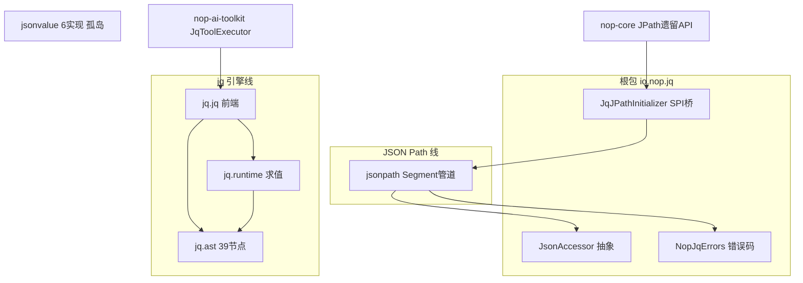

# 架构与数据流

> 本页回答三个问题：nop-jq 单模块内部如何分层、一次 jq 查询如何端到端流经各层、jq 引擎与 JSON Path 两条查询线在哪里交汇与分离。机制细节不在本页重复：求值模型与内建分发见 [jq-runtime](./modules/jq-runtime.md)，JSON Path 线全貌见 [jsonpath](./modules/jsonpath.md)，编译逐阶段走查见 [query-pipeline](./flows/query-pipeline.md)，术语界定见 [glossary](./glossary.md)。
>
> 核心源文件（相对基准 `../src/main/java/io/nop/jq/`，已验证可解析）：
>
> - [../src/main/java/io/nop/jq/jq/JqEngine.java](../src/main/java/io/nop/jq/jq/JqEngine.java) — 编译门面：LocalCache 1000，loader 内 tokenize→parse
> - [../src/main/java/io/nop/jq/jq/JqDirectQuery.java](../src/main/java/io/nop/jq/jq/JqDirectQuery.java) — 编译产物：绑定专属 executor 的 apply 边界
> - [../src/main/java/io/nop/jq/jq/runtime/JqExecutor.java](../src/main/java/io/nop/jq/jq/runtime/JqExecutor.java) — 求值引擎：execute/executeInto 入口 + 每调用匿名 visitor
> - [../src/main/java/io/nop/jq/jsonpath/NopJsonPath.java](../src/main/java/io/nop/jq/jsonpath/NopJsonPath.java) — JSON Path 门面：compile/eval/set/remove 全 API 面
> - [../src/main/java/io/nop/jq/JsonAccessor.java](../src/main/java/io/nop/jq/JsonAccessor.java) — 屏蔽 Map/DynamicObject/JavaBean 差异的取值抽象
> - [../src/main/java/io/nop/jq/NopJsonAccessor.java](../src/main/java/io/nop/jq/NopJsonAccessor.java) — 唯一实现，Map 快路径外委托 nop-core BeanTool
> - [../src/main/java/io/nop/jq/jq/JqLexer.java](../src/main/java/io/nop/jq/jq/JqLexer.java) — 词法器：字符串 token 携带原文的编译契约
> - [../../../nop-ai/nop-ai-toolkit/src/main/java/io/nop/ai/toolkit/tools/JqToolExecutor.java](../../../nop-ai/nop-ai-toolkit/src/main/java/io/nop/ai/toolkit/tools/JqToolExecutor.java) — 唯一活跃生产消费者

nop-jq 是单 Maven 模块，五个包组成四个子系统加一个根包基础设施层：`io.nop.jq.jq`（前端）与 `io.nop.jq.jq.runtime`（求值）构成 jq 引擎线，`io.nop.jq.jsonpath` 构成独立的 JSON Path 线，`io.nop.jq.jsonvalue` 是无生产消费者的独立值模型，根包 `io.nop.jq` 提供两线共用的取值抽象、错误码与一条对 nop-core 的 SPI 桥。两条查询线无代码交叉（grep 核验，见 [jsonpath 与 jq 线的边界](./modules/jsonpath.md)）。

## 四个子系统与依赖方向

| 子系统 | 包 | 职责 | 依赖谁 | 被谁依赖 | 对外入口 |
|------|----|------|--------|---------|---------|
| jq 前端 | `io.nop.jq.jq` | 文本→token→AST→可执行查询 | `jq.ast`、`jq.runtime` | JqToolExecutor | `JqEngine.compile`（JqEngine.java:22-24） |
| AST 契约 | `io.nop.jq.jq.ast` | 39 节点 sealed 契约 + visitor | 无 import，纯契约（JqAstNode.java:1-7） | 前端与运行时两侧 | — |
| jq 运行时 | `io.nop.jq.jq.runtime` | 求值、145 内建、路径赋值、打印 | `jq.ast`（JqExecutor.java:3） | 前端（经 JqDirectQuery 持有） | 包内协作，不直接对外 |
| JSON Path 线 | `io.nop.jq.jsonpath` | 独立的 Segment 编译求值线 | 根包 `JsonAccessor`/`NopJqErrors`（NopJsonPath.java:3-5；JsonPathExecutor.java:3,20） | JPath SPI 桥 | `NopJsonPath`（NopJsonPath.java:14-15） |
| 值模型 | `io.nop.jq.jsonvalue` | 不可变 JSON 值，sealed 6 实现（JsonValue.java:8-12） | 仅 JDK | 无生产消费者，全仓仅测试 `TestJsonValue.java` 引用 | — |
| 根包 | `io.nop.jq` | 取值抽象、错误码族、SPI 桥、遗留上下文类 | nop-core（JPath 桥，JqJPathInitializer.java:12-14） | jsonpath 线 | `JsonAccessor`、`JqJPathInitializer` |

依赖方向的结构性事实：

- **ast 是依赖汇聚点且零依赖**。`JqAstNode` 无任何 import，sealed permits 恰 39 个节点（JqAstNode.java:7-21）；前端产出它（JqParser），运行时消费它（`import io.nop.jq.jq.ast.*`，JqExecutor.java:3）。
- **前端对运行时的依赖是构造期绑定**：`JqDirectQuery` import `JqEnvironment`/`JqExecutor`/`JqValue`（JqDirectQuery.java:4-6），构造时 `new JqExecutor()` 存入 final 字段（JqDirectQuery.java:19-23）；`JqLexer` 也直接复用运行时的 `JqRuntimeException` 报词法错（JqLexer.java:3）。运行时不反向 import 前端任何类。
- **jq 三包（jq/ast/runtime）对 jsonpath 包与 `JsonAccessor` 的引用为零**——这是两条线"无代码交叉"断言的一半；另一半是 jsonpath 包也不 import jq 线任何类。核验记录见 [jsonpath 与 jq 线的边界](./modules/jsonpath.md#与-jq-线的边界)。
- **`NopJsonAccessor` 在生产代码中的唯一消费者是 jsonpath 线**：`NopCompiledJsonPath` 以 `new JsonPathExecutor(NopJsonAccessor.INSTANCE)` 构造进程级共享执行器（NopCompiledJsonPath.java:15）。jq 线有自己的封闭值世界，不经过任何反射 accessor。
- **jsonvalue 是孤岛**：jq 线用 `JqValue`、jsonpath 线操作原生 Map/List，`io.nop.jq.jsonvalue` 的 6 个实现无任何生产引用（同 [glossary 边界 A](./glossary.md) 的核验）。
- **根包有一个死类**：`JsonQueryContext` 的 javadoc 声称"穿越 Segment 管道与 Filter 求值"（JsonQueryContext.java:3-7），但全模块无一处引用——它是 jsonpath 线设计的遗迹，不参与任何数据流。



> Sources: [nop-kernel/nop-jq/src/main/java/io/nop/jq/jq/JqEngine.java:22-24](/nop-kernel/nop-jq/src/main/java/io/nop/jq/jq/JqEngine.java#L22-L24) [nop-kernel/nop-jq/src/main/java/io/nop/jq/jq/ast/JqAstNode.java:7-21](/nop-kernel/nop-jq/src/main/java/io/nop/jq/jq/ast/JqAstNode.java#L7-L21) [nop-kernel/nop-jq/src/main/java/io/nop/jq/jsonpath/NopCompiledJsonPath.java:15](/nop-kernel/nop-jq/src/main/java/io/nop/jq/jsonpath/NopCompiledJsonPath.java#L15) [nop-kernel/nop-jq/src/main/java/io/nop/jq/jsonvalue/JsonValue.java:8-12](/nop-kernel/nop-jq/src/main/java/io/nop/jq/jsonvalue/JsonValue.java#L8-L12) [nop-kernel/nop-jq/src/main/java/io/nop/jq/JsonQueryContext.java:3-7](/nop-kernel/nop-jq/src/main/java/io/nop/jq/JsonQueryContext.java#L3-L7)

## 一次 jq 查询的端到端数据流

以唯一生产消费者 `JqToolExecutor` 的调用序列为准（JqToolExecutor.java:43-45：`JsonTool.parse(data)` 得 root → `JqEngine.compile(expression)` → `query.apply(root)`）：

1. **编译缓存命中判定**。`JqEngine.compile` 是一行 `cache.get(expr)`，静态 LocalCache `"nop-jq-compile"` 容量 1000（JqEngine.java:15-17,22-24）；未命中时 loader `doCompile` 执行 tokenize → parse → `new JqDirectQuery(expr, ast)`（JqEngine.java:26-32）。编译失败异常原样穿出，不缓存失败结果。
2. **词法**。`JqLexer.tokenize` 单遍扫描；字符串 token 携带引号间原文，转义与 `\(...)` 插值拆分推迟到语法层（JqLexer.java:8-14）。77 种 token 类型与失败模式见 [query-pipeline 词法节](./flows/query-pipeline.md#词法jqlexertokenize)。
3. **语法**。`JqParser` 按 12 层优先级递归下降产出 sealed AST，`expect(EOF)` 收尾（优先级全表见 [query-pipeline 语法节](./flows/query-pipeline.md#语法jqparser-的-12-层优先级链)）。
4. **构造期绑定**。每个 `JqDirectQuery` 持有 AST 与一个专属 `JqExecutor`（JqDirectQuery.java:19-23）；执行器内再构造 `JqDestructurer` 与绑定 `this::executeInto` 的 `JqPathEval`（JqExecutor.java:21-23），路径赋值机制见 [path-assign](./flows/path-assign.md)。
5. **apply 边界转换**。`JqValue.of(root)` 把 Java 对象递归折叠进封闭 JqValue 世界，其余类型抛 `IllegalArgumentException`（JqDirectQuery.java:26-29）；随后每次调用新建 `JqEnvironment`（作用域栈 + 预算计数：调用深度 2000、输出量 100 万、split 上限 10 万，JqEnvironment.java:14-18）。
6. **visitor 分发求值**。`executeInto` 先检查输出汇是否已被懒算子标记停止，再对当前节点 `accept` 一个**每次调用现建**的匿名 `JqAstVisitor`，39 个 visit 方法与 39 种节点一一对应（JqExecutor.java:34-47）。核心流语义：管道左端完整求值为临时列表，右端对左端每个输出把结果写进共享 outputs（JqExecutor.java:137-152）；13 个惰性特殊形式经 `JqShortCircuitList` + `JqStopException` 提前掐断生产者（机制展开见 [jq-runtime 短路节](./modules/jq-runtime.md#惰性消费如何截断生产者)）。`FuncCall` 经 `JqBuiltins` 三层分发（惰性特殊形式 → 用户遮蔽 → 急切 switch），145 名内建（见 [jq-runtime 内建节](./modules/jq-runtime.md#内建函数145-名的三层分发)）。
7. **回边界还原**。求值产出的 `List<JqValue>` 逐个 `toJava()` 转回 `List<Object>`（JqDirectQuery.java:30-34）。三个出口变体：`apply` 异常原样上抛；`applyOne` 空流返回 null（JqDirectQuery.java:37-41）；`applyPartial` 把运行错折叠为 `errored` 标志、保留错误前已产出输出，仅 `OutOfMemoryError`/`StackOverflowError` 照常重抛（JqDirectQuery.java:50-66，官方测试 harness 专用）。
8. **渲染**。模块无 CLI；文本化由调用方负责——`JqToolExecutor` 用 `JsonTool.stringify`（非引擎内 `JqPrinter`）拼接多输出（JqToolExecutor.java:47-58）；`JqPrinter` 只服务 jq 线内部的 `tojson`/`tostring`/插值/错误消息（JqPrinter 职责见 [jq-runtime 输出节](./modules/jq-runtime.md#输出语义jqprinter)）。

```mermaid
sequenceDiagram
    participant App as JqToolExecutor
    participant Eng as JqEngine
    participant Lex as JqLexer
    participant Par as JqParser
    participant Qry as JqDirectQuery
    participant Exe as JqExecutor
    participant Blt as JqBuiltins
    App->>Eng: compile expr
    Eng->>Eng: LocalCache get 容量1000
    alt 首次编译
        Eng->>Lex: tokenize
        Lex-->>Eng: token 列表含 EOF
        Eng->>Par: parse 12层优先级
        Par-->>Eng: JqAstNode
        Eng->>Qry: new 绑专属 executor
    end
    Eng-->>App: IJsonQuery
    App->>Qry: apply root
    Qry->>Qry: JqValue.of 边界转换
    Qry->>Exe: execute ast input env
    Exe->>Exe: 匿名 visitor 逐节点分发
    Exe->>Blt: FuncCall 三层分发
    Blt-->>Exe: 输出追加共享 outputs
    Exe-->>Qry: List JqValue
    Qry->>Qry: 逐个 toJava
    Qry-->>App: List Object
    App->>App: JsonTool.stringify 渲染
```

这条链的每一步输入/输出/失败模式已按 8 阶段逐项列表化在 [query-pipeline 全链路一览](./flows/query-pipeline.md#全链路一览)，本页不重复该表；架构层面的要点是：**编译期产物被 1000 条缓存放大共享，求值期状态（env、JqValue 图）每次 apply 全部新建**，线程安全不靠锁而靠"求值期不写共享结构"（`JqDirectQuery` 内无任何同步块，AST 只读）。

> Sources: [nop-kernel/nop-jq/src/main/java/io/nop/jq/jq/JqEngine.java:15-32](/nop-kernel/nop-jq/src/main/java/io/nop/jq/jq/JqEngine.java#L15-L32) [nop-kernel/nop-jq/src/main/java/io/nop/jq/jq/JqDirectQuery.java:26-66](/nop-kernel/nop-jq/src/main/java/io/nop/jq/jq/JqDirectQuery.java#L26-L66) [nop-kernel/nop-jq/src/main/java/io/nop/jq/jq/runtime/JqExecutor.java:34-47](/nop-kernel/nop-jq/src/main/java/io/nop/jq/jq/runtime/JqExecutor.java#L34-L47) [nop-kernel/nop-jq/src/main/java/io/nop/jq/jq/runtime/JqEnvironment.java:14-18](/nop-kernel/nop-jq/src/main/java/io/nop/jq/jq/runtime/JqEnvironment.java#L14-L18) [nop-ai/nop-ai-toolkit/src/main/java/io/nop/ai/toolkit/tools/JqToolExecutor.java:43-58](/nop-ai/nop-ai-toolkit/src/main/java/io/nop/ai/toolkit/tools/JqToolExecutor.java#L43-L58)

## 两条查询线的交汇与边界

| 维度 | jq 线（`jq` + `jq.runtime`） | JSON Path 线（`jsonpath`） |
|------|------|------|
| 值世界 | `JqValue` 封闭 7 实现（含函数值），更新即复制 | 原生 Map/List/JavaBean，经 `JsonAccessor` 屏蔽三类目标（JsonAccessor.java:5-9） |
| 编译产物 | `JqDirectQuery`（AST + 专属 executor，随缓存共享） | `NopCompiledJsonPath`（Segment 管道 + 进程级 `SHARED_EXECUTOR`） |
| 编译缓存 | `JqEngine` 静态 LocalCache，1000（JqEngine.java:15-17） | `NopJsonPath` 持有的 `JsonPathCompiler`，LocalCache 1000（JsonPathCompiler.java:12-13,21-24） |
| 错误模型 | `JqRuntimeException` 携带 error value，编译+求值两期都抛（全仓 104 处 throw） | `NopJqException` 仅编译期；唯一实际触发码 NOP_JQ-002，其余 7 码预留未用 |
| 资源预算 | 深度 2000 / 输出 100 万（JqEnvironment.java:14-18） | 无预算，求值期零 throw，失败退化为 null/false |
| 修改语义 | 函数式：`evalPaths` 收集路径后复制重建，空流=删除、null 生长（见 [path-assign](./flows/path-assign.md)） | 原地写：定位父容器 `setProperty`，中间容器一律不创建（见 [jsonpath 写语义节](./modules/jsonpath.md#写语义setremove-不创建中间容器)） |
| 生产消费者 | `JqToolExecutor`（AI 工具 `jq`） | JPath SPI 桥（全平台遗留调用方） |

两线交汇**只有两处，且都在本线一侧**（结论沿用 [jsonpath 与 jq 线的边界](./modules/jsonpath.md#与-jq-线的边界) 的 grep 核验，2026-09-26）：

1. **根包错误码族共享**。`NopJqErrors` 定义 NOP_JQ-001..008（NopJqErrors.java:15-37），jsonpath 线只消费 `ERR_JQ_COMPILE_ERROR`：解析器 11 处报错共用（JsonPathParser 经 NopJsonPath.java:33-38 再兜底归一）。jq 线完全不使用错误码——它的"错误码"就是 jq error value 本身。双轨分工全表见 [error-model](./topics/error-model.md)。
2. **`JqJPathInitializer` SPI 桥**。平台初始化时（`ICoreInitializer`，order 在组件注册后、IoC 消费 JPath 前）调用 `JPath.registerEvaluator`（JqJPathInitializer.java:26-35），把 nop-core 遗留 `io.nop.core.lang.json.jpath.JPath` 的 eval/evalOne/set/remove 四个请求全部委托给 `NopJsonPath`（JqJPathInitializer.java:42-63）。委托方向是 **nop-core → jsonpath 线**，jq 引擎不在这条链上——全平台遗留 JPath 调用方实际落到的是 JSON Path 求值语义，不是 jq 语义。

除这两点外一切皆为边界：jq 前端/AST/运行时三包对 jsonpath 与 `JsonAccessor` 零引用；jsonpath 包不进入 `JqValue` 世界；两套编译缓存互不相干（同名容量 1000 是巧合的配置习惯，不是共享组件）。为 jq 线新增能力（内建、AST 节点）不会影响 JSON Path 线，反之亦然；跨线的语义对齐只能靠测试分别钉住。

> Sources: [nop-kernel/nop-jq/src/main/java/io/nop/jq/NopJqErrors.java:15-37](/nop-kernel/nop-jq/src/main/java/io/nop/jq/NopJqErrors.java#L15-L37) [nop-kernel/nop-jq/src/main/java/io/nop/jq/JqJPathInitializer.java:26-63](/nop-kernel/nop-jq/src/main/java/io/nop/jq/JqJPathInitializer.java#L26-L63) [nop-kernel/nop-jq/src/main/java/io/nop/jq/jsonpath/NopJsonPath.java:33-38](/nop-kernel/nop-jq/src/main/java/io/nop/jq/jsonpath/NopJsonPath.java#L33-L38) [nop-kernel/nop-jq/src/main/java/io/nop/jq/jsonpath/JsonPathCompiler.java:12-24](/nop-kernel/nop-jq/src/main/java/io/nop/jq/jsonpath/JsonPathCompiler.java#L12-L24) [nop-kernel/nop-jq/src/main/java/io/nop/jq/JsonAccessor.java:5-9](/nop-kernel/nop-jq/src/main/java/io/nop/jq/JsonAccessor.java#L5-L9)

## 平台消费者

模块外与 nop-jq 的全部接触面共三个，方向各不相同：

| 消费者 | 方向 | 走哪条线 | 关键事实 |
|--------|------|---------|---------|
| `nop-ai/nop-ai-toolkit` 的 `JqToolExecutor` | 平台 → nop-jq | 纯 jq 线 | import 只有 `IJsonQuery` + `JqEngine`（JqToolExecutor.java:8-9）；工具名 `jq`（JqToolExecutor.java:19）；`JqRuntimeException` 以 `e.errorMessage()` 回传 AI（JqToolExecutor.java:61-63）——错误码族对该消费者不可见（见 [error-model 消费方节](./topics/error-model.md#消费方回传jqtoolexecutor-与-ai-工具消费者)） |
| nop-core 遗留 `JPath` 调用方（经 SPI 桥） | nop-core → nop-jq | 纯 JSON Path 线 | `JqJPathInitializer` 注册 `JPathEvaluator`，四方法逐一委托 `NopJsonPath`（JqJPathInitializer.java:44-62）；桥的存活期由 initialize/destroy 配对管理（JqJPathInitializer.java:33-40） |
| 测试 harness | 模块内自测 | jq 线 | 官方套件经 `applyPartial` 把运行错吞为 `errored` 标志（JqDirectQuery.java:43-50 的 javadoc 契约），复刻 jq runner"错误只截断流"语义 |

两点架构含义：其一，`JqToolExecutor` 是**仓库内唯一活跃生产消费者**（[jq-runtime 关系节](./modules/jq-runtime.md#关系) 与 [error-model](./topics/error-model.md) 双页 grep 核验一致），它只用 `JqEngine.compile().apply()` 三步调用面——jq 线的对外承诺实际上就是这一个入口组合；`IJsonQuery` 上遗留的 `getXLangExpression` 恒返回 null（IJsonQuery.java:37-40），是 XLang 时代的兼容残留，无数据流经此。其二，jsonvalue 包与 `JsonQueryContext` 死类说明该模块经历过一次收缩（v3 清理删 3 个死 AST 节点，见 [glossary](./glossary.md)），但收缩未清完：两处遗迹仍在编译单元里，读代码时不应把它们当作活架构的一部分。

> Sources: [nop-ai/nop-ai-toolkit/src/main/java/io/nop/ai/toolkit/tools/JqToolExecutor.java:8-66](/nop-ai/nop-ai-toolkit/src/main/java/io/nop/ai/toolkit/tools/JqToolExecutor.java#L8-L66) [nop-kernel/nop-jq/src/main/java/io/nop/jq/JqJPathInitializer.java:33-63](/nop-kernel/nop-jq/src/main/java/io/nop/jq/JqJPathInitializer.java#L33-L63) [nop-kernel/nop-jq/src/main/java/io/nop/jq/jq/IJsonQuery.java:37-40](/nop-kernel/nop-jq/src/main/java/io/nop/jq/jq/IJsonQuery.java#L37-L40) [nop-kernel/nop-jq/src/main/java/io/nop/jq/jq/JqDirectQuery.java:43-50](/nop-kernel/nop-jq/src/main/java/io/nop/jq/jq/JqDirectQuery.java#L43-L50)

## 关系

- 机制展开：编译 8 阶段逐步走查 [查询管线](./flows/query-pipeline.md)；求值模型/内建/预算 [求值运行时与内建函数库](./modules/jq-runtime.md)；JSON Path 编译求值线 [JSON Path 编译求值线](./modules/jsonpath.md)；`|=` 改写链 [路径赋值](./flows/path-assign.md)；双轨错误体系 [错误模型](./topics/error-model.md)。
- 入口与上手：[快速上手](./quickstart.md)、[nop-jq 总览](./overview.md)、[阅读指南](./reading-guide.md)、[术语表](./glossary.md)。

> Sources: [查询管线](./flows/query-pipeline.md) [求值运行时](./modules/jq-runtime.md) [JSON Path](./modules/jsonpath.md) [路径赋值](./flows/path-assign.md) [错误模型](./topics/error-model.md)

## Sources

- [nop-kernel/nop-jq/src/main/java/io/nop/jq/jq/JqEngine.java:15-32](/nop-kernel/nop-jq/src/main/java/io/nop/jq/jq/JqEngine.java#L15-L32)
- [nop-kernel/nop-jq/src/main/java/io/nop/jq/jq/JqDirectQuery.java:4-6](/nop-kernel/nop-jq/src/main/java/io/nop/jq/jq/JqDirectQuery.java#L4-L6)
- [nop-kernel/nop-jq/src/main/java/io/nop/jq/jq/JqDirectQuery.java:19-41](/nop-kernel/nop-jq/src/main/java/io/nop/jq/jq/JqDirectQuery.java#L19-L41)
- [nop-kernel/nop-jq/src/main/java/io/nop/jq/jq/JqDirectQuery.java:43-66](/nop-kernel/nop-jq/src/main/java/io/nop/jq/jq/JqDirectQuery.java#L43-L66)
- [nop-kernel/nop-jq/src/main/java/io/nop/jq/jq/IJsonQuery.java:10-41](/nop-kernel/nop-jq/src/main/java/io/nop/jq/jq/IJsonQuery.java#L10-L41)
- [nop-kernel/nop-jq/src/main/java/io/nop/jq/jq/JqLexer.java:3-14](/nop-kernel/nop-jq/src/main/java/io/nop/jq/jq/JqLexer.java#L3-L14)
- [nop-kernel/nop-jq/src/main/java/io/nop/jq/jq/ast/JqAstNode.java:1-21](/nop-kernel/nop-jq/src/main/java/io/nop/jq/jq/ast/JqAstNode.java#L1-L21)
- [nop-kernel/nop-jq/src/main/java/io/nop/jq/jq/runtime/JqExecutor.java:3-23](/nop-kernel/nop-jq/src/main/java/io/nop/jq/jq/runtime/JqExecutor.java#L3-L23)
- [nop-kernel/nop-jq/src/main/java/io/nop/jq/jq/runtime/JqExecutor.java:34-47](/nop-kernel/nop-jq/src/main/java/io/nop/jq/jq/runtime/JqExecutor.java#L34-L47)
- [nop-kernel/nop-jq/src/main/java/io/nop/jq/jq/runtime/JqExecutor.java:137-152](/nop-kernel/nop-jq/src/main/java/io/nop/jq/jq/runtime/JqExecutor.java#L137-L152)
- [nop-kernel/nop-jq/src/main/java/io/nop/jq/jq/runtime/JqEnvironment.java:14-18](/nop-kernel/nop-jq/src/main/java/io/nop/jq/jq/runtime/JqEnvironment.java#L14-L18)
- [nop-kernel/nop-jq/src/main/java/io/nop/jq/JsonAccessor.java:5-9](/nop-kernel/nop-jq/src/main/java/io/nop/jq/JsonAccessor.java#L5-L9)
- [nop-kernel/nop-jq/src/main/java/io/nop/jq/NopJsonAccessor.java:17-18](/nop-kernel/nop-jq/src/main/java/io/nop/jq/NopJsonAccessor.java#L17-L18)
- [nop-kernel/nop-jq/src/main/java/io/nop/jq/JsonQueryContext.java:3-7](/nop-kernel/nop-jq/src/main/java/io/nop/jq/JsonQueryContext.java#L3-L7)
- [nop-kernel/nop-jq/src/main/java/io/nop/jq/JqJPathInitializer.java:26-63](/nop-kernel/nop-jq/src/main/java/io/nop/jq/JqJPathInitializer.java#L26-L63)
- [nop-kernel/nop-jq/src/main/java/io/nop/jq/NopJqErrors.java:15-37](/nop-kernel/nop-jq/src/main/java/io/nop/jq/NopJqErrors.java#L15-L37)
- [nop-kernel/nop-jq/src/main/java/io/nop/jq/jsonvalue/JsonValue.java:8-12](/nop-kernel/nop-jq/src/main/java/io/nop/jq/jsonvalue/JsonValue.java#L8-L12)
- [nop-kernel/nop-jq/src/main/java/io/nop/jq/jsonpath/NopJsonPath.java:3-40](/nop-kernel/nop-jq/src/main/java/io/nop/jq/jsonpath/NopJsonPath.java#L3-L40)
- [nop-kernel/nop-jq/src/main/java/io/nop/jq/jsonpath/JsonPathCompiler.java:12-34](/nop-kernel/nop-jq/src/main/java/io/nop/jq/jsonpath/JsonPathCompiler.java#L12-L34)
- [nop-kernel/nop-jq/src/main/java/io/nop/jq/jsonpath/JsonPathExecutor.java:3-20](/nop-kernel/nop-jq/src/main/java/io/nop/jq/jsonpath/JsonPathExecutor.java#L3-L20)
- [nop-kernel/nop-jq/src/main/java/io/nop/jq/jsonpath/NopCompiledJsonPath.java:15](/nop-kernel/nop-jq/src/main/java/io/nop/jq/jsonpath/NopCompiledJsonPath.java#L15)
- [nop-ai/nop-ai-toolkit/src/main/java/io/nop/ai/toolkit/tools/JqToolExecutor.java:8-66](/nop-ai/nop-ai-toolkit/src/main/java/io/nop/ai/toolkit/tools/JqToolExecutor.java#L8-L66)
