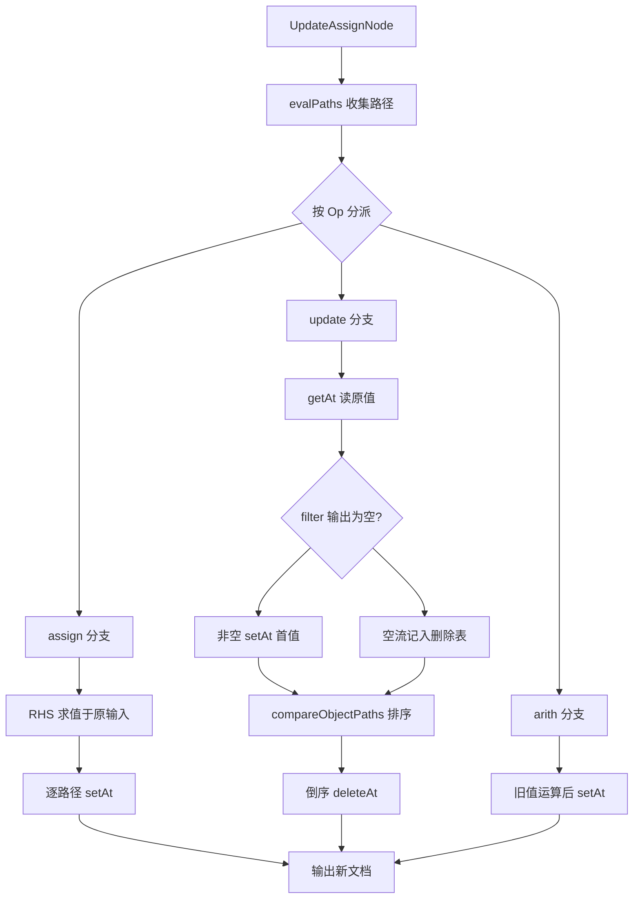
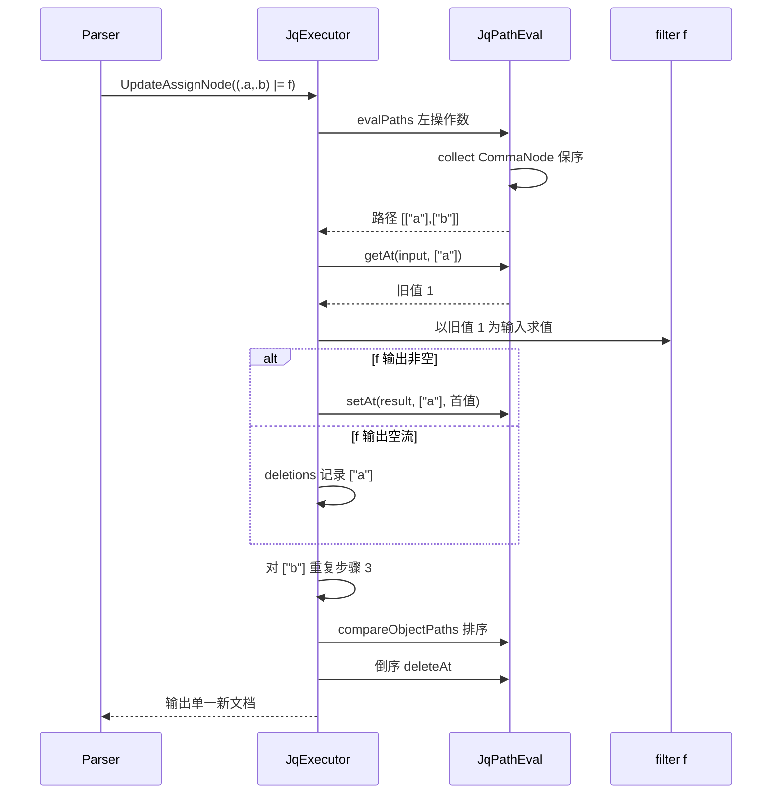

# 路径赋值：`|=` 如何改写文档

> 本文核心源文件（路径相对本页 `deepwiki-v3/flows/`）：
>
> - [../../src/main/java/io/nop/jq/jq/runtime/JqPathEval.java](../../src/main/java/io/nop/jq/jq/runtime/JqPathEval.java) — 路径求值与函数式更新（603 行，本页主体）
> - [../../src/main/java/io/nop/jq/jq/ast/UpdateAssignNode.java](../../src/main/java/io/nop/jq/jq/ast/UpdateAssignNode.java) — 赋值算子 AST 节点与 Op 枚举
> - [../../src/main/java/io/nop/jq/jq/runtime/JqExecutor.java](../../src/main/java/io/nop/jq/jq/runtime/JqExecutor.java) — `executeUpdateAssign` 三条执行路径
> - [../../src/main/java/io/nop/jq/jq/runtime/JqBuiltins.java](../../src/main/java/io/nop/jq/jq/runtime/JqBuiltins.java) — `path()`/`del()`/`getpath`/`setpath`/`delpaths` 共享同一套路径机制
> - [../../src/main/java/io/nop/jq/jq/runtime/JqEnvironment.java](../../src/main/java/io/nop/jq/jq/runtime/JqEnvironment.java) — 路径收集过程中的变量绑定与作用域
> - [../../src/main/java/io/nop/jq/jq/JqParser.java](../../src/main/java/io/nop/jq/jq/JqParser.java) — 赋值算子的解析与优先级
> - [../../src/test/resources/io/nop/jq/jq/jq-official.test](../../src/test/resources/io/nop/jq/jq/jq-official.test) — jq 官方行为基线（赋值/删除/路径用例）

`|=` 的实现不是"原地修改"，而是一条纯函数式的改写链：把赋值号左边的过滤表达式求值成一列**具体路径**（key/下标的列表），再逐路径读旧值、算新值，最后在不改变输入文档的前提下构造出新文档。求值与改写分属两类角色——[JqPathEval](../../src/main/java/io/nop/jq/jq/runtime/JqPathEval.java) 负责路径收集与 `getAt`/`setAt`/`deleteAt`，[JqExecutor](../../src/main/java/io/nop/jq/jq/runtime/JqExecutor.java) 负责按算子语义编排三者。求值模型本身（每表达式把输入映射为输出列表）见 [jq-runtime](../modules/jq-runtime.md)；术语定义见 [glossary](../glossary.md)。

## 机制定位：UpdateAssignNode 与三条执行路径

解析器在 `parseAssign` 中识别 8 种赋值 token，一一映射到 `UpdateAssignNode.Op`；赋值优先级介于 `//`（alternative）与 `or` 之间 [JqParser.java:104-126](../../src/main/java/io/nop/jq/jq/JqParser.java)。`Op` 枚举覆盖 `=`、`|=`、`+=`、`-=`、`*=`、`/=`、`%=`、`//=` 八种 [UpdateAssignNode.java:8-17](../../src/main/java/io/nop/jq/jq/ast/UpdateAssignNode.java)。节点只携带 `op`、左操作数 `path`（路径表达式）、右操作数 `value` 三个字段 [UpdateAssignNode.java:19-31](../../src/main/java/io/nop/jq/jq/ast/UpdateAssignNode.java)。

`JqExecutor` 持有一个绑定自身 `executeInto` 的 `JqPathEval` 实例 [JqExecutor.java:23](../../src/main/java/io/nop/jq/jq/runtime/JqExecutor.java)：路径收集过程中遇到的普通值表达式（下标表达式、条件表达式等）仍回调执行器按值求值。visitor 分发到 `visitUpdateAssign` 后进入 `executeUpdateAssign` [JqExecutor.java:427-430](../../src/main/java/io/nop/jq/jq/runtime/JqExecutor.java)。该方法第一步总是 `pathEval.evalPaths(n.path(), input, env)`，然后按算子分派 [JqExecutor.java:630-633](../../src/main/java/io/nop/jq/jq/runtime/JqExecutor.java)：

| 算子 | Op 枚举 | RHS 求值输入 | 旧值 | 写入规则 | 输出文档数 |
|------|---------|-------------|------|----------|-----------|
| `=` | ASSIGN | 原输入 | 不读 | 每个 RHS 输出值都全量覆盖所有路径 | 每个 RHS 输出一个 [JqExecutor.java:634-642](../../src/main/java/io/nop/jq/jq/runtime/JqExecutor.java) |
| `\|=` | UPDATE | 旧值（getpath 语义） | `getAt(原输入, path)` | 非空流取**首个**输出 setAt；空流记删除 | 恒 1 个 [JqExecutor.java:643-662](../../src/main/java/io/nop/jq/jq/runtime/JqExecutor.java) |
| `+=` 等 5 种 | ADD..MOD | 原输入 | `getAt(result, path)` | `arith(旧值, arg)` 后 setAt | 每个 RHS 输出一个 [JqExecutor.java:676-686](../../src/main/java/io/nop/jq/jq/runtime/JqExecutor.java) |
| `//=` | ALTERNATIVE | 原输入 | `getAt(result, path)` | 旧值为假时才写入 RHS 首值 | 恒 1 个 [JqExecutor.java:663-675](../../src/main/java/io/nop/jq/jq/runtime/JqExecutor.java) |

三条路径的差异本质是"以什么为基准读、以什么为基准写"：`=` 的 RHS 与路径互不耦合，直接对原输入反复 setAt；`|=` 的 RHS 以**原输入处**的旧值为输入（`getpath` 语义，注释见 [JqExecutor.java:644-646](../../src/main/java/io/nop/jq/jq/runtime/JqExecutor.java)），但写入累积到 `result` 上；算术族读取的是已累积的 `result`，保证多条路径读到彼此的前序更新。`arith` 只是转发到通用数学运算 [JqExecutor.java:690-699](../../src/main/java/io/nop/jq/jq/runtime/JqExecutor.java)。`path()`、`del()`、`setpath`/`delpaths` 内建函数复用同一个 `JqPathEval` 与 `setAt`/`deleteAt`，其中 `del` 同样采用"排序后倒序删除" [JqBuiltins.java:115-135](../../src/main/java/io/nop/jq/jq/runtime/JqBuiltins.java)。

> Sources: JqParser.java:104-126；UpdateAssignNode.java:8-31；JqExecutor.java:23, 427-430, 630-699；JqBuiltins.java:115-135

## collect：过滤表达式如何变成具体路径

`evalPaths` 以空前缀启动 `collect` 递归，路径按过滤表达式的**输出顺序**追加进列表 [JqPathEval.java:52-57](../../src/main/java/io/nop/jq/jq/runtime/JqPathEval.java)。`collect` 的通用形态是：维护 `prefix`（已确定的祖先键序列），每个产生路径的分支把新键追加到 `prefix` 副本后入列。各 AST 分支的产路径行为：

| AST 分支 | 产路径行为 | 行号 |
|----------|-----------|------|
| IdentityNode（`.`） | 当前 prefix 原样入列 | [JqPathEval.java:62-63](../../src/main/java/io/nop/jq/jq/runtime/JqPathEval.java) |
| PipeNode（`a \| b`） | 左段先求完整路径列表，逐条 `getAt` 下钻后用右段续接扩展 prefix | [JqPathEval.java:64-77](../../src/main/java/io/nop/jq/jq/runtime/JqPathEval.java) |
| CommaNode（`a,b`） | 左右两段先后以**同一 prefix** 收集，保逗号顺序 | [JqPathEval.java:78-80](../../src/main/java/io/nop/jq/jq/runtime/JqPathEval.java) |
| FieldAccessNode（`.a`） | prefix + 字段名（JqString）；容器非对象/非 null 抛 `Cannot index … with string` | [JqPathEval.java:81-102](../../src/main/java/io/nop/jq/jq/runtime/JqPathEval.java) |
| IndexAccessNode（`.[expr]`） | prefix + 键值；负数下标按当前数组长度归一为正下标 | [JqPathEval.java:103-137](../../src/main/java/io/nop/jq/jq/runtime/JqPathEval.java) |
| IteratorNode（`.[]`） | 数组产出全部下标、对象产出全部键；标量抛错；JqNull 静默贡献零路径 | [JqPathEval.java:138-169](../../src/main/java/io/nop/jq/jq/runtime/JqPathEval.java) |
| SliceNode（`.[2:4]`） | 产出 `SlicePath(from,to)` 记录，仅供 setAt/deleteAt 消费 | [JqPathEval.java:31-36, 170-189](../../src/main/java/io/nop/jq/jq/runtime/JqPathEval.java) |
| RecursiveDescentNode（`..`） | 根路径加全部后代路径，逐层递归展开 | [JqPathEval.java:216-218, 356-372](../../src/main/java/io/nop/jq/jq/runtime/JqPathEval.java) |
| FuncCallNode | `select`/`recurse`/`first`/`last`/`limit`/`getpath` 特判；用户函数下钻函数体；其余抛无效路径 | [JqPathEval.java:190-191, 259-316](../../src/main/java/io/nop/jq/jq/runtime/JqPathEval.java) |
| TryCatchNode | try 体抛错时只贡献零路径（路径级容错） | [JqPathEval.java:192-197](../../src/main/java/io/nop/jq/jq/runtime/JqPathEval.java) |
| IfThenElseNode | 条件按**值**求值，按真伪收集对应分支 | [JqPathEval.java:198-207](../../src/main/java/io/nop/jq/jq/runtime/JqPathEval.java) |
| BindNode（`E as $x`） | 值解构绑定后收集 body，绑定在 pushScope/popScope 间完成 | [JqPathEval.java:219-244](../../src/main/java/io/nop/jq/jq/runtime/JqPathEval.java) |
| EmptyNode | 零路径 | [JqPathEval.java:245-246](../../src/main/java/io/nop/jq/jq/runtime/JqPathEval.java) |
| 其余一切节点 | 按值求出首个输出，抛 `Invalid path expression with result …` | [JqPathEval.java:250-256](../../src/main/java/io/nop/jq/jq/runtime/JqPathEval.java) |

函数调用分支是唯一"理解内建函数语义"的地方：`select(c)` 真则把当前 prefix 认定为一条路径，否则不产路径 [JqPathEval.java:262-268](../../src/main/java/io/nop/jq/jq/runtime/JqPathEval.java)；`first`/`last` 无参时等价 `.[0]`/`.[-1]`，带参时下钻末位实参 [JqPathEval.java:274-284](../../src/main/java/io/nop/jq/jq/runtime/JqPathEval.java)；`getpath(p)` 把数组实参的元素直接展开为路径 [JqPathEval.java:285-295](../../src/main/java/io/nop/jq/jq/runtime/JqPathEval.java)。default 分支先按函数名+参数个数查用户定义，命中则以其闭包/定义环境继续 collect 函数体 [JqPathEval.java:296-306](../../src/main/java/io/nop/jq/jq/runtime/JqPathEval.java)——这就是官方用例 `def x: .[1,2]; x=10` 能工作的原因（对照 [jq-official.test:1139-1140](../../src/test/resources/io/nop/jq/jq/jq-official.test)）；查不到则按值执行并抛无效路径 [JqPathEval.java:307-313](../../src/main/java/io/nop/jq/jq/runtime/JqPathEval.java)。

BindNode 分支的变量绑定走 `JqDestructurer` + `env.pushScope()/bind()/popScope()` [JqPathEval.java:224-243](../../src/main/java/io/nop/jq/jq/runtime/JqPathEval.java)，依赖 [JqEnvironment](../../src/main/java/io/nop/jq/jq/runtime/JqEnvironment.java) 的词法作用域栈 [JqEnvironment.java:46-56](../../src/main/java/io/nop/jq/jq/runtime/JqEnvironment.java)。

**错误转嫁（describeNearAttempt）**：当管道左段不是合法路径表达式时，报错不以左段为名，而是借**右段消费者**的视角重述——这是 jq 的报错风格 [JqPathEval.java:318-322](../../src/main/java/io/nop/jq/jq/runtime/JqPathEval.java)。`describeNearAttempt` 按消费者类型生成消息：IndexAccess → `near attempt to access element X of Y`，IteratorNode → `near attempt to iterate through Y`，FieldAccess → `near attempt to access element "c" of Y` [JqPathEval.java:328-352](../../src/main/java/io/nop/jq/jq/runtime/JqPathEval.java)。开头的前缀检查保证只转嫁一次、内层操作的报错优先 [JqPathEval.java:326-327](../../src/main/java/io/nop/jq/jq/runtime/JqPathEval.java)。IndexAccess 分支在 collect 内另有等价的内联版本（对象侧失败时对键求值并直接抛 near-attempt 消息）[JqPathEval.java:108-118](../../src/main/java/io/nop/jq/jq/runtime/JqPathEval.java)。官方基线覆盖三种消息形态 [jq-official.test:972-988](../../src/test/resources/io/nop/jq/jq/jq-official.test)，`=` 与 `|=` 都能触发 [jq-official.test:1131-1137](../../src/test/resources/io/nop/jq/jq/jq-official.test)。

> Sources: JqPathEval.java:31-36, 52-57, 62-137, 138-197, 216-244, 245-256, 259-316, 318-354, 356-372；JqEnvironment.java:46-56；jq-official.test:972-988, 1131-1140

## 函数式更新：getAt → setAt / deleteAt

路径一旦确定，改写全部由三个静态方法以**复制-重建**方式完成，输入文档永不被修改。

`getAt` 沿路径逐键下钻：字符串键要求 JqObject、数字键要求数组（负下标先加长度归一），容器缺失或类型不符一律返回 NULL 而不报错 [JqPathEval.java:426-455](../../src/main/java/io/nop/jq/jq/runtime/JqPathEval.java)——这正是 `|=` 能对"读不到"的位置生效的前提，读出 null 交给 setAt 生长。

`setAt` 是 null 自动生长的所在：

- 空路径直接返回新值 [JqPathEval.java:459-460](../../src/main/java/io/nop/jq/jq/runtime/JqPathEval.java)；
- 字符串键 + JqNull：以 LinkedHashMap 新建 JqObject，递归 setAt 余下路径 [JqPathEval.java:470-474](../../src/main/java/io/nop/jq/jq/runtime/JqPathEval.java)；
- 字符串键 + JqObject：`obj.put` 生成新对象（写时复制）[JqPathEval.java:475-479](../../src/main/java/io/nop/jq/jq/runtime/JqPathEval.java)；
- 数字键 + JqNull：新建数组，`[0, idx)` 区间以 NULL 填充后放新值；负下标在 null 上直接抛 `Out of bounds negative array index` [JqPathEval.java:487-496](../../src/main/java/io/nop/jq/jq/runtime/JqPathEval.java)；
- 数字键 + 数组：负下标归一后不足长度补 NULL、越界一位即追加、否则原位替换 [JqPathEval.java:497-512](../../src/main/java/io/nop/jq/jq/runtime/JqPathEval.java)；
- NaN 下标显式拒绝 [JqPathEval.java:484-486](../../src/main/java/io/nop/jq/jq/runtime/JqPathEval.java)；对数字容器写字符串键/对字符串容器写数字键分别抛 `Cannot index … with string/number` [JqPathEval.java:480-481, 513-514](../../src/main/java/io/nop/jq/jq/runtime/JqPathEval.java)。

`deleteAt` 按 depth 递归：末键触发 `remove`，中途键递归进子容器，子容器缺失或下标越界时**原样返回**（删除是幂等的）[JqPathEval.java:519-549](../../src/main/java/io/nop/jq/jq/runtime/JqPathEval.java)。`SlicePath` 分量转交 `setSlice`：赋予数组则拼接替换区间，赋予 null 则删除区间，赋予非数组抛 `A slice of an array can only be assigned another array`，null 容器返回 NULL，其他容器抛 `Cannot update … slices` [JqPathEval.java:551-573](../../src/main/java/io/nop/jq/jq/runtime/JqPathEval.java)。

null 生长的官方基线：`.[2][3] = 1` 对 `[4]` 产出 `[4,null,[null,null,null,1]]`（数组间自动补 null 容器）[jq-official.test:1123-1129](../../src/test/resources/io/nop/jq/jq/jq-official.test)；`getpath(["a",0,"b"]) |= 5` 对 `null`/`{"a":null}` 等输入都长出 `{"a":[{"b":5}]}`，而对数字标量则抛 `Cannot index number with …` [jq-official.test:1098-1104](../../src/test/resources/io/nop/jq/jq/jq-official.test)。`JqNull` 是独立单例类而非 Java null，所以 setAt 的 `instanceof JqNull` 判定覆盖的是 jq 的 null 值 [JqValues.java:9-11](../../src/main/java/io/nop/jq/jq/runtime/JqValues.java)。

> Sources: JqPathEval.java:426-455, 457-517, 519-549, 551-573；JqValues.java:9-11；jq-official.test:1098-1104, 1123-1129

## 不变式与失败边界

**路径排序不变式与倒序原因**。`|=` 的删除统一走"先收集、再排序、后倒序删除"：`deletions.sort(JqPathEval::compareObjectPaths)` 后从表尾向前 `deleteAt` [JqExecutor.java:657-660](../../src/main/java/io/nop/jq/jq/runtime/JqExecutor.java)。原因有二：其一，数组按下标删除会使后续元素前移，只有先删大下标、后删小下标，未被删除的已记录下标才始终有效（源码注释：deletions are applied last so indices do not shift [JqExecutor.java:644-646](../../src/main/java/io/nop/jq/jq/runtime/JqExecutor.java)；`del` 内建同款注释 [JqBuiltins.java:130-132](../../src/main/java/io/nop/jq/jq/runtime/JqBuiltins.java)）；其二，`compareObjectPaths` 的平局规则是**长路径排前** [JqPathEval.java:594](../../src/main/java/io/nop/jq/jq/runtime/JqPathEval.java)，倒序迭代因此先删后代路径、后删祖先路径——`del(.foo[0], .foo, …)` 这类嵌套删除不会因父级先消失而落空 [jq-official.test:1026-1028](../../src/test/resources/io/nop/jq/jq/jq-official.test)。比较器逐段比较：双 SlicePath 比 `from`/`to`，双 JqValue 走 `JqOrdering.compare`，混合时 SlicePath 排在普通键之后 [JqPathEval.java:576-595](../../src/main/java/io/nop/jq/jq/runtime/JqPathEval.java)。

排序不变式的直接可观察证据是 `.foo[1,4,2,3] |= empty`：路径按逗号顺序收成 `[foo,1],[foo,4],[foo,2],[foo,3]`，排序后倒序删除 4→3→2→1，得到 `{"foo":[0,5]}` [JqExecutor.java:651-660](../../src/main/java/io/nop/jq/jq/runtime/JqExecutor.java) + [jq-official.test:1119-1121](../../src/test/resources/io/nop/jq/jq/jq-official.test)。同理 `(.[] | select(. >= 2)) |= empty` 把选中的下标整体删除 [jq-official.test:1111-1113](../../src/test/resources/io/nop/jq/jq/jq-official.test)，`.[] |= select(. % 2 == 0)` 中 select 为假的项按空流删除，留下 `[0,2,4]` [jq-official.test:1115-1117](../../src/test/resources/io/nop/jq/jq/jq-official.test)。

**空流即删除**是 `|=` 独有的语义：filter 对旧值求值产出空列表时不写入任何值，路径进入删除表 [JqExecutor.java:651-653](../../src/main/java/io/nop/jq/jq/runtime/JqExecutor.java)。`=` 没有这条规则——它的 RHS 输出多少个值就产出多少份文档 [JqExecutor.java:634-642](../../src/main/java/io/nop/jq/jq/runtime/JqExecutor.java)，`.[2:4] = ([], ["a","b"], …)` 的三个输出即为此形态 [jq-official.test:404-409](../../src/test/resources/io/nop/jq/jq/jq-official.test)。

**失败边界**汇总：

| 边界 | 行为 | 依据 |
|------|------|------|
| 非路径构造（如 `map(...)`）作路径 | 抛 `Invalid path expression with result …`，携带肇事值 | [JqPathEval.java:250-256](../../src/main/java/io/nop/jq/jq/runtime/JqPathEval.java) + [jq-official.test:972-975](../../src/test/resources/io/nop/jq/jq/jq-official.test) |
| 管道左段非法路径 | 经 describeNearAttempt 借右段消费者重述错误；已转嫁过则原样透传 | [JqPathEval.java:68-71, 326-352](../../src/main/java/io/nop/jq/jq/runtime/JqPathEval.java) |
| 迭代/索引标量 | `Cannot iterate over …` / `Cannot index … with string` | [JqPathEval.java:94-97, 165-168](../../src/main/java/io/nop/jq/jq/runtime/JqPathEval.java) |
| null 上负下标写入 / NaN 下标 | `Out of bounds negative array index` / `Cannot set array element at NaN index` | [JqPathEval.java:484-496](../../src/main/java/io/nop/jq/jq/runtime/JqPathEval.java) |
| 对标量容器写入 | `Cannot index … with string/number`（getpath 用例实测） | [JqPathEval.java:480-481, 513-514](../../src/main/java/io/nop/jq/jq/runtime/JqPathEval.java) + [jq-official.test:1098-1104](../../src/test/resources/io/nop/jq/jq/jq-official.test) |
| `|=` filter 多输出 | 只采用首个输出，其余丢弃 | [JqExecutor.java:650-654](../../src/main/java/io/nop/jq/jq/runtime/JqExecutor.java) + [jq-official.test:1090-1092](../../src/test/resources/io/nop/jq/jq/jq-official.test) |

> Sources: JqExecutor.java:634-662；JqPathEval.java:68-71, 94-97, 165-168, 250-256, 326-352, 484-496, 576-595；JqBuiltins.java:130-132；jq-official.test:404-409, 972-975, 1026-1028, 1090-1092, 1098-1104, 1111-1121

## 求值顺序走查：`(.a,.b) |= f`

把 GATHER 目标问题完整串起来——输入 `{"a":1,"b":2}`，执行 `(.a,.b) |= f`：

1. **解析**：`parseAssign` 识别 `|=`，左操作数是 CommaNode，产出 `UpdateAssignNode(UPDATE, (.a,.b), f)` [JqParser.java:104-126](../../src/main/java/io/nop/jq/jq/JqParser.java) + [UpdateAssignNode.java:8-17](../../src/main/java/io/nop/jq/jq/ast/UpdateAssignNode.java)。
2. **收集路径**：`evalPaths` 进入 `collect(CommaNode)`，左段 `collect(.a)` 以空前缀产出 `["a"]`，右段 `collect(.b)` 以同一空前缀产出 `["b"]`——逗号保序，两路径按此顺序入列 [JqPathEval.java:78-80](../../src/main/java/io/nop/jq/jq/runtime/JqPathEval.java)。
3. **逐路径更新（保序遍历）**：对 `["a"]`：`getAt(input, ["a"])` 从**原输入**读出旧值 1 [JqExecutor.java:649](../../src/main/java/io/nop/jq/jq/runtime/JqExecutor.java)；`f(1)` 非空则 `setAt(result, ["a"], 首个输出)`，写入累积副本 [JqExecutor.java:654](../../src/main/java/io/nop/jq/jq/runtime/JqExecutor.java)；为空则 `["a"]` 进删除表 [JqExecutor.java:651-653](../../src/main/java/io/nop/jq/jq/runtime/JqExecutor.java)。随后对 `["b"]` 重复，注意此时 `result` 已含对 `a` 的更新 [JqExecutor.java:646-655](../../src/main/java/io/nop/jq/jq/runtime/JqExecutor.java)。
4. **收尾**：若无删除，直接输出 result（恒一份文档）[JqExecutor.java:661](../../src/main/java/io/nop/jq/jq/runtime/JqExecutor.java)；若有删除，排序后倒序删除再输出 [JqExecutor.java:657-660](../../src/main/java/io/nop/jq/jq/runtime/JqExecutor.java)。

递归下降与用户函数可以叠加在同一条链上：`(.. | select(type == "object" and has("b") …)|.b) |= .[0]` 由 RecursiveDescent 展开全部后代路径、select 逐位置筛选、`.[0]` 收窄，一次 `|=` 完成多处改写 [jq-official.test:1778-1780](../../src/test/resources/io/nop/jq/jq/jq-official.test)；`def inc(x): x |= .+1; inc(.[].a)` 则经 collectCall 的用户函数分支把路径收集下钻进函数体 [JqPathEval.java:296-306](../../src/main/java/io/nop/jq/jq/runtime/JqPathEval.java) + [jq-official.test:1094-1096](../../src/test/resources/io/nop/jq/jq/jq-official.test)。

> Sources: JqParser.java:104-126；UpdateAssignNode.java:8-17；JqPathEval.java:78-80, 296-306；JqExecutor.java:643-662；jq-official.test:1094-1096, 1778-1780

## Sources

- [../../src/main/java/io/nop/jq/jq/runtime/JqPathEval.java:24-57](../../src/main/java/io/nop/jq/jq/runtime/JqPathEval.java) 类职责、SlicePath、NodeExecutor、evalPaths 入口
- [../../src/main/java/io/nop/jq/jq/runtime/JqPathEval.java:59-257](../../src/main/java/io/nop/jq/jq/runtime/JqPathEval.java) collect 全分支
- [../../src/main/java/io/nop/jq/jq/runtime/JqPathEval.java:259-354](../../src/main/java/io/nop/jq/jq/runtime/JqPathEval.java) collectCall 特判与 describeNearAttempt
- [../../src/main/java/io/nop/jq/jq/runtime/JqPathEval.java:426-595](../../src/main/java/io/nop/jq/jq/runtime/JqPathEval.java) getAt/setAt/deleteAt/setSlice/compareObjectPaths
- [../../src/main/java/io/nop/jq/jq/ast/UpdateAssignNode.java:8-31](../../src/main/java/io/nop/jq/jq/ast/UpdateAssignNode.java) Op 枚举与节点字段
- [../../src/main/java/io/nop/jq/jq/runtime/JqExecutor.java:630-699](../../src/main/java/io/nop/jq/jq/runtime/JqExecutor.java) executeUpdateAssign 与 arith
- [../../src/main/java/io/nop/jq/jq/runtime/JqBuiltins.java:115-135](../../src/main/java/io/nop/jq/jq/runtime/JqBuiltins.java) path()/del() 复用同一机制
- [../../src/main/java/io/nop/jq/jq/runtime/JqEnvironment.java:46-56](../../src/main/java/io/nop/jq/jq/runtime/JqEnvironment.java) 作用域栈（BindNode 分支依赖）
- [../../src/main/java/io/nop/jq/jq/JqParser.java:104-126](../../src/main/java/io/nop/jq/jq/JqParser.java) 赋值解析与 Op 映射
- [../../src/main/java/io/nop/jq/jq/runtime/JqValues.java:9-11](../../src/main/java/io/nop/jq/jq/runtime/JqValues.java) JqNull 单例
- [../../src/test/resources/io/nop/jq/jq/jq-official.test:1060-1150](../../src/test/resources/io/nop/jq/jq/jq-official.test) 赋值/删除/错误转嫁官方基线
- [../../src/test/resources/io/nop/jq/jq/jq-official.test:972-988](../../src/test/resources/io/nop/jq/jq/jq-official.test) path() 三种 near-attempt 消息
