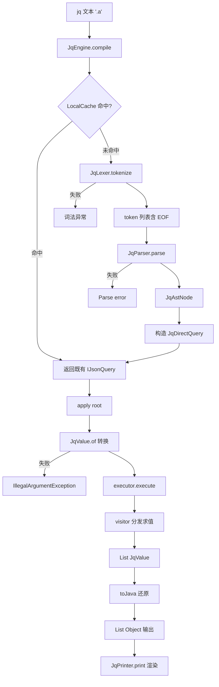

# 查询管线：一条 jq 程序从文本到输出流

> 机制章：追踪一条 jq 程序文本（以 `jq '.a' file` 的等价调用为例）从字符串到输出流的端到端旅程。每一步给出输入、输出与失败时抛出的异常。
>
> 源文件基准（仓库根相对路径）：
>
> - [nop-kernel/nop-jq/src/main/java/io/nop/jq/jq/JqEngine.java](../../src/main/java/io/nop/jq/jq/JqEngine.java)
> - [nop-kernel/nop-jq/src/main/java/io/nop/jq/jq/JqLexer.java](../../src/main/java/io/nop/jq/jq/JqLexer.java)
> - [nop-kernel/nop-jq/src/main/java/io/nop/jq/jq/JqParser.java](../../src/main/java/io/nop/jq/jq/JqParser.java)
> - [nop-kernel/nop-jq/src/main/java/io/nop/jq/jq/JqDirectQuery.java](../../src/main/java/io/nop/jq/jq/JqDirectQuery.java)
> - [nop-kernel/nop-jq/src/main/java/io/nop/jq/jq/IJsonQuery.java](../../src/main/java/io/nop/jq/jq/IJsonQuery.java)
> - [nop-kernel/nop-jq/src/main/java/io/nop/jq/jq/runtime/JqExecutor.java](../../src/main/java/io/nop/jq/jq/runtime/JqExecutor.java)
> - [nop-kernel/nop-jq/src/main/java/io/nop/jq/jq/runtime/JqPrinter.java](../../src/main/java/io/nop/jq/jq/runtime/JqPrinter.java)
>
> 辅证：[JqValue.java](../../src/main/java/io/nop/jq/jq/runtime/JqValue.java)、[JqValues.java](../../src/main/java/io/nop/jq/jq/runtime/JqValues.java)、[JqEnvironment.java](../../src/main/java/io/nop/jq/jq/runtime/JqEnvironment.java)、[JqShortCircuitList.java](../../src/main/java/io/nop/jq/jq/runtime/JqShortCircuitList.java)、[JqRuntimeException.java](../../src/main/java/io/nop/jq/jq/runtime/JqRuntimeException.java)、[JqToken.java](../../src/main/java/io/nop/jq/jq/JqToken.java)、[JqAstNode.java](../../src/main/java/io/nop/jq/jq/ast/JqAstNode.java)

## 全链路一览

管线共八个阶段，前四段是编译期（文本 → token → AST → 可执行查询对象），后四段是求值期（Java 对象 → JqValue → 输出流 → 文本）。编译产物被静态缓存，求值每次调用独立进行。



| 步骤 | 输入 | 输出 | 失败模式 |
|------|------|------|---------|
| 1. `JqEngine.compile` | jq 表达式字符串 | `IJsonQuery`（命中缓存则直接返回） | loader 异常不被捕获，原样上抛（JqEngine.java:22-24） |
| 2. `JqLexer.tokenize` | 原始表达式文本 | `List<JqToken>`，末尾追加 EOF 哨兵 | `JqRuntimeException`：非法字符 / 未闭合字符串 / 未闭合插值（JqLexer.java:170-173、229-231、255-257） |
| 3. `JqParser.parse` | `List<JqToken>` | `JqAstNode`（sealed，39 种节点） | `JqRuntimeException`，消息前缀 `Parse error:`（JqParser.java:1036-1047、469-472） |
| 4. `new JqDirectQuery` | 表达式 + AST | 绑定专属 `JqExecutor` 的查询对象 | 无，纯字段赋值（JqDirectQuery.java:19-23） |
| 5. `JqValue.of(root)` | 任意 Java 对象 | `JqValue` 值树 | `IllegalArgumentException`：不支持的类型（JqValue.java:37） |
| 6. `executor.execute` | AST + `JqValue` + `JqEnvironment` | `List<JqValue>` 输出流 | `JqRuntimeException`（携带 errorValue，jq 层 try/catch 可捕）（JqExecutor.java:34-38、861-866） |
| 7. `v.toJava()` | `List<JqValue>` | `List<Object>` | 无，结构还原（JqDirectQuery.java:30-34） |
| 8. `JqPrinter.print` | `JqValue` | 紧凑 JSON 文本 | 无，未知类型回退 `toString`（JqPrinter.java:16-20、51-53） |

> Sources: JqEngine.java:14-33; JqLexer.java:23-179; JqParser.java:29-33; JqDirectQuery.java:25-35; JqValue.java:15-38; JqExecutor.java:34-38; JqPrinter.java:16-20

## 编译入口：JqEngine 与编译缓存

`JqEngine` 是无状态门面：`compile(expr)` 只有一行 `cache.get(expr)`，全部编译逻辑在缓存 loader `doCompile` 里（JqEngine.java:22-32）。

| 维度 | 行为 | 依据 |
|------|------|------|
| 缓存实例 | 静态 `LocalCache`，名 `"nop-jq-compile"` | JqEngine.java:16-17 |
| 键 | 表达式原文 `String`，整个表达式一个键 | JqEngine.java:22-24 |
| 值 | `IJsonQuery`（实际为 `JqDirectQuery`，内含 AST 与专属 `JqExecutor`） | JqDirectQuery.java:19-23 |
| 容量上限 | `DEFAULT_CACHE_SIZE = 1000` | JqEngine.java:15-17 |
| 加载器 | `JqEngine::doCompile`：tokenize → parse → 构造 | JqEngine.java:17、26-32 |
| 命中收益 | 跳过 tokenize 与 parse；同一表达式复用同一 AST 与 executor | JqEngine.java:22-24 |
| 编译失败 | 异常从 `cache.get` 直接抛出，`JqEngine` 无 try/catch | JqEngine.java:22-24 |
| 共享安全性 | 每次 `apply` 新建 `JqEnvironment`，每次 `executeInto` 新建匿名 visitor，共享 executor 可重入 | JqDirectQuery.java:26-29；JqExecutor.java:45-47 |

`IJsonQuery` 契约：`apply` 返回全部输出、`applyOne` 只取第一个输出（空流返回 null）、`getAst` 暴露 AST 供调试、`isDirectExecution` 恒为 true（IJsonQuery.java:14-34；JqDirectQuery.java:79-81）。

> Sources: JqEngine.java:14-33; JqDirectQuery.java:14-35; IJsonQuery.java:10-41; JqExecutor.java:40-47

## 词法：JqLexer.tokenize

单遍扫描：主循环按当前字符 switch 分派，产出带源位置的 token，扫描结束后追加 `EOF` 哨兵（JqLexer.java:23-178）。token 类型共 77 种，定义在 JqTokenType.java:6-93。

词法层的三条关键规则：

1. **双字符算符优先消歧**：`|=` 与 `|`、`..` 与 `.`、`//` 与 `/`（及 `//=`）、`?//` 与 `?`、`==` 与 `=`、`!=`、`>=`、`<=`、各算术 `=` 变体，均在单字符分支内用 `match`/`lookAhead` 就地判定（JqLexer.java:34-161）。裸 `!` 后面不是 `=` 直接抛异常（JqLexer.java:139-145）。
2. **字符串 token 携带原文**：`readString` 返回引号之间的 raw 文本，不解码转义；`\(` 插值按括号深度配对原样吞入，嵌套引号不终止字符串。转义解码与插值拆分全部推迟到语法层，因为 raw 文本必须保留插值内的引号和括号结构（JqLexer.java:8-14、207-259）。
3. **数字识别含回滚**：整数/小数之外还尝试指数部分，`e` 后不是数字则回退 `pos` 按原样结束；`isFloat` 决定产出 `FLOAT` 还是 `INTEGER` token（JqLexer.java:273-300）。`.5` 这类无整数部分的小数在 `.` 分支里识别为数字（JqLexer.java:42-53）。

标识符与关键字：`$` 开头的变量和普通标识符走同一条 `readIdent`（字母数字下划线），随后 `keywordType` 对 37 个关键字（`if/then/reduce/foreach/label/def/...`）映射为专用 token 类型，其余归 `IDENT`（JqLexer.java:163、302-310、317-358）。

失败模式：非空白且无法归类的字符抛 `Unexpected character '<c>' in jq expression at position <n>`；引号未闭合抛 `Unterminated string starting at position <n>`；`\(` 括号不配对抛 `Unterminated string interpolation starting at position <n>`（JqLexer.java:170-173、229-231、255-257）。

> Sources: JqLexer.java:8-14; JqLexer.java:23-178; JqLexer.java:207-300; JqLexer.java:317-358; JqToken.java:6-15

## 语法：JqParser 的 12 层优先级链

递归下降解析器，入口 `parse()` 调 `parsePipe` 后强制 `expect(EOF)`，多余 token 即报错（JqParser.java:29-33）。优先级链从低到高共 12 层，与类注释声明的 jq 文法一致（JqParser.java:9-19）：

| 层 | 方法 | 算符 | 结合性 | 行号 |
|----|------|------|--------|------|
| 1 | `parsePipe` | `\|` | 左 | 35-58 |
| 2 | `parseComma` | `,` | 左 | 81-96 |
| 3 | `parseAlternative` | `//` | 右（递归调用自身） | 98-106 |
| 4 | `parseAssign` | `= \|=` `+=` `-=` `*=` `/=` `%=` `//=` | 非结合，右操作数取 alternative 层 | 108-128 |
| 5 | `parseOr` | `or` | 左 | 130-138 |
| 6 | `parseAnd` | `and` | 左 | 140-148 |
| 7 | `parseComparison` | `== != > >= < <=` | 非结合（单个 if，无循环） | 150-169 |
| 8 | `parseAddSub` | `+ -` | 左 | 171-180 |
| 9 | `parseMulDiv` | `* / %` | 左 | 182-195 |
| 10 | `parseUnary` | 一元 `-` | — | 197-203 |
| 11 | `parsePostfix` | `?` `.foo` `."foo"` `[...]` `(...)` 调用 | 后缀循环 | 205-248 |
| 12 | `parsePrimary` | 字面量、`.`、`..`、`()`、`[]`、`{}`、`@`、关键字结构 | — | 304-475 |

关键分支语义：

- **`def` 与 `label` 挂在管道层**：`def f: BODY; REST` 解析为 `PipeNode(FuncDef, rest)`，定义的作用域覆盖其后整条管道；`label $x | REST` 同理产出 `LabelNode`（JqParser.java:35-49）。
- **`as` 绑定在 term 层收口**：`Term as $x | rest` 的 body 由 `parsePipe` 解析，即绑定延伸到外层管道结束（JqParser.java:17-19、205-216）。
- **try/catch 在 alternative 层**：`try` 的主体和 `catch` 处理器都按 `parseAlternative` 解析，随后的逗号与管道落在 try 之外（JqParser.java:362-373）。
- **对象构造值不吞逗号**：`{a: ...}` 的值按 `parseAlternative` 解析，保证 `,` 分隔的下一个字段不被吸入值表达式（JqParser.java:856-859）。
- **字符串收尾在语法层**：无插值的 raw 串直接解码转义（含 `\uXXXX` 代理对合成）；含 `\(...)` 的拆成字面量与子表达式片段，子表达式递归走完整的 lexer+parser，产出 `StringInterpNode`（JqParser.java:501-519、525-569、587-595）。
- **关键字双面性**：`length/keys/type/error/env` 等可作字段名（`.length`）或裸内建调用，但 `as/if/then/and` 等保留语法词被排除，避免 `. as $x` 被误读为字段访问（JqParser.java:1000-1011）。

失败模式：`expect` 不匹配抛 `Expected <TYPE> but got <TYPE> ('<text>')`，经 `error()` 包装为 `Parse error: <msg> at position <pos>`；`module`/`import` 显式不支持；`peek` 落到 EOF 哨兵时 `expect` 自然失败（JqParser.java:469-472、1032-1047）。

> Sources: JqParser.java:9-19; JqParser.java:35-58; JqParser.java:98-128; JqParser.java:304-475; JqParser.java:501-595; JqParser.java:1032-1047

## 求值：JqDirectQuery 绑定专属 JqExecutor

**构造期绑定**。`JqDirectQuery` 构造时 new 一个专属 `JqExecutor` 存入 final 字段，AST 与表达式一并持有（JqDirectQuery.java:19-23）。

**边界转换**。`apply(root)` 第一步 `JqValue.of(root)` 把 Java 世界折叠进封闭的 jq 值世界：只接受 null、Boolean、Number、String、List、Map 和已转换的 JqValue，其余类型抛 `IllegalArgumentException`；Map 用 LinkedHashMap 保持键序（JqValue.java:15-38）。随后新建 `JqEnvironment`（每次调用独立的变量作用域与预算计数），调 `executor.execute` 得到 `List<JqValue>`，逐个 `toJava()` 还原为 `List<Object>`（JqDirectQuery.java:26-35）。`toJava` 的还原规则：JqNull→null、JqBoolean→boolean、JqNumber→原 Number、JqString→String、JqArray→`List<Object>`、JqObject→`Map<String,Object>`、函数值返回自身（JqValues.java:12、25、44、78、109-113、153-159、173）。

**执行入口与 visitor 分发**。`execute` 把 `executeInto` 包进临时 ArrayList；`executeInto` 先检查输出汇是否已被懒算子标记停止，然后对根节点 `accept` 一个**每次调用现建的匿名 `JqAstVisitor`**——39 个 visit 方法一一对应 sealed `JqAstNode` 的 39 种节点，visitor 闭包捕获 `input/env/outputs`，每调用重建保证 `executeInto` 可重入、线程安全（JqExecutor.java:34-47；JqAstNode.java:7-25；JqAstVisitor.java:5-45）。

**管道不变式**。`visitPipe` 的求值模型：**左端先完整求值为临时列表，右端对左端每个输出逐一求值并把结果写入共享 outputs**（JqExecutor.java:148-151）。这是整个执行器的核心语义；exception 是唯一的控制流旁路。`def` 特例：左端是 `FuncDefNode` 时 fork 子环境、按 `name/arity` 注册 `JqFunctionDef`（捕获定义处环境，实现词法作用域），右端在子环境中一次求值（JqExecutor.java:138-147）。

**控制流用异常近似回溯**（JqExecutor.java:13-18 类注释）：

- `label $x | body` / `break $x`：`visitBreak` 抛 `JqBreakException`，`visitLabel` 按标签名捕获，标签不符则继续上抛；break 前已产出的输出保留（JqExecutor.java:260-274）。
- 懒算子 `limit/first/any/all/isempty`：`JqBuiltins` 以 `JqShortCircuitList` 作为生产者输出汇，每 `add` 一个元素就测停止谓词，满足即抛 `JqStopException` 提前结束生产者；`executeInto` 开头的 `stopRequested` 检查让嵌套求值在进入子表达式前就停止（JqExecutor.java:40-44；JqShortCircuitList.java:13-50；JqBuiltins.java:29-51）。
- try/catch 只捕 `JqRuntimeException`，`JqBreakException`/`JqStopException` 原样穿透；捕获后以 `e.errorValue()` 作为 catch 表达式的输入（JqExecutor.java:246-258；JqRuntimeException.java:25-28）。`//` 算子同理：左端错误被吞掉、非真值时回落右端（JqExecutor.java:405-425）。

**资源预算**。`JqEnvironment` 携带计数：用户函数调用深度上限 `MAX_CALL_DEPTH = 2000`（`enterCall` 超限抛异常），累计输出量上限 `MAX_OUTPUT_COUNT = 1,000,000`（`checkOutputLimit` 在数组构造、foreach、递归下降、while 等无界路径上调用）（JqEnvironment.java:15-18、96-113；JqExecutor.java:322、361、435、551-559）。

> Sources: JqDirectQuery.java:19-35; JqExecutor.java:10-47; JqExecutor.java:137-158; JqExecutor.java:246-274; JqShortCircuitList.java:13-50; JqEnvironment.java:94-113; JqValues.java:109-159

## 端到端时序：一次 `jq '.a' file` 的等价调用

模块内没有 CLI main；`jq '.a' file` 的等价调用是：调用方自行读文件得到 root 对象，然后 `JqEngine.compile(".a")` + `query.apply(root)`，输出文本用 `JqPrinter.print` 渲染（全仓 grep 无 `public static void main`；JqEngine.java:22-24 是唯一编译入口）。

```mermaid
sequenceDiagram
    participant App as 调用方
    participant Eng as JqEngine
    participant Cache as LocalCache
    participant Lex as JqLexer
    participant Par as JqParser
    participant Qry as JqDirectQuery
    participant Exe as JqExecutor

    App->>Eng: compile ".a"
    Eng->>Cache: get ".a"
    alt 缓存命中
        Cache-->>Eng: 既有 IJsonQuery
    else 首次编译
        Cache->>Lex: tokenize
        Lex-->>Cache: token 列表含 EOF
        Cache->>Par: parse
        Par-->>Cache: JqAstNode
        Cache->>Qry: new 绑定 executor
        Qry-->>Eng: IJsonQuery
    end
    Eng-->>App: IJsonQuery
    App->>Qry: apply root
    Qry->>Qry: JqValue.of 边界转换
    Qry->>Exe: execute ast input env
    Exe->>Exe: visitFieldAccess 加 getField
    Exe-->>Qry: List JqValue
    Qry->>Qry: 逐个 toJava
    Qry-->>App: List Object
    App->>App: JqPrinter.print 渲染
```

对 `'.a'` 的具体求值：token 流为 `DOT`、`IDENT("a")`、`EOF`；`parseDotPrimary` 消费 `.` 后看到 `IDENT`，产出 `FieldAccessNode("a", null)`（JqParser.java:477-498）。执行期 `visitFieldAccess` 走无显式对象分支，对 `input` 调 `getField`：键存在返回对应值，键不存在返回 `JqValue.NULL`（区别于报错），对象之外的类型才抛 `Cannot index <type> with string`（JqExecutor.java:73-82、479-488）。

> Sources: JqEngine.java:22-32; JqParser.java:477-498; JqExecutor.java:73-82; JqExecutor.java:479-488

## 输出端：toJava 与 JqPrinter

`apply` 的返回值是 `List<Object>`；文本化由 `JqPrinter` 承担——它是静态工具类，供 `tostring`/`tojson`/字符串插值/错误消息以及调用方最终渲染共用（JqPrinter.java:7-11 类注释）。

打印规则（`print` → `append` 递归）：

- **数字**：Integer/Long 原样；NaN 打成 `null`；±Infinity 收敛到 ±`1.7976931348623157e+308`；整数值 double 打成不带小数点的 long；其余 double 走 `formatDouble`（最短表示，指数小写 e 带显式符号，剥掉尾随 `.0`）（JqPrinter.java:56-96）。
- **字符串**：最小转义——只处理 `"` `\` 和控制字符，控制字符用 `\uXXXX`（JqPrinter.java:98-121）。
- **tostring 语义**：字符串保持原样不加速引号，其余类型等同 print（JqPrinter.java:123-128）。
- **错误消息渲染**：`printTruncated` 对超过 11 字符的值截断加 `...`，对齐 jq 官方错误格式（JqPrinter.java:78-82）。

> Sources: JqPrinter.java:7-20; JqPrinter.java:56-96; JqPrinter.java:78-82; JqPrinter.java:123-128

## 失败路径：编译错与运行错

全链路只有两个异常检查点，其余都是 `JqRuntimeException` 单轨：

| 阶段 | 异常类型 | 典型消息 | 可恢复性 | 依据 |
|------|---------|---------|---------|------|
| 词法 | `JqRuntimeException` | `Unexpected character '!' in jq expression` / `Unterminated string ...` | 修正表达式后重新 compile | JqLexer.java:139-145、170-173、229-231 |
| 语法 | `JqRuntimeException` | `Parse error: Expected THEN but got ... at position n` | 同上 | JqParser.java:1036-1047 |
| 边界转换 | `IllegalArgumentException` | `Cannot convert <class> to JqValue` | 调用方传入可转换类型 | JqValue.java:37 |
| 运行期类型错 | `JqRuntimeException`（带 errorValue） | `Cannot index string with number` / `... cannot be added` / 除零 | jq 层 try/catch 可捕，`?` 与 `//` 可吞 | JqExecutor.java:479-519、944-947、1001-1011、246-258、405-425 |
| 未定义符号 | `JqRuntimeException` | `$x is not defined` / `f/1 is not defined` / 参数个数不符 | 同上 | JqEnvironment.java:59-66；JqExecutor.java:754、765-768 |
| error 内建 | `JqRuntimeException` | 消息即错误值本身 | catch 后以 errorValue 为输入 | JqExecutor.java:381-388、861-866；JqRuntimeException.java:25-28 |
| 资源预算 | `JqRuntimeException` | `Call depth limit exceeded (max=2000)` / `Output count limit exceeded (max=1000000)` | 属于程序性失败，不可用 try/catch 合法绕过预算 | JqEnvironment.java:96-113 |
| 控制流 | `JqBreakException` / `JqStopException` | — | 仅 label/懒算子内部消化，try/catch 穿透，不逃逸出 execute | JqExecutor.java:250-251、260-274；JqStopException.java:4-7 |

两点补充语义：其一，`apply` 把任何 `RuntimeException` 原样抛给调用方；`applyPartial` 则把运行错折叠为 `errored` 标志、保留错误前已产出的输出（对齐官方测试 harness 的容忍语义），但 `OutOfMemoryError`/`StackOverflowError` 重抛（JqDirectQuery.java:50-66）。其二，编译失败不产生可缓存的查询对象——loader 抛异常即本次 get 失败，下次同表达式会再次走完整编译（JqEngine.java:22-24 无任何失败缓存逻辑）。

> Sources: JqLexer.java:139-173; JqParser.java:1032-1047; JqValue.java:37; JqExecutor.java:246-274; JqEnvironment.java:94-113; JqDirectQuery.java:50-66

## 相关页面

- 求值模型、内建函数库与路径赋值的展开：[jq-runtime 求值细节](../modules/jq-runtime.md)
- 术语定义与易混划界：[../glossary.md](../glossary.md)

## Sources

- [JqEngine.java:14-33](/nop-kernel/nop-jq/src/main/java/io/nop/jq/jq/JqEngine.java#L14-L33)
- [JqLexer.java:8-359](/nop-kernel/nop-jq/src/main/java/io/nop/jq/jq/JqLexer.java#L8-L359)
- [JqParser.java:9-19](/nop-kernel/nop-jq/src/main/java/io/nop/jq/jq/JqParser.java#L9-L19)
- [JqParser.java:29-58](/nop-kernel/nop-jq/src/main/java/io/nop/jq/jq/JqParser.java#L29-L58)
- [JqParser.java:98-248](/nop-kernel/nop-jq/src/main/java/io/nop/jq/jq/JqParser.java#L98-L248)
- [JqParser.java:304-475](/nop-kernel/nop-jq/src/main/java/io/nop/jq/jq/JqParser.java#L304-L475)
- [JqParser.java:501-595](/nop-kernel/nop-jq/src/main/java/io/nop/jq/jq/JqParser.java#L501-L595)
- [JqParser.java:856-859](/nop-kernel/nop-jq/src/main/java/io/nop/jq/jq/JqParser.java#L856-L859)
- [JqParser.java:1000-1011](/nop-kernel/nop-jq/src/main/java/io/nop/jq/jq/JqParser.java#L1000-L1011)
- [JqParser.java:1032-1047](/nop-kernel/nop-jq/src/main/java/io/nop/jq/jq/JqParser.java#L1032-L1047)
- [JqDirectQuery.java:19-35](/nop-kernel/nop-jq/src/main/java/io/nop/jq/jq/JqDirectQuery.java#L19-L35)
- [JqDirectQuery.java:50-66](/nop-kernel/nop-jq/src/main/java/io/nop/jq/jq/JqDirectQuery.java#L50-L66)
- [IJsonQuery.java:10-41](/nop-kernel/nop-jq/src/main/java/io/nop/jq/jq/IJsonQuery.java#L10-L41)
- [JqExecutor.java:10-47](/nop-kernel/nop-jq/src/main/java/io/nop/jq/jq/runtime/JqExecutor.java#L10-L47)
- [JqExecutor.java:73-82](/nop-kernel/nop-jq/src/main/java/io/nop/jq/jq/runtime/JqExecutor.java#L73-L82)
- [JqExecutor.java:137-158](/nop-kernel/nop-jq/src/main/java/io/nop/jq/jq/runtime/JqExecutor.java#L137-L158)
- [JqExecutor.java:246-274](/nop-kernel/nop-jq/src/main/java/io/nop/jq/jq/runtime/JqExecutor.java#L246-L274)
- [JqExecutor.java:405-425](/nop-kernel/nop-jq/src/main/java/io/nop/jq/jq/runtime/JqExecutor.java#L405-L425)
- [JqExecutor.java:479-488](/nop-kernel/nop-jq/src/main/java/io/nop/jq/jq/runtime/JqExecutor.java#L479-L488)
- [JqExecutor.java:754-792](/nop-kernel/nop-jq/src/main/java/io/nop/jq/jq/runtime/JqExecutor.java#L754-L792)
- [JqExecutor.java:861-866](/nop-kernel/nop-jq/src/main/java/io/nop/jq/jq/runtime/JqExecutor.java#L861-L866)
- [JqExecutor.java:1001-1011](/nop-kernel/nop-jq/src/main/java/io/nop/jq/jq/runtime/JqExecutor.java#L1001-L1011)
- [JqPrinter.java:7-20](/nop-kernel/nop-jq/src/main/java/io/nop/jq/jq/runtime/JqPrinter.java#L7-L20)
- [JqPrinter.java:56-96](/nop-kernel/nop-jq/src/main/java/io/nop/jq/jq/runtime/JqPrinter.java#L56-L96)
- [JqPrinter.java:78-82](/nop-kernel/nop-jq/src/main/java/io/nop/jq/jq/runtime/JqPrinter.java#L78-L82)
- [JqPrinter.java:98-128](/nop-kernel/nop-jq/src/main/java/io/nop/jq/jq/runtime/JqPrinter.java#L98-L128)
- [JqValue.java:15-38](/nop-kernel/nop-jq/src/main/java/io/nop/jq/jq/runtime/JqValue.java#L15-L38)
- [JqValues.java:109-159](/nop-kernel/nop-jq/src/main/java/io/nop/jq/jq/runtime/JqValues.java#L109-L159)
- [JqEnvironment.java:15-18](/nop-kernel/nop-jq/src/main/java/io/nop/jq/jq/runtime/JqEnvironment.java#L15-L18)
- [JqEnvironment.java:59-66](/nop-kernel/nop-jq/src/main/java/io/nop/jq/jq/runtime/JqEnvironment.java#L59-L66)
- [JqEnvironment.java:94-113](/nop-kernel/nop-jq/src/main/java/io/nop/jq/jq/runtime/JqEnvironment.java#L94-L113)
- [JqShortCircuitList.java:13-50](/nop-kernel/nop-jq/src/main/java/io/nop/jq/jq/runtime/JqShortCircuitList.java#L13-L50)
- [JqRuntimeException.java:25-28](/nop-kernel/nop-jq/src/main/java/io/nop/jq/jq/runtime/JqRuntimeException.java#L25-L28)
- [JqStopException.java:4-7](/nop-kernel/nop-jq/src/main/java/io/nop/jq/jq/runtime/JqStopException.java#L4-L7)
- [JqToken.java:6-15](/nop-kernel/nop-jq/src/main/java/io/nop/jq/jq/JqToken.java#L6-L15)
- [JqAstNode.java:7-25](/nop-kernel/nop-jq/src/main/java/io/nop/jq/jq/ast/JqAstNode.java#L7-L25)
- [JqAstVisitor.java:5-45](/nop-kernel/nop-jq/src/main/java/io/nop/jq/jq/ast/JqAstVisitor.java#L5-L45)
- [JqBuiltins.java:22-51](/nop-kernel/nop-jq/src/main/java/io/nop/jq/jq/runtime/JqBuiltins.java#L22-L51)
