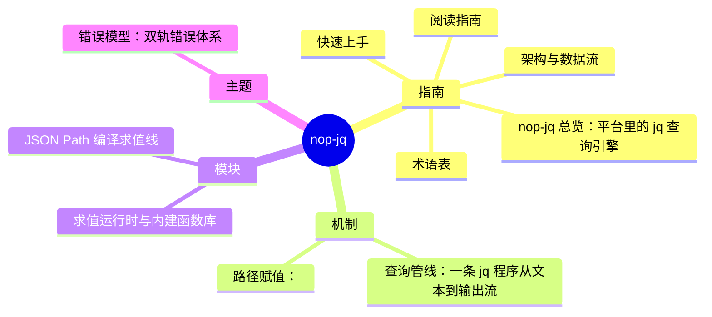

# nop-jq DeepWiki

> 目标：nop-kernel/nop-jq · 结构契约：[PLAN.md](./PLAN.md) · 本文件由 gen-wiki-meta.mjs 生成，勿手改

> 快照：nop-kernel/nop-jq @ 10d9198613 · 2026-09-26

## 指南

- [overview](overview.md) — nop-jq 总览：平台里的 jq 查询引擎
- [quickstart](quickstart.md) — 快速上手
- [glossary](glossary.md) — 术语表
- [reading guide](reading-guide.md) — 阅读指南
- [architecture](architecture.md) — 架构与数据流

## 机制

- [flows query pipeline](flows/query-pipeline.md) — 查询管线：一条 jq 程序从文本到输出流
- [flows path assign](flows/path-assign.md) — 路径赋值：`

## 模块

- [modules jq runtime](modules/jq-runtime.md) — 求值运行时与内建函数库
- [modules jsonpath](modules/jsonpath.md) — JSON Path 编译求值线

## 主题

- [topics error model](topics/error-model.md) — 错误模型：双轨错误体系
