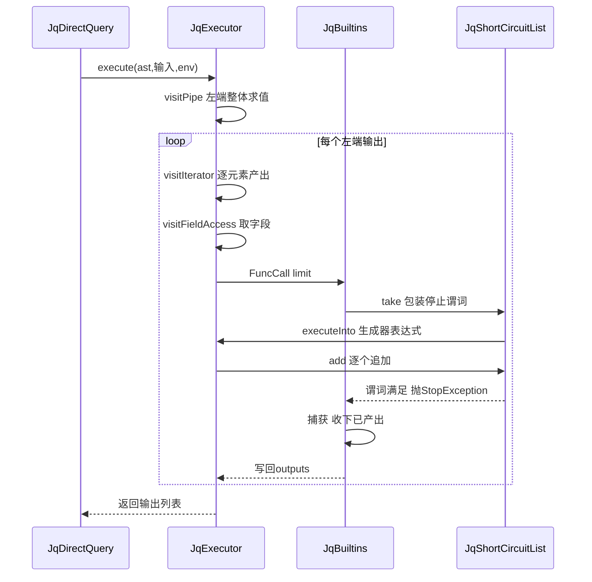
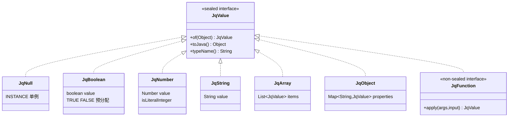
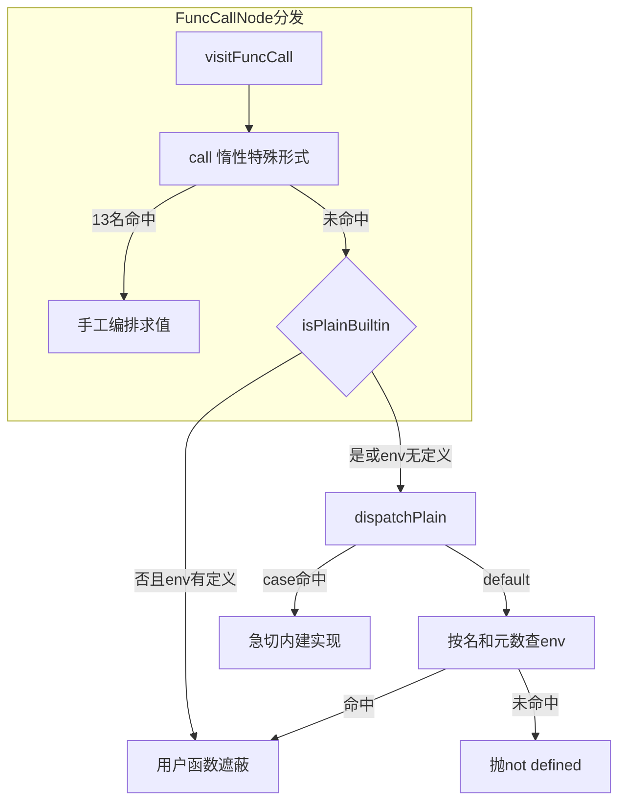

# 求值运行时与内建函数库

> 本文覆盖 `jq.runtime` 子包：AST 如何被求值为输出流。
> 核心源文件（相对本页的仓库路径基准 `../../`）：
>
> - [../../nop-kernel/nop-jq/src/main/java/io/nop/jq/jq/runtime/JqExecutor.java — 求值引擎，AST 节点 visitor 分发
> - [../../nop-kernel/nop-jq/src/main/java/io/nop/jq/jq/runtime/JqBuiltins.java — 145 名内建函数分发
> - [../../nop-kernel/nop-jq/src/main/java/io/nop/jq/jq/runtime/JqEnvironment.java — 作用域、函数表、资源预算
> - [../../nop-kernel/nop-jq/src/main/java/io/nop/jq/jq/runtime/JqValues.java — JqValue 六个具体实现
> - [../../nop-kernel/nop-jq/src/main/java/io/nop/jq/jq/runtime/JqValue.java — 封闭值接口
> - [../../nop-kernel/nop-jq/src/main/java/io/nop/jq/jq/runtime/JqPrinter.java — 规范输出格式
> - [../../nop-kernel/nop-jq/src/main/java/io/nop/jq/jq/runtime/JqPathEval.java — 路径表达式求值（供赋值/`del`/`path`）

## 职责与边界

本子包回答一个问题：给定一棵 jq AST 和一个输入值，产出一列输出值。它包含五类机制：

| 机制 | 承担者 | 一句话职责 |
|------|--------|-----------|
| 求值引擎 | `JqExecutor` | 对 39 种 AST 节点逐一分发，把输出追加进共享列表 |
| 内建函数库 | `JqBuiltins` | 惰性特殊形式、急切内建、用户函数遮蔽三层分发 |
| 运行环境 | `JqEnvironment` | 变量作用域栈、函数定义表、调用深度与输出量预算 |
| 值模型 | `JqValue` + `JqValues` | 7 个封闭实现，全部不可变更新 |
| 输出语义 | `JqPrinter` | jq 规范的 JSON 渲染（整数化、NaN→null、最短转义） |

不属于本页：文本到 AST 的编译（见 [查询管线](../flows/query-pipeline.md)）、jsonpath 独立编译线（`io.nop.jq.jsonpath` 包，与 jq 线仅共享根包错误工具）。路径赋值 `|=` 的完整机制有独立的流页，这里只写运行时侧的调用面。

> Sources: [nop-kernel/nop-jq/src/main/java/io/nop/jq/jq/runtime/JqExecutor.java:10-18](/nop-kernel/nop-jq/src/main/java/io/nop/jq/jq/runtime/JqExecutor.java#L10-L18) [nop-kernel/nop-jq/src/main/java/io/nop/jq/jq/runtime/JqBuiltins.java:12-16](/nop-kernel/nop-jq/src/main/java/io/nop/jq/jq/runtime/JqBuiltins.java#L12-L16) [nop-kernel/nop-jq/src/main/java/io/nop/jq/jq/runtime/JqEnvironment.java:9-12](/nop-kernel/nop-jq/src/main/java/io/nop/jq/jq/runtime/JqEnvironment.java#L9-L12) [nop-kernel/nop-jq/src/main/java/io/nop/jq/jq/runtime/JqPrinter.java:6-11](/nop-kernel/nop-jq/src/main/java/io/nop/jq/jq/runtime/JqPrinter.java#L6-L11)

## 入口点与调用契约

外部唯一常规入口是 `JqEngine.compile` 返回的 `JqDirectQuery`。每次 `apply` 的生命周期：

1. 边界转换：`JqValue.of(root)` 把 Java 对象递归转成 JqValue（Map/List/Number/String → 对应 JqValue，null → NULL）；
2. 每次调用新建一个 `JqEnvironment`（无跨调用状态）；
3. `executor.execute(ast, input, env)` 返回 `List<JqValue>`；
4. 逐个 `toJava()` 转回 Java 对象。见 `nop-kernel/nop-jq/src/main/java/io/nop/jq/jq/JqDirectQuery.java:26-35`。

每个 `JqDirectQuery` 实例持有自己的 `JqExecutor`（构造时 `new JqExecutor()`，`nop-kernel/nop-jq/src/main/java/io/nop/jq/jq/JqDirectQuery.java:19-23`），而 AST 被编译缓存放大共享——线程安全依赖"求值期不写共享结构"，见下文不变式一节。`applyPartial` 是官方测试套件的第二入口：运行时异常只终结输出流、保留已产出结果，仅 `OutOfMemoryError`/`StackOverflowError` 照常上抛（`nop-kernel/nop-jq/src/main/java/io/nop/jq/jq/JqDirectQuery.java:50-66`）。

`JqExecutor` 还暴露三个包内协作口：`callBuiltinOrUser` 委派给 `JqBuiltins.call`；`callFunctionFromBuiltin` 供 JqBuiltins 回调用户函数；`evalMathOpPublic` 供算术内建复用私有限定符语义（`nop-kernel/nop-jq/src/main/java/io/nop/jq/jq/runtime/JqExecutor.java:703-715`）。

> Sources: [nop-kernel/nop-jq/src/main/java/io/nop/jq/jq/JqDirectQuery.java:26-35](/nop-kernel/nop-jq/src/main/java/io/nop/jq/jq/JqDirectQuery.java#L26-L35) [nop-kernel/nop-jq/src/main/java/io/nop/jq/jq/JqDirectQuery.java:50-66](/nop-kernel/nop-jq/src/main/java/io/nop/jq/jq/JqDirectQuery.java#L50-L66) [nop-kernel/nop-jq/src/main/java/io/nop/jq/jq/runtime/JqExecutor.java:34-44](/nop-kernel/nop-jq/src/main/java/io/nop/jq/jq/runtime/JqExecutor.java#L34-L44) [nop-kernel/nop-jq/src/main/java/io/nop/jq/jq/runtime/JqValue.java:15-38](/nop-kernel/nop-jq/src/main/java/io/nop/jq/jq/runtime/JqValue.java#L15-L38)

## 机制与控制流：输出列表即数据流

### 基本契约

`execute` = 新建输出列表 + `executeInto`；`executeInto(node, input, env, outputs)` 把 node 的所有输出**追加**到调用方传入的列表。每个表达式把一个输入映射为多个输出，jq 用回溯实现的部分在这里用两个控制流异常近似：`label/break` 经 `JqBreakException` 解栈，惰性消费者（limit/first/any/all/isempty）经 `JqShortCircuitList` + `JqStopException` 提前终止生产者（`nop-kernel/nop-jq/src/main/java/io/nop/jq/jq/runtime/JqExecutor.java:10-18`）。

`executeInto` 每次调用构造一个匿名 `JqAstVisitor`，捕获当前 `input`/`outputs` 闭包状态；代码注释声明这是为了可重入与线程安全，并称 JIT 逃逸分析会消除热路径上的分配（`nop-kernel/nop-jq/src/main/java/io/nop/jq/jq/runtime/JqExecutor.java:45-47`）。visitor 共 39 个 visit 方法，与 `JqAstNode` sealed permits 列表的 39 个节点一一对应（`nop-kernel/nop-jq/src/main/java/io/nop/jq/jq/ast/JqAstNode.java:12-25`）。

### 管道与笛卡尔积

- **管道 `a | b`**：左端经 `execute` **完整求值为临时列表**，然后对每个左端输出把右端 `executeInto` 同一个 outputs 列表。左端若是 `FuncDefNode` 则走词法作用域分支：在 fork 出的子环境注册 `JqFunctionDef`（捕获定义点环境）后直接执行右端（`nop-kernel/nop-jq/src/main/java/io/nop/jq/jq/runtime/JqExecutor.java:137-152`）。
- **逗号 `,`**：左右两端依次写入同一 outputs（`nop-kernel/nop-jq/src/main/java/io/nop/jq/jq/runtime/JqExecutor.java:154-158`）。
- **二元运算/比较**：左右各自完整求值后做双循环笛卡尔积（`nop-kernel/nop-jq/src/main/java/io/nop/jq/jq/runtime/JqExecutor.java:160-180`）。对象构造同理：逐字段对 key、value 的所有输出做递归笛卡尔（`nop-kernel/nop-jq/src/main/java/io/nop/jq/jq/runtime/JqExecutor.java:571-590`）；字符串插值对每个插值部件的输出做回溯式展开（`nop-kernel/nop-jq/src/main/java/io/nop/jq/jq/runtime/JqExecutor.java:594-615`）。
- **短路布尔**：`and`/`or` 左端已定则不再求右端；`not` 只作用于右端（`nop-kernel/nop-jq/src/main/java/io/nop/jq/jq/runtime/JqExecutor.java:182-202`）。
- **reduce/foreach**：`init` 只取第一个输出作初值；体为空流时状态置 NULL，foreach 优先执行 `extract`，无 extract 才直接输出状态并计入输出预算（`nop-kernel/nop-jq/src/main/java/io/nop/jq/jq/runtime/JqExecutor.java:332-369`）。
- **while/until**：while 每圈输出前检查预算；until 有 `MAX_CALL_DEPTH` 圈数守护，超限报 "until did not converge"（`nop-kernel/nop-jq/src/main/java/io/nop/jq/jq/runtime/JqExecutor.java:432-453`）。

### 惰性消费如何截断生产者

`JqShortCircuitList` 是 `ArrayList` 子类，重写 `add`/`add(int,E)`/`addAll`：每追加一个元素就跑一次停止谓词，满足即抛 `JqStopException.INSTANCE`——该异常以 `super(null, null, false, false)` 构造，单例、无栈追踪（`nop-kernel/nop-jq/src/main/java/io/nop/jq/jq/runtime/JqShortCircuitList.java:31-46`、`nop-kernel/nop-jq/src/main/java/io/nop/jq/jq/runtime/JqStopException.java:9-14`）。`executeInto` 入口第一行检查 sink 是否已满足，满足则不求值直接抛（`nop-kernel/nop-jq/src/main/java/io/nop/jq/jq/runtime/JqExecutor.java:40-44`）。

> Sources: [nop-kernel/nop-jq/src/main/java/io/nop/jq/jq/runtime/JqExecutor.java:10-18](/nop-kernel/nop-jq/src/main/java/io/nop/jq/jq/runtime/JqExecutor.java#L10-L18) [nop-kernel/nop-jq/src/main/java/io/nop/jq/jq/runtime/JqExecutor.java:137-152](/nop-kernel/nop-jq/src/main/java/io/nop/jq/jq/runtime/JqExecutor.java#L137-L152) [nop-kernel/nop-jq/src/main/java/io/nop/jq/jq/runtime/JqShortCircuitList.java:13-46](/nop-kernel/nop-jq/src/main/java/io/nop/jq/jq/runtime/JqShortCircuitList.java#L13-L46) [nop-kernel/nop-jq/src/main/java/io/nop/jq/jq/runtime/JqBuiltins.java:259-269](/nop-kernel/nop-jq/src/main/java/io/nop/jq/jq/runtime/JqBuiltins.java#L259-L269)

## JqEnvironment：作用域栈、函数表与资源预算

**作用域**：`Deque<Map<String,JqValue>>`，`bind` 只写栈顶，`lookup` 从栈顶向栈底线性扫描，找不到抛 `"$name is not defined"`（`nop-kernel/nop-jq/src/main/java/io/nop/jq/jq/runtime/JqEnvironment.java:46-66`）。`BindNode`/reduce/foreach/用户函数调用都靠 `pushScope`+`popScope`（try/finally 保证弹栈）实现绑定生命周期（`nop-kernel/nop-jq/src/main/java/io/nop/jq/jq/runtime/JqExecutor.java:276-293`）。

**函数表**：`Map<String,Object>`，键为 `name/arity`（`functionKey`，`nop-kernel/nop-jq/src/main/java/io/nop/jq/jq/runtime/JqExecutor.java:757-760`），值有四种形态：`JqFunctionDef`（def+定义环境）、`JqClosureFn`（过滤器参数闭包）、`JqFunction`（宿主注册的 Java 函数）、裸 `FuncDefNode`（兜底，调用时补配环境）（`nop-kernel/nop-jq/src/main/java/io/nop/jq/jq/runtime/JqExecutor.java:731-755`）。

**fork 与写时复制**：`fork()` 复制栈引用、共享函数表和计数器，并标记 `defsShared=true`；此后任何 `defineFunction` 先克隆整表再写（`nop-kernel/nop-jq/src/main/java/io/nop/jq/jq/runtime/JqEnvironment.java:78-84`、`140-144`）。类注释说明了为什么这样不会泄漏绑定：每条绑定路径必先 push 新作用域，函数表写前必克隆（`nop-kernel/nop-jq/src/main/java/io/nop/jq/jq/runtime/JqEnvironment.java:134-139`）。注意 fork **共享** `callDepth`/`outputCount`——嵌套调用的深度和输出量合计计量，不会被子调用重置。

**输入流**：`pendingInputs` 双端队列供 `input`/`inputs` 消费，耗尽时 `nextInput` 抛 errorValue 为字符串 `"break"` 的 `JqRuntimeException`——即 jq 语义里可被 `try` 捕获的 break 错误（`nop-kernel/nop-jq/src/main/java/io/nop/jq/jq/runtime/JqEnvironment.java:117-130`）。

| 预算 | 值 | 检查点 | 超限行为 |
|------|----|--------|---------|
| `MAX_CALL_DEPTH` | 2000 | `callUserFunction` 进出配对（enterCall/exitCall） | 抛 "Call depth limit exceeded" |
| `MAX_OUTPUT_COUNT` | 1,000,000 | 数组构造、foreach、while、`..` 递归下降、range、recurse | 抛 "Output count limit exceeded" |
| `MAX_SPLIT_LIMIT` | 100,000 | `split` 输入字符串长度 | 抛 "Input string too large for split" |
| until 收敛守护 | 复用 2000 | `until` 每圈递增 guard | 抛 "until did not converge" |

三个常量都是 `public static final`，无运行期覆盖通道（`nop-kernel/nop-jq/src/main/java/io/nop/jq/jq/runtime/JqEnvironment.java:14-18`）。检查点落点：`nop-kernel/nop-jq/src/main/java/io/nop/jq/jq/runtime/JqExecutor.java:322,361,435,551,557` 与 `nop-kernel/nop-jq/src/main/java/io/nop/jq/jq/runtime/JqBuiltins.java:153,168,515,1657,1662,1670`。

> Sources: [nop-kernel/nop-jq/src/main/java/io/nop/jq/jq/runtime/JqEnvironment.java:14-18](/nop-kernel/nop-jq/src/main/java/io/nop/jq/jq/runtime/JqEnvironment.java#L14-L18) [nop-kernel/nop-jq/src/main/java/io/nop/jq/jq/runtime/JqEnvironment.java:78-84](/nop-kernel/nop-jq/src/main/java/io/nop/jq/jq/runtime/JqEnvironment.java#L78-L84) [nop-kernel/nop-jq/src/main/java/io/nop/jq/jq/runtime/JqEnvironment.java:134-144](/nop-kernel/nop-jq/src/main/java/io/nop/jq/jq/runtime/JqEnvironment.java#L134-L144) [nop-kernel/nop-jq/src/main/java/io/nop/jq/jq/runtime/JqExecutor.java:786-791](/nop-kernel/nop-jq/src/main/java/io/nop/jq/jq/runtime/JqExecutor.java#L786-L791)

## JqValue：封闭值模型与全序

`JqValue` 是 sealed interface，permits 六个具体类型加 `JqFunction`（`nop-kernel/nop-jq/src/main/java/io/nop/jq/jq/runtime/JqValue.java:8-9`）；实现集中在 `JqValues.java`。设计要点：

- **不可变更新**：`JqArray` 的 `add/set/remove`、`JqObject` 的 `put/remove` 都复制底层容器返回新值（`nop-kernel/nop-jq/src/main/java/io/nop/jq/jq/runtime/JqValues.java:94-108`、`143-152`）；`JqObject` 构造时包 `unmodifiableMap`。例外是 `JqObject.ofFresh`：调用方移交刚建好的 Map 免一次拷贝，注释点名对象构造与 `to_entries` 是热路径（`nop-kernel/nop-jq/src/main/java/io/nop/jq/jq/runtime/JqValues.java:129-136`）。
- **JqNumber 的相等性特例**：两个"字面整数"（Integer/Long 存储）按 long 精确比较；任一方经过算术即为 double 存储，按 double 比较。代码注释给出后果：`9007199254740993+0` 等于字面量 `9007199254740992`（`nop-kernel/nop-jq/src/main/java/io/nop/jq/jq/runtime/JqValues.java:47-65`）。`hashCode` 始终按 double——注释声明只影响散列分布、不影响正确性（`nop-kernel/nop-jq/src/main/java/io/nop/jq/jq/runtime/JqValues.java:62-65`）。
- **真值**：只有 null 和 false 为假（`nop-kernel/nop-jq/src/main/java/io/nop/jq/jq/runtime/JqTruthiness.java:8-15`）。
- **全序**：null < false < true < number < string < array < object；NaN 排在所有数之后且等于自身（保证 sort 稳定）；两个同为字面整数的数按 long 精确比较；对象先比排序后的键数组再逐键比值（`nop-kernel/nop-jq/src/main/java/io/nop/jq/jq/runtime/JqOrdering.java:5-9`、`56-72`、`83-97`）。比较、排序族内建、`evalComparison` 全部走这一个入口（`nop-kernel/nop-jq/src/main/java/io/nop/jq/jq/runtime/JqExecutor.java:1028-1038`）。

| 实现 | 存储 | 不可变策略 | 特殊语义 |
|------|------|-----------|---------|
| `JqNull` | 单例 `INSTANCE` | — | 迭代 null 产出空；索引 null 得 null |
| `JqBoolean` | boolean 字段 | `TRUE`/`FALSE` 复用 | truthiness 唯二假值之一 |
| `JqNumber` | `Number`（Integer/Long/Double） | 值语义 | 字面整数精确比较；NaN 多层特殊化（见失败一节） |
| `JqString` | `String` | 值语义 | `length` 按 codePoint 计数 |
| `JqArray` | `List<JqValue>` 拷贝入 `List.copyOf` | 更新即复制 | 负索引在 `getIndex` 层折算 |
| `JqObject` | `LinkedHashMap` 包 unmodifiable | 更新即复制；`ofFresh` 免拷 | 保持插入序；`keys` 才排序 |
| `JqFunction` | 函数式接口 | — | 宿主扩展点；`toJava` 返回自身 |

> Sources: [nop-kernel/nop-jq/src/main/java/io/nop/jq/jq/runtime/JqValues.java:47-65](/nop-kernel/nop-jq/src/main/java/io/nop/jq/jq/runtime/JqValues.java#L47-L65) [nop-kernel/nop-jq/src/main/java/io/nop/jq/jq/runtime/JqValues.java:123-136](/nop-kernel/nop-jq/src/main/java/io/nop/jq/jq/runtime/JqValues.java#L123-L136) [nop-kernel/nop-jq/src/main/java/io/nop/jq/jq/runtime/JqOrdering.java:56-72](/nop-kernel/nop-jq/src/main/java/io/nop/jq/jq/runtime/JqOrdering.java#L56-L72) [nop-kernel/nop-jq/src/main/java/io/nop/jq/jq/runtime/JqTruthiness.java:8-15](/nop-kernel/nop-jq/src/main/java/io/nop/jq/jq/runtime/JqTruthiness.java#L8-L15)

## 内建函数：145 名的三层分发

`JqBuiltins` 是私有构造的 final 工具类，唯一入口 `call(executor, node, input, env, outputs)`（`nop-kernel/nop-jq/src/main/java/io/nop/jq/jq/runtime/JqBuiltins.java:22-27`）。`BUILTIN_NAMES` 数组登记 145 个 `名字/元数` 条目供 `builtins` 内建上报（`nop-kernel/nop-jq/src/main/java/io/nop/jq/jq/runtime/JqBuiltins.java:210-236`；`case "builtins"` 输出于 `1346-1352`）。分发按序过三层：

1. **惰性特殊形式 switch**（13 个名字：limit/first/last/nth/isempty/any/all/path/del/until/while/repeat/error）：需要参数 AST 本身，逐个手工编排求值（`nop-kernel/nop-jq/src/main/java/io/nop/jq/jq/runtime/JqBuiltins.java:28-182`）。
2. **用户遮蔽检查**：仅当名字**不是** plain builtin 且 `env` 有同名同元数定义时，转调 `callFunctionFromBuiltin`——用户函数可以遮蔽大多数内建，但不能遮蔽 `isPlainBuiltin` 列出的 17 个名字（empty/error/not/length/keys/keys_unsorted/values/has/in/contains/inside/type/tostring/tojson/fromjson/tonumber/toboolean）（`nop-kernel/nop-jq/src/main/java/io/nop/jq/jq/runtime/JqBuiltins.java:184-192`、`1890-1898`）。
3. **`dispatchPlain` 巨型 switch**：急切内建主体；`default` 分支再按 `名/元数` 查 env，仍无则抛 `name/arity is not defined`（`nop-kernel/nop-jq/src/main/java/io/nop/jq/jq/runtime/JqBuiltins.java:323-327`、`1393-1406`）。

惰性截断的通用原语是 `take`：把生成器表达式跑进一个带停止谓词的 `JqShortCircuitList`，捕获 `JqStopException` 返回已收部分（`nop-kernel/nop-jq/src/main/java/io/nop/jq/jq/runtime/JqBuiltins.java:259-269`）。`any/2`、`all/2` 用同一原语实现"找到即停"的生成器扫描（`nop-kernel/nop-jq/src/main/java/io/nop/jq/jq/runtime/JqBuiltins.java:272-289`）。急切侧的参数求值有两个辅助：`evalArgs` 把所有参数输出拼接成一列，`evalAllArgs` 保留每参数一列供笛卡尔积使用（`nop-kernel/nop-jq/src/main/java/io/nop/jq/jq/runtime/JqBuiltins.java:1423-1440`）。

12 类抽样（每类求值方式与边界行为不同，是分层的实际后果）：

| 类别 | 代表 | 求值方式 | 边界行为 |
|------|------|---------|---------|
| 惰性特殊形式 | `limit(2; …)`、`first` | `take` 短路，参数 AST 手工执行 | limit 负数抛错；first/0 只认非空数组输入 |
| 路径族 | `getpath/setpath/delpaths` | 参数急切，路径操作委托 `JqPathEval` | delpaths 排序后**倒序**删除防索引位移 |
| 递归遍历 | `recurse`、`walk`、`paths` | 深度优先；recurse 每层查输出预算 | recurse/filter 求值异常被吞成"无子节点" |
| 排序聚合 | `sort_by/group_by/unique_by` | 先对每元素求 key 再排序/分组 | 依赖 `JqOrdering` 全序 |
| 字符串 | `ltrimstr/split/join` | 参数急切 | 非字符串输入**原样通过**（ltrimstr/rtrimstr） |
| 正则族 | `test/match/capture/scan/splits` | 委托 `JqRegexSupport` | flags 参数可选，经 `regexArgs` 解析 |
| 数学 | `floor/pow/log…` | `DoubleUnaryOperator` 适配 | 非数值输入返回 null 而非报错（`floorLike/doubleFunc`） |
| 时间 | `strftime/gmtime/mktime…` | 委托 `JqTimeFunctions` | 输入类型不符抛中文外英文错误 |
| 流转换 | `tostream/fromstream` | 递归产 `[path, leaf]` 事件对 | fromstream 支持 `[path]`+下一事件的对象补全模式 |
| 输入输出 | `input/inputs/halt/halt_error` | 消费 `pendingInputs` | `halt_error` 默认退出码 5；`input_line_number` 恒 0 |
| 类型过滤 | `arrays/objects/scalars…` | 类型不符**不产出**（不是报错） | scalars 排除 array/object |
| 环境杂项 | `env/now/debug/builtins` | `debug` 走可替换 sink | `modulemeta` 恒返回空对象 |

> Sources: [nop-kernel/nop-jq/src/main/java/io/nop/jq/jq/runtime/JqBuiltins.java:22-27](/nop-kernel/nop-jq/src/main/java/io/nop/jq/jq/runtime/JqBuiltins.java#L22-L27) [nop-kernel/nop-jq/src/main/java/io/nop/jq/jq/runtime/JqBuiltins.java:184-192](/nop-kernel/nop-jq/src/main/java/io/nop/jq/jq/runtime/JqBuiltins.java#L184-L192) [nop-kernel/nop-jq/src/main/java/io/nop/jq/jq/runtime/JqBuiltins.java:259-269](/nop-kernel/nop-jq/src/main/java/io/nop/jq/jq/runtime/JqBuiltins.java#L259-L269) [nop-kernel/nop-jq/src/main/java/io/nop/jq/jq/runtime/JqBuiltins.java:1890-1898](/nop-kernel/nop-jq/src/main/java/io/nop/jq/jq/runtime/JqBuiltins.java#L1890-L1898)

## 用户函数与闭包

`callUserFunction` 区分两类参数（`nop-kernel/nop-jq/src/main/java/io/nop/jq/jq/runtime/JqExecutor.java:762-792`）：

- **值参数 `$x`**：在**调用点**环境急切求值，随后 `bindValueParamsCartesian` 对每个参数的每个输出做递归笛卡尔绑定——多输出参数会让函数体执行多次（`nop-kernel/nop-jq/src/main/java/io/nop/jq/jq/runtime/JqExecutor.java:796-814`）。
- **过滤器参数 `g`**：不急切求值，包装成 `JqClosureFn`（捕获调用点 env + 参数 AST）注册进函数体环境；函数体里 `g` 当零参函数调用（`nop-kernel/nop-jq/src/main/java/io/nop/jq/jq/runtime/JqClosureFn.java:13-33`）。

词法作用域由两处共同保证：`FuncDefNode` 出现在管道左端时，定义注册进 fork 出的子环境并把该环境封进 `JqFunctionDef`，函数体内的函数名解析发生在**定义点**环境；实参求值发生在**调用点**环境（`nop-kernel/nop-jq/src/main/java/io/nop/jq/jq/runtime/JqExecutor.java:137-147`、`769-770`、`nop-kernel/nop-jq/src/main/java/io/nop/jq/jq/runtime/JqFunctionDef.java:9-13`）。实参数少于形参直接抛错；调用深度预算在 `enterCall/exitCall`（try/finally）内计量（`nop-kernel/nop-jq/src/main/java/io/nop/jq/jq/runtime/JqExecutor.java:765-791`）。

变量解析有一组硬编码优先级：`$ENV` 返回进程环境变量对象，`$__loc__` 返回固定 `{"file":"<top-level>","line":1}`，随后才查零参函数、再查变量（`nop-kernel/nop-jq/src/main/java/io/nop/jq/jq/runtime/JqExecutor.java:295-314`）。

> Sources: [nop-kernel/nop-jq/src/main/java/io/nop/jq/jq/runtime/JqExecutor.java:762-792](/nop-kernel/nop-jq/src/main/java/io/nop/jq/jq/runtime/JqExecutor.java#L762-L792) [nop-kernel/nop-jq/src/main/java/io/nop/jq/jq/runtime/JqExecutor.java:796-814](/nop-kernel/nop-jq/src/main/java/io/nop/jq/jq/runtime/JqExecutor.java#L796-L814) [nop-kernel/nop-jq/src/main/java/io/nop/jq/jq/runtime/JqClosureFn.java:13-33](/nop-kernel/nop-jq/src/main/java/io/nop/jq/jq/runtime/JqClosureFn.java#L13-L33) [nop-kernel/nop-jq/src/main/java/io/nop/jq/jq/runtime/JqFunctionDef.java:9-13](/nop-kernel/nop-jq/src/main/java/io/nop/jq/jq/runtime/JqFunctionDef.java#L9-L13)

## 状态与生命周期

状态分三层，生命周期各不相同：

| 状态 | 归属 | 生命周期 | 关键事实 |
|------|------|---------|---------|
| AST + `JqExecutor` | `JqDirectQuery` | 随编译缓存存活（cache 1000 条，`nop-kernel/nop-jq/src/main/java/io/nop/jq/jq/JqEngine.java:13-21`） | 求值期只读 AST；`JqDestructurer`/`JqPathEval` 字段构造后不可变（`JqExecutor.java:21-23`） |
| `JqEnvironment` | 每次 apply 新建 | 单次 apply | 作用域 push/pop 严格配对；fork 共享预算计数器 |
| `JqValue` 图 | 单次 apply 内 | 值语义、无别名突变 | 更新一律产新值，跨 fork 无需防御性拷贝 |
| `debugSink` | `JqExecutor` 字段 | 实例级可替换 | 默认 `System.err::println`（`JqExecutor.java:26-30`） |

`JqExecutor.debug` 把值经 `JqPrinter.print` 写进 sink；`debug` 内建输出原值不变（`nop-kernel/nop-jq/src/main/java/io/nop/jq/jq/runtime/JqExecutor.java:717-719`、`nop-kernel/nop-jq/src/main/java/io/nop/jq/jq/runtime/JqBuiltins.java:1119-1122`）。

> Sources: [nop-kernel/nop-jq/src/main/java/io/nop/jq/jq/runtime/JqExecutor.java:21-30](/nop-kernel/nop-jq/src/main/java/io/nop/jq/jq/runtime/JqExecutor.java#L21-L30) [nop-kernel/nop-jq/src/main/java/io/nop/jq/jq/JqEngine.java:13-21](/nop-kernel/nop-jq/src/main/java/io/nop/jq/jq/JqEngine.java#L13-L21) [nop-kernel/nop-jq/src/main/java/io/nop/jq/jq/runtime/JqEnvironment.java:20-27](/nop-kernel/nop-jq/src/main/java/io/nop/jq/jq/runtime/JqEnvironment.java#L20-L27)

## 不变式与失败语义

**输出先于错误保留**。`try/catch` 捕获 `JqRuntimeException`（`break`/stop 异常**重抛不捕**），catch 分支以 `e.errorValue()` 为输入执行——错误发生前已进 outputs 的值不受影响（`nop-kernel/nop-jq/src/main/java/io/nop/jq/jq/runtime/JqExecutor.java:246-258`）。`JqRuntimeException` 携带 jq 错误值：字符串错误即该字符串，其他值为其规范 JSON 渲染（`nop-kernel/nop-jq/src/main/java/io/nop/jq/jq/runtime/JqRuntimeException.java:15-35`）。`label` 捕获同名 break、保留已产出输出，异名 break 继续上抛（`nop-kernel/nop-jq/src/main/java/io/nop/jq/jq/runtime/JqExecutor.java:260-270`）。

**NaN/无穷出现在四层，各层处理不同**：

| 层 | 位置 | 行为 |
|----|------|------|
| 算术 | `numbers()` MOD：NaN 参与取模得 NaN；除零（DIV/MOD）抛 jq 风格 "cannot be … because the divisor is zero"；MOD 用 long 饱和截断（注释：like C intmax_t），除以 -1 得 0 | `JqExecutor.java:1000-1014` |
| 索引 | `getIndex` 数组下标 NaN 返回 null；`getSlice` start NaN 归 0、end NaN 归 MAX；字符串重复次数 NaN/负数得 null | `JqExecutor.java:501-508`、`521-546`、`963-975` |
| 排序 | NaN 排在所有数之后、与自身相等 | `JqOrdering.java:63-70` |
| 打印 | NaN 渲染为 `null`；无穷渲染为 `±1.7976931348623157e+308`；整数值 double 去掉小数部分 | `JqPrinter.java:63-74` |

**结构性不变式**：fork 不泄漏绑定（写时复制 + 必 push 新作用域，`JqEnvironment.java:134-139`）；`executeInto` 对同一 outputs 列表可重入（每调用新 visitor）；`halt`/`halt_error` 抛 `JqHaltException`——它**继承自** `JqRuntimeException`，而 `try/catch` 捕获的正是后者，故 `try (halt_error)` 在本实现中可被捕获（组合两个事实可推：`nop-kernel/nop-jq/src/main/java/io/nop/jq/jq/runtime/JqHaltException.java:9`、`JqExecutor.java:252`；文件中未见专门豁免逻辑）。`error`/`fromjson`/`tonumber` 等的错误消息全为英文字符串。

> Sources: [nop-kernel/nop-jq/src/main/java/io/nop/jq/jq/runtime/JqExecutor.java:246-270](/nop-kernel/nop-jq/src/main/java/io/nop/jq/jq/runtime/JqExecutor.java#L246-L270) [nop-kernel/nop-jq/src/main/java/io/nop/jq/jq/runtime/JqExecutor.java:1000-1014](/nop-kernel/nop-jq/src/main/java/io/nop/jq/jq/runtime/JqExecutor.java#L1000-L1014) [nop-kernel/nop-jq/src/main/java/io/nop/jq/jq/runtime/JqPrinter.java:56-76](/nop-kernel/nop-jq/src/main/java/io/nop/jq/jq/runtime/JqPrinter.java#L56-L76) [nop-kernel/nop-jq/src/main/java/io/nop/jq/jq/runtime/JqRuntimeException.java:15-35](/nop-kernel/nop-jq/src/main/java/io/nop/jq/jq/runtime/JqRuntimeException.java#L15-L35)

## 输出语义：JqPrinter

`JqPrinter` 是 `tojson`/`tostring`/字符串插值/错误消息共用的规范渲染器（类注释点名这四处用途，`nop-kernel/nop-jq/src/main/java/io/nop/jq/jq/runtime/JqPrinter.java:6-11`）。`print` = 紧凑 JSON（无空格分隔）；`appendNumber` 规则：Integer/Long 原样、NaN→`null`、无穷→边界值字面量、整数值 double 转 long、其余走 `formatDouble`（最短表示、小写 e 指数带显式符号、剥尾随 `.0`）（`nop-kernel/nop-jq/src/main/java/io/nop/jq/jq/runtime/JqPrinter.java:56-96`）。字符串转义手工扫描，只处理 `"` `\` 及 6 个控制符，其余控制字符走 `\u%04x`（`nop-kernel/nop-jq/src/main/java/io/nop/jq/jq/runtime/JqPrinter.java:98-121`）。两个变体：`printTruncated` 供错误消息截断到 11 字符加 `...`（`79-82`）；`tostring` 字符串保持裸值、其余打印（`124-128`）。对象比较用的 `compareLists` 也在此类（`131-139`）。

> Sources: [nop-kernel/nop-jq/src/main/java/io/nop/jq/jq/runtime/JqPrinter.java:56-96](/nop-kernel/nop-jq/src/main/java/io/nop/jq/jq/runtime/JqPrinter.java#L56-L96) [nop-kernel/nop-jq/src/main/java/io/nop/jq/jq/runtime/JqPrinter.java:98-128](/nop-kernel/nop-jq/src/main/java/io/nop/jq/jq/runtime/JqPrinter.java#L98-L128) [nop-kernel/nop-jq/src/main/java/io/nop/jq/jq/runtime/JqPrinter.java:6-11](/nop-kernel/nop-jq/src/main/java/io/nop/jq/jq/runtime/JqPrinter.java#L6-L11)

## 扩展点

- **宿主函数注册**：`env.defineFunction(name, JqFunction)` 可把任意 Java 函数注入环境；`callFunction` 对 `JqFunction` 形态的定义直接急切求值全部实参后调用 `apply`，输出为单值（`nop-kernel/nop-jq/src/main/java/io/nop/jq/jq/runtime/JqExecutor.java:742-748`、`nop-kernel/nop-jq/src/main/java/io/nop/jq/jq/runtime/JqValues.java:169-174`）。仓库内未见生产代码使用此通道（未检索到调用方），它是接口允许的能力而非已用特性。
- **debug sink 可替换**：`setDebugSink`，注释明说供测试替换（`nop-kernel/nop-jq/src/main/java/io/nop/jq/jq/runtime/JqExecutor.java:26-30`）。
- **遮蔽白名单**：新增内建若希望可被用户 `def` 遮蔽，就不要加进 `isPlainBuiltin`；反之必须加（`nop-kernel/nop-jq/src/main/java/io/nop/jq/jq/runtime/JqBuiltins.java:1890-1898`）。
- **新内建的落点**：`dispatchPlain` switch + `BUILTIN_NAMES` 数组两处同步；正则/时间类应委托 `JqRegexSupport`/`JqTimeFunctions` 而非继续膨胀 switch。
- **解构模式**：`JqDestructurer` 以 `ExprEvaluator` 函数接口注入求值能力，`destructureTop` 顶层处理 `?` 可选与 `?//` 备选（返回 null 表示不匹配）（`nop-kernel/nop-jq/src/main/java/io/nop/jq/jq/runtime/JqDestructurer.java:19-51`）。

> Sources: [nop-kernel/nop-jq/src/main/java/io/nop/jq/jq/runtime/JqExecutor.java:26-30](/nop-kernel/nop-jq/src/main/java/io/nop/jq/jq/runtime/JqExecutor.java#L26-L30) [nop-kernel/nop-jq/src/main/java/io/nop/jq/jq/runtime/JqExecutor.java:742-748](/nop-kernel/nop-jq/src/main/java/io/nop/jq/jq/runtime/JqExecutor.java#L742-L748) [nop-kernel/nop-jq/src/main/java/io/nop/jq/jq/runtime/JqDestructurer.java:19-51](/nop-kernel/nop-jq/src/main/java/io/nop/jq/jq/runtime/JqDestructurer.java#L19-L51)

## 配置与运维

运行时无任何配置面：三个预算常量硬编码为 `public static final`（见资源预算表），`JqEngine` 编译缓存大小 `DEFAULT_CACHE_SIZE = 1000` 同为常量（`nop-kernel/nop-jq/src/main/java/io/nop/jq/jq/JqEngine.java:13-16`）。运维相关的行为只有两条链路：`halt`/`halt_error` 以 `JqHaltException` 上抛并带退出码（默认 5，可由参数覆盖，`nop-kernel/nop-jq/src/main/java/io/nop/jq/jq/runtime/JqBuiltins.java:1129-1139`）；`$ENV`/`env` 把进程环境变量整体暴露为 jq 对象（`nop-kernel/nop-jq/src/main/java/io/nop/jq/jq/runtime/JqExecutor.java:721-727`）——沙箱化部署需注意这两个内建可读全量环境。错误消息按模块内异常约定使用英文串。

> Sources: [nop-kernel/nop-jq/src/main/java/io/nop/jq/jq/JqEngine.java:13-16](/nop-kernel/nop-jq/src/main/java/io/nop/jq/jq/JqEngine.java#L13-L16) [nop-kernel/nop-jq/src/main/java/io/nop/jq/jq/runtime/JqBuiltins.java:1129-1139](/nop-kernel/nop-jq/src/main/java/io/nop/jq/jq/runtime/JqBuiltins.java#L1129-L1139) [nop-kernel/nop-jq/src/main/java/io/nop/jq/jq/runtime/JqExecutor.java:721-727](/nop-kernel/nop-jq/src/main/java/io/nop/jq/jq/runtime/JqExecutor.java#L721-L727)

## 关键测试

- **官方套件基线**：`src/test/resources/io/nop/jq/jq/jq-official.test`（2117 行）按 jq 官方 jq.test 格式组织（程序/输入/期望输出三行一块，`%%FAIL` 块与 `# Runtime error:` 注释约定），由 `JqOfficialCase.parseResource` 解析、`TestJqOfficial` 驱动（`nop-kernel/nop-jq/src/test/java/io/nop/jq/jq/JqOfficialCase.java:13-30`）。官方期望文本中的 NaN 经 `\u0001NAN\u0001` 标记往返还原（`nop-kernel/nop-jq/src/test/java/io/nop/jq/jq/TestJqOfficial.java:135-167`）。
- **执行语义单测**：`TestJqExecution` 的 `assertJq` 按输出条数+逐条数值比较断言；数值比较显式按 double 且区分 NaN 位型（`nop-kernel/nop-jq/src/test/java/io/nop/jq/jq/TestJqExecution.java:21-40`）。
- **消费方视角**：平台侧唯一活跃消费者是 `nop-ai/nop-ai-toolkit` 的 `JqToolExecutor`，走 `JqEngine.compile(expression).apply(root)`（`nop-ai/nop-ai-toolkit/src/main/java/io/nop/ai/toolkit/tools/JqToolExecutor.java:44-45`）——即本页所有机制都在这条调用链上被回归覆盖。
- 辅助套件：`TestJqComprehensive`、`TestJqAiAgentUseCases`（同目录）。

> Sources: [nop-kernel/nop-jq/src/test/java/io/nop/jq/jq/JqOfficialCase.java:13-30](/nop-kernel/nop-jq/src/test/java/io/nop/jq/jq/JqOfficialCase.java#L13-L30) [nop-kernel/nop-jq/src/test/java/io/nop/jq/jq/TestJqExecution.java:21-40](/nop-kernel/nop-jq/src/test/java/io/nop/jq/jq/TestJqExecution.java#L21-L40) [nop-ai/nop-ai-toolkit/src/main/java/io/nop/ai/toolkit/tools/JqToolExecutor.java:44-45](/nop-ai/nop-ai-toolkit/src/main/java/io/nop/ai/toolkit/tools/JqToolExecutor.java#L44-L45)

## 性能注意

- **急切物化是默认**：管道左端完整求值为临时列表后才驱动右端（`JqExecutor.java:148-150`）；惰性只存在于 `take` 包装的 13 个特殊形式。左端输出量大时内存与输出量成正比——预算上限 100 万即最坏物化规模。
- **不可变更新的代价**：每次 `JqArray`/`JqObject` 更新整容器复制（O(n)）；`setpath` 链式写、`constructObjects` 笛卡尔展开是复制热点，后者靠 `JqObject.ofFresh` 免去终态二次拷贝（`JqValues.java:129-136`）。
- **短路异常已去栈化**：`JqStopException` 无栈构造（`JqStopException.java:11-14`）；`JqBreakException` 仍是常规有栈异常，深层 break 有填栈成本（`JqBreakException.java:11-15`）。
- **每调用 visitor 分配**：代码注释声称 JIT 逃逸分析在热路径消除该分配——这是源内注释的主张，本页未见基准数据佐证（`JqExecutor.java:45-46`）。
- **散列细节**：`JqNumber.hashCode` 恒按 double，字面整数特例只存在于 `equals`——注释声明仅影响散列分布（`JqValues.java:62-65`）；作用域查找是逐层线性扫描 `HashMap`，深作用域链的变量访问随深度线性变慢（`JqEnvironment.java:59-66`）。

> Sources: [nop-kernel/nop-jq/src/main/java/io/nop/jq/jq/runtime/JqExecutor.java:45-47](/nop-kernel/nop-jq/src/main/java/io/nop/jq/jq/runtime/JqExecutor.java#L45-L47) [nop-kernel/nop-jq/src/main/java/io/nop/jq/jq/runtime/JqValues.java:94-108](/nop-kernel/nop-jq/src/main/java/io/nop/jq/jq/runtime/JqValues.java#L94-L108) [nop-kernel/nop-jq/src/main/java/io/nop/jq/jq/runtime/JqStopException.java:11-14](/nop-kernel/nop-jq/src/main/java/io/nop/jq/jq/runtime/JqStopException.java#L11-L14) [nop-kernel/nop-jq/src/main/java/io/nop/jq/jq/runtime/JqEnvironment.java:59-66](/nop-kernel/nop-jq/src/main/java/io/nop/jq/jq/runtime/JqEnvironment.java#L59-L66)

## 关系

- 上游：jq 前端把文本编译成 39 节点的 sealed AST（`JqAstNode`），经 `JqEngine` 缓存后由 `JqDirectQuery` 绑定本运行时执行；编译链路见 [查询管线](../flows/query-pipeline.md)，术语界定见 [glossary](../glossary.md)。
- 协作子机制：`JqPathEval` 以 `NodeExecutor` 函数接口反向依赖执行器（构造时传 `this::executeInto`，`JqExecutor.java:23`），为赋值/`del`/`path` 计算具体路径；`JqDestructurer` 同理注入求值回调。
- 平行线：`io.nop.jq.jsonpath` 是独立的 JSON Path 编译求值线，不经过本运行时的任何类。
- 下游：`nop-ai-toolkit` 的 `JqToolExecutor` 是仓库内唯一生产消费者。

> Sources: [nop-kernel/nop-jq/src/main/java/io/nop/jq/jq/runtime/JqExecutor.java:21-23](/nop-kernel/nop-jq/src/main/java/io/nop/jq/jq/runtime/JqExecutor.java#L21-L23) [nop-kernel/nop-jq/src/main/java/io/nop/jq/jq/runtime/JqPathEval.java:19-35](/nop-kernel/nop-jq/src/main/java/io/nop/jq/jq/runtime/JqPathEval.java#L19-L35) [nop-ai/nop-ai-toolkit/src/main/java/io/nop/ai/toolkit/tools/JqToolExecutor.java:44-45](/nop-ai/nop-ai-toolkit/src/main/java/io/nop/ai/toolkit/tools/JqToolExecutor.java#L44-L45)

## Sources

- [nop-kernel/nop-jq/src/main/java/io/nop/jq/jq/runtime/JqExecutor.java:10-18](/nop-kernel/nop-jq/src/main/java/io/nop/jq/jq/runtime/JqExecutor.java#L10-L18)
- [nop-kernel/nop-jq/src/main/java/io/nop/jq/jq/runtime/JqExecutor.java:34-44](/nop-kernel/nop-jq/src/main/java/io/nop/jq/jq/runtime/JqExecutor.java#L34-L44)
- [nop-kernel/nop-jq/src/main/java/io/nop/jq/jq/runtime/JqExecutor.java:40-47](/nop-kernel/nop-jq/src/main/java/io/nop/jq/jq/runtime/JqExecutor.java#L40-L47)
- [nop-kernel/nop-jq/src/main/java/io/nop/jq/jq/runtime/JqExecutor.java:137-158](/nop-kernel/nop-jq/src/main/java/io/nop/jq/jq/runtime/JqExecutor.java#L137-L158)
- [nop-kernel/nop-jq/src/main/java/io/nop/jq/jq/runtime/JqExecutor.java:246-270](/nop-kernel/nop-jq/src/main/java/io/nop/jq/jq/runtime/JqExecutor.java#L246-L270)
- [nop-kernel/nop-jq/src/main/java/io/nop/jq/jq/runtime/JqExecutor.java:295-314](/nop-kernel/nop-jq/src/main/java/io/nop/jq/jq/runtime/JqExecutor.java#L295-L314)
- [nop-kernel/nop-jq/src/main/java/io/nop/jq/jq/runtime/JqExecutor.java:332-369](/nop-kernel/nop-jq/src/main/java/io/nop/jq/jq/runtime/JqExecutor.java#L332-L369)
- [nop-kernel/nop-jq/src/main/java/io/nop/jq/jq/runtime/JqExecutor.java:432-453](/nop-kernel/nop-jq/src/main/java/io/nop/jq/jq/runtime/JqExecutor.java#L432-L453)
- [nop-kernel/nop-jq/src/main/java/io/nop/jq/jq/runtime/JqExecutor.java:479-546](/nop-kernel/nop-jq/src/main/java/io/nop/jq/jq/runtime/JqExecutor.java#L479-L546)
- [nop-kernel/nop-jq/src/main/java/io/nop/jq/jq/runtime/JqExecutor.java:571-615](/nop-kernel/nop-jq/src/main/java/io/nop/jq/jq/runtime/JqExecutor.java#L571-L615)
- [nop-kernel/nop-jq/src/main/java/io/nop/jq/jq/runtime/JqExecutor.java:703-760](/nop-kernel/nop-jq/src/main/java/io/nop/jq/jq/runtime/JqExecutor.java#L703-L760)
- [nop-kernel/nop-jq/src/main/java/io/nop/jq/jq/runtime/JqExecutor.java:762-814](/nop-kernel/nop-jq/src/main/java/io/nop/jq/jq/runtime/JqExecutor.java#L762-L814)
- [nop-kernel/nop-jq/src/main/java/io/nop/jq/jq/runtime/JqExecutor.java:870-1038](/nop-kernel/nop-jq/src/main/java/io/nop/jq/jq/runtime/JqExecutor.java#L870-L1038)
- [nop-kernel/nop-jq/src/main/java/io/nop/jq/jq/runtime/JqBuiltins.java:22-192](/nop-kernel/nop-jq/src/main/java/io/nop/jq/jq/runtime/JqBuiltins.java#L22-L192)
- [nop-kernel/nop-jq/src/main/java/io/nop/jq/jq/runtime/JqBuiltins.java:210-236](/nop-kernel/nop-jq/src/main/java/io/nop/jq/jq/runtime/JqBuiltins.java#L210-L236)
- [nop-kernel/nop-jq/src/main/java/io/nop/jq/jq/runtime/JqBuiltins.java:259-289](/nop-kernel/nop-jq/src/main/java/io/nop/jq/jq/runtime/JqBuiltins.java#L259-L289)
- [nop-kernel/nop-jq/src/main/java/io/nop/jq/jq/runtime/JqBuiltins.java:512-520](/nop-kernel/nop-jq/src/main/java/io/nop/jq/jq/runtime/JqBuiltins.java#L512-L520)
- [nop-kernel/nop-jq/src/main/java/io/nop/jq/jq/runtime/JqBuiltins.java:1027-1066](/nop-kernel/nop-jq/src/main/java/io/nop/jq/jq/runtime/JqBuiltins.java#L1027-L1066)
- [nop-kernel/nop-jq/src/main/java/io/nop/jq/jq/runtime/JqBuiltins.java:1129-1139](/nop-kernel/nop-jq/src/main/java/io/nop/jq/jq/runtime/JqBuiltins.java#L1129-L1139)
- [nop-kernel/nop-jq/src/main/java/io/nop/jq/jq/runtime/JqBuiltins.java:1393-1406](/nop-kernel/nop-jq/src/main/java/io/nop/jq/jq/runtime/JqBuiltins.java#L1393-L1406)
- [nop-kernel/nop-jq/src/main/java/io/nop/jq/jq/runtime/JqBuiltins.java:1423-1440](/nop-kernel/nop-jq/src/main/java/io/nop/jq/jq/runtime/JqBuiltins.java#L1423-L1440)
- [nop-kernel/nop-jq/src/main/java/io/nop/jq/jq/runtime/JqBuiltins.java:1648-1690](/nop-kernel/nop-jq/src/main/java/io/nop/jq/jq/runtime/JqBuiltins.java#L1648-L1690)
- [nop-kernel/nop-jq/src/main/java/io/nop/jq/jq/runtime/JqBuiltins.java:1890-1898](/nop-kernel/nop-jq/src/main/java/io/nop/jq/jq/runtime/JqBuiltins.java#L1890-L1898)
- [nop-kernel/nop-jq/src/main/java/io/nop/jq/jq/runtime/JqEnvironment.java:14-18](/nop-kernel/nop-jq/src/main/java/io/nop/jq/jq/runtime/JqEnvironment.java#L14-L18)
- [nop-kernel/nop-jq/src/main/java/io/nop/jq/jq/runtime/JqEnvironment.java:46-66](/nop-kernel/nop-jq/src/main/java/io/nop/jq/jq/runtime/JqEnvironment.java#L46-L66)
- [nop-kernel/nop-jq/src/main/java/io/nop/jq/jq/runtime/JqEnvironment.java:78-84](/nop-kernel/nop-jq/src/main/java/io/nop/jq/jq/runtime/JqEnvironment.java#L78-L84)
- [nop-kernel/nop-jq/src/main/java/io/nop/jq/jq/runtime/JqEnvironment.java:96-113](/nop-kernel/nop-jq/src/main/java/io/nop/jq/jq/runtime/JqEnvironment.java#L96-L113)
- [nop-kernel/nop-jq/src/main/java/io/nop/jq/jq/runtime/JqEnvironment.java:117-144](/nop-kernel/nop-jq/src/main/java/io/nop/jq/jq/runtime/JqEnvironment.java#L117-L144)
- [nop-kernel/nop-jq/src/main/java/io/nop/jq/jq/runtime/JqValues.java:33-71](/nop-kernel/nop-jq/src/main/java/io/nop/jq/jq/runtime/JqValues.java#L33-L71)
- [nop-kernel/nop-jq/src/main/java/io/nop/jq/jq/runtime/JqValues.java:87-152](/nop-kernel/nop-jq/src/main/java/io/nop/jq/jq/runtime/JqValues.java#L87-L152)
- [nop-kernel/nop-jq/src/main/java/io/nop/jq/jq/runtime/JqValues.java:169-174](/nop-kernel/nop-jq/src/main/java/io/nop/jq/jq/runtime/JqValues.java#L169-L174)
- [nop-kernel/nop-jq/src/main/java/io/nop/jq/jq/runtime/JqValue.java:8-38](/nop-kernel/nop-jq/src/main/java/io/nop/jq/jq/runtime/JqValue.java#L8-L38)
- [nop-kernel/nop-jq/src/main/java/io/nop/jq/jq/runtime/JqPrinter.java:6-11](/nop-kernel/nop-jq/src/main/java/io/nop/jq/jq/runtime/JqPrinter.java#L6-L11)
- [nop-kernel/nop-jq/src/main/java/io/nop/jq/jq/runtime/JqPrinter.java:56-128](/nop-kernel/nop-jq/src/main/java/io/nop/jq/jq/runtime/JqPrinter.java#L56-L128)
- [nop-kernel/nop-jq/src/main/java/io/nop/jq/jq/runtime/JqOrdering.java:5-97](/nop-kernel/nop-jq/src/main/java/io/nop/jq/jq/runtime/JqOrdering.java#L5-L97)
- [nop-kernel/nop-jq/src/main/java/io/nop/jq/jq/runtime/JqTruthiness.java:8-15](/nop-kernel/nop-jq/src/main/java/io/nop/jq/jq/runtime/JqTruthiness.java#L8-L15)
- [nop-kernel/nop-jq/src/main/java/io/nop/jq/jq/runtime/JqShortCircuitList.java:13-46](/nop-kernel/nop-jq/src/main/java/io/nop/jq/jq/runtime/JqShortCircuitList.java#L13-L46)
- [nop-kernel/nop-jq/src/main/java/io/nop/jq/jq/runtime/JqStopException.java:9-14](/nop-kernel/nop-jq/src/main/java/io/nop/jq/jq/runtime/JqStopException.java#L9-L14)
- [nop-kernel/nop-jq/src/main/java/io/nop/jq/jq/runtime/JqBreakException.java:11-15](/nop-kernel/nop-jq/src/main/java/io/nop/jq/jq/runtime/JqBreakException.java#L11-L15)
- [nop-kernel/nop-jq/src/main/java/io/nop/jq/jq/runtime/JqRuntimeException.java:15-35](/nop-kernel/nop-jq/src/main/java/io/nop/jq/jq/runtime/JqRuntimeException.java#L15-L35)
- [nop-kernel/nop-jq/src/main/java/io/nop/jq/jq/runtime/JqHaltException.java:9-16](/nop-kernel/nop-jq/src/main/java/io/nop/jq/jq/runtime/JqHaltException.java#L9-L16)
- [nop-kernel/nop-jq/src/main/java/io/nop/jq/jq/runtime/JqClosureFn.java:13-33](/nop-kernel/nop-jq/src/main/java/io/nop/jq/jq/runtime/JqClosureFn.java#L13-L33)
- [nop-kernel/nop-jq/src/main/java/io/nop/jq/jq/runtime/JqFunctionDef.java:9-13](/nop-kernel/nop-jq/src/main/java/io/nop/jq/jq/runtime/JqFunctionDef.java#L9-L13)
- [nop-kernel/nop-jq/src/main/java/io/nop/jq/jq/runtime/JqDestructurer.java:19-51](/nop-kernel/nop-jq/src/main/java/io/nop/jq/jq/runtime/JqDestructurer.java#L19-L51)
- [nop-kernel/nop-jq/src/main/java/io/nop/jq/jq/runtime/JqPathEval.java:19-35](/nop-kernel/nop-jq/src/main/java/io/nop/jq/jq/runtime/JqPathEval.java#L19-L35)
- [nop-kernel/nop-jq/src/main/java/io/nop/jq/jq/ast/JqAstNode.java:12-25](/nop-kernel/nop-jq/src/main/java/io/nop/jq/jq/ast/JqAstNode.java#L12-L25)
- [nop-kernel/nop-jq/src/main/java/io/nop/jq/jq/JqEngine.java:13-31](/nop-kernel/nop-jq/src/main/java/io/nop/jq/jq/JqEngine.java#L13-L31)
- [nop-kernel/nop-jq/src/main/java/io/nop/jq/jq/JqDirectQuery.java:19-66](/nop-kernel/nop-jq/src/main/java/io/nop/jq/jq/JqDirectQuery.java#L19-L66)
- [nop-kernel/nop-jq/src/test/java/io/nop/jq/jq/JqOfficialCase.java:13-30](/nop-kernel/nop-jq/src/test/java/io/nop/jq/jq/JqOfficialCase.java#L13-L30)
- [nop-kernel/nop-jq/src/test/java/io/nop/jq/jq/TestJqExecution.java:21-40](/nop-kernel/nop-jq/src/test/java/io/nop/jq/jq/TestJqExecution.java#L21-L40)
- [nop-kernel/nop-jq/src/test/java/io/nop/jq/jq/TestJqOfficial.java:135-167](/nop-kernel/nop-jq/src/test/java/io/nop/jq/jq/TestJqOfficial.java#L135-L167)
- [nop-ai/nop-ai-toolkit/src/main/java/io/nop/ai/toolkit/tools/JqToolExecutor.java:44-45](/nop-ai/nop-ai-toolkit/src/main/java/io/nop/ai/toolkit/tools/JqToolExecutor.java#L44-L45)
