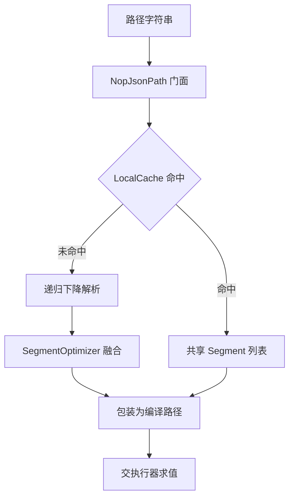
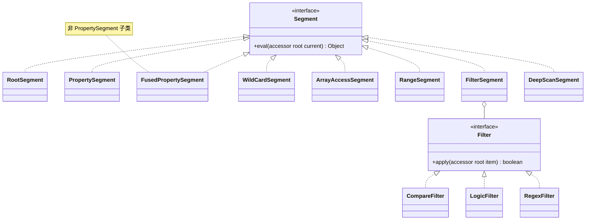
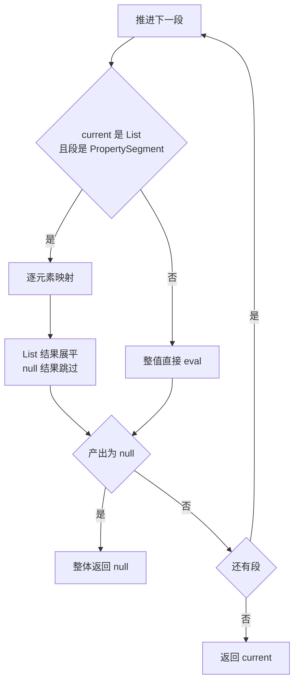

# JSON Path 编译求值线

> 源基线（本文断言的核查范围）：
>
> - ../../nop-kernel/nop-jq/src/main/java/io/nop/jq/jsonpath/JsonPathParser.java（338 行）
> - ../../nop-kernel/nop-jq/src/main/java/io/nop/jq/jsonpath/JsonPathCompiler.java
> - ../../nop-kernel/nop-jq/src/main/java/io/nop/jq/jsonpath/SegmentOptimizer.java
> - ../../nop-kernel/nop-jq/src/main/java/io/nop/jq/jsonpath/JsonPathExecutor.java
> - ../../nop-kernel/nop-jq/src/main/java/io/nop/jq/jsonpath/NopCompiledJsonPath.java（228 行）
> - ../../nop-kernel/nop-jq/src/main/java/io/nop/jq/jsonpath/NopJsonPath.java
> - ../../nop-kernel/nop-jq/src/main/java/io/nop/jq/JsonAccessor.java

一条 JSON Path 字符串的完整生命周期：`NopJsonPath` 门面将其交给进程级共享的 `JsonPathCompiler`（LocalCache，容量 1000）编译为不可变 `Segment` 管道；编译期 `SegmentOptimizer` 把连续属性段融合为单个 `FusedPropertySegment`；求值期 `JsonPathExecutor` 逐段推进，且只对 `PropertySegment` 做列表逐元素传播——融合段不走该分支，这是本线最容易误判的求值语义。写路径（`set`/`remove`）定位父容器后原地修改，缺失的中间容器一律不创建。本线是 nop-jq 内与 jq 求值线并行的独立子系统：jq 线封闭在 `JqValue` 值世界，本线直接操作 Map/List/JavaBean（经 [JsonAccessor 抽象）。术语约定见 [../glossary.md](../glossary.md)。

## 编译管线：字符串到 Segment 管道

编译入口是 `NopJsonPath.compile(path)`，它委托给静态字段 `COMPILER`——一个进程级 `JsonPathCompiler` 实例（NopJsonPath.java:15,20-22）。缓存键就是原始路径字符串，容量默认 1000（JsonPathCompiler.java:13,21-24）；未命中时执行 `doCompile`：先 `JsonPathParser.parse()` 递归下降解析出 `Segment` 列表，再立即过 `SegmentOptimizer.optimize()`（JsonPathCompiler.java:30-34）。缓存的值（`List<Segment>`）被同一路径的所有 `NopCompiledJsonPath` 实例共享；段对象全部无状态（唯一的"状态"是过滤器持有的不可变 `Pattern` 等），共享是安全的。解析任何失败都以 `NopJqException` 抛出，错误码 `ERR_JQ_COMPILE_ERROR`（NOP_JQ-002），携带 `ARG_EXPR` 与 `detail` 参数（JsonPathParser.java:333-337）；`NopJsonPath.compile` 再包一层 catch-all，把非 Nop 异常也归一到同一错误码（NopJsonPath.java:33-38）。

解析器是单遍递归下降（JsonPathParser.java:28-59）：`$` 固定产生首段 `RootSegment`（JsonPathParser.java:39-40），随后按当前字符分派——`.` 进入属性或深扫描，`[` 进入括号形式，其余字符直接报错。因为 `RootSegment` 恒存在，任何合法路径编译出的管道长度 ≥1：单独 `$` 是唯一长度为 1 的管道，这一点决定了执行器"单段快路径"的实际收益面（见求值节）。

段类型与语法形式的一一对应如下表。`Segment` 接口只有一个方法 `eval(accessor, root, current)`，`root` 参数专供过滤器回溯根对象（Segment.java:9-19）。

| 语法形式 | 产物 Segment | 求值语义 | 依据 |
|---|---|---|---|
| `$` | `RootSegment` | 恒返回根对象，恒为管道首段 | RootSegment.java:15-17 |
| `.name` / `['name']` / `[name]` | `PropertySegment` | 取属性；输入 null 则输出 null | PropertySegment.java:20-24，JsonPathParser.java:61-69,102-105,108-111 |
| 连续 ≥2 个属性段 | `FusedPropertySegment` | 顺序 `getProperty` 循环，null 短路 | FusedPropertySegment.java:26-33 |
| `.*` / `[*]` / `[]` | `WildCardSegment`（单例） | 数组→元素列表；对象→值列表；标量→null | WildCardSegment.java:18-38，JsonPathParser.java:62-66,92-99 |
| `[i]` | `ArrayAccessSegment` | 支持负索引；越界返回 null（不抛错） | ArrayAccessSegment.java:29-32 |
| `[s:e]` | `RangeSegment` | 负边界钳位；省略 `e` 编译为 `Integer.MAX_VALUE` 再按长度截断 | RangeSegment.java:36-37，JsonPathParser.java:134-147 |
| `[?(...)]` | `FilterSegment` | 当前值必须是数组，否则 null；逐元素做谓词过滤 | FilterSegment.java:23-37 |
| `..name` / `..['name']` | `DeepScanSegment(name)` | 递归遍历树，收集每个 map 节点上同名属性的非 null 值 | DeepScanSegment.java:29-51 |
| `..` / `..[*]` | `DeepScanSegment(null)` | 恒返回空列表（见边界节） | DeepScanSegment.java:33-38，JsonPathParser.java:81-83,119-122 |

> Sources: [JsonPathCompiler.java:12-35](/nop-kernel/nop-jq/src/main/java/io/nop/jq/jsonpath/JsonPathCompiler.java#L12-L35) [JsonPathParser.java:37-132](/nop-kernel/nop-jq/src/main/java/io/nop/jq/jsonpath/JsonPathParser.java#L37-L132) [JsonPathParser.java:333-337](/nop-kernel/nop-jq/src/main/java/io/nop/jq/jsonpath/JsonPathParser.java#L333-L337) [NopJsonPath.java:15-40](/nop-kernel/nop-jq/src/main/java/io/nop/jq/jsonpath/NopJsonPath.java#L15-L40) [RootSegment.java:15-17](/nop-kernel/nop-jq/src/main/java/io/nop/jq/jsonpath/RootSegment.java#L15-L17)

## Segment 层级与过滤器

段实现分两组：`Segment`（管道步骤）与 `Filter`（仅作为 `FilterSegment` 的谓词参数存在）。关键结构事实：`FusedPropertySegment` 直接实现 `Segment`，它**不是** `PropertySegment` 的子类（FusedPropertySegment.java:11）——这个类型学差异决定了它在执行器中走哪条分支。

过滤器三实现的行为细节（表格如下）。数值比较统一走 `doubleValue` 的 `Double.compare`，因此 int/long/double 混比不丢精度语义；非数值退化为 `Comparable`，再退化为 `toString()` 字典序（CompareFilter.java:44-54）。

| 运算符 | Filter 实现 | 语义要点 |
|---|---|---|
| `==` / `=`（单个等号） | `CompareFilter.EQ` | 单 `=` 在词法层按 `==` 处理（JsonPathParser.java:221-224） |
| `!=` | `CompareFilter.NE` | 实际值为 null 且期望值非 null 时才为 true（CompareFilter.java:28-29） |
| `>` `>=` `<` `<=` | `CompareFilter.GT/GE/LT/LE` | 数值 double 比较 → Comparable → toString 兜底（CompareFilter.java:32-54） |
| `=~` | `RegexFilter` | `Pattern.find()` 子串匹配而非全串匹配；Pattern 在编译期构造（RegexFilter.java:14-17,24） |
| `&&` `\|\|` | `LogicFilter` | 短路求值；与 `&&`/`||` 在同一层循环左结合，无优先级差（LogicFilter.java:24-28，JsonPathParser.java:158-175） |

`&&`/`||` 无优先级是个实际语义差异：`@.a == 1 || @.b == 2 && @.c == 3` 解析为 `((a==1 || b==2) && c==3)`，与 Java 习惯相反（JsonPathParser.java:160-174，扁平 while 循环逐运算符左折叠）。过滤器也不支持括号分组——`parseFilterTerm` 内没有 `(` 分派。

> Sources: [Segment.java:9-19](/nop-kernel/nop-jq/src/main/java/io/nop/jq/jsonpath/Segment.java#L9-L19) [FusedPropertySegment.java:11-33](/nop-kernel/nop-jq/src/main/java/io/nop/jq/jsonpath/FusedPropertySegment.java#L11-L33) [CompareFilter.java:25-54](/nop-kernel/nop-jq/src/main/java/io/nop/jq/jsonpath/CompareFilter.java#L25-L54) [RegexFilter.java:14-25](/nop-kernel/nop-jq/src/main/java/io/nop/jq/jsonpath/RegexFilter.java#L14-L25) [JsonPathParser.java:158-227](/nop-kernel/nop-jq/src/main/java/io/nop/jq/jsonpath/JsonPathParser.java#L158-L227)

## 编译期优化：属性段融合

`SegmentOptimizer` 是本线唯一的编译期优化，规则一句话：扫描段列表，把**连续**的 `PropertySegment` 攒成批，遇到任何非属性段或列表末尾时 flush——单段原样保留，≥2 段打包为 `FusedPropertySegment`（SegmentOptimizer.java:15-41）。以 `$.a.b.c[0].d.e` 为例：

| | 融合前（Parser 产物） | 融合后（缓存中的管道） |
|---|---|---|
| 段序列 | Root, P(a), P(b), P(c), Idx(0), P(d), P(e) | Root, Fused(a.b.c), Idx(0), Fused(d.e) |
| 段数 | 7 | 4 |
| 求值行为 | 三个属性段各自独立 eval | `a.b.c` 一次 eval 内联三步取属性 |

收益是减少"每段一次虚调用 + null 检查"的开销：融合段把 N 步取属性折叠为一个循环（FusedPropertySegment.java:26-33）。代价在求值节展开：融合改变了列表传播语义。深扫描、通配、过滤、索引、切片等任何段都会终止融合窗口——所以只有纯点号链（如 `$.a.b.c`、`$.store.book.title` 前缀）被整体融合，混合路径在每个"异类段"处切开。

> Sources: [SegmentOptimizer.java:12-41](/nop-kernel/nop-jq/src/main/java/io/nop/jq/jsonpath/SegmentOptimizer.java#L12-L41) [FusedPropertySegment.java:26-33](/nop-kernel/nop-jq/src/main/java/io/nop/jq/jsonpath/FusedPropertySegment.java#L26-L33) [JsonPathCompiler.java:30-34](/nop-kernel/nop-jq/src/main/java/io/nop/jq/jsonpath/JsonPathCompiler.java#L30-L34)

## 求值：列表传播与融合段旁路

`JsonPathExecutor.execute`（JsonPathExecutor.java:29-45）的骨架：空管道返回 root（实际不可达，Root 恒在）；长度 1 走快路径直接 `segment.eval`——即只有 `$` 这一条路径受益（见编译管线节）；否则逐段推进，任一段产出 null 立即整体返回 null（JsonPathExecutor.java:41-42）。注意空列表**不是** null，会继续向后传播——`$..author` 深扫描无命中时后续段收到 `[]` 而非提前退出。

核心分叉在 `evalSegment`（JsonPathExecutor.java:47-65）：

`instanceof PropertySegment` 分支（JsonPathExecutor.java:48-63）是唯一的列表传播点：空列表直接原样返回避免分配（51-52 行）；逐元素求值后 `List` 结果 `addAll` 展平一层、null 结果丢弃（56-59 行）。其余一切段（通配、切片、过滤、深扫描、**以及融合段**）拿到 List 都当作单个整体值处理。

这就是融合优化的语义代价：`$..foo.bar.baz` 编译为 Root → DeepScan(foo) → Fused(bar.baz)。深扫描产出 List 后，`evalSegment` 的条件判断 `segment instanceof PropertySegment` 对 `FusedPropertySegment` 为 false，融合段直接对整个 List 调 `accessor.getProperty(list, "bar")`——走 `NopJsonAccessor` 的非 Map 分支进入 BeanTool 反射路径（NopJsonAccessor.java:21-28），而不是像未融合的 `.bar` 那样逐元素映射。同样的旁路发生在 `$.arr[*].x.y` 这类"通配后跟纯属性链"的形态上。 unfused 语义（逐元素）与 fused 语义（整值取属性）在 List 输入上分歧，是本线最需要知道的边界；BeanTool 对 List 取属性的具体返回值取决于 nop-core 反射实现，本页不做断言。

对比之下，`FilterSegment` 对非数组输入返回 null（FilterSegment.java:26-27）、`DeepScanSegment` 对 null 输入静默返回空列表（DeepScanSegment.java:30-31）——各段对"形状不符"的输入一致采取 null/空归一而非抛错，所以本线求值期几乎不存在异常路径（编译期是唯一的报错窗口，见错误模型 [../topics/error-model.md](../topics/error-model.md)）。

`NopCompiledJsonPath` 在此之上提供消费 API：`eval` 复用进程级共享的 `SHARED_EXECUTOR`（NopCompiledJsonPath.java:16，段不可变故线程安全）；`evalOne` 取 List 首元素否则原样返回（38-46 行）；`executeAll` 把 null 归一为空列表、标量包装为单元素列表（JsonPathExecutor.java:70-79）；`size`/`contains`/`containsValue`/`keySet`/`paths` 都是 eval 结果的形状归一封装（NopCompiledJsonPath.java:145-222，其中 `paths` 只对 map/array 子节点递归收集键与索引，198-222 行）。

> Sources: [JsonPathExecutor.java:29-79](/nop-kernel/nop-jq/src/main/java/io/nop/jq/jsonpath/JsonPathExecutor.java#L29-L79) [JsonPathExecutor.java:47-65](/nop-kernel/nop-jq/src/main/java/io/nop/jq/jsonpath/JsonPathExecutor.java#L47-L65) [NopCompiledJsonPath.java:15-46](/nop-kernel/nop-jq/src/main/java/io/nop/jq/jsonpath/NopCompiledJsonPath.java#L15-L46) [NopJsonAccessor.java:20-28](/nop-kernel/nop-jq/src/main/java/io/nop/jq/NopJsonAccessor.java#L20-L28) [FilterSegment.java:22-37](/nop-kernel/nop-jq/src/main/java/io/nop/jq/jsonpath/FilterSegment.java#L22-L37)

## 写语义：set/remove 不创建中间容器

`NopCompiledJsonPath.set`（NopCompiledJsonPath.java:52-99）按最后一段分派，且**只支持三类最后段**：

1. **FusedPropertySegment**（59-76 行）：先执行前面所有段定位父容器，再按属性名逐级 `getProperty` 走到倒数第二级，对最后一级 `setProperty`。任何一级为 null 立即返回 false。
2. **PropertySegment**（84-87 行）：执行前 n-1 段得父容器，`setProperty` 写入；父为 null 返回 false。
3. **ArrayAccessSegment**（88-97 行）：负索引先归一化（`size + index`），越界返回 false——数组不会扩容。

其余最后段（通配、切片、过滤、深扫描）一律返回 false（98 行）。"不创建中间容器"的准确含义：父容器链上任何缺失节点导致 false，而不是自动 `new Map` 补链；但对**已存在**的 Map，`setProperty` 就是 `Map.put`，会写入新键（NopJsonAccessor.java:31-39）。`NopJsonPath.set` 的 javadoc 与该实现一致："Returns false when the parent container ... does not exist; intermediate containers are not created"（NopJsonPath.java:71-78）。`remove` 更窄：融合段与单属性段两条路径都要求最终容器 `instanceof java.util.Map` 才执行键删除，数组元素删除不支持、恒 false（NopCompiledJsonPath.java:124-128,136-141）。

> Sources: [NopCompiledJsonPath.java:52-99](/nop-kernel/nop-jq/src/main/java/io/nop/jq/jsonpath/NopCompiledJsonPath.java#L52-L99) [NopCompiledJsonPath.java:104-143](/nop-kernel/nop-jq/src/main/java/io/nop/jq/jsonpath/NopCompiledJsonPath.java#L104-L143) [NopJsonPath.java:71-78](/nop-kernel/nop-jq/src/main/java/io/nop/jq/jsonpath/NopJsonPath.java#L71-L78) [NopJsonAccessor.java:31-39](/nop-kernel/nop-jq/src/main/java/io/nop/jq/NopJsonAccessor.java#L31-L39)

## 边界与陷阱

- **`DeepScanSegment(null)` 恒返回空列表**。深扫描的递归遍历照常执行，但唯一向结果添加元素的分支被 `propertyName != null` 守卫（DeepScanSegment.java:33-38），名字为 null 时整棵树走完也什么都收不到。语法入口有两条：末尾裸 `..`（JsonPathParser.java:81-83）与 `..[*]`（JsonPathParser.java:119-122）。也就是说 `$..[*]` 不是"深扫描所有节点"，而是恒空。附带一个测试覆盖缺口：`DeepScanTest` 中覆盖 `$..[*]` 的方法缺 `@Test` 注解，未参与构建（DeepScanTest.java:15-40），该行为目前没有运行中的测试钉住。
- **过滤器左值仅支持 `@.prop` 单级**。`parseFilterTerm` 硬编码 `@` `.` 后读一个属性名（JsonPathParser.java:179-181），而属性名读取在 `.` 处截断（277-288 行），所以 `@.a.b == 1` 会在读到 `.` 时报"Unexpected operator"。右值只能是字符串或数字字面量——无布尔、无 null、无 `@` 侧路径互比（JsonPathParser.java:229-238）。
- **`ignoreNullValue` 是死参数**。`compile(path, ignoreNullValue)` 的 javadoc 声称"null 值按缺失处理"，但方法体从未读取该参数（NopJsonPath.java:24-40）；缓存键也不含它，两个重载编译结果必然相同。
- **单 `=` 合法**、`&&`/`||` 无优先级、`=~` 是子串匹配——见过滤器表（编译管线节与 Segment 层级节）。
- **null 与空列表在求值中地位不同**：null 短路整体返回 null（JsonPathExecutor.java:41-42），空列表继续传播并可能被属性段分支原样返回（51-52 行）。因此 `contains`（定义为 `eval != null`，NopCompiledJsonPath.java:156-158）对恒空深扫描 `$..` 返回 true。
- **Fastjson 兼容面**：门面 javadoc 明确 API 命名对齐 `com.alibaba.fastjson.JSONPath` 以便迁移（NopJsonPath.java:10-13），但语法面是子集——无脚本表达式、无嵌套过滤路径、无括号分组（解析器全部分派可见 JsonPathParser.java:42-156）。

> Sources: [DeepScanSegment.java:22-51](/nop-kernel/nop-jq/src/main/java/io/nop/jq/jsonpath/DeepScanSegment.java#L22-L51) [JsonPathParser.java:71-132](/nop-kernel/nop-jq/src/main/java/io/nop/jq/jsonpath/JsonPathParser.java#L71-L132) [JsonPathParser.java:177-238](/nop-kernel/nop-jq/src/main/java/io/nop/jq/jsonpath/JsonPathParser.java#L177-L238) [NopJsonPath.java:24-40](/nop-kernel/nop-jq/src/main/java/io/nop/jq/jsonpath/NopJsonPath.java#L24-L40) [NopCompiledJsonPath.java:145-158](/nop-kernel/nop-jq/src/main/java/io/nop/jq/jsonpath/NopCompiledJsonPath.java#L145-L158)

## 与 jq 线的边界

nop-jq 内两条查询线无代码交叉：`io.nop.jq.jq` 子包（lexer/parser/AST/runtime）对 `jsonpath` 包与 `JsonAccessor` 的引用为零（grep 核验，2026-09-26）。两者差异在值世界：本线直接操作 Map/List/JavaBean，`JsonAccessor` 接口屏蔽三者差异（JsonAccessor.java:5-8），`isMap` 显式排除数组与简单类型（NopJsonAccessor.java:63-69）；jq 线封闭于 `JqValue` 值模型，有自己的 AST 与执行器。实际交汇只有两处，且都在本线一侧：其一，`NopJqErrors` 错误码族共享，本线只消费 `ERR_JQ_COMPILE_ERROR`（JsonPathParser.java:334，NopJsonPath.java:36）；其二，`JqJPathInitializer` 在平台初始化时注册 SPI，把 nop-core 遗留的 `io.nop.core.lang.json.jpath.JPath` 请求委托给 `NopJsonPath` 的 eval/evalOne/set/remove（JqJPathInitializer.java:33-35,42-63）。错误体系双轨的全貌见 [../topics/error-model.md](../topics/error-model.md)。

> Sources: [JsonAccessor.java:5-62](/nop-kernel/nop-jq/src/main/java/io/nop/jq/JsonAccessor.java#L5-L62) [NopJsonAccessor.java:63-74](/nop-kernel/nop-jq/src/main/java/io/nop/jq/NopJsonAccessor.java#L63-L74) [JqJPathInitializer.java:26-63](/nop-kernel/nop-jq/src/main/java/io/nop/jq/JqJPathInitializer.java#L26-L63) [JsonPathParser.java:333-337](/nop-kernel/nop-jq/src/main/java/io/nop/jq/jsonpath/JsonPathParser.java#L333-L337)

## Sources

- [../../nop-kernel/nop-jq/src/main/java/io/nop/jq/jsonpath/JsonPathParser.java:37-59](/nop-kernel/nop-jq/src/main/java/io/nop/jq/jsonpath/JsonPathParser.java#L37-L59)
- [../../nop-kernel/nop-jq/src/main/java/io/nop/jq/jsonpath/JsonPathParser.java:71-132](/nop-kernel/nop-jq/src/main/java/io/nop/jq/jsonpath/JsonPathParser.java#L71-L132)
- [../../nop-kernel/nop-jq/src/main/java/io/nop/jq/jsonpath/JsonPathParser.java:158-238](/nop-kernel/nop-jq/src/main/java/io/nop/jq/jsonpath/JsonPathParser.java#L158-L238)
- [../../nop-kernel/nop-jq/src/main/java/io/nop/jq/jsonpath/JsonPathParser.java:277-337](/nop-kernel/nop-jq/src/main/java/io/nop/jq/jsonpath/JsonPathParser.java#L277-L337)
- [../../nop-kernel/nop-jq/src/main/java/io/nop/jq/jsonpath/JsonPathCompiler.java:12-35](/nop-kernel/nop-jq/src/main/java/io/nop/jq/jsonpath/JsonPathCompiler.java#L12-L35)
- [../../nop-kernel/nop-jq/src/main/java/io/nop/jq/jsonpath/SegmentOptimizer.java:12-41](/nop-kernel/nop-jq/src/main/java/io/nop/jq/jsonpath/SegmentOptimizer.java#L12-L41)
- [../../nop-kernel/nop-jq/src/main/java/io/nop/jq/jsonpath/JsonPathExecutor.java:29-79](/nop-kernel/nop-jq/src/main/java/io/nop/jq/jsonpath/JsonPathExecutor.java#L29-L79)
- [../../nop-kernel/nop-jq/src/main/java/io/nop/jq/jsonpath/NopCompiledJsonPath.java:15-99](/nop-kernel/nop-jq/src/main/java/io/nop/jq/jsonpath/NopCompiledJsonPath.java#L15-L99)
- [../../nop-kernel/nop-jq/src/main/java/io/nop/jq/jsonpath/NopCompiledJsonPath.java:104-222](/nop-kernel/nop-jq/src/main/java/io/nop/jq/jsonpath/NopCompiledJsonPath.java#L104-L222)
- [../../nop-kernel/nop-jq/src/main/java/io/nop/jq/jsonpath/NopJsonPath.java:10-121](/nop-kernel/nop-jq/src/main/java/io/nop/jq/jsonpath/NopJsonPath.java#L10-L121)
- [../../nop-kernel/nop-jq/src/main/java/io/nop/jq/jsonpath/RootSegment.java:15-17](/nop-kernel/nop-jq/src/main/java/io/nop/jq/jsonpath/RootSegment.java#L15-L17)
- [../../nop-kernel/nop-jq/src/main/java/io/nop/jq/jsonpath/PropertySegment.java:20-24](/nop-kernel/nop-jq/src/main/java/io/nop/jq/jsonpath/PropertySegment.java#L20-L24)
- [../../nop-kernel/nop-jq/src/main/java/io/nop/jq/jsonpath/FusedPropertySegment.java:11-33](/nop-kernel/nop-jq/src/main/java/io/nop/jq/jsonpath/FusedPropertySegment.java#L11-L33)
- [../../nop-kernel/nop-jq/src/main/java/io/nop/jq/jsonpath/WildCardSegment.java:18-38](/nop-kernel/nop-jq/src/main/java/io/nop/jq/jsonpath/WildCardSegment.java#L18-L38)
- [../../nop-kernel/nop-jq/src/main/java/io/nop/jq/jsonpath/ArrayAccessSegment.java:29-32](/nop-kernel/nop-jq/src/main/java/io/nop/jq/jsonpath/ArrayAccessSegment.java#L29-L32)
- [../../nop-kernel/nop-jq/src/main/java/io/nop/jq/jsonpath/RangeSegment.java:36-37](/nop-kernel/nop-jq/src/main/java/io/nop/jq/jsonpath/RangeSegment.java#L36-L37)
- [../../nop-kernel/nop-jq/src/main/java/io/nop/jq/jsonpath/FilterSegment.java:22-37](/nop-kernel/nop-jq/src/main/java/io/nop/jq/jsonpath/FilterSegment.java#L22-L37)
- [../../nop-kernel/nop-jq/src/main/java/io/nop/jq/jsonpath/DeepScanSegment.java:22-51](/nop-kernel/nop-jq/src/main/java/io/nop/jq/jsonpath/DeepScanSegment.java#L22-L51)
- [../../nop-kernel/nop-jq/src/main/java/io/nop/jq/jsonpath/CompareFilter.java:25-54](/nop-kernel/nop-jq/src/main/java/io/nop/jq/jsonpath/CompareFilter.java#L25-L54)
- [../../nop-kernel/nop-jq/src/main/java/io/nop/jq/jsonpath/RegexFilter.java:14-25](/nop-kernel/nop-jq/src/main/java/io/nop/jq/jsonpath/RegexFilter.java#L14-L25)
- [../../nop-kernel/nop-jq/src/main/java/io/nop/jq/jsonpath/LogicFilter.java:24-28](/nop-kernel/nop-jq/src/main/java/io/nop/jq/jsonpath/LogicFilter.java#L24-L28)
- [../../nop-kernel/nop-jq/src/main/java/io/nop/jq/JsonAccessor.java:5-62](/nop-kernel/nop-jq/src/main/java/io/nop/jq/JsonAccessor.java#L5-L62)
- [../../nop-kernel/nop-jq/src/main/java/io/nop/jq/NopJsonAccessor.java:20-74](/nop-kernel/nop-jq/src/main/java/io/nop/jq/NopJsonAccessor.java#L20-L74)
- [../../nop-kernel/nop-jq/src/main/java/io/nop/jq/JqJPathInitializer.java:26-63](/nop-kernel/nop-jq/src/main/java/io/nop/jq/JqJPathInitializer.java#L26-L63)
