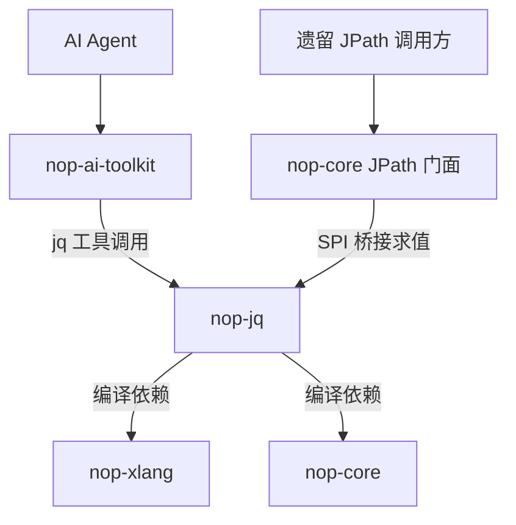

# nop-jq 总览：平台里的 jq 查询引擎

> nop-jq 是 Nop 平台内嵌的 jq 查询引擎，含两条能力线：一条按 jq 1.7.1 官方语义实现完整 jq 语言，以官方套件 430/430 动态用例为语义基线；另一条是 fastjson 兼容的独立 JSON Path 实现。模块运行时仅依赖 nop-core/nop-commons/nop-xlang，对外承担两个角色：经 nop-ai-toolkit 把 jq 暴露为 AI 工具；经 SPI 桥接恢复 nop-core 遗留 JPath 的求值。
>
> 源文件基准（链接相对 deepwiki-v3/ 目录，已验证）：
>
> - [../src/main/java/io/nop/jq/jq/JqEngine.java](../src/main/java/io/nop/jq/jq/JqEngine.java) — jq 编译门面，静态缓存 1000 条
> - [../src/main/java/io/nop/jq/jq/IJsonQuery.java](../src/main/java/io/nop/jq/jq/IJsonQuery.java) — 编译产物接口：apply/applyOne
> - [../src/main/java/io/nop/jq/jsonpath/NopJsonPath.java](../src/main/java/io/nop/jq/jsonpath/NopJsonPath.java) — JSON Path 门面，fastjson 兼容签名
> - [../src/main/java/io/nop/jq/JqJPathInitializer.java](../src/main/java/io/nop/jq/JqJPathInitializer.java) — JPath 求值桥接注册
> - [../src/main/java/io/nop/jq/NopJqErrors.java](../src/main/java/io/nop/jq/NopJqErrors.java) — NOP_JQ-001..008 错误码
> - [../../../nop-ai/nop-ai-toolkit/src/main/java/io/nop/ai/toolkit/tools/JqToolExecutor.java](../../../nop-ai/nop-ai-toolkit/src/main/java/io/nop/ai/toolkit/tools/JqToolExecutor.java) — AI 工具消费者（工具名 jq）
> - [../../../nop-kernel/nop-core/src/main/java/io/nop/core/lang/json/jpath/JPath.java](../../../nop-kernel/nop-core/src/main/java/io/nop/core/lang/json/jpath/JPath.java) — 遗留门面：编译保留、求值委托

## 定位与解决的问题

模块坐标 `io.github.entropy-cloud:nop-jq`，属 nop-kernel 分组（pom.xml:7-13）。它回答三个问题：

1. **在 JVM 上按官方语义执行 jq 程序**。测试套件 vendor jq 1.7.1 release `tests/jq.test` 原文 447 块，430 个动态用例（421 ok + 9 %%FAIL）全部通过；harness 不静默跳过，编译错误、运行时错误、输出不匹配都判失败（TestJqOfficial.java:16-27）。
2. **给存量 JSONPath 使用者一个无第三方运行时依赖的替代**。`NopJsonPath` 的 API 名与签名跟随 fastjson `com.alibaba.fastjson.JSONPath` 以便迁移（NopJsonPath.java:10-14）；jayway json-path 仅 test scope（pom.xml:59-63）。
3. **恢复平台遗留 JPath 的求值**。nop-core 的 `JPath` 保留编译、求值委托给已注册的 `JPathEvaluator`，无注册时快速失败 `nop.err.core.jpath.no-evaluator`（JPath.java:15-25）；本模块在 IoC 消费 JPath 之前注册桥接（JqJPathInitializer.java:27-40）。

> Sources: pom.xml:7-13,23-37,59-63；NopJsonPath.java:10-14；JPath.java:15-25；JqJPathInitializer.java:27-40；TestJqOfficial.java:16-27；ai-dev/logs/2026/09-25.md:22,29

## 在平台中的位置

上游消费者 nop-ai-toolkit：`JqToolExecutor` 注册工具名 `jq`（JqToolExecutor.java:19），从工具调用取 `expression` 与 `data` 字段，`JsonTool.parse` 后经 `JqEngine.compile(expr).apply(root)` 求值，多输出按行拼接返回；`JqRuntimeException` 的 error 消息原样返回给 agent（JqToolExecutor.java:31-67）。

存量消费者 nop-core：`JqJPathInitializer` 经 ServiceLoader 发现，把 `eval/evalOne/set/remove` 四个操作委托到 `NopJsonPath`（JqJPathInitializer.java:42-63），执行时机在组件注册之后、IoC 启动之前（JqJPathInitializer.java:27-30）。

> Sources: JqToolExecutor.java:19,31-67；JqJPathInitializer.java:27-30,42-63

## 能力边界

语义基线是官方套件而非近似子集：解析器/执行器以 jq 1.7.1 为目标语义（ai-dev/logs/2026/09-25.md:20），套件明确排除 12 个依赖外部模块的块（447 块 = 421 ok + 12 模块依赖跳过 + 9 %%FAIL + 5 IGNORE，ai-dev/logs/2026/09-25.md:22,43）。

关键数字：

| 数字 | 含义 | 依据 |
|---|---|---|
| 430/430 | 官方套件动态用例（421 ok + 9 %%FAIL）全部通过 | TestJqOfficial.java:16-30；ai-dev/logs/2026/09-25.md:29,43 |
| 145 | `BUILTIN_NAMES` 内建函数名/元数条目 | JqBuiltins.java:209-236 |
| 39 | sealed AST 节点类型数 | JqAstNode.java:7-18 |
| 1000 | JqEngine 编译缓存容量（DEFAULT_CACHE_SIZE） | JqEngine.java:15 |
| 8 | NOP_JQ 错误码（NOP_JQ-001..008） | NopJqErrors.java:15-38 |

两条能力线的分工：

| 维度 | jq 引擎线（jq.jq / jq.jq.runtime） | JSON Path 线（jsonpath） |
|---|---|---|
| 入口 | `JqEngine.compile`，按表达式文本缓存（JqEngine.java:22-24） | `NopJsonPath.compile/eval`，无编译缓存（NopJsonPath.java:15,20-40） |
| 语言语义 | jq 1.7.1：多输出流、管道、reduce、路径赋值 `\|=` | fastjson JSONPath 兼容 API（NopJsonPath.java:10-14） |
| 编译产物 | `JqDirectQuery`，持有 AST（JqEngine.java:26-32） | `NopCompiledJsonPath`，持有 Segment 列表（NopJsonPath.java:39） |
| 读改能力 | `apply/applyOne` 读 + `\|=`/`del()` 路径改写（IJsonQuery.java:10-29） | `eval/set/remove/size/contains/containsValue/keySet/paths`（NopJsonPath.java:45-121） |
| 错误 | `JqRuntimeException`（jq error 值语义） | `NopJqException` + NOP_JQ-001..008（NopJqErrors.java:15-38） |

边界事实：`jsonvalue` 包的不可变值模型当前无生产消费者（PLAN.md:13）；JPath 桥接仅覆盖上述四方法，`JPath.compile` 本就不经过本模块（JqJPathInitializer.java:44-62）。细节见 [jq 运行时](modules/jq-runtime.md)、[JSON Path 线](modules/jsonpath.md)、[错误模型](topics/error-model.md)。

> Sources: ai-dev/logs/2026/09-25.md:20-43；JqBuiltins.java:209-236；JqAstNode.java:7-18；JqEngine.java:15-32；NopJsonPath.java:15-40,45-121；IJsonQuery.java:10-29；PLAN.md:13

## 继续阅读

- 动手前看 [快速上手](quickstart.md)（同批）与 [术语表](glossary.md)
- 结构与取舍：[架构](architecture.md)（同批）；按序阅读路径见 [阅读指南](reading-guide.md)（同批）
- 机制细读：[查询管线](flows/query-pipeline.md)、[路径赋值](flows/path-assign.md)
- 模块与专题：[jq 运行时](modules/jq-runtime.md)、[JSON Path 线](modules/jsonpath.md)、[错误模型](topics/error-model.md)

> Sources: 导航段，无新断言

## Sources

- [nop-kernel/nop-jq/pom.xml:7-13](/nop-kernel/nop-jq/pom.xml#L7-L13)
- [nop-kernel/nop-jq/pom.xml:23-37](/nop-kernel/nop-jq/pom.xml#L23-L37)
- [nop-kernel/nop-jq/pom.xml:59-63](/nop-kernel/nop-jq/pom.xml#L59-L63)
- [nop-kernel/nop-jq/src/main/java/io/nop/jq/jq/JqEngine.java:14-33](/nop-kernel/nop-jq/src/main/java/io/nop/jq/jq/JqEngine.java#L14-L33)
- [nop-kernel/nop-jq/src/main/java/io/nop/jq/jq/IJsonQuery.java:10-29](/nop-kernel/nop-jq/src/main/java/io/nop/jq/jq/IJsonQuery.java#L10-L29)
- [nop-kernel/nop-jq/src/main/java/io/nop/jq/jq/runtime/JqBuiltins.java:209-236](/nop-kernel/nop-jq/src/main/java/io/nop/jq/jq/runtime/JqBuiltins.java#L209-L236)
- [nop-kernel/nop-jq/src/main/java/io/nop/jq/jq/ast/JqAstNode.java:7-18](/nop-kernel/nop-jq/src/main/java/io/nop/jq/jq/ast/JqAstNode.java#L7-L18)
- [nop-kernel/nop-jq/src/main/java/io/nop/jq/jsonpath/NopJsonPath.java:10-40](/nop-kernel/nop-jq/src/main/java/io/nop/jq/jsonpath/NopJsonPath.java#L10-L40)
- [nop-kernel/nop-jq/src/main/java/io/nop/jq/jsonpath/NopJsonPath.java:45-121](/nop-kernel/nop-jq/src/main/java/io/nop/jq/jsonpath/NopJsonPath.java#L45-L121)
- [nop-kernel/nop-jq/src/main/java/io/nop/jq/NopJqErrors.java:15-38](/nop-kernel/nop-jq/src/main/java/io/nop/jq/NopJqErrors.java#L15-L38)
- [nop-kernel/nop-jq/src/main/java/io/nop/jq/JqJPathInitializer.java:27-40](/nop-kernel/nop-jq/src/main/java/io/nop/jq/JqJPathInitializer.java#L27-L40)
- [nop-kernel/nop-jq/src/main/java/io/nop/jq/JqJPathInitializer.java:42-63](/nop-kernel/nop-jq/src/main/java/io/nop/jq/JqJPathInitializer.java#L42-L63)
- [nop-kernel/nop-jq/src/test/java/io/nop/jq/jq/TestJqOfficial.java:16-30](/nop-kernel/nop-jq/src/test/java/io/nop/jq/jq/TestJqOfficial.java#L16-L30)
- [nop-kernel/nop-jq/src/test/resources/io/nop/jq/jq/jq-official.test:1-2117](/nop-kernel/nop-jq/src/test/resources/io/nop/jq/jq/jq-official.test#L1-L2117)
- [nop-kernel/nop-core/src/main/java/io/nop/core/lang/json/jpath/JPath.java:15-25](/nop-kernel/nop-core/src/main/java/io/nop/core/lang/json/jpath/JPath.java#L15-L25)
- [nop-ai/nop-ai-toolkit/src/main/java/io/nop/ai/toolkit/tools/JqToolExecutor.java:19-67](/nop-ai/nop-ai-toolkit/src/main/java/io/nop/ai/toolkit/tools/JqToolExecutor.java#L19-L67)
- [nop-kernel/nop-jq/deepwiki-v3/PLAN.md:13](/nop-kernel/nop-jq/deepwiki-v3/PLAN.md#L13)
- [ai-dev/logs/2026/09-25.md:20-43](/ai-dev/logs/2026/09-25.md#L20-L43)
