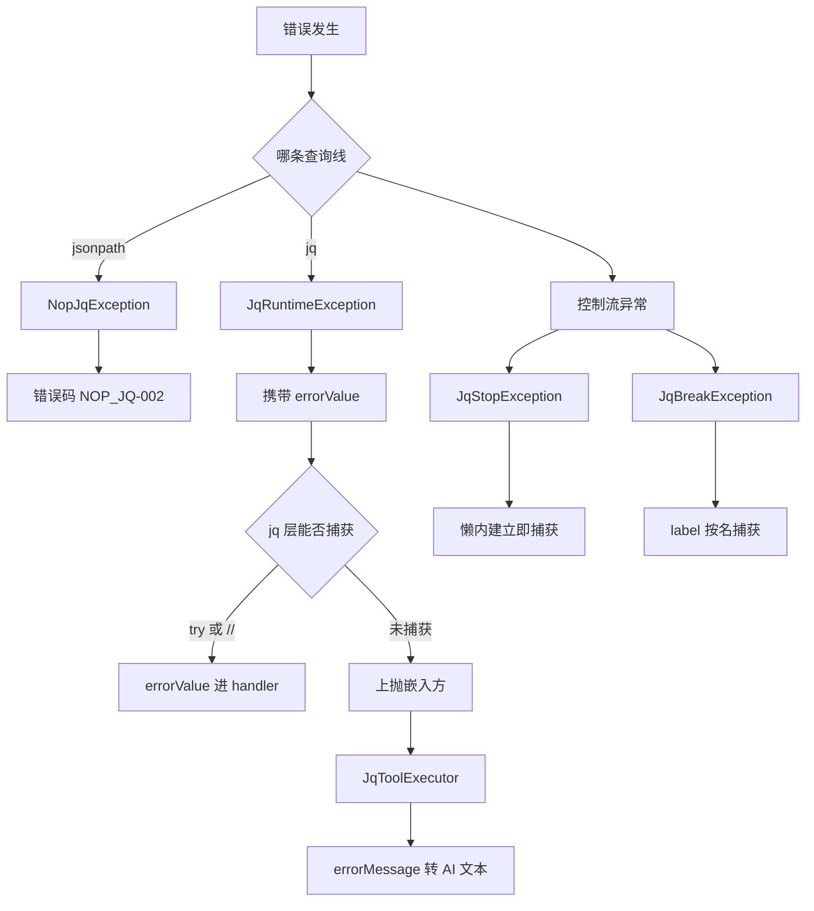

# 错误模型：双轨错误体系

> 源基线（本文断言的核查范围）：
>
> - ../../src/main/java/io/nop/jq/NopJqErrors.java（38 行）
> - ../../src/main/java/io/nop/jq/NopJqException.java（14 行）
> - ../../src/main/java/io/nop/jq/jq/runtime/JqRuntimeException.java（37 行）
> - ../../src/main/java/io/nop/jq/jq/runtime/JqStopException.java（14 行）
> - ../../src/main/java/io/nop/jq/jq/runtime/JqBreakException.java（19 行）
> - ../../src/main/java/io/nop/jq/jq/runtime/JqHaltException.java（17 行）
> - ../../src/main/java/io/nop/jq/jq/runtime/JqInvalidPathException.java（18 行）
> - ../../src/main/java/io/nop/jq/jsonpath/JsonPathParser.java
> - ../../src/main/java/io/nop/jq/jsonpath/NopJsonPath.java
> - ../../src/main/java/io/nop/jq/jq/runtime/JqExecutor.java
> - ../../src/main/java/io/nop/jq/jq/runtime/JqBuiltins.java
> - ../../../../nop-ai/nop-ai-toolkit/src/main/java/io/nop/ai/toolkit/tools/JqToolExecutor.java（68 行）

nop-jq 的错误表示分两轨：**jsonpath 线**用 `NopJqException` + `ErrorCode` 错误码族（`NopJqErrors`，NOP_JQ-001..008，实际只有 NOP_JQ-002 有抛出点）；**jq 求值线**全生命周期用 `JqRuntimeException`（携带 jq error value，另有 Break/Stop 两个非错误控制流异常）。两线无代码交叉，选型由"你调用哪条线"唯一决定，不由错误性质决定。求值语义见 [../modules/jq-runtime.md](../modules/jq-runtime.md)，jsonpath 线全貌见 [../modules/jsonpath.md](../modules/jsonpath.md)。

## 双轨分工：两条查询线，两套错误类型

一句话分工：**jsonpath 线只在编译期抛 `NopJqException`（唯一错误码 NOP_JQ-002），求值期不抛任何异常；jq 线在编译期和求值期都抛 `JqRuntimeException`，控制流用专门的非错误异常表达。**

| 轨道 | 异常类型 | 触发阶段 | 消费者 | 典型场景 |
|---|---|---|---|---|
| jsonpath 线 | `NopJqException`（`NopException` 子类，带 `ErrorCode`） | 仅编译期 | `NopJsonPath`/`NopCompiledJsonPath` 的 Java 调用方 | 路径语法非法 |
| jq 线（真异常） | `JqRuntimeException`（`RuntimeException` 子类，携带 `JqValue` error value） | 编译期 + 求值期 | jq 层 `try`/`//`；未捕获则嵌入方（JqToolExecutor、测试 harness） | 类型错误、`error` 内建、资源预算超限 |
| jq 线（控制流） | `JqStopException` / `JqBreakException` | 求值期 | executor 自身、`label` 求值 | `limit`/`first`/`any`/`all` 短路；`label`/`break` |
| jq 线（子类） | `JqHaltException` / `JqInvalidPathException` | 求值期 | 同 `JqRuntimeException` | `halt_error` 带退出码退出；路径赋值遇到非路径值 |

两线选型的实际含义：调用 `NopJsonPath.eval/set/remove` 只需防 `NopJqException`（且仅编译期触发）；调用 `JqEngine.compile` + `IJsonQuery.apply` 则必须预期 `JqRuntimeException` 在**编译和求值两个时刻**出现——`JqEngine.compile` 不做任何包装，词法/语法错误以 `JqRuntimeException` 原样穿出（JqEngine.java:22-32；JqLexer.java:142,171,230,256；JqParser.java:1044-1046）。

> Sources: [JqEngine.java:22-32](/nop-kernel/nop-jq/src/main/java/io/nop/jq/jq/JqEngine.java#L22-L32) [NopJsonPath.java:29-39](/nop-kernel/nop-jq/src/main/java/io/nop/jq/jsonpath/NopJsonPath.java#L29-L39) [JqLexer.java:138-258](/nop-kernel/nop-jq/src/main/java/io/nop/jq/jq/JqLexer.java#L138-L258) [JqParser.java:1044-1046](/nop-kernel/nop-jq/src/main/java/io/nop/jq/jq/JqParser.java#L1044-L1046)

## NOP_JQ-001..008 错误码全表

错误码在 `NopJqErrors` 中以 `ErrorCode.define("NOP_JQ-xxx", 模板)` 定义，模板占位符 `{path}`/`{expr}`/`{index}`/`{item}` 由 `NopException.param()` 填充，参数名常量 `ARG_EXPR/ARG_PATH/ARG_INDEX/ARG_ITEM` 同文件声明（NopJqErrors.java:10-37）。全仓库 grep 核验（2026-09-26，含测试）：**只有 NOP_JQ-002 有抛出点**；其余七码自引入提交 40d64b4114 起从未被引用，属预留未用。

| 错误码 | 常量 | 消息模板 | 实际抛出点 |
|---|---|---|---|
| NOP_JQ-001 | `ERR_JQ_INVALID_PATH` | Invalid JsonPath expression: {path} | 预留未用 |
| NOP_JQ-002 | `ERR_JQ_COMPILE_ERROR` | Failed to compile JsonPath expression: {expr} | `JsonPathParser.error()`（JsonPathParser.java:333-337），解析器 11 处报错共用；`NopJsonPath.compile` 再兜底归一非 Nop 异常到同一错误码（NopJsonPath.java:33-38） |
| NOP_JQ-003 | `ERR_JQ_INDEX_OUT_OF_BOUNDS` | Array index out of bounds: {index} | 预留未用；越界实际返回 null（ArrayAccessSegment.java:29-30） |
| NOP_JQ-004 | `ERR_JQ_NOT_ARRAY` | Expected array but got {item} | 预留未用；非数组输入实际返回 null（ArrayAccessSegment.java:25-26） |
| NOP_JQ-005 | `ERR_JQ_NOT_OBJECT` | Expected object but got {item} | 预留未用 |
| NOP_JQ-006 | `ERR_JQ_FILTER_ERROR` | Filter evaluation failed for expression: {expr} | 预留未用 |
| NOP_JQ-007 | `ERR_JQ_SET_FAILED` | Failed to set value at path: {path} | 预留未用；`set` 失败实际返回 false（NopCompiledJsonPath.java:52-99） |
| NOP_JQ-008 | `ERR_JQ_REMOVE_FAILED` | Failed to remove value at path: {path} | 预留未用；`remove` 失败实际返回 false（NopCompiledJsonPath.java:104-143） |

预留未用的机制性原因：jsonpath 求值期被设计为**零 throw**——除解析器外 `jsonpath/*.java` 无任何 throw 语句（grep 核验），取值缺失退化为 null（如 `[i]` 越界，ArrayAccessSegment.java:21-33），写失败退化为 false（`set`/`remove` 的布尔返回契约，NopJsonPath.java:72-85）。003..008 描述的失败模式在代码里都有非异常出路，错误码因此没有触发场景。`ARG_PATH/ARG_INDEX/ARG_ITEM` 三个参数常量同样无使用点，只有 `ARG_EXPR` 被两处抛出点引用（JsonPathParser.java:335；NopJsonPath.java:37）。

`NopJqException` 本身是无行为子类：仅透传 `ErrorCode`（及 cause）给 `NopException` 的两个构造器（NopJqException.java:6-14），错误码的语义全部在 `ErrorCode` 定义与 `.param()` 填充侧。

> Sources: [NopJqErrors.java:9-38](/nop-kernel/nop-jq/src/main/java/io/nop/jq/NopJqErrors.java#L9-L38) [NopJqException.java:6-14](/nop-kernel/nop-jq/src/main/java/io/nop/jq/NopJqException.java#L6-L14) [JsonPathParser.java:333-337](/nop-kernel/nop-jq/src/main/java/io/nop/jq/jsonpath/JsonPathParser.java#L333-L337) [NopJsonPath.java:29-39](/nop-kernel/nop-jq/src/main/java/io/nop/jq/jsonpath/NopJsonPath.java#L29-L39) [ArrayAccessSegment.java:21-33](/nop-kernel/nop-jq/src/main/java/io/nop/jq/jsonpath/ArrayAccessSegment.java#L21-L33) [NopCompiledJsonPath.java:52-143](/nop-kernel/nop-jq/src/main/java/io/nop/jq/jsonpath/NopCompiledJsonPath.java#L52-L143)

## jq 线：JqRuntimeException 与 error value

`JqRuntimeException extends RuntimeException`，核心是携带一个 `JqValue errorValue`——jq 程序里错误的**值**形态（JqRuntimeException.java:8-18）。三个构造器约定：字符串消息自动包装为 `JqString` 作为 error value（11-13）；带 cause 时 error value 取消息（20-23）。两个读取语义不同：`errorValue()` 是 `try` 的 handler 收到的输入（JqExecutor.java:252-255）；`errorMessage()` 是给人看的文本——字符串错误返回字符串本身，非字符串错误返回该值的 jq 规范渲染，与 jq 打印错误的方式一致（JqRuntimeException.java:30-36，实现即 `errorValue.toString()`）。

抛出点全仓库 104 处 `new JqRuntimeException`，分布在 11 个文件（grep 核验，2026-09-26），按来源分五类：

| 来源 | 场景 | 依据 |
|---|---|---|
| 编译期词法/语法 | 非法字符、未终止字符串/插值；解析错误统一为 "Parse error: ... at position N" | JqLexer.java:142,171,230,256；JqParser.java:1044-1046；插值子表达式错误被转译重抛（JqParser.java:585-596） |
| 求值期类型错误 | "Cannot index/iterate over X"、"cannot be negated"、算术除零、`as*` 类型断言失败 | JqExecutor.java:125,207,486-545,1002-1010；JqValue.java:50-55 |
| 函数解析 | 未定义函数、参数个数不符 | JqExecutor.java:754,766 |
| 资源预算 | 调用深度超 2000、输出量超 100 万 | JqEnvironment.java:15,17,96-99,108-112 |
| `error`/`halt`/`halt_error` 内建 | 程序主动出错或带退出码终止 | JqExecutor.java:381-388；JqBuiltins.java:172-177,1129-1138 |

`error` 内建的抛出路径展示了 error value 的构造规则：`errorFor(errorValue)` 对 `JqString` 用字符串本身做消息，其他值用 `JqPrinter.print` 的规范渲染做消息、原值做 error value（JqExecutor.java:861-866）。因此 jq 层 `try f catch g` 捕获后，`g` 拿到的是原始 error value（可以是对象、数组），而嵌入方拿到的是渲染后的字符串——同一个错误，两种投影。

> Sources: [JqRuntimeException.java:3-37](/nop-kernel/nop-jq/src/main/java/io/nop/jq/jq/runtime/JqRuntimeException.java#L3-L37) [JqExecutor.java:246-258](/nop-kernel/nop-jq/src/main/java/io/nop/jq/jq/runtime/JqExecutor.java#L246-L258) [JqExecutor.java:861-866](/nop-kernel/nop-jq/src/main/java/io/nop/jq/jq/runtime/JqExecutor.java#L861-L866) [JqBuiltins.java:168-177](/nop-kernel/nop-jq/src/main/java/io/nop/jq/jq/runtime/JqBuiltins.java#L168-L177) [JqEnvironment.java:96-112](/nop-kernel/nop-jq/src/main/java/io/nop/jq/jq/runtime/JqEnvironment.java#L96-L112)

## 控制流异常：不是错误的异常

jq 线有两个异常**不代表错误**，类型体系把它们与 `JqRuntimeException` 分开，捕获点必须显式放行：

| 异常 | 角色 | 抛出点 | 捕获点 | 能否被 jq `try` 捕获 |
|---|---|---|---|---|
| `JqStopException` | 输出短路信号（limit/first/any/all/isempty 拿够了） | executor 入口检查（JqExecutor.java:40-44）；`JqShortCircuitList.checkStop`（JqShortCircuitList.java:20-23） | 懒内建即刻捕获：`take`（JqBuiltins.java:263-267）、生成器扫描（JqBuiltins.java:283-287） | 否——`try`/`//`/`fromjson` 显式 rethrow（JqExecutor.java:250-251,409-410；JqBuiltins.java:378-379） |
| `JqBreakException` | `label`/`break` 控制流，携带 label 名与返回值 | `visitBreak`（JqExecutor.java:272-274） | 同名 `label` 的 `visitLabel`（JqExecutor.java:260-270），名字不符继续上抛（264-266） | 否，同上 |

`JqStopException` 是私有构造的单例 `INSTANCE`，用 `super(null, null, false, false)` 关闭栈追踪以消除短路热路径上的填栈开销（JqStopException.java:9-13）；其 javadoc 明确约定"绝不能逃出 executor：懒内建立刻捕获"（JqStopException.java:3-7）。

另有两个 `JqRuntimeException` 的**子类**，类型上属于真异常、可被 jq `try` 捕获，但语义特化：

- `JqHaltException`：`halt_error` 抛出，携带请求的进程退出码（默认 5，可由参数指定）（JqHaltException.java:9-16；JqBuiltins.java:1130-1138）。仓库内没有任何代码读取 `exitCode()`（grep 核验，2026-09-26）——它只能被传递给嵌入方处理；又因其是 `JqRuntimeException` 子类，jq 层 `try` 同样能拦住它（JqExecutor.java:250-252 的 catch 范围）。
- `JqInvalidPathException`：仅用于路径赋值（`|=`）——当路径位置的 filter 产出普通值而非路径时抛出，携带越界值供 jq 风格错误文本使用（JqInvalidPathException.java:3-18）；`JqPathEval` 捕获后重抛并附上"非法路径表达式 near attempt ..."上下文（JqPathEval.java:68-70,108-112,143-144）。

判定一条异常是否为"真错误"的唯一标准是类型：`JqRuntimeException` 及其子类可被 jq 层捕获处理；`JqStopException`/`JqBreakException` 是内部控制流，任何用户可见的捕获语义都必须放行它们（三处捕获点均遵循该规则，JqExecutor.java:250-251,409-410；JqBuiltins.java:378-379）。

> Sources: [JqStopException.java:3-14](/nop-kernel/nop-jq/src/main/java/io/nop/jq/jq/runtime/JqStopException.java#L3-L14) [JqBreakException.java:3-19](/nop-kernel/nop-jq/src/main/java/io/nop/jq/jq/runtime/JqBreakException.java#L3-L19) [JqExecutor.java:40-44](/nop-kernel/nop-jq/src/main/java/io/nop/jq/jq/runtime/JqExecutor.java#L40-L44) [JqExecutor.java:260-274](/nop-kernel/nop-jq/src/main/java/io/nop/jq/jq/runtime/JqExecutor.java#L260-L274) [JqBuiltins.java:259-289](/nop-kernel/nop-jq/src/main/java/io/nop/jq/jq/runtime/JqBuiltins.java#L259-L289) [JqHaltException.java:3-17](/nop-kernel/nop-jq/src/main/java/io/nop/jq/jq/runtime/JqHaltException.java#L3-L17) [JqInvalidPathException.java:3-18](/nop-kernel/nop-jq/src/main/java/io/nop/jq/jq/runtime/JqInvalidPathException.java#L3-L18) [JqPathEval.java:68-112](/nop-kernel/nop-jq/src/main/java/io/nop/jq/jq/runtime/JqPathEval.java#L68-L112)

## 消费方回传：JqToolExecutor 与 AI 工具消费者

`JqToolExecutor`（nop-ai-toolkit，nop-jq 当前唯一活跃生产消费者）把 jq 查询暴露为名为 `jq` 的 AI 工具（JqToolExecutor.java:18-24），错误回传走三条分支，全部归一为 `AiToolCallResult.errorResult` 文本，不抛异常给工具框架：

| 分支 | 条件 | 回传内容 | 依据 |
|---|---|---|---|
| 参数校验失败 | `expression` 或 `data` 为空 | 固定英文提示（"jq expression is required" 等） | JqToolExecutor.java:33-41 |
| jq 线错误 | 抛出 `JqRuntimeException` | `e.errorMessage()`——源码注释：jq error value 即 AI agent 应看到的消息 | JqToolExecutor.java:61-63 |
| 其余异常 | 任何其他 `Exception`（含 `NopJqException`、JSON 解析失败） | `e.toString()` | JqToolExecutor.java:64-66 |

关键事实：`errorMessage()` 在全仓库只有这一个调用点（grep 核验，2026-09-26）；该工具走纯 jq 线（`JqEngine.compile`，JqToolExecutor.java:44），正常错误路径不经过 NOP_JQ 错误码族——错误码对 AI 工具消费者不可见，AI 拿到的只有 jq 风格的渲染文本。第二条分支与第三条的分界是类型而非错误来源，这延续了上一节的判定规则。测试侧对错误的消费策略不同：官方套件 harness 用 `applyPartial` 把任何 `RuntimeException` 吞为 `errored` 标志、保留错误前已产出的输出，以复刻 jq runner "错误只截断流" 的语义（JqDirectQuery.java:43-60；TestJqOfficial.java:75-88）。

> Sources: [JqToolExecutor.java:27-67](/nop-ai/nop-ai-toolkit/src/main/java/io/nop/ai/toolkit/tools/JqToolExecutor.java#L27-L67) [JqDirectQuery.java:43-64](/nop-kernel/nop-jq/src/main/java/io/nop/jq/jq/JqDirectQuery.java#L43-L64) [TestJqOfficial.java:74-97](/nop-kernel/nop-jq/src/test/java/io/nop/jq/jq/TestJqOfficial.java#L74-L97)

## Sources

- [nop-kernel/nop-jq/src/main/java/io/nop/jq/NopJqErrors.java:9-38](/nop-kernel/nop-jq/src/main/java/io/nop/jq/NopJqErrors.java#L9-L38)
- [nop-kernel/nop-jq/src/main/java/io/nop/jq/NopJqException.java:6-14](/nop-kernel/nop-jq/src/main/java/io/nop/jq/NopJqException.java#L6-L14)
- [nop-kernel/nop-jq/src/main/java/io/nop/jq/jq/runtime/JqRuntimeException.java:3-37](/nop-kernel/nop-jq/src/main/java/io/nop/jq/jq/runtime/JqRuntimeException.java#L3-L37)
- [nop-kernel/nop-jq/src/main/java/io/nop/jq/jq/runtime/JqStopException.java:3-14](/nop-kernel/nop-jq/src/main/java/io/nop/jq/jq/runtime/JqStopException.java#L3-L14)
- [nop-kernel/nop-jq/src/main/java/io/nop/jq/jq/runtime/JqBreakException.java:3-19](/nop-kernel/nop-jq/src/main/java/io/nop/jq/jq/runtime/JqBreakException.java#L3-L19)
- [nop-kernel/nop-jq/src/main/java/io/nop/jq/jq/runtime/JqHaltException.java:3-17](/nop-kernel/nop-jq/src/main/java/io/nop/jq/jq/runtime/JqHaltException.java#L3-L17)
- [nop-kernel/nop-jq/src/main/java/io/nop/jq/jq/runtime/JqInvalidPathException.java:3-18](/nop-kernel/nop-jq/src/main/java/io/nop/jq/jq/runtime/JqInvalidPathException.java#L3-L18)
- [nop-kernel/nop-jq/src/main/java/io/nop/jq/jq/runtime/JqExecutor.java:40-44](/nop-kernel/nop-jq/src/main/java/io/nop/jq/jq/runtime/JqExecutor.java#L40-L44)
- [nop-kernel/nop-jq/src/main/java/io/nop/jq/jq/runtime/JqExecutor.java:246-274](/nop-kernel/nop-jq/src/main/java/io/nop/jq/jq/runtime/JqExecutor.java#L246-L274)
- [nop-kernel/nop-jq/src/main/java/io/nop/jq/jq/runtime/JqExecutor.java:381-388](/nop-kernel/nop-jq/src/main/java/io/nop/jq/jq/runtime/JqExecutor.java#L381-L388)
- [nop-kernel/nop-jq/src/main/java/io/nop/jq/jq/runtime/JqExecutor.java:405-413](/nop-kernel/nop-jq/src/main/java/io/nop/jq/jq/runtime/JqExecutor.java#L405-L413)
- [nop-kernel/nop-jq/src/main/java/io/nop/jq/jq/runtime/JqExecutor.java:486-545](/nop-kernel/nop-jq/src/main/java/io/nop/jq/jq/runtime/JqExecutor.java#L486-L545)
- [nop-kernel/nop-jq/src/main/java/io/nop/jq/jq/runtime/JqExecutor.java:754-766](/nop-kernel/nop-jq/src/main/java/io/nop/jq/jq/runtime/JqExecutor.java#L754-L766)
- [nop-kernel/nop-jq/src/main/java/io/nop/jq/jq/runtime/JqExecutor.java:861-866](/nop-kernel/nop-jq/src/main/java/io/nop/jq/jq/runtime/JqExecutor.java#L861-L866)
- [nop-kernel/nop-jq/src/main/java/io/nop/jq/jq/runtime/JqBuiltins.java:168-177](/nop-kernel/nop-jq/src/main/java/io/nop/jq/jq/runtime/JqBuiltins.java#L168-L177)
- [nop-kernel/nop-jq/src/main/java/io/nop/jq/jq/runtime/JqBuiltins.java:259-289](/nop-kernel/nop-jq/src/main/java/io/nop/jq/jq/runtime/JqBuiltins.java#L259-L289)
- [nop-kernel/nop-jq/src/main/java/io/nop/jq/jq/runtime/JqBuiltins.java:368-381](/nop-kernel/nop-jq/src/main/java/io/nop/jq/jq/runtime/JqBuiltins.java#L368-L381)
- [nop-kernel/nop-jq/src/main/java/io/nop/jq/jq/runtime/JqBuiltins.java:1129-1138](/nop-kernel/nop-jq/src/main/java/io/nop/jq/jq/runtime/JqBuiltins.java#L1129-L1138)
- [nop-kernel/nop-jq/src/main/java/io/nop/jq/jq/runtime/JqEnvironment.java:15-17](/nop-kernel/nop-jq/src/main/java/io/nop/jq/jq/runtime/JqEnvironment.java#L15-L17)
- [nop-kernel/nop-jq/src/main/java/io/nop/jq/jq/runtime/JqEnvironment.java:96-112](/nop-kernel/nop-jq/src/main/java/io/nop/jq/jq/runtime/JqEnvironment.java#L96-L112)
- [nop-kernel/nop-jq/src/main/java/io/nop/jq/jq/runtime/JqShortCircuitList.java:7-23](/nop-kernel/nop-jq/src/main/java/io/nop/jq/jq/runtime/JqShortCircuitList.java#L7-L23)
- [nop-kernel/nop-jq/src/main/java/io/nop/jq/jq/runtime/JqPathEval.java:68-112](/nop-kernel/nop-jq/src/main/java/io/nop/jq/jq/runtime/JqPathEval.java#L68-L112)
- [nop-kernel/nop-jq/src/main/java/io/nop/jq/jq/runtime/JqPathEval.java:143-166](/nop-kernel/nop-jq/src/main/java/io/nop/jq/jq/runtime/JqPathEval.java#L143-L166)
- [nop-kernel/nop-jq/src/main/java/io/nop/jq/jq/runtime/JqValue.java:50-55](/nop-kernel/nop-jq/src/main/java/io/nop/jq/jq/runtime/JqValue.java#L50-L55)
- [nop-kernel/nop-jq/src/main/java/io/nop/jq/jq/JqEngine.java:22-32](/nop-kernel/nop-jq/src/main/java/io/nop/jq/jq/JqEngine.java#L22-L32)
- [nop-kernel/nop-jq/src/main/java/io/nop/jq/jq/JqLexer.java:138-258](/nop-kernel/nop-jq/src/main/java/io/nop/jq/jq/JqLexer.java#L138-L258)
- [nop-kernel/nop-jq/src/main/java/io/nop/jq/jq/JqParser.java:585-596](/nop-kernel/nop-jq/src/main/java/io/nop/jq/jq/JqParser.java#L585-L596)
- [nop-kernel/nop-jq/src/main/java/io/nop/jq/jq/JqParser.java:1044-1046](/nop-kernel/nop-jq/src/main/java/io/nop/jq/jq/JqParser.java#L1044-L1046)
- [nop-kernel/nop-jq/src/main/java/io/nop/jq/jq/JqDirectQuery.java:43-64](/nop-kernel/nop-jq/src/main/java/io/nop/jq/jq/JqDirectQuery.java#L43-L64)
- [nop-kernel/nop-jq/src/main/java/io/nop/jq/jsonpath/JsonPathParser.java:333-337](/nop-kernel/nop-jq/src/main/java/io/nop/jq/jsonpath/JsonPathParser.java#L333-L337)
- [nop-kernel/nop-jq/src/main/java/io/nop/jq/jsonpath/NopJsonPath.java:29-39](/nop-kernel/nop-jq/src/main/java/io/nop/jq/jsonpath/NopJsonPath.java#L29-L39)
- [nop-kernel/nop-jq/src/main/java/io/nop/jq/jsonpath/NopJsonPath.java:72-85](/nop-kernel/nop-jq/src/main/java/io/nop/jq/jsonpath/NopJsonPath.java#L72-L85)
- [nop-kernel/nop-jq/src/main/java/io/nop/jq/jsonpath/NopCompiledJsonPath.java:34-143](/nop-kernel/nop-jq/src/main/java/io/nop/jq/jsonpath/NopCompiledJsonPath.java#L34-L143)
- [nop-kernel/nop-jq/src/main/java/io/nop/jq/jsonpath/ArrayAccessSegment.java:21-33](/nop-kernel/nop-jq/src/main/java/io/nop/jq/jsonpath/ArrayAccessSegment.java#L21-L33)
- [nop-kernel/nop-jq/src/test/java/io/nop/jq/jq/TestJqOfficial.java:74-97](/nop-kernel/nop-jq/src/test/java/io/nop/jq/jq/TestJqOfficial.java#L74-L97)
- [nop-ai/nop-ai-toolkit/src/main/java/io/nop/ai/toolkit/tools/JqToolExecutor.java:18-67](/nop-ai/nop-ai-toolkit/src/main/java/io/nop/ai/toolkit/tools/JqToolExecutor.java#L18-L67)
